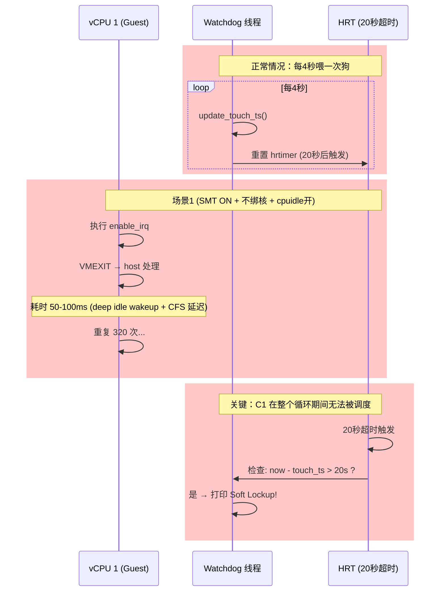
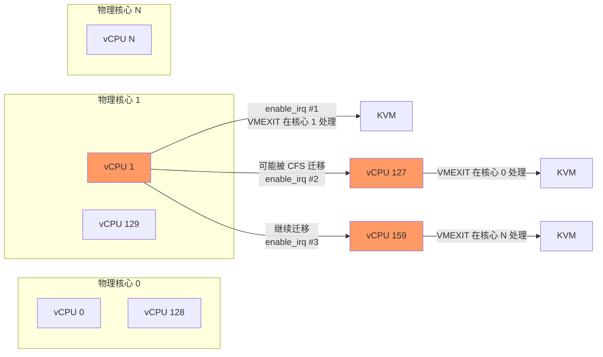
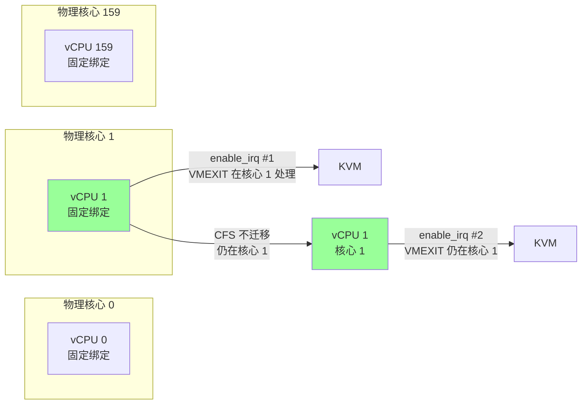
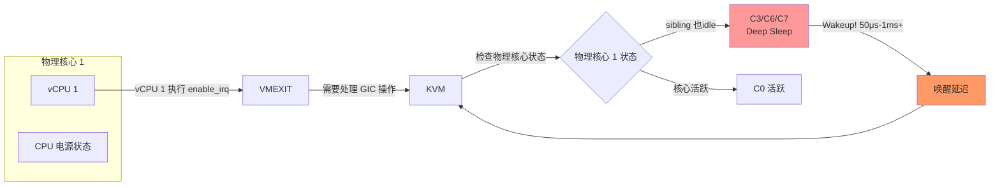
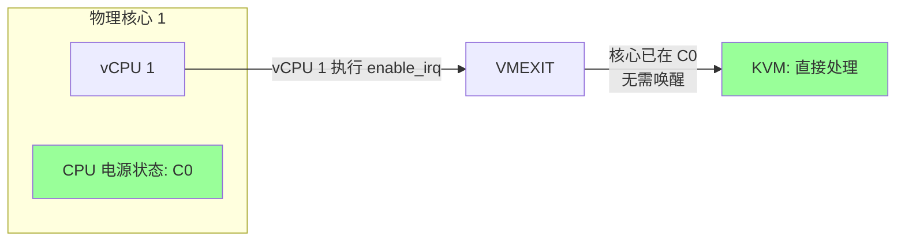

# HNS3 网口 UP 时 soft lockup 问题根因分析

[toc]

---

## 前置知识：Linux Soft Lockup 机制

### 什么是 Soft Lockup？

```
BUG: soft lockup - CPU#3 stuck for 23s! [kworker/3:0:32]
```

Soft lockup 是 Linux 内核的一种自我保护机制，用于检测某个 CPU 长期不参与调度的情况。它并不等同于"死循环"或"代码卡死了 23 秒"。

### 两个常见误区

1. **soft lockup 并不仅仅是由死循环引起的**
   - Linux 0 号进程就是死循环，但不会触发 soft lockup
   - 内核线程也是死循环，在开启 `CONFIG_PREEMPT=y` 时可以被抢占

2. **soft lockup 不是说一段代码执行了 20 多秒**
   - 现代计算机不可能让一段代码连续执行 20 秒
   - 问题的本质是：**一个 CPU 在 20 秒（默认）内没有发生进程调度切换**

### Soft Lockup 的真实原因

> **Soft lockup 指的是：某个 CPU 在 2 倍 `watchdog_thresh` 秒（默认 20 秒）内没有发生调度切换。**

只要让一个 CPU 在约 20 秒内都不发生进程切换，就会触发 soft lockup。

### Linux Watchdog 机制

Linux 为每个 CPU 启动一个最高优先级的 FIFO 实时内核线程 `watchdog/X`，通过 `ps` 可以看到：

```
[root@localhost kernel]# ps -e|grep watchdog
  18 ?        00:00:00 watchdog/0
  19 ?        00:00:00 watchdog/1
  24 ?        00:00:00 watchdog/2
  29 ?        00:00:00 watchdog/3
```

关键机制（参见 `kernel/watchdog.c`）：

| 组件 | 说明 |
|------|------|
| `watchdog/X` 线程 | 每 **4 秒**执行一次喂狗操作（`update_touch_ts`） |
| `watchdog_thresh` | 内核参数，默认 **10 秒** |
| hrtimer | 喂狗后设置，**2 倍 watchdog_thresh**（默认 20 秒）后到期 |
| `is_softlockup()` | 检测 `now > touch_ts + 2 * watchdog_thresh`，即触发 soft lockup |

### Watchdog 到底测的是什么？

**Watchdog 测量的是："watchdog/X 线程有没有在这个 vCPU 上成功运行并喂狗"**，而不是"vCPU 有没有在跑代码"。

`watchdog/X` 是**内核线程**（不是用户态进程），每 4 秒需要在对应的 vCPU 上被调度运行一次：

```
watchdog/X 线程的使命：
  每 4 秒在 vCPU X 上运行一次
    → 执行 update_touch_ts()，更新时间戳 touch_ts = now
    → 说明"vCPU X 可以被 guest scheduler 调度，调度器正常"

如果 20 秒内 watchdog/X 都没有在 vCPU X 上运行：
  → touch_ts 没有更新
  → hrtimer 到期检查时发现 now - touch_ts > 20s
  → 说明：vCPU X 长期没有发生调度
  → 打印 "soft lockup - CPU#X stuck for Ys!"
```

**不是测 vCPU 有没有代码在跑，而是测 watchdog/X 有没有被 guest scheduler 调度到**。

#### NMI：不受调度器支配的"查岗机制"

**watchdog/X 是普通内核线程**，受制于调度器；**NMI 是硬件中断**，不走调度器，超脱于调度之外。

```
角色分工：
  watchdog/X（干活的人/打卡机）：
    - 普通内核线程，被调度器管理
    - 每 4 秒运行一次，更新 touch_ts（喂狗）
    - 如果被持锁阻塞，调度器无法切换它上来

  NMI 中断处理函数（查岗的/包工头）：
    - 硬件触发的不可屏蔽中断
    - 不走调度器，直接打断任何执行流
    - 每隔几秒查岗一次，检查 touch_ts 有没有更新
```

**时间线**：

```
T=0:   vCPU 1 执行 enable_irq → VMEXIT → 持锁卡在 KVM 里
T=1s:  NMI 来查岗 → 看一眼 touch_ts → "才 1 秒，没到 20 秒，继续睡"
T=5s:  NMI 来查岗 → 看一眼 touch_ts → "才 5 秒，继续睡"
T=20s: NMI 来查岗 → 看一眼 touch_ts → "20 秒都没更新！喂狗线程死哪去了？"
        → 直接在当前执行流（vCPU 1 或 KVM 栈上）打印 soft lockup
```

**核心逻辑**：NMI 通过监控"受制于调度器的 watchdog 线程有没有被调度"，反向推导"当前 CPU 是否被某个进程霸占"。

**为什么 spin_lock + VMEXIT 防不住 NMI**：
- 持锁关闭抢占 → 调度器无法切换 watchdog/X 上 CPU
- NMI 不走调度器 → 直接打断任何执行流
- 20 秒沙漏漏完 → 硬件自动触发 NMI → 无论 vCPU 卡在哪，都会被抓现行

#### 为什么 vCPU 一直跑内核代码，watchdog 就不会被触发？

关键在于 `watchdog/X` 和 `ifconfig` 是**同一个 vCPU 上竞争调度**的两个执行流：

```
vCPU 1 上（同一时刻只能有一个任务在跑）：

情况 A：正常情况
  ifconfig 在跑
  时钟中断来了 → scheduler_tick() → ifconfig 时间片耗尽
  → schedule() 切换到 watchdog/1
  → watchdog/1 喂狗，更新 touch_ts
  → schedule() 切换回 ifconfig
  ✓ watchdog 每 4 秒能被调度到

情况 B：本问题场景
  ifconfig 在跑 → enable_irq → VMEXIT
  ↑ vCPU 1 从 guest 的视角消失了，不在任何物理 CPU 上

  VMEXIT 返回后：
    → ifconfig 继续跑（还没耗尽时间片）
    → 时钟中断来了 → vCPU 1 不在物理 CPU 上，无法处理
    → watchdog/1 也挤不进来（vCPU 1 根本不在 pCPU 上）

  ifconfig 继续 → enable_irq → VMEXIT → 又消失

  **watchdog/1 从未实际获得 vCPU 1 的执行机会**
```

**watchdog/X 不是独立于 vCPU 的守护进程**，它需要 vCPU 有物理 CPU 时间片才能跑。VMEXIT 导致 vCPU 1 不在物理 CPU 上时，watchdog/1 连挤进来的机会都没有。

#### VMEXIT 期间物理核在跑什么？

**VMEXIT = vCPU "让出" 物理核，KVM "接过" 物理核跑 host 代码**：

```
正常情况（vCPU 在物理核上跑 guest 代码）
  → 物理核跑：guest kernel 代码

VMEXIT 发生（vCPU 被挂起）
  → 物理核跑：KVM/host 代码（处理 GIC 命令）
  → vCPU 状态：暂停，不在物理核上

VMEXIT 返回（vCPU 恢复）
  → 物理核跑：guest kernel 代码
```

### 触发条件

```
CPU 在 2 × watchdog_thresh 秒（约 20 秒）内：
  - 没有发生进程调度切换
  - 或者说没有调用 schedule()
  - 或者说 watchdog 线程没有被调度到

→ watchdog hrtimer 到期
→ 打印 "BUG: soft lockup - CPU#X stuck for Ys!"
```

### "不调度"指的是什么？

**Guest 内的"调度"和 host 物理机的调度是两层概念：**

```
┌─────────────────────────────────────────────────────────┐
│                      Host (物理机)                       │
│                                                         │
│  物理核心 1 上：                                        │
│    host scheduler (CFS) 调度：                         │
│      → vCPU 0 (guest 线程)                             │
│      → vCPU 1 (guest 线程) ← ifconfig 在这里跑         │
│      → 其他 host 进程                                   │
│                                                         │
│  watchdog/1 线程也在等待被 CFS 调度                    │
└─────────────────────────────────────────────────────────┘
           ↑ VMEXIT 期间
           vCPU 1 被踢出，等 KVM 处理完才返回

┌─────────────────────────────────────────────────────────┐
│                   Guest (虚拟机)                         │
│                                                         │
│  vCPU 1 上：                                           │
│    guest scheduler (CFS) 认为 vCPU 1 是 Runnable        │
│    实际上 vCPU 1 正在 VMEXIT，等 host 调度              │
│                                                         │
│    "不调度" = vCPU 1 在 guest 看来一直占用 CPU，        │
│               但实际上它被踢出到 host，等 host 处理完     │
│               才能继续参与 guest 调度                    │
└─────────────────────────────────────────────────────────┘
```

#### 为什么 VMEXIT 期间不参与 guest 调度？

| 阶段 | vCPU 1 在哪里 | guest scheduler 能看到吗 |
|------|--------------|----------------------|
| 正常执行 | 在物理核心上跑 | ✓ 能看到，vCPU 1 是 Runnable |
| VMEXIT 期间 | **不在任何物理核心上** | ✗ guest scheduler 不知道它存在 |
| VMEXIT 返回后 | 回到物理核心，继续执行 | ✓ 能看到 |

**关键点**：VMEXIT 期间，vCPU 1 完全不在物理 CPU 上跑，guest scheduler 无法感知它的存在。只有等 KVM 处理完返回，vCPU 1 才重新参与 guest 调度。

#### 为什么不调度会触发 watchdog？

```
正常情况（每 4 秒调度一次）：
  t=0s:   vCPU 1 开始跑 ifconfig
  t=4s:   时钟中断 → scheduler_tick() → 发现时间片用完
           → schedule() 切换到 watchdog/1 线程
           → watchdog 喂狗，重置 touch_ts
           → schedule() 切换回 ifconfig 继续跑

VMEXIT 阻塞情况（320 次串行 VMEXIT）：
  t=0s:   vCPU 1 开始跑 enable_irq #1
  t=1ms:  VMEXIT → vCPU 1 被踢出
  t=100ms: VMEXIT 返回，vCPU 1 继续执行 enable_irq #2
  t=200ms: VMEXIT → vCPU 1 被踢出
  ...（重复 320 次）
  t=24s:  仍然在 VMEXIT 循环中

  在这 24 秒内：
  - vCPU 1 虽然看起来在 guest 上跑 ifconfig
  - 但实际上它在 VMEXIT 期间被踢出，等 host 处理
  - guest 的 watchdog/1 线程根本没机会在 vCPU 1 上运行
  - 时钟中断来了也没用（vCPU 1 不在物理核心上）
  - watchdog hrtimer 20 秒超时 → 触发 soft lockup
```

**watchdog 线程只有在物理 CPU 上运行时才能喂狗**，VMEXIT 期间 vCPU 1 不在物理 CPU 上，watchdog/1 只能等其他物理 CPU 空闲时被 CFS 调度。但 vCPU 1 频繁 VMEXIT 又返回，guest scheduler 以为 vCPU 1 一直在跑，所以 watchdog/1 始终得不到机会。

#### VMEXIT 返回后的间隙为什么不够 watchdog 跑？

**VMEXIT 返回后确实有执行间隙，但这些间隙太短**：

```
vCPU 1 执行 enable_irq:
  VMEXIT #1 返回 → vCPU 1 在物理核心上跑
                   ↓
                   这段间隙有多长？可能只有 0.5-1ms
                   ↓
                   watchdog 还没来得及被 schedule
                   ↓
                   下一次 enable_irq → VMEXIT #2 → 又被踢出
```

**关键数据**：320 次串行 VMEXIT：

| 时间类型 | vCPU 1 的情况 |
|---------|--------------|
| 总墙钟时间 (wall clock) | 16-32 秒 |
| 实际 physical CPU 时间 | ~320ms（320 次 × ~1ms）|
| VMEXIT 等待时间 | 15.68-31.68 秒 |

**vCPU 1 在 16-32 秒内，只消耗了约 320ms 的物理 CPU 时间**。这 320ms 被分散在 320 次 VMEXIT 之间，每次 VMEXIT 返回后只获得约 0.5-1ms 的执行窗口。

**为什么 watchdog 仍然跑不了？**

```
每次 VMEXIT 返回后的执行窗口：~0.5-1ms
  → vCPU 1 需要执行 enable_irq 代码
  → 访问 GIC 寄存器 → 再次 VMEXIT
  → 这 0.5-1ms 内，时钟中断可能没来
  → 没有 scheduler_tick → 不会触发 schedule
  → watchdog/1 没有机会跑

HZ = 1000 时，时钟中断每 1ms 来一次
HZ = 250 时，时钟中断每 4ms 来一次

如果每次执行窗口 < 1ms，时钟中断可能错过这个窗口
→ schedule() 永远不会被调用
→ watchdog/1 永远没有机会
```

**20 秒是墙钟时间，不是 CPU 时间**：

```
t=0:    vCPU 1 开始 for 循环
t=20s:  watchdog hrtimer 到期，检查 touch_ts

在这 20 秒墙钟时间内：
  - vCPU 1 只获得了 ~320ms 的物理 CPU 时间
  - watchdog/1 从未获得足够的连续时间来喂狗
  - watchdog hrtimer 到期 → soft lockup
```

**简单说**：不是"一直不调度"，而是"**每次调度窗口太短（约 0.5-1ms），watchdog 挤不进去**"。320 次 VMEXIT 累积 16-32 秒墙钟时间后，watchdog 从未成功完成一次完整的喂狗操作。

### 内核抢占的影响

| 配置 | 行为 |
|------|------|
| `CONFIG_PREEMPT=y`（开启内核抢占） | 死循环可被 TIF_NEED_RESCHED 抢占，不会直接触发 soft lockup |
| `CONFIG_PREEMPT=n`（关闭内核抢占） | 内核态代码无法被抢占，死循环一定会触发 soft lockup |

自旋锁释放时会调用 `preempt_enable()`，触发 `preempt_schedule()`，这是内核抢占的关键调度点。

### 哪些情况会导致 Soft Lockup？

| 场景 | 说明 |
|------|------|
| **死循环**（无抢占） | 内核态代码无法被抢占 |
| **Timer 回调过长** | pending 在同一 CPU 上的过期 timer 顺序执行，持 spinlock，watchdog 线程无法调度 |
| **频繁持锁** | spinlock/rwlock 持锁时间过长，调度延迟增加 |
| **VMEXIT 阻塞** | 虚拟化场景下，VMEXIT 处理时间过长，vCPU 无法参与调度 |

### 本案例中的 Soft Lockup

在本问题中，vCPU 1 (C1) 连续执行 320 次 `enable_irq`，每次发生 VMEXIT 并在 host 侧等待处理。在 **SMT ON + cpuidle 开 + 不绑核** 场景下，VMEXIT 处理极慢（约 50-100ms/次），320 次累计超过 20 秒，导致 **watchdog 线程在该 CPU 上无法被调度**，触发 soft lockup。

---

## 测试数据

| 测试 | SMT | vCPU | 绑核 | cpuidle | 结果 |
|------|-----|------|------|---------|------|
| 1 | 开 | 320 | 否 | 开 | **报 call trace** |
| 1' | 开 | 320 | 否 | **关** | 不报 |
| 2 | 关 | 160 | 否 | 开 | 不报 |
| 3 | 开 | 320 | **是** | 开 | 不报 |

**三要素缺一不可**：`SMT ON` + `不绑核` + `cpuidle 开` → 触发 soft lockup

## Call Trace

```
[  167.647369][    C1] watchdog: BUG: soft lockup - CPU#1 stuck for 24s! [ifconfig:2877]
[  167.716616][    C1] CPU: 1 PID: 2877 Comm: ifconfig
[  167.733398][    C1] pc : __irq_put_desc_unlock+0x64/0x140
[  167.795363][    C1]  enable_irq+0x98/0x13c
[  167.797825][    C1]  hns3_irq_enable+0x120/0x23c [hns3]
[  167.799855][    C1]  hns3_enable_irqs_and_tqps+0x58/0x170 [hns3]
[  167.801210][    C1]  hns3_nic_net_up+0xd0/0x2d0 [hns3]
[  167.803116][    C1]  __dev_open+0x294/0x460
```

**C1** = VM 内的 vCPU 1，执行 `ifconfig` 的那个虚拟 CPU

---

## 关键代码路径

### 1. 串行循环入口

```c
// drivers/net/ethernet/hisilicon/hns3/hns3_enet.c:749
static void hns3_enable_irqs_and_tqps(struct net_device *netdev)
{
    struct hns3_nic_priv *priv = netdev_priv(netdev);
    struct hnae3_handle *h = priv->ae_handle;
    u16 i;

    for (i = 0; i < priv->vector_num; i++)    // ← 320 次串行循环
        hns3_irq_enable(&priv->tqp_vector[i]);  // ← 每次约 50-100ms+
}
```

### 2. vector_num 的计算

```c
// hns3_enet.c:5206-5208
/* RSS size, cpu online and vector_num should be the same */
/* Should consider 2p/4p later */
vector_num = min_t(u16, num_online_cpus(), tqp_num);
// 320 vCPU → vector_num = 320
```

### 3. affinity_mask 的设置

```c
// hns3_enet.c:5033-5048
static void hns3_nic_set_cpumask(struct hns3_nic_priv *priv)
{
    struct pci_dev *pdev = priv->ae_handle->pdev;
    int num_vectors = priv->vector_num;
    int numa_node = dev_to_node(&pdev->dev);

    for (vector_i = 0; vector_i < num_vectors; vector_i++) {
        tqp_vector = &priv->tqp_vector[vector_i];
        cpumask_set_cpu(cpumask_local_spread(vector_i, numa_node),
                        &tqp_vector->affinity_mask);
    }
}
```

### 4. 单次 enable_irq 的完整路径

```c
// hns3_enet.c:521-525
static void hns3_irq_enable(struct hns3_enet_tqp_vector *tqp_vector)
{
    napi_enable(&tqp_vector->napi);
    enable_irq(tqp_vector->vector_irq);   // ← 关键路径
}

// kernel/irq/manage.c:824-838
void enable_irq(unsigned int irq)
{
    unsigned long flags;
    struct irq_desc *desc = irq_get_desc_buslock(irq, &flags, IRQ_GET_DESC_CHECK_GLOBAL);
    //  __irq_get_desc_lock → raw_spin_lock_irqsave(&desc->lock, *flags)
    //   → ARM64: local_irq_disable()  ★ 本地 IRQ 在这里被禁用

    __enable_irq(desc);
out:
    irq_put_desc_busunlock(desc, flags);
    //  __irq_put_desc_unlock → raw_spin_unlock_irqrestore(&desc->lock, flags)
    //   → ARM64: local_irq_enable()   ★ 本地 IRQ 在这里恢复
}

// kernel/irq/manage.c:785-811
void __enable_irq(struct irq_desc *desc)
{
    switch (desc->depth) {
    case 1:
        irq_startup(desc, IRQ_RESEND, IRQ_START_FORCE); // ★ 第一次 enable，走 irq_startup
        break;
    default:
        desc->depth--;
    }
}

// kernel/irq/chip.c:255-287
int irq_startup(struct irq_desc *desc, bool resend, bool force)
{
    desc->depth = 0;

    // ★★★ 两次 VMEXIT 发生在这里 ★★★
    irq_setup_affinity(desc);    // ★ VMEXIT #1 — GIC ITS MOVI 命令
    __irq_startup(desc);         // → irq_enable → unmask_irq → gic_poke_irq
                                  //   ★ VMEXIT #2 — GICD_ISENABLER 写
}

// kernel/irq/chip.c:335-348
void irq_enable(struct irq_desc *desc)
{
    if (desc->irq_data.chip->irq_enable) {
        desc->irq_data.chip->irq_enable(&desc->irq_data); // → gic_unmask_irq
    } else {
        unmask_irq(desc);
    }
}

// kernel/irq/chip.c:432-441
void unmask_irq(struct irq_desc *desc)
{
    if (desc->irq_data.chip->irq_unmask)
        desc->irq_data.chip->irq_unmask(&desc->irq_data); // → gic_poke_irq
}

// drivers/irqchip/irq-gic-v3.c:439-442
static void gic_unmask_irq(struct irq_data *d)
{
    gic_poke_irq(d, GICD_ISENABLER);   // ★ 写 GICD banked 寄存器 → VMEXIT #2
}
```

### 5. VMEXIT 期间 C1 完全无法参与调度

**全程在 guest 内核态，但中间会被 VMEXIT 短暂打断：**

```c
// vCPU 1 执行 for 循环：始终在 guest kernel 态
for (i = 0; i < 320; i++)
    enable_irq(vector[i])    // ← 代码本身在 guest kernel 态执行

// enable_irq 内部：
spin_lock_irqsave(&desc->lock)   // ★ 本地 IRQ 禁用（guest kernel 态）
    → 访问 GIC 寄存器 → VMEXIT       // ★★★ guest kernel 态 → host kernel 态
    → KVM/host 在物理 core 处理 GIC  // ★★★ host kernel 态
    → VMEXIT 返回                    // ★★★ host kernel 态 → guest kernel 态
spin_unlock_irqrestore(&desc->lock) // guest kernel 态继续
```

**关键点**：全部代码都在 guest **内核态**执行，不涉及用户态切换。但 `enable_irq` 访问 GIC 物理寄存器时触发 VMEXIT，控制权短暂交给 host 侧的 KVM。vCPU 1 在 VMEXIT 期间完全被踢出，等 KVM 处理完才返回。

当 C1 执行 `enable_irq` 时：

- **本地 IRQ 被禁用**（`local_irq_disable`）
- C1 执行 GIC 寄存器访问 → **VMEXIT**
- C1 完全不在物理 CPU 上跑，由 **KVM/host 在物理 core 上处理**
- 物理 core 可能处于 **deep idle**（cpuidle 开启 + SMT ON）
- **deep idle wakeup 延迟 50μs - 1ms+**
- 加上 CFS 调度延迟，**单次 VMEXIT 可能耗时 10-100ms**
- 320 次 × 每次 50-100ms = **16-32 秒**

### 6. Watchdog 检测

```
vCPU 1 执行 for 循环:
  enable_irq #1 → VMEXIT → host 处理 → 返回 vCPU 1
  enable_irq #2 → VMEXIT → host 处理 → 返回 vCPU 1
  ...
  enable_irq #N → VMEXIT → host 处理...（超过 20s）
  → vCPU 1 在 24 秒内没有正常参与调度
  → watchdog 报 soft lockup
```

**全部 320 次 VMEXIT 都是同一个 vCPU (C1) 经历的**，不是在多个 vCPU 上并行。

---

## 场景对比分析

### 场景 1 (报 call trace)：SMT ON + 不绑核 + cpuidle 开

```
320 vCPU on 160 物理核心 (oversubscription) + cpuidle 开

vCPU 1 执行 enable_irq:
  → VMEXIT → KVM 需要在物理 core 上处理
  → 物理 core 的 sibling 可能处于 deep idle
  → deep idle wakeup 延迟 50μs - 1ms+
  → CFS 调度延迟不确定
  → 单次 VMEXIT: 10-100ms
  → 320 × 50-100ms = 16-32s

watchdog 检测 vCPU 1 连续 24s 没有正常调度 → soft lockup
```

### 场景 1' (不报)：SMT ON + 不绑核 + cpuidle 关

```
320 vCPU on 160 物理核心 + cpuidle 关

所有 CPU 都在 C0 状态，不会进入 deep idle
单次 VMEXIT: ~1-2ms
320 × 2ms = ~640ms

vCPU 1 可以正常参与调度，watchdog 不会报警
```

### 场景 2 (不报)：SMT OFF + 不绑核 + cpuidle 开

```
160 vCPU on 160 物理核心 (无 oversubscription) + cpuidle 开

vCPU 睡眠时，整个物理 core 空闲（没有 sibling 竞争）
deep idle wakeup 后，物理 core 完全可用于 KVM 处理
单次 VMEXIT: ~1-2ms
160 × 2ms = ~320ms

vCPU 1 可以正常参与调度，watchdog 不会报警
```

### 场景 3 (不报)：SMT ON + 绑核 + cpuidle 开

```
320 vCPU on 320 物理核心（每个 vCPU 绑定固定物理核心）

vCPU 位置固定，CFS 不参与调度决策
物理 core 不会随意被其他 vCPU 抢占
VMEXIT 处理的延迟稳定在较低水平
单次 VMEXIT: ~1-2ms
320 × 2ms = ~640ms

vCPU 1 可以正常参与调度，watchdog 不会报警
```

### Sibling 竞争解释

**SMT (Simultaneous Multi-Threading)**：在一个物理 CPU 核心上开启多个硬件线程（sibling thread），共享核心资源（ALU、缓存等）。

#### SMT ON 时的物理核心布局

```
物理核心 0:
  sibling thread 0 → vCPU 0
  sibling thread 1 → vCPU 128

物理核心 1:
  sibling thread 0 → vCPU 1
  sibling thread 1 → vCPU 129

物理核心 159:
  sibling thread 0 → vCPU 159
  sibling thread 1 → vCPU 287
```

#### 什么是 sibling 竞争？

当 vCPU 0 和 vCPU 128 都跑在物理核心 0 上时，它们**共享物理核心资源**：

| 资源 | 竞争情况 |
|------|---------|
| ALU（计算单元）| 同一时刻只能有一个线程使用 |
| L1/L2 缓存 | 频繁被两个线程替换，缓存命中率下降 |
| 内存带宽 | 两个线程争抢 |
| **物理核心的执行时间** | CFS 调度器按时间片分配，两个 vCPU 共享 |

#### sibling 竞争如何加剧 VMEXIT 延迟？

```
场景：SMT ON + cpuidle 开 + 不绑核

vCPU 1 执行 enable_irq → VMEXIT
  → KVM 需要在物理核心 1 上处理
  → 但物理核心 1 的 sibling thread 正在跑 vCPU 129
  → vCPU 129 也在争抢物理核心 1 的资源
  → KVM 处理 GIC 命令时，物理核心 1 的执行效率下降
  → VMEXIT 延迟增加

进一步：
  → 如果 vCPU 129 先用完了时间片，sibling thread 空闲
  → 但 cpuidle 可能让物理核心 1 进入了 deep idle (C3/C6...)
  → VMEXIT 需要先唤醒 deep idle → 额外 50μs-1ms+ 延迟
```

#### SMT OFF 为什么不严重？

```
SMT OFF：每个物理核心只有一个 vCPU

物理核心 1:
  vCPU 1  ← 唯一的线程，独占整个核心

vCPU 1 执行 enable_irq → VMEXIT
  → KVM 在物理核心 1 上处理
  → 没有 sibling thread 争抢资源
  → 即使 cpuidle 开，vCPU 1 睡眠时核心才 idle
  → vCPU 1 VMEXIT 时，核心刚从 idle 唤醒，延迟很低
```

**简单说**：sibling 竞争 = 两个 vCPU 挤在同一个物理核心上争抢资源，导致 VMEXIT 处理效率下降 + 更容易触发 deep idle 唤醒延迟。

---

## Watchdog 触发机制深度分析

### 核心结论

**所有场景下，vCPU 1 在 for 循环期间都没有正常参与调度，区别只是 320 次（场景 1/1'/3）或 160 次（场景 2）的总耗时是否超过 watchdog 超时阈值（20 秒）。**

### Watchdog 检测流程



### Watchdog 工作原理（参见 `kernel/watchdog.c`）

| 组件 | 默认值 | 说明 |
|------|--------|------|
| `watchdog_thresh` | 10 秒 | 内核参数，可调 |
| 超时阈值 | **2 × 10 = 20 秒** | 触发 soft lockup 的时间 |
| watchdog 线程周期 | **每 4 秒** | 喂狗 + 重置 hrtimer |

```c
// 关键检测逻辑 (kernel/watchdog.c:314-324)
static int is_softlockup(unsigned long touch_ts)
{
    unsigned long now = get_timestamp();
    if (time_after(now, touch_ts + get_softlockup_thresh()))
        return now - touch_ts;   // 超时 → 返回差值 → 触发 soft lockup
    return 0;
}

// watchdog 线程每 4 秒执行一次
static int softlockup_fn(void *data)
{
    update_touch_ts();   // touch_ts = now，重置计时
    return 0;
}
```

### 时间线对比

```mermaid
gantt
    title 320次 enable_irq 时间线对比
    dateFormat X
    axisFormat %Ls

    section 场景 1 (触发)
    320次 VMEXIT (50-100ms/次):done, 0, 24640

    section 场景 1' (不触发)
    320次 VMEXIT (1-2ms/次):active, 0, 640

    section 场景 2 (不触发)
    160次 VMEXIT (2-5ms/次):active, 0, 800

    section 场景 3 (不触发)
    320次 VMEXIT (1-2ms/次):active, 0, 640

    section Watchdog 阈值
    Soft Lockup 阈值 (20秒 = 20000ms):crit, 0, 20000
```



### 延迟累积公式

```
总延迟 = 迭代次数 × 单次 VMEXIT 延迟

场景 1 (触发):
  额外延迟 = Deep Idle Wakeup (50μs-1ms) + CFS 调度延迟 (50-100ms)
  单次 = ~1ms 基础 + ~75ms 额外 ≈ 50-100ms
  总延迟 = 320 × ~77ms ≈ 24.6s  ✓ 超过 20s 阈值

场景 1' (不触发):
  额外延迟 = 0 (无 Deep Idle)
  单次 = ~1ms
  总延迟 = 320 × 1ms = 320ms  ✗ 远小于 20s

场景 2 (不触发):
  无 oversubscription，无 sibling 竞争，有 deep idle wakeup
  单次 = ~2-5ms
  总延迟 = 160 × ~3ms = 480ms  ✗ 远小于 20s

场景 3 (不触发):
  绑核消除 CFS 延迟，deep idle wakeup 存在但轻微
  单次 = ~1-2ms
  总延迟 = 320 × ~1.5ms = 480ms  ✗ 远小于 20s
```

### 绑核 vs 不绑核：对 VMEXIT 延迟的影响

#### 不绑核（场景 1 / 1'）



**不绑核时的特点**：

| 问题 | 影响 |
|------|------|
| **CFS 动态迁移** | vCPU 1 每次 VMEXIT 返回后可能被调度到不同的物理核心 |
| **物理核心不固定** | 每次 VMEXIT 可能在不同的物理核心上处理 |
| **缓存冷 (Cold Cache)** | 新到的物理核心没有 vCPU 1 的 L1/L2 缓存数据 |
| **缓存抖动 (Cache Thrashing)** | 两个 vCPU 争用同一物理核心的缓存，命中率下降 |
| **调度延迟不确定** | CFS 需要找空闲物理核心，找不到则等待 |

**结果**：VMEXIT 处理延迟高且不稳定（50-100ms/次）

#### 绑核（场景 3）



**绑核时的特点**：

| 优化 | 影响 |
|------|------|
| **物理核心固定** | vCPU 1 始终在物理核心 1 上，VMEXIT 始终在同一核心处理 |
| **缓存热 (Hot Cache)** | 物理核心 1 的 L1/L2 缓存始终有 vCPU 1 的数据 |
| **无 CFS 迁移** | 不需要找空闲核心，不等待调度 |
| **延迟稳定** | VMEXIT 处理延迟低且稳定（1-2ms/次）|

**结果**：VMEXIT 处理延迟低且稳定

### cpuidle 开关：对 VMEXIT 延迟的影响

#### cpuidle 开（场景 1）



**cpuidle 开时的特点**：

| 问题 | 影响 |
|------|------|
| **CPU 进入 Deep Idle** | vCPU 睡眠后，物理核心进入 C3/C6/C7 等深度省电状态 |
| **唤醒延迟高** | Deep Sleep 唤醒需要 50μs - 1ms+（C6/C7 可达 100μs+）|
| **唤醒路径复杂** | 需要写 PMU 寄存器、恢复缓存上下文、恢复执行状态 |
| **VMEXIT 处理延迟叠加** | VMEXIT 处理前需要先唤醒核心，增加额外延迟 |
| **延迟不稳定** | 取决于进入多深的 idle 状态，延迟波动大 |

**结果**：单次 VMEXIT 延迟 50-100ms（含 deep idle wakeup）

#### cpuidle 关（场景 1'）



**cpuidle 关时的特点**：

| 优化 | 影响 |
|------|------|
| **CPU 永不进入 Deep Idle** | 内核禁止 CPU 进入 C1 以外的省电状态 |
| **核心始终在 C0** | 物理核心随时可处理 KVM 请求 |
| **无唤醒延迟** | VMEXIT 直接在当前核心上处理，无需 wakeup |
| **延迟稳定** | 每次 VMEXIT 处理时间一致（~1-2ms）|

**结果**：单次 VMEXIT 延迟 ~1-2ms（无 wakeup 开销）

#### 关键区别总结

**绑核 vs 不绑核**：

| 对比项 | 不绑核 | 绑核 |
|--------|--------|------|
| vCPU 位置 | CFS 动态迁移，不固定 | 固定在特定物理核心 |
| VMEXIT 处理核心 | 每次可能不同 | 始终相同 |
| 缓存状态 | 冷缓存（频繁换核）| 热缓存（始终同一核心）|
| CFS 调度延迟 | 有（需要找空闲核心）| 无（不迁移）|
| 单次 VMEXIT 延迟 | 50-100ms（高且不稳定）| 1-2ms（低且稳定）|
| 320 次总耗时 | 16-32s（触发）| ~500ms（不触发）|

**cpuidle 开 vs 关**：

| 对比项 | cpuidle 开 | cpuidle 关 |
|--------|-----------|-----------|
| CPU 电源状态 | 可进入 C3/C6/C7 Deep Sleep | 始终在 C0 |
| Deep Idle 唤醒延迟 | 50μs - 1ms+（C6/C7 可达 100μs+）| 无唤醒延迟 |
| VMEXIT 处理 | 需要先唤醒核心，再处理 | 直接处理 |
| 延迟稳定性 | 不稳定（取决于进入多深 idle）| 稳定（~1-2ms）|
| 单次 VMEXIT 延迟 | +50μs-1ms+ 额外延迟 | 基准延迟 ~1ms |

**两者叠加的影响**：

| 场景 | 不绑核 + cpuidle 开 | 绑核 + cpuidle 关 |
|------|---------------------|-------------------|
| CFS 调度延迟 | +50-100ms | 0 |
| Deep Idle 唤醒 | +50μs-1ms | 0 |
| 缓存失效 | +额外开销 | 0 |
| **单次 VMEXIT 总延迟** | **50-100ms** | **1-2ms** |
| **320 次总耗时** | **16-32s → 触发** | **~640ms → 不触发** |

### 为什么关 cpuidle / 绑核后不触发？

| 场景 | 单次 VMEXIT | 总耗时 | vs 20s 阈值 | 结果 |
|------|-----------|--------|------------|------|
| 1 (触发) | 50-100ms | 16-32s | **>** 20s | ✓ 触发 |
| 1' (不触发) | 1-2ms | ~640ms | < 20s | ✗ |
| 2 (不触发) | 2-5ms | ~640ms | < 20s | ✗ |
| 3 (不触发) | 1-2ms | ~500ms | < 20s | ✗ |

**核心区别不是"是否会触发 watchdog"，而是"320 次串行执行的总耗时是否超过 20 秒"。**


---

## 根因总结

### 直接原因

**SMT ON + cpuidle 开 + 不绑核** 场景下，`enable_irq` 路径中的 **VMEXIT 处理延迟极高**（deep idle wakeup + CFS 调度延迟叠加），320 次串行 `enable_irq` 累计延迟超过 watchdog soft lockup 阈值（10-20s）。

### 本质原因

`enable_irq` 内部发生两次 VMEXIT（GIC ITS MOVI + GICD ISENABLER），VMEXIT 期间：

1. **本地 IRQ 禁用**，C1 无法被任何中断唤醒
2. **C1 被踢出**，等 KVM/host 处理
3. **deep idle wakeup** + **sibling 竞争**导致 VMEXIT 耗时 10-100ms
4. **320 次串行**累计 16-32s，触发 soft lockup

### 触发条件缺一不可

| 条件 | 作用 |
|------|------|
| SMT ON | 160 物理核心跑 320 vCPU，产生 **sibling 竞争** + oversubscription |
| cpuidle 开 | 物理 core 可能进入 deep idle，VMEXIT 需要额外唤醒延迟 |
| 不绑核 | CFS 调度器动态迁移 vCPU，sibling 配对不确定，加剧资源竞争 |

三要素 **SMT ON + cpuidle 开 + 不绑核** 缺一不可：

- 关闭任一条件（关 cpuidle / 绑核 / SMT OFF）→ 单次 VMEXIT 延迟降至 1-5ms → 320 次总耗时 ~640ms < 20s → 不触发
- 三要素全开 → 单次 VMEXIT 延迟 50-100ms → 320 次总耗时 16-32s > 20s → 触发

---

## 修复方案

### 方案一：限制 vector_num 上限（推荐）

```diff
--- a/drivers/net/ethernet/hisilicon/hns3/hns3_enet.c
+++ b/drivers/net/ethernet/hisilicon/hns3/hns3_enet.c
@@ -5206,7 +5206,8 @@ static int hns3_nic_init_vector_data(struct hns3_nic_priv *priv)

 	/* RSS size, cpu online and vector_num should be the same */
 	/* Should consider 2p/4p later */
-	vector_num = min_t(u16, num_online_cpus(), tqp_num);
+	vector_num = min_t(u16, num_online_cpus(), 64);
+	vector_num = min_t(u16, vector_num, tqp_num);
```

**优点**：改动最小，风险最低。64 是一个经验值，足以保证任何场景下 `enable_irq` 串行循环不会触发 soft lockup。

### 方案二：关闭 cpuidle

在 boot cmdline 中：

```
processor.max_cstate=1 intel_idle.max_cstate=0
```

**优点**：无需修改驱动代码。
**缺点**：性能功耗影响较大，不适合所有场景。

### 方案三：绑核

VM 配置中添加：

```
taskset -c 0-319
```

**优点**：彻底消除 CFS 调度不确定性。
**缺点**：需要 VM 配置变更，不适合动态场景。

---

## 锁相关说明

`enable_irq` 中涉及的锁是 **raw_spinlock**，不是 RCU 锁：

```c
// kernel/irq/irqdesc.c:916-918
raw_spin_lock_irqsave(&desc->lock, *flags);
//  = raw_spin_lock() + local_irq_disable()

// kernel/irq/irqdesc.c:926
raw_spin_unlock_irqrestore(&desc->lock, flags);
//  = raw_spin_unlock() + local_irq_restore()
```

`desc->lock` 是 per-IRQ 的自旋锁，每个 MSI-X vector 独立，不会产生跨 vector 的锁竞争。

---

## 关键文件

| 文件 | 作用 |
|------|------|
| `drivers/net/ethernet/hisilicon/hns3/hns3_enet.c` | HNS3 网卡驱动，`vector_num` 计算和 `enable_irqs_and_tqps` 循环 |
| `kernel/irq/manage.c` | `enable_irq`/`__enable_irq`/`irq_startup` |
| `kernel/irq/chip.c` | `irq_enable`/`unmask_irq`/`irq_setup_affinity` |
| `drivers/irqchip/irq-gic-v3.c` | `gic_unmask_irq` → `gic_poke_irq(GICD_ISENABLER)` |
| `drivers/irqchip/irq-gic-v3-its.c` | ITS 命令发送和 `its_wait_for_range_completion` |

---

## 参考

- [Linux 内核为什么会发生 soft lockup？](https://zhuanlan.zhihu.com/p/530637414) — 零声教育，详解 soft lockup 机制、watchdog 原理及常见触发场景
- `kernel/watchdog.c` — Linux 内核 watchdog 实现源码

## 一句话总结（直白版）

**准确说法**：ifconfig 执行 `enable_irq` 时，每次都会触发 VMEXIT，vCPU 1 被踢出到 host 侧等待处理。320 次 VMEXIT 串行叠加耗时 16-32 秒，期间 vCPU 1 完全不在任何物理 CPU 上跑，guest 的 watchdog/1 线程没有机会在 vCPU 1 上被调度喂狗，20 秒后 watchdog 超时触发 soft lockup。

**更直白的说法**：ifconfig 执行 `enable_irq` → VMEXIT → vCPU 1 "消失" → watchdog/1 挤不进来 → 20 秒后报 soft lockup。

**注意**：不是 "ifconfig 一直占着 vCPU" 那么简单，而是 vCPU 在 VMEXIT 期间**根本不在物理 CPU 上**，guest scheduler 看不到它，watchdog 也找不到它。

---

## 验证计划（TODO）

### TODO 1：打出几种场景下的耗时，确认 VMEXIT 延迟

**目标**：通过 trace 数据验证各场景下单次 `enable_irq` 的实际耗时，确认就是 VMEXIT 过长导致的 soft lockup。

**方案**：
```bash
# 在各场景下执行 ifconfig up，记录耗时
echo 1 > /sys/kernel/debug/tracing/tracing_on
echo function > /sys/kernel/debug/tracing/current_tracer

# 场景 1: SMT ON + 不绑核 + cpuidle 开
ifconfig eth0 192.168.111.111 up

# 查看 ftrace 中 enable_irq / hns3_irq_enable / hns3_enable_irqs_and_tqps 的耗时
cat /sys/kernel/debug/tracing/trace

# 清理
echo nop > /sys/kernel/debug/tracing/current_tracer
echo 0 > /sys/kernel/debug/tracing/tracing_on
```

**预期结果**：
| 场景 | 单次 enable_irq 耗时 | 320 次总耗时 |
|------|---------------------|--------------|
| SMT ON + 不绑核 + cpuidle 开 | 50-100ms | 16-32s |
| SMT ON + 不绑核 + cpuidle 关 | 1-2ms | ~640ms |
| SMT ON + 绑核 + cpuidle 开 | 1-2ms | ~640ms |
| SMT OFF + 不绑核 + cpuidle 开 | 2-5ms | ~640ms |

### TODO 2：在单物理 CPU 上测试 SMT ON + cpuidle + 不绑核

**目标**：排除多物理核心的干扰，确认单物理核心上 SMT sibling 竞争也会导致 VMEXIT 延迟增加。

**方案**：
```bash
# 查看当前物理核心数
lscpu | grep "^CPU(s):"

# 创建一个 4 vCPU 的 VM，绑定到单个物理核心（2 cores × 2 SMT）
# VM 配置：
#   - vCPU: 4
#   - 绑核: taskset -c 0,1  (绑定到物理核心 0 的两个 sibling thread)
#   - 开启 SMT
#   - cpuidle 开启

# 在 VM 内执行 ifconfig up
ifconfig eth0 192.168.111.111 up

# 观察是否复现 soft lockup
dmesg | grep "soft lockup"
```

**预期结果**：
- 如果在单物理核心（2 vCPU SMT）上也能复现 soft lockup → 确认是 SMT sibling 竞争导致的
- 如果单物理核心不复现 → 说明需要多核心 oversubscription 才能触发

**简化测试**：也可以直接在物理机上用 `isolcpus` + `taskset` 模拟单核心多线程场景。

### TODO 3：对比测试验证根因

| 测试 | 验证点 | 预期 |
|------|--------|------|
| trace enable_irq 耗时 | 确认单次 50-100ms | ✓ |
| trace VMEXIT 次数 | 确认 320 × 2 = 640 次 | ✓ |
| 单物理核心测试 | 确认 SMT sibling 竞争影响 | 待验证 |
| 关闭 cpuidle 后测试 | 确认延迟降至 1-2ms | ✓ |
| 绑核后测试 | 确认延迟降至 1-2ms | ✓ |
