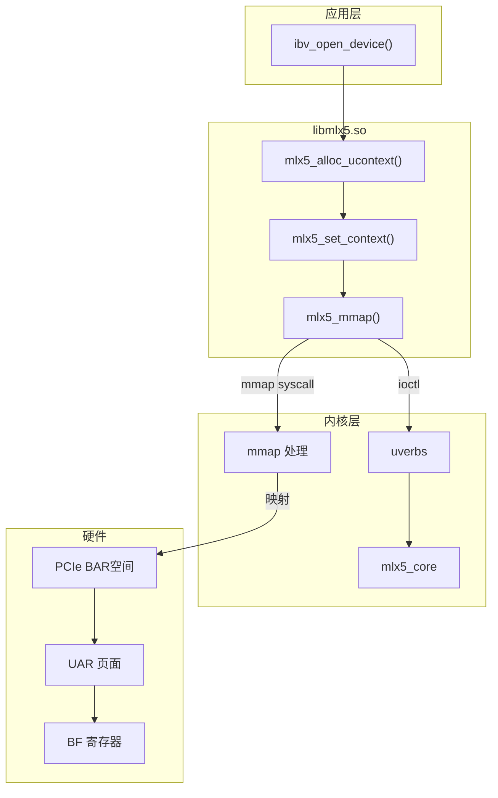
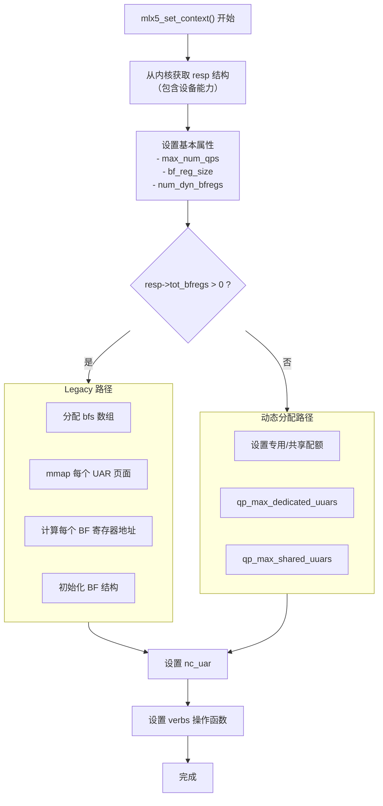
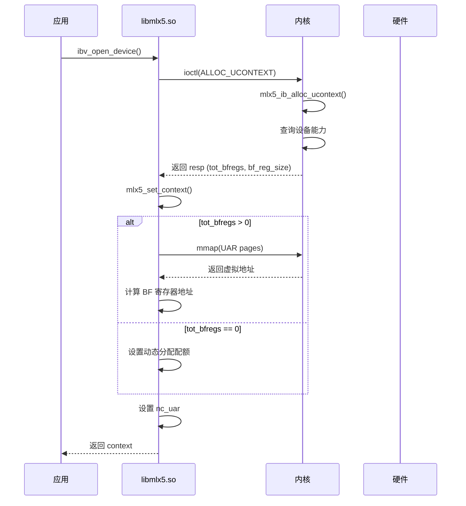
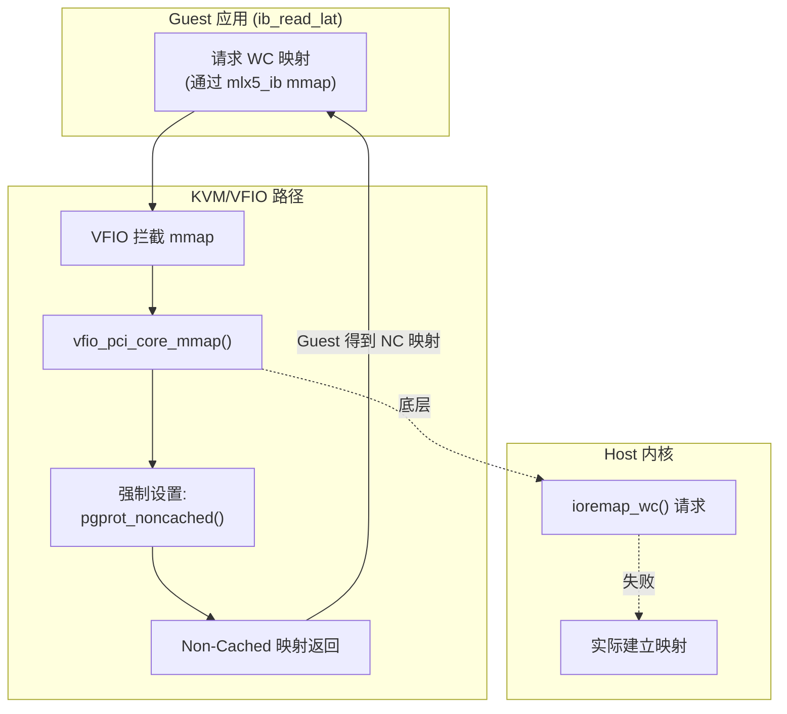

# 原理分析
Host 侧 mmap 路径
```c
// mlx5.c 第 2531-2532 行
if (mlx5_mmap(&context->uar[i], i, cmd_fd, page_size,
              context->shut_up_bf ? MLX5_UAR_TYPE_NC :
              MLX5_UAR_TYPE_REGULAR) == MAP_FAILED)
```

```
┌─────────────┬──────────────────────┬──────────────────────┬──────────────────┐
│ shut_up_bf  │       UAR 类型       │      mmap 命令       │     页表属性     │
│    值       │                      │                      │                  │
├─────────────┼──────────────────────┼──────────────────────┼──────────────────┤
│ 0 (默认)    │ MLX5_UAR_TYPE_REGULAR│ MLX5_IB_MMAP_ALLOC_WC│ NORMAL-NC        │
├─────────────┼──────────────────────┼──────────────────────┼──────────────────┤
│ 1           │ MLX5_UAR_TYPE_NC     │ MLX5_IB_MMAP_NC_PAGE │ DEVICE_nGnRnE    │
└─────────────┴──────────────────────┴──────────────────────┴──────────────────┘
```

内核侧处理
```c
// mlx5/main.c 第 2213-2219 行
switch (cmd) {
case MLX5_IB_MMAP_WC_PAGE:
case MLX5_IB_MMAP_ALLOC_WC:         // ← WC 路径
case MLX5_IB_MMAP_REGULAR_PAGE:
    prot = pgprot_writecombine(vma->vm_page_prot);  // → NORMAL-NC
    break;
case MLX5_IB_MMAP_NC_PAGE:          // ← NC 路径
    prot = pgprot_noncached(vma->vm_page_prot);      // → DEVICE_nGnRnE
    break;
}
```
对比结果

```
┌─────────┬──────────────┬─────────────────┐
│  环境   │  shut_up_bf  │      属性       │
├─────────┼──────────────┼─────────────────┤
│  Host   │   0 (默认)   │   NORMAL-NC     │
├─────────┼──────────────┼─────────────────┤
│ Guest   │    可能为 1  │ DEVICE_nGnRnE   │
└─────────┴──────────────┴─────────────────┘
```

验证
```shell
# 在 Host 上运行测试前：

# 检查环境变量
echo $MLX5_SHUT_UP_BF  # 如果没输出就是 unset，默认是 0

# 或者直接看 /proc 环境
cat /proc/$(pgrep -f ib_read_lat)/environ | tr '\0' '\n' | grep MLX5
```

如果 Host 上也是 DEVICE_nGnRnE，说明 Host 的 shut_up_bf 也是 1。

# host vs guest 的路径猜测

❯ 还需要分析一下在当前测试结果为前提下，host和guest分别是怎么配的？二者的完整流程

## 测试结果

| 环境 | 页表属性 | AttrIdx |
|------|----------|---------|
| Host | MEM/NORMAL-NC | NORMAL-NC |
| Guest | DEVICE/nGnRnE | DEVICE_nGnRnE |

---

## Host 侧完整流程（得到 NORMAL-NC）

### 1. 用户态选择 UAR 类型

文件: `providers/mlx5/mlx5.c`

```c
// 第 2506 行
context->shut_up_bf = get_shut_up_bf();  // 返回 0 (默认)

// 第 2531 行
if (mlx5_mmap(&context->uar[i], i, cmd_fd, page_size,
              context->shut_up_bf ? MLX5_UAR_TYPE_NC :  // 0 ? false
              MLX5_UAR_TYPE_REGULAR) == MAP_FAILED)      // ← 走这里
结果: MLX5_UAR_TYPE_REGULAR

### 2. 用户态选择 mmap 命令

```c
// 第 2208 行
offset = get_uar_mmap_offset(index, page_size,
    (uar_type == MLX5_UAR_TYPE_REGULAR_DYN) ? MLX5_IB_MMAP_ALLOC_WC :
    MLX5_MMAP_GET_REGULAR_PAGES_CMD);  // ← 走这里
```

```
mmap 命令: MLX5_MMAP_GET_REGULAR_PAGES_CMD = 0
```

### 3. 内核决定页表属性

文件: `drivers/infiniband/hw/mlx5/main.c`

```c
alloc_uar_entry(..., enum mlx5_ib_uapi_uar_alloc_type alloc_type)             
{                                                                             
    ...                                                                       
    if (alloc_type == MLX5_IB_UAPI_UAR_ALLOC_TYPE_BF)
        entry->mmap_flag = MLX5_IB_MMAP_TYPE_UAR_WC;    // flag = 3: MEM/NORMAL-NC
    else                                                                      
        entry->mmap_flag = MLX5_IB_MMAP_TYPE_UAR_NC;   // flag = 4: DEVICE/nGnRnE
    ...                                                                       
}  

// 第 2213 行
switch (cmd) {
case MLX5_IB_MMAP_WC_PAGE:
case MLX5_IB_MMAP_ALLOC_WC:
case MLX5_IB_MMAP_REGULAR_PAGE:         // ← cmd=0 匹配这个
    prot = pgprot_writecombine(vma->vm_page_prot);  // → NORMAL-NC
    break;
case MLX5_IB_MMAP_NC_PAGE:
    prot = pgprot_noncached(vma->vm_page_prot);     // → DEVICE_nGnRnE
    break;
}
```

```
页表属性: pgprot_writecombine() → MT_NORMAL_NC
```

### Host 流程总结

```
shut_up_bf = 0 (默认)
      ↓
MLX5_UAR_TYPE_REGULAR
      ↓
MLX5_MMAP_GET_REGULAR_PAGES_CMD (cmd=0)
      ↓
pgprot_writecombine()
      ↓
MT_NORMAL_NC → MEM/NORMAL-NC ✓
```

## Guest 侧完整流程（得到 DEVICE_nGnRnE）

### 1. 用户态选择 UAR 类型

```c
context->shut_up_bf = get_shut_up_bf();  // 返回 1 (可能)
```

可能原因:

- Guest 里有 `MLX5_SHUT_UP_BF=1` 环境变量
- 或者 Guest 的 `get_shut_up_bf()` 返回 1

```c
if (mlx5_mmap(&context->uar[i], ..., MLX5_UAR_TYPE_NC))  // ← 走这里
```

### 2. 用户态选择 mmap 命令

```c
// 第 2194 行
if (uar_type == MLX5_UAR_TYPE_NC) {
    offset = get_uar_mmap_offset(index, page_size,
                     MLX5_MMAP_GET_NC_PAGES_CMD);  // ← cmd=3
}
```

```
mmap 命令: MLX5_MMAP_GET_NC_PAGES_CMD = 3
```

### 3. 内核决定页表属性

```c
switch (cmd) {
case MLX5_IB_MMAP_NC_PAGE:    // ← cmd=3 或 NC 类型会走这里
    prot = pgprot_noncached(vma->vm_page_prot);  // → DEVICE_nGnRnE
}
```

```
页表属性: pgprot_noncached() → MT_DEVICE_nGnRnE
```

### Guest 流程总结

```
shut_up_bf = 1 (或 MLX5_SHUT_UP_BF=1)
      ↓
MLX5_UAR_TYPE_NC
      ↓
MLX5_MMAP_GET_NC_PAGES_CMD (cmd=3)
      ↓
pgprot_noncached()
      ↓
MT_DEVICE_nGnRnE → DEVICE/nGnRnE ✓
```

## 对比总结

| 步骤 | Host | Guest |
|------|------|-------|
| shut_up_bf | 0 (默认) | 1 |
| UAR 类型 | REGULAR | NC |
| mmap 命令 | GET_REGULAR_PAGES_CMD (0) | GET_NC_PAGES_CMD (3) |
| 内核页表属性 | pgprot_writecombine() | pgprot_noncached() |
| AttrIdx | NORMAL-NC | DEVICE_nGnRnE |
| 写合并 | ✓ 允许 | ✗ 禁止 |

## 验证方法

在 Guest 里检查：

```bash
# 方法1: 看环境变量
echo $MLX5_SHUT_UP_BF

# 方法2: 在 rdma-core 代码里加打印
# mlx5.c 第 2531 行之前加:
printf("shut_up_bf = %d\n", context->shut_up_bf);
printf("uar_type = %s\n", context->shut_up_bf ? "NC" : "REGULAR");
```


# 路径自验证

一般 SMMU 设备的操作流程是这样的：

```
  CPU写命令到内存队列
          │                                                                     
          ▼
  写Doorbell寄存器 -- 此时还是 mmu 操作(通知SMMU)                                                   
          │       
          ▼
  SMMU读取命令
          │                                                                     
          ▼
  SMMU执行命令 (如TLB invalidate)                                               
          │       
          ▼
  写回Sync响应 (如果需要)
```

## 用户态

在用户态mlx5中`./rdma-core/providers/mlx5/mlx5.c`，是通过`env = getenv("MLX5_SHUT_UP_BF");`环境变量来确定使用什么类型属性。

```c
static int get_shut_up_bf(void)
{
    //...
    env = getenv("MLX5_SHUT_UP_BF");
    //...
}

static int mlx5_set_context(struct mlx5_context *context,
			    struct mlx5_ib_alloc_ucontext_resp *resp,
			    bool is_import)
{
    //...
        context->shut_up_bf = get_shut_up_bf();
		if (mlx5_mmap(&context->uar[i], i, cmd_fd, page_size,
			      context->shut_up_bf ? MLX5_UAR_TYPE_NC :
			      MLX5_UAR_TYPE_REGULAR) == MAP_FAILED) {
			context->uar[i].reg = NULL;
    //...
}

void *mlx5_mmap(struct mlx5_uar_info *uar, int index, int cmd_fd, int page_size,
		int uar_type)
{
	off_t offset;

	if (uar_type == MLX5_UAR_TYPE_NC) {
		offset = get_uar_mmap_offset(index, page_size,
					     MLX5_MMAP_GET_NC_PAGES_CMD);
		uar->reg = mmap(NULL, page_size, PROT_WRITE, MAP_SHARED,
				       cmd_fd, offset); //这里就会通过系统调用，把属性配下去，offset 编码了 mmap 命令
		if (uar->reg != MAP_FAILED) {
			uar->type = MLX5_UAR_TYPE_NC;
			goto out;
		}
	}

	/* Backward compatibility for legacy kernels that don't support
	 * MLX5_MMAP_GET_NC_PAGES_CMD mmap command.
	 */
	offset = get_uar_mmap_offset(index, page_size,
				     (uar_type == MLX5_UAR_TYPE_REGULAR_DYN) ?
				     MLX5_IB_MMAP_ALLOC_WC :
				     MLX5_MMAP_GET_REGULAR_PAGES_CMD);
	uar->reg = mmap(NULL, page_size, PROT_WRITE, MAP_SHARED,
			cmd_fd, offset); //这里就会通过系统调用，把属性配下去，offset 编码了 mmap 命令
	if (uar->reg != MAP_FAILED)
		uar->type = MLX5_UAR_TYPE_REGULAR;

out:
	return uar->reg;
}
```

```
  ┌────────┬─────────┬───────────────────────┬────────────────┬───────────┐     
  │ shut_u │  UAR    │       mmap 命令       │    内核处理    │ 页表属性  │ 
  │  p_bf  │  类型   │                       │                │           │     
  ├────────┼─────────┼───────────────────────┼────────────────┼───────────┤ 
  │ 0      │ REGULAR │ MLX5_MMAP_GET_REGULAR │ pgprot_writeco │ NORMAL-NC │ 
  │        │         │ _PAGES_CMD (0)        │ mbine()        │           │     
  ├────────┼─────────┼───────────────────────┼────────────────┼───────────┤ 
  │ 0      │ REGULAR │ MLX5_IB_MMAP_ALLOC_WC │ pgprot_writeco │ NORMAL-NC │     
  │        │ _DYN    │  (6)                  │ mbine()        │           │     
  ├────────┼─────────┼───────────────────────┼────────────────┼───────────┤ 
  │ 1      │ NC      │ MLX5_MMAP_GET_NC_PAGE │ pgprot_noncach │ DEVICE_nG │     
  │        │         │ S_CMD (3)             │ ed()           │ nRnE      │     
  └────────┴─────────┴───────────────────────┴────────────────┴───────────┘
```

NC 延迟最低，但 REGULAR 在多数实际工作负载中因缓存收益往往更好。环境变量 MLX5_SHUT_UP_BF 主要用于特定调试或低延迟优化场景。

## 内核态-stage1

上面是用户态下发 cmd 的流程，接着 mmap 系统调用后就会到内核态进行处理，内核态代码可以看 mlx5 驱动代码`./openeuler/kernel/drivers/infiniband/hw/mlx5/main.c`

```c
static const struct ib_device_ops mlx5_ib_dev_ops = {
    // ...
    .mmap = mlx5_mmap,
    // ...
}
```

所以实际上驱动执行`mmap`系统调用，会调用内核态的`mlx5_ib_mmap()`，属性也是在这里配置下去的

```c
static int mlx5_ib_mmap(struct ib_ucontext *ibcontext, struct vm_area_struct *vma)
{
	struct mlx5_ib_ucontext *context = to_mucontext(ibcontext);
	struct mlx5_ib_dev *dev = to_mdev(ibcontext->device);
	unsigned long command;
	phys_addr_t pfn;

	command = get_command(vma->vm_pgoff);
	switch (command) {
	case MLX5_IB_MMAP_WC_PAGE:
	case MLX5_IB_MMAP_ALLOC_WC:
		if (!dev->wc_support)
			return -EPERM;
		fallthrough;
	case MLX5_IB_MMAP_NC_PAGE:
	case MLX5_IB_MMAP_REGULAR_PAGE:
		return uar_mmap(dev, command, vma, context);//全都路由到同一个地方执行 uar_mmap

	//...
    case MLX5_IB_MMAP_CLOCK_INFO:
	return mlx5_ib_mmap_clock_info_page(dev, vma, context);

	default:
		return mlx5_ib_mmap_offset(dev, vma, ibcontext);//实际测试中发现它走的就是这里
    }
	return 0;
}

static int uar_mmap(struct mlx5_ib_dev *dev, enum mlx5_ib_mmap_cmd cmd,
		    struct vm_area_struct *vma,
		    struct mlx5_ib_ucontext *context)
{
	//...

	switch (cmd) {
	case MLX5_IB_MMAP_WC_PAGE:
	case MLX5_IB_MMAP_ALLOC_WC:
	case MLX5_IB_MMAP_REGULAR_PAGE:
		/* For MLX5_IB_MMAP_REGULAR_PAGE do the best effort to get WC */
		prot = pgprot_writecombine(vma->vm_page_prot);
		break;
	case MLX5_IB_MMAP_NC_PAGE:
		prot = pgprot_noncached(vma->vm_page_prot);
		break;
	default:
		return -EINVAL;
	}

	//...
}

static int mlx5_ib_mmap_offset(struct mlx5_ib_dev *dev,
			       struct vm_area_struct *vma,
			       struct ib_ucontext *ucontext)
{
	//...

	pgoff = mlx5_vma_to_pgoff(vma);
	entry = rdma_user_mmap_entry_get_pgoff(ucontext, pgoff);
	if (!entry)
		return -EINVAL;

	mentry = to_mmmap(entry);
	pfn = (mentry->address >> PAGE_SHIFT);
	if (mentry->mmap_flag == MLX5_IB_MMAP_TYPE_VAR ||
	    mentry->mmap_flag == MLX5_IB_MMAP_TYPE_UAR_NC) 
		prot = pgprot_noncached(vma->vm_page_prot);
	else
		prot = pgprot_writecombine(vma->vm_page_prot);//host 的 stage1就是走这里，配成NORMAL-NC
	ret = rdma_user_mmap_io(ucontext, vma, pfn,
				entry->npages * PAGE_SIZE,
				prot,
				entry);
	rdma_user_mmap_entry_put(&mentry->rdma_entry);
	return ret;
}
```

其中，内核态配置属性时，可能会因为场景的不同而修改页表属性
- 其中host侧测试的话，通过io_remap_pfn_range 建立的是系统页表（VA → host PA），属性直接用户态的vm_page_prot，不会改变。
- guest侧测试的话，通过VFIO 透传，只有 stage1 会走 io_remap_pfn_range，stage 2页表映射时，有可能就会修改页表属性。具体看 stage 2的解析

完整的调用栈为：

```text
  用户态（libmlx5）

  应用程序 (ib_read_lat / ib_write_lat)
      ↓
      post_send_db() in qp.c
      ↓ (mmap 系统调用)
      mmap(NULL, size, PROT_WRITE, MAP_SHARED, fd, offset)

  用户态 mlx5 库

  Step 1: mlx5_mmap() 决定 mmap 命令
  mlx5_mmap(uar, index, cmd_fd, page_size, uar_type)
      │
      ├─ if (uar_type == MLX5_UAR_TYPE_NC)
      │       ↓
      │   get_uar_mmap_offset(..., MLX5_MMAP_GET_NC_PAGES_CMD)  // cmd=3
      │
      └─ else (REGULAR / REGULAR_DYN)
              ↓
          get_uar_mmap_offset(...,
              (uar_type == MLX5_UAR_TYPE_REGULAR_DYN) ?
                  MLX5_IB_MMAP_ALLOC_WC :         // cmd=6
                  MLX5_MMAP_GET_REGULAR_PAGES_CMD)  // cmd=0
      │
      ↓
  mmap(fd, offset)  ← 系统调用，offset 编码了 mmap 命令

  内核态（mlx5 驱动）

  Step 2: mlx5_ib_mmap() 处理 mmap
  sys_mmap() → mlx5_ib_mmap()
      │
      ├─ get_command(vma->vm_pgoff)  // 从 offset 解码出命令
      │
      └─ switch(cmd) {
             case MLX5_IB_MMAP_WC_PAGE:
             case MLX5_IB_MMAP_ALLOC_WC:        // cmd=6
             case MLX5_IB_MMAP_REGULAR_PAGE:
                     prot = pgprot_writecombine()  // → NORMAL-NC

             case MLX5_IB_MMAP_NC_PAGE:         // cmd=3
                     prot = pgprot_noncached()      // → DEVICE_nGnRnE
         }
      | 
      └── vma->vm_page_prot = prot              // ⬅️  关键：属性写入 VMA
      │
      ↓
  io_remap_pfn_range(vma, addr, pfn, size, prot)
      │
      ↓
      创建 VMA，设置页表属性
      └── io_remap_pfn_range() 或 remap_pfn_range()
      └── Set PageTabl 属性                 :                               
          ├── _PAGE_CACHE_MODE = pgprot 解析后的 cache mode
          └── PTE attributes 由 vma->vm_page_prot 决定 

  Step3：page fault 时创建 PTE（vm_page_prot 在 mmap 时确定后，page fault 创建 PTE 时直接使用）                                            
                                                                   
  VM 运行访问 UAR 地址 → 页故障 → handle_mm_fault()
  └── __handle_mm_fault()                                                       
      └── create_pte()
          └── set_pte_at()                                                      
              └── arch-specific: 转换 vm_page_prot → hardware PTE
                  ├── pgprot_noncached() → ATTRINDX(DEVICE_nGnRnE) = 0xc        
                  └── pgprot_writecombine() → ATTRINDX(NORMAL_NC) = 0x8  
```

## 内核态-stage2

VFIO/IOMMU 会硬编码配置成 Device_nGnRE，而且 ARM Stage2  不是通过`io_remap_pfn_range`设置的属性，而是通过`arm_smmu_map_pages`设置的。

- Stage-1 建立：Guest 进程调用 mmap() 时，用户态触发

    ```text
      Guest 用户空间
        └── mmap()  // 用户空间调用
            ⬇️ 
        Guest 内核 (陷入内核)
        └── mmap_region()
        └── io_remap_pfn_range()        // 建立 GVA → GPA (Stage-1)
            └── set_pte()                  // 只设置 Stage-1
    ```

- Stage-2 建立：QEMU 启动 VM 时，QEMU 模拟 VFIO 设备

    ```text
        QEMU (用户空间)                                                               
        └── vfio_iommu_map_dma(iova=GPA, paddr=HPA, size=..., prot=...)               
            ⬇️  [ioctl 陷入内核]                                                       
                                                                                        
        内核 VFIO                                                                     
        └── drivers/vfio/vfio_iommu_type1.c:1787                                      
            └── iommu_map(d->domain, iova, paddr, size, prot | IOMMU_CACHE,
        GFP_KERNEL)                                                                   
                ⬇️                              
            IOMMU Core (iommu.c)                                                      
                └── iommu_map() -> __iommu_map()                
                    └── ops->map_pages()  // d->domain->ops = arm_smmu_ops，[.map_pages		= arm_smmu_map_pages,]
                        ⬇️                      
                    ARM SMMU v3                                                       
                    └── drivers/iommu/arm/arm-smmu-v3/arm-smmu-v3.c:3484
                        └── arm_smmu_map_pages()                                      
                            └── ops->map_pages()  // ops = io_pgtable_ops，【.map_pages	= arm_lpae_map_pages,】
                                ⬇️                                                     
                            ARM LPAE io-pgtable
                            └── drivers/iommu/io-pgtable-arm.c:546                    
                                └── arm_lpae_map_pages()
                                    └── arm_lpae_prot_to_pte()  // ← 关键！           
                                        ⬇️                                             
                                    写 SMMU Stream Table Entry (STE)
    ```

```c
static int vfio_iommu_map(struct vfio_iommu *iommu, dma_addr_t iova,
			  unsigned long pfn, long npage, int prot)
{
	struct vfio_domain *d;
	int ret;

	list_for_each_entry(d, &iommu->domain_list, next) {
		ret = iommu_map(d->domain, iova, (phys_addr_t)pfn << PAGE_SHIFT,
				npage << PAGE_SHIFT, prot | IOMMU_CACHE,
				GFP_KERNEL);
		...
	}

	...
}

 static arm_lpae_iopte arm_lpae_prot_to_pte(struct arm_lpae_io_pgtable *data, 
 int prot)//这里的 prot 参数由 VFIO 传递的                                             
 {                                                                             
     if (data->iop.fmt == ARM_64_LPAE_S2 || data->iop.fmt == ARM_32_LPAE_S2) {
         if (prot & IOMMU_MMIO) {                                              
             pte |= ARM_LPAE_PTE_MEMATTR_DEV;        // = 0x1 << 2 =           Device_nGnRE                           
         } else if (prot & IOMMU_CACHE) {                                      
             if (data->iop.cfg.quirks & IO_PGTABLE_QUIRK_ARM_S2FWB)
                 pte |= ARM_LPAE_PTE_MEMATTR_FWB_WB; // = 0x6 << 2 = Normal FWB
             else                        
                 pte |= ARM_LPAE_PTE_MEMATTR_OIWB;  // = 0xf << 2 = Normal OIWB
         } else {                       
             pte |= ARM_LPAE_PTE_MEMATTR_NC;         // = 0x5 << 2 = NC        
         }                              
     }                                                                         
     ...                                                                       
 }  
```


```text
  QEMU 启动时做了什么？
  ├── 解析命令行: -device vfio-pci,host=0000:03:00.0                            
  ├── 获取设备 BAR 信息 (lspci 或 sysfs)                                        
  ├── 计算 UAR 的 GPA 范围: 例如 0x4000000000 - 0x407FFFFFFF (128MB)            
  └── 调用 vfio_iommu_map_dma(GPA=0x4000000000, HPA=0x..., size=128MB)          
      └── SMMU 建立 GPA → HPA 映射 (整个 128MB 区域一次建立)                    
                                                                                
  所以当 Guest 用户态调用 mmap() 时，对应的 GPA → HPA                           
  映射已经存在了，不需要再触发 arm_smmu_map。
```

```text
  Step4：MemAttr 到 Stage-2 PTE 的映射

  iommu_map() → arm_smmu_map() → __arm_smmu_map_sg() → 写 STE/CD → SMMU 硬件
                                                                                
  Stage-2 PTE (ARM64)
  ┌────────────────────────────────────────────────────┐                        
  │  Bits 63:52 │ Bits 51:16          │ Bits 15:0    │
  ├────────────────────────────────────────────────────┤                        
  │  Reserved   │  Output Address (OA) │ Attributes    │                        
  └────────────────────────────────────────────────────┘                        
                       ↓                                                        
          MemAttr 在 bits [5:2] (与 Stage-1 类似)
                                                                                
          MemAttr 值:
          - 0x1 = Device_nGnRE (IOMMU 默认用于 MMIO)                            
          - 0xf = Normal (用于 RAM)                                             

```

## ARM 综合 stage1 && stage2 综合页表属性

ARM 架构规范定义属性组合规则，并在硬件中实现。

软件配置页表属性，硬件执行属性综合：

```text
┌─────────────────┐        ┌─────────────────┐
│  Stage-1 PTE   │        │                 │
│  MemAttr = A   │───────▶│  属性组合逻辑    │──────▶ 最终属性
│                 │        │  (硬件实现)     │
│  Stage-2 PTE    │        │                 │
│  MemAttr = B   │        │                 │
└─────────────────┘        └─────────────────┘
```

属性组合规则（硬件查表）：

| Stage-1 | Stage-2 | 最终结果 |
|---------|---------|----------|
| Normal | Normal | Normal（按规则合并 Cache/Share 属性） |
| Device | 任意 | Device（最保守胜出） |
| 任意 | Device | Device（最保守胜出） |
| NC/Uncached | 任意 | NC（最保守胜出） |

软件能控制与不能控制的边界：

| 软件能控制的 | 软件不能控制的 |
|--------------|----------------|
| Stage-1 属性（通过 pgprot） | 属性组合规则（硬件固定） |
| Stage-2 属性（通过 IOMMU/VFIO） | 硬件实现细节 |
| IOMMU_DOMAIN 类型 | |

关键点：

1. 软件配置：通过 pgprot_*() 选择 Stage-1 属性，通过 VFIO/IOMMU 选择 Stage-2 属性

2. 硬件执行：MMU/SMMU 遍历页表时，按 ARM 规范自动组合属性

3. 组合结果：对设备来说只看到最终属性，对软件透明

解决性能问题的关键在于，软件层面上需要同时控制 Stage-1 和 Stage-2 的属性，让它们的组合结果是期望的属性（如 NORMAL_NC）。

如果 VFIO 配置成 IOMMU_CACHE（Normal），即使 Stage-1 是 Device_nGnRnE，最终也是 Device_nGnRnE（Device 胜出）。

如果希望最终属性是 NORMAL_NC（允许写合并），需要：
- Stage-1 = NORMAL_NC（允许 WC）
- Stage-2 = Normal（不过度限制）

但 VFIO/IOMMU 默认不使用 IOMMU_MMIO，因为它无法区分区域是 MMIO 还是普通内存，这是 VFIO 的设计问题。

## 总结

- Host：mmap → vm_page_prot → page fault → io_remap_pfn_range → 按用户态 prot 
  设置属性                                                                      
- Guest Stage-1（Guest 系统页表）：mmap → vm_page_prot → page fault →
  io_remap_pfn_range → 按用户态 prot                                            
- Guest Stage-2（KVM 虚拟化页表）：完全由 VFIO/IOMMU driver 控制，与用户态
  prot 无关 

# 测试

在测试中发现，将mlx5 doorbell 寄存器的 stage1 页表 hard code 成 DEVICE_nGnRE 后，他的性能就跟 guest 持平了，说明就是这个配置导致的性能问题：

先来看一下host和guest执行后的打印：

```shell
# host
[17784.095218] mlx5_ib_mmap: command=5 vm_pgoff=0x500 entering switch
[17784.104747] mlx5_ib_mmap: command=7 vm_pgoff=0x700 entering switch
[17784.118678] mlx5_ib_mmap: command=9 vm_pgoff=0x900 entering switch
[17784.125909] mlx5_ib_mmap_offset: pgoff=0x90000
[17784.131397] mlx5_ib_mmap_offset: mmap_flag=4 address=0x800002102000 pfn=0x800002102
[17784.140095] mlx5_ib_mmap_offset: setting prot=pgprot_noncached
[17784.149000] mlx5_ib_mmap: command=9 vm_pgoff=0x901 entering switch
[17784.157367] mlx5_ib_mmap_offset: pgoff=0x90001               # host多执行了一次mlx5_ib_mmap，这里估计是把剩下的全部配成
[17784.162847] mlx5_ib_mmap_offset: mmap_flag=3 address=0x800002103000 pfn=0x800002103
[17784.171540] mlx5_ib_mmap_offset: setting prot=pgprot_noncached (FORCE DEVICE)

---------------------------------------------------------------------------------------
                    RDMA_Read Latency Test
 Dual-port       : OFF          Device         : mlx5_0
 Number of qps   : 1            Transport type : IB
 Connection type : RC           Using SRQ      : OFF
 PCIe relax order: ON
 ibv_wr* API     : ON
 TX depth        : 1
 Mtu             : 1024[B]
 Link type       : Ethernet
 GID index       : 3
 Outstand reads  : 16
 rdma_cm QPs     : OFF
 Data ex. method : Ethernet
 Verbose pingpong data : ON
---------------------------------------------------------------------------------------
 local address: LID 0000 QPN 0x92e9 PSN 0xb29696 OUT 0x10 RKey 0x186e00 VAddr 0x0000003b8d3000
 GID: 00:00:00:00:00:00:00:00:00:00:255:255:192:168:10:103
 remote address: LID 0000 QPN 0x015b PSN 0x726b3d OUT 0x10 RKey 0x186e00 VAddr 0x0000001cbc7000
 GID: 00:00:00:00:00:00:00:00:00:00:255:255:192:168:10:101
---------------------------------------------------------------------------------------
 #bytes        #iterations       t_avg[usec]    tps average
 4             5437833            2.94           339864.50
---------------------------------------------------------------------------------------

# guest
root@localhost:/# ./ib_read_lat -c RC -d mlx5_0 -p 49054 -s 4 -x 3 --p
erform_warm_up --use_new_io 192.168.10.101 -D 30
[  581.225971][  T310] mlx5_ib_mmap: command=5 vm_pgoff=0x500 entering switch
[  581.227139][  T310] mlx5_ib_mmap: command=7 vm_pgoff=0x700 entering switch
[  581.229504][  T310] mlx5_ib_mmap: command=9 vm_pgoff=0x900 entering switch # 可以看到，guest只执行了一次mlx5_ib_mmap，然后mlx5_ib_mmap_offset里是走正常的pgprot_noncached设置路径（非FORCE）
[  581.230647][  T310] mlx5_ib_mmap_offset: pgoff=0x90000
[  581.231438][  T310] mlx5_ib_mmap_offset: mmap_flag=4 address=0x8000012000 pfn=0x8000012
[  581.232685][  T310] mlx5_ib_mmap_offset: setting prot=pgprot_noncached
---------------------------------------------------------------------------------------
                    RDMA_Read Latency Test
 Dual-port       : OFF          Device         : mlx5_0
 Number of qps   : 1            Transport type : IB
 Connection type : RC           Using SRQ      : OFF
 PCIe relax order: ON
 ibv_wr* API     : ON
 TX depth        : 1
 Mtu             : 1024[B]
 Link type       : Ethernet
 GID index       : 3
 Outstand reads  : 16
 rdma_cm QPs     : OFF
 Data ex. method : Ethernet
 Verbose pingpong data : ON
---------------------------------------------------------------------------------------
 local address: LID 0000 QPN 0x00e0 PSN 0x96e64e OUT 0x10 RKey 0x020800 VAddr 0x00000000455000
 GID: 00:00:00:00:00:00:00:00:00:00:255:255:192:168:10:102
 remote address: LID 0000 QPN 0x0161 PSN 0xf71223 OUT 0x10 RKey 0x186e00 VAddr 0x0000003c5bf000
 GID: 00:00:00:00:00:00:00:00:00:00:255:255:192:168:10:101
---------------------------------------------------------------------------------------
 #bytes        #iterations       t_avg[usec]    tps average
 4             5420437            2.95           338778.01
---------------------------------------------------------------------------------------
```

| 场景 | doorbell 类型 | 延迟 |
|------|-------------|------|
| host（正常） | WC / BF | ~2.45us |
| host（强制 DEVICE） | 非 BF | ~2.94us |
| guest（VFIO） | 非 BF | ~2.95us |


这正好说明了原因了，之前host-host收发包测得结果是2.45us，现在第二次offset强制写成DEVICE后，就跟guest的时延持平了，说明这新增的一次offset很关键，如果能在guest上也多加这一次offset配置成NORMEL-NC，说不定guest就会有大幅度的性能提升。

## 用户态 mlx5 属性配置

用户态 mlx5 整体流程：



现在先暂时猜测 VFIO 限制了 guest 的配置，`rdma-core/providers/mlx5/mlx5_vfio.c`代码中有针对 VFIO 分配 uar 的代码：

```c
static struct mlx5dv_devx_uar *
vfio_devx_alloc_uar(struct ibv_context *ibctx, uint32_t flags)
{
	struct mlx5_vfio_context *ctx = to_mvfio_ctx(ibctx);
	struct mlx5_devx_uar *uar;

	if (flags != MLX5_IB_UAPI_UAR_ALLOC_TYPE_NC) {
		errno = EOPNOTSUPP;
		return NULL;
	}//只支持 NC，不支持 BF！，rdma的vfio配置不是主动去决定的，而是被动去配置的，关键在于关键在 bf_reg_size 和 shut_up_bf

	uar = calloc(1, sizeof(*uar));
	if (!uar) {
		errno = ENOMEM;
		return NULL;
	}

	uar->dv_devx_uar.page_id = ctx->eqs_uar.uarn;
	uar->dv_devx_uar.base_addr = (void *)(uintptr_t)ctx->eqs_uar.iova;
	uar->dv_devx_uar.reg_addr = uar->dv_devx_uar.base_addr + MLX5_BF_OFFSET;
	uar->context = ibctx;

	return &uar->dv_devx_uar;
}
```

这是因为：
1. VFIO 下的设备能力是 QEMU 模拟或透传的
2. 某些设备能力（如 Burst-Fire）在 VFIO 模式下可能无法安全支持                
3. 所以 VFIO 代码被动拒绝了 BF UAR 请求

根据Mellanox/NVIDIA的驱动规范，一个UAR（User Access Region，用户访问区域）内部固定包含4个BF寄存器（BlueFlame寄存器），它们共同协作来完成硬件通信：

| 概念 | 全称 / 别名 | 核心作用 | 本质与范围 |
|------|-----------|---------|----------|
| UAR | User Access Region | 通信"大门"：提供用户态程序直接访问硬件的内存区域，是BF寄存器的容器。一个UAR页面包含4个BF寄存器。 | 一片内存区域 |
| BF | BlueFlame Register / BFREG / UUAR | 通信"通道"：负责向硬件发送门铃（Doorbell），以通知硬件处理任务队列。主要用于发送队列（SQ）的触发。 | UAR内部的4个寄存器之一 |


Mellanox (NVIDIA) InfiniBand/RoCE 驱动 中用于动态分配 UAR (User Access Region) 门铃页面的代码中，`mlx5_get_qp_uar()` 为 Queue Pair (QP) 分配一个 UAR（BlueFlame 门铃页面），用于下发 doorbell 通知硬件：

```c
static struct mlx5_bf *mlx5_get_qp_uar(struct ibv_context *context)
{
	struct mlx5_context *ctx = to_mctx(context);
	struct mlx5_bf *bf = NULL, *bf_entry;

    //非缓存映射 Non-Cached，对应pgprot_noncached
    //Guest 在 VFIO 模式下，很可能是由于VFIO的拦截，bf_reg_size 被配置成了 0 或 shut_up_bf 为真，导致只使用 NC UAR，无法使用 BF UAR。
	if (ctx->shut_up_bf || !ctx->bf_reg_size)
		return ctx->nc_uar; //非缓存 UAR (nc_uar)，也就是最后配的是DEVICE_nGnRE

    //BlueFlame 映射，对应pgprot_writecombine
    // host 可以通过 mlx5_alloc_qp_uar 分配 UAR
	pthread_mutex_lock(&ctx->dyn_bfregs_mutex);
	do {
		bf = list_pop(&ctx->dyn_uar_qp_dedicated_list, struct mlx5_bf, uar_entry);  //【第1优先级】从空闲列表取专用 UAR
		if (bf)
			break;

		if (ctx->qp_alloc_dedicated_uuars < ctx->qp_max_dedicated_uuars) {  //【第2优先级】未达上限，分配新的专用 UAR
			if (mlx5_alloc_qp_uar(context, true))//mlx5_alloc_qp_uar(context, true) -> NORMAL-NC，也就是 host 的第二次配置
				break;
			continue;
		}

		if (ctx->qp_alloc_shared_uuars < ctx->qp_max_shared_uuars) {//【第3优先级】未达上限，分配新的共享 UAR
			if (mlx5_alloc_qp_uar(context, false))
				break;
		}

		/* Looking for a shared uuar with the less concurrent usage */
		list_for_each(&ctx->dyn_uar_qp_shared_list, bf_entry, uar_entry) {//【第4优先级】从已使用的共享列表中找并发最少的
			if (!bf) {
				bf = bf_entry;
			} else {
				if (bf_entry->count < bf->count)
					bf = bf_entry;
			}
		}
		bf->count++;
	} while (!bf);

	pthread_mutex_unlock(&ctx->dyn_bfregs_mutex);
	return bf;
}

static int mlx5_alloc_qp_uar(struct ibv_context *context, bool dedicated)
{
	struct mlx5_context *ctx = to_mctx(context);
	struct mlx5_bf *bf;

	bf = mlx5_alloc_dyn_uar(context, MLX5_IB_UAPI_UAR_ALLOC_TYPE_BF);
	if (!bf)
		return -1;

	if (dedicated)//mlx5_alloc_qp_uar(context, true) -> NORMAL-NC，也就是 host 的第二次配置
		bf->qp_dedicated = true;
	else
		bf->qp_shared = true;

	mlx5_insert_dyn_uuars(ctx, bf);//动态分配
	return 0;
}
```

代码的逻辑如下：

```
开始
  ↓
检查是否禁用 BF 或无 BF 大小？
  ↓ 是
返回非缓存 UAR (nc_uar)
  ↓ 否
加锁保护
  ↓
┌─────────────────────────────────┐
│        循环尝试分配              │
└─────────────────────────────────┘
  ↓
【第1优先级】从空闲列表取专用 UAR
  ↓ 有 → 返回
  ↓ 无
【第2优先级】未达上限，分配新的专用 UAR
  ↓ 成功 → 返回
  ↓ 失败/已达上限
【第3优先级】未达上限，分配新的共享 UAR
  ↓
【第4优先级】从已使用的共享列表中找并发最少的
  ↓
增加引用计数
  ↓
返回
```

| 优先级 | 条件 | 说明 |
|--------|------|------|
| 1 | 空闲专用列表有 UAR | 直接复用 |
| 2 | qp_alloc_dedicated_uuars < qp_max_dedicated_uuars | 分配新的专用 UAR |
| 3 | qp_alloc_shared_uuars < qp_max_shared_uuars | 分配新的共享 UAR |
| 4 | 其他情况 | 从共享列表选负载最低的 UAR |

其中 ctx 结构体中保存了动态分配 UAR 的信息（以下是一些主要信息）：

```c
struct mlx5_context {
    // 动态 BF 寄存器列表
    struct list_head dyn_uar_qp_dedicated_list;  // 专用 UAR 列表（空闲）
    struct list_head dyn_uar_qp_shared_list;     // 共享 UAR 列表（已使用）
    
    int shut_up_bf;              // 是否禁用 BlueFlame
    size_t bf_reg_size;          // BF 寄存器大小
    struct mlx5_bf *nc_uar;      // 非缓存 UAR（回退用）
    
    // 配额控制
    int qp_max_dedicated_uuars;  // 最大专用 UAR 数量
    int qp_alloc_dedicated_uuars;// 已分配的专用 UAR 数量
    int qp_max_shared_uuars;     // 最大共享 UAR 数量
    int qp_alloc_shared_uuars;   // 已分配的共享 UAR 数量
};
```

综上，可以怀疑host上是支持分配 BF 寄存器的，所以他可以在`while (!bf)`的循环中，找最优的 UAR。

而 guest 中可能是 VFIO 中拦截了 BlueFlame 寄存器的分配（配置了bf_reg_size 被配置成了 0 或 shut_up_bf 为真），导致只能使用非缓存 UAR，也就只能分配一次就 return 了。

为了确定guest的 UAR 分配路径，可以在用户态代码中加上这个打印：

```c
// 在 mlx5_get_qp_uar() 中添加
printk("=== mlx5_get_qp_uar DEBUG ===\n");
printk("shut_up_bf=%d\n", ctx->shut_up_bf);
printk("bf_reg_size=%zu\n", ctx->bf_reg_size);
printk("qp_max_dedicated_uuars=%d\n", ctx->qp_max_dedicated_uuars);
printk("qp_alloc_dedicated_uuars=%d\n", ctx->qp_alloc_dedicated_uuars);
printk("qp_max_shared_uuars=%d\n", ctx->qp_max_shared_uuars);
printk("qp_alloc_shared_uuars=%d\n", ctx->qp_alloc_shared_uuars);
printk("nc_uar=%p\n", ctx->nc_uar);
// 这样就能确定 VFIO 到底拦截了什么。
```

也可以看一下用户态源码中`rdma-core/tests/test_mlx5_uar.py`的测试结果

解决方案：需要在 QEMU/VFIO 层面或 rdma-core 中支持在 VFIO 模式下也允许 BF UAR 分配，或者让 Guest 的 doorbell 使用 NORMAL-NC 属性。

### host 上的两次配置 vs guest 一次配置

host 上的配置：

```text
  第一次：打开设备时                                                            
                  
  mlx5dv_open_device()                                                          
    ↓                                                                           
  mlx5_alloc_context()                                                          
    ↓                                                                           
  nc_uar = mlx5_alloc_dyn_uar(NC)  ← 第1次，分配 nc_uar                         
    ↓                                                                           
  mmap(nc_uar)  ← 第1次 mmap (flag=4)
                                                                                
  第二次：创建 QP 时
                                                                                
  mlx5_create_qp()
    ↓
  mlx5_get_qp_uar()
    ↓
  mlx5_alloc_qp_uar()  ← 第2次，分配 bf_uar                                     
    ↓
  mmap(bf_uar)  ← 第2次 mmap (flag=3) 
```

guest 上的配置，因为 VFIO 模式下：：

```c
  // mlx5_get_qp_uar() 中
  if (ctx->shut_up_bf || !ctx->bf_reg_size) {                                   
      return ctx->nc_uar;  // ← 直接返回已有的 nc_uar，不再分配 bf_uar
  }  
```

所以 Guest：
- 第1次：打开设备时分配 nc_uar                                             
- 第2次：创建 QP 时跳过，直接用 nc_uar

## mlx5 的 context 配置的定义

上述分析中，页面的配置这些信息都是在`mlx5_set_context`中配置的：

```c
static const struct verbs_device_ops mlx5_dev_ops = {
	.name = "mlx5",
	.match_min_abi_version = MLX5_UVERBS_MIN_ABI_VERSION,
	.match_max_abi_version = MLX5_UVERBS_MAX_ABI_VERSION,
	.match_table = mlx5_hca_table,
	.alloc_device = mlx5_device_alloc,
	.uninit_device = mlx5_uninit_device,
	.alloc_context = mlx5_alloc_context,
	.import_context = mlx5_import_context,
};

mlx5_alloc_context
    mlx5_set_context
```

mlx5_set_context 核心流程:



| 步骤 | 代码 | 说明 |
|------|------|------|
| 1 | `context->bf_reg_size = resp->bf_reg_size` | 从内核获取 BF 寄存器大小 |
| 2 | `context->shut_up_bf = get_shut_up_bf()` | 检查环境变量是否禁用 BF |
| 3 | `if (resp->tot_bfregs)` | 判断使用哪种分配模式 |
| 4 | `mlx5_mmap()` | 映射 UAR 页面到用户空间 |
| 5 | `context->bfs[bfi].reg = ...` | 计算每个 BF 寄存器的地址 |


属性配置的完整链路：



可以看到，关键的`bf_reg_size`、`tot_bfregs`、`num_dyn_bfregs`等配置都是通过内核`resp`获取的。`shut_up_bf`是由环境变量`MLX5_SHUT_UP_BF`设置的，这个变量在`mlx5_ib_alloc_ucontext()`中设置。

## 限制 guest 上 doorbell 属性配置的因素

从上面[用户态 mlx5 属性配置](#用户态-mlx5-属性配置)已知，rdma的vfio配置不是主动去决定的，而是被动去配置的，关键在于关键在 bf_reg_size 和 shut_up_bf，而[mlx5-的-context-配置的定义](#mlx5-的-context-配置的定义)中又找到这两个关键属性是通过内核`resp`获取的。因此我们可以看一下在guest时，内核是怎么配置它的（set_ucontext_resp中确定了一系列属性）：

```c
//./kernel/drivers/infiniband/hw/mlx5/main.c
static int set_ucontext_resp(struct ib_ucontext *uctx,
			     struct mlx5_ib_alloc_ucontext_resp *resp)
{
	struct ib_device *ibdev = uctx->device;
	struct mlx5_ib_dev *dev = to_mdev(ibdev);
	struct mlx5_ib_ucontext *context = to_mucontext(uctx);
	struct mlx5_bfreg_info *bfregi = &context->bfregi;

	if (MLX5_CAP_GEN(dev->mdev, dump_fill_mkey)) {
		resp->dump_fill_mkey = dev->mkeys.dump_fill_mkey;
		resp->comp_mask |=
			MLX5_IB_ALLOC_UCONTEXT_RESP_MASK_DUMP_FILL_MKEY;
	}

	resp->qp_tab_size = 1 << MLX5_CAP_GEN(dev->mdev, log_max_qp);
	if (dev->wc_support) //只有 dev->wc_support = true 时，才会设置 bf_reg_size
		resp->bf_reg_size = 1 << MLX5_CAP_GEN(dev->mdev,
						      log_bf_reg_size);
	//...

	return 0;
}
```

所以需要查找在`dev->wc_support`是怎么配置的：

```c
//./kernel/include/linux/pci.h
#ifndef arch_can_pci_mmap_wc
#define arch_can_pci_mmap_wc()		0
#endif
//./kernel/arch/arm64/include/asm/pci.h
#define arch_can_pci_mmap_wc() 1

// ./kernel/drivers/infiniband/hw/mlx5/mem.c
int mlx5_ib_test_wc(struct mlx5_ib_dev *dev)
{
	struct ib_cq_init_attr cq_attr = { .cqe = TEST_WC_NUM_WQES + 1 };
	int port_type_cap = MLX5_CAP_GEN(dev->mdev, port_type);
	struct ib_qp_init_attr qp_init_attr = {
		.cap = { .max_send_wr = TEST_WC_NUM_WQES },
		.qp_type = IB_QPT_UD,
		.sq_sig_type = IB_SIGNAL_REQ_WR,
		.create_flags = MLX5_IB_QP_CREATE_WC_TEST,
	};
	struct ib_qp_attr qp_attr = { .port_num = 1 };
	struct ib_device *ibdev = &dev->ib_dev;
	struct ib_qp *qp;
	struct ib_cq *cq;
	struct ib_pd *pd;
	int ret;

	if (!MLX5_CAP_GEN(dev->mdev, bf)) // 检查硬件能力，不支持 bf 的话直接返回
		return 0;

    //!dev->mdev->roce.roce_en：RoCE 未启用
    //port_type_cap == MLX5_CAP_PORT_TYPE_ETH：端口类型是以太网
	if (!dev->mdev->roce.roce_en &&
	    port_type_cap == MLX5_CAP_PORT_TYPE_ETH) {
        //如果是 PF（物理功能）,检查架构是否支持 PCIe WC mmap，dev->wc_support = true（arch_can_pci_mmap_wc()）
        //而如果是 ROCE + VF（虚拟功能）的话就悲催了，这里直接默认dev->wc_support = false
		if (mlx5_core_is_pf(dev->mdev))
			dev->wc_support = arch_can_pci_mmap_wc();//PF天然配置成1

        //然后返回 0（不继续测试，因为非 RoCE 模式下不支持测试）
		return 0;
	}

    // 关键：分配 BF 寄存器时，第二个参数 wc 被设为 true
	ret = mlx5_alloc_bfreg(dev->mdev, &dev->wc_bfreg, true, false);
        +->alloc_uars_page
            +->pfn = uar2pfn(mdev, up->index);// VFIO 的 IOVA 地址
            +->ioremap_wc(pfn,...)  // e可能失败
	if (ret)
		goto print_err;

	if (!dev->wc_bfreg.wc)//检查分配的 BF 是否真的是 WC 类型，如果设备是 VF，那么这里dev->wc_bfreg.wc = 0，所以也不会往下继续配置 dev->wc_support = true
		goto out1;

	pd = ib_alloc_pd(ibdev, 0);
	if (IS_ERR(pd)) {
		ret = PTR_ERR(pd);
		goto out1;
	}

	cq = ib_create_cq(ibdev, NULL, NULL, NULL, &cq_attr);
	if (IS_ERR(cq)) {
		ret = PTR_ERR(cq);
		goto out2;
	}

	qp_init_attr.recv_cq = cq;
	qp_init_attr.send_cq = cq;
	qp = ib_create_qp(pd, &qp_init_attr);
	if (IS_ERR(qp)) {
		ret = PTR_ERR(qp);
		goto out3;
	}

	qp_attr.qp_state = IB_QPS_INIT;
	ret = ib_modify_qp(qp, &qp_attr,
			   IB_QP_STATE | IB_QP_PORT | IB_QP_PKEY_INDEX |
				   IB_QP_QKEY);
	if (ret)
		goto out4;

	qp_attr.qp_state = IB_QPS_RTR;
	ret = ib_modify_qp(qp, &qp_attr, IB_QP_STATE);
	if (ret)
		goto out4;

	qp_attr.qp_state = IB_QPS_RTS;
	ret = ib_modify_qp(qp, &qp_attr, IB_QP_STATE | IB_QP_SQ_PSN);
	if (ret)
		goto out4;

	ret = test_wc_do_send(dev, qp);//实际测试通过 BF 发送 doorbell
	if (ret < 0)
		goto out4;

	ret = test_wc_poll_cq_result(dev, cq);//检查发送是否成功完成
	if (ret > 0) {
		dev->wc_support = true; //一层层配下来，配到这里才确定能配置成功
		ret = 0;
	}

out4:
	ib_destroy_qp(qp);
out3:
	ib_destroy_cq(cq);
out2:
	ib_dealloc_pd(pd);
out1:
	mlx5_free_bfreg(dev->mdev, &dev->wc_bfreg);
print_err:
	if (ret)
		mlx5_ib_err(
			dev,
			"Error %d while trying to test write-combining support\n",
			ret);
	return ret;
}
```

流程图如下：
```
                    mlx5_ib_test_wc()
                          │
                          ↓
              ┌───────────────────────┐
              │ MLX5_CAP_GEN(..., bf) │
              └───────────────────────┘
                    │           │
                   否          是
                    │           │
                    ↓           ↓
                 return 0   ┌─────────────────────────────────┐
                            │ RoCE 模式？                      │
                            │ (!roce_en && port_type==ETH)    │
                            └─────────────────────────────────┘
                              │                       │
                             是                      否
                              │                       │
                              ↓                       ↓
                    ┌─────────────────┐    ┌─────────────────────────┐
                    │ mlx5_core_is_pf │    │ mlx5_alloc_bfreg(wc=true)│
                    └─────────────────┘    └─────────────────────────┘
                      │           │                    │
                     PF          VF                  失败? 否
                      │           │                    │
                      ↓           ↓                    ↓
              wc_support=1    wc_support=0    ┌───────────────────┐
                      │           │            │ dev->wc_bfreg.wc? │
                      ↓           ↓            └───────────────────┘
                   return 0    return 0               │        │
                                                      是       否
                                                       │        │
                                                       ↓        ↓
                                                ┌──────────┐  goto out1
                                                │ 完整测试  │
                                                │ 流程     │
                                                └──────────┘
                                                       │
                                                       ↓
                                                wc_support=true
```

最终的结果：

| 环境 | mlx5_core_is_pf() | wc_support | bf_reg_size |
|------|-------------------|------------|-------------|
| Host (PF) | true | 设置为 `arch_can_pci_mmap_wc()` | 有值 |
| Guest (VF via VFIO) | false | 不设置，保持默认值 | = 0 |

对于 VF，他的 wc 配置是 flase：

```text

  路径1：非ROCE + ETH 模式（PF/VF差异在这里）                                   
   
  mlx5_ib_test_wc()                                                             
    ↓             
  !dev->mdev->roce.roce_en = true                                               
  port_type_cap == MLX5_CAP_PORT_TYPE_ETH = true
    ↓                                                                           
  进入 if 分支    
    ↓                                                                           
  mlx5_core_is_pf() = true? (PF) → dev->wc_support = arch_can_pci_mmap_wc()
  mlx5_core_is_pf() = false? (VF) → 不设置，直接 return 0                       
   
  路径2：ROCE 模式（VF走这里）                                                  
                  
  mlx5_ib_test_wc()                                                             
    ↓             
  dev->mdev->roce.roce_en = true
    ↓
  跳过第一个 if 分支
    ↓                                                                           
  mlx5_alloc_bfreg(dev->mdev, &dev->wc_bfreg, true, false)  ← ROCE 下VF也走这里
    ↓                                                                           
  alloc_uars_page(mdev, map_wc=true)
    ↓                                                                           
  ioremap_wc()  ← 可能失败
    ↓                                                                           
  返回 -EAGAIN 或 bfreg->wc = false
    ↓                                                                           
  dev->wc_support 保持 false
```

| 模式 | PF | VF |
|------|----|----|
| 非ROCE + ETH | `wc_support = arch_can_pci_mmap_wc()` | 直接 return，`wc_support = false` |
| ROCE | `mlx5_alloc_bfreg()` 成功，`wc_support = true` | `mlx5_alloc_bfreg()` 可能失败，`wc_support = false` |

再来看看为啥说 VF 下`ioremap_wc()`可能失败：

```c
#define ioremap_wc(addr, size)	\
	ioremap_prot((addr), (size), PROT_NORMAL_NC)
#define ioremap_np(addr, size)	\
	ioremap_prot((addr), (size), PROT_DEVICE_nGnRnE)

// 这个函数里返回NULL的话，VF
void __iomem *ioremap_prot(phys_addr_t phys_addr, size_t size,
			   unsigned long prot)
{
	unsigned long last_addr = phys_addr + size - 1;
	pgprot_t pgprot = __pgprot(prot);

	/* Don't allow outside PHYS_MASK */
    // 检查失败 - 地址超出物理地址范
	if (last_addr & ~PHYS_MASK)
		return NULL;

	/* Don't allow RAM to be mapped. */
    // 失败 - 尝试映射 RAM 区域，VFIO BAR 不支持 WC
	if (WARN_ON(pfn_is_map_memory(__phys_to_pfn(phys_addr))))
		return NULL;

	/*
	 * If a hook is registered (e.g. for confidential computing
	 * purposes), call that now and barf if it fails.
	 */
    //  拒绝 - 某些安全检查失败 
	if (unlikely(ioremap_prot_hook) &&
	    WARN_ON(ioremap_prot_hook(phys_addr, size, &pgprot))) {
		return NULL;
	}

    // 内部失败 - ioremap_page_range() 返回错
	return generic_ioremap_prot(phys_addr, size, pgprot);
}
EXPORT_SYMBOL(ioremap_prot);
```

所以接下来还需要验证 guest 上的 wc_support 是不是 false。

## 可能得解决方案

综合上述的分析，这里的关键并不止是让 VF 下页表属性改成 NORMAL-NC，也需要想办法让 guest 下支持 mlx5 的 BF。

BF 依赖：`write combining + relaxed ordering`。

但 VFIO 无法保证：
- 写入顺序
    - guest CPU → stage-1 → stage-2 → SMMU
    - reorder / merge 行为不可控
- IOVA ≠ 真实物理地址
    - ioremap_wc() 期望 phys addr，VFIO 给的是 IOVA -> WC buffer flush 行为可能不符合设备预期
- 安全问题（最重要）
    - `WC + MMIO = write merge / speculative`（SMMU 是否支持 WC 语义？）
    - 可能导致：
        - doorbell 被错误触发
        - DMA side effect
        - guest → device 攻击面扩大

但是 VFIO + ARM64 下，系统无法保证 WC 映射对设备是安全的，

VF 通过 VFIO 透传时，ioremap_wc() 接收的地址是 VFIO 的 IOVA 地址，而不是真实物理地址。

可能让 VF 支持 WC 的方案：

```
  方案1：修改 mlx5 VF 驱动（绕过 ioremap）                                      
   
  在 mlx5_ib_test_wc() 中，让 VF 也尝试分配 WC BF：                             
                  
  // mem.c - 假设修改后
  if (!dev->mdev->roce.roce_en && port_type_cap == MLX5_CAP_PORT_TYPE_ETH) {    
      if (mlx5_core_is_pf(dev->mdev))                                           
          dev->wc_support = arch_can_pci_mmap_wc();                             
      return 0;                                                                 
  }               

  // 新增：VF 也尝试分配 WC                                                     
  ret = mlx5_alloc_bfreg(dev->mdev, &dev->wc_bfreg, true, false);
  if (ret) {                                                                    
      dev->wc_support = false;  // 失败
  } else {                                                                      
      dev->wc_support = dev->wc_bfreg.wc;  // 可能成功
  }                                                                             
                  
  方案2：修改 ARM64 ioremap 支持 IOVA                                           
   
  // arch/arm64/mm/ioremap.c - 假设修改后                                       
  int ioremap_prot(phys_addr_t phys_addr, size_t size, unsigned long prot)
  {                                                                             
      // 检测是否是 VFIO 的 IOVA 地址
      if (is_vfio_iova(phys_addr)) {                                            
          // 使用特殊的 VFIO 映射路径                                           
          return vfio_ioremap_wc(phys_addr, size);
      }                                                                         
      ...         
  }

  方案3：修改 VFIO 支持 WC 属性                                                 
   
  在 VFIO 层面支持 WC 映射给 mlx5 VF 使用。
```

结论                                                                          
                  
目前没有简单的方法让 VF 支持 WC，因为：

1. VFIO 的 IOVA 地址不是真实物理地址
2. ARM64 ioremap 期望的是物理地址
3. ioremap_prot_hook 目前只处理 Realm 加密，不处理 VFIO                       

这是一个 架构层面的设计限制，不是简单的配置问题。

对于**方案3**，`vfio_pci_core.c`文件中：

```c
vfio_pci_core_mmap
    //VFIO 强制所有 BAR 映射使用 pgprot_noncached（Device_nGnRnE）,无论用户空间请求的是什么内存属性（WC、Normal、Device），VFIO 在建立 mmap 映射时，都强制覆盖为 Non-Cached。
    +->vma->vm_page_prot = pgprot_noncached(vma->vm_page_prot);
```



| 原因 | 说明 |
|------|------|
| 安全性 | WC 映射允许写入合并和重排，可能导致 DMA 攻击或数据泄漏 |
| 隔离性 | Non-Cached 保证每次访问都直接到达硬件，便于 VFIO 追踪和拦截 |
| 兼容性 | 不同设备的 WC 行为差异大，Non-Cached 是最安全的选择 |
| 虚拟化开销 | WC 映射在虚拟化环境中需要额外的 VM_Exit 处理 |


所以修改方案为：

```
  实现方案                                                                      
                                                                                
  方案：让 VFIO 支持 mlx5 BAR WC 映射                                           
   
  需要修改以下位置：                                                            
                  
  1. ARM64 ioremap - 添加 VFIO hook

  // arch/arm64/mm/ioremap.c
  static ioremap_prot_hook_t ioremap_prot_hook;                                 
   
  int arm64_ioremap_prot_hook_register(ioremap_prot_hook_t hook)                
  {               
      if (WARN_ON(ioremap_prot_hook))
          return -EBUSY;                                                        
      ioremap_prot_hook = hook;
      return 0;                                                                 
  }               

  void __iomem *ioremap_prot(phys_addr_t phys_addr, size_t size, unsigned long 
  prot)
  {
      pgprot_t pgprot = __pgprot(prot);
                                                                                
      /* 新增：调用 hook 处理 VFIO 地址 */
      if (unlikely(ioremap_prot_hook) &&                                        
          ioremap_prot_hook(phys_addr, size, &pgprot)) {                        
          return NULL;
      }                                                                         
                  
      return generic_ioremap_prot(phys_addr, size, pgprot);
  }

  2. VFIO 注册 hook                                                             
   
  // drivers/vfio/pci/vfio_pci_core.c - 在初始化时注册                          
  static int vfio_pci_init(void)
  {                                                                             
      arm64_ioremap_prot_hook_register(vfio_ioremap_hook);
  }                                                                             
                  
  3. VFIO hook 实现                                                             
   
  // drivers/vfio/pci/vfio_pci.c                                                
  static int vfio_ioremap_hook(phys_addr_t phys, size_t size, pgprot_t *prot)
  {
      struct pci_dev *pdev;
      struct vfio_pci_core_device *vdev;                                        
   
      /* 查找是否是需要 WC 的 mlx5 VF */                                        
      pdev = vfio_pci_from_bar_addr(phys);
      if (!pdev)                                                                
          return 0;  // 不是 VFIO 地址，不处理
                                                                                
      vdev = to_vfio_pci_core_device(pdev);
                                                                                
      if (IS_MLXVF(vdev) && is_wc_bar(phys)) {                                  
          /* mlx5 VF 的 WC BAR，使用 WC 属性 */
          *prot = pgprot_writecombine(*prot);                                   
          return 0;
      }                                                                         
                  
      return 0;
  }

  4. 关键修改：把强制 pgprot_noncached 改成可配置                               
   
  // drivers/vfio/pci/vfio_pci_core.c:1889                                      
  // 修改前：                                                                   
  vma->vm_page_prot = pgprot_noncached(vma->vm_page_prot);
                                                                                
  // 修改后：允许设备特定设置
  if (vdev->bar_wc_allowed[index])
      vma->vm_page_prot = pgprot_writecombine(vma->vm_page_prot);               
  else
      vma->vm_page_prot = pgprot_noncached(vma->vm_page_prot);                  
                                                                                
  总结
                                                                                
  根因：vfio_pci_core_mmap() 第 1889 行强制使用 pgprot_noncached                
   
  解决方案：让 VFIO 支持在特定条件下为 mlx5 VF 使用 pgprot_writecombine         
                  
  需要修改的文件：
  1. arch/arm64/mm/ioremap.c - 添加 VFIO hook
  2. drivers/vfio/pci/vfio_pci_core.c - 改成可配置                              
  3. drivers/vfio/pci/mlx5/ - mlx5 VF 启用 WC 选项
```

**所以如果是测试的话，要对齐host和guest的配置的话，最好的办法就是测试时让PF也不支持BF（通过设置环境变量）**

```shell
export MLX5_SHUT_UP_BF=1
```

## 该测试及分析的关键总结

- bf_reg_size 决定 BF 能不能用
- wc_support 是关键 gating
- VF 路径不会 enable WC
- 第二次 mmap = BF UAR
- mlx5 doorbell 性能差异的本质是：是否使用 BF（write combining doorbell），而不是页表属性本身
- VFIO 禁用 BF 是出于虚拟化一致性和安全模型，而不是简单的技术限制

后续研究：

1. 量化 BF vs non-BF 差异（已经做了）
2. 提出：
    - “trusted VFIO mode”
    - 或 “mlx5 BF capability exposure”
3. 讨论：
    - ordering guarantee
    - SMMU 支持情况

## 社区讨论 guest 的 mlx5 优化方案

./email-rfc-urar-wc-vfio 下面就是讨论的邮件内容

  预判 reviewer 会问的问题已准备好回答:                                         

```
  ┌─────────────────────┬────────────────────────────────────────────────────┐  
  │        问题         │                        回答                        │
  ├─────────────────────┼────────────────────────────────────────────────────┤
  │ ordering guarantee? │ "Only for trusted environments, validated by       │
  │                     │ platform testing"                                  │
  ├─────────────────────┼────────────────────────────────────────────────────┤
  │ Why not generic?    │ "RFC starts mlx5-specific; generalization can      │
  │                     │ follow"                                            │  
  ├─────────────────────┼────────────────────────────────────────────────────┤
  │ arm64 SMMU WC       │ "Tested on our platform; further validation        │  
  │ support?            │ needed"                                            │  
  └─────────────────────┴────────────────────────────────────────────────────┘
```