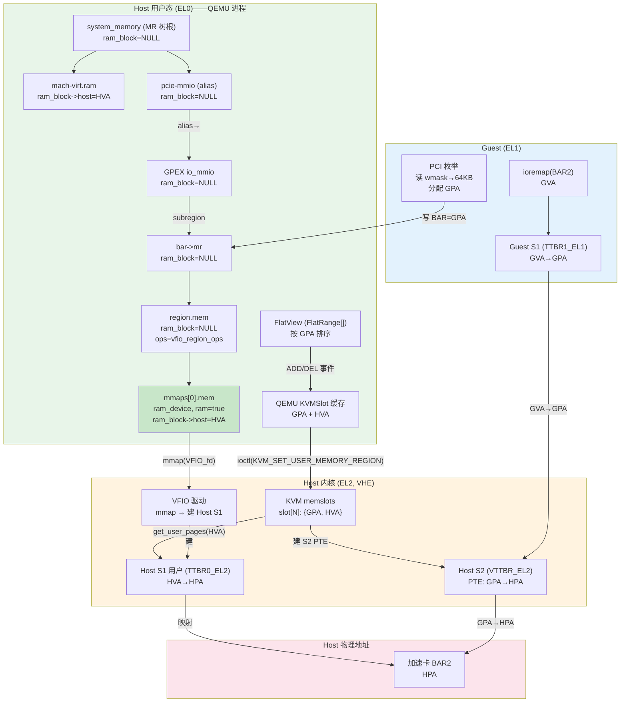

# PCI BAR 虚拟化全流程 —— 第1篇：正常 vfio-pci 驱动

## 0. 总体架构图（VHE mode）



> **图例**: 绿色=QEMU 用户态, 橙色=Host 内核, 蓝色=Guest, 粉色=物理地址

---

## 第一部分：基础知识

## 1. 四种地址空间

在 PCI BAR 虚拟化场景中涉及四种地址，分属三个主体管理。

| 地址 | 全称 | 谁分配 | 存在哪里 | 示例 |
|------|------|--------|----------|------|
| **GVA** | Guest Virtual Address | Guest 内核 (ioremap) | Guest S1 页表 PTE | `0xffff_8000_ca00_0000` |
| **GPA** | Guest Physical Address | QEMU 命令行(窗口基址) + Guest PCI 枚举(BAR 偏移) | BAR 配置寄存器、S2 PTE | `0x8000_200000` |
| **HVA** | Host Virtual Address | Host 内核 (mmap 返回值) | QEMU ram_device MR 的 `ram_block->host` | `0x7fff_xxxx_0000` |
| **HPA** | Host Physical Address | Host BIOS/PCI 枚举 | S2 PTE 的目标字段 | `0x8000_0000_0000` |

### 1.1 GVA —— Guest 虚拟地址

谁分配: **Guest 内核**。当 Guest 驱动调用 `pci_iomap(pdev, BAR2, 0)` → `ioremap(GPA_BAR2)` 时，Guest 内核在其虚拟地址空间的高端（TTBR1_EL1 管理的区域）分配一个 GVA。

```
Guest [EL1] 驱动:
  io_base = ioremap(GPA 0x8000_200000, 64KB)
  → 返回 GVA 0xffff_8000_ca00_0000
  → Guest S1 (TTBR1_EL1) 中新建 PTE: GVA → GPA 0x8000_200000
```

GVA 高位为 `0xffff` 是因为 ARM64 规定**内核虚拟地址的高 16 位全是 1**，由 TTBR1_EL1 翻译。

### 1.2 GPA —— Guest 物理地址

GPA 是 Guest "以为"的物理地址。Guest 用它来做 PCI 总线地址分配和设备 MMIO 访问。

谁分配:
- **PCI MMIO 窗口基址**: QEMU 启动参数决定（如 `-M virt,highmem=on` 产生高位 MMIO 窗口），记录了 PCI bus MMIO 空间映射到的 GPA 起始位置
- **各 BAR 的 GPA**: Guest 在 PCI 枚举时从窗口基址开始连续分配

存在哪里:
- PCI 配置空间的 BAR 寄存器（Guest 可读写）
- QEMU 的 `PCIIORegion.addr`（QEMU 内部的 BAR GPA）
- KVM S2 页表的 PTE 源字段（GPA 端）

**GPA 可以是不连续的**。一个 VM 中，RAM 占低地址、PCI MMIO 占高地址、中间可能有空洞。

### 1.3 HVA —— Host 虚拟地址（QEMU 用户态）

HVA 是 QEMU 进程用户态可见的虚拟地址，由 **Host 内核通过 mmap 系统调用**分配。

```
QEMU [EL0]:
  ptr = mmap(NULL, 64KB, PROT_READ|PROT_WRITE, MAP_SHARED, vfio_fd, bar_offset)
  → 返回 HVA 0x7fff_xxxx_0000
  → 这个 HVA 是 Host 内核在 QEMU 进程的 VMA 空间中分配的
  → 不是一个计算值，是内核 VMA 分配器任意分配的
```

存在哪里:
- VMA 结构体 (内核管理)
- QEMU ram_device MR 的 `ram_block->host` 字段
- QEMU KVMSlot 的 `ram` 字段

### 1.4 HPA —— Host 物理地址

HPA 是**真正的物理地址**，是设备寄存器在 Host 物理总线上的位置。

谁分配: **Host BIOS/Linux 在物理机 PCI 枚举时**分配，与虚拟机无关。

存在哪里:
- Host S1 页表 (TTBR0_EL2) 的 PTE 目标 → 用于 QEMU/Host 访问
- S2 页表 (VTTBR_EL2) 的 PTE 目标 → 用于 Guest 访问

**GPA 与 HPA 不相等**。GPA 是虚拟的，HPA 是真实的。两者通过 S2 页表关联。

### 1.5 四种地址的完整 64 位表示

以 Guest 访问 Dev1 BAR2 的 mailbox 寄存器（BAR2 内偏移 `0x300`）为例：

```
地址                   完整 64-bit hex              高位含义                    低 16 位(页内偏移)
───────────────────────────────────────────────────────────────────────────────────────────
GVA:  0xffff_8000_ca00_0300   ffff = Guest 内核空间     8000_ca00_0 = ioremap 分配   0300
                              标志 (TTBR1_EL1 管理)

GPA:  0x0000_8000_2000_0300   0000_8000_2000 = QEMU 的   8000_2000_0 = PCI MMIO 窗口  0300
                              PCI MMIO 窗口内偏移         基址 + BAR 偏移

HVA:  0x0000_7fff_a000_0300   0000_7fff_a000_0 = Host    7fff_a000_0 = QEMU 进程      0300
                              内核 VMA 分配器指定         用户空间地址

HPA:  0x0000_0800_0000_0300   0000_0800_0000_0 = Host    0800_0000_0 = 加速卡 BAR2    0300
                              BIOS 在 PCI 枚举时分配      物理地址
```

**四种地址的高位含义完全不同，互相之间没有数值上的映射关系：**

```
GVA 0xffff_8000_ca00_0300          HVA 0x0000_7fff_a000_0300
  │ Guest 内核地址空间               │ QEMU 用户态地址空间
  │ TTBR1_EL1 管理                  │ TTBR0_EL2 管理
  │                                 │
  ▼ Guest S1 页表翻译               ▼ Host S1 页表翻译
GPA 0x0000_8000_2000_0300          HPA 0x0000_0800_0000_0300
  │ Guest 的"物理地址"               │ 真实物理地址 (设备寄存器)
  │                                 │
  └──── Host S2 页表 (VTTBR_EL2) ────┘
       GPA → HPA 映射
```

**数值对比（关键规律）：**

| 规律 | 说明 |
|------|------|
| GVA 和 HVA **无关** | 分属两个完全不同的地址空间，各自的页表独立翻译 |
| GVA 和 GPA **相差 ioremap 偏移** | Guest 内核 ioremap 时建立了映射 |
| HVA 和 HPA **相差 mmap 映射** | Host 内核 mmap 时建立了 VMA 关联 |
| GPA 和 HPA **通过 S2 关联** | KVM 用 HVA 查到 HPA 后填入 S2 PTE |
| 低 16 位 [15:0] **全部相同**（都是 `0x0300`） | 因为 64KB PAGE_SIZE 下页内偏移不变 |

---

## 2. 三套独立页表

在 VHE 模式下，Host 内核运行在 EL2，Guest 运行在 EL1。两者使用**不同的物理寄存器**来控制各自的页表，**不共用任何 TTBR**。

### 2.1 VHE 寄存器别名机制

VHE (Virtualization Host Extensions) 的核心设计：Host 内核在 EL2 运行时，ARM 硬件对 TTBR 等寄存器做别名映射，让 Host 内核能复用 EL1 的指令编码。

```
VHE 模式 (HCR_EL2.E2H=1, TGE=1):

Host 在 EL2 运行时:
  代码写 TTBR0_EL1 ──→ 硬件自动路由到 TTBR0_EL2  (Host 用户空间 HVA→HPA)
  代码写 TTBR1_EL1 ──→ 硬件自动路由到 TTBR1_EL2  (Host 内核空间 KVA→HPA)
  代码写 TCR_EL1   ──→ 硬件自动路由到 TCR_EL2

Guest 在 EL1 运行时:
  代码写 TTBR0_EL1 ──→ 真正的 TTBR0_EL1          (Guest 用户空间 GVA→GPA)
  代码写 TTBR1_EL1 ──→ 真正的 TTBR1_EL1          (Guest 内核空间 GVA→GPA)

Host S2:
  VTTBR_EL2 ──→ 独立的物理寄存器, 不由 EL1 alias 影响 (GPA→HPA)
```

### 2.2 三套页表对比

物理上存在**五套**独立寄存器和**六套**用于不同目的的页表：

| 寄存器 | 使用场景 | 翻译关系 | 页表由谁管理 |
|---------|----------|----------|-------------|
| TTBR0_EL2 | QEMU 用户态 | HVA → HPA | Host 内核 |
| TTBR1_EL2 | Host 内核态 | KVA → HPA | Host 内核 |
| TTBR0_EL1 | Guest 用户态 | GVA → GPA | Guest OS |
| TTBR1_EL1 | Guest 内核态 | GVA → GPA | Guest OS |
| VTTBR_EL2 | Guest 运行时 | GPA → HPA | KVM (Host 内核) |

**VM entry/exit 时硬件自动切换 TTBR 寄存器**：

```
VM entry (Host → Guest):
  保存: TTBR0_EL2, TTBR1_EL2 → 硬件内部
  恢复: 真正的 TTBR0_EL1, TTBR1_EL1 → Guest 之前保存的值
  HCR_EL2.VM = 1 → Guest S1 + Host S2 生效

VM exit (Guest → Host):
  保存: TTBR0_EL1, TTBR1_EL1 → 硬件内部
  恢复: TTBR0_EL2, TTBR1_EL2 → Host 运行时值
  HCR_EL2.VM = 0 → Host S1 生效
```

### 2.3 哪套页表在什么时候被使用

| 场景 | 使用的页表 | 涉及 EL | 说明 |
|------|-----------|---------|------|
| Guest 访问 BAR2 (正常路径) | **Guest S1 (TTBR1_EL1) + Host S2 (VTTBR_EL2)** | Guest EL1 | 硬件两级翻译, 无 VM exit |
| Guest 访问 BAR2 (S2 缺页) | 触发 VM exit → KVM 处理 | Guest→Host EL2 | 建 S2 PTE 或注入 SEA |
| QEMU pread(VFIO_fd) | **Host S1 内核 (TTBR1_EL2, ioremap)** | Host EL2 | 慢路径, syscall 上下文 |
| KVM 建 S2 页表 | **Host S1 用户 (TTBR0_EL2)** | Host EL2 | `get_user_pages(HVA)` 查 QEMU 用户页表 |
| QEMU 访问 Guest RAM | **Host S1 用户 (TTBR0_EL2)** | Host EL0 | QEMU 模拟 DMA 等操作 |
| VM exit/entry 上下文切换 | 硬件自动保存/恢复 TTBR | 硬件 | Cortex-A 的 VM entry/exit 机制 |

### 2.4 页表的角色关系图

```
┌─────────────────────────────────────────────────────────────────┐
│                                                                 │
│  Guest 运行时 (HCR_EL2.VM=1):                                  │
│                                                                 │
│    Guest 指令: ldr x0, [x3]                                    │
│      GVA 0xffff_8000_ca00_0300                                  │
│       ↓ TTBR1_EL1 (Guest S1 页表)  ← Guest OS 管理              │
│      GPA 0x8000_2000_0300                                       │
│       ↓ VTTBR_EL2 (Host S2 页表)   ← KVM 管理                  │
│      HPA 0x0800_0000_0300                                       │
│       ↓ 物理总线                                                │
│      设备寄存器                                                  │
│                                                                 │
│    TTBR0_EL2, TTBR1_EL2 (Host S1) ── 完全不参与!                │
│                                                                 │
├─────────────────────────────────────────────────────────────────┤
│                                                                 │
│  KVM 建 S2 页表时 (Host EL2):                                   │
│                                                                 │
│    KVM: get_user_pages(QEMU 进程, HVA 0x7fff_a000_0000)        │
│       ↓ TTBR0_EL2 (Host S1 用户页表) ← 查 QEMU 的 HVA          │
│      HPA 0x0800_0000_0000                                       │
│                                                                 │
│    KVM: 填入 S2 PTE                                             │
│       ↓ VTTBR_EL2 (Host S2 页表)                                │
│      GPA 0x8000_2000_0000 → HPA 0x0800_0000_0000               │
│                                                                 │
└─────────────────────────────────────────────────────────────────┘
```

### 2.5 本场景中只用到的三套

在 VFIO BAR 场景中，Guest 访问设备只需要 **Guest S1 (TTBR1_EL1) + Host S2 (VTTBR_EL2)** 两套页表，但建 S2 时又依赖 **Host S1 用户 (TTBR0_EL2)** 作为"脚手架"来查 HPA。所以核心三套是：

```
TTBR0_EL2  → Host S1 用户页表 → HVA→HPA → S2 的"脚手架"
TTBR1_EL1  → Guest S1 内核页表 → GVA→GPA → Guest 自己的翻译
VTTBR_EL2  → Host S2 页表      → GPA→HPA → Guest 运行时的硬件路径
```

---

## 3. QEMU 中的数据结构

所有本节描述的数据结构都在 **QEMU 进程用户态 (Host EL0)** 中，它们是 QEMU 管理 Guest 物理地址空间的内部表示。

### 3.1 system_memory —— MR 树根

`system_memory` 是 QEMU 中的一个全局变量 (`MemoryRegion*`)，代表 **Guest 的整个物理地址空间**。

**`system/memory.c`**:
```c
MemoryRegion *system_memory;
```

它本身只是一个空容器——不存数据，不映射到任何实际内存。真正的内容由挂在它下面的**子 MR (MemoryRegion)** 定义。

### 3.2 MemoryRegion —— 树节点

每个 MemoryRegion 描述 Guest 物理地址空间中的一段区域。

**`include/exec/memory.h`** — 关键字段：
```c
struct MemoryRegion {
    char *name;                 // 名称, 如 "mach-virt.ram", "0000:00:01.0 base BAR 4"
    hwaddr addr;                // 在父 MR 内的偏移 (GPA = 父 MR 基址 + addr)
    uint64_t size;              // 区域大小 (最大 UINT64_MAX)
    //--
    bool ram;                   // 是否是 RAM 类型 (QEMU 可分配后端内存)
    bool ram_device;            // 是否是 ram_device (VFIO mmap 的 BAR)
    bool readonly;
    bool rom_device;
    //--
    MemoryRegion *parent;       // 父 MR
    QTAILQ_HEAD(, MemoryRegion) subregions;  // 子 MR 链表
    RAMBlock *ram_block;        // 如果 ram=true, 指向后端 RAM 块
    const MemoryRegionOps *ops; // 如果 ram=false, 指向 IO 回调函数表
};
```

**三种核心 MR 类型**：

| 类型 | 标志 | 有无 HVA | 说明 |
|------|------|---------|------|
| **RAM** | `ram=true, ram_device=false` | 有 (QEMU malloc) | Guest 普通内存 |
| **RAM device** | `ram=true, ram_device=true` | 有 (mmap 返回) | VFIO BAR mmap 成功 |
| **IO** | `ops != NULL, ram=false` | **没有** | VFIO BAR mmap 失败 / virtio 等 |

#### subregions 与 ram_block 的分工

`subregions` 和 `ram_block` 是**两个正交的字段**，不是取舍关系：

- **`subregions`** → 树结构（拓扑）：`QTAILQ` 链表，存子 MR。负责 **"这个 GPA 区间包含哪些子区域"**
- **`ram_block`** → 数据后端（存储）：`ram_block->host` 是一个 HVA 指针。负责 **"这个 MR 的实际数据在宿主机的哪个地址"**

**四种组合**：

| `subregions` | `ram_block` | 例子 | 说明 |
|---|---|---|---|
| 有 | 无 | `bar->mr`, `region.mem` | 纯容器/IO 层，通过子 MR 定义内容 |
| 无 | 有 | `mmaps[0].mem`, `mach-virt.ram` | 叶子节点，`ram_block->host` = HVA |
| 有 | 有 | 被 overlay 切割的 RAM | 罕见 |
| 无 | 无 | GIC, UART 等纯 IO MR | 只通过 `ops` 回调处理 MMIO |

**在 VFIO BAR 场景中的三层对应**：

```
bar->mr                          subregions=有, ram_block=NULL    (纯容器)
  └── region.mem                 subregions=有, ram_block=NULL    (IO 层, ops 回调)
        └── mmaps[0].mem         subregions=无, ram_block->host = HVA ← 唯一有数据的!
```

> **关键**: KVM 建 memslot 时只关心叶子 ram_device MR 的 `ram_block->host`（HVA）。中间的容器 MR 和 IO MR 没有 `ram_block`，不触发 memslot 创建。

#### ops —— MMIO 回调函数表

`ops` (`MemoryRegionOps *`) 定义了该 MR 的 MMIO 读写回调。**它与 `ram` 互斥**——要么走硬件直达（ram=true），要么走 QEMU 软件模拟（ops != NULL）。

```c
struct MemoryRegionOps {
    uint64_t (*read)(void *opaque, hwaddr addr, unsigned size);   // MMIO 读（QEMU接口）
    void (*write)(void *opaque, hwaddr addr, uint64_t data, unsigned size); // MMIO 写（QEMU接口）
    struct {
        unsigned min_access_size;   // 最小单次访问粒度 (1, 2, 4, 8)
        unsigned max_access_size;   // 最大单次访问粒度 (最大 8 字节)
    } valid;
    // ...
};
```

**两类 MR 对比**：

| | `ops = NULL, ram = true` | `ops != NULL, ram = false` |
|---|---|---|
| 例子 | `mach-virt.ram`, `mmaps[0].mem` | `region.mem`, GIC, UART |
| Guest 访问路径 | **S2 命中 → 硬件直达设备** | **S2 miss → VM exit → QEMU ops 回调** |
| KVM 建 memslot? | **是** | **否** |
| 速度 | 快（无 VM exit） | 慢（每次都要退出到 QEMU） |
| 访问粒度限制 | 无（任意大小） | 受 `ops->valid.max_access_size` 限制（最大 8 字节） |

**VFIO BAR 场景：快路径 vs 慢路径**：

```
mmap 成功时 (ram_device MR 存在):
  mmaps[0].mem  ← ops = NULL, ram = true
  → KVM memslot → S2 PTE → Guest 直接 S2 访问 → 硬件直达 ✅

mmap 失败时 (仅有 IO MR):
  region.mem    ← ops = vfio_region_ops, ram = false
  → 无 memslot, 无 S2 映射
  → Guest 访问 → S2 miss → VM exit → KVM_EXIT_MMIO → QEMU
  → ops->read/write → vfio_region_ops.read() → pread(VFIO_fd) → 慢路径 🐢
```

在慢路径中，CPU会abort填充ESR寄存器给kvm，kvm 对 QEMU 有一个 MMIO 接口：`kvm_run` 结构体。KVM 填充后返回给 QEMU，QEMU 自己决定如何分发到具体的 MR：

```
Guest ldr → S2 miss → VM exit

KVM [Host EL2] 解码 ESR, 填充 kvm_run:
  kvm_run->mmio.phys_addr = GPA 0x8000_200300
  kvm_run->mmio.len       = 8
  kvm_run->mmio.is_write  = false
  kvm_run->exit_reason    = KVM_EXIT_MMIO
  → 返回 QEMU

QEMU [Host EL0] 收到 KVM_EXIT_MMIO:
  address_space_rw(GPA)
  → 查 FlatView → 找到 region.mem
  → 调用 region.mem->ops->read(...)   ← QEMU 自己的代码, 还在 EL0!
  → vfio_region_read() → pread(VFIO_fd) → syscall → 进入 Host EL2
```

**KVM 只负责"把这个问题交给 QEMU"，ops 是 QEMU 收到后的内部处理。**

> **后续问题的伏笔**: 当 BAR2 mmap 失败后，只剩下 `region.mem` (IO 类型, `ops->valid.max_access_size = 8`)。Guest 执行 `ldp x0, x1, [x3]` 时是 **128-bit (16 字节)** 原子操作，超出 VFIO region ops 的最大粒度，KVM 的 ISV=0 也无法解码指令 → 只能向 Guest 注入 SEA → kernel panic。**这就是第2篇要分析的 crash 根源。**

### 3.3 MR 树的结构实例

以直通一个 HISI VF 为例，`system_memory` 的树结构：

```
system_memory (根容器, 覆盖整个 GPA 空间)
│
├── [GPA 0x0000_0000, size=2GB]  "mach-virt.ram"
│    ram=true, ram_block->host = HVA_0x7ffe_0000  (QEMU malloc 的)
│    ops = NULL,  子 MR: 无
│
├── [GPA 0x8000_0000_0000, size=751MB]  "pcie-mmio"   ← ALIAS 类型
│    └── 指向 → GPEX io_mmio (size=UINT64_MAX, PCI bus 的 MMIO 地址空间)
│         │
│         ├── [offset 0x0000_0000, size=2MB]  Dev1 BAR4 mr
│         │    ├── [offset 0] region.mem  (IO, vfio_region_ops)
│         │    └── [offset 0] mmaps[0].mem (ram_device, HVA_0x7fff_xxxx)
│         │
│         ├── [offset 0x0020_0000, size=64KB]  Dev1 BAR2 mr
│         │    ├── [offset 0] region.mem  (IO, vfio_region_ops)
│         │    └── [offset 0] mmaps[0].mem (ram_device, HVA_0x7fff_yyyy)
│         │
│         └── [offset 0x0040_0000, size=2MB]  Dev2 BAR4 mr
│              └── ...
│
├── [GPA 0x0900_0000, size=4KB]  pl011 (串口, IO)
│    ops = serial_ops,   ram=false,  子 MR: 无
│
└── [GPA 0x0800_0000, size=64KB]  GIC (中断控制器, IO)
     ops = gic_ops,  ram=false,  子 MR: 无
```

**VIFO BAR MR 的三层嵌套**：

```
bar->mr (外层容器, 可以是 IO 或 ram_device, 取决于 mmap 是否成功)
  └── region.mem (内层, IO 类型, vfio_region_ops: .read / .write)
        └── mmaps[0].mem (ram_device, 仅在 mmap 成功时创建)
             ram=true, ram_device=true, ram_block->host = HVA
```

> **注意**: `bar->mr` 本身是 IO 类型（`ram=false`），真正的 ram_device 是最内层的 `mmaps[0].mem`。KVM 建 memslot 用的是这个最内层 MR。

### 3.4 FlatView —— MR 树的展平视图

MR 树是嵌套结构，但 KVM 需要按 GPA 查找——所以 QEMU 把树展开成 FlatView。

**FlatView 是一组按 GPA 排序、不重叠的 `FlatRange` 数组**：

```c
struct FlatView {
    FlatRange *ranges;       // 数组, 按 GPA 排序
    unsigned nr;             // 元素数量
    unsigned nr_allocated;
};

struct FlatRange {
    MemoryRegion *mr;        // 指向对应 MR
    hwaddr offset_in_region; // MR 内部偏移
    AddrRange addr;          // { start: GPA, size: 字节数 }，FlatView 就是按这个 GPA 排序的
    bool readonly;
};
```

**MR 树 vs FlatView**：

```
MR 树 (嵌套, 链表)                    FlatView (数组, 按 GPA 排序)
───────────────────────────          ──────────────────────────────
可以有空洞 (GPA 区间无 MR)            同样可以有空洞 (该 GPA 区间不在数组中)
子节点按 priority + offset 排序      按 GPA 升序
alias MR 特殊处理                    所有 alias 已解析为绝对 GPA
持久存储, 增量修改                    每次 MR 树变时全量重建
```

**从 MR 树生成 FlatView 的过程**：

```c
// system/memory.c: generate_memory_topology()
// 递归遍历 MR 树 → 处理 alias → 处理 priority 覆盖 → 输出 FlatRange[]
render_memory_region(view, mr, base, size) {
    QTAILQ_FOREACH(subregion, &mr->subregions) {
        // 1) 先处理高 priority 的 (会覆盖低 priority)
        // 2) 再处理低 priority 的 (只在未被覆盖的区域生效)
        // 3) alias MR 会递归进入指向的目标 MR
        render_memory_region(view, subregion, base + offset, subregion_size);
    }
}
```

**展平后的 FlatView 示例**：

```
FlatView.ranges[] (按 GPA 升序排列):
[0] GPA [0x0000_0000, 0x8000_0000)           → mach-virt.ram  (ram)
      ←── GPA 空洞: 0x8000_0000 到 0x0800_0000 没有 MR ──→
[1] GPA [0x0800_0000, 0x0801_0000)           → GIC            (IO)
      ←── GPA 空洞: 0x0801_0000 到 0x8000_0000_0000 没有 MR ──→
[2] GPA [0x8000_0000_0000, 0x8000_0020_0000) → Dev1 BAR4      (ram_device)
[3] GPA [0x8000_0020_0000, 0x8000_0020_ffff] → Dev1 BAR2      (ram_device)
[4] GPA [0x8000_0040_0000, 0x8000_0060_0000) → Dev2 BAR4      (ram_device)
```

> FlatView 按 GPA 升序排列，GPA `0x0800_0000` (GIC) < GPA `0x8000_0000_0000` (PCI)，所以 GIC 排在 PCI BAR 前面。相邻区间之间的 GPA 空洞在数组中表现为"不覆盖"。

### 3.5 PCIIORegion —— PCI BAR 台账

每个 PCI BAR 对应一个 `PCIIORegion`，**它的 size 字段在 `pci_register_bar()` 后不再改变**：

```c
struct PCIIORegion {
    pcibus_t addr;              // GPA — Guest 写的 BAR 地址, 如 0x8000_2000_0000
    pcibus_t size;              // BAR 大小 — 来自 VFIO_DEVICE_GET_REGION_INFO
    uint8_t type;               // 64-bit prefetchable / 32-bit / IO
    MemoryRegion *memory;       // 指向 bar->mr (含 ram_device 子 MR)
    MemoryRegion *address_space; // 指向 GPEX io_mmio (PCI bus 的 MMIO 地址空间)
};
```

**`r->size` 如何决定 Guest 看到的 BAR 大小**：

```c
// hw/pci/pci.c: pci_register_bar()
r->size = 0x10000;             // 64KB ← 来自 ioctl(VFIO_DEVICE_GET_REGION_INFO)

wmask = ~(size - 1);           // ~(0xFFFF) = 0xFFFFFFFFFFFF0000
pci_set_quad(pci_dev->wmask + addr, wmask);  // 写入虚拟 PCI 配置空间

// Guest 枚举时:
//  写 BAR = 0xFFFFFFFF → 读回 = value & wmask = 0xFFFFFFFFFFFF0000
//  → 低 16 位全是 0 → BAR = 2^16 = 64KB
```

**vfio-pci 正常情况**: `VFIO_DEVICE_GET_REGION_INFO` 返回 64KB → `r->size=64KB` → `wmask = ~(64KB-1)` 写入虚拟 PCI 配置空间 → Guest PCI 枚举时读 BAR 寄存器 → 得到 wmask → 推断 BAR2=64KB → 分配两个 VF 的 BAR2 至少间隔 64KB → 不重叠

### 3.6 子 MR 链表的排序规则

子 MR 用 `QTAILQ` 双向链表组织，**按以下规则排序**：

```
规则1: priority 降序 (高 priority 先被遍历, 覆盖低 priority)
规则2: 同 priority 按 addr (offset) 升序 (GPA 小的在前)
```

```c
// system/memory.c: memory_region_add_subregion_common() — 插入逻辑
QTAILQ_FOREACH(other, &mr->subregions, subregions_link) {
    if (subregion->priority > other->priority)
        break;                  // 插入高 priority 前面
    if (subregion->priority == other->priority &&
        subregion->addr < other->addr)
        break;                  // 同 priority, 插入小 offset 前面
}
QTAILQ_INSERT_BEFORE(other, subregion, subregions_link);
```

**两种 priority 的来源**：

| 来源 | priority | 何时 |
|------|---------|------|
| `pci_update_mappings()` | **1** | Guest 写 BAR 地址时的原始注册 |
| `vfio_sub_page_bar_update_mapping()` | **0** | 补救机制: 扩展 sub-page BAR 到 PAGE_SIZE |

> **重要线索**: priority 1→0 的降级是后续多 VF 重叠问题的关键（第2篇详述）。

---

## 4. KVM 中的数据结构

本节描述的结构都在 **Host 内核 (EL2)** 中，是 KVM 管理 memslot 和 S2 页表的内部表示。

### 4.1 三层嵌套结构

KVM 中 memslot 的组织形式是 **三级嵌套**：

```
struct kvm (一个 VM 实例)
  │
  └─ struct kvm_memslots *memslots[KVM_ADDRESS_SPACE_NUM]
       │
       │  KVM_ADDRESS_SPACE_NUM = 1 (普通 VM, 无 SMMU 多地址空间)
       │
       └─ memslots[0] → struct kvm_memslots  (容器, 只有一个)
            ├─ int used_slots            ← 实际使用的 memslot 数量
            ├─ u64 generation            ← 版本号 (RCU 无锁读)
            │
            └─ struct kvm_memory_slot memslots[32767]  ← 大数组!
                 │  (每个元素: base_gfn=GPA>>16, npages=页数, userspace_addr [HVA])
                 │
                 ├─ [0]: {base_gfn=0x0 [GPA页帧号],        npages=32768, userspace_addr [HVA_ram]}      RAM (2GB)
                 ├─ [1]: {base_gfn=0x8000_0000 [GPA页帧号], npages=32,    userspace_addr [HVA_bar4]}     Dev1 BAR4 (2MB)
                 ├─ [2]: {base_gfn=0x8000_2000 [GPA页帧号], npages=1,     userspace_addr [HVA_bar2]}     Dev1 BAR2 (64KB)
                 ├─ [3]: {base_gfn=0x8000_4000 [GPA页帧号], npages=32,    userspace_addr [HVA_bar4_2]}   Dev2 BAR4 (2MB)
                 ├─ [4]: 空
                 └─ ...
```

| 层 | 类型 | 说明 |
|---|------|------|
| `kvm->memslots[]` | 指针数组，通常 1 个元素 | `memslots[0]` 指向唯一的 `kvm_memslots` 容器 |
| `kvm_memslots` | 容器结构体 | 内含 memslot 数组 + `used_slots` 计数 + `generation` 版本号 |
| `kvm_memory_slot` | 单个 memslot | 描述一段**连续** GPA 区间 |

### 4.2 kvm_memory_slot 结构体

**`include/linux/kvm_host.h`**:
```c
struct kvm_memory_slot {
    gfn_t base_gfn;                // 起始 GPA >> PAGE_SHIFT (16)
    unsigned long npages;          // 页数 (GPA 区间大小 = npages × PAGE_SIZE)
    unsigned long userspace_addr;  // HVA (QEMU 用户态地址) — 不是 HPA!
    u32 flags;                     // KVM_MEM_READONLY 等(这个在热迁移的标脏中很重要)
    int id;                        // slot ID
    u16 as_id;                     // address space ID
};
```

**举例**——Dev1 BAR2 的 memslot：
```c
{
    base_gfn       = 0x8000_2000_00,   // GPA 0x8000_200000 >> 16
    npages         = 1,                // 64KB / 64KB = 1 页
    userspace_addr = 0x7fff_yyyy_0000, // QEMU mmap 返回的 HVA
    flags          = 0,
}
```

> **memslot 不存 HPA。** 存的是 HVA。KVM 需要 HPA 时通过 `get_user_pages(userspace_addr)` 动态查 Host S1 (TTBR0_EL2) 页表获取。

### 4.3 memslot 与 S2 页表的关系

每个 memslot 对应 S2 页表中的一段 GPA→HPA 映射。KVM 在**创建 memslot 的同时**填入 S2 PTE：

```
ioctl(KVM_SET_USER_MEMORY_REGION, {...})
  → __kvm_set_memory_region()
    → kvm_set_memslot()
      → kvm_arch_commit_memory_region()        ← ARM64 架构回调
        → get_user_pages(HVA=0x7fff_yyyy_0000) ← 查 Host S1 (TTBR0_EL2)
        → HPA = 0x0800_0000_0000
        → 填 S2 PTE (VTTBR_EL2):
            GPA 0x8000_2000_0000 → HPA 0x0800_0000_0000 (Device-nGnRE)
```

**memslot 数量上限**：`KVM_MEM_SLOTS_NUM = 32767`。每个 VM 可以有最多 32767 个 memslot，远超实际需要。

### 4.4 memslot 删除时清 S2 PTE

当 QEMU 通知 KVM 删除一个 memslot（内存大小=0 的 KVM_SET_USER_MEMORY_REGION）：

```
ioctl(vm_fd, KVM_SET_USER_MEMORY_REGION, &mem);
  → __kvm_set_memory_region()
    → kvm_set_memslot(kvm, old, NULL, KVM_MR_DELETE)
      → kvm_invalidate_memslot()              ← 标记 INVALID, 替换活跃树
        → kvm_arch_flush_shadow_memslot()
          → unmap_stage2_range(GPA, size)     ← 清 S2 PTE + 刷新 TLB
      → 从 memslots 数组中移除
```

**清理包括**：遍历 S2 页表 → 清除该 GPA 范围内的所有 PTE → `dsb ishst` → `tlbi vmalls12e1is` 刷 TLB。

### 4.5 QEMU KVMSlot vs KVM kvm_memory_slot

QEMU 内部也维护了一份 memslot 缓存叫 `KVMSlot`，与内核的 `kvm_memory_slot` 通过 ioctl 同步：

```
QEMU [EL0] KVMSlot (缓存):            KVM [EL2] kvm_memory_slot (权威):
  ┌─────────────────────┐            ┌──────────────────────────┐
  │ start_addr  (GPA)   │  ioctl    │ base_gfn    (GPA >> 16) │
  │ memory_size (64KB)  │ ───────→  │ npages      (页数)      │
  │ ram         (HVA)   │  KVM_SET  │ userspace_addr (HVA)    │
  │ flags       (0)     │           │ flags                   │
  │ dirty_bmap  (...)   │           │                          │
  └─────────────────────┘            └──────────────────────────┘
```

QEMU 的 KVMSlot 只是**本地缓存**——QEMU 不需要每次都查内核状态，直接用缓存的 `start_addr + memory_size` 就知道当前 memslot 的 GPA 范围，用于后续比对 FlatView 变化。

---

## 5. QEMU MR 与 KVM memslot 的关联

QEMU 的 MR 和 KVM 的 memslot 通过 **FlatView → KVM MemoryListener → ioctl** 这条链路关联。

### 5.1 什么 MR 会触发 memslot

只有 **`mr->ram = true`** 的 MR 才会传出 memslot 的 ioctl 请求。如果 `mr->ram = false`（IO 类型），即使出现在 FlatView，也不会触发 memslot 创建。

| MR 类型 | mr->ram | mr->ram_device | 触发 memslot? | 说明 |
|---|---|---|---|---|
| RAM | true | false | **是** | Guest 普通内存, 后端是 QEMU malloc |
| RAM device | true | true | **是** | VFIO BAR mmap 成功 |
| IO | false | false | **否** | VFIO BAR mmap 失败 / virtio 等 |
| ROM / ROM device | true | — | **是** | 固件等 |

### 5.2 从 FlatView 到 memslot 的完整链路

```
QEMU [EL0]:
  MR 树变化 → FlatView 重建 → 新旧 FlatView 对比

  第一遍扫描 (adding=false): 生成 DEL 事件
    对每个旧有新增的 FlatRange:
      → kvm_region_del(section)
        → 加入 DELETE 事务队列

  第二遍扫描 (adding=true): 生成 ADD 事件
    对每个新有旧无的 FlatRange:
      → kvm_region_add(section)
        → 加入 ADD 事务队列

  kvm_region_commit(): 统一处理
    先执行所有 DELETE:
      kvm_set_phys_mem(section, add=false)
        → ioctl(vm_fd, KVM_SET_USER_MEMORY_REGION, &mem);
        → KVM [EL2]: 清 S2 PTE + 删 memslot

    再执行所有 ADD:
      kvm_set_phys_mem(section, add=true)
        → kvm_align_section(section, &start)
          将 section 对齐到 PAGE_SIZE 边界
          32KB section → 返回 0 → SKIP!
          64KB section → 返回 64KB → 继续
        → ram = memory_region_get_ram_ptr(mr)  // HVA
        → ioctl(KVM_SET_USER_MEMORY_REGION,
                {GPA, size=64KB, HVA})
        → KVM [EL2]: 建 S2 PTE + 插入 memslot 数组
```

**事件顺序**：先 DEL 后 ADD。这是刻意的——先释放旧的 GPA 范围，再分配新的，避免 memslot 重叠冲突。

### 5.3 kvm_align_section：页对齐门

```c
// accel/kvm/kvm-all.c:266
static hwaddr kvm_align_section(section, &start_addr) {
    hwaddr size = section->size;

    // start_addr = round_up(section_GPA, PAGE_SIZE)
    *start_addr = ALIGN(section_GPA, 64KB);

    // 如果 section 太小, 对齐后返回 0 → 不建 memslot!
    if (delta > size)
        return 0;

    // 返回 size 为 PAGE_SIZE 整数倍
    return (size - delta) & PAGE_MASK;
}
```

**这是 32KB BAR 无法建 memslot 的直接原因。** 32KB < 64KB(PAGE_SIZE) → kvm_align_section 返回 0 → kvm_set_phys_mem 直接 return → 没有 ioctl 发出 → KVM 不知道这个 BAR → S2 无映射。

### 5.4 QEMU KVMSlot vs KVM kvm_memory_slot

QEMU 内部维护 `KVMSlot` 列表作为**本地缓存**，与内核的 `kvm_memory_slot` 通过 ioctl 同步。缓存的作用：QEMU 不需要每次都查内核状态，直接用缓存的 `start_addr + memory_size` 就知道当前 memslot 的 GPA 范围，用于后续比对 FlatView 变化。

```
FlatView section (GPA, size) → 对比 KVMSlot 缓存
  ├─ 新出现且不在缓存中 → ADD → ioctl(KVM_SET_USER_MEMORY_REGION, add)
  ├─ 在缓存中但 FlatView 里没了 → DEL → ioctl(KVM_SET_USER_MEMORY_REGION, del)
  └─ 已存在且没变 → 跳过
```

---

## 第二部分：正常 vfio-pci 下 BAR 建立与访问全流程

> 以下每个步骤标注了执行主体 `[Guest EL1]` / `[QEMU EL0]` / `[Host 内核 EL2]`，以及涉及的地址类型 `GVA` / `GPA` / `HVA` / `HPA`。

## 6. 阶段1：QEMU 启动 → 查询 BAR 信息 [QEMU EL0 → Host EL2 → QEMU EL0]

### 6.1 QEMU 打开 VFIO 设备

QEMU [EL0] 启动时，每个 VFIO 直通设备对应一个 VFIO container 和一个 VFIO group。QEMU 通过文件操作打开设备：

```
QEMU [EL0]:
  fd = open("/dev/vfio/XX", O_RDWR)       → vfio_fd
  ioctl(vfio_fd, VFIO_GROUP_SET_CONTAINER, ...)
  ioctl(vfio_fd, VFIO_GROUP_GET_DEVICE_FD, "0000:01:00.0")  → device_fd
```

### 6.2 查询 BAR 物理大小

QEMU [EL0] 向内核查询每个 BAR 的大小：

```
QEMU [EL0]:
  ioctl(device_fd, VFIO_DEVICE_GET_REGION_INFO, &info)
    → info.index = VFIO_PCI_BAR2_REGION_INDEX
    ↓ syscall 进入内核

Host 内核 [EL2] VFIO 驱动:
  通用 vfio-pci 驱动 → 读物理 PCI 配置空间 → BAR2 物理大小 = 64KB
  ← info.size = 0x10000 (64KB)

QEMU [EL0]:
  region->size = info.size = 64KB        // 存到 VFIORegion
```

**`hw/vfio/helpers.c:370`**:
```c
region->size = info->size;   // ← 来自内核 VFIO_DEVICE_GET_REGION_INFO ioctl
```

**数据结构关系**：`region` 的类型是 `VFIORegion`，嵌入在 `VFIOBAR` 中，而 `VFIOBAR` 是 `VFIOPCIDevice` 的成员数组 `bars[]` 的元素：

```
VFIOPCIDevice.bars[2]        (VFIOBAR)
  ├── .size       = 64KB    (来自 region.size 副本)
  ├── .mr         → bar->mr (外层容器 MemoryRegion)
  └── .region     (VFIORegion)
        ├── .size = 64KB    (来自 ioctl VFIO_DEVICE_GET_REGION_INFO)
        ├── .mem  = region.mem (IO 层 MemoryRegion)
        │    ops  = vfio_region_ops (.read / .write)
        │    ram  = false
        └── .mmaps[0]       (VFIOMmap)
              ├── .mmap = HVA_0x7fff_xxxx  (mmap 返回值)
              └── .mem  = mmaps[0].mem (ram_device MemoryRegion)
                   ram        = true
                   ram_device = true
                   ram_block->host = HVA_0x7fff_xxxx
```

> **正常 vfio-pci 下**: `info->size = 64KB`（物理 BAR 大小，不截断）。hisi_acc 驱动的问题（截断为 32KB）将在第 2 篇分析。

### 6.3 创建 BAR 的 MemoryRegion 层级

QEMU [EL0] 为 BAR 创建三层 MR 结构：

**`hw/vfio/pci.c:1760-1785`** — vfio_bar_register:

```c
// Step 1: 外层容器 (纯拓扑, ram=false, 子 MR 链表)
bar->mr = g_new0(MemoryRegion, 1);
memory_region_init_io(bar->mr, ..., NULL, NULL, name, 64KB);

// Step 2: 内层 IO MR (ops = vfio_region_ops, ram=false)
if (bar->region.size > 0) {
    memory_region_add_subregion(bar->mr, 0, bar->region.mem);

    // Step 3: 尝试 mmap → 若成功创建 ram_device 子 MR
    vfio_region_mmap(&bar->region);
}
```

**结果（正常 vfio-pci，mmap 成功）**:

```
VFIOPCIDevice (每个 VFIO 直通设备一个)
  └── .bars[BAR2]  (VFIOBAR)
       ├── .size = 64KB
       ├── .mr → bar->mr (第1层: 容器, IO 类型, ram=false, size=64KB)
       │         subregions: [region.mem]
       │
       └── .region  (VFIORegion)
             ├── .size = 64KB
             ├── .mem → region.mem (第2层: IO 层, ops=vfio_region_ops, ram=false)
             │          subregions: [mmaps[0].mem]
             │          ops->read  = vfio_region_read   ← 慢路径
             │          ops->write = vfio_region_write
             │
             └── .mmaps[0]  (VFIOMmap)
                   ├── .mmap = HVA_0x7fff_xxxx
                   └── .mem → mmaps[0].mem (第3层: ram_device)
                              ram       = true
                              ram_device = true
                              ram_block->host = HVA_0x7fff_xxxx  ← 从 mmap 得到
                              subregions = 空 (叶子节点)
```

> **三层 MR 的分工**: 第1层=容器(纯拓扑), 第2层=IO(慢路径), 第3层=ram_device(快路径, 存 HVA)。KVM 只看第3层——只有 `mr->ram=true` 才建 memslot。

**VFIOPCIDevice 如何与设备绑定**:

```c
// hw/vfio/pci.h:122
struct VFIOPCIDevice {
    PCIDevice pdev;              // 继承自 QEMU 的 PCI 设备基类
    VFIODevice vbasedev;         // VFIO 设备基类
    VFIOBAR bars[PCI_NUM_REGIONS - 1];  // ← 每个 BAR 一个 VFIOBAR
};
```

- `VFIOPCIDevice` 是 QEMU Object 类型（`TYPE_VFIO_PCI`），QEMU 命令行 `-device vfio-pci,host=0000:01:00.0` 触发创建
- 每个直通设备创建**一个** `VFIOPCIDevice` 实例，嵌入在 QEMU 的设备模型中
- `pdev` 是 `PCIDevice` 基类——Guest 看到的就是这个 PCI 设备
- `bars[]` 数组索引对应 BAR 编号（0~5），`bars[2]` 对应 BAR2
- `VFIO_PCI(pdev)` 宏可以从父类 `PCIDevice` 反向获取 `VFIOPCIDevice` 指针


### 6.4 mmap：获取 Host 用户态 HVA

QEMU [EL0] 调用 mmap 获取 HVA：

```
QEMU [EL0]:
  vfio_region_mmap():
    size = qemu_real_host_page_size() = 64KB
    ptr = mmap(NULL, 64KB, PROT_READ|PROT_WRITE,
               MAP_SHARED, vfio_device_fd, bar2_fd_offset)
    ↓ syscall

Host 内核 [EL2] VFIO 驱动:
  vfio_pci_core_mmap():
    → vma->vm_pgoff = BAR2_HPA >> PAGE_SHIFT   // 设备物理页帧号
    → vma->vm_ops = vfio_pci_mmap_ops           // 注册 fault 回调
    → 此时不建 Host S1 PTE! (延迟到首次访问 HVA 时)
  ← 返回 HVA = 0x7fff_xxxx_0000 给 QEMU

QEMU [EL0]:
  // 用 HVA 创建 ram_device MR
  memory_region_init_ram_device_ptr(&mmaps[0].mem, ...,
                                     HVA_0x7fff_xxxx, 64KB);
  // mmaps[0].mem.ram = true
  // mmaps[0].mem.ram_device = true
  // mmaps[0].mem.ram_block->host = HVA_0x7fff_xxxx
```

**mmap 建立了什么？**

| 立即建立 | 延迟建立 |
|---|---|
| VMA (内核记录: HVA 区间 + BAR2 HPA 页帧号) | Host S1 PTE (TTBR0_EL2): HVA → HPA |
| ram_device MR (QEMU: mr->ram=true) | KVM memslot (VTTBR_EL2): GPA → HPA |
| QEMU 拿到 HVA 0x7fff_xxxx | 这两个等到后续步骤才建 |

### 6.5 pci_register_bar：PCI 台账固化

QEMU [EL0] 在 PCI 配置空间注册 BAR：

**`hw/pci/pci.c:1321-1333`**:
```c
r = &pci_dev->io_regions[BAR2];
r->size          = 0x10000;              // 64KB — 永久不改!
r->addr          = PCI_BAR_UNMAPPED;     // 尚未分配 GPA
r->memory        = bar->mr;             // → MR 树
r->address_space = bus->address_space_mem;  // → GPEX io_mmio

// BAR 可写掩码 → Guest 通过它知道 BAR 大小
wmask = ~(0x10000 - 1);                 // = 0xFFFFFFFFFFFF0000
pci_set_quad(pci_dev->wmask + addr, wmask);
```

**wmask 机制**：
- Guest 写 BAR 寄存器 = 0xFFFFFFFF → QEMU 返回 value & 0xFFFFFFFFFFFF0000
- Guest 看到低 16 位全是 0 → 推断 BAR 大小 = 2^16 = 64KB

> **正常 vfio-pci 下**: `r->size = 64KB` → Guest 后续分配两个 VF 的 BAR2 至少间隔 64KB → 不会重叠。

### 6.6 阶段1 完成时的状态

```
QEMU [EL0]:
  ✓ MR 树: bar->mr → region.mem → mmaps[0].mem (HVA=0x7fff_xxxx)
  ✓ PCI 台账: r->size=64KB, r->addr=UNMAPPED
  ✓ wmask 已写入虚拟 PCI 配置空间
  ✗ BAR 尚未映射到 GPA (r->addr = UNMAPPED)
  ✗ KVM 尚未建 memslot (还没触发 FlatView 变化)
  ✗ Host S1 PTE 尚未建立 (HVA 还没被访问过)

Host 内核 [EL2]:
  ✓ VMA 已注册: HVA ↔ BAR2 HPA 的关联

Guest [EL1]:
  ✗ 尚未启动 / 尚未 PCI 枚举
```

---

> **下一节**: 阶段2: Guest PCI 枚举 (7. 阶段2)
>
> 请确认以上内容无误后，我继续写第 7 节。
