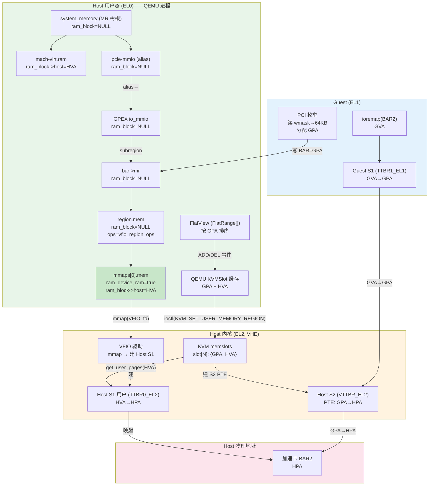
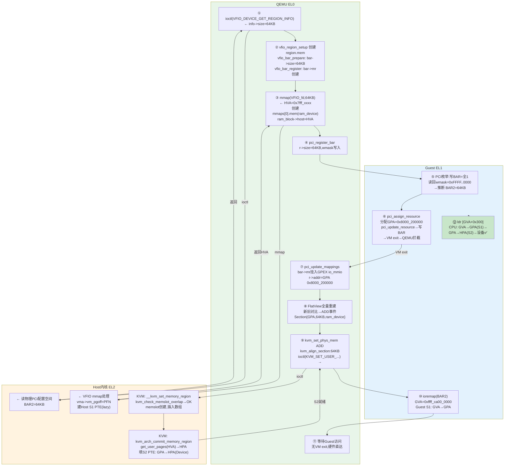

# PCI BAR 虚拟化全流程 —— 第1篇：正常 vfio-pci 驱动

## 0. 总体架构图（VHE mode）



> **图例**: 绿色=QEMU 用户态, 橙色=Host 内核, 蓝色=Guest, 粉色=物理地址

---

## 第一部分：基础知识

## 1. 四种地址空间

在 PCI BAR 虚拟化场景中涉及四种地址，分属三个主体管理。

| 地址 | 全称 | 谁分配 | 存在哪里 | 示例 |
|------|------|--------|----------|------|
| **GVA** | Guest Virtual Address | Guest 内核 (ioremap) | Guest S1 页表 PTE | `0xffff_8000_ca00_0000` |
| **GPA** | Guest Physical Address | QEMU 命令行(窗口基址) + Guest PCI 枚举(BAR 偏移) | BAR 配置寄存器、S2 PTE | `0x8000_200000` |
| **HVA** | Host Virtual Address | Host 内核 (mmap 返回值) | QEMU ram_device MR 的 `ram_block->host` | `0x7fff_xxxx_0000` |
| **HPA** | Host Physical Address | Host BIOS/PCI 枚举 | S2 PTE 的目标字段 | `0x8000_0000_0000` |

### 1.1 GVA —— Guest 虚拟地址

谁分配: **Guest 内核**。当 Guest 驱动调用 `pci_iomap(pdev, BAR2, 0)` → `ioremap(GPA_BAR2)` 时，Guest 内核在其虚拟地址空间的高端（TTBR1_EL1 管理的区域）分配一个 GVA。

```
Guest [EL1] 驱动:
  io_base = ioremap(GPA 0x8000_200000, 64KB)
  → 返回 GVA 0xffff_8000_ca00_0000
  → Guest S1 (TTBR1_EL1) 中新建 PTE: GVA → GPA 0x8000_200000
```

GVA 高位为 `0xffff` 是因为 ARM64 规定**内核虚拟地址的高 16 位全是 1**，由 TTBR1_EL1 翻译。

### 1.2 GPA —— Guest 物理地址

GPA 是 Guest "以为"的物理地址。Guest 用它来做 PCI 总线地址分配和设备 MMIO 访问。

谁分配:
- **PCI MMIO 窗口基址**: QEMU 启动参数决定（如 `-M virt,highmem=on` 产生高位 MMIO 窗口），记录了 PCI bus MMIO 空间映射到的 GPA 起始位置
- **各 BAR 的 GPA**: Guest 在 PCI 枚举时从窗口基址开始连续分配

存在哪里:
- PCI 配置空间的 BAR 寄存器（Guest 可读写）
- QEMU 的 `PCIIORegion.addr`（QEMU 内部的 BAR GPA）
- KVM S2 页表的 PTE 源字段（GPA 端）

**GPA 可以是不连续的**。一个 VM 中，RAM 占低地址、PCI MMIO 占高地址、中间可能有空洞。

### 1.3 HVA —— Host 虚拟地址（QEMU 用户态）

HVA 是 QEMU 进程用户态可见的虚拟地址，由 **Host 内核通过 mmap 系统调用**分配。

```
QEMU [EL0]:
  ptr = mmap(NULL, 64KB, PROT_READ|PROT_WRITE, MAP_SHARED, vfio_fd, bar_offset)
  → 返回 HVA 0x7fff_xxxx_0000
  → 这个 HVA 是 Host 内核在 QEMU 进程的 VMA 空间中分配的
  → 不是一个计算值，是内核 VMA 分配器任意分配的
```

存在哪里:
- VMA 结构体 (内核管理)
- QEMU ram_device MR 的 `ram_block->host` 字段
- QEMU KVMSlot 的 `ram` 字段

### 1.4 HPA —— Host 物理地址

HPA 是**真正的物理地址**，是设备寄存器在 Host 物理总线上的位置。

谁分配: **Host BIOS/Linux 在物理机 PCI 枚举时**分配，与虚拟机无关。

存在哪里:
- Host S1 页表 (TTBR0_EL2) 的 PTE 目标 → 用于 QEMU/Host 访问
- S2 页表 (VTTBR_EL2) 的 PTE 目标 → 用于 Guest 访问

**GPA 与 HPA 不相等**。GPA 是虚拟的，HPA 是真实的。两者通过 S2 页表关联。

### 1.5 四种地址的完整 64 位表示

以 Guest 访问 Dev1 BAR2 的 mailbox 寄存器（BAR2 内偏移 `0x300`）为例：

```
地址                   完整 64-bit hex              高位含义                    低 16 位(页内偏移)
───────────────────────────────────────────────────────────────────────────────────────────
GVA:  0xffff_8000_ca00_0300   ffff = Guest 内核空间     8000_ca00_0 = ioremap 分配   0300
                              标志 (TTBR1_EL1 管理)

GPA:  0x0000_8000_2000_0300   0000_8000_2000 = QEMU 的   8000_2000_0 = PCI MMIO 窗口  0300
                              PCI MMIO 窗口内偏移         基址 + BAR 偏移

HVA:  0x0000_7fff_a000_0300   0000_7fff_a000_0 = Host    7fff_a000_0 = QEMU 进程      0300
                              内核 VMA 分配器指定         用户空间地址

HPA:  0x0000_0800_0000_0300   0000_0800_0000_0 = Host    0800_0000_0 = 加速卡 BAR2    0300
                              BIOS 在 PCI 枚举时分配      物理地址
```

**四种地址的高位含义完全不同，互相之间没有数值上的映射关系：**

```
GVA 0xffff_8000_ca00_0300          HVA 0x0000_7fff_a000_0300
  │ Guest 内核地址空间               │ QEMU 用户态地址空间
  │ TTBR1_EL1 管理                  │ TTBR0_EL2 管理
  │                                 │
  ▼ Guest S1 页表翻译               ▼ Host S1 页表翻译
GPA 0x0000_8000_2000_0300          HPA 0x0000_0800_0000_0300
  │ Guest 的"物理地址"               │ 真实物理地址 (设备寄存器)
  │                                 │
  └──── Host S2 页表 (VTTBR_EL2) ────┘
       GPA → HPA 映射
```

**数值对比（关键规律）：**

| 规律 | 说明 |
|------|------|
| GVA 和 HVA **无关** | 分属两个完全不同的地址空间，各自的页表独立翻译 |
| GVA 和 GPA **相差 ioremap 偏移** | Guest 内核 ioremap 时建立了映射 |
| HVA 和 HPA **相差 mmap 映射** | Host 内核 mmap 时建立了 VMA 关联 |
| GPA 和 HPA **通过 S2 关联** | KVM 用 HVA 查到 HPA 后填入 S2 PTE |
| 低 16 位 [15:0] **全部相同**（都是 `0x0300`） | 因为 64KB PAGE_SIZE 下页内偏移不变 |

---

## 2. 三套独立页表

在 VHE 模式下，Host 内核运行在 EL2，Guest 运行在 EL1。两者使用**不同的物理寄存器**来控制各自的页表，**不共用任何 TTBR**。

### 2.1 VHE 寄存器别名机制

VHE (Virtualization Host Extensions) 的核心设计：Host 内核在 EL2 运行时，ARM 硬件对 TTBR 等寄存器做别名映射，让 Host 内核能复用 EL1 的指令编码。

```
VHE 模式 (HCR_EL2.E2H=1, TGE=1):

Host 在 EL2 运行时:
  代码写 TTBR0_EL1 ──→ 硬件自动路由到 TTBR0_EL2  (Host 用户空间 HVA→HPA)
  代码写 TTBR1_EL1 ──→ 硬件自动路由到 TTBR1_EL2  (Host 内核空间 KVA→HPA)
  代码写 TCR_EL1   ──→ 硬件自动路由到 TCR_EL2

Guest 在 EL1 运行时:
  代码写 TTBR0_EL1 ──→ 真正的 TTBR0_EL1          (Guest 用户空间 GVA→GPA)
  代码写 TTBR1_EL1 ──→ 真正的 TTBR1_EL1          (Guest 内核空间 GVA→GPA)

Host S2:
  VTTBR_EL2 ──→ 独立的物理寄存器, 不由 EL1 alias 影响 (GPA→HPA)
```

### 2.2 三套页表对比

物理上存在**五套**独立寄存器和**六套**用于不同目的的页表：

| 寄存器 | 使用场景 | 翻译关系 | 页表由谁管理 |
|---------|----------|----------|-------------|
| TTBR0_EL2 | QEMU 用户态 | HVA → HPA | Host 内核 |
| TTBR1_EL2 | Host 内核态 | KVA → HPA | Host 内核 |
| TTBR0_EL1 | Guest 用户态 | GVA → GPA | Guest OS |
| TTBR1_EL1 | Guest 内核态 | GVA → GPA | Guest OS |
| VTTBR_EL2 | Guest 运行时 | GPA → HPA | KVM (Host 内核) |

**VM entry/exit 时硬件自动切换 TTBR 寄存器**：

```
VM entry (Host → Guest):
  保存: TTBR0_EL2, TTBR1_EL2 → 硬件内部
  恢复: 真正的 TTBR0_EL1, TTBR1_EL1 → Guest 之前保存的值
  HCR_EL2.VM = 1 → Guest S1 + Host S2 生效

VM exit (Guest → Host):
  保存: TTBR0_EL1, TTBR1_EL1 → 硬件内部
  恢复: TTBR0_EL2, TTBR1_EL2 → Host 运行时值
  HCR_EL2.VM = 0 → Host S1 生效
```

### 2.3 哪套页表在什么时候被使用

| 场景 | 使用的页表 | 涉及 EL | 说明 |
|------|-----------|---------|------|
| Guest 访问 BAR2 (正常路径) | **Guest S1 (TTBR1_EL1) + Host S2 (VTTBR_EL2)** | Guest EL1 | 硬件两级翻译, 无 VM exit |
| Guest 访问 BAR2 (S2 缺页) | 触发 VM exit → KVM 处理 | Guest→Host EL2 | 建 S2 PTE 或注入 SEA |
| QEMU pread(VFIO_fd) | **Host S1 内核 (TTBR1_EL2, ioremap)** | Host EL2 | 慢路径, syscall 上下文 |
| KVM 建 S2 页表 | **Host S1 用户 (TTBR0_EL2)** | Host EL2 | `get_user_pages(HVA)` 查 QEMU 用户页表 |
| QEMU 访问 Guest RAM | **Host S1 用户 (TTBR0_EL2)** | Host EL0 | QEMU 模拟 DMA 等操作 |
| VM exit/entry 上下文切换 | 硬件自动保存/恢复 TTBR | 硬件 | Cortex-A 的 VM entry/exit 机制 |

### 2.4 页表的角色关系图

```
┌─────────────────────────────────────────────────────────────────┐
│                                                                 │
│  Guest 运行时 (HCR_EL2.VM=1):                                  │
│                                                                 │
│    Guest 指令: ldr x0, [x3]                                    │
│      GVA 0xffff_8000_ca00_0300                                  │
│       ↓ TTBR1_EL1 (Guest S1 页表)  ← Guest OS 管理              │
│      GPA 0x8000_2000_0300                                       │
│       ↓ VTTBR_EL2 (Host S2 页表)   ← KVM 管理                  │
│      HPA 0x0800_0000_0300                                       │
│       ↓ 物理总线                                                │
│      设备寄存器                                                  │
│                                                                 │
│    TTBR0_EL2, TTBR1_EL2 (Host S1) ── 完全不参与!                │
│                                                                 │
├─────────────────────────────────────────────────────────────────┤
│                                                                 │
│  KVM 建 S2 页表时 (Host EL2):                                   │
│                                                                 │
│    KVM: get_user_pages(QEMU 进程, HVA 0x7fff_a000_0000)        │
│       ↓ TTBR0_EL2 (Host S1 用户页表) ← 查 QEMU 的 HVA          │
│      HPA 0x0800_0000_0000                                       │
│                                                                 │
│    KVM: 填入 S2 PTE                                             │
│       ↓ VTTBR_EL2 (Host S2 页表)                                │
│      GPA 0x8000_2000_0000 → HPA 0x0800_0000_0000               │
│                                                                 │
└─────────────────────────────────────────────────────────────────┘
```

### 2.5 本场景中只用到的三套

在 VFIO BAR 场景中，Guest 访问设备只需要 **Guest S1 (TTBR1_EL1) + Host S2 (VTTBR_EL2)** 两套页表，但建 S2 时又依赖 **Host S1 用户 (TTBR0_EL2)** 作为"脚手架"来查 HPA。所以核心三套是：

```
TTBR0_EL2  → Host S1 用户页表 → HVA→HPA → S2 的"脚手架"
TTBR1_EL1  → Guest S1 内核页表 → GVA→GPA → Guest 自己的翻译
VTTBR_EL2  → Host S2 页表      → GPA→HPA → Guest 运行时的硬件路径
```

---

## 3. QEMU 中的数据结构

所有本节描述的数据结构都在 **QEMU 进程用户态 (Host EL0)** 中，它们是 QEMU 管理 Guest 物理地址空间的内部表示。

### 3.1 system_memory —— MR 树根

`system_memory` 是 QEMU 中的一个全局变量 (`MemoryRegion*`)，代表 **Guest 的整个物理地址空间**。

**`system/memory.c`**:
```c
MemoryRegion *system_memory;
```

它本身只是一个空容器——不存数据，不映射到任何实际内存。真正的内容由挂在它下面的**子 MR (MemoryRegion)** 定义。

### 3.2 MemoryRegion —— 树节点

每个 MemoryRegion 描述 Guest 物理地址空间中的一段区域。

**`include/exec/memory.h`** — 关键字段：
```c
struct MemoryRegion {
    char *name;                 // 名称, 如 "mach-virt.ram", "0000:00:01.0 base BAR 4"
    hwaddr addr;                // 在父 MR 内的偏移 (GPA = 父 MR 基址 + addr)
    uint64_t size;              // 区域大小 (最大 UINT64_MAX)
    //--
    bool ram;                   // 是否是 RAM 类型 (QEMU 可分配后端内存)
    bool ram_device;            // 是否是 ram_device (VFIO mmap 的 BAR)
    bool readonly;
    bool rom_device;
    //--
    MemoryRegion *parent;       // 父 MR
    QTAILQ_HEAD(, MemoryRegion) subregions;  // 子 MR 链表
    RAMBlock *ram_block;        // 如果 ram=true, 指向后端 RAM 块
    const MemoryRegionOps *ops; // 如果 ram=false, 指向 IO 回调函数表
};
```

**三种核心 MR 类型**：

| 类型 | 标志 | 有无 HVA | 说明 |
|------|------|---------|------|
| **RAM** | `ram=true, ram_device=false` | 有 (QEMU malloc) | Guest 普通内存 |
| **RAM device** | `ram=true, ram_device=true` | 有 (mmap 返回) | VFIO BAR mmap 成功 |
| **IO** | `ops != NULL, ram=false` | **没有** | VFIO BAR mmap 失败 / virtio 等 |

#### subregions 与 ram_block 的分工

`subregions` 和 `ram_block` 是**两个正交的字段**，不是取舍关系：

- **`subregions`** → 树结构（拓扑）：`QTAILQ` 链表，存子 MR。负责 **"这个 GPA 区间包含哪些子区域"**
- **`ram_block`** → 数据后端（存储）：`ram_block->host` 是一个 HVA 指针。负责 **"这个 MR 的实际数据在宿主机的哪个地址"**

**四种组合**：

| `subregions` | `ram_block` | 例子 | 说明 |
|---|---|---|---|
| 有 | 无 | `bar->mr`, `region.mem` | 纯容器/IO 层，通过子 MR 定义内容 |
| 无 | 有 | `mmaps[0].mem`, `mach-virt.ram` | 叶子节点，`ram_block->host` = HVA |
| 有 | 有 | 被 overlay 切割的 RAM | 罕见 |
| 无 | 无 | GIC, UART 等纯 IO MR | 只通过 `ops` 回调处理 MMIO |

**在 VFIO BAR 场景中的三层对应**：

```
bar->mr                          subregions=有, ram_block=NULL    (纯容器)
  └── region.mem                 subregions=有, ram_block=NULL    (IO 层, ops 回调)
        └── mmaps[0].mem         subregions=无, ram_block->host = HVA ← 唯一有数据的!
```

> **关键**: KVM 建 memslot 时只关心叶子 ram_device MR 的 `ram_block->host`（HVA）。中间的容器 MR 和 IO MR 没有 `ram_block`，不触发 memslot 创建。

#### ops —— MMIO 回调函数表

`ops` (`MemoryRegionOps *`) 定义了该 MR 的 MMIO 读写回调。**它与 `ram` 互斥**——要么走硬件直达（ram=true），要么走 QEMU 软件模拟（ops != NULL）。

```c
struct MemoryRegionOps {
    uint64_t (*read)(void *opaque, hwaddr addr, unsigned size);   // MMIO 读（QEMU接口）
    void (*write)(void *opaque, hwaddr addr, uint64_t data, unsigned size); // MMIO 写（QEMU接口）
    struct {
        unsigned min_access_size;   // 最小单次访问粒度 (1, 2, 4, 8)
        unsigned max_access_size;   // 最大单次访问粒度 (最大 8 字节)
    } valid;
    // ...
};
```

**两类 MR 对比**：

| | `ops = NULL, ram = true` | `ops != NULL, ram = false` |
|---|---|---|
| 例子 | `mach-virt.ram`, `mmaps[0].mem` | `region.mem`, GIC, UART |
| Guest 访问路径 | **S2 命中 → 硬件直达设备** | **S2 miss → VM exit → QEMU ops 回调** |
| KVM 建 memslot? | **是** | **否** |
| 速度 | 快（无 VM exit） | 慢（每次都要退出到 QEMU） |
| 访问粒度限制 | 无（任意大小） | 受 `ops->valid.max_access_size` 限制（最大 8 字节） |

**VFIO BAR 场景：快路径 vs 慢路径**：

```
mmap 成功时 (ram_device MR 存在):
  mmaps[0].mem  ← ops = NULL, ram = true
  → KVM memslot → S2 PTE → Guest 直接 S2 访问 → 硬件直达 ✅

mmap 失败时 (仅有 IO MR):
  region.mem    ← ops = vfio_region_ops, ram = false
  → 无 memslot, 无 S2 映射
  → Guest 访问 → S2 miss → VM exit → KVM_EXIT_MMIO → QEMU
  → ops->read/write → vfio_region_ops.read() → pread(VFIO_fd) → 慢路径 🐢
```

在慢路径中，CPU会abort填充ESR寄存器给kvm，kvm 对 QEMU 有一个 MMIO 接口：`kvm_run` 结构体。KVM 填充后返回给 QEMU，QEMU 自己决定如何分发到具体的 MR：

```
Guest ldr → S2 miss → VM exit

KVM [Host EL2] 解码 ESR, 填充 kvm_run:
  kvm_run->mmio.phys_addr = GPA 0x8000_200300
  kvm_run->mmio.len       = 8
  kvm_run->mmio.is_write  = false
  kvm_run->exit_reason    = KVM_EXIT_MMIO
  → 返回 QEMU

QEMU [Host EL0] 收到 KVM_EXIT_MMIO:
  address_space_rw(GPA)
  → 查 FlatView → 找到 region.mem
  → 调用 region.mem->ops->read(...)   ← QEMU 自己的代码, 还在 EL0!
  → vfio_region_read() → pread(VFIO_fd) → syscall → 进入 Host EL2
```

**KVM 只负责"把这个问题交给 QEMU"，ops 是 QEMU 收到后的内部处理。**

> **后续问题的伏笔**: 当 BAR2 mmap 失败后，只剩下 `region.mem` (IO 类型, `ops->valid.max_access_size = 8`)。Guest 执行 `ldp x0, x1, [x3]` 时是 **128-bit (16 字节)** 原子操作，超出 VFIO region ops 的最大粒度，KVM 的 ISV=0 也无法解码指令 → 只能向 Guest 注入 SEA → kernel panic。**这就是第2篇要分析的 crash 根源。**

### 3.3 MR 树的结构实例

以直通一个 HISI VF 为例，`system_memory` 的树结构：

```
system_memory (根容器, 覆盖整个 GPA 空间)
│
├── [GPA 0x0000_0000, size=2GB]  "mach-virt.ram"
│    ram=true, ram_block->host = HVA_0x7ffe_0000  (QEMU malloc 的)
│    ops = NULL,  子 MR: 无
│
├── [GPA 0x8000_0000_0000, size=751MB]  "pcie-mmio"   ← ALIAS 类型
│    └── 指向 → GPEX io_mmio (size=UINT64_MAX, PCI bus 的 MMIO 地址空间)
│         │
│         ├── [offset 0x0000_0000, size=2MB]  Dev1 BAR4 mr
│         │    ├── [offset 0] region.mem  (IO, vfio_region_ops)
│         │    └── [offset 0] mmaps[0].mem (ram_device, HVA_0x7fff_xxxx)
│         │
│         ├── [offset 0x0020_0000, size=64KB]  Dev1 BAR2 mr
│         │    ├── [offset 0] region.mem  (IO, vfio_region_ops)
│         │    └── [offset 0] mmaps[0].mem (ram_device, HVA_0x7fff_yyyy)
│         │
│         └── [offset 0x0040_0000, size=2MB]  Dev2 BAR4 mr
│              └── ...
│
├── [GPA 0x0900_0000, size=4KB]  pl011 (串口, IO)
│    ops = serial_ops,   ram=false,  子 MR: 无
│
└── [GPA 0x0800_0000, size=64KB]  GIC (中断控制器, IO)
     ops = gic_ops,  ram=false,  子 MR: 无
```

**VIFO BAR MR 的三层嵌套**：

```
bar->mr (外层容器, 可以是 IO 或 ram_device, 取决于 mmap 是否成功)
  └── region.mem (内层, IO 类型, vfio_region_ops: .read / .write)
        └── mmaps[0].mem (ram_device, 仅在 mmap 成功时创建)
             ram=true, ram_device=true, ram_block->host = HVA
```

> **注意**: `bar->mr` 本身是 IO 类型（`ram=false`），真正的 ram_device 是最内层的 `mmaps[0].mem`。KVM 建 memslot 用的是这个最内层 MR。

### 3.4 FlatView —— MR 树的展平视图

MR 树是嵌套结构，但 KVM 需要按 GPA 查找——所以 QEMU 把树展开成 FlatView。

**FlatView 是一组按 GPA 排序、不重叠的 `FlatRange` 数组**：

```c
struct FlatView {
    FlatRange *ranges;       // 数组, 按 GPA 排序
    unsigned nr;             // 元素数量
    unsigned nr_allocated;
};

struct FlatRange {
    MemoryRegion *mr;        // 指向对应 MR
    hwaddr offset_in_region; // MR 内部偏移
    AddrRange addr;          // { start: GPA, size: 字节数 }，FlatView 就是按这个 GPA 排序的
    bool readonly;
};
```

**MR 树 vs FlatView**：

```
MR 树 (嵌套, 链表)                    FlatView (数组, 按 GPA 排序)
───────────────────────────          ──────────────────────────────
可以有空洞 (GPA 区间无 MR)            同样可以有空洞 (该 GPA 区间不在数组中)
子节点按 priority + offset 排序      按 GPA 升序
alias MR 特殊处理                    所有 alias 已解析为绝对 GPA
持久存储, 增量修改                    每次 MR 树变时全量重建
```

**从 MR 树生成 FlatView 的过程**：

```c
// system/memory.c: generate_memory_topology()
// 递归遍历 MR 树 → 处理 alias → 处理 priority 覆盖 → 输出 FlatRange[]
render_memory_region(view, mr, base, size) {
    QTAILQ_FOREACH(subregion, &mr->subregions) {
        // 1) 先处理高 priority 的 (会覆盖低 priority)
        // 2) 再处理低 priority 的 (只在未被覆盖的区域生效)
        // 3) alias MR 会递归进入指向的目标 MR
        render_memory_region(view, subregion, base + offset, subregion_size);
    }
}
```

**展平后的 FlatView 示例**：

```
FlatView.ranges[] (按 GPA 升序排列):
[0] GPA [0x0000_0000, 0x8000_0000)           → mach-virt.ram  (ram)
      ←── GPA 空洞: 0x8000_0000 到 0x0800_0000 没有 MR ──→
[1] GPA [0x0800_0000, 0x0801_0000)           → GIC            (IO)
      ←── GPA 空洞: 0x0801_0000 到 0x8000_0000_0000 没有 MR ──→
[2] GPA [0x8000_0000_0000, 0x8000_0020_0000) → Dev1 BAR4      (ram_device)
[3] GPA [0x8000_0020_0000, 0x8000_0020_ffff] → Dev1 BAR2      (ram_device)
[4] GPA [0x8000_0040_0000, 0x8000_0060_0000) → Dev2 BAR4      (ram_device)
```

> FlatView 按 GPA 升序排列，GPA `0x0800_0000` (GIC) < GPA `0x8000_0000_0000` (PCI)，所以 GIC 排在 PCI BAR 前面。相邻区间之间的 GPA 空洞在数组中表现为"不覆盖"。

### 3.5 PCIIORegion —— PCI BAR 台账

每个 PCI BAR 对应一个 `PCIIORegion`，**它的 size 字段在 `pci_register_bar()` 后不再改变**：

```c
struct PCIIORegion {
    pcibus_t addr;              // GPA — Guest 写的 BAR 地址, 如 0x8000_2000_0000
    pcibus_t size;              // BAR 大小 — 来自 VFIO_DEVICE_GET_REGION_INFO
    uint8_t type;               // 64-bit prefetchable / 32-bit / IO
    MemoryRegion *memory;       // 指向 bar->mr (含 ram_device 子 MR)
    MemoryRegion *address_space; // 指向 GPEX io_mmio (PCI bus 的 MMIO 地址空间)
};
```

**`r->size` 如何决定 Guest 看到的 BAR 大小**：

```c
// hw/pci/pci.c: pci_register_bar()
r->size = 0x10000;             // 64KB ← 来自 ioctl(VFIO_DEVICE_GET_REGION_INFO)

wmask = ~(size - 1);           // ~(0xFFFF) = 0xFFFFFFFFFFFF0000
pci_set_quad(pci_dev->wmask + addr, wmask);  // 写入虚拟 PCI 配置空间

// Guest 枚举时:
//  写 BAR = 0xFFFFFFFF → 读回 = value & wmask = 0xFFFFFFFFFFFF0000
//  → 低 16 位全是 0 → BAR = 2^16 = 64KB
```

**vfio-pci 正常情况**: `VFIO_DEVICE_GET_REGION_INFO` 返回 64KB → `r->size=64KB` → `wmask = ~(64KB-1)` 写入虚拟 PCI 配置空间 → Guest PCI 枚举时读 BAR 寄存器 → 得到 wmask → 推断 BAR2=64KB → 分配两个 VF 的 BAR2 至少间隔 64KB → 不重叠

### 3.6 子 MR 链表的排序规则

子 MR 用 `QTAILQ` 双向链表组织，**按以下规则排序**：

```
规则1: priority 降序 (高 priority 先被遍历, 覆盖低 priority)
规则2: 同 priority 按 addr (offset) 升序 (GPA 小的在前)
```

```c
// system/memory.c: memory_region_add_subregion_common() — 插入逻辑
QTAILQ_FOREACH(other, &mr->subregions, subregions_link) {
    if (subregion->priority > other->priority)
        break;                  // 插入高 priority 前面
    if (subregion->priority == other->priority &&
        subregion->addr < other->addr)
        break;                  // 同 priority, 插入小 offset 前面
}
QTAILQ_INSERT_BEFORE(other, subregion, subregions_link);
```

**两种 priority 的来源**：

| 来源 | priority | 何时 |
|------|---------|------|
| `pci_update_mappings()` | **1** | Guest 写 BAR 地址时的原始注册 |
| `vfio_sub_page_bar_update_mapping()` | **0** | 补救机制: 扩展 sub-page BAR 到 PAGE_SIZE |

> **重要线索**: priority 1→0 的降级是后续多 VF 重叠问题的关键（第2篇详述）。

---

## 4. KVM 中的数据结构

本节描述的结构都在 **Host 内核 (EL2)** 中，是 KVM 管理 memslot 和 S2 页表的内部表示。

### 4.1 三层嵌套结构

KVM 中 memslot 的组织形式是 **三级嵌套**：

```
struct kvm (一个 VM 实例)
  │
  └─ struct kvm_memslots *memslots[KVM_ADDRESS_SPACE_NUM]
       │
       │  KVM_ADDRESS_SPACE_NUM = 1 (普通 VM, 无 SMMU 多地址空间)
       │
       └─ memslots[0] → struct kvm_memslots  (容器, 只有一个)
            ├─ int used_slots            ← 实际使用的 memslot 数量
            ├─ u64 generation            ← 版本号 (RCU 无锁读)
            │
            └─ struct kvm_memory_slot memslots[32767]  ← 大数组!
                 │  (每个元素: base_gfn=GPA>>16, npages=页数, userspace_addr [HVA])
                 │
                 ├─ [0]: {base_gfn=0x0 [GPA页帧号],        npages=32768, userspace_addr [HVA_ram]}      RAM (2GB)
                 ├─ [1]: {base_gfn=0x8000_0000 [GPA页帧号], npages=32,    userspace_addr [HVA_bar4]}     Dev1 BAR4 (2MB)
                 ├─ [2]: {base_gfn=0x8000_2000 [GPA页帧号], npages=1,     userspace_addr [HVA_bar2]}     Dev1 BAR2 (64KB)
                 ├─ [3]: {base_gfn=0x8000_4000 [GPA页帧号], npages=32,    userspace_addr [HVA_bar4_2]}   Dev2 BAR4 (2MB)
                 ├─ [4]: 空
                 └─ ...
```

| 层 | 类型 | 说明 |
|---|------|------|
| `kvm->memslots[]` | 指针数组，通常 1 个元素 | `memslots[0]` 指向唯一的 `kvm_memslots` 容器 |
| `kvm_memslots` | 容器结构体 | 内含 memslot 数组 + `used_slots` 计数 + `generation` 版本号 |
| `kvm_memory_slot` | 单个 memslot | 描述一段**连续** GPA 区间 |

### 4.2 kvm_memory_slot 结构体

**`include/linux/kvm_host.h`**:
```c
struct kvm_memory_slot {
    gfn_t base_gfn;                // 起始 GPA >> PAGE_SHIFT (16)
    unsigned long npages;          // 页数 (GPA 区间大小 = npages × PAGE_SIZE)
    unsigned long userspace_addr;  // HVA (QEMU 用户态地址) — 不是 HPA!
    u32 flags;                     // KVM_MEM_READONLY 等(这个在热迁移的标脏中很重要)
    int id;                        // slot ID
    u16 as_id;                     // address space ID
};
```

**举例**——Dev1 BAR2 的 memslot：
```c
{
    base_gfn       = 0x8000_2000_00,   // GPA 0x8000_200000 >> 16
    npages         = 1,                // 64KB / 64KB = 1 页
    userspace_addr = 0x7fff_yyyy_0000, // QEMU mmap 返回的 HVA
    flags          = 0,
}
```

> **memslot 不存 HPA。** 存的是 HVA。KVM 需要 HPA 时通过 `get_user_pages(userspace_addr)` 动态查 Host S1 (TTBR0_EL2) 页表获取。

### 4.3 memslot 与 S2 页表的关系

每个 memslot 对应 S2 页表中的一段 GPA→HPA 映射。KVM 在**创建 memslot 的同时**填入 S2 PTE：

```
ioctl(KVM_SET_USER_MEMORY_REGION, {...})
  → __kvm_set_memory_region()
    → kvm_set_memslot()
      → kvm_arch_commit_memory_region()        ← ARM64 架构回调
        → get_user_pages(HVA=0x7fff_yyyy_0000) ← 查 Host S1 (TTBR0_EL2)
        → HPA = 0x0800_0000_0000
        → 填 S2 PTE (VTTBR_EL2):
            GPA 0x8000_2000_0000 → HPA 0x0800_0000_0000 (Device-nGnRE)
```

**memslot 数量上限**：`KVM_MEM_SLOTS_NUM = 32767`。每个 VM 可以有最多 32767 个 memslot，远超实际需要。

### 4.4 memslot 删除时清 S2 PTE

当 QEMU 通知 KVM 删除一个 memslot（内存大小=0 的 KVM_SET_USER_MEMORY_REGION）：

```
ioctl(vm_fd, KVM_SET_USER_MEMORY_REGION, &mem);
  → __kvm_set_memory_region()
    → kvm_set_memslot(kvm, old, NULL, KVM_MR_DELETE)
      → kvm_invalidate_memslot()              ← 标记 INVALID, 替换活跃树
        → kvm_arch_flush_shadow_memslot()
          → unmap_stage2_range(GPA, size)     ← 清 S2 PTE + 刷新 TLB
      → 从 memslots 数组中移除
```

**清理包括**：遍历 S2 页表 → 清除该 GPA 范围内的所有 PTE → `dsb ishst` → `tlbi vmalls12e1is` 刷 TLB。

### 4.5 QEMU KVMSlot vs KVM kvm_memory_slot

QEMU 内部也维护了一份 memslot 缓存叫 `KVMSlot`，与内核的 `kvm_memory_slot` 通过 ioctl 同步：

```
QEMU [EL0] KVMSlot (缓存):            KVM [EL2] kvm_memory_slot (权威):
  ┌─────────────────────┐            ┌──────────────────────────┐
  │ start_addr  (GPA)   │  ioctl    │ base_gfn    (GPA >> 16) │
  │ memory_size (64KB)  │ ───────→  │ npages      (页数)      │
  │ ram         (HVA)   │  KVM_SET  │ userspace_addr (HVA)    │
  │ flags       (0)     │           │ flags                   │
  │ dirty_bmap  (...)   │           │                          │
  └─────────────────────┘            └──────────────────────────┘
```

QEMU 的 KVMSlot 只是**本地缓存**——QEMU 不需要每次都查内核状态，直接用缓存的 `start_addr + memory_size` 就知道当前 memslot 的 GPA 范围，用于后续比对 FlatView 变化。

---

## 5. QEMU MR 与 KVM memslot 的关联

QEMU 的 MR 和 KVM 的 memslot 通过 **FlatView → KVM MemoryListener → ioctl** 这条链路关联。

### 5.1 什么 MR 会触发 memslot

只有 **`mr->ram = true`** 的 MR 才会传出 memslot 的 ioctl 请求。如果 `mr->ram = false`（IO 类型），即使出现在 FlatView，也不会触发 memslot 创建。

| MR 类型 | mr->ram | mr->ram_device | 触发 memslot? | 说明 |
|---|---|---|---|---|
| RAM | true | false | **是** | Guest 普通内存, 后端是 QEMU malloc |
| RAM device | true | true | **是** | VFIO BAR mmap 成功 |
| IO | false | false | **否** | VFIO BAR mmap 失败 / virtio 等 |
| ROM / ROM device | true | — | **是** | 固件等 |

### 5.2 从 FlatView 到 memslot 的完整链路

```
QEMU [EL0]:
  MR 树变化 → FlatView 重建 → 新旧 FlatView 对比

  第一遍扫描 (adding=false): 生成 DEL 事件
    对每个旧有新增的 FlatRange:
      → kvm_region_del(section)
        → 加入 DELETE 事务队列

  第二遍扫描 (adding=true): 生成 ADD 事件
    对每个新有旧无的 FlatRange:
      → kvm_region_add(section)
        → 加入 ADD 事务队列

  kvm_region_commit(): 统一处理
    先执行所有 DELETE:
      kvm_set_phys_mem(section, add=false)
        → ioctl(vm_fd, KVM_SET_USER_MEMORY_REGION, &mem);
        → KVM [EL2]: 清 S2 PTE + 删 memslot

    再执行所有 ADD:
      kvm_set_phys_mem(section, add=true)
        → kvm_align_section(section, &start)
          将 section 对齐到 PAGE_SIZE 边界
          32KB section → 返回 0 → SKIP!
          64KB section → 返回 64KB → 继续
        → ram = memory_region_get_ram_ptr(mr)  // HVA
        → ioctl(KVM_SET_USER_MEMORY_REGION,
                {GPA, size=64KB, HVA})
        → KVM [EL2]: 建 S2 PTE + 插入 memslot 数组
```

**事件顺序**：先 DEL 后 ADD。这是刻意的——先释放旧的 GPA 范围，再分配新的，避免 memslot 重叠冲突。

### 5.3 kvm_align_section：页对齐门

```c
// accel/kvm/kvm-all.c:266
static hwaddr kvm_align_section(section, &start_addr) {
    hwaddr size = section->size;

    // start_addr = round_up(section_GPA, PAGE_SIZE)
    *start_addr = ALIGN(section_GPA, 64KB);

    // 如果 section 太小, 对齐后返回 0 → 不建 memslot!
    if (delta > size)
        return 0;

    // 返回 size 为 PAGE_SIZE 整数倍
    return (size - delta) & PAGE_MASK;
}
```

**这是 32KB BAR 无法建 memslot 的直接原因。** 32KB < 64KB(PAGE_SIZE) → kvm_align_section 返回 0 → kvm_set_phys_mem 直接 return → 没有 ioctl 发出 → KVM 不知道这个 BAR → S2 无映射。

### 5.4 QEMU KVMSlot vs KVM kvm_memory_slot

QEMU 内部维护 `KVMSlot` 列表作为**本地缓存**，与内核的 `kvm_memory_slot` 通过 ioctl 同步。缓存的作用：QEMU 不需要每次都查内核状态，直接用缓存的 `start_addr + memory_size` 就知道当前 memslot 的 GPA 范围，用于后续比对 FlatView 变化。

```
FlatView section (GPA, size) → 对比 KVMSlot 缓存
  ├─ 新出现且不在缓存中 → ADD → ioctl(KVM_SET_USER_MEMORY_REGION, add)
  ├─ 在缓存中但 FlatView 里没了 → DEL → ioctl(KVM_SET_USER_MEMORY_REGION, del)
  └─ 已存在且没变 → 跳过
```

---

## 第二部分：正常 vfio-pci 下 BAR 建立与访问全流程

> 以下每个步骤标注了执行主体 `[Guest EL1]` / `[QEMU EL0]` / `[Host 内核 EL2]`，以及涉及的地址类型 `GVA` / `GPA` / `HVA` / `HPA`。

**流程总览**:



> 绿色=QEMU, 橙色=Host内核, 蓝色=Guest, 深绿=完成


## 6. 阶段1：QEMU 启动 → 查询 BAR 信息 [QEMU EL0 → Host EL2 → QEMU EL0]

**函数调用链**:

```
vfio_connect → vfio_get_group → vfio_get_device
  → vfio_region_setup (helpers.c:370)       — region->size = info->size, 创建 region.mem
  → vfio_bar_prepare (pci.c:1785)            — bar->size = region.size
  → vfio_bar_register (pci.c:1797)           — 创建 MR 树 + mmap + 台账
    → memory_region_init_io                  — 创建 bar->mr (容器)
    → memory_region_add_subregion            — 挂入 region.mem
    → vfio_region_mmap                       — mmap → 创建 mmaps[0].mem
    → pci_register_bar (pci.c:1298)          — r->size, wmask
```

<!-- ```
6.1 打开 VFIO 设备 [QEMU EL0]
    vfio_fd → ioctl(VFIO_DEVICE_GET_REGION_INFO) → device_fd
    │
6.2 创建 MR + 赋值字段 [QEMU EL0 → Host EL2 → QEMU EL0]
    ioctl → info->size=64KB → region.mem 创建
    → bar->size=64KB → bar->mr 创建 → mmap → mmaps[0].mem 创建
    │
6.3 mmap 获取 HVA [QEMU EL0 → Host EL2]
    mmap(VFIO_fd, 64KB) → HVA → ram_block->host
    │
6.4 PCI 台账固化 [QEMU EL0]
    pci_register_bar → r->size=64KB, wmask, r->addr=UNMAPPED
    │
6.5 阶段1 完成
    MR 树就绪, 台账就绪, BAR 尚未映射到 GPA, KVM 尚未建 memslot
``` -->

### 6.1 QEMU 打开 VFIO 设备

QEMU [EL0] 启动时，每个 VFIO 直通设备对应一个 VFIO container 和一个 VFIO group。QEMU 通过文件操作打开设备：

```
QEMU [EL0]:
  fd = open("/dev/vfio/XX", O_RDWR)       → vfio_fd
  ioctl(vfio_fd, VFIO_GROUP_SET_CONTAINER, ...)
  ioctl(vfio_fd, VFIO_GROUP_GET_DEVICE_FD, "0000:01:00.0")  → device_fd
```

### 6.2 创建 BAR 的 MemoryRegion + 赋值数据结构

本节按 QEMU 代码执行顺序，逐步展开：每一步既修改 `VFIOPCIDevice` 中的字段值，又在 `system_memory` 的 MR 树上创建/连接节点。两者**同步发生**。

#### Step 1: ioctl 查询 BAR 物理大小 [QEMU EL0 → Host EL2 → QEMU EL0]

```
QEMU [EL0]:
  ioctl(device_fd, VFIO_DEVICE_GET_REGION_INFO, &info)
  ↓ syscall

Host 内核 [EL2] VFIO 驱动:
  读物理 PCI 配置空间 → BAR2 物理大小 = 64KB
  ← info->size = 0x10000

QEMU [EL0]:
  vfio_region_setup() — hw/vfio/helpers.c:370
    region->size = info->size = 64KB               ← VFIORegion.size 赋值
    region->mem  = 新建 MemoryRegion (IO 类型)       ← MR树第2层: region.mem 创建!
      .ops = vfio_region_ops (.read / .write)
      .ram = false
```

**产出**: `VFIORegion.size = 64KB`, `region.mem` MR 已创建。

#### Step 2: bar->size 赋值 [QEMU EL0]

```
QEMU [EL0]:
  vfio_bar_prepare() — hw/vfio/pci.c:1785
    bar->size = bar->region.size = 64KB            ← VFIOBAR.size 赋值, mmap 之前已就绪!
```

**产出**: `VFIOBAR.size = 64KB`。

#### Step 3: 创建 bar->mr + 挂载子 MR [QEMU EL0]

```
QEMU [EL0]:
  vfio_bar_register() — hw/vfio/pci.c:1797

  // 3a) 创建外层容器 MR
  bar->mr = g_new0(MemoryRegion, 1);               ← MR树第1层: bar->mr 创建!
  memory_region_init_io(bar->mr, ..., name, bar->size);
  //                                                  ↑ bar->size = 64KB

  // 3b) 将已有的 region.mem 挂入 bar->mr 下面
  memory_region_add_subregion(bar->mr, 0, bar->region.mem);
  //                                     ↑ region.mem 在 Step1 已创建
```

**产出**: `bar->mr` MR 创建, `region.mem` 挂入其 subregions。

#### Step 4: mmap → 创建 ram_device MR [QEMU EL0 → Host EL2 → QEMU EL0]

**mmap 的目的**: 获取一个 Host 用户态 HVA，使 KVM 能通过 `get_user_pages(HVA)` 查到设备 BAR2 的 HPA，进而填入 S2 页表（GPA→HPA）。只有 ram_device MR（`mr->ram=true`）才能触发 KVM memslot 注册，Guest 才能通过 S2 硬件直达设备（快路径）。

```
QEMU [EL0]:
  vfio_region_mmap(&bar->region):
    ptr = mmap(NULL, 64KB, PROT_READ|PROT_WRITE, MAP_SHARED,
               vfio_device_fd, bar2_fd_offset)
    ↓ syscall → Host 内核 VFIO 驱动
    → vma->vm_pgoff = BAR2_HPA >> PAGE_SHIFT  (记录设备物理页帧号)
    → 返回 HVA = 0x7fff_xxxx_0000

QEMU [EL0]:
  memory_region_init_ram_device_ptr(&mmaps[0].mem, ..., HVA, 64KB);
  //   MR树第3层: ram_device → ram=true, ram_device=true
  //   ram_block->host = HVA  ← KVM 用这个 HVA 通过 get_user_pages 查 HPA

  memory_region_add_subregion(&bar->region.mem, 0, &mmaps[0].mem);
```

**mmap 后 vs mmap 前**:

| | mmap 失败时 | mmap 成功时 |
|---|---|---|
| BAR 的 MR 类型 | 只有 IO (region.mem) | IO + **ram_device** (mmaps[0].mem) |
| `mr->ram` | false | **true** (叶子节点) |
| Guest 访问路径 | S2 miss → VM exit → QEMU pread/pwrite (慢) | **S2 命中 → 硬件直达设备 (快)** |
| KVM memslot | 不建 | **建立** |
| 本场景 | hisi_acc (已修复) | vfio-pci / hisi_acc 修复后 |

#### 完成后: 数据结构与 MR 树的对应

每一步同步影响两个维度——结构调整**下加粗**为新增：

| 步骤 | 数据字段 (VFIOPCIDevice) | MR 树节点 (system_memory) |
|------|------------------------|--------------------------|
| Step1 | `region->size = 64KB` | **创建 `region.mem` (IO)** |
| Step2 | `bar->size = 64KB` | — (纯数据赋值) |
| Step3 | `bar->mr → 新建 MR` | **创建 `bar->mr` (容器)**, 挂入 region.mem |
| Step4 | `mmap = HVA` | **创建 `mmaps[0].mem` (ram_device)**, 挂入 region.mem 下 |

**完成时的完整结构**:

```
VFIOPCIDevice.bars[2]        (VFIOBAR)                   system_memory 树中对应的 MR
  ├── .size = 64KB                                       ─
  ├── .mr ─────────────────────────→ bar->mr             ● (第1层: 容器, IO, ram=false)
  │                                   subregions: [region.mem]
  └── .region (VFIORegion)                               ─
        ├── .size = 64KB                                 ─
        ├── .mem ────────────────────→ region.mem        ● (第2层: IO, ops=vfio_region_ops)
        │       .ops = vfio_region_ops  subregions: [mmaps[0].mem]
        │       .ram = false                              ─
        └── .mmaps[0] (VFIOMmap)                         ─
              ├── .mmap = HVA_0x7fff_xxxx (mmap 返回)    ─
              └── .mem ───────────────→ mmaps[0].mem     ● (第3层: ram_device, ram=true)
                      .ram = true                         ram_block->host = HVA
                      .ram_device = true                  subregions = 空
                      .ram_block->host = HVA
```

> **注意**: `VFIOPCIDevice` 中存的是 MemoryRegion 的**指针**, 与 system_memory 树中的 MR 是**同一对象**。数据字段赋值与 MR 树创建同步进行, 两套路径访问同一块内存。

> **正常 vfio-pci 下**: `info->size = 64KB`（物理 BAR 大小，不截断）。hisi_acc 驱动的问题（截断为 32KB）将在第 2 篇分析。


### 6.3 mmap：qemu 通过 mmap 获取 Host 用户态 HVA

QEMU [EL0] 调用 mmap 获取 HVA：

```
QEMU [EL0]:
  vfio_region_mmap():
    size = qemu_real_host_page_size() = 64KB
    ptr = mmap(NULL, 64KB, PROT_READ|PROT_WRITE,
               MAP_SHARED, vfio_device_fd, bar2_fd_offset)
    ↓ syscall

Host 内核 [EL2] VFIO 驱动:
  vfio_pci_core_mmap():
    → vma->vm_pgoff = BAR2_HPA >> PAGE_SHIFT   // 设备物理页帧号
    → vma->vm_ops = vfio_pci_mmap_ops           // 注册 fault 回调
    → 此时不建 Host S1 PTE! (延迟到首次访问 HVA 时)
  ← 返回 HVA = 0x7fff_xxxx_0000 给 QEMU

QEMU [EL0]:
  // 用 HVA 创建 ram_device MR
  memory_region_init_ram_device_ptr(&mmaps[0].mem, ...,
                                     HVA_0x7fff_xxxx, 64KB);
  // mmaps[0].mem.ram = true
  // mmaps[0].mem.ram_device = true
  // mmaps[0].mem.ram_block->host = HVA_0x7fff_xxxx
```

**mmap 建立了什么？**

| 立即建立 | 延迟建立 |
|---|---|
| VMA (内核记录: HVA 区间 + BAR2 HPA 页帧号) | Host S1 PTE (TTBR0_EL2): HVA → HPA |
| ram_device MR (QEMU: mr->ram=true) | KVM memslot (VTTBR_EL2): GPA → HPA |
| QEMU 拿到 HVA 0x7fff_xxxx | 这两个等到后续步骤才建 |

### 6.4 pci_register_bar：qemu 中 PCI 台账固化

`pci_register_bar` 是 `vfio_bar_register` 的最后一步调用。它从已建好的 `bar->mr` 读取大小赋给 `r->size`，并写入 BAR wmask。

**`r->size` 赋值链**:

```
ioctl(VFIO_DEVICE_GET_REGION_INFO) → info->size=64KB (6.2)
     → region->size=64KB (helpers.c:370, vfio_region_setup)
     → bar->size=64KB    (pci.c:1785, vfio_bar_prepare)
     → bar->mr size=64KB (6.3, memory_region_init_io)
     → r->size=64KB      (pci.c:1323, ← 这里!)
```

**`hw/pci/pci.c:1321-1333`** — pci_register_bar 内部:
```c
pcibus_t size = memory_region_size(bar->mr);  // = 64KB, 从已建好的 MR 读取

r = &pci_dev->io_regions[BAR2];
r->size          = size;                  // 64KB — 永久不改!
r->addr          = PCI_BAR_UNMAPPED;     // 尚未分配 GPA
r->memory        = bar->mr;             // → MR 树
r->address_space = bus->address_space_mem;  // → GPEX io_mmio

// BAR 可写掩码 → Guest 通过 PCI 协议探测 BAR 大小
wmask = ~(size - 1);                 // ~(0xFFFF) = 0xFFFFFFFFFFFF0000
// 逐步计算: size=0x10000, size-1=0xFFFF, ~0xFFFF=0xFFFF_FFFF_FFFF_0000
pci_set_quad(pci_dev->wmask + addr, wmask);
// pci_set_quad: 把 wmask 写入qemu虚拟 PCI 配置空间的"BAR 可写掩码"区域
// Guest 读 BAR 时: QEMU 返回 bar_val & wmask
// wmask 中为 0 的位被强制清零, 模拟硬件"硬连线到地"
```

> wmask 写入虚拟 PCI 配置空间后，Guest 可通过 PCI 协议探测 BAR 大小（写全1→读回 wmask→推断 64KB），详细流程见 [7.1](#71-guest-读-bar-大小)。

> **正常 vfio-pci 下**: `r->size = 64KB` → Guest 后续分配两个 VF 的 BAR2 至少间隔 64KB → 不会重叠。

### 6.5 阶段1 完成时的状态

```
QEMU [EL0]:
  ✓ MR 树: bar->mr → region.mem → mmaps[0].mem (HVA=0x7fff_xxxx)
  ✓ PCI 台账: r->size=64KB, r->addr=UNMAPPED
  ✓ wmask 已写入虚拟 PCI 配置空间
  ✗ BAR 尚未映射到 GPA (r->addr = UNMAPPED)
  ✗ KVM 尚未建 memslot (还没触发 FlatView 变化)
  ✗ Host S1 PTE 尚未建立 (HVA 还没被访问过)

Host 内核 [EL2]:
  ✓ VMA 已注册: HVA ↔ BAR2 HPA 的关联

Guest [EL1]:
  ✗ 尚未启动 / 尚未 PCI 枚举
```

---

## 7. 阶段2：Guest PCI 枚举分配GPA - 通过qemu的wmask [Guest EL1]

**函数调用链**:

```
Guest [EL1] PCI 子系统:
  → pbus_assign_resources_sorted (setup-bus.c:493)
    → __dev_sort_resources              — 收集所有 BAR, 按对齐排序
    → __assign_resources_sorted         — 在 MMIO 窗口内依次分配
      → pci_assign_resource (setup-res.c:327)
        → _pci_assign_resource          — 找 align 对齐、size 大小的空闲区域
        → pci_update_resource (setup-res.c:126)
          → pci_write_config_dword      — 写 BAR 寄存器 = GPA → VM exit → QEMU

Guest OS 启动后，PCI 子系统扫描 PCI 总线，枚举所有设备并为每个 BAR 分配 GPA。
```

### 7.1 Guest 读 BAR 大小

Guest [EL1] 通过标准 PCI 协议探测 BAR2 的大小：

```
1. Guest [EL1] 写 BAR2 配置空间寄存器 = 0xFFFFFFFF_FFFFFFFF
   → 这是一次 PCI 配置空间 MMIO 写, GPA 落在 ECAM 区域
   → CPU: GVA → GPA (Guest S1) → S2 miss → VM exit → QEMU [EL0]

2. QEMU [EL0] 拦截，模拟硬件"硬连线到地"的行为:
   → bar2_val = 0xFFFFFFFF_FFFFFFFF
   → 返回 bar2_val & wmask = 0xFFFFFFFF_FFFFFFFF & 0xFFFF_FFFF_FFFF_0000
                           = 0xFFFF_FFFF_FFFF_0000

3. Guest [EL1] 收到 0xFFFF_FFFF_FFFF_0000:
   → 低 16 位全是 0 → BAR 大小 = 2^16 = 65536 = 64KB

(Guest 不存储"BAR 大小"这个数字本身——它从 wmask 直接算出大小后,
 用于计算资源需求, 然后继续下一步分配 GPA)
```

### 7.2 Guest 分配 GPA

Guest [EL1] 的 PCI 子系统遍历总线上所有设备，为每个 BAR 分配 GPA。

**`drivers/pci/setup-bus.c:493-503`** — 遍历总线设备，收集所有 BAR 后依次分配:

```c
static void pbus_assign_resources_sorted(const struct pci_bus *bus, ...)
{
    struct pci_dev *dev;
    LIST_HEAD(head);

    list_for_each_entry(dev, &bus->devices, bus_list)
        __dev_sort_resources(dev, &head);       // 收集所有设备的 BAR, 按对齐排序

    __assign_resources_sorted(&head, ...);      // 依次在 MMIO 窗口内分配
}
```

**`drivers/pci/setup-res.c:327-370`** — 单个 BAR 的分配:

```c
int pci_assign_resource(struct pci_dev *dev, int resno)
{
    struct resource *res = dev->resource + resno;   // → &dev->resource[resno]
    align = pci_resource_alignment(dev, res);        // BAR 大小 = 对齐要求
    size = resource_size(res);                       // 从 wmask 探测到的 BAR 大小

    ret = _pci_assign_resource(dev, resno, size, align);
    // 在 PCI MMIO 窗口中找一块 align 对齐、size 大小的空闲区域
    // → res->start = GPA, res->end = GPA + size - 1

    if (resno < PCI_BRIDGE_RESOURCES)
        pci_update_resource(dev, resno);           // 把 GPA 写入 BAR 配置寄存器
}
```

**正常 vfio-pci 下多 VF 的分配结果**:

```
Dev1 BAR4: size=2MB → alloc GPA 0x8000_0000_0000, current → 0x8000_0020_0000
Dev1 BAR2: size=64KB → alloc GPA 0x8000_0020_0000, current → 0x8000_0021_0000
Dev2 BAR4: size=2MB → alloc GPA 0x8000_0040_0000, current → 0x8000_0060_0000
Dev2 BAR2: size=64KB → alloc GPA 0x8000_0060_0000, current → 0x8000_0061_0000
```

**两个 VF 的 BAR2 间隔 = 0x40_0000 (4MB) >> 64KB → 不重叠。**

### 7.3 Guest 写 BAR 寄存器

`pci_update_resource` 把分配的 GPA 写入 BAR2 配置空间寄存器。

**`drivers/pci/setup-res.c:126`**:

```c
void pci_update_resource(struct pci_dev *dev, int resno)
{
    struct resource *res = dev->resource + resno;
    // ...
    pci_write_config_dword(dev, reg, new);    // 写 BAR 寄存器 = GPA
}
```

Guest [EL1] 执行 `pci_write_config_dword(dev, BAR2, GPA 0x8000_2000_0000)`:
→ CPU: GVA → GPA (Guest S1) → 落在 PCI ECAM 区域 GPA → VM exit → QEMU [EL0] 拦截
→ Dev1 BAR2 寄存器新值 = 0x8000_2000_0000
→ 与旧值不同 → 触发 QEMU `pci_update_mappings()`

---

## 8. 阶段3：QEMU 处理 BAR 写入 → MR 挂入 GPA [QEMU EL0]

**函数调用链**:

```
Guest 写 BAR → VM exit → QEMU [EL0]:
  → pci_default_write_config (pci.c)
    → pci_update_mappings (pci.c:1511)
      → pci_bar_address                 — 读取 + 对齐校验 Guest 写的 GPA
      → memory_region_add_subregion_overlap
            (GPEX io_mmio, offset, bar->mr, priority=1)
          → MR 树变化, 标记 FlatView 脏

Guest 写 BAR2 寄存器触发了 QEMU 的 `pci_update_mappings()`，这步把之前建好的 `bar->mr`（含 ram_device）挂到系统 GPA 上。
```
### 8.1 pci_update_mappings：BAR MR 挂入 PCI Bus 地址空间

**`hw/pci/pci.c:1511-1553`**:

```c
static void pci_update_mappings(PCIDevice *d)
{
    PCIIORegion *r;
    int i;
    pcibus_t new_addr;

    for (i = 0; i < PCI_NUM_REGIONS; i++) {
        r = &d->io_regions[i];
        if (!r->size) continue;

        new_addr = pci_bar_address(d, i, r->type, r->size);
        // → 从 PCI 配置空间读Guest写的 BAR 值 → GPA 0x8000_200000
        // → 做对齐校验: new_addr &= ~(size-1)

        if (new_addr == r->addr) continue;    // 没变, 跳过

        // 删除旧映射 (如果有的话)
        if (r->addr != PCI_BAR_UNMAPPED) {
            memory_region_del_subregion(r->address_space, r->memory);
        }

        r->addr = new_addr;                  // 记录新 GPA

        if (r->addr != PCI_BAR_UNMAPPED) {
            // ★ 核心: 把 bar->mr (含 ram_device) 挂到 GPEX io_mmio 的子区域
            //   r->address_space = GPEX io_mmio
            //   r->addr          = GPA 0x8000_200000 - base_mmio = 0x00200000
            //   r->memory        = bar->mr (含 ram_device 子 MR)
            memory_region_add_subregion_overlap(
                r->address_space, r->addr, r->memory, 1);
        }
    }
}
```

**此时的变化**:

```
MR 树变化:
  GPEX io_mmio.subregions
    + [offset=0x00200000, priority=1] bar->mr (Dev1 BAR2)
      ├── region.mem (IO)
      └── mmaps[0].mem (ram_device, HVA, 64KB)

通过 pcie-mmio alias:
  GPEX offset 0x00200000 → system_memory GPA 0x8000_200000
```

**关键**: 挂入的位置是 `GPEX io_mmio`（PCI Bus 的 MMIO 地址空间），通过 `pcie-mmio` alias 1:1 映射到 system_memory 的 GPA 0x8000_200000。

### 8.2 触发 FlatView 重建

`memory_region_add_subregion_overlap` 改变了 GPEX io_mmio 的子链表 → MR 树变化 → QEMU 在事务提交时重建 FlatView → 下一节展开。

---

## 9. 阶段4：FlatView 重建 → KVM Listener [QEMU EL0]

**函数调用链**:

```
memory_region_transaction_commit
  → flatviews_reset (memory.c)              — 清空所有缓存的 FlatView
  → generate_memory_topology (memory.c)     — 遍历整棵 MR 树
    → render_memory_region                   — 递归渲染, 生成 FlatRange[]
  → address_space_set_flatview (memory.c)
    → address_space_update_topology_pass(old, new, false)  — DEL 先
    → address_space_update_topology_pass(old, new, true)   — ADD 后
      → MEMORY_LISTENER_UPDATE_REGION
        → kvm_region_add / kvm_region_del (kvm-all.c)
  → kvm_region_commit (kvm-all.c)           — 统一处理事务
    → kvm_set_phys_mem(ADD/DEL)              — 进入阶段5

`pci_update_mappings` 改变了 MR 树，QEMU 在下一次 `memory_region_transaction_commit()` 时重建 FlatView，新旧对比生成 ADD/DEL 事件。
```
### 9.1 FlatView 重建流程

**`system/memory.c:1137-1155`** — `memory_region_commit()`:

```c
void memory_region_commit(void)
{
    if (memory_region_update_pending) {
        flatviews_reset();                              // 1) 清空缓存的 FlatView

        MEMORY_LISTENER_CALL_GLOBAL(begin, Forward);    // 2) 通知所有 listener: 要变了

        QTAILQ_FOREACH(as, &address_spaces, ...) {
            address_space_set_flatview(as);             // 3) 重建 FlatView + 生成 DEL/ADD
        }

        MEMORY_LISTENER_CALL_GLOBAL(commit, Forward);   // 4) 通知所有 listener 处理事务
    }
}
```

### 9.2 generate_memory_topology：遍历 MR 树生成 FlatView

**`system/memory.c:1115`** — `generate_memory_topology()`:

递归遍历 `system_memory` 的子 MR，处理 alias 和 priority 覆盖，输出 `FlatRange[]` 数组。

**`system/memory.c:604-693`** — `render_memory_region()` 关键逻辑:

```c
static void render_memory_region(FlatView *view, MemoryRegion *mr, ...)
{
    // 1) 处理 alias: 如 pcie-mmio alias → 递归进入 GPEX io_mmio
    if (mr->alias) {
        render_memory_region(view, mr->alias, ...);
        return;
    }

    // 2) 遍历子 MR (按 priority 降序 + offset 升序)
    QTAILQ_FOREACH(subregion, &mr->subregions) {
        render_memory_region(view, subregion, ...);
    }

    // 3) 按 GPA 排序插入 FlatView
    for (i = 0; i < view->nr && remain > 0; ++i) {
        if (base < view->ranges[i].addr.start) {
            flatview_insert(view, i, &fr);    // 在 GPA 空洞处插入
        }
    }
}
```

### 9.3 两遍扫描：DEL 旧 → ADD 新

**`system/memory.c:953-1012`** — `address_space_update_topology_pass()`:

```c
static void address_space_update_topology_pass(as, old_view, new_view, adding)
{
    // 双指针归并旧/new FlatView, 生成事件:
    //   adding=false: 生成 DEL (旧有新增/旧有变化)
    //   adding=true:  生成 ADD (新有旧无)

    while (iold < old_view->nr || inew < new_view->nr) {
        if (in old but not in new) {
            if (!adding)
                MEMORY_LISTENER_UPDATE_REGION(frold, ..., region_del);  // DEL
        } else if (in new but not in old) {
            if (adding)
                MEMORY_LISTENER_UPDATE_REGION(frnew, ..., region_add);  // ADD
        }
    }
}
```

**两遍调用**（`system/memory.c:1088-1089`）:
```c
address_space_update_topology_pass(as, old_view, new_view, false);  // DEL 先
address_space_update_topology_pass(as, old_view, new_view, true);   // ADD 后
```

> **先 DEL 后 ADD 是刻意的**：先释放旧的 GPA 范围，再分配新的，避免 memslot 重叠。

### 9.4 两个 VF BAR2 产生的事件

Guest PCI 枚举依次写入 Dev1 和 Dev2 的 BAR2 寄存器，每次写入触发独立的 FlatView 重建和 KVM listener 回调。

**Dev1 BAR2**（Guest 写入后）:

```
旧 FlatView: BAR2 不在 FlatView 中 (r->addr = UNMAPPED)
新 FlatView: +Section[A] = {GPA 0x8000_200000, 64KB, mr=Dev1_mmaps[0].mem, ram_device}
→ ADD 事件: Section[A]
```

**Dev2 BAR2**（Guest 写入后）:

```
旧 FlatView: Dev1 BAR2 已在 FlatView 中，但 Dev2 BAR2 不在
新 FlatView: +Section[B] = {GPA 0x8000_600000, 64KB, mr=Dev2_mmaps[0].mem, ram_device}
→ ADD 事件: Section[B]
```

**两个 BAR2 在 FlatView 中不重叠**：

```
FlatView (按 GPA 升序):
  Section[N-1]  → Dev1 BAR4  [0x8000_000000, 2MB]  ram_device
  Section[N]    → Dev1 BAR2  [0x8000_200000, 64KB]  ram_device  ← 新增!
  Section[N+1]  → Dev2 BAR4  [0x8000_400000, 2MB]  ram_device  ← 新增!
  Section[N+2]  → Dev2 BAR2  [0x8000_600000, 64KB]  ram_device  ← 新增!
```

> **正常 vfio-pci 下**：Guest 看到的 BAR2=64KB，分配时间隔 64KB+ → 两个 BAR2 GPA 至少间距 0x400000 → 不重叠 → 各自独立的 ADD 事件 → 两个 memslot 不冲突。

**Dev2 写入 BAR 后 FlatView 会全量重建，但 Dev1 不受影响**：

每次 MR 树变化都会触发 FlatView 全量重建——`flatviews_reset()` 清空缓存，`generate_memory_topology()` 重新遍历整个 `system_memory` 树。但重建后的新旧 FlatView diff 只处理**变化的部分**：

```
Dev2 BAR2 写入 → FlatView 全量重建:
  旧: Section[A] Dev1 BAR2 [0x8000_200000, 64KB]
  新: Section[A] Dev1 BAR2 [0x8000_200000, 64KB]  ← 完全不变!
      Section[B] Dev2 BAR2 [0x8000_600000, 64KB]  ← 新增!

  双指针归并:

  Section[A]: 新旧都有 && flatrange_equal → NOP (不触发 memslot 操作)
              → Dev1 的 memslot 安安稳稳, 不删不重建

  Section[B]: 新有旧无 → ADD 事件
              → Dev2 走 kvm_set_phys_mem → 新建 memslot
```

**全量遍历 ≠ 全部重建 memslot。** FlatView 是全量生成，但只有 diff 不同的 section 才触发 KVM listener。不变的 section 对应的 memslot 完全不受影响。

### 9.5 KVM MemoryListener 回调

**`accel/kvm/kvm-all.c:1580-1622`** — `kvm_region_add` / `kvm_region_del`:

```c
static void kvm_region_add(MemoryListener *listener, MemoryRegionSection *section)
{
    // section 就是上面 ADD 事件中的 section
    // 加入事务 ADD 队列, 等待 commit 时统一处理
    update = g_new0(KVMMemoryUpdate, 1);
    update->section = *section;
    QSIMPLEQ_INSERT_TAIL(&kml->transaction_add, update, next);
}
```

**kvm_region_commit** 统一处理所有 DEL → 再处理所有 ADD:
```c
// 先处理 DEL:
QSIMPLEQ_FOREACH(u, &kml->transaction_del, next)
    kvm_set_phys_mem(kml, &u->section, false);    // add=false → 删 memslot

// 再处理 ADD:
QSIMPLEQ_FOREACH(u, &kml->transaction_add, next)
    kvm_set_phys_mem(kml, &u->section, true);     // add=true → 建 memslot
```

**Dev1 和 Dev2 各自产生一个 ADD 事件（没有 DEL），分别走到 kvm_set_phys_mem → 下一节展开。两个 memslot GPA 不重叠，先后注册都成功。**

---

## 10. 阶段5：KVM memslot 注册 [QEMU EL0 → Host EL2]

**函数调用链**:

```
QEMU [EL0]:
  kvm_set_phys_mem (kvm-all.c:1338)
    → kvm_align_section (kvm-all.c:266)    — 对齐到 PAGE_SIZE
    → kvm_alloc_slot                        — 分配 QEMU KVMSlot
    → kvm_set_user_memory_region (kvm-all.c:318)
      → ioctl(KVM_SET_USER_MEMORY_REGION, {slot, GPA, size, HVA})

Host 内核 [EL2]:
  kvm_vm_ioctl_set_memory_region
    → __kvm_set_memory_region (kvm_main.c:2211)
      → kvm_check_memslot_overlap (kvm_main.c:2141)  — 检查重叠
      → kvm_set_memslot                               — 创建, 插入数组

`kvm_set_phys_mem` 收到 ADD 事件后，通过 `ioctl(KVM_SET_USER_MEMORY_REGION)` 通知 Host 内核 KVM 创建 memslot 并建 S2 页表。
```
### 10.1 kvm_set_phys_mem：决定是否建 memslot

**`accel/kvm/kvm-all.c:1338-1391`**:

```c
static void kvm_set_phys_mem(KVMMemoryListener *kml,
                             MemoryRegionSection *section, bool add)
{
    MemoryRegion *mr = section->mr;

    // 1) 只处理 RAM 类型 (ram_device 是 RAM 的子类型)
    if (!memory_region_is_ram(mr)) {
        // IO 类型的 MR → 跳过, 不建 memslot!
        return;
    }

    // 2) 对齐 section 到 PAGE_SIZE
    size = kvm_align_section(section, &start_addr);
    if (!size) {
        // section 太小 → 跳过 (32KB section 在此被过滤!)
        return;
    }

    // 3) 从 ram_device MR 取出 QEMU 用户态 HVA
    ram = memory_region_get_ram_ptr(mr);
    // → mr->ram_block->host = HVA 0x7fff_xxxx

    // 4) 注册 / 注销 memslot
    if (!add) {
        mem = kvm_lookup_matching_slot(kml, start_addr, slot_size);
        kvm_set_user_memory_region(kml, mem, false);    // 删除
    } else {
        mem = kvm_alloc_slot(kml);
        mem->start_addr = start_addr;                    // GPA 0x8000_200000
        mem->memory_size = slot_size;                    // 64KB
        mem->ram = ram;                                  // HVA 0x7fff_xxxx
        kvm_set_user_memory_region(kml, mem, true);     // 创建
    }
}
```

### 10.2 kvm_align_section：页对齐门

**`accel/kvm/kvm-all.c:266-280`**:

```c
static hwaddr kvm_align_section(MemoryRegionSection *section, hwaddr *start)
{
    hwaddr size = section->size;                           // 64KB

    *start = ROUND_UP(section->offset_within_address_space, PAGE_SIZE);
    // → GPA 0x8000_200000 已对齐到 64KB, 不变

    hwaddr delta = *start - section->offset_within_address_space;  // 0
    if (delta > size) return 0;                           // 不触发

    return (size - delta) & PAGE_MASK;                    // 64KB
}
```

> **对于 Dev1 BAR2**：section size=64KB=PAGE_SIZE，start 已对齐 → 直接返回 64KB → 允许建 memslot。

### 10.3 从 QEMU KVMSlot 到 KVM kvm_memory_slot

**`accel/kvm/kvm-all.c:318-351`** — `kvm_set_user_memory_region`:

```c
static int kvm_set_user_memory_region(KVMMemoryListener *kml,
                                       KVMSlot *slot, bool new)
{
    struct kvm_userspace_memory_region mem;

    mem.slot             = slot->slot;               // slot ID
    mem.guest_phys_addr  = slot->start_addr;         // GPA 0x8000_200000
    mem.userspace_addr   = (unsigned long)slot->ram; // HVA 0x7fff_xxxx
    mem.flags            = slot->flags;              // 0
    mem.memory_size      = slot->memory_size;        // 0x10000 (64KB)

    ret = kvm_vm_ioctl(s, KVM_SET_USER_MEMORY_REGION, &mem);
    // → syscall → Host 内核 [EL2] KVM
}
```

**传入内核的值**:

```
KVM_SET_USER_MEMORY_REGION {
    slot             = 2
    guest_phys_addr  = 0x8000_200000      ← GPA
    memory_size      = 0x10000            ← 64KB
    userspace_addr   = 0x7fff_xxxx_0000   ← HVA
    flags            = 0
}
```

### 10.4 Host 内核 KVM：创建 memslot

**`virt/kvm/kvm_main.c:2211-2284`** — `__kvm_set_memory_region`:

```c
int __kvm_set_memory_region(struct kvm *kvm,
                            const struct kvm_userspace_memory_region2 *mem)
{
    base_gfn = mem->guest_phys_addr >> PAGE_SHIFT;    // GPA 0x8000_200000 >> 16
    npages   = mem->memory_size >> PAGE_SHIFT;        // 64KB >> 16 = 1

    if (!old || !old->npages) {
        change = KVM_MR_CREATE;
    }

    // 检查 memslot 不重叠
    if (kvm_check_memslot_overlap(slots, id, base_gfn, base_gfn + npages))
        return -EEXIST;          // ← 重叠就拒绝!

    new->base_gfn       = base_gfn;        // 0x8000_2000_00
    new->npages         = npages;          // 1
    new->userspace_addr = HVA;             // 0x7fff_xxxx_0000

    kvm_set_memslot(kvm, old, new, KVM_MR_CREATE);
}
```

**正常 vfio-pci 单 VF 场景**: Dev1 BAR2 的 memslot `[0x8000_200000, 64KB]` 不与任何已有 memslot 重叠 → 创建成功。

**memslot 重叠检查** — `kvm_check_memslot_overlap` (`virt/kvm/kvm_main.c:2141`):

```c
static bool kvm_check_memslot_overlap(struct kvm_memslots *slots, int id,
                                      gfn_t start, gfn_t end)
{
    struct kvm_memslot_iter iter;

    // 遍历所有已存在的 memslot, 检查是否与 [start, end) 区间重叠
    kvm_for_each_memslot_in_gfn_range(&iter, slots, start, end) {
        if (iter.slot->id != id)      // ≠ 自身 (可能是修改同 id 的 slot)
            return true;              // 重叠! 返回 -EEXIST
    }
    return false;                     // 无重叠, 允许创建
}
```

**原理**：遍历整个 `kvm_memslots.memslots[]` 数组，检查 `[start, end)` GPA 区间内是否已有其他 memslot。如果一个普通 VM 只有一个地址空间（`as_id=0`），那么**所有 root port 下的 BAR memslot 都在同一个 memslots 数组中**——跨 root port 的 memslot 如果 GPA 重叠也会被检查出来。root port 能解决双 VF 问题，是因为每个 bridge 有独立的 MMIO 窗口，Guest 在各自窗口内分配 GPA，不会重叠。

---

## 11. 阶段6：KVM 建 S2 页表 [Host EL2]

**函数调用链**:

```
Host 内核 [EL2] KVM:
  kvm_set_memslot (kvm_main.c)
    → kvm_arch_prepare_memory_region (mmu.c)      — ARM64 参数校验
    → kvm_replace_memslot                          — 插入 memslots 数组
    → kvm_arch_commit_memory_region (mmu.c:2112)   — 建 S2 PTE
      → get_user_pages(HVA)                        — 查 Host S1, 获取 HPA
      → 填入 VTTBR_EL2 S2 页表: GPA → HPA

memslot 创建成功后，KVM 在 `kvm_arch_commit_memory_region` 中填入 S2 PTE。
```
### 11.1 get_user_pages：HVA → HPA

KVM 用 memslot 中存的 HVA，调用 `get_user_pages()` 查 Host S1 页表获取 HPA：

```
Host 内核 [EL2] KVM:

  kvm_set_memslot(kvm, old, new, KVM_MR_CREATE)
    → kvm_arch_commit_memory_region()    — arch/arm64/kvm/mmu.c:2112

  // ARM64 架构代码填充 S2:
  get_user_pages(QEMU 进程, HVA=0x7fff_xxxx_0000, 1 page)
    → 查 Host S1 用户页表 (TTBR0_EL2)
    → 如果 Host S1 PTE 尚未建立 (mmap 后首次访问)
      → Host page fault → vfio_pci_mmap_fault()
      → io_remap_pfn_range(vma, HVA, PFN, 64KB, DEVICE_nGnRE)
      → 建 Host S1 PTE: HVA → HPA
    → HPA = 0x0800_0000_0000 (设备 BAR2 物理地址)
```

### 11.2 填 S2 PTE：GPA → HPA

```
Host 内核 [EL2] KVM:

  在 VTTBR_EL2 指向的 S2 页表中填入 1 个 PTE:
    PTE.source  = GPA 0x8000_2000_0000
    PTE.target  = HPA 0x0800_0000_0000
    PTE.attr    = Device-nGnRE (设备内存, 不可缓存, 不可 speculate)
    PTE.size    = 64KB (整个页, npages=1)
```

### 11.3 最终 memslot 值

```
Host 内核 [EL2] KVM — kvm_memory_slot:

  kvm->memslots[0]->memslots[2] = {
      base_gfn       = 0x8000_2000_00,         // GPA 0x8000_200000 >> 16
      npages         = 1,                      // 64KB / 64KB = 1 页
      userspace_addr = 0x7fff_xxxx_0000,       // QEMU 用户态 HVA
  }

S2 页表 (VTTBR_EL2):
  GPA 0x8000_2000_0000 → HPA 0x0800_0000_0000 (Device-nGnRE)
```

**完成: Guest 可以通过 S2 页表访问 Dev1 BAR2 的设备寄存器。**

---

> **下一节**: 阶段7: Guest 驱动加载 → 访问 BAR2 (12. 阶段7)

## 12. 阶段7：Guest 驱动加载 → 访问 BAR2 [Guest EL1]

**函数调用链**:

```
Guest [EL1] 驱动 (hisi_zip):
  → hisi_zip_probe (zip_main.c)
    → hisi_qm_init (qm.c)
      → pci_iomap(pdev, BAR2, 0)
        → ioremap(GPA 0x8000_200000, 64KB)
          → 填 Guest S1 PTE (TTBR1_EL1): GVA → GPA

Guest [EL1] 使用 mailbox 寄存器 (qm.c:633):
  → qm_mb_read → hisi_qm_wait_mb_ready → ldp x0, x1, [io_base + 0x300]
    → CPU: GVA → GPA (Guest S1) → GPA → HPA (Host S2) → 设备 ✅

S2 页表就绪后，Guest 驱动初始化时 `ioremap(BAR2)` 建立 Guest S1 映射，之后每一次访问设备寄存器通过两级页表遍历直达硬件。
```
### 12.1 Guest 驱动 ioremap 建立 Guest S1 映射

**Guest 驱动的初始化路径**（以 hisi_zip 为例）:

```c
// Guest [EL1] 驱动: drivers/crypto/hisilicon/zip/zip_main.c
hisi_zip_probe(pdev)
  → hisi_qm_init()                            // drivers/crypto/hisilicon/qm.c
    → pci_request_regions(pdev, ...)          // 预留 BAR 空间
    → io_base = pci_iomap(pdev, BAR2, 0);     // ← ioremap!
      → ioremap(GPA 0x8000_2000_0000, 64KB)
        → 在 Guest 内核 vmalloc 区域分配 GVA
        → 填 Guest S1 PTE (TTBR1_EL1): GVA → GPA
```

**结果**:

```
Guest S1 页表 (TTBR1_EL1):
  PTE: GVA 0xffff_8000_ca00_0000 → GPA 0x8000_2000_0000
  属性: Device-nGnRE (与 S2 属性一致)
```

### 12.2 Guest 访问 BAR2 → 两级页表遍历

Guest 驱动首次访问 mailbox 寄存器（BAR2 内偏移 0x300）:

```
Guest [EL1] 驱动:
  ldr x0, [x3]                  // x3 = GVA 0xffff_8000_ca00_0000 + 0x300
                                 //    = GVA 0xffff_8000_ca00_0300

CPU 硬件两级页表遍历 (无 VM exit):

  Stage 1 — Guest S1 (TTBR1_EL1):
    GVA 0xffff_8000_ca00_0300
    ↓ 查 Guest S1 PTE
    GPA 0x8000_2000_0300

  Stage 2 — Host S2 (VTTBR_EL2):
    GPA 0x8000_2000_0300
    ↓ 命中 memslot [0x8000_200000, 64KB] → S2 PTE 存在
    HPA 0x0800_0000_0300

  → CPU 发出读请求到物理地址 HPA 0x0800_0000_0300
  → PCIe 总线 → HISILICON 加速卡 BAR2 响应
  → 返回 mailbox 寄存器值 → 写入 x0 → 指令完成 ✅
```

**全程无 VM exit，无 QEMU 介入。** 这就是 ram_device MR + KVM memslot 提供的"快路径"。

---

## 13. 完整流程总览（11 步）

```
═══════════════════════════════════════════════════════════════════
阶段1: QEMU 启动 [QEMU EL0 → Host EL2]
═══════════════════════════════════════════════════════════════════
1. ioctl(VFIO_DEVICE_GET_REGION_INFO) → BAR2=64KB
2. 创建 MR 树: bar->mr → region.mem → mmaps[0].mem (ram_device)
3. mmap(VFIO_fd, 64KB) → HVA → ram_block->host
4. pci_register_bar → r->size=64KB, wmask, r->addr=UNMAPPED

═══════════════════════════════════════════════════════════════════
阶段2: Guest PCI 枚举 [Guest EL1 → QEMU EL0]
═══════════════════════════════════════════════════════════════════
5. Guest 读 BAR wmask → 推断 BAR2=64KB
6. Guest 分配 GPA 0x8000_200000 + 写 BAR 寄存器
   → QEMU pci_update_mappings → bar->mr 挂入 GPEX io_mmio

═══════════════════════════════════════════════════════════════════
阶段3: QEMU FlatView + KVM memslot [QEMU EL0 → Host EL2]
═══════════════════════════════════════════════════════════════════
7. FlatView 重建 → ADD 事件: section [GPA 0x8000_200000, 64KB, ram_device]
8. KVM listener: kvm_set_phys_mem ADD
   → ioctl(KVM_SET_USER_MEMORY_REGION, {GPA, 64KB, HVA})

═══════════════════════════════════════════════════════════════════
阶段4: KVM 建 S2 [Host EL2]
═══════════════════════════════════════════════════════════════════
9. __kvm_set_memory_region → memslot 不重叠 → 创建成功
10. get_user_pages(HVA) → HPA → 填 S2 PTE: GPA 0x8000_200000 → HPA

═══════════════════════════════════════════════════════════════════
阶段5: Guest 访问 [Guest EL1, 硬件自动]
═══════════════════════════════════════════════════════════════════
11. Guest ioremap(BAR2) → GVA → Guest S1: GVA→GPA
    ldr → Guest S1(GVA→GPA) + Host S2(GPA→HPA) → 设备 ✅
```

---

## 附录 A: 关键代码索引

| 文件 | 行号 | 内容 |
|------|------|------|
| `drivers/pci/setup-res.c` | 327 | `pci_assign_resource` — Guest 分配 BAR GPA |
| `drivers/pci/setup-bus.c` | 493 | `pbus_assign_resources_sorted` — 遍历总线分配 |
| `drivers/crypto/hisilicon/qm.c` | 633 | `qm_mb_read` — Guest ldp 访问 mailbox 寄存器 |
| `hw/vfio/helpers.c` | 370 | `region->size = info->size` — VFIORegion.size 赋值 |
| `hw/vfio/pci.c` | 1785 | `bar->size = region.size` — VFIOBAR.size 赋值 |
| `hw/vfio/pci.c` | 1797 | `vfio_bar_register` — 创建三层 MR, mmap |
| `hw/pci/pci.c` | 1298 | `pci_register_bar` — 台账固化 (r->size, wmask) |
| `hw/pci/pci.c` | 1511 | `pci_update_mappings` — BAR MR 挂入 GPA |
| `system/memory.c` | 604 | `render_memory_region` — 递归生成 FlatView |
| `system/memory.c` | 953 | `address_space_update_topology_pass` — 两遍扫描 |
| `system/memory.c` | 1137 | `memory_region_commit` — 事务提交 + FlatView 重建 |
| `accel/kvm/kvm-all.c` | 266 | `kvm_align_section` — 页对齐门 |
| `accel/kvm/kvm-all.c` | 1338 | `kvm_set_phys_mem` — 决定是否建 memslot |
| `accel/kvm/kvm-all.c` | 1580 | `kvm_region_add/del` — KVM listener 回调 |
| `virt/kvm/kvm_main.c` | 2141 | `kvm_check_memslot_overlap` — memslot 重叠检查 |
| `virt/kvm/kvm_main.c` | 2211 | `__kvm_set_memory_region` — 创建/删除 memslot |
| `arch/arm64/kvm/mmu.c` | 2229 | `kvm_arch_flush_shadow_memslot` — 清 S2 PTE |

