# Patchset-Merge v2 架构设计

## 1. 概述

Patchset-Merge v2 是一个将 Linux 内核 patchset 从上游自动合入目标仓库的 AI Agent 系统。采用**分层架构 + Skill 串联**模式，通过 4 个专职 Layer 和 3 个通用 Skill 协同完成从配置解析到输出报告的全流程。

### 1.1 设计目标

| 目标 | 说明 |
|------|------|
| 自动化 | 逐个合入、逐个编译、逐个 commit，N 个 patch 产生 N 个 commit |
| 可靠性 | 层间 JSON 接口 + schema_version 校验 + gate_check 门禁 |
| 可恢复 | state.json 持久化执行状态，支持中断后从断点继续 |
| 可审核 | 每个 patch 产出 analyse.md，汇总产出 summary.md |
| 可降级 | 脚本超时/失败时 AI 手工接管，不阻塞流程 |

### 1.2 核心技术栈

- **Skill 系统**: Claude Code / OpenCode Skill 定义格式（YAML frontmatter + Markdown body）
- **Subagent**: Task tool (subagent_type: general) 独立上下文并行搜索
- **脚本层**: Python 3 确定性脚本（符号提取、编译点计算、意图校验、状态机门禁）
- **门禁链**: gate_check.sh（层间）+ gatekeeper.py（层内 7 步状态机）双重保障

---

## 2. 整体架构

### 2.1 分层架构总览

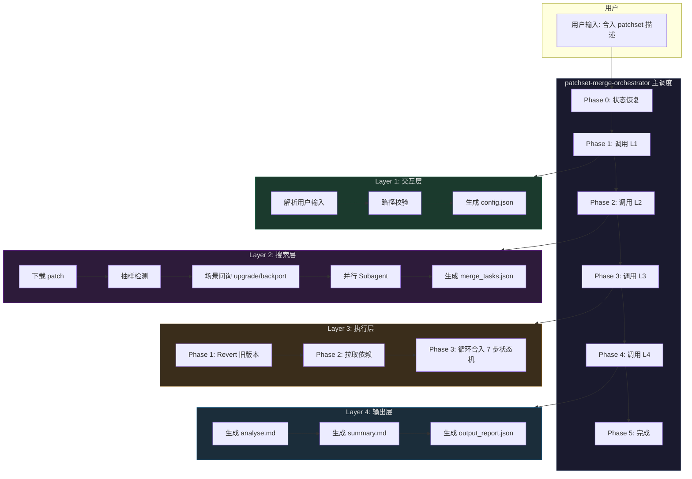

### 2.2 层间数据流

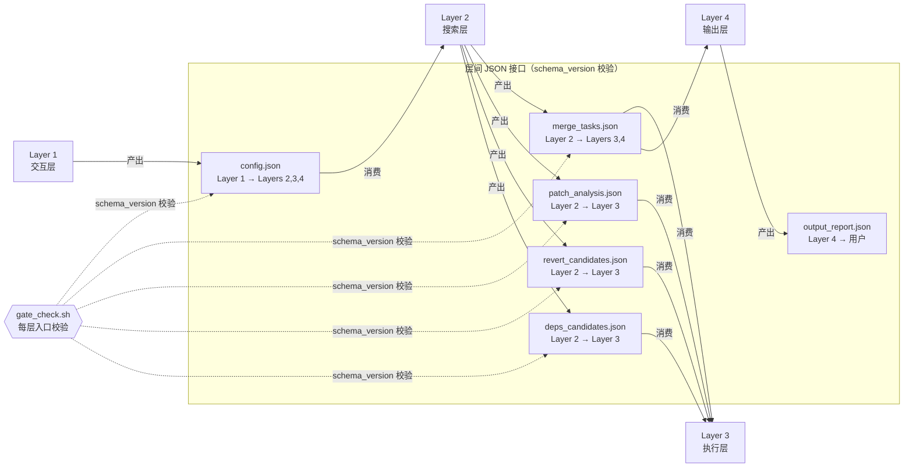

---

## 3. Layer 详解

### 3.1 Layer 1 — 交互层

**职责**: 解析用户输入、校验路径、自动检测基线和架构、生成 config.json。

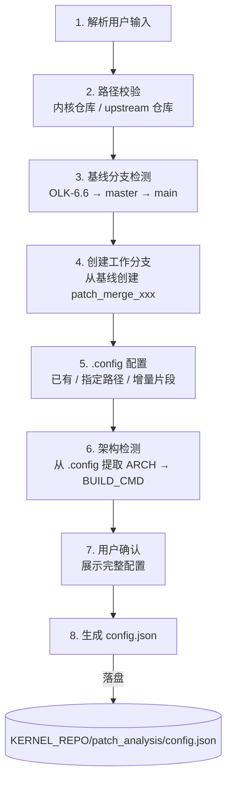

**产出的 config.json 关键字段**:

| 字段 | 说明 | 示例 |
|------|------|------|
| `patch_source` | patch 来源 | `message-id: <xxx@lore.kernel.org>` |
| `kernel_repo_path` | 目标仓库路径 | `/root/code/openeuler/kernel` |
| `kernel_branch` | 操作分支 | `patch_merge_HDBSS_v3` |
| `baseline_branch` | 基线分支 | `OLK-6.6` |
| `kernel_arch` | 目标架构 | `arm64` |
| `build_cmd` | 编译命令 | `make ARCH=arm64 -j$(nproc)` |
| `output_dir` | 输出根目录 | `patchmerge/patch_merge_HDBSS_v3_output` |
| `scene` | 合入场景（Layer 2 回写） | `upgrade` / `backport` |

---

### 3.2 Layer 2 — 搜索层

**职责**: 下载 patch、检测旧版本、场景问询、并行 Subagent 搜索、AI 汇总生成 merge_tasks.json。

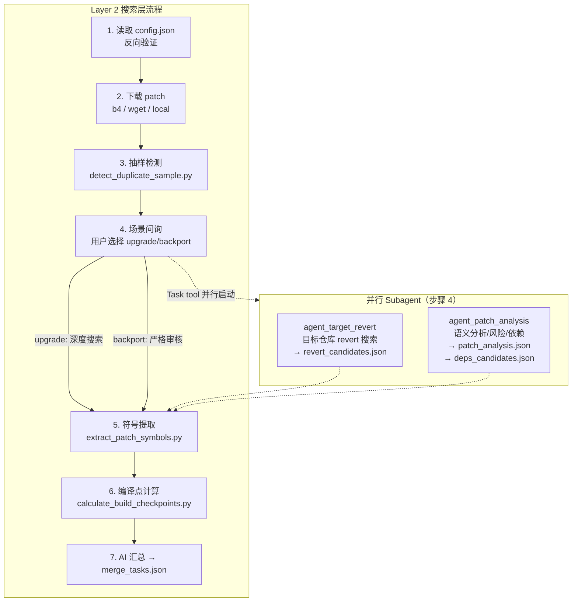

**Layer 2 Subagent 详解**:

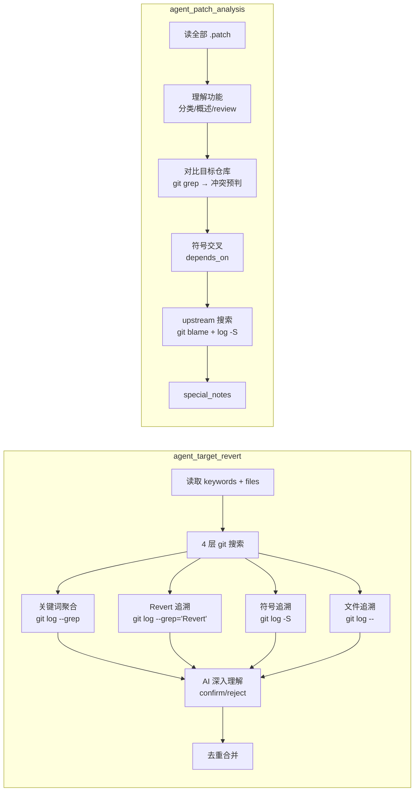

**产出的 merge_tasks.json 结构**:

```json
{
  "schema_version": "1.0",
  "merge_order": [
    {
      "seq": 1,
      "task_id": "0001",
      "action": "apply",
      "patch_file": "/tmp/patches/0001-xxx.patch",
      "pre_revert": ["abc123"],
      "depends_on": [],
      "build_checkpoint": true,
      "checkpoint_reason": {"rules_triggered": ["Rule_1"], "primary_reason": "infra patch"}
    }
  ],
  "deps_order": [],
  "current_state": null
}
```

---

### 3.3 Layer 3 — 执行层

**职责**: 串行 merge、编译验证、commit、review。最复杂的层，包含三阶段执行和 7 步状态机。

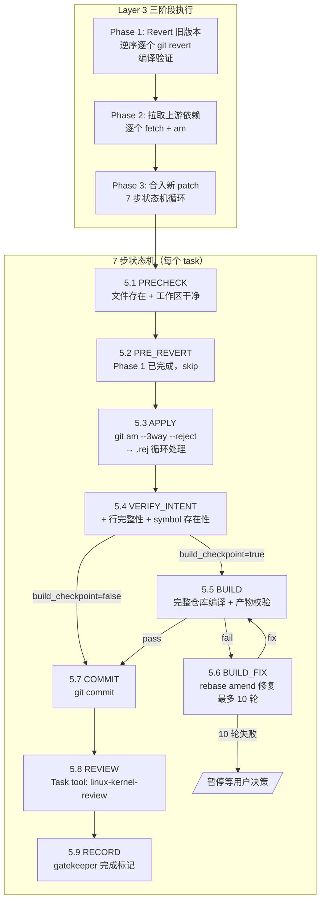

**7 步状态机前置依赖链**:

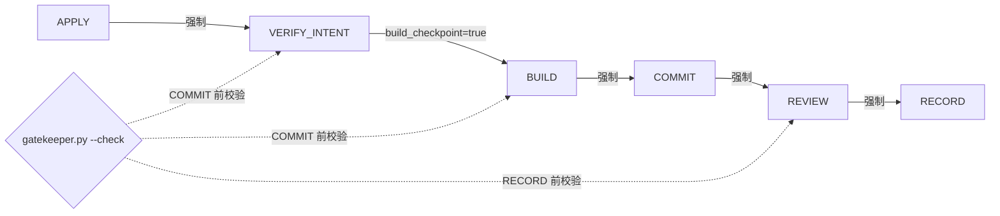

**步骤 5.3 APPLY 冲突解决流程**:

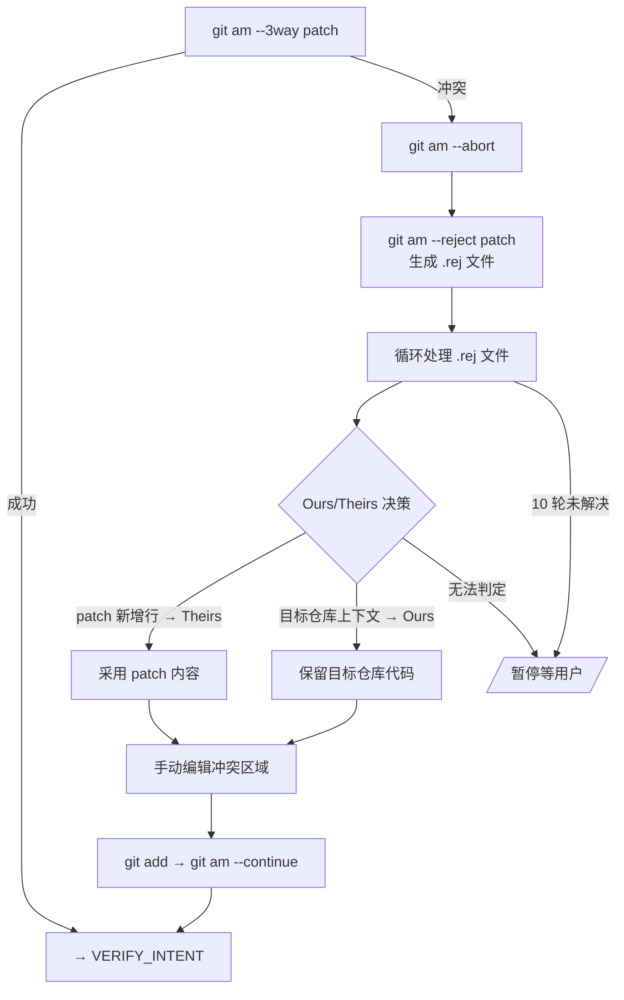

---

### 3.4 Layer 4 — 输出层

**职责**: 生成所有 analyse.md 和 summary.md，验证输出完整性，产出 output_report.json。

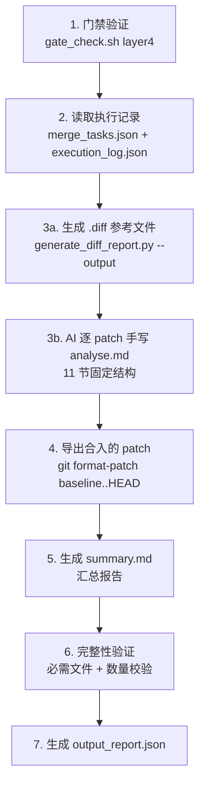

**analyse.md 11 节结构**:

| 节 | 内容 | 生成方式 |
|----|------|----------|
| 1 | 基本信息（patch 编号/标题/作者/涉改文件） | AI 从 JSON 提取 |
| 2 | 功能描述与关联模块 | AI 语义分析 |
| 3 | 依赖分析（高版本/bugfix/内部/重复） | AI 从 Subagent 结果汇总 |
| 4 | Revert 需求评估 | AI 从 revert_candidates 提取 |
| 5 | 风险程度 | AI 从 patch_analysis 提取 |
| 6 | 人工 Review 需求度 | AI 判断 |
| 7 | 建议验证冒烟内容 | AI 建议 |
| 8 | 合入实际经验（冲突/编译修复/重试） | AI 从 execution_log 汇总 |
| 9 | 与源 Patch 的差异对比（逐行对比表） | AI 参考 .diff 文件生成 |
| 10 | 编译验证记录（错误数/产物/重试） | AI 从 gatekeeper 记录提取 |
| 11 | Review 建议与改进方向 | AI 深度分析 |

---

## 4. 通用 Skill 模块

### 4.1 conflict-resolver — Git 冲突自动解决

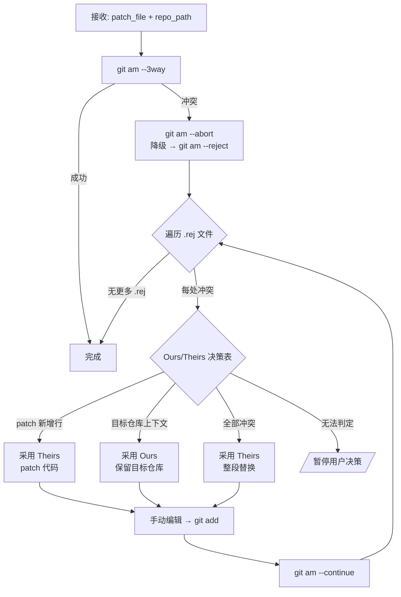

**10 场景决策表（节选）**:

| 场景 | 冲突内容 | 决策 | 理由 |
|------|---------|------|------|
| 1 | patch 在文件末尾新增行 | Theirs | 无上下文冲突 |
| 2 | patch 修改函数内部，目标相同函数有不同代码 | Theirs | patch 引入新功能 |
| 3 | patch 删行，目标该行有本地修改 | Ours | 保护目标仓库适配 |
| 4 | patch + 目标均新增了不同函数在同位置 | Both | 保留两者，手工调整 |
| 5 | patch 改 Makefile/Kconfig | 暂停 | 编译控制文件需人工审核 |

### 4.2 linux-kernel-review — 内核 Patch 专项 Review

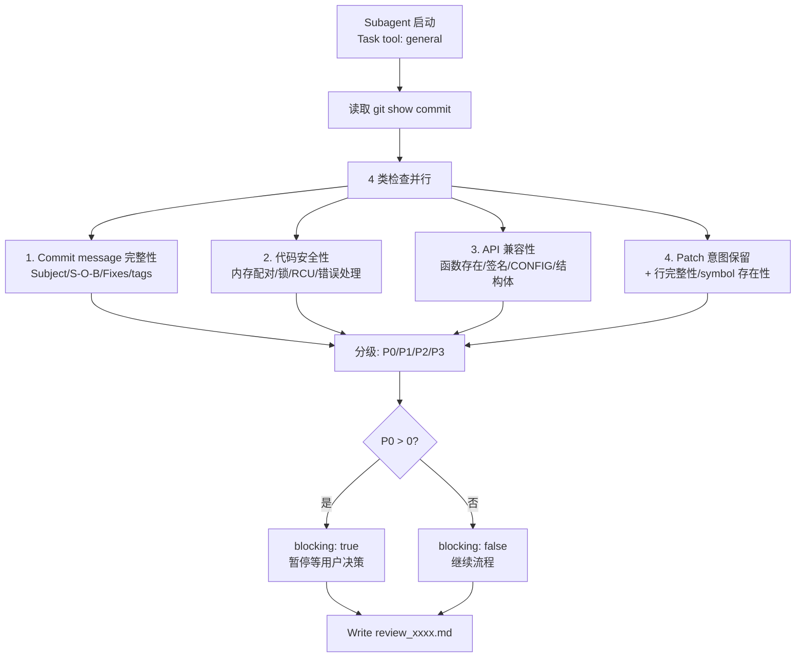

**Review 严重度分级**:

| 级别 | 含义 | 示例 | 操作 |
|------|------|------|------|
| P0 | 内存泄漏/死锁/符号缺失/API 不兼容 | kmalloc 无 kfree | 必须修复 |
| P1 | 逻辑错误/锁问题/+ 行丢失 | 错误路径释放不完整 | 建议修复 |
| P2 | message 不完整/API 签名差异 | 缺少 Fixes tag | 信息记录 |
| P3 | 风格/格式/次要建议 | 缩进不一致 | 可选改进 |

### 4.3 agent_patch_analysis — 语义分析 Subagent

独立 Subagent（Task tool: general），在 Layer 2 步骤 4 并行启动。读取全部 .patch 文件，深度理解后产出 `patch_analysis.json`。

**6 步流程**:

| 步骤 | 操作 | 产出字段 |
|------|------|----------|
| 1 | 读 commit msg + diff → 理解功能 | `功能分类`, `功能概述`, `review_required` |
| 2 | git grep 目标仓库 → 预判冲突 | `conflicts_predicted`, `risk_level` |
| 3 | 符号交叉分析 → 内部依赖 | `depends_on` |
| 4 | upstream git blame/log -S → deps | `blame_hits`, `deps_candidates.json` |
| 5 | 提炼注意事项 | `special_notes` |
| 6 | 决定 AM 策略 | `execution_guide.am_mode`（reject/3way） |

Layer 3 在 git am 前读取 `patch_analysis.json`，根据 `risk_level` 和 `conflicts_predicted` 调整 AM 模式。

---

## 5. 脚本层

### 5.1 shared-scripts（7 个）

| 脚本 | 行数 | 职责 | 调用时机 |
|------|------|------|----------|
| `gatekeeper.py` | 357 | 7 步状态机门禁：记录/检查/恢复 | Layer 3 每步调用 |
| `verify_patch_intent.py` | 272 | APPLY 后意图校验（+ 行 + symbol） | Layer 3 步骤 5.4 |
| `extract_patch_symbols.py` | 214 | 从 .patch 提取符号和分类 | Layer 2 步骤 7 |
| `calculate_build_checkpoints.py` | 304 | 7 条规则计算编译检查点 | Layer 2 步骤 8 |
| `generate_analyse_md.py` | 423 | 确定性生成 analyse.md（保留，当前不调用） | — |
| `generate_diff_report.py` | 503 | 源 patch vs 实际 commit 偏离对比 | Layer 2 步骤 3, Layer 4 步骤 3a |
| `generate_summary_md.py` | 223 | 从 analyse.md 汇总 summary.md | Layer 4 步骤 5 |

### 5.2 orchestrator/scripts（5 个）

| 脚本 | 行数 | 职责 | 调用时机 |
|------|------|------|----------|
| `gate_check.sh` | 223 | 层间 JSON 存在性/有效性/schema_version 校验 | 每层入口 |
| `validate_json.py` | 45 | JSON 必填字段校验 | gate_check 内部 |
| `download_patches.py` | 389 | 统一下载（b4/wget/local）| Layer 2 步骤 2 |
| `detect_duplicate.py` | 1123 | 旧版本完整检测（PR 聚合+diff 相似度）| 保留不调用 |
| `detect_duplicate_sample.py` | 150 | 快速抽样检测（<1s）| Layer 2 步骤 3 |

---

## 6. 门禁体系

### 6.1 双层门禁

```
┌─────────────────────────────────────────────────────┐
│                    门禁体系                          │
├─────────────────────┬───────────────────────────────┤
│   gate_check.sh     │       gatekeeper.py           │
│   层间门禁           │       层内状态机门禁           │
├─────────────────────┼───────────────────────────────┤
│ 校验内容:            │ 校验内容:                      │
│ - JSON 存在性/非空   │ - 前置步骤是否 pass            │
│ - JSON 可解析性      │ - build_checkpoint 编译要求    │
│ - schema_version     │ - VERIFY_INTENT 前置 COMMIT   │
│ - 必填字段完整性     │ - REVIEW 前置 RECORD           │
│ - 路径一致性         │ - 恢复模式（--restore）        │
├─────────────────────┼───────────────────────────────┤
│ 执行: 每层入口前     │ 执行: 每步状态转换时            │
│ 粒度: Layer 级       │ 粒度: Task 级（7 步状态机）     │
│ 退出码: 10-30       │ 退出码: 0-10                   │
└─────────────────────┴───────────────────────────────┘
```

### 6.2 schema_version 版本控制

所有层间 JSON 文件必须包含 `schema_version` 字段（当前 `"1.0"`）。gate_check.sh 在每层入口校验前置文件的版本是否匹配，不匹配则拒绝进入。

接口变更必须执行 **7 步传播规则**:
1. 更新 `schema_version` 版本号（+0.1）
2. 更新消费层 SKILL.md 中的读取逻辑
3. 更新 `gate_check.sh` 期望值
4. 更新 `references/` 下的 schema 文档
5. 更新 Python 脚本适应新字段
6. 更新 `docs/field_reference.md` 生产者/消费者关系
7. 运行集成测试验证

---

## 7. 文件与目录结构

```
patchset-merge-v2/
├── AGENTS.md                             # 开发规范与硬性约束
├── README.md                             # 项目说明
├── install.sh / uninstall.sh             # 安装/卸载脚本
│
├── patchset-merge-orchestrator/          # 主调度 Skill
│   ├── SKILL.md                          # 5 Phase 调度流程 + 恢复机制
│   ├── scripts/                          # 5 个脚本（门禁/下载/检测）
│   └── references/                       # 5 个参考文档
│
├── layer1-interaction/                   # Layer 1: 用户交互
│   ├── SKILL.md                          # 8 步交互流程
│   └── references/                       # 2 个参考文档
│
├── layer2-search/                        # Layer 2: 搜索
│   ├── SKILL.md                          # 10 步搜索流程 + 并行 Subagent
│   ├── agents/
│   │   └── agent_patch_analysis_SKILL.md # 语义分析 Subagent
│   └── references/                       # 8 个 schema 文档
│
├── layer3-execution/                     # Layer 3: 执行
│   ├── SKILL.md                          # 6 步执行流程 + 7 步状态机
│   └── references/                       # 3 个参考文档
│
├── layer4-output/                        # Layer 4: 输出
│   ├── SKILL.md                          # 7 步输出流程
│   └── references/                       # 3 个参考文档
│
├── conflict-resolver/                    # 独立模块: 冲突解决
│   ├── SKILL.md                          # git am 冲突自动解决
│   └── references/
│       └── decision_table.md             # 10 场景 Ours/Theirs 决策表
│
├── linux-kernel-review/                  # 独立模块: 内核 Review
│   └── SKILL.md                          # 4 类 19 项检查清单
│
├── shared-scripts/                       # 7 个复用 Python 脚本
│
├── docs/                                 # 设计文档
│   ├── architecture.md                   # 本文档
│   ├── field_reference.md                # 字段生产者/消费者关系
│   └── superpowers/                      # 规范与计划
│
└── tests/                                # 集成测试
    └── test_integration.sh
```

---

## 8. 关键设计决策

| 决策 | 说明 |
|------|------|
| **Subagent 用 Task tool: general** | Cannbot/opencode 只支持 `explore` 和 `general` 两种类型，搜索/分析 Agent 用 `general` |
| **review 用独立 Subagent** | 隔离上下文，避免主 AI 既做 merge 又 review 自己（无 fresh eyes） |
| **analyse.md 由 AI 手写** | 脚本生成的 markdown 太刻板，AI 从模板生成质量更高 |
| **编译前 rm -f Image** | 防止 make timestamp 优化跳过实际编译（虚假通过） |
| **多产物动态校验** | 解析 BUILD_CMD 目标 → Image 始终检查 + modules 按 MODPOST 判定 |
| **config.json 双写** | 保留 `patch_analysis/` 作为固定入口，同时归档到 `$OUTPUT_DIR/` |
| **输出目录隔离** | `patchmerge/<分支名>_output/`，不同分支互不干扰 |
