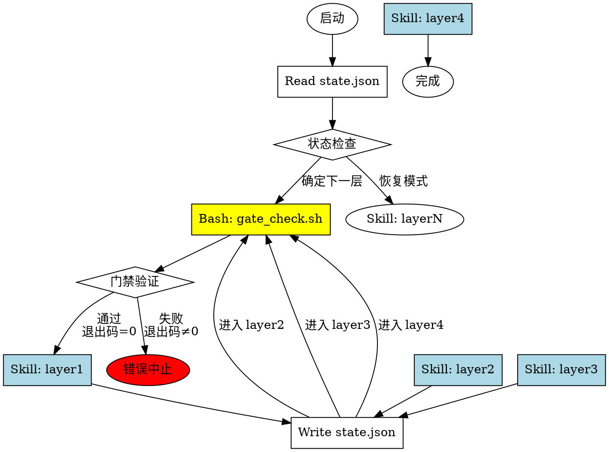

# Patchset-Merge 分层架构设计文档

**设计日期**: 2026-06-10  
**设计目标**: 解决现有 patchset-merge skill 的核心痛点，实现清晰的四层架构  
**架构模式**: Skill 内控制流 + 最小确定性脚本 + Skill 串联模式  

---

## 1. 概述

### 1.1 核心痛点

现有 patchset-merge skill 存在以下关键问题：

| 痛点 | 具体表现 | 影响 |
|------|---------|------|
| **层次耦合** | Phase 和 Agent 职责划分不清晰 | 修改一个模块影响全局流程 |
| **职责混乱** | Subagent 分工不合理（agent_analysis + agent_revert） | 难以维护和扩展 |
| **AI 遗忘** | 输出文档被 AI 遗忘或丢失 | 无法恢复执行状态 |
| **脚本超时** | 慢模型环境下 Python 脚本超时 | 流程中断无法继续 |
| **git apply 丢 message** | 降级链允许 git apply | commit message 丢失 |

### 1.2 设计目标

1. **清晰的分层架构** - 四层职责明确，层间完全隔离
2. **强制执行机制** - Skill 串联 + 门禁验证 + 状态文件，确保流程不被跳过
3. **AI 遗忘规避** - 强制落盘 + 完整性验证，不依赖 AI 记忆
4. **超时容错** - Skill 内控制流 + 最小脚本（<5s），避免超时中断
5. **commit message 保护** - 强制 git am，循环处理 .rej，禁止 git apply

### 1.3 架构模式确认

经过多轮讨论，确认采用以下组合方案：

- **基础模式**: 方案 D（Skill 内控制流 + 最小确定性脚本）
- **组织方式**: 方案 C（Skill 串联模式）
- **实现路径**: 路径 C（混合方案：新建 Skill 框架 + 复用脚本 + 降级机制）

---

## 2. 整体架构

### 2.1 Skill 文件组织结构

```
patchset-merge-v2/
├── patchset-merge-orchestrator/      # 主调度 Skill
│   ├── SKILL.md                      # ~300 lines
│   ├── scripts/
│   │   ├── gate_check.sh             # 门禁验证 (<1s)
│   │   ├── validate_json.py          # JSON schema 验证 (<1s)
│   │   ├── verify_build.sh           # 编译验证 (make 命令)
│   │   ├── download_patches.py       # Patch 下载 (保留，执行时间可控)
│   │   └── check_files_exist.sh      # 文件存在性检查 (<1s)
│   └── references/
│       ├── layer_interface_schema.md # JSON 接口定义
│       ├── state_schema.md           # state.json 定义
│       └── fallback_guide.md         # 降级机制指南
│
├── layer1-interaction/               # 用户交互层
│   ├── SKILL.md                      # ~400 lines
│   └ references/
│       ├── config_schema.md          # config.json 定义
│       └── user_interaction_guide.md
│
├── layer2-search/                    # 搜索层
│   ├── SKILL.md                      # ~500 lines
│   ├── agents/
│   │   ├── agent_target_revert.md    # 目标仓库搜索 Subagent
│   │   └── agent_upstream_deps.md    # Upstream 依赖搜索 Subagent
│   ├── scripts/
│   │   └ extract_patch_symbols.py    # 符号提取 (<3s)
│   └ references/
│       ├── search_strategy.md        # 搜索策略指南
│       ├── revert_candidates_schema.md
│       ├── deps_candidates_schema.md
│       └ merge_tasks_schema.md
│       └ patch_symbols_schema.md
│
├── layer3-execution/                 # 执行层
│   ├── SKILL.md                      # ~600 lines
│   ├── agents/
│   │   ├── agent_conflict_resolver.md # 冲突解决 Subagent
│   └ references/
│       ├── execution_state_machine.md # 状态机定义
│       ├── analyse_template.md        # analyse.md 模板
│       ├── conflict_decision_tree.md  # Ours/Theirs 决策树
│       ├── build_fix_strategy.md      # BUILD_FIX 策略详解
│
├── layer4-output/                    # 输出层
│   ├── SKILL.md                      # ~300 lines
│   └ references/
│       ├── summary_template.md        # summary.md 模板
│       └ output_checklist.md         # 输出完整性检查项
│
└── shared-scripts/                   # 从现有 patchset-merge 复用
    ├── calculate_build_checkpoints.py  # 保留 (<2s)
    ├── generate_diff_report.py         # 保留 (<5s)
    ├── generate_analyse_md.py          # 保留 (<2s)
    ├── generate_summary_md.py          # 保留 (<2s)
    ├── verify_patch_intent.py          # 保留 (<1s)
    ├── gatekeeper.py                   # 保留（状态机核心）
    └── extract_patch_symbols.py        # 保留 (<3s)
```

### 2.2 强制执行流程



### 2.3 层间数据传递接口

| 层 | 输入 | 输出 | 接口文件 |
|-----|------|------|---------|
| Layer 1 | 用户描述 | 配置信息 | `config.json` |
| Layer 2 | `config.json` | 搜索结果 | `revert_candidates.json` + `deps_candidates.json` + `merge_tasks.json` |
| Layer 3 | `merge_tasks.json` | 执行记录 | `analyse.md` 系列 + `execution_log.json` |
| Layer 4 | `execution_log.json` + `analyse.md` 系列 | 汇总报告 | `summary.md` + `output_report.json` |

### 2.4 状态文件设计 (state.json)

```json
{
  "session_id": "timestamp-feature-hash",
  "kernel_repo": "/path/to/kernel",
  "kernel_branch": "patch_merge_HDBSS",
  "kernel_arch": "arm64",
  "current_layer": "layer3",
  "layer_status": {
    "layer1": {
      "status": "completed",
      "skill_invoked": "layer1-interaction",
      "output_files": ["config.json"],
      "gate_check_exit_code": 0,
      "completed_at": "ISO timestamp",
      "duration_seconds": 45
    },
    "layer2": {
      "status": "completed",
      "skill_invoked": "layer2-search",
      "output_files": ["revert_candidates.json", "deps_candidates.json", "merge_tasks.json"],
      "subagents": ["agent_target_revert", "agent_upstream_deps"],
      "gate_check_exit_code": 0,
      "completed_at": "ISO timestamp",
      "duration_seconds": 180
    },
    "layer3": {
      "status": "in_progress",
      "skill_invoked": "layer3-execution",
      "current_task_id": "0005",
      "current_step": "BUILD",
      "tasks_completed": ["0001", "0002", "0003", "0004"],
      "gate_check_exit_code": 0,
      "started_at": "ISO timestamp"
    },
    "layer4": {
      "status": "pending",
      "output_files": []
    }
  },
  "error_log": [],
  "fallback_log": []
}
```

---

## 3. Layer 1 - 用户交互层设计

### 3.1 核心职责

从用户一句话描述中提取配置、校验路径、确认模式，输出结构化 config.json。

### 3.2 核心特性

- **纯 Skill 内逻辑** - 不调用任何 Python 脚本
- **Bash 快命令** - 所有操作使用 Bash 工具执行（不会超时）
- **用户交互** - 使用 Question 工具确认场景

### 3.3 执行流程

#### 步骤 1: 解析用户输入

从用户描述中提取：
- `PATCH_SOURCE`（patch 来源）
- `KERNEL_REPO_PATH`（目标仓库）
- `KERNEL_BRANCH`（目标分支）
- `UPSTREAM_REPO_PATH`（上游仓库，可选）

使用 Bash 工具执行 grep/sed 快命令。

#### 步骤 2: 路径校验

```bash
test -d "$KERNEL_REPO" || exit 10
test -d "$KERNEL_REPO/.git" || exit 11
```

#### 步骤 3: 自动配置提取

```bash
KERNEL_ARCH=$(grep -oP 'CONFIG_ARM64=y' .config || echo "x86_64")
KERNEL_BRANCH=$(git branch --show-current)
BUILD_CMD="make ARCH=$KERNEL_ARCH -j$(nproc)"
```

#### 步骤 4: 场景确认

使用 Question 工具展示配置并确认。

#### 步骤 5: Write config.json

```json
{
  "patch_source": "<PATCH_SOURCE>",
  "kernel_repo_path": "<KERNEL_REPO>",
  "kernel_branch": "<KERNEL_BRANCH>",
  "kernel_arch": "<KERNEL_ARCH>",
  "build_cmd": "<BUILD_CMD>",
  "upstream_repo_path": "<UPSTREAM_REPO 或 null>",
  "scene": "unknown",
  "user_input_original": "<USER_INPUT>"
}
```

### 3.4 config.json Schema

```json
{
  "$schema": "http://json-schema.org/draft-07/schema#",
  "title": "Patchset-Merge Config",
  "required": ["patch_source", "kernel_repo_path", "kernel_branch", "kernel_arch", "build_cmd"],
  "properties": {
    "patch_source": {"type": "string"},
    "kernel_repo_path": {"type": "string"},
    "kernel_branch": {"type": "string"},
    "kernel_arch": {"type": "string", "enum": ["arm64", "x86_64", "arm", "riscv"]},
    "build_cmd": {"type": "string"},
    "upstream_repo_path": {"type": ["string", "null"]},
    "scene": {"type": "string", "enum": ["upgrade", "backport", "unknown"]}
  }
}
```

---

## 4. Layer 2 - 搜索层设计

### 4.1 核心职责

并行启动两个 Subagent 搜索 revert 候选和 upstream 依赖，AI 汇总合并后生成 merge_tasks.json。

### 4.2 核心特性

- **Subagent 并行** - 一条消息内同时启动两个 Task
- **不调 Python 脚本** - Subagent 内使用 Bash git 命令
- **AI 汇总** - 主 Agent 在 Skill 内合并逻辑（迁移 topo_sort.py 等）
- **降级机制** - JSON 验证失败 → AI 手工检查

### 4.3 Subagent 定义

#### agent_target_revert

**职责**: 搜索目标仓库需要 revert 的 commit

**执行方式**:
1. Bash: `git log --grep=<keyword>`
2. Bash: `git log -- <file>`
3. Read: `git show <commit>`
4. AI 判断: confirm/reject/need_review
5. Write: `revert_candidates.json`

#### agent_upstream_deps

**职责**: 搜索 upstream 仓库依赖 patch

**执行方式**:
1. Bash: `git log -S <symbol>`
2. Bash: `git log --grep="Fixes:"`
3. Read: `git show <commit>`
4. AI 判断: confirm/reject
5. Write: `deps_candidates.json`

### 4.4 AI 汇总逻辑（迁移自 topo_sort.py）

#### 依赖排序

```markdown
步骤 1: 读取 patch 原始顺序
```bash
cd /tmp/patches
PATCH_ORDER=$(ls 0*.patch | sed 's/.patch//' | sort)
```

步骤 2: 检测反向依赖（AI 判断）
遍历每个 patch：
  - 若 patch_i 引用 patch_j (j>i) 的符号 → 反向依赖

步骤 3: 用户决策处理方案
Question: [1] 保持原始顺序（推荐） / [2] 调整顺序

步骤 4: 计算 build_checkpoint（AI 按规则判定）
规则优先级：
  1. 反向依赖者 → false
  2. 反向依赖被依赖者 → true
  3. 含 pre_revert → true
  4. infra patch → true
  5. 高风险 → true
  6. 最后一个 patch → true
  7. skip/doc → false
  8. 功能模块分组最后一个 → true
  9. 其他 → false
```

### 4.5 输出文件 Schema

#### revert_candidates.json

```json
{
  "candidates": [
    {
      "commit_hash": "abc123",
      "subject": "...",
      "similarity_score": 0.82,
      "ruling": "confirm",
      "ruling_reason": "旧版本 HDBSS 实现",
      "revert_cmd": "git revert abc123"
    }
  ],
  "keywords_used": ["HDBSS"],
  "files_searched": ["arch/arm64/kvm/hdbss.c"]
}
```

#### deps_candidates.json

```json
{
  "dependencies": [
    {
      "commit_hash": "def456",
      "subject": "stage2 页表重构",
      "introduced_symbols": ["stage2_map"],
      "ruling": "confirm",
      "pull_cmd": "b4 am <msgid>"
    }
  ]
}
```

---

## 5. Layer 3 - 执行层设计

### 5.1 核心职责

串行执行 merge 流程：APPLY → VERIFY_INTENT → BUILD → COMMIT → REVIEW，每 patch 完成后落盘 analyse.md。

### 5.2 核心约束

<HARD-GATE>
1. **串行执行** - merge 步骤不可并行
2. **每 patch commit** - N 个 patch 产生 N 个 commit
3. **build_checkpoint 控制** - 仅在 checkpoint=true 编译验证
4. **强制落盘** - 每 commit 完成后立即 Write analyse.md
5. **门禁验证** - 每步骤调用 gatekeeper.py 标记状态

禁止操作：
❌ git apply（会丢失 commit message）
❌ git am --skip（会跳过 patch）
❌ git reset --hard（会删除 commit）
</HARD-GATE>

### 5.3 APPLY 降级链（修正版）

```bash
### 尝试 1: git am --3way

git am --3way "$patch_file"

if [ $? -eq 0 ]; then
  echo "✅ git am 成功，commit message 已保留"
  continue to VERIFY_INTENT
else
  ### 尝试 2: git am --3way --reject
  git am --abort
  git am --3way --ignore-space-change --keep-cr --reject "$patch_file"
  
  ### 循环处理 .rej 文件（while 循环）
  while [ -n "$(find . -name '*.rej')" ]; do
    for rej_file in $(find . -name "*.rej"); do
      Read: "$rej_file"
      Read: 目标文件
      AI 判断如何填入
      Edit: 目标文件
      Bash: rm "$rej_file"
    done
  done
  
  ### 尝试 3: git add + git am --continue
  git add -A
  git am --continue
  
  if [ $? -eq 0 ]; then
    echo "✅ 成功"
  else
    # 循环继续（最多 10 轮）
    RETRY_COUNT=$((RETRY_COUNT + 1))
    if [ $RETRY_COUNT -ge 10 ]; then
      Question: 失败处理选项
    fi
  fi
fi
```

### 5.4 BUILD_FIX 策略（新增）

<HARD-GATE>
编译失败时，绝对禁用：
❌ git reset --hard（删除 commit）
❌ git reset --soft（改变历史）
❌ 批量 git commit --amend（未验证）

允许操作：
✅ git rebase -i HEAD~N（交互式修复特定 patch）
✅ git commit --amend --no-edit（仅 amend 出错 patch）
✅ 最小化代码修复（只修复编译错误）
</HARD-GATE>

#### 根因定位流程

**步骤 1**: 确定 checkpoint 组范围
```bash
python3 -c "
# 找上一个 checkpoint → 当前 checkpoint
# 输出组内 patch 范围
"
```

**步骤 2**: 提取编译错误信息
```bash
Read: $KERNEL_REPO/patch_analysis/build_logs/$task_id_build.log
提取:
  error_file: drivers/gpu/arm/mali_kbase_core.c:150
  error_symbol: kbase_reg_write
  error_function: GPU register write
```

**步骤 3**: 反查 patch（三重匹配）
- 文件匹配: error_file ∈ task.files_changed
- 符号匹配: error_symbol ∈ task.introduced_symbols ∪ referenced_symbols
- 功能匹配: error_function == task.功能分类

**步骤 4**: 定位结果
```
[BUILD_FAIL] 定位错误源：
  检查范围: 0002 → 0005
  组内 patch:
    0004: drivers/gpu/arm/mali_kbase_core.c ← 文件匹配 ✅
    0003: mali_kbase_common.h ← 符号匹配
  定位结果: 0004 文件匹配 + 0003 符号定义
  建议: amend 0004 修复代码
```

**步骤 5**: rebase amend 修复流程
```bash
N=<出错 patch 到当前 checkpoint 的 patch 数>
git rebase -i HEAD~$N
# 标记出错 patch 为 edit

vim <错误文件>
# AI 用 Edit 工具最小修复

make ARCH=$KERNEL_ARCH -j$(nproc)  # 验证修复
git add <只修改的文件>            # 禁止 -A
git commit --amend --no-edit      # 不改 message
git rebase --continue

# checkpoint 重新编译验证
make ARCH=$KERNEL_ARCH -j$(nproc)
```

**步骤 6**: 记录修复日志
```bash
python3 $SCRIPTS_DIR/gatekeeper.py \
  --step BUILD_FIX \
  --fix-source-task <出错 patch> \
  --fix-type <错误类型>
```

#### 编译失败分类处理

| 错误类型 | 判断依据 | 处理方式 |
|---------|---------|---------|
| patch 代码语法错误 | error 行在 patch 文件 | 编辑源文件最小修复 |
| patch 代码逻辑错误 | undefined symbol ∈ introduced_symbols | 添加符号定义或 stub |
| 调用不存在符号 | symbol 不在任何 patch 的 introduced_symbols | 标记缺失上游依赖 |
| 非 patch 的 config 问题 | error 涉及 CONFIG_XXX 未定义 | 临时改 .config → make → git restore |
| 类型不匹配 | 函数签名冲突 | 最小适配类型 |

### 5.5 状态机流程

```
PRECHECK → PRE_REVERT → APPLY → VERIFY_INTENT → BUILD → COMMIT → REVIEW → RECORD → DONE
```

每个步骤调用 gatekeeper.py 标记状态。

### 5.6 agent_conflict_resolver Subagent

**职责**: 分析 .rej 文件 + 冲突文件 + patch 意图，输出 Ours/Theirs 决策

**输入**:
- patch_file 路径
- 所有 .rej 文件内容
- 冲突文件 diff
- references/conflict_decision_tree.md（Ours/Theirs 规则）

**输出**: resolution.json
```json
{
  "resolution_steps": [
    {
      "step": 1,
      "action": "edit_file",
      "file": "arch/arm64/kvm/arm.c",
      "line_insert_after": 120,
      "content": "完整代码片段",
      "reason": "patch 新增 HDBSS handler，必须保留"
    }
  ]
}
```

---

## 6. Layer 4 - 输出层设计

### 6.1 核心职责

读取所有 analyse.md + execution_log.json，生成 summary.md 汇总报告，强制验证输出文件完整性。

### 6.2 核心约束

<HARD-GATE>
输出文件必须落盘！不依赖 AI 记忆。

验证规则：
1. 所有 analyse.md 文件必须存在且非空
2. summary.md 必须存在且非空
3. output_report.json 必须包含完整性检查结果

若验证失败 → 中止并输出缺失文件列表
</HARD-GATE>

### 6.3 执行流程

#### 步骤 1: 门禁验证
```bash
bash $SCRIPTS_DIR/gate_check.sh layer4 $KERNEL_REPO_PATH
# 检查所有 analyse.md 存在
```

#### 步骤 2-3: 读取执行记录
```bash
Read: execution_log.json
Read: merge_tasks.json
Read: 所有 *-analyse.md 文件
```

#### 步骤 4: 生成 summary.md
```bash
python3 $SCRIPTS_DIR/generate_summary_md.py \
  --merge-tasks merge_tasks.json \
  --analysis-dir patch_analysis \
  --output summary.md

# AI 补充以下内容：
  - 整体合入经验总结
  - 典型冲突案例分析
  - 性能指标
  - 用户建议
```

#### 步骤 5: 生成 diff 报告
```bash
python3 $SCRIPTS_DIR/generate_diff_report.py \
  --patch-dir /tmp/patches \
  --output-dir patch_analysis
```

#### 步骤 6: 输出完整性验证
```bash
# 检查必需文件存在且非空
REQUIRED_FILES=(config.json merge_tasks.json execution_log.json summary.md)
for file in $REQUIRED_FILES; do
  test -f "$file" || exit 10
  test -s "$file" || exit 11
done

# 检查 analyse.md 数量匹配
ANALYSE_COUNT=$(ls *-analyse.md | wc -l)
PATCH_COUNT=$(grep -c "done" merge_tasks.json)
[ "$ANALYSE_COUNT" -eq "$PATCH_COUNT" ] || exit 12
```

#### 步骤 7: Write output_report.json
```json
{
  "session_id": "...",
  "total_patches": 15,
  "patches_applied": 14,
  "build_checkpoints": 5,
  "conflicts_resolved": 8,
  "output_files": {
    "config.json": {"exists": true, "size_bytes": 512},
    "analyse_files": {"count": 15}
  },
  "verification_status": "all_passed"
}
```

---

## 7. 强制执行保障

### 7.1 硬性调用链

主 Skill (patchset-merge-orchestrator) 定义：

```markdown
<HARD-GATE>
执行顺序强制锁定：

1. 必须首先调用 layer1-interaction
2. 等待 layer1 完成（config.json 生成）后，才能调用 layer2-search
3. 等待 layer2 完成后，才能调用 layer3-execution
4. 等待 layer3 完成后，才能调用 layer4-output

违反顺序 = 立即中止
</HARD-GATE>
```

### 7.2 门禁验证脚本 (gate_check.sh)

```bash
#!/bin/bash
# 执行时间 <1秒

LAYER=$1
KERNEL_REPO=$2

case $LAYER in
  layer2)
    test -f "$KERNEL_REPO/patch_analysis/config.json" || exit 10
    ;;
  layer3)
    test -f "$KERNEL_REPO/patch_analysis/revert_candidates.json" || exit 20
    test -f "$KERNEL_REPO/patch_analysis/deps_candidates.json" || exit 21
    test -f "$KERNEL_REPO/patch_analysis/merge_tasks.json" || exit 22
    ;;
  layer4)
    ls "$KERNEL_REPO/patch_analysis"/*-analyse.md >/dev/null 2>&1 || exit 30
    ;;
esac

exit 0
```

### 7.3 状态文件持久化

每层完成后立即 Write state.json：
```bash
Write: $KERNEL_REPO/.patchmerge/state.json
{
  "current_layer": "layer3",
  "layer_status": {
    "layer1": {"status": "completed"},
    "layer2": {"status": "completed"},
    "layer3": {"status": "in_progress"}
  }
}
```

恢复机制：
```markdown
启动时 Read state.json：
  - 若 layer1 已完成 → 检查 layer2 前置 → 从 layer2 继续
  - 若 layer2 已完成 → 检查 layer3 前置 → 从 layer3 继续
```

---

## 8. 与现有 patchset-merge 对比

### 8.1 冲突解决策略差异

| 维度 | 现有方案 | 新设计方案 | 差异影响 |
|------|---------|-----------|---------|
| **降级路径** | git am → git apply --reject | git am → git am --reject（循环） | **修正严重错误** |
| **.rej 处理** | 单次处理 | while 循环处理 | **增强保障** |
| **重试机制** | 无上限 | 最多 10 轮 | **新增约束** |
| **git am --skip** | 未明确禁止 | ❌ 完全禁止 | **强制约束** |

**关键问题修正**：
现有方案允许 git apply → 丢失 commit message（严重错误）  
新设计强制 git am → 保护 commit message

### 8.2 编译校验策略差异

| 维度 | 现有方案 | 新设计方案 | 差异影响 |
|------|---------|-----------|---------|
| **build_checkpoint** | ✅ 已有 | ✅ 保留 | 无差异 |
| **编译禁止表** | ✅ 已有 | ✅ 保留 | 无差异 |
| **产物验证** | ✅ 已有 | ✅ 保留 | 无差异 |
| **BUILD_FIX 策略** | ✅ 已有 rebase amend | ✅ **详细补充** | **增强说明** |
| **禁用 git reset** | ✅ 已明确 | ✅ **强调** | **增强约束** |

**新设计补充**：
- BUILD_FIX 详细流程（6 步骤 + 三重匹配）
- 明确禁用 git reset 约束（HARD-GATE）
- 编译失败分类处理表

### 8.3 需要保留的部分

- ✅ Ours/Theirs 决策表（references/conflict_decision_tree.md）
- ✅ VERIFY_INTENT 验证逻辑（verify_patch_intent.py）
- ✅ gatekeeper.py 状态机核心
- ✅ 编译禁止表（禁止局部编译、单项编译）

---

## 9. 实现路径（路径 C）

### 9.1 新建 Skill 串联框架

创建 5 个新 Skill：
1. `patchset-merge-orchestrator`（主调度）
2. `layer1-interaction`
3. `layer2-search`
4. `layer3-execution`
5. `layer4-output`

### 9.2 复用脚本清单

**保留脚本**（执行时间可控，<5s）：
- `download_patches.py`
- `validate_json.py`
- `verify_build.sh`
- `gatekeeper.py`
- `extract_patch_symbols.py`
- `calculate_build_checkpoints.py`
- `generate_diff_report.py`
- `generate_analyse_md.py`
- `generate_summary_md.py`
- `verify_patch_intent.py`

**迁移逻辑到 Skill 内**（超时风险高）：
- `topo_sort.py` → Layer 2 AI 汇总逻辑
- `merge_order_sort.py` → Layer 2 AI 汇总逻辑
- `detect_duplicate.py` → Layer 2 Subagent 内 Bash 命令
- `generate_revert_plan.py` → Layer 3 PRE_REVERT 步骤
- `execute_revert.py` → Layer 3 PRE_REVERT 步骤（Skill 内 Bash）

### 9.3 降级机制设计

| 场景 | 正常执行 | 降级方案 |
|------|---------|---------|
| **JSON 验证失败** | validate_json.py（<1s） | AI 手工检查 JSON 字段 |
| **符号提取失败** | extract_patch_symbols.py（<3s） | AI 从 patch 手工提取 |
| **Subagent 超时** | Task subagent | 主 Agent 直接执行 Bash 命令 |

---

## 10. 文件清单与目录结构

详见第 2.1 节 Skill 文件组织结构。

### 10.1 每个 Skill 的核心文件

| Skill | 核心文件 | 大小预估 | 关键内容 |
|-------|---------|---------|---------|
| orchestrator | SKILL.md | ~300 lines | 硬性调用链 + 门禁验证 |
| layer1 | SKILL.md | ~400 lines | Bash 解析 + config.json |
| layer2 | SKILL.md | ~500 lines | Subagent + AI 汇总 |
| layer3 | SKILL.md | ~600 lines | 状态机 + APPLY + BUILD_FIX |
| layer4 | SKILL.md | ~300 lines | 强制验证 + summary |

### 10.2 references/ 文件清单

总计 16 个参考文档：
- JSON schema 定义（7 个）
- 模板定义（3 个）
- 指南文档（6 个）

---

## 11. 附录

### 11.1 JSON Schema 定义合集

见各层设计章节的 Schema 定义。

### 11.2 Bash 快命令清单（不会超时）

| 命令类型 | 执行时间 | 用途 |
|---------|---------|------|
| `grep/sed/awk` | <1s | 文本提取 |
| `git log --grep` | <2s | commit 搜索 |
| `git show <hash>` | <1s | 查看 commit |
| `test -f` | <1s | 文件检查 |
| `ls/find` | <1s | 文件列举 |
| `make ARCH=...` | make 命令本身 | 编译验证 |

### 11.3 降级机制详细步骤

见第 9.3 节。

---

## 总结

本设计文档完整定义了 patchset-merge 分层架构：

1. **四层职责明确** - Interaction、Search、Execution、Output
2. **强制执行保障** - 硬性调用链 + 门禁验证 + 状态文件
3. **核心痛点解决** - 超时容错、AI 遗忘规避、commit message 保护
4. **与现有方案对比** - 修正 git apply 错误、补充 BUILD_FIX 策略
5. **实现路径清晰** - 新建 Skill 框架 + 复用脚本 + 降级机制

下一步：调用 writing-plans skill 创建详细实现计划。