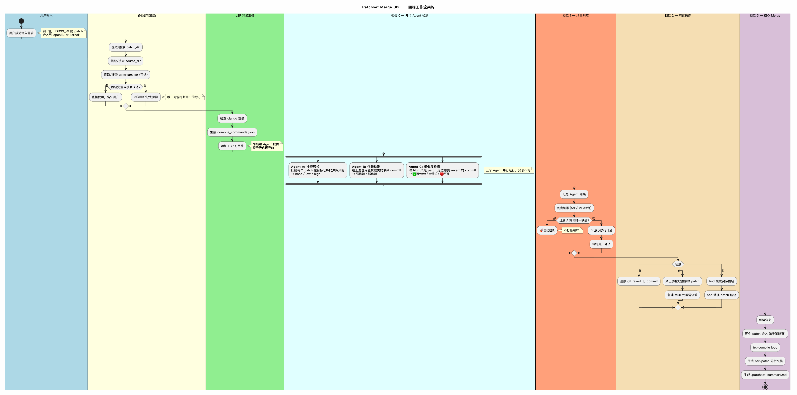
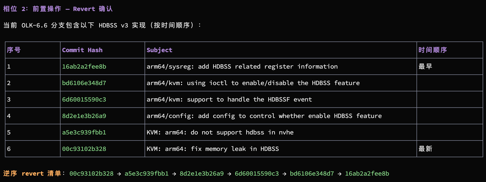
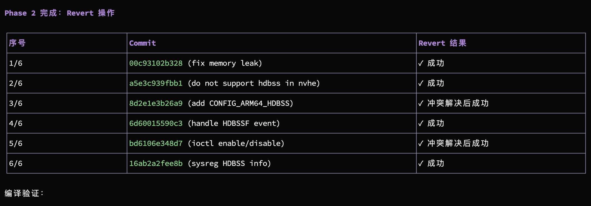
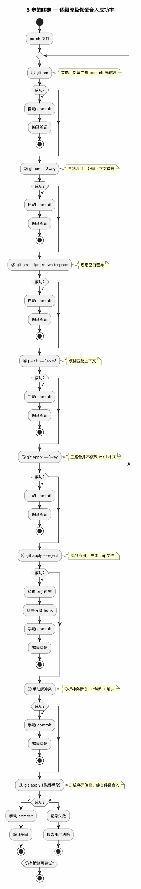
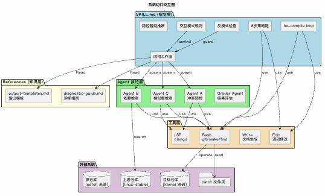
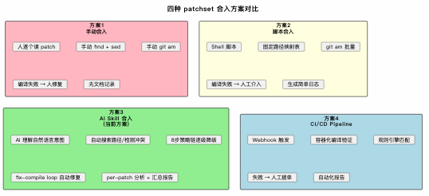

# Patchset Merge Skill — 技术分享报告

> 撰写日期：2026-05-22

---

## 1. 背景与动机

Linux 内核开发中，patchset 跨分支合入是高频操作。openEuler 等下游发行版需要持续从上游（linux-stable、Linaro、各 SIG 组）合入补丁，面临三个核心痛点：

| 痛点 | 传统方式 | 实际代价 |
|------|---------|---------|
| **路径差异** | 手动 find + sed 替换 patch 路径 | 每个 patchset 5-15 分钟 |
| **旧版本冲突** | 人工判断是否需要 revert，逐 commit 操作 | 容易漏掉依赖，导致编译失败 |
| **依赖缺失** | 编译失败 → 查日志 → git log 搜上游 → 手动挑 commit | 单次排查 20-60 分钟 |

merge-patchset skill 的目标是：**让 AI 自动完成检测、判定、执行的全流程，人只需要在关键决策点确认。**

---

## 2. 整体架构

### 2.1 四相工作流

> PlantUML 源文件: [diagrams/workflow-overview.puml](diagrams/workflow-overview.puml)







### 2.2 8 步策略链条（Phase 3 核心）

> PlantUML 源文件: [diagrams/strategy-chain.puml](diagrams/strategy-chain.puml)



### 2.3 组件交互图

> PlantUML 源文件: [diagrams/component-interaction.puml](diagrams/component-interaction.puml)




---

## 3. 内核多分支适配方案

### 3.1 当前适配能力矩阵

合入 patch 到不同内核分支时面临四类差异，skill 的应对如下：

| 差异类型 | 具体表现 | Skill 应对机制 | 对应场景 | 成熟度 |
|---------|---------|---------------|---------|--------|
| **路径差异** | 同一驱动在不同分支路径不同（如 `drivers/net/` vs `drivers/net/ethernet/vendor/`） | `find` 搜索文件名 → `sed` 替换 patch 路径 → 展示映射 | E — 路径适配 | ✅ 成熟 |
| **代码版本差异** | 目标分支已有旧版本实现（如 SIG 组提前回合的初版驱动） | Agent C 相似度检测 → git blame 追溯 → 安全评估 → 逆序 revert | B — 先 Revert | ✅ 成熟 |
| **依赖缺失** | 目标分支缺少 patch 依赖的前置 commit（新宏、新函数、新类型） | Agent B 在上游搜索 → 强/弱分级 → 拉取或 stub | C — 补依赖 | ⚠ 需上游路径 |
| **配置差异** | 不同分支的 Kconfig / defconfig 不同 | fix-compile loop 中临时修改 → commit 后还原 | Phase 3 内置 | ✅ 成熟 |
| **API 变更** | 目标分支的内核 API 版本不同（如 `kmalloc` 参数变化） | 8 步策略链中的 ②③ 自动适应；⑦ 手动解决 | Phase 3 内置 | ✅ 成熟 |
| **并发合入** | 多个 patchset 同时在相近代码区域合入 | 工作区不干净检测 → 警告用户 | Phase 3.1 | ⚠ 需人工协调 |

### 3.2 多分支场景示例

```
场景：将 HDBSS_v3 驱动 patchset 合入 3 个不同分支

分支 A (linux-stable 5.10):
  ├── 路径: drivers/net/ethernet/hisilicon/hdbss/  (新驱动，路径不存在)
  ├── 前置代码: 无
  ├── 判定: 场景 A + E (路径适配 + 干净合入)
  └── 结果: 🚀 自动完成

分支 B (openEuler 5.10):
  ├── 路径: drivers/net/ethernet/hisilicon/hdbss/  (已有旧版)
  ├── 前置代码: v1 版本驱动 (commit abc123)
  ├── 判定: 场景 B + E (revert 旧版 + 路径适配)
  └── 结果: ⚠ 确认 revert 后自动完成

分支 C (openEuler 6.6):
  ├── 路径: drivers/net/ethernet/hisilicon/hdbss/  (已有 v2)
  ├── 前置代码: v2 版本 + 依赖 commit def456 (来自上游)
  ├── 判定: 场景 B + C (revert + 补依赖)
  └── 结果: ⚠ 确认 revert + 依赖拉取后自动完成
```

---

## 4. 方案对比

### 4.1 四种合入方案对比

> PlantUML 源文件: [diagrams/solution-comparison.puml](diagrams/solution-comparison.puml)



### 4.2 六维度量化对比

| 维度 | 方案1: 手动合入 | 方案2: Shell 脚本 | **方案3: AI Skill** | 方案4: CI/CD |
|------|:---:|:---:|:---:|:---:|
| **单 patchset 耗时** | 30-120 分钟 | 10-30 分钟 | **3-15 分钟** | 5-20 分钟(不含排队) |
| **冲突处理能力** | 依赖个人经验 | 规则固定，不灵活 | **LSP 增强 + 8 策略链** | 规则引擎，需预定义 |
| **依赖发现** | 编译失败后人工排查 | 不支持 | **Agent B 自动搜索+分级** | 不支持 |
| **路径适配** | 手动 find + sed | 硬编码映射表 | **自动 find + 智能映射** | 需预配置 |
| **可追溯性** | 依赖个人记录 | 简单日志 | **逐行 diff 分析文档** | 自动化报告 |
| **学习成本** | 高（需 git 深度知识） | 中（需脚本维护能力） | **低（自然语言交互）** | 高（需 CI/CD 平台能力） |
| **异常处理** | 人灵活决策 | 脚本中断，人工介入 | **AI 自主分析→修复→重试** | Pipeline 失败，人工处理 |
| **批量并行** | 不可并行 | 不可并行 | 3 Agent 并行检测 | 可并行 |
| **维护成本** | — | 映射表持续维护 | **修改指令即可** | Pipeline 配置维护 |

### 4.3 关键差异分析

```
方案选择决策树:

需要处理多种内核分支? 
├── 否 → 方案2 (脚本) 或 方案4 (CI/CD)
└── 是 → 分支间差异类型多吗?
    ├── 仅路径差异 → 方案2 (维护映射表)
    └── 路径 + 代码版本 + 依赖差异 → 方案3 (AI Skill)

合入频率?
├── 每天 ≥ 5 个 → 方案3 或 方案4
├── 每周 1-5 个 → 方案3 (推荐)
└── 偶尔 → 方案1 或 方案3

对可追溯性要求?
├── 需要审计 → 方案3 (per-patch 分析文档)
└── 不需要 → 方案2 或 方案4
```

### 4.4 AI Skill 方案的核心优势

1. **意图理解而非命令执行**：用户说"把 HDBSS_v3 合入 kernel"，AI 自动推理 patch_dir 和 source_dir
2. **检测前置而非事后修复**：Agent A/B/C 并行检测，提前知道冲突、依赖、revert 需求
3. **策略自适应降级**：`git am` → `git am --3way` → ... → `git apply`，8 级逐步降级
4. **自主修复循环**：编译失败 → 分析错误 → 修复源码 → 重编译，不中断流程
5. **完整的审计追踪**：每个 patch 的逐行 diff 对比、冲突解决思考过程、编译修复记录

---

## 5. 修改演进记录

### 5.1 版本演进时间线

> PlantUML 源文件: [diagrams/version-timeline.puml](diagrams/version-timeline.puml)

### 5.2 关键修改记录

| 日期 | 版本 | 修改内容 | 解决的问题 |
|------|------|---------|-----------|
| 2026-05-10 | v0 | 初始 SKILL.md，含四相工作流、8步策略链、fix-compile loop | 建立基础框架 |
| 2026-05-11 | v1 | 添加 `compatibility: claude-code, opencode`；重写 preamble 为平台感知版本；install.sh 支持多平台部署 + Tier 2 降级版本生成 | Claude Code / OpenCode 双平台支持 |
| 2026-05-11 | v1 | 同步更新 revert-patchset SKILL.md；重写 README 多平台文档 | 保持一致 |
| 2026-05-22 | v2 | **新增「路径智能推断」章节**：4 级优先级（提取→搜索→推断→询问），含 `find` 搜索模板 | OpenCode 频繁询问路径问题 |
| 2026-05-22 | v2 | **Phase 1 分级确认**：场景 A → 自动继续；场景 E（唯一映射）→ 自动继续；B/C/组合 → 确认 | 干净合入无需等待 |
| 2026-05-22 | v2 | **交互模式重写**：核心原则 + 分级确认表 + 6 条反模式自检清单 | 减少不必要的用户打断 |
| 2026-05-22 | v2 | **反模式扩充**：禁止搜到结果还确认、禁止干净合入停下来、禁止重复询问 | 行为约束 |
| 2026-05-22 | v2 | 同步更新 `references/output-templates.md` 的 Phase 1 模板和输出规则 | 模板与规则一致 |

### 5.3 v2 修改的核心设计理念

```
问题: OpenCode 每次都要停下来问路径

根因分析:
┌─────────────────────────────────────────────────────────┐
│ 1. 路径不完整时没有告诉 AI "可以自己去搜"                  │
│ 2. Phase 1 一刀切要求确认，不区分场景                      │
│ 3. 反模式只说"不要重复问"，没说"能搜就不要问"               │
│ 4. OpenCode 原生行为偏保守，缺少 karpathy-guidelines 指导   │
└─────────────────────────────────────────────────────────┘

解决策略:
┌─────────────────────────────────────────────────────────┐
│ 1. 路径智能推断: 给 AI 具体的 find 命令模板               │
│ 2. 分级确认: 可逆操作自动继续，不可逆才确认                 │
│ 3. 强化反模式: "搜到唯一结果直接用"变成硬规则               │
│ 4. 把决策权交给 AI: description 里写 "NEVER ask"          │
└─────────────────────────────────────────────────────────┘
```

---

## 6. 当前状态总结

### 6.1 能力地图

| 能力 | 状态 | 说明 |
|------|:----:|------|
| 路径自动推断 | ✅ | 支持关键词搜索、上下文推断、常见路径搜索 |
| 冲突预检 (Agent A) | ✅ | LSP 优先，grep 回退，三级风险评估 |
| 依赖检测 (Agent B) | ✅ | 强/弱分级，需指定 upstream |
| 相似度检测 (Agent C) | ✅ | 三级 revert 判定，含依赖链分析 |
| 路径适配 (场景 E) | ✅ | 自动 find + sed，唯一映射自动继续 |
| Revert 合入 (场景 B) | ✅ | 逆序 revert + 安全评估 |
| 依赖补全 (场景 C) | ✅ | 强依赖拉取 + 弱依赖 stub |
| 8步策略链 | ✅ | git am → ... → git apply 逐级降级 |
| fix-compile loop | ✅ | 分析→修复→重编译，环境问题自动还原 |
| per-patch 分析文档 | ✅ | 逐行 diff 对比 + 冲突解决思考过程 |
| 汇总报告 | ✅ | 风险评级 + 热力图 |
| Claude Code 支持 | ✅ | 原生支持 |
| OpenCode 支持 | ✅ | 原生支持 |
| 其他平台降级 | ✅ | Gemini CLI / Copilot / Cursor / 通用 |
| **干净合入自动继续** | ✅ | v2 新增 |
| **只问必要问题** | ✅ | v2 新增 |

### 6.2 已知局限与后续方向

| 局限 | 影响 | 后续方向 |
|------|------|---------|
| 编译验证仅支持 Makefile/CMakefile/build.sh | 特殊构建系统需手动编译 | 支持用户自定义编译命令 |
| 上游仓库需手动指定路径 | 依赖检测需额外输入 | 利用 git remote 自动推断 |
| LSP 仅支持 clangd | 非 C/C++ 项目无符号导航 | 扩展其他 LSP 支持 |
| 不支持 patch 冲突的自动合并 | 冲突时靠 8 策略链降级 | 探索 AI 辅助三路合并 |

### 6.3 后续任务清单

| TODO | 内容 | 状态 |
|------|------|:----:|
| TODO-0 | Phase 4 Code Review 流程设计 — 含 code-reviewer / security-reviewer 子 agent 调用 + `git rebase → commit --amend → rebase --continue` 的 Fix Loop | 🔴待解决 |
| TODO-1 | index.js 分析结论 — 现有 skill 均不使用 JS，纯指令驱动无需代码入口 | ✅已完成 |
| TODO-2 | Subagent 设计优化 — 建议将 agent prompt 从 SKILL.md 拆分到 agents/ 目录，含设计原则和调度写法示例 | 🟡规划中 |
| TODO-3 | Patch 拓扑排序算法 — 参考性能组方案，基于符号依赖矩阵 + Kahn/DFS 拓扑排序，面向大批量 CVE 回合场景 | 🟡规划中 |
| TODO-4 | 按 Tag 切基线遗留问题 — 6 个问题（基线识别、分支冲突、编译环境差异、安全补丁、revert 安全、路径组合），标注了状态 | 🔴待解决 |

---

## 7. 附录

### 7.1 项目文件结构

```
patchset-merge/
├── SKILL.md                         # merge-patchset 源文件 (~844 行)
├── karpathy-guidelines-SKILL.md     # AI 行为准则
├── install.sh                       # 多平台安装脚本
├── CLAUDE.md                        # Claude Code 项目指令
├── README.md                        # 项目文档
├── references/
│   ├── output-templates.md          # 输出模板 (Phase 0-3 对话/文档/报告)
│   └── diagnostic-guide.md          # 冲突/编译错误诊断指南
└── docs/
    └── merge-patchset-skill-report.md  # 本报告
```

### 7.2 技术栈

| 层 | 技术 | 用途 |
|----|------|------|
| 指令定义 | Markdown + YAML frontmatter | SKILL.md 本体 |
| AI 平台 | Claude Code / OpenCode | Skill 加载和执行 |
| 代码分析 | clangd (LSP) | 符号导航、调用链分析 |
| 版本控制 | git (am/apply/revert/format-patch/blame/log) | 所有合入操作 |
| 编译 | make / cmake / build.sh | 编译验证 |
| 部署 | Bash (install.sh) | 多平台安装 + 降级版本生成 |
