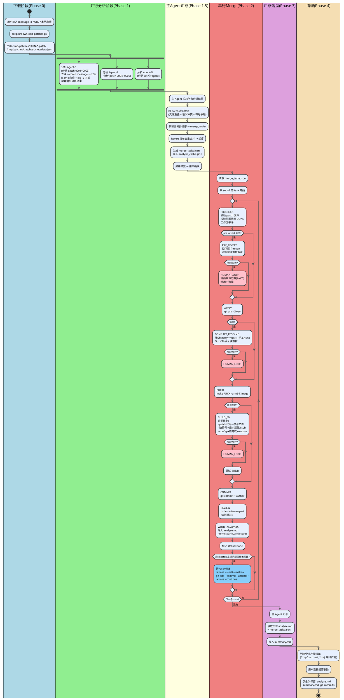

# OpenCode Skill: merge-patchset 设计文档

## 概述

一个用于 Linux 多仓代码合入解冲突的多 Agent OpenCode Skill。核心能力：从高版本 Linux 源端获取 patchset，深度分析依赖和冲突，逐 patch 合入目标内核仓库，最小化解冲突并编译验证。

## 总览（PlantUML）



---

## 运行环境

| 项 | 值 |
|----|-----|
| Runtime | OpenCode Skill（主），Claude Code 兼容 |
| LLM 后端 | DeepSeek v4-pro（Anthropic 兼容 API） |
| 目标内核仓库 | `~/code/openeuler/kernel/`，分支 `patch-pmu-partitioning` |
| 架构 | ARM64 |
| 编译目标 | `make ARCH=arm64 Image` |
| 关键工具 | b4 0.15.2, python3, git |

---

## 文件结构

```
merge-patchset/
├── SKILL.md                           # OpenCode Skill 主文件
├── AGENTS.md                          # 本仓库说明
├── references/
│   ├── code-review-expert/            # 捆绑的 code-review skill
│   │   └── SKILL.md
│   ├── output-templates.md            # analyse.md 模板
│   └── diagnostic-guide.md            # 冲突诊断决策树指南
├── scripts/
│   ├── download_patches.py            # b4/wget/本地 统一下载
│   └── generate_diff_report.py        # 生成完整 patch diff
└── docs/superpowers/specs/
    └── 2026-05-22-merge-patchset-design.md  # 本文档
```

---

## 核心约束（刚性）

1. **逐个合入 + 逐个 commit**：N 个 patch = N 个 commit，不允许批量
2. **每 1 个 task 完成后停下**，等用户确认后再继续
3. **每 commit 完成后调 code-review-expert skill review**
4. **revert 也逐个 commit**：逆序 revert（最新→最旧）
5. **每合入一个 patch 必须编译验证**：`make ARCH=arm64 Image`，0 error + Image 产物存在
6. **merge 必须串行执行**：merge 步骤不可并行
7. **前期分析阶段是只读操作**，可以并行
8. **中文输出**：所有思考、解释、报告
9. **只取改动行**：只应用 `+`/`-` 行，上下文行不强制合入
10. **修改严格归属于所属 patch**：不允许将无关改动混入其他 patch 的 commit
11. **编译通过 + 功能正常是第一指标**，两者同等优先级

---

## 两大使用场景

### 场景 A：高版本源端合入

从高版本 Linux 源端合入 patchset：
- **向后找 bugfix**：git blame 追溯 patch 代码行的上游历史，定位 Fixes 标签引用的 bugfix
- **向前找依赖**：git log -S 搜索引用符号，找到引入 commit；若缺失则标记为高版本依赖
- 速度快、定位精准

### 场景 B：本地实现 + 新版本代码合并

本地已有实现代码，需合并新版本：
- 判断目标仓库是否有高依赖 patch
- 评判机制：是否回退本地实现
  - 独立特性实现 → 建议全部回退
  - 局部修改 → 分析回退范围

---

## Agent 架构

### 调度模型

外部编排：Skill 本身不 spawn 子 agent。SKILL.md 描述工作流，Phase 1 输出结构化分析结果，由上层调度器或用户分发给对应 agent。Phase 2 由 merge agent 串行执行 `merge_tasks.json`。

### Agent 种类

| Agent | 阶段 | 性质 | 数量 |
|-------|------|------|------|
| 分析 Agent | Phase 1 | 并行，只读 | 按 patch 数动态分配 |
| 主 Agent（汇总） | Phase 1.5 | 串行，只读 | 1 |
| Merge Agent | Phase 2 | 串行，写入 | 1 |
| 主 Agent（汇总） | Phase 3 | 串行，只读 | 1（同 Phase 1.5 的 agent） |

### 分析 Agent 分配策略

| Patch 总数 | 每 agent 负责 | Agent 数 |
|-----------|-------------|---------|
| ≤3 | 全部 | 1（主 Agent 兼任） |
| 4-8 | 2-3 个 | 2-3 |
| ≥9 | ≤4 个 | N/4 向上取整 |

---

## Phase 0：下载（确定性脚本）

```
输入：用户提供 message-id / URL / 本地路径
执行：scripts/download_patches.py
输出：
   /tmp/patches/0001-<name>.patch ... 000N-<name>.patch
   /tmp/patches/patchset.metadata.json
```

b4 下载命令：`b4 am <message-id> -o /tmp/patches/`（若需代理先检查本地配置）

### patchset.metadata.json

```json
{
  "source": "lore.kernel.org message-id: <xxx>",
  "download_method": "b4|wget|local",
  "total_patches": 5,
  "target_kernel": "/root/code/openeuler/kernel",
  "target_branch": "patch-pmu-partitioning",
  "build_target": "make ARCH=arm64 Image",
  "patches": [
    {
      "id": "0001",
      "file": "/tmp/patches/0001-xxx.patch",
      "subject": "",
      "author": "",
      "date": "",
      "upstream_commit": ""
    }
  ]
}
```

### /tmp/patches/analysis_cache.json（Phase 1 → Phase 2 桥梁）

Phase 1 分析不写 analyse.md，但分析数据需传递给 Phase 2 的 WRITE_ANALYSIS。主 Agent 将所有分析 Agent 的结果合并写入此文件，merge agent 在 WRITE_ANALYSIS 时读取。

```json
{
  "0001": {
    "summary": "功能描述",
    "modules": "关联模块",
    "risk": "中",
    "risk_detail": "具体风险点",
    "revert_level": "建议",
    "revert_commits": ["abc123"],
    "revert_reason": "原因",
    "high_version_deps": ["缺失符号: commit"],
    "bugfix_deps": [{"symbol": "xx", "commit": "yy", "desc": "修复了什么"}],
    "internal_deps": ["0002"],
    "review_required": "高",
    "review_reason": "为什么",
    "smoke_tests": ["验证点1", "验证点2"],
    "full_diff": "完整 diff 文本或文件路径"
  }
}
```

---

## Phase 1：并行分析（纯交互，不写文件）

### 分析 Agent 行为

**优先级**：先深入理解 commit message → 再分析代码 diff

**输入**：分配的 patch 文件组 + metadata.json

**处理流程**：

1. **解析 patch**：提取 introduced_by_patch（新增/修改的符号）、referenced_symbols（调用的符号）、changed_files

2. **向后搜索 - Bugfix 发现**：
   - `git blame -L` 追踪修改行的后续改动
   - `git log --grep="Fixes:.*<commit>"` 查找 Fixes 标签
   - 递归追溯（bugfix 的 bugfix）

3. **向前搜索 - 依赖发现**：
   - `grep -rn <symbol>` 检查符号在目标内核是否存在
   - 不存在 → `git log -S "<symbol>"` 找到引入 commit
   - 递归检查引入 commit 是否也缺失（构建依赖树）
   - 若依赖以 patchset 形式引入 → 标记为依赖 patchset

4. **屏幕输出**（struct 格式）：
   ```
   [PATCH-0001]
   summary=功能描述
   modules=关联模块
   risk=高/中/低
   revert=必须|建议|无须 | commit_hash
   deps=缺失符号列表
   blame_hits=相关 bugfix commit
   review_required=高/中/低
   ```

### 主 Agent 汇总

**输入**：所有分析 Agent 的屏幕输出

**处理流程**：

1. **跨 patch 冲突检测**：
   - 文件修改集合重叠（直接重叠 / 相邻 <10 行）→ CONFLICT_HIGH
   - introduced 符号的交叉引用 → 语义冲突
   - used ∩ introduced → 强依赖

2. **依赖图 + 拓扑排序**：检测循环依赖，输出 merge_order

3. **全局 Revert 清单去重**：所有 agent 报告的 revert commit 去重合并，逆序排序

4. **生成 merge_tasks.json**：写入 `/tmp/patches/merge_tasks.json`

5. **屏幕输出预览** → 用户确认

---

## Phase 2：串行 Merge

### merge_tasks.json Schema

```json
{
  "patchset_info": {
    "source": "来源描述",
    "download_method": "b4|wget|local",
    "total_patches": 5,
    "target_kernel": "/root/code/openeuler/kernel",
    "target_branch": "patch-pmu-partitioning",
    "build_target": "make ARCH=arm64 Image"
  },
  "merge_order": [
    {
      "seq": 1,
      "task_id": "0001",
      "status": "pending",
      "patch_file": "/tmp/patches/0001-xxx.patch",
      "subject": "patch subject",
      "files_changed": ["file1.c", "file2.h"],
      "pre_revert": ["commit_hash"],
      "depends_on": ["task_id"],
      "risk_level": "高/中/低",
      "review_required": "高/中/低",
      "blame_hits": [
        {"file": "...", "func": "...", "commit": "...", "type": "bugfix"}
      ],
      "skip": false,
      "skip_dependency_impact": null,
      "conflicts_predicted": [
        {"file": "...", "func": "...", "reason": "具体冲突原因"}
      ],
      "special_notes": "",
      "execution_log": []
    }
  ],
  "global_revert_order": ["abc123", "def456"]
}
```

### merge_tasks.json 字段说明

| 字段 | 类型 | 说明 |
|------|------|------|
| `status` | string | `pending` / `in_progress` / `done` / `blocked` / `skipped` / `failed` |
| `skip_dependency_impact` | string/null | 被 skip 时有效：<br>**强**=后续 patch 修改同一文件或同一函数，跳过则后续全阻塞<br>**中**=后续 patch 引用此 patch 引入的符号（函数/宏/类型）<br>**弱**=后续 patch 与此 patch 在不同独立模块<br>`null`=未被 skip |
| `execution_log` | list | 追加式记录：`{"timestamp": "", "state": "PRECHECK", "result": "OK/FAIL", "detail": ""}` |
| `global_revert_order` | list | 顶层字段，全局 revert 的去重+逆序清单，merge agent 在 Phase 2 开头统一执行 |

### status 状态转换

```
pending → in_progress → done
   │          │
   ├──────────┼──→ blocked  （依赖未满足）
   │          │
   └──────────┼──→ failed   （10 轮失败，用户未选方案）
              │
              └──→ skipped   （用户选 skip）
```

### Merge Agent 状态机

```
[START]
  │
  ▼
PRECHECK ──失败──→ BLOCKED
  │
  ▼
PRE_REVERT ──失败(10轮)──→ FAILED → HUMAN_LOOP
  │
  ▼
APPLY ──失败──→ CONFLICT_RESOLVE ──失败(10轮)──→ FAILED → HUMAN_LOOP
  │                │
  │                └──成功──→ BUILD
  │
  ▼
BUILD ──失败──→ BUILD_FIX ──失败(10轮)──→ FAILED → HUMAN_LOOP
  │                │
  │                └──成功──→ BUILD（重试）
  │
  ▼
COMMIT
  │
  ▼
REVIEW
  │
  ▼
WRITE_ANALYSIS
  │
  ▼
[DONE] → 下一个 task
```

### 各状态详解

#### PRECHECK

- 校验 patch 文件存在
- 校验 depends_on 中所有 task_id 状态为 DONE
  - 若前置被 SKIP → 检查 skip_dependency_impact：强依赖则 BLOCKED，中/弱则允许继续
- 工作区干净检查：`git diff --quiet && git diff --cached --quiet`

#### PRE_REVERT

- 按逆序逐个 `git revert <commit> --no-edit`
- 冲突时按 ours/theirs 决策树解决
- 失败回滚：`git revert --abort` + 对已成功做 `git reset --hard HEAD~N`

#### APPLY

降级链：
```
git am --3way <patch>
  ├─ 成功 → BUILD
  └─ 失败 → git apply --3way --reject → 分析 .rej 手动填入
       └─ 仍失败 → 读 .patch 逐 hunk 手工匹配
```

#### CONFLICT_RESOLVE

Ours/Theirs 决策树：

| 场景 | Ours（本地） | Theirs（patch） | 抉择 |
|------|------------|----------------|------|
| 上下文行差异 | 真实上下文 | patch 的上下文 | **Ours** |
| 独立新功能 | 无对应代码 | 新函数/宏 | **Theirs** |
| 上游重构 vs 本地 | 上游新版本 | 同一功能重构 | **Theirs**（除非是 openEuler 特有） |
| 同 bug 不同修复 | 本地修复 | 上游修复 | **Theirs**（上游更权威） |
| 新功能 vs 本地 hack | 本地代码 | 上游新功能 | **建议 Theirs**，记录 ours 历史 |
| 独立本地特性 | 本地特性实现 | 无关上游改动 | **Revert ours → Theirs** |
| 无法判定 | — | — | **暂停，输出代码对比给用户裁定** |

#### BUILD

- `make ARCH=arm64 Image -j$(nproc)`
- 0 error + `arch/arm64/boot/Image` 存在 = 通过
- 超时 120 秒

#### BUILD_FIX

- 错误分类：
  - patch 代码本身错误 → 编辑源文件修复
  - 调用不存在符号 → 标记缺失，尝试最小适配或 stub
  - 非 patch 的 config 问题 → 临时改 `.config` → make → `git restore .config`
- 只改 patch 自己的文件，不改其他模块

#### 10 轮失败退出

累计 10 次仍未解决 → 深度分析根因 → 输出具体方案：

1. **冲突定位**：精确到文件:行号:函数名 + 错误原文
2. **根因分析**：ours vs theirs 代码对比 / 编译器错误原文 / 语义矛盾点
3. **具体推荐方案（2-4 个，每个可直接操作）**：
   - 方案 A: 具体操作步骤 → 影响范围 → 风险 → 所需额外工作
   - 方案 B: ...
   - ...
   - 方案 C: skip 此 patch（放倒数第二，标注后续依赖程度）
     - 后续 patch 依赖程度：强/中/弱
4. **推荐**（标注理由）

#### COMMIT

- `git commit -m "<patch subject>" --author="<patch author>"`
- 二次确认 `git diff --cached` 只含本 patch 文件

#### REVIEW

- 检测 `references/code-review-expert/SKILL.md` 是否存在
  - 存在 → 加载 skill，对 `HEAD~1..HEAD` 做 review
  - 不存在 → 跳过，标注"未做自动 review"
- review 意见：必须修复 → 标记需 rebase amend；建议 → 记录不阻塞

#### WRITE_ANALYSIS

写入 `./patch_analysis/<task_id>-<short-name>-analys.md`，内容合并：
- Phase 1 分析数据（功能/依赖/风险/revert）
- Phase 2 合入的实际经验（冲突解决/编译修复/roop 次数）
- 完整 diff（脚本生成）
- 编译验证记录

---

## 跨 Patch 修复流程（rebase + amend）

触发：后续发现前面已 commit 的 patch 有问题

```
1. git rebase -i HEAD~N → 目标 commit 标记 edit
2. 编辑文件 → 只改属于此 patch 的代码
3. make ARCH=arm64 Image → 0 error + Image
4. git add <只改过的文件>（禁止 -A）
5. git commit --amend（小修不改 message，大修追加 Fixup 说明）
6. git rebase --continue
7. 终验：make ARCH=arm64 Image
8. 更新 ./patch_analysis/<task_id>-analys.md 追加记录
```

---

## 任务恢复

重启时读 `merge_tasks.json`，找第一个 status ≠ "done" 的 task：
- 工作区干净 → 从 PRECHECK 开始
- 有未提交改动 → 提示用户清理
- 在 am 中间态 → `git am --abort`，重新开始

---

## 输出模板

### analyse.md 固定模板

```markdown
# Patch {task_id}: {subject}

## 1. 基本信息
| 项 | 值 |
|----|-----|
| 来源 commit | <hash> |
| 作者 | <name> |
| 涉改文件数 | N |
| 合入状态 | 成功/失败（原因） |

## 2. 功能描述与关联模块

## 3. 依赖分析
### 高版本依赖
### Bugfix 依赖（git blame 追溯）
### 前置 patch 依赖（本 patchset 内）

## 4. Revert 需求评估
| 必要性等级 | 必须/建议/无须 |
| 要 revert 的 commit | <hash> |
| 理由 | <> |

## 5. 风险程度（高/中/低）

## 6. 人工 Review 需求度（高/中/低）

## 7. 建议验证冒烟内容

## 8. 合入实际经验
<!-- Phase 2 完成后填充 -->

## 9. 与源 Patch 的完整 Diff

## 10. 编译验证记录
```

---

## Phase 3：汇总落盘

所有 task 的 `status` 为 `done` / `skipped` / `failed` 后，主 Agent：

```
1. 读取 ./patch_analysis/ 下所有 000N-*-analys.md
2. 读取 merge_tasks.json 获取执行历史
3. 按 summary.md 模板汇总
4. 写入 ./patch_analysis/summary.md
```

---

## 捆绑脚本规格

### scripts/download_patches.py

```
用途：统一入口，根据输入类型下载 patchset

输入参数：
  --source <message-id|url|local_dir>
  --output-dir /tmp/patches/
  --proxy （可选，HTTP 代理地址）

行为：
  - message-id → b4 am <msg-id> -o <output-dir>
  - URL（lore/patchwork）→ wget/b4 下载
  - 本地路径 → 复制 .patch 文件到 output-dir
  - 自动检测代理：先查环境变量 http_proxy/https_proxy

输出：
  - 标准化的 .patch 文件（0001-xxx.patch 格式）
  - patchset.metadata.json
```

### scripts/generate_diff_report.py

```
用途：对于已合入的 patch，生成原始 patch 与实际应用的完整 diff 对比

输入参数：
  --patch-file /tmp/patches/000N-xxx.patch
  --repo-path ~/code/openeuler/kernel/
  --commit <hash>   # 合入后的 commit

输出（stdout）：
  1. 原始 patch 内容（--source）
  2. 实际应用的 diff（git show <commit>）
  3. 差异对比（diff of diffs）：标出哪些行因为冲突解决而偏离了原始 patch

用于填充 analyse.md 的"第 9 节：与源 Patch 的完整 Diff"
```

### summary.md 模板

```markdown
# Patchset Merge 汇总报告

## 基本信息
| 项 | 值 |
|----|-----|
| 来源 | <message-id / URL> |
| Patch 总数 | N |
| 合入成功 | M |
| 跳过 | P |
| 失败 | Q |
| 目标分支 | <branch> |
| 操作时间 | <start> ~ <end> |

## 合入顺序与状态
| Seq | Patch | 状态 | 风险 | Review | 备注 |
|-----|-------|------|------|--------|------|
| 1 | 0001-xxx | done | 低 | 低 | |
| 2 | 0003-xxx | done | 中 | 高 | 依赖 0001 |
| 3 | 0002-xxx | done | 低 | 低 | 顺序调整 |

## 依赖关系图
（树形/缩进表示 patch 间依赖）

## Revert 记录
| Commit | 原因 | 关联 Patch |
|--------|------|-----------|
| abc123 | 本地实现冲突 | 0003 |

## 编译验证总览
| Patch | 编译结果 | error | 修复次数 |
|-------|---------|-------|---------|
| 0001 | 通过 | 0 | 0 |
| 0002 | 通过 | 0 | 2 |

## 跨 Patch 修复记录
（若有 rebase amend 记录在此）

## 全局风险汇总
- 高风险 patch：<列表>
- 建议重点人工 review：<列表>

## 待处理事项
- <阻塞的 patch 及依赖影响>
```

---

## Phase 4：清理中间产物

汇总落盘后，列出中间产物清单供用户选择删除。只列不删。

**永久保留（不动）：**
- `./patch_analysis/000N-*-analys.md`
- `./patch_analysis/summary.md`
- git commits

**可清理清单：**

| 路径 | 说明 |
|------|------|
| `/tmp/patches/0001-*.patch` ~ `000N-*.patch` | 下载的原始 patch 文件 |
| `/tmp/patches/patchset.metadata.json` | metadata |
| `/tmp/patches/merge_tasks.json` | 合并任务调度文件 |
| `/tmp/patches/analysis_cache.json` | Phase 1 分析缓存 |
| `*.rej`（内核仓库下） | git apply --reject 残留 |
| 编译产物（`*.o`、`arch/arm64/boot/Image` 等） | 内核编译中间文件 |

---

## 编码规范

遵循 karpathy-guidelines：
- 先思考再编码，明确假设
- 最简代码解决问题
- 手术式修改，不碰无关代码
- 以可验证目标驱动执行
