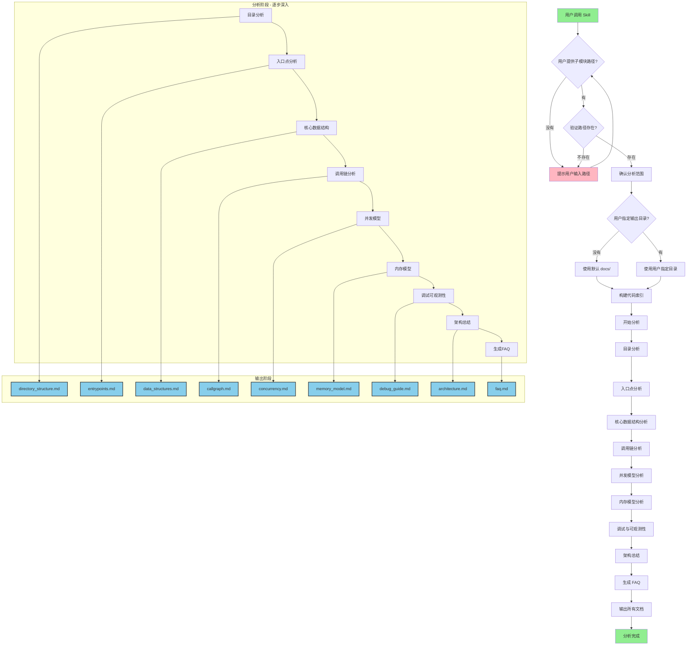

# Linux 内核模块学习 Skill 创建指南

当你需要创建一个 AI Skill 来自动学习 Linux 内核模块并生成文档时，请按以下步骤生成 steps.md：

---

## 技能运作流程图（Mermaid）



### 详细步骤流程

```
1. [接收输入] 用户调用 skill 并提供子模块路径
       ↓
2. [验证路径] 检查路径是否存在于代码仓库
       ↓
3. [确认范围] 显示将分析的文件和模块清单
       ↓
4. [构建索引] 执行 cscope/ctags 建立索引
       ↓
5. [目录分析] 分析目录结构、Makefile、Kconfig
       ↓
6. [入口点分析] 找出 module_init、probe 等入口
       ↓
7. [数据结构分析] 分析核心数据结构的生命周期
       ↓
8. [调用链分析] 追踪 ioctl、fast path、irq 等路径
       ↓
9. [并发分析] 分析锁、RCU、workqueue 等
       ↓
10. [内存分析] 分析 DMA、MMIO、IOMMU 等
       ↓
11. [调试分析] 识别 tracepoint、debugfs 等
       ↓
12. [架构总结] 生成高层架构文档
       ↓
13. [生成FAQ] 生成常见问题文档
       ↓
14. [完成] 输出所有文档到目标目录
```

---

## 背景

这个 Skill 用于：
- 自动分析陌生的 Linux 内核模块
- 根据用户指定的子模块路径进行针对性分析
- 构建语义理解
- 生成结构化技术文档
- 提取架构和执行流程
- 帮助开发者逆向工程并理解复杂的内核逻辑

---

## Skill 使用方式

用户调用此 skill 时可以指定：
- **子模块路径**：如 `drivers/gpu/drm/i915` 或 `net/ipv4/af_inet`
- **输出目录**：文档存放位置（默认为当前目录下的 `docs/`）

示例用法：
```
/learn-linux-module drivers/gpu/drm/i915 --output ./i915-docs
```

---

## 输出格式

所有文档输出到用户指定的目录（默认为 `docs/`）：

```text
docs/
├── overview/          # 概览文档
├── architecture/      # 架构文档
├── debug/              # 调试指南
└── faq.md             # 常见问题
```
---

## 第一步：接收并确认用户输入

当用户指定子模块路径后：

1. **验证路径存在**：检查用户提供的路径是否在代码仓库中
2. **确认分析范围**：明确要分析的子模块边界
3. **检查缓存**：如果之前已分析过，直接复用或询问是否重新分析
4. **输出分析计划**：向用户说明将分析哪些内容

示例：
```
用户输入：/learn-linux-module drivers/gpu/drm/i915
Skill 输出：
  ✓ 找到模块：drivers/gpu/drm/i915
  分析范围：
    - 核心驱动代码 (i915/*.c)
    - GPU 调度器 (i915/gem/*)
    - 显示驱动 (i915/display/*)
  是否继续？ [Y/n]
```

---

## 第二步：代码仓库索引构建

分析前必须先构建索引（git代码仓的目录下有cscope和ctags文件就行，没有的话再创建）：

```bash
cscope -Rb
ctags -R
```

如果 compile_commands.json 不存在：

```bash
bear -- make -j$(nproc)
```

推荐工具优先级：
1. clangd / 语义索引
2. cscope
3. ctags
4. rg
5. grep

---

## 第二步：目录分析

分析目标模块的布局结构。

### 输出内容

- **目录树**：完整目录层级
- **Makefile 关系**：模块间依赖
- **Kconfig 依赖**：配置依赖关系
- **子模块分类**：核心模块 vs 辅助模块
- **核心源文件**：列出 .c 和 .h 文件

### 必须识别

- **控制路径（control path）**：初始化、配置、销毁路径
- **数据路径（datapath）**：数据流经的路径
- **驱动层**：底层硬件交互
- **平台抽象层**：Linux 内核抽象接口
- **用户空间接口**：sysfs、proc、netlink 等

### 输出文件

`docs/overview/directory_structure.md`

---

## 第三步：入口点分析

找出模块的所有入口点。

### 分析内容

- `module_init` / `module_exit`：模块加载/卸载
- `platform_driver` / `pci_driver`：设备驱动注册
- 总线注册：i2c、spi、usb 等
- `file_operations`：字符设备接口
- `vm_operations_struct`：内存映射接口
- `ioctl` 处理器：设备控制
- `sysfs` / `debugfs` / `procfs`：内核调试接口
- `netdev_ops`：网络设备接口
- IRQ 处理函数：中断处理

### 输出内容

- 注册流程图
- 回调关系图
- 初始化序列
- 卸载序列

### 输出文件

`docs/overview/entrypoints.md`

---

## 第四步：核心数据结构分析

识别并分析所有核心数据结构。

### 重点结构类型

- `struct xxx_dev`：设备对象
- `struct xxx_ctx`：上下文对象
- `struct xxx_ops`：操作集合
- `struct xxx_queue`：队列对象
- `struct xxx_domain`：域对象

### 每个结构分析

1. **所有权**：谁创建、谁销毁
2. **生命周期**：分配到释放的全过程
3. **分配/释放路径**：alloc、free 调用链
4. **引用图**：被谁引用、引用谁
5. **同步保护**：用什么锁保护
6. **嵌入对象**：内嵌的其他结构
7. **回调关系**：函数指针的设置和调用

### 输出内容

- 数据结构关系图（Mermaid 或 PlantUML）
- 生命周期时序图
- 引用关系图

### 输出文件

`docs/architecture/data_structures.md`

---

## 第五步：调用链分析

构建完整的执行路径。

### 探测路径（Probe Path）

- PCI probe
- platform probe
- 设备创建流程

### 用户空间路径

- ioctl：控制命令路径
- read/write：读写数据路径
- mmap：内存映射路径
- netlink：用户态通信路径
- 系统调用：系统调用入口

### 快速路径（Fast Path）

- 数据包 TX/RX
- IO 数据路径
- MMIO 写入
- DMA 提交
- 中断处理优化路径

### IRQ 路径

- hardirq：硬件中断处理
- threaded irq：线程化中断
- softirq：软中断处理
- NAPI：网络中断轮询

### 工作线程路径

- workqueue：工作队列
- kthread：内核线程
- delayed work：延迟工作
- tasklet：小任务

### 输出内容

- Mermaid 时序图
- 函数调用链
- 异步执行路径
- 锁边界标注

### 输出文件

`docs/architecture/callgraph.md`

---

## 第六步：并发模型分析

分析同步机制和执行上下文。

### 分析内容

- **锁类型**：
  - spinlock：自旋锁
  - mutex：互斥锁
  - rwlock：读写锁
  - RCU：读拷贝更新
- **原子操作**：
  - atomic_t / refcount_t
- **延迟机制**：
  - workqueue
  - tasklet
  - softirq
  - hardirq
- **其他机制**：
  - 抢占
  - per-cpu 数据

### 识别内容

- 锁层级（lock hierarchy）
- 锁顺序（lock ordering）
- 竞态区域（race-prone regions）
- 死锁风险（deadlock risks）
- 睡眠/非睡眠上下文（sleep/non-sleep contexts）

### 输出文件

`docs/architecture/concurrency.md`

---

## 第七步：内存模型分析

分析内存所有权和硬件交互。

### 分析内容

- **内存分配**：
  - DMA：直接内存访问
  - MMIO：内存映射 I/O
  - vmalloc：虚拟内存分配
  - kmalloc：内核堆分配
- **硬件交互**：
  - 页面钉扎（page pinning）
  - IOMMU：输入/输出内存管理单元
  - scatterlist：分散/聚集列表
  - 缓存一致性（cache coherency）
  - 页表交互
  - 用户空间映射
  - hugepage 使用

### 重点关注

- doorbell：门铃机制
- BAR 映射：PCI BAR 地址映射
- iommu_map：IOMMU 映射
- remap_pfn_range：页帧重映射
- dma_alloc_coherent：一致性 DMA 分配
- get_user_pages：获取用户页

### 输出文件

`docs/architecture/memory_model.md`

---

## 第八步：调试与可观测性

识别调试机制和工具。

### 分析内容

- tracepoints：跟踪点
- ftrace：函数追踪
- debugfs：调试文件系统
- sysfs：系统文件系统
- printk：内核日志
- dynamic_debug：动态调试
- perf hooks：性能分析钩子
- lockdep：锁依赖检查
- WARN_ON 路径：警告触发路径

### 输出内容

- 有用的 tracepoints 列表
- 调试命令大全
- perf/ftrace 工作流程
- 崩溃分析技巧
- 常见问题排查清单

### 输出文件

`docs/debug/debug_guide.md`

---

## 第九步：架构总结

生成高层架构文档。

### 必须包含

- 子系统目的和功能
- 分层模型（从硬件到用户空间）
- 数据流图
- 控制流图
- 与其他内核子系统的交互：
  - MM 子系统（内存管理）
  - 调度器（scheduler）
  - IRQ 子系统（中断）
  - IOMMU
  - 网络子系统
  - 块设备层
  - KVM/VFIO

### 输出文件

`docs/overview/architecture.md`

---

## 第十步：FAQ 生成

自动生成开发者常见问题。

### 包含内容

- 常见误解和陷阱
- 棘手的锁规则
- 隐藏的假设
- 性能瓶颈点
- 常见 bug 和解决方案
- 调试技巧和工具

### 输出文件

`docs/faq.md`

---

## 推荐 Workflow

AI 分析 Linux 内核模块时，推荐使用：

### 开发工具链

- **Claude Code**：AI 编程助手
- **tmux**：终端多路复用
- **cscope**：代码索引和浏览
- **tree-sitter**：语法分析和 AST
- **rg (ripgrep)**：快速代码搜索
- **pahole**：数据结构可视化
- **bear**：编译命令生成
- **clangd index**：语义索引

### 分析策略

按优先级：

1. **语义查找**：使用 clangd 理解符号含义
2. **类型分析**：理解数据结构定义
3. **调用图追踪**：理解函数调用关系
4. **并发分析**：理解锁和同步机制
5. **内存所有权追踪**：理解对象生命周期

### 禁止做法

- 不要盲目扫描整个代码仓库
- 不要反复 grep 相同符号
- 不要在无代码引用的情况下总结
- 不要忽略锁和生命周期规则
- 不要跳过内存模型分析

---

## 特别关注领域

优先深度分析以下领域：

- MMIO（内存映射 I/O）
- DMA（直接内存访问）
- IOMMU（输入/输出内存管理单元）
- VFIO（虚拟功能 I/O）
- KVM（内核虚拟机）
- 页表（page table）
- 中断子系统
- 调度子系统
- 内存屏障（memory barrier）
- 无锁快速路径
- NUMA（非统一内存访问）
- per-cpu 优化

---

## 最终目标

生成的文档应能让：

1. **新内核开发者**：快速理解子系统
2. **资深内核工程师**：高效调试问题
3. **AI 编码 Agent**：继续自主开发