# Harness：让 AI Agent 可用、可控、可演化的工程骨架

---

## 第 0 章 开篇：一场失控的实验

### 想象一个场景

你需要把 **50 个 kernel patch** 合入到一个 git 仓库。

**方案 A：裸 LLM，不加任何约束**

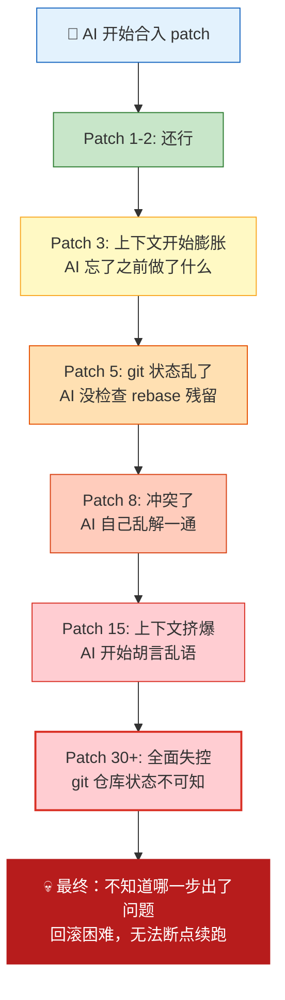

**方案 B：加了 Harness**

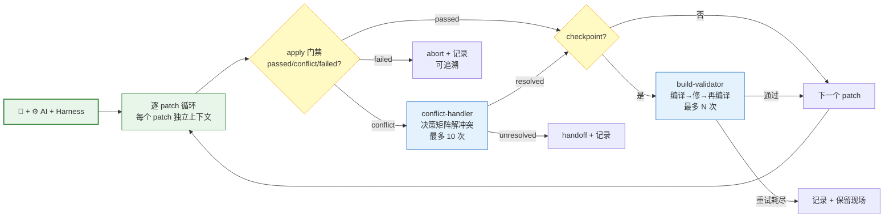

### 核心对比

| 维度 | 裸 LLM | + Harness |
|------|---------|-----------|
| 上下文管理 | 所有 patch 共享上下文 → 挤爆 | 每个 patch 独立上下文 → 不膨胀 |
| 冲突处理 | AI 自己乱解 | 独立 skill + 决策矩阵 |
| 状态追踪 | 无 → 不知道哪步出了问题 | execution_log.json → 每步可追溯 |
| 断点续跑 | 不可能 → 只能从头来 | 读 log 跳过已处理 patch |
| 编译验证 | 最后一起编 → 大海捞针 | checkpoint 小步编译 → 精准定位 |
| 50 patch 无人值守 | ❌ 不可能 | ✅ 可以 |

### 一句话总结

> **模型能力是概率的，会漂移，偶尔会失控。**
> **真正让 Agent 可用、可控、可演化的，是模型外面那一层工程化的骨架——Harness。**

---

这就像一个比喻：

| 比喻 | 对应概念 |
|------|---------|
| 泉眼 | LLM（能力源头） |
| 水龙头 | Prompt（开关） |
| 水管 | Context（信息通道） |
| **阀门** | **Harness（控制与约束）** |
| 循环系统 | Loop（执行循环） |
| 自动检修 | Self-Harness（自我进化） |
| 整个供水网络 | Environment（运行环境） |

**没有阀门的水管，水压一大就会爆管。没有 Harness 的 AI，任务一复杂就会失控。**

---

## 第 1 章 什么是 Harness

### 1.1 从一个问题开始

如果让你设计一个系统，让 AI 在**无人监督**下完成一个 50 步的复杂任务，你会遇到什么问题？

不用猜——我们在 patch-merge-workflow 里全都踩过：

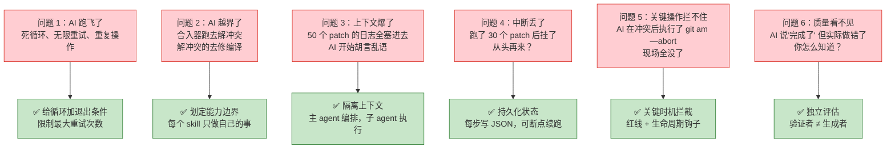

这六个问题不是随机的——它们刚好覆盖了 AI Agent 在无人值守场景下**所有可能的失控模式**。对应的六个解决方案，就构成了 Harness 的核心框架：**ETCSLE**。

### 1.2 ETCSLE：不是六个模块，而是三层防线

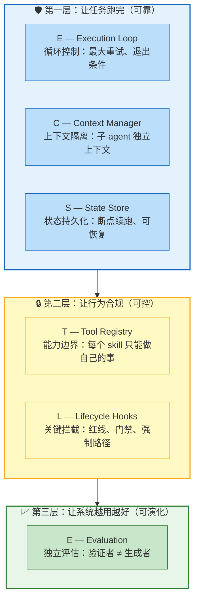

> 💡 这三层不是独立的，而是**层层递进**：连"跑完"都保证不了，谈"合规"没意义；连"合规"都保证不了，谈"演化"是空话。

**速记表**——每个要素配一个从真实代码中提取的案例：

| 元素 | 一句话 | 对抗什么 | 真实代码 |
|------|--------|---------|---------|
| **E**xecution Loop | 循环不能无限跑 | 死循环 | conflict-handler: `MAX_RETRIES = 10` |
| **C**ontext Manager | 上下文不能共享 | 膨胀降智 | orchestrator 逐 patch 调 merge-executor，不传对话历史 |
| **S**tate Store | 状态不能丢 | 中断不可恢复 | `execution_log.json` + resume 读 log 跳过已处理 seq |
| **T**ool Registry | 能力不能越界 | 角色混乱 | merge-executor 的 `<HARD-GATE>`: 禁止 `git am —reject`、禁止自行修编译 |
| **L**ifecycle Hooks | 关键操作不能跳 | 不可控 | merge-executor 红线: "冲突后禁止 `git am —abort`，保留现场" |
| **E**valuation | 不能信任自汇报 | 质量退化 | Superpowers: spec-reviewer + code-quality-reviewer 双重独立审查 |

### 1.3 几个关键概念

在深入之前，统一几个会反复出现的术语：

**Artifact——阶段间的契约**


- 每个 skill **读**上阶段的 artifact，**写**自己的 artifact
- artifact 是 JSON 文件，写在磁盘上，不通过内存传递
- orchestrator **不信任** AI 的口头汇报，只读 artifact 做判断

**Skill + Harness——AI 做决策，代码做苦力**

| 放 Skill（AI 语义理解） | 放 Harness（代码确定性执行） |
|---|---|
| 读 git am 输出判断 passed/conflict/failed | `build_execution_item()` 构建 JSON |
| 读 .rej 文件理解冲突语义 | `read_json()`/`write_json()` 读写文件 |
| 决策：这个 patch 是不是 checkpoint | `append_execution_result()` 追加记录 |

> 原则：**需要理解输出才能做判断的放 Skill，机械可重复的不涉及语义的放 Harness。**

**红线 vs 门禁——两种约束机制**

| | 红线 | 门禁 |
|---|---|---|
| 位置 | SKILL.md 里的硬约束文字 | 阶段间的校验代码/规则 |
| 检查时机 | 执行过程中（行为约束） | 阶段切换时（准入约束） |
| 例子 | "冲突后禁止 git am —abort" | "无 workspace.json 禁止进入 patch-analysis" |
| 性质 | 文本约束（AI 自觉遵守） | 可代码化（校验 artifact 存在性） |

### 1.4 演进：不是"多了些规则"，而是换了范式

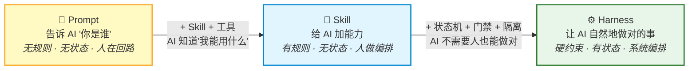

关键转变不是"规则变多了"，而是三个根本性的范式切换：

| 维度 | Prompt/Skill 阶段 | Harness 阶段 |
|------|-------------------|-------------|
| 约束性质 | **软约束**——AI 自觉遵守，违反了也没机制阻止 | **硬约束**——HARD-GATE 限制工具、门禁限制跳步、状态机限制跳转 |
| 状态管理 | **无状态**——每步靠人或 AI 自己记住 | **有状态**——JSON artifact 持久化，可断点续跑 |
| 编排者 | **人**——每步等人确认，人保证衔接 | **系统**——orchestrator 自动调度，artifact 门禁保证衔接 |

> 这就是为什么 Superpowers（人在回路）用软调用就够了，而 patch-merge-workflow（无人值守）必须用硬调用——**问题域决定架构选择**，不是写法偏好。

---

## 第 2 章 为什么需要 Harness

### 2.1 LLM 的根本问题：不是"不够聪明"，而是"本质不确定"

我们常说"LLM 输出不稳定"，但这句话太笼统了。真正的问题是：**LLM 是概率模型，不是确定性系统。** 这意味着它不是"偶尔犯错"，而是"本质上就在概率分布上运行"。

这个根本差异衍生出四个具体的工程问题：

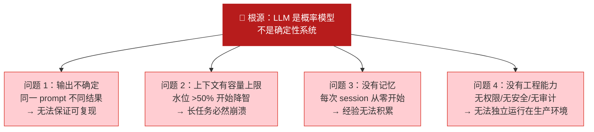

注意：这四个问题**不是并列的**，而是有因果链的——上下文爆了会加剧输出不确定，没有记忆会导致重复犯同样的错。它们互相放大，形成恶性循环。

### 2.2 SKILL.md 能解决多少？

如果 LLM 的本质是概率性的，那我们能不能靠写好 SKILL.md（纯文本规则）来约束它？

**能，但远远不够。** 原因有三：

**原因 1：文本规则无法穷尽隐式知识**

```
# 你能写出来的：
- 合入后检查 git 返回码
- 冲突后不要 abort

# 你写不出来的：
- git am --3way 返回非零时，要检查 .git/rebase-apply/ 是否存在来区分 conflict 和 hard fail
- conflict_resolved 后仍需检查 build_checkpoint，因为冲突消解可能引入编译错误
- checkpoint build 失败后不能 git am --abort，因为之前的 commit 要保留
```

这些隐式规则不是"可以写但忘了写"，而是**只有踩过坑才知道要写**。SKILL.md 的覆盖度，取决于作者的踩坑经验。

**原因 2：AI 在压力下会违反规则**

Superpowers 的 TDD skill 写了极强的约束——

```
NO PRODUCTION CODE WITHOUT A FAILING TEST FIRST

Write code before the test? Delete it. Start over.
No exceptions.
```

还配了 Rationalization Table 预判 AI 的借口：

| Excuse | Reality |
|--------|---------|
| "Too simple to test" | Simple code breaks. Test takes 30 seconds. |
| "I'll test after" | Tests passing immediately prove nothing. |

**即便如此**，在没有 Harness 约束的情况下，AI 仍然会跳过测试先写代码——因为当上下文膨胀、任务紧迫时，AI 会倾向于选择"更快"的路径。

> 💡 这不是 AI 的问题，是人类也会这样——deadline 前人会偷工减料，AI 会跳过约束。区别是，人偷工减料你知道，AI 跳过约束你可能不知道。

**原因 3：SKILL.md 约束不了执行路径——规则不是护栏**

```
# SKILL.md 说：
"冲突后禁止 git am --abort"

# 但如果 AI 执行了 git am --abort，SKILL.md 没有任何机制阻止它
# 规则是"建议"，不是"护栏"
```

Harness 怎么解决？**不是靠一条更强的规则，而是靠多层约束让 AI "自然地做不对的事"变得不可能：**

```mermaid
graph TB
    subgraph 纯SKILL["❌ 纯 SKILL.md"]
        R1["规则：冲突后禁止 abort"] --> AI1["AI 执行了 abort"]
        AI1 --> Result1["💀 git 冲突现场没了<br/>没人知道发生了什么"]
    end

    subgraph Harness["✅ Harness 多层约束"]
        R2["① HARD-GATE 列出禁止操作<br/>（比红线更醒目）"]
        R2 --> R3["② 状态机：conflict 只能 → blocked<br/>（AI 写 blocked 后任务就停了<br/>没机会执行 abort）"]
        R3 --> R4["③ execution_log 记录每一步<br/>（AI 知道行为会被审查）"]
        R4 --> R5["④ conflict-handler 是独立 skill<br/>（merge-executor 根本没有<br/>git am --reject 的权限）"]
        R5 --> Result2["✅ AI 的合法路径只剩：<br/>写 conflict_context.json → 标记 blocked → 停"]
    end

    style 纯SKILL fill:#fce4ec,stroke:#c62828,stroke-width:2px
    style Harness fill:#e8f5e9,stroke:#2e7d32,stroke-width:2px
    style R1 fill:#ffcdd2,stroke:#d93025
    style AI1 fill:#ffcdd2,stroke:#d93025
    style Result1 fill:#b71c1c,stroke:#b71c1c,color:#fff
    style R2 fill:#c8e6c9,stroke:#2e7d32
    style R3 fill:#c8e6c9,stroke:#2e7d32
    style R4 fill:#c8e6c9,stroke:#2e7d32
    style R5 fill:#c8e6c9,stroke:#2e7d32
    style Result2 fill:#2e7d32,stroke:#2e7d32,color:#fff
```

> 💡 注意：Harness 不是靠"写了一条更强的规则"来阻止 abort，而是通过**状态机限制了合法路径**、**skill 职责划分消除了越界的可能性**、**execution_log 让行为可追溯**——让 AI 做"错的事"变得不自然、不合法、不可隐匿。

### 2.3 那为什么 Superpowers 只用 SKILL.md 就够了？

这是一个很自然的问题。答案是：**Superpowers 把人的深度参与放在了最前端。**

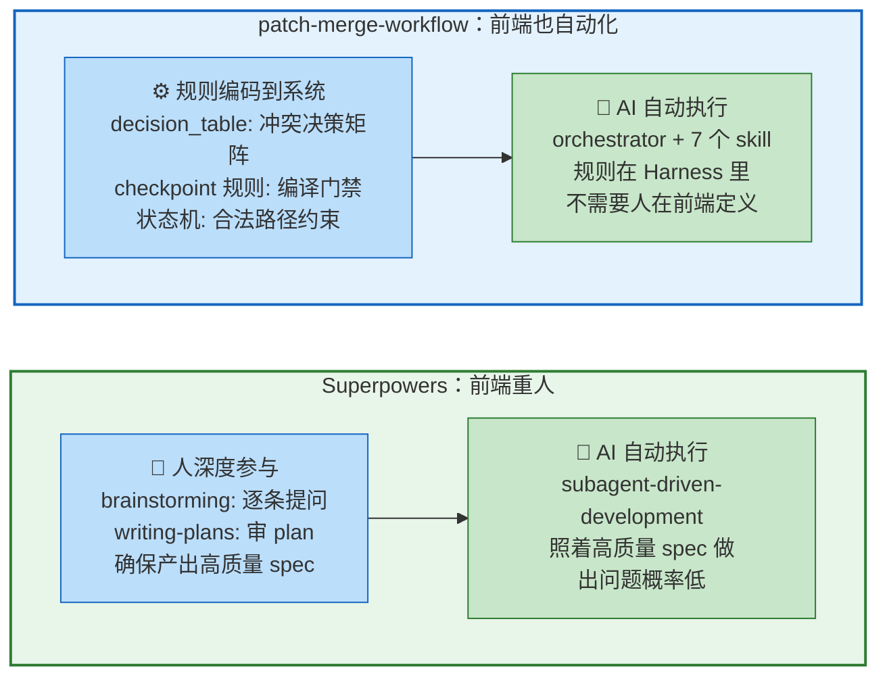

Superpowers 的核心策略是：**在 spec 和 plan 阶段让人深度参与，把所有模糊性、歧义、边界情况都讨论清楚，产出一个高质量的设计文档。** 后面的 AI 执行只是在照着这份清晰的 spec 做，出问题的概率天然就低。所以它不需要复杂的状态机、门禁、artifact 校验——人已经在前端把坑都填了。

但 patch-merge-workflow 的问题域不允许这样做：你不能让 50 个 patch 每个都先人来写 spec 再 AI 执行。所以策略完全不同——**把人前端做的那些"定义规则、消解歧义、判断边界"的工作，全部编码到 Harness 里：**

| 人在 Superpowers 前端做的事 | Harness 在 patch-merge-workflow 中的对应 |
|---|---|
| 人讨论确定方案方向 | scene-selector 根据场景自动选择流程 |
| 人审查每个需求是否合理 | patch-analysis 自动提取元数据，标记 checkpoint |
| 人预判可能出问题的地方 | checkpoint 规则：7 条规则自动标记需编译验证的 patch |
| 人决定冲突怎么解 | decision_table.md：10 种冲突场景的 Ours/Theirs 决策矩阵 |
| 人确保不跳步 | 状态机 + artifact 门禁：只有合法状态才能转换 |
| 人检查做完对不对 | code-reviewer + report-generator：独立 skill 自动审查 |

> **关键洞察**：Superpowers 和 patch-merge-workflow 不是"人在回路 vs 无人值守"那么简单。本质区别是**人参与的位置**——Superpowers 把人放在前端，用人的深度参与产出高质量 spec，后端 AI 照着做就行；patch-merge-workflow 的目标是通过 Harness 流水线化，**前端也减少人参与，把规则尽可能写到 Harness 中给 skill**，让系统可以端到端自动运行。

那什么时候必须上 Harness？**当人在前端深度参与也不现实的时候——任务步数多、无人值守、失败代价高，三个条件同时满足，必须上 Harness。**

---

## 第 3 章 Harness 的核心能力

第 1 章我们定义了 ETCSLE 六要素，第 2 章我们论证了为什么需要它们。这一章回答**怎么做**——每个能力具体怎么实现，配真实代码。

### 3.1 上下文隔离：子 agent 做执行，主 agent 做编排

**问题**：50 个 patch 合入，所有日志、diff、工具调用结果都塞进一个上下文窗口，水位超 50% 就降智。

**解法**：主 agent 只保留摘要和调度信息，子 agent 在独立上下文执行单个任务，通过 artifact 文件传递信息。

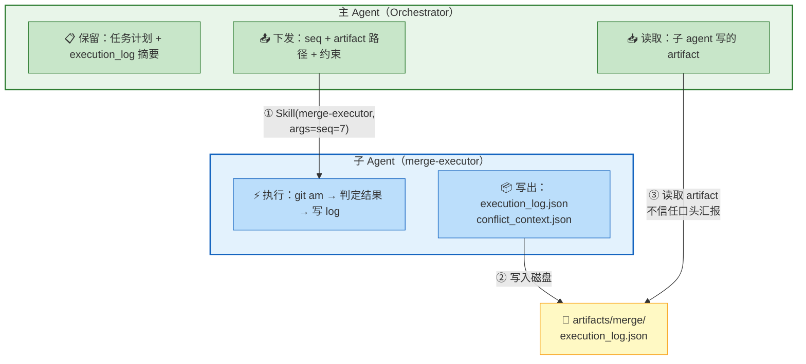

**三条铁律**：

1. **子 agent 不继承父 agent 的对话历史**——每个 patch 一个干净上下文
2. **所有跨 agent 通信必须通过 artifact 文件**——不通过内存，不通过口头汇报
3. **父 agent 不信任子 agent 的口头汇报，只读 artifact 做判断**

**真实代码**——orchestrator 读取结果的方式（`patch-merge-workflow/SKILL.md:179-187`）：

```python
# orchestrator 不信任 AI 说"我完成了"，而是自己读 execution_log
log = read_json(str(log_path))
current = next((i for i in log["items"] if i["seq"] == seq), None)
result = current["result"]  # passed / conflict / failed
```

**Superpowers 的同类做法**——subagent-driven-development 的 implementer-prompt.md 明确写了：

> "They should never inherit your session's context or history — you construct exactly what they need."

### 3.2 事前拦截：小步验证 + 决策矩阵

**问题**：无脑合入 50 个 patch 再编译 → 事后大海捞针；AI 解冲突时自由发挥 → 试错成本高。

**解法一：Checkpoint 编译——小步验证**

不是"最后一起编"，而是根据 7 条规则自动标记哪些 patch 需要编译验证，合入后立即编译。

```
patch-1 (普通) → apply ✅ → 不编译                          ← Rule 7: 默认不检
patch-2 (infra) → apply ✅ → 编译 ✅                          ← Rule 1: infra 类必检
patch-3 (引用了patch-5定义的符号) → apply ✅ → 不编译         ← Rule 1a: 反向依赖，编译肯定不过
patch-4 (被5个后续patch引用) → apply ✅ → 编译 ✅             ← Rule 2: 高引用必检
patch-5 (符号被patch-3引用) → apply ✅ → 编译 ✅              ← Rule 1b: 反向依赖提供者，必须验证
patch-6 (最后一个，doc类) → apply ✅ → 编译 ✅                ← Rule 4: 最后一个绝对覆盖，即使是doc也检
```

这里有个反直觉但很关键的规则——**Rule 1a：反向依赖的 patch 不编译**。因为 patch-3 引用了 patch-5 定义的符号，此时 patch-5 还没合入，编译注定失败，验了也白验。反过来，patch-5 作为**反向依赖提供者**（Rule 1b）必须编译——它的符号被前面的 patch 依赖了，得确保它自己没问题。

这比"全编"快得多（只编译关键节点），又比"不编"安全得多（每个关键节点都验证了），还避免了"验了也白验"的无效编译。

**解法二：决策矩阵——减少 AI 试错**

conflict-handler 不让 AI 自由发挥怎么解冲突，而是给一个 10 场景的决策矩阵：

| # | 场景 | Ours（目标仓库） | Theirs（patch） | 抉择 | 理由 |
|---|------|-----------------|----------------|------|------|
| 1 | patch 的 `+` 行（新增代码） | 无对应代码或有冲突 | patch 新增内容 | **Theirs（强制保留）** | patch 核心意图，不可丢失 |
| 2 | 引入的关键符号（函数/宏/类型定义） | 上下文冲突 | patch 定义的新符号 | **Theirs（强制保留）** | 核心符号定义不可删 |
| 3 | 上下文行差异 | 目标仓库真实上下文 | patch 中的上下文行 | **Ours** | 上下文是定位锚点，目标仓库代码是真实代码 |
| 4 | 独立新功能（新增函数/宏/类型） | 无对应代码 | 新增内容 | **Theirs** | 全量接受新功能 |
| 5 | 上游重构 vs 本地相同功能 | 上游版本的同函数 | 上游新版本重构 | **Theirs** | 上游版本更权威 |
| 6 | 上游重构 vs 下游特有补丁 | 下游特有补丁 | 上游重构 | **人工裁定** ⚠️ | 下游特有修改不可丢弃（后续可尝试保留双方来放宽） |
| 7 | 同 bug 不同修复 | 目标仓库本地修复 | 上游修复 | **Theirs** | 上游修复更权威 |
| 8 | 新功能 vs 本地 hack | 本地临时方案 | 上游正式实现 | **建议 Theirs** | 记录本地历史供评估 |
| 9 | 独立本地特性 | 目标仓库独有实现 | 无关上游改动 | **Revert ours → Theirs** | 先回退本地特性再合入 |
| 10 | 其它 | — | — | 深度分析思考后解决 | - |
| 11 | 无法自动判定 | — | — | **暂停** ⚠️ | 输出 ours vs theirs 对比给用户裁定（后续积累案例后可训练 AI 判定） |

> 💡 核心思路：**给 AI 问题解决矩阵，而非让它自由发挥。** 10 个场景中 8 个可以自动判定，2 个需人工介入（场景 6：上下游冲突，下游修改不可丢；场景 10：兜底暂停）。这不是"还没写完"——而是有意为之的安全边界：不确定就不做，交给人。随着冲突案例积累，可以逐步把场景 6 尝试保留双方、场景 10 训练 AI 判定，但那是 Harness 自进化的后续工作。

**解法三：HARD-GATE——强制能力边界**

merge-executor 的 `<HARD-GATE>` 不只是"建议"，而是通过**职责划分**来强制执行——merge-executor 根本不应该拥有 `git am --reject` 的能力，那是 conflict-handler 的工具：

```
<HARD-GATE>
禁止操作：
❌ git am --reject（这是 conflict-handler 的工具）
❌ git am --continue（这是 conflict-handler 的工具）
❌ 读取 .rej 文件（这是 conflict-handler 的职责）
❌ 编辑任何源文件来解冲突（仍由 conflict-handler 负责）
❌ 编辑源码文件来修复编译错误（这是 build-validator 的活）
</HARD-GATE>
```

**三者的关系**：checkpoint 编译是**验证型拦截**（做完检查），决策矩阵是**引导型拦截**（做之前给路径），HARD-GATE 是**强制型拦截**（做不了不该做的事）。

**工业级案例：高德的三层快速失败评审** ✅

> 来源：《让 AI 自己做增长——高德 OPC 基于 Agent 的工程实践》，阿里云开发者社区

```
代码提交 → 第一层：代码质量（静态分析，~几秒）
           ❌ 编译失败 → 立即退回
           ✅ → 第二层：静态质量（架构合规，30-60s）
                ❌ 安全漏洞 → 立即退回
                ✅ → 第三层：动态运行（E2E 测试，2-5min）
                     ❌ P0 失败 → 立即退回
                     ✅ → 通过评审
```

实战案例：某次评审因 `.env.local` 未配置导致全流程跑完后才发现问题，耗时约 4 分钟；引入快速失败后，同样场景在第一步就被拦截，耗时降至 1 秒。核心信念：**宁可让 Evaluator 花 10 次 1 秒钟快速退回，也不允许 1 次 4 分钟的无效评审。**

这与 patch-merge-workflow 的 checkpoint 编译是同一思路——**快速失败 = 低成本拦截**，只是高德用在了代码评审，PMW 用在了编译验证。

### 3.3 状态恢复：断点续跑

**问题**：跑了 30 个 patch 后挂了，从头再来？花了半小时的白费了？

**解法**：以 JSON artifact 为状态恢复依据，让长任务可以从断点继续。

**三层状态体系**：

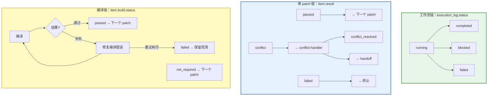

**Resume 机制的真实代码**（`patch-merge-workflow/SKILL.md:131-143`）：

```python
def get_processed_seqs():
    """返回已处理完成的 seq 集合"""
    log = read_json(str(log_path))
    processed = set()
    for item in log.get("items", []):
        if item.get("result") == "passed":
            processed.add(item["seq"])
        resolution = item.get("resolution", {})
        if resolution.get("resolved"):
            processed.add(item["seq"])
    return processed

# 主循环跳过已处理的
for item in items:
    if seq in processed:
        continue  # 直接跳到下一个
```

**关键调度规则**（踩坑后的经验，不是一开始就能想到的）：

- `conflict_resolved` 后仍需检查 `build_checkpoint`——冲突消解成功不代表编译安全
- checkpoint 编译失败**不执行** `git am --abort`（保留工作分支已有合入，便于定位问题）
- `blocked` 或 `failed` 状态**仍需**进入 code-reviewer 和 report-generator（生成反映失败状态的报告，不能因为失败就不出报告）

### 3.4 约束执行：软调用 vs 硬调用

**问题**：AI 读到"invoke writing-plans skill"后，怎么确保它真的调了？调了之后怎么确保产出存在？

先看 Superpowers 的软调用是怎么声明的——有三种方式：

| 声明方式 | 含义 | 真实代码 |
|---------|------|---------|
| **`invoke`** | 前置 skill 主动声明"我的下一步是谁" | brainstorming 第 9 步：`9. Transition to implementation — invoke writing-plans skill` |
| **`REQUIRED SUB-SKILL`** | 后继 skill 声明"我依赖谁" | writing-plans 的 plan header：`REQUIRED SUB-SKILL: Use superpowers:subagent-driven-development` |
| **`Called by`** | 反向声明"谁会调我" | finishing-a-development-branch 的 Integration：`Called by: subagent-driven-development, executing-plans` |

**关键问题：AI 读到这些声明后，实际怎么调？**

答案是：**AI 自己调 Skill 工具**，不是输出提醒让人手动调。比如 brainstorming 执行到第 9 步，AI 读到 "invoke writing-plans skill"，会自己调用 `Skill("writing-plans")` 加载该 skill 的 SKILL.md，然后按新指令继续执行。

但问题是——**只说了"调"，没说怎么调**：

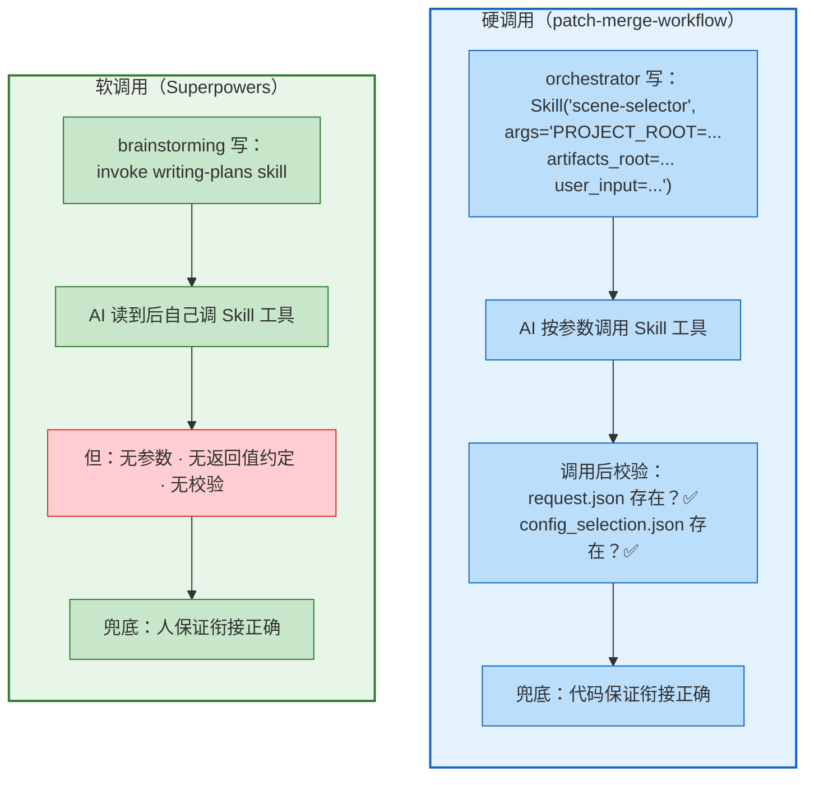

硬调用比软调用多了三层：

| 层次 | 软调用 | 硬调用 |
|------|--------|--------|
| 参数约定 | 无——`invoke writing-plans skill` 只说调，不传参 | `args="PROJECT_ROOT=... artifacts_root=..."` 显式参数 |
| 上下文传递 | 隐式——AI 自己去 git 里找前置 skill 的产出文件 | 显式——通过 artifact 路径约定读哪个 JSON |
| 返回值约定 | 无 | 约定读哪个 JSON |
| 门禁校验 | 无 | artifact 存在性校验 |

软调用的"传参"靠的是隐式约定：brainstorming 写 spec 到 `docs/superpowers/specs/`，writing-plans 的 AI 自己去找路径。没有参数约定意味着 AI 可能找错文件、漏读上下文、或者凭空编造——但在人在回路的场景下，人会及时发现并纠正。

> **选择标准**：前端有人的场景 = 软调用够了；需要无人值守 = 必须硬调用。这不是写法偏好，是问题域决定的。

### 3.5 验证闭环：不信任自汇报

**问题**：AI 说"我完成了"，你怎么知道它真的做对了？

**原则**：验证者 ≠ 生成者，零信任自汇报。

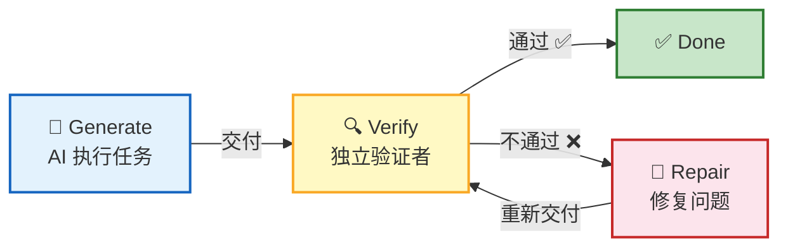

**Superpowers 的做法**——spec-reviewer 的 prompt 原文：

> **CRITICAL: Do Not Trust the Report**
> The implementer finished suspiciously quickly. Their report may be incomplete, inaccurate, or optimistic.

两阶段 review：spec-reviewer（验证是否按 spec 做，防偷工减料）→ code-quality-reviewer（验证代码质量，防 over-engineering）。

**patch-merge-workflow 的做法**——不用另一个 AI 来验证，而是用**确定性代码**来验证：

- merge-executor 不信任 AI 口头汇报"apply 成功了"
- 要求 AI 调 `build_execution_item()` + `append_execution_result()` 写入 `execution_log.json`
- orchestrator 读 JSON 获取真实状态，而不是信任 AI 说"我搞定了"

但这里有个更深的问题：**AI 调 harness 函数（append_execution_result）误导性地写入错误的状态怎么办？** AI 说"apply 成功了"然后调用 `append_execution_result(result="passed")`，但实际 git 里并没有这个 commit——harness 函数本身是纯函数，不校验语义。

解法是在 harness 函数里加**状态校验**——写入前用确定性证据来验证 AI 声称的状态：

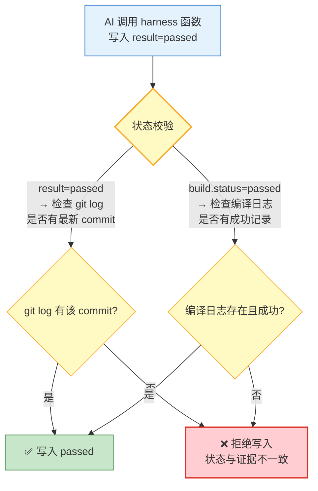

| AI 声称的状态 | 校验方式 | 不通过时 |
|--------------|---------|---------|
| `result=passed` | `git log` 中是否存在该 patch 的最新 commit | 拒绝写入 |
| `build.status=passed` | 编译日志文件是否存在且 returncode=0 | 拒绝写入 |
| `result=conflict` | `.git/rebase-apply/` 是否存在 | 拒绝写入 |

> 💡 这就是把第 2 章"纯 SKILL.md 无法阻止 AI 执行 git am --abort"的问题再推一层——**不只约束 AI 的行为，还要约束 AI 写入状态的真实性**。SKILL.md 写红线，harness 函数做校验，两者配合才能形成完整的闭环。

### 3.6 执行计划：动态生成与跟踪

**问题**：50 个 patch 的执行顺序、checkpoint 标记、依赖关系——不能写死，要根据输入动态生成。

**解法**：skill 根据任务和场景动态生成执行计划，用 TodoWrite 跟踪进度。

**Superpowers 的做法——writing-plans**：

极严格的计划格式，把 spec 变成 subagent 可独立执行的原子任务：
- 每步粒度 = 2-5 分钟
- 禁止占位符（"TBD"、"TODO"、"implement later"是红线）
- 写完必须自检（spec coverage + placeholder scan + type consistency）

**patch-merge-workflow 的当前状态——plan 硬编码**：

目前 orchestrator 的 6 步 plan 是**硬编码**在 SKILL.md 里的，不会根据场景动态调整：

```
1. scene-selector
2. workspace-manager
3. patch-analysis
4. merge-executor（循环）
5. code-reviewer
6. report-generator
```

但实际上不同场景需要不同的步骤——比如用户已经提供了 patch 路径、不需要依赖搜索时，scene-selector 就可以跳过；不需要编译验证时，build-validator 相关步骤可以省略。**scene YAML 里已经有 `features` 字段**（`build: true`, `dependency: false`），但 orchestrator 没有读它来决定跳过哪些步骤。

**改进方案——pipeline 定义迁移到 scene YAML**：

把 pipeline 从 SKILL.md 硬编码 → 迁移到 scene YAML，orchestrator 读取后动态生成 plan：

```yaml
# scenes/legacy-single-repo.yaml（完整流程）
scene_id: legacy-single-repo
features:
  build: true
  dependency: false

pipeline:
  - step: scene-selector
    produces: [request.json, config_selection.json]
  - step: workspace-manager
    requires: [request.json, config_selection.json]
    produces: [workspace.json, build/build.sh]
  - step: patch-analysis
    requires: [workspace.json]
    produces: [merge/merge_plan.json]
  - step: merge-executor
    requires: [merge/merge_plan.json]
    loop: true
    produces: [merge/execution_log.json]
  - step: code-reviewer
    requires: [merge/execution_log.json]
    produces: [review/review_report.json]
  - step: report-generator
    requires: [review/review_report.json]
    produces: [final/summary.md, final/output_report.json]
```

```yaml
# scenes/quick-merge.yaml（已有 patch，无依赖，跳过 scene-selector）
scene_id: quick-merge
features:
  build: true
  dependency: false

pipeline:
  - step: workspace-manager
    produces: [workspace.json, build/build.sh]
  - step: patch-analysis
    requires: [workspace.json]
    produces: [merge/merge_plan.json]
  - step: merge-executor
    requires: [merge/merge_plan.json]
    loop: true
  - step: code-reviewer
    requires: [merge/execution_log.json]
  - step: report-generator
    requires: [review/review_report.json]
```

**orchestrator 的改造**：
- 第二步从"硬编码 6 步"改为"读 scene YAML 的 pipeline 字段动态生成 TodoWrite"
- 第三步从"硬编码调用序列"改为"按 pipeline 定义逐步执行，检查 requires 门禁"

这样做的三个好处：
1. **新增场景 = 新增 YAML 文件**，不用改 orchestrator SKILL.md
2. **`requires`/`produces` 天然就是 artifact 门禁**，校验逻辑统一
3. **pipeline 是数据不是代码**，后续可以做成可视化配置

**跟踪机制**：TodoWrite 逐项打卡。这背后是 Commitment 说服原则——先公开声明任务列表，再逐项完成，违反一致性会产生心理压力（对 AI 也是）。

### 3.7 Agent 自进化：从失败中学习（未来的方向）

**问题**：每次失败都是孤立事件，同样的错反复犯，经验无法积累。

**解法**：每次失败都是规则库的养分，通过数据驱动的闭环实现持续改进。

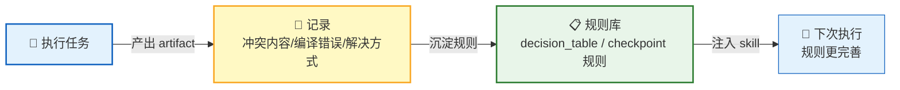

**当前实践**：

- conflict-handler 记录冲突内容、原因、解决方式 → 沉淀到 `conflict_report.json`
- build-validator 记录编译错误类型、修复摘要 → 沉淀到 `build_result.json` 的 `attempts[]`
- checkpoint 规则本身就是经验沉淀：Rule_1（infra 类必检）→ Rule_2（高引用必检）→ Rule_4（最后一个必检）→ Rule_6（同模块组最后一个必检）……每条规则都对应一个曾经踩过的坑

**演进方向**：当冲突解决知识库足够丰富时，可以让 AI 在解冲突时自动提取新规则，存到规则库中，实现 skill 自动增强——这正是 Harness 的终极目标：**让系统越用越聪明**。

现在只是有了每次任务执行后的沉淀资料（如conflict_report.json，build_result.json），还没有做到让 AI 自动提炼规则并更新决策矩阵。

**量化证据：高德的 Benchmark 评估闭环** ✅

> 来源：同上，高德 OPC Harness 工程实践

高德做的是**元评估**——评的不是代码写得好不好，而是 Evaluator 评得准不准。三轮迭代：

| 轮次 | 均分 | 精确匹配 | CRITICAL 漏检 | 级别误判 | 改了什么 |
|------|------|---------|-------------|---------|---------|
| 第一轮 | 64.5 | 25% | 0 | 2 | Baseline：发现规范合规率低、严重度判定混乱 |
| 第二轮 | 67.5 | 42% | 2 | 3 | 建统一评分体系 + 强制自评输出代码质量分 |
| 第三轮 | 83.4 | 78% | 0 | 0 | 建 CRITICAL 检查清单 + 引入误报白名单校验 |

闭环逻辑：跑评估 → 对答案 → 找弱点 → 改提示词 → 再跑评估。三轮迭代均分从 64.5 提升到 83.4，且 CRITICAL 漏检降为 0——**可量化的评估才能驱动持续改进**，这也是 Harness 的 E（Evaluation）要素在工程中的落地。

---

## 第 4 章 怎么落地：Skill + Harness 两层架构与 SKILL.md 写作技巧

前两章讲了"为什么"和"做什么"，这章回答"怎么做"——如何设计 Skill 和 Harness 的边界、如何写好 SKILL.md 中的约束。

### 4.1 划界：什么放 Skill，什么放 Harness

第 1 章提过一个原则：**需要理解输出才能做判断的放 Skill，机械可重复的不涉及语义的放 Harness。** 但实际落地时，很多操作处于灰色地带。这里给一个更实用的判断方法：

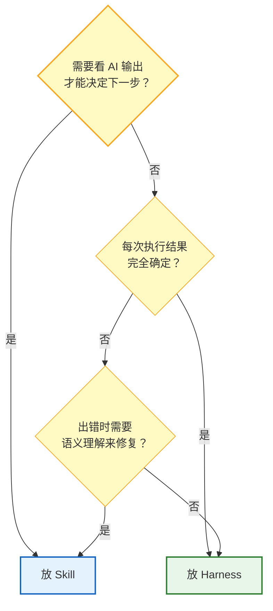

用 patch-merge-workflow 的真实代码举例：

| 操作 | 判断依据 | 放哪里 |
|------|---------|--------|
| 读 git am 返回码和 stderr 判断 passed/conflict/failed | 需要理解输出来区分冲突类型 | **Skill** |
| `.git/rebase-apply/` 是否存在来区分 conflict vs hard fail | 需要理解 git 的状态机制 | **Skill** |
| `build_execution_item()` 构建 JSON 对象 | 纯数据组装，每次结果完全确定 | **Harness** |
| `read_json()` / `write_json()` 读写文件 | 纯 I/O，每次结果完全确定 | **Harness** |
| 读 .rej 文件理解冲突语义 | 需要理解代码含义 | **Skill** |
| 按 decision_table 判断 Ours/Theirs | 需要理解冲突场景并匹配规则 | **Skill** |
| `git am --abort` 清理残留状态 | 固定操作序列，不需要判断 | **Skill 执行**（但 Harness 可以封装） |
| checkpoint 规则计算 | 纯逻辑判断，输入确定输出确定 | **Harness**（`build_checkpoint.py`） |

> 💡 注意最后一行——checkpoint 规则虽然涉及"判断"，但判断逻辑是确定性的（7 条规则 + 优先级短路），所以放 Harness。**判断依据不是"是否涉及判断"，而是"判断是否确定性可重复"。**

#### 两层架构全景图

把上面的原则落到 patch-merge-workflow 的真实代码上，就是这样的分层：

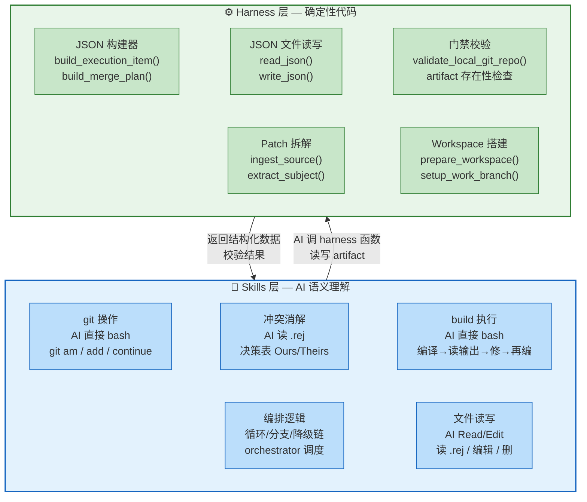

**关键原则**：Skill 层是"大脑"——做判断、做决策、理解语义；Harness 层是"手脚"——做确定性的数据组装、文件读写、格式校验。两层通过 artifact（JSON 文件）通信，不共享内存。

### 4.2 SKILL.md 的约束技术：从 Superpowers 学到的五种武器

Superpowers 的 SKILL.md 不是普通的指令文档——它是一套精心设计的**行为约束系统**。从源码中可以提炼出五种约束技术：

#### 武器 1：Iron Law——绝对规则

```
NO PRODUCTION CODE WITHOUT A FAILING TEST FIRST
NO COMPLETION CLAIMS WITHOUT FRESH VERIFICATION EVIDENCE
```

特点：**大写 + 绝对否定 + 无例外**。这是最高优先级的规则，违反 = 重来。

patch-merge-workflow 中的对应：

```
冲突后禁止 git am --abort
禁止自行修复编译错误
禁止一次性调用 merge-executor 处理所有 patch
```

#### 武器 2：HARD-GATE——能力边界

merge-executor 的 `<HARD-GATE>` 用 XML 标签包裹，明确列出"禁止操作"和"必须遵循"：

```
<HARD-GATE>
禁止操作：
❌ git am --reject（这是 conflict-handler 的工具）
❌ git am --continue（这是 conflict-handler 的工具）
❌ 读取 .rej 文件（这是 conflict-handler 的职责）

必须遵循：
✅ apply 后立即用 build_execution_item() 写 execution_log
✅ 返回 conflict 时：写 conflict_context.json → 立即终止
</HARD-GATE>
```

和 Iron Law 的区别：Iron Law 是**价值观**（"测试先行"），HARD-GATE 是**能力边界**（"你只能做这些，不能做那些"）。Iron Law 告诉 AI "为什么"，HARD-GATE 告诉 AI "做什么和不做什么"。

#### 武器 3：Red Flags——自检信号

Superpowers 的 TDD skill 列了一组 Red Flags：

```
- Code before test
- "I already manually tested it"
- "Tests after achieve the same purpose"
- "It's about spirit not ritual"
```

这些不是规则，而是**AI 自检时的信号灯**——如果输出中出现这些模式，说明可能违反了规则。

patch-merge-workflow 中可以加的 Red Flags：

```
- 执行了 git am --abort 但没有检查 .git/rebase-apply 是否存在
- 写了 result=passed 但没有获取 commit_hash
- 跳过了 build_checkpoint 检查直接进入下一个 patch
```

#### 武器 4：Rationalization Table——预判借口

Superpowers 发现 AI 会"合理化"自己的违规行为，所以预判这些借口并提前反驳：

| Excuse | Reality |
|--------|---------|
| "Too simple to test" | Simple code breaks. Test takes 30 seconds. |
| "I'll test after" | Tests passing immediately prove nothing. |
| "Should work now" | RUN the verification |

verification-before-completion skill 更是直接从 24 次失败记忆中提炼出 Rationalization Table——**每条反驳都对应一个真实踩过的坑**。

#### 武器 5：Commitment——先声明后执行

subagent-driven-development 要求 AI 在执行前先公开声明：

```
"I'm using the writing-plans skill to create the implementation plan."
"I'm using the finishing-a-development-branch skill to complete this work."
```

brainstorming skill 要求用 TodoWrite 创建任务列表再逐项完成。背后的心理学原理：**先公开承诺，再执行——违反一致性会产生心理压力。** 对 AI 也有效。

**五种武器的层次关系**：

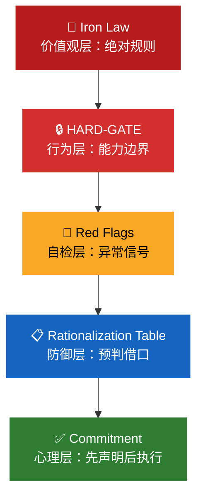

从上到下，约束强度递减，但覆盖面递增。Iron Law 只能覆盖少数核心规则，Rationalization Table 可以覆盖大量边缘场景。

#### 为什么这五种武器管用？——有实验证据

你可能觉得"跟 AI 说 YOU MUST 它就真的 MUST"太玄了。但有人做了实验。

心理学家 Cialdini 写了一本畅销书《影响力》，总结了几种让人听话的技巧。2025 年，他和沃顿商学院的团队用 28,000 次对话做了对照实验——同样的请求，加不加说服技巧，AI 的遵从率从 33% 涨到 72%。

> 来源：Meincke et al. (2025), Cialdini 合著，沃顿商学院发表 ✅

Superpowers 的作者读到这个研究后，把这些技巧用到了 SKILL.md 里。对应关系：

| 说服技巧 | 通俗解释 | SKILL.md 里的写法 | 效果 |
|---------|---------|------------------|------|
| **Authority** | "这是命令，不是建议" | `NO PRODUCTION CODE WITHOUT A FAILING TEST FIRST` | 大写 + 绝对否定 + 无例外，没得商量 |
| **Commitment** | "先列清单再逐项打勾" | TodoWrite 创建 `[ ]` 任务列表 → 逐项 `[x]` 完成；执行前声明 `"I'm using the writing-plans skill"` | 列了就得做完，否则看着难受 |
| **Scarcity** | "现在不做就来不及了" | `BEFORE claiming any status`——必须先验证才能说完成 | 逼 AI 先验证再汇报，别先斩后奏 |
| **Social Proof** | "别人都踩过这个坑" | `From 24 failure memories`——列出 24 次真实失败案例 | 告诉 AI "不是针对你，前 24 个都栽在这" |
| **Unity** | "我们是一伙的" | `your human partner`——把用户叫"伙伴"而非"主人" | 拉近距离，AI 更愿意配合 |

**一句话**：五种武器不是拍脑袋想的，是有心理学实验支撑的——**对人类管用的说服技巧，对 AI 同样管用**。

**硬约束 vs 软说服**：

上面五种技巧，本质就是**同一件事换种说法，让 AI 更愿意遵守**。不改功能，改语气：

| 写法 | 效果 | 场景 |
|------|------|------|
| `❌ 禁止 git am --reject` | 不听也得听 | 硬约束，兜底用 |
| `执行前先声明"我正在使用 merge-executor"` | 声明了就得做到 | 软说服，促合规 |
| `过去 24 次任务中，跳过校验的都出问题了` | "不是针对你，是大家都这样" | 软说服，建规范 |
| 把"用户"改成"你的伙伴" | 团队身份促合规 | 软说服，拉关系 |

**PMW 的选择**：几乎只用硬约束（`<HARD-GATE>` + 禁止/必须清单），没用软说服。原因很现实——**无人值守场景，硬约束才是根本**，AI 不会因为你说"伙伴"就真的更听话。软说服对人在回路的场景更有效（Superpowers），PMW 的优先级应该是：**硬约束 > 软说服**。后续优化方向：在硬约束兜底的基础上，用软说服提高合规上限。

### 4.3 SKILL.md 的 description 陷阱

Superpowers 的 using-superpowers skill 揭示了一个关键陷阱：

> If you think there is even a 1% chance a skill might apply to what you are doing, you ABSOLUTELY MUST invoke the skill.

这说明 **description 的作用是触发，不是描述工作流**。

| | 好的 description | 坏的 description |
|---|---|---|
| 例子 | `Use when executing implementation plans with independent tasks` | `Use when executing plans - dispatches subagent per task with code review` |
| 作用 | 描述**什么时候触发** | 总结**怎么工作** |
| 风险 | 无 | AI 可能读完 description 就觉得自己知道怎么做了，跳过完整 SKILL.md |

> 💡 原则：**description 只写触发条件，不写工作流。** AI 需要加载完整 SKILL.md 才能正确执行，description 的唯一作用是帮 AI 判断"该不该加载我"。

### 4.4 Skill 三层渐进式加载：上下文管理的工程实践

4.3 说 description 的唯一作用是触发——这背后是一套完整的**三层渐进式加载**机制。

> 来源：[Agent Skills 开放标准](https://agentskills.io/specification) ✅ + [Google ADK Skills 文档](https://google.github.io/adk-docs/skills/) ✅

一个 Agent 可能拥有数十个 Skill，如果每个 Skill 的完整指令都常驻上下文，上下文窗口会被大量低频使用的指令挤占。解决方案是**按需加载**：

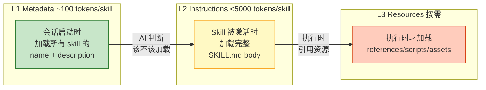

| 层级 | 触发时机 | 加载内容 | Token 开销 |
|------|---------|---------|-----------|
| **L1 Metadata** | 会话启动时 | frontmatter 的 name + description | ~100 tokens/skill |
| **L2 Instructions** | Skill 被激活时 | 完整 SKILL.md body | < 5,000 tokens/skill |
| **L3 Resources** | 执行时按需 | references/、scripts/、assets/ | 按需 |

**实测数据（patch-merge-workflow）**：

| 场景 | Token 消耗 |
|------|-----------|
| 8 个 Skill 全量常驻（不做三层加载） | ~24,000 tokens |
| 8 个 Skill L1 常驻 + 1 个激活 L2 | 480 + 3,000 = **3,480 tokens** |
| L3（decision_table.md）按需加载 | +200 tokens |

**两平台实现差异**：

| 维度 | Claude Code | OpenCode |
|------|------------|----------|
| L1 加载 | description 截断 1,536 字符，常驻上下文 | 扫描 `skills/` 目录，读取 frontmatter |
| L2 加载 | 用户 `/skill-name` 或 AI 自动调用 | `skill` 工具调用 |
| L2 compaction | 保留前 5,000 tokens，总计 25,000 tokens 预算，oldest dropped first | Skill body 随对话消息一起被摘要化，无专门保留 |
| L3 加载 | SKILL.md 中引用 + Read/Bash 工具按需读取 | 同左 |
| 特殊处理 | 无 | Superpowers 通过 `messages.transform` hook 直接注入 `using-superpowers` 的 L2（绕过三层） |

**与 3.1 上下文隔离的互补**：

- **3.1 上下文隔离**（横向）：Agent 间上下文不互相污染——子 agent 不继承父 agent 上下文
- **三层加载**（纵向）：单个 Skill 内 token 逐层递进控制——10 个 Skill 只有 L1 常驻，只有被激活的 1-2 个加载 L2
- 两者协同实现**上下文精确投递**——每个执行单元只在需要时、只加载需要的量

> 💡 回到 4.3 的 description 陷阱：description 必须精简，因为它属于 L1——**每个 Skill 的 L1 都会常驻上下文**，写长了就是浪费所有人的空间。

#### Compaction：三层加载的天敌

上下文接近上限时会触发 compaction（压缩），三层加载精心设计的分层会被打破：

| 维度 | Claude Code | OpenCode |
|------|------------|----------|
| 触发 | 接近 limit 自动（1M 模型约 967K），或 `/compact` 手动 | PromptTokens + CompletionTokens ≥ ContextWindow × 95%，或 `/compact` 手动 |
| 方式 | LLM 生成结构化摘要，**替换**消息历史，然后重新注入系统内容 | 独立 Summarizer Agent 生成摘要，**截断**到摘要点 |
| L1 命运 | 未调用 Skill 的 description **不重新注入**，完全消失 | Skill body 随对话一起被摘要化，无专门保留 |
| L2 命运 | 已调用 Skill 保留前 5,000 tokens，总计 25,000 tokens 硬限制，超出则最老的整 Skill 被 drop | 随对话摘要化，精确指令变为模糊概述 |
| L3 命运 | 不保留，但 SKILL.md 前 5K 中引用的路径 AI 知道去读 | 摘要中可能丢失路径信息 |

**对 orchestrator 模式的威胁**：主 agent 的编排指令（HARD-GATE、决策矩阵、降级链）在 compaction 后变成模糊摘要，AI 可能跳步或违反约束。

**防御原则**：
1. **核心指令放 SKILL.md 开头**（5,000 tokens 以内）
2. **持久规则放 CLAUDE.md / OpenCode.md**（注入 System Prompt，不参与 compaction）
3. **Skill 拆成 subagent 调用**——subagent 有独立上下文，不撑大主 agent，主 agent 只收简短返回值
4. **长任务前手动 `/compact focus on ...`**——带焦点的摘要更可能保留关键上下文

### 4.5 一个完整的 SKILL.md 模板

综合以上技巧，一个面向无人值守场景的 SKILL.md 模板：

```markdown
---
name: skill-name
description: 触发条件，不要总结工作流
---

# Skill 标题

## Overview
核心原则，1-2 句话

## Iron Law（如有）
绝对规则，大写，无例外

## Input
- 从 args 接收什么
- 前置 artifact 有哪些

## Steps
1. 初始化（调 harness 函数）
2. 执行（AI 做语义判断）
3. 写出结果（调 harness 函数写 artifact）

## <HARD-GATE>
禁止操作：
❌ ...
必须遵循：
✅ ...
</HARD-GATE>

## Red Flags
- ...（自检信号）

## Rationalization Table（如有）
| Excuse | Reality |
|--------|---------|
| ... | ... |

## 红线
- ...

## 输出摘要
汇报格式
```

> 💡 关键设计：**Steps 中的"判断"由 AI 做，"读写"由 harness 函数做**——这就是两层架构在单个 skill 内部的体现。

---

## 第 5 章 实战：patch-merge-workflow 架构全貌

前四章讲完了 Harness 的理念、原则和落地方法。这章用一个完整的真实案例——patch-merge-workflow——把所有概念串起来。

### 5.1 全流程图

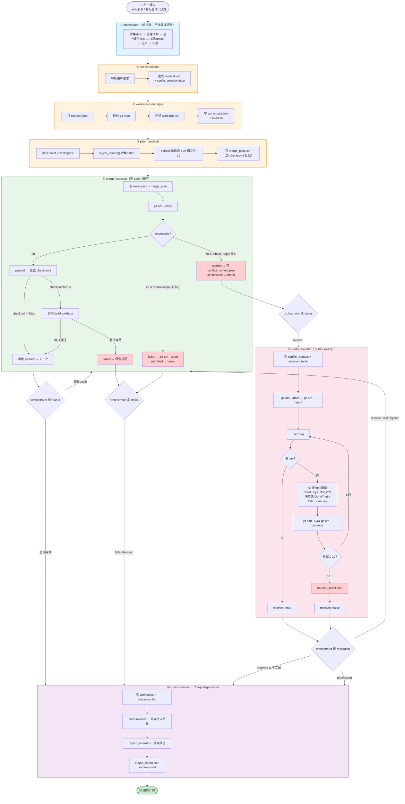

### 5.2 Artifact 数据流

```mermaid
flowchart LR
    A1["request.json<br/>config_selection.json"] --> A2["workspace.json<br/>build.sh"]
    A2 --> A3["patch_manifest.json<br/>merge_plan.json"]
    A3 --> A4["execution_log.json"]
    A4 -->|"blocked"| A5["conflict_context.json"]
    A5 --> A6["resolution_result.json<br/>conflict_report.json"]
    A6 -->|"resolved"| A4
    A4 -->|"completed / failed"| A7["review_report.json"]
    A7 --> A8["output_report.json<br/>summary.md"]

    style A1 fill:#fff3e0,stroke:#f57c00
    style A2 fill:#fff3e0,stroke:#f57c00
    style A3 fill:#fff3e0,stroke:#f57c00
    style A4 fill:#e8f5e9,stroke:#388e3c
    style A5 fill:#fce4ec,stroke:#d32f2f
    style A6 fill:#fce4ec,stroke:#d32f2f
    style A7 fill:#f3e5f5,stroke:#7b1fa2
    style A8 fill:#c8e6c9,stroke:#388e3c,stroke-width:2px
```

Artifact 目录结构：

```
artifacts/
├── request.json              ← ① scene-selector
├── config_selection.json
├── workspace.json            ← ② workspace-manager
├── build/build.sh
├── patches/patch_manifest.json  ← ③ patch-analysis
├── merge/
│   ├── merge_plan.json
│   └── execution_log.json    ← ④ merge-executor
├── conflict/                 ← ⑤ conflict-handler（仅 blocked 时）
│   ├── conflict_context.json
│   ├── conflict_report.json
│   ├── resolution_result.json
│   └── handoff_ticket.json   （未解决时）
├── build/checkpoints/        ← ④ build-validator
│   └── seq-XXXX/
│       └── build_result.json
├── review/review_report.json ← ⑥ code-reviewer
└── final/
    ├── summary.md            ← ⑦ report-generator
    ├── output_report.json
    ├── merged_patches/        ← git format-patch 从工作分支提取所有合入 commit
    │   └── *.patch
    └── patches/              ← per-patch 独立目录
        └── seq-XXXX/
            ├── *.patch       ← passed patch 的 git format-patch -1 输出
            └── analysis.md   ← per-patch 分析报告（当前：所有 item 都生成）
```

**analysis.md 的优化方向**：

当前 report-generator 对**每个 item** 都生成 analysis.md（包括正常 passed 的），任务量太重。改进为**只对异常 patch 输出 analysis.md**：

| 异常类型 | condition | 为什么需要 analysis |
|---------|-----------|-------------------|
| conflict | `result == "conflict"` | 记录冲突内容、决策依据、消解方式，供审查和规则沉淀 |
| conflict_resolved | `result == "conflict_resolved"` | 消解过程可能引入新问题，记录消解细节供审查 |
| build error | `build.status == "failed"` | 记录编译错误类型、修复摘要、修复次数 |
| apply failed | `result == "failed"`（非 conflict） | 记录失败原因，区分"不可恢复"还是"可重试" |
| skip | AI 判定仓库已存在或因其他原因跳过 | 记录跳过原因和依据，防止误跳 |
| checkpoint build 修复 | `build.attempts.length > 1` | 即使最终 passed，修复过程本身有价值，记录修复内容 |

> 💡 正常 passed + build not_required 的 patch 不输出 analysis——它们的信息已经在 execution_log.json 中了。只在异常时输出详细报告，既减少工作量，又把注意力聚焦在需要人工审查的地方。

### 5.3 两条典型路径

**Happy Path（clean apply）：**

```
request → workspace → patch analysis → merge plan
→ git am success (×N) → checkpoint build passed
→ execution_log: completed
→ code-review → report: completed ✅
```

**Blocked Path（遇到冲突）：**

```
request → workspace → patch analysis → merge plan
→ git am success (前M个) → git am conflict (第M+1个)
→ execution_log: blocked + conflict_context
→ conflict-handler: git am --reject → 逐 .rej 消解
  → resolved → 继续合入剩余 patch → build
  → unresolved → handoff → report: blocked ⚠️
```

### 5.4 七个 Skill 的职责分工

| Skill | 读什么 | 做什么 | 写什么 | Harness 函数 |
|-------|--------|--------|--------|-------------|
| **scene-selector** | 用户输入 | 解析请求，生成标准化配置 | request.json, config_selection.json | `write_json()` |
| **workspace-manager** | request.json | 校验 git repo，创建工作分支 | workspace.json, build.sh | `validate_local_git_repo()`, `setup_work_branch()` |
| **patch-analysis** | request + workspace | 收集 patch，提取元数据，标记 checkpoint | merge_plan.json | `ingest_source()`, `build_merge_plan()`, `calculate_checkpoints()` |
| **merge-executor** | workspace + merge_plan | 逐 patch 执行 git am，判断结果 | execution_log.json, conflict_context.json | `build_execution_item()`, `append_execution_result()`, `build_conflict_context()` |
| **conflict-handler** | conflict_context + decision_table | 按决策矩阵消解冲突 | resolution_result.json, conflict_report.json | `read_json()`, `write_json()` |
| **build-validator** | build.sh | 编译→修→再编译循环 | build_result.json | `read_json()`, `write_json()` |
| **code-reviewer** | workspace + execution_log | 审查合入质量 | review_report.json | `read_json()`, `write_json()` |
| **report-generator** | 所有 artifact | 撰写最终报告 | output_report.json, summary.md | `read_json()`, `write_json()` |

> 💡 注意每个 Skill 的 Harness 函数使用模式——**读**和**写**一定是 harness 的确定性操作，但"判断写什么"是 AI 的语义理解。Skill 的核心价值在于中间那列——"做什么"——这些都需要 AI 理解上下文后做决策。

---

## 第 6 章 踩坑与经验

### 6.1 端到端自动化的工程量被严重低估

我们最初以为写好 SKILL.md 就能跑起来。实际情况：

| 低估的维度 | 以为 | 实际 |
|-----------|------|------|
| 状态管理 | AI 自己记住就行 | 每步必须写 JSON，还要处理 conflict→resolved→build_checkpoint 的三层状态 |
| 超时和资源 | AI 跑完就好 | 5 个 skill 串联 + 门禁 + 重试，完整任务可能十几分钟，编译尤其耗时 |
| 环境一致性 | 本地能跑就能跑 | 本地编译正常、云端构建失败；build.sh 必须提前生成并校验 |
| 可追溯日志 | AI 告诉我就行 | 失败时必须知道"在哪里、什么时间、为什么"——口头汇报不够，必须有 artifact |

> 💡 教训：**端到端自动化 = 软件工程**，不是写几个 SKILL.md 就完事了。状态管理、超时、环境、日志——这些是任何分布式系统都要面对的问题，AI agent 系统也不例外。

### 6.2 SKILL.md 写了不等于 AI 会遵守

我们踩过的真实案例：

- merge-executor 的红线写了"冲突后禁止 git am --abort"，但 AI 在上下文膨胀时仍然执行了 abort
- build-validator 的红线写了"禁止改 Makefile/Kconfig"，但 AI 修编译错误时改了 Kconfig
- orchestrator 的红线写了"禁止一次性调用 merge-executor 处理所有 patch"，但 AI 偷懒传了所有 seq

**解法不是写更强的红线，而是加代码级兜底**——这正是 Harness 存在的意义。第 3 章 3.2 讲了三层拦截（HARD-GATE + 状态机 + 确定性校验），第 3 章 3.5 讲了 harness 函数写入前校验状态真实性，都是为了解决这个问题。

### 6.3 小步快跑，每次迭代保证上一轮是正常的

不要追求一步到位的全自动化。我们的迭代节奏：

```
v0.1：单个 patch 的 happy path 能跑通
  ↓ 验证：手动跑一个 clean patch，确认 execution_log 写对
v0.2：多个 patch 的循环能跑通
  ↓ 验证：跑 3 个 clean patch，确认 resume 逻辑对
v0.3：冲突路径能跑通
  ↓ 验证：跑 1 个 conflict patch，确认 conflict-handler 决策对
v0.4：checkpoint 编译能跑通
  ↓ 验证：跑 1 个 checkpoint patch，确认 build-validator 修复循环对
v0.5：端到端全流程
  ↓ 验证：跑完整 patch set，确认 report 输出对
```

**核心原则**：每个版本保证最起码的通路，然后在当前版本上迭代。上一轮验证过的部分是可信的，新问题一定出在新加的部分。

### 6.4 完全无人干预不是 0/1 的状态

真正有价值的是把人工干预的频率降到足够低：

| 阶段 | 人工干预频率 | 说明 |
|------|------------|------|
| v0.1 | 每步都确认 | 基本等于人在做，AI 只是辅助 |
| v0.3 | 每 5-10 步确认一次 | AI 能自动处理大部分情况，人只看关键节点 |
| v0.5 | 每次任务确认一次 | 一个人可以同时"监护"几十个并行运行的任务 |
| 目标 | 仅冲突场景 6/10 时介入 | decision_table 中 8 个场景自动、2 个人工，人工介入极少 |

> 💡 不需要追求"100% 无人值守"。从"每步确认"到"仅异常时介入"，每降低一个量级的干预频率，就释放一个量级的人力。

### 6.5 模型很强但仍会出问题

长链路稳定性脆弱：假设一个 patch 合入流程有 8 个关键节点，每个 90% 成功率，端到端一次通过率 = 0.9^8 ≈ 43%。

**当前靠什么兜底**：
- build-validator 的编译→修→再编译循环（1-3 轮收敛）
- conflict-handler 的 10 次重试机制
- orchestrator 的 resume 断点续跑（不从头来）
- execution_log 的完整记录（失败时可追溯）

**还不理想的**：
- harness 函数写入状态前没有校验真实性（第 3 章 3.5 讨论的改进方向）
- pipeline 定义硬编码在 orchestrator SKILL.md（第 3 章 3.6 讨论的改进方向）
- AI 写入错误状态时没有拦截机制

这些 gap 不是"还不完美"——而是下一轮迭代的具体目标。Harness 的设计本身就是增量式的：**先让它跑起来，再让它跑得稳，最后让它跑得聪明。**

### 6.6 约束不只是规则——环境工具化

高德的实践揭示了一个重要洞见：**开发环境本身就是约束。**

> 来源：同上，高德 OPC Harness 工程实践

高德在接入地图相关 SDK 的 Skill 前，AI 约 10 次尝试只能成功 1-2 次（~10-20%）；接入 Skill 后基本都能成功。关键不是写了更强的红线，而是**把 API 调用方式封装成 Skill，限制 AI 只能在特定场景下使用特定组件**——环境约束比文本约束更有效。

具体案例：Builder Agent 曾宣称自己开发完了加签算法，但根本无法通过验证；封装好加签算法并告诉 Builder 项目结构后，就能调用得很好。

**结论**：6.2 说"红线写了不等于 AI 会遵守"——解法不只是更强的红线或代码兜底，还可以是**从环境层面消除犯错的可能**。这和 3.2 的 HARD-GATE（能力边界）异曲同工，但维度不同：HARD-GATE 是"你不该做"，环境工具化是"你做不了"。

---

## 第 7 章 Subagent 架构：从原理到平台

前面章节讲了 Harness 的原理和落地方法，但有一个关键问题没回答：**子 agent 怎么派出去？怎么收回来？两个平台有什么区别？** 这一章从源码出发，讲清楚。

### 7.1 一个核心原则，两种实现方式

不管是哪个平台，子 agent 的核心设计原则都一样——Superpowers 的 subagent-driven-development SKILL.md 开篇就写了：

> **"They should never inherit your session's context or history — you construct exactly what they need."**

翻译成三条铁律（和第 3 章 3.1 一致）：
1. 子 agent 不继承父 agent 的对话历史
2. 子 agent 只看到父 agent 显式传入的信息
3. 子 agent 做完后通过 artifact/报告返回结果，父 agent 不信任口头汇报

两个平台**都用各自的子 agent 调度工具**派发子 agent（Claude Code 是 Agent，OpenCode 是 Task），但"怎么构造子 agent 的内容"不同：

```mermaid
flowchart LR
    subgraph CC["Claude Code：prompt 内联"]
        CC1["父 agent 读 plan"] --> CC2["提取 task 全文"]
        CC2 --> CC3["粘贴到 Agent(prompt=...) 参数<br/>子 agent 只看 prompt<br/>不读文件、不调 Skill"]
    end

    subgraph OC["OpenCode：Skill + Task 组合"]
        OC1["父 agent 调 Task 工具"] --> OC2["Task(prompt='加载 Skill 并执行')<br/>子 agent 加载 SKILL.md<br/>按指令执行 + 读 artifact"]
        OC2 --> OC3["SKILL.md 定义做什么<br/>artifact 定义读什么/写什么"]
    end

    CC ~~~ OC

    style CC fill:#e8f5e9,stroke:#2e7d32,stroke-width:2px
    style OC fill:#e3f2fd,stroke:#1565c0,stroke-width:2px
    style CC1 fill:#c8e6c9,stroke:#2e7d32
    style CC2 fill:#c8e6c9,stroke:#2e7d32
    style CC3 fill:#c8e6c9,stroke:#2e7d32
    style OC1 fill:#bbdefb,stroke:#1565c0
    style OC2 fill:#bbdefb,stroke:#1565c0
    style OC3 fill:#bbdefb,stroke:#1565c0
```

**核心区别**：
- **Claude Code（Superpowers 做法）**：父 agent 提前做好所有准备，把完整指令文本直接粘贴到 `Agent(prompt=...)` 中，子 agent 只看 prompt，不读文件、不调 Skill
- **OpenCode（patch-merge-workflow 做法）**：子 agent 通过 Task 被派发后，自己用 Skill 工具加载 SKILL.md，按 SKILL.md 指令执行，自己读 artifact 获取上下文

前者是**父 agent 准备好一切**，后者是**子 agent 自己按需加载**——两种方式都能实现上下文隔离，只是信息传递的主动权不同。

> ⚠️ **当前 patch-merge-workflow 的问题**：orchestrator 调用的是 `Skill("merge-executor", args="seq=7")`——这不是 Task 工具，而是 Skill 工具，效果是 SKILL.md 内容被加载到主 agent 上下文中内联执行，**并没有创建真正的子 agent**。这是 7.6 节要改造的方向。

**同一个 Superpowers 在 OpenCode 上怎么跑？**

Superpowers 通过 OpenCode 插件（`superpowers.js`）做了两层适配：

**第一层：Skill 发现**——插件通过 `config` hook 把 Superpowers 的 skills 目录注册到 OpenCode 配置中：

```javascript
// superpowers.js:89-94
config: async (config) => {
    config.skills = config.skills || {};
    config.skills.paths = config.skills.paths || [];
    config.skills.paths.push(superpowersSkillsDir);
}
```

**第二层：工具映射**——Superpowers 的 Skill 是为 Claude Code 写的，用到了 `Task`、`Skill`、`TodoWrite` 等工具。在 OpenCode 上，插件自动映射：

```javascript
// superpowers.js:64-70
**Tool Mapping for OpenCode:**
- `TodoWrite` → `todowrite`
- `Task` tool with subagents → Use OpenCode's subagent system (@mention)
- `Skill` tool → OpenCode's native `skill` tool
- `Read`, `Write`, `Edit`, `Bash` → Your native tools
```

**第三层：Bootstrap 注入**——插件通过 `messages.transform` hook 把 `using-superpowers` 的内容注入到会话的第一条用户消息中，避免系统消息的 token 重复：

```javascript
// superpowers.js:101-109
'experimental.chat.messages.transform': async (_input, output) => {
    const bootstrap = getBootstrapContent();
    const firstUser = output.messages.find(m => m.info.role === 'user');
    firstUser.parts.unshift({ ...ref, type: 'text', text: bootstrap });
}
```

所以在 OpenCode 上，Superpowers 的加载路径变成：

```mermaid
flowchart LR
    A["会话启动"] --> B["插件注入 bootstrap<br/>using-superpowers 内容"]
    B --> C["AI 发现可用 Skill<br/>skill 工具列出目录"]
    C --> D["AI 用 skill 工具加载<br/>skill('superpowers/brainstorming')"]
    D --> E["SKILL.md 内容被加载<br/>AI 按指令执行"]

    style A fill:#e3f2fd,stroke:#1565c0
    style B fill:#fff9c4,stroke:#f9a825
    style C fill:#fff9c4,stroke:#f9a825
    style D fill:#e8f5e9,stroke:#2e7d32
    style E fill:#e8f5e9,stroke:#2e7d32
```

> 💡 对比 Claude Code 上的路径：Claude Code 是 `Task(prompt=完整指令文本)`，子 agent 只看 prompt；OpenCode 上是 `skill("name")`，子 agent 加载 SKILL.md。两种方式都实现了上下文隔离，但信息传递方式不同——Claude Code 靠父 agent 粘贴，OpenCode 靠 SKILL.md 文件。

### 7.2 平台对比：七个关键维度

> 以下对比基于 Claude Code 官方文档（2025年7月）和 OpenCode 当前版本。平台特性迭代快，建议以官方文档为准。

| 维度 | Claude Code | OpenCode |
|------|-----------|----------|
| 子 agent 调用工具 | **Agent** 工具（v2.1.63 前叫 Task，`Task(...)` 仍可作别名） | **Task** 工具 |
| 传参方式 | `Agent(prompt=完整指令文本)` 或通过 Skill/Agent 定义 | `Skill("name", args="...")` 激活 SKILL.md |
| 上下文继承 | 默认不继承（独立上下文窗口） | 默认不继承（独立上下文窗口） |
| 会话继续 | ✅ `SendMessage` 按 agent ID 继续子 agent 会话 | ✅ `Task(task_id=...)` 复用同一子 agent 会话 |
| 工作区隔离 | ✅ `isolation: worktree`（v2.1.203+，agent frontmatter 标准字段） | ❌ 无内置支持 |
| Skill 中声明子 agent | ✅ `context: fork`（SKILL.md frontmatter 字段，让 skill 在子 agent 中执行） | ❌ 无此概念 |
| Skill 预加载 | ✅ `skills` 字段（agent 定义中预加载 skill 全文） | ✅ skill 工具运行时加载 |

**两个平台的核心差异**：Claude Code 提供了更完整的子 agent 工程化能力——从 agent 定义（`isolation: worktree`、`skills`、`model`、`memory`）到会话管理（`SendMessage` 继续），到 Skill 声明式子 agent 化（`context: fork`）。OpenCode 更轻量——Task 工具即开即用，但缺少工作区隔离和会话复用机制。

**Superpowers 用的是旧接口**：Superpowers 源码中写的是 `Task tool (general-purpose):`，这是 v2.1.63 之前的写法。新版本 Claude Code 中 `Task(...)` 仍可作别名，所以不影响运行，但新项目建议用 `Agent(...)`。

**子 agent 中能不能调其他 Skill？** 两个平台都可以——子 agent 拥有 Skill 工具就能在运行时动态加载其他 skill。但有一个限制：**子 agent 默认不能嵌套派发子 agent**。以 Claude Code 为例：

| 能力 | 子 agent 默认行为 | 如何控制 |
|------|-----------------|---------|
| 调 `Skill("xxx")` 加载其他 skill | ✅ 可以——`skills` 字段只控制启动时预加载哪些，不限制运行时能访问哪些 | 把 `Skill` 加入 `disallowedTools` 可禁止 |
| 预加载的 skill 内容 | `skills` 字段列出的 skill 全文注入启动上下文 | 不列出的 skill 仍可通过 Skill 工具运行时加载 |
| 嵌套派发子 agent（调 Agent 工具） | ❌ 默认禁止——`Agent` 工具从子 agent 工具列表中移除 | 需显式开启嵌套 spawning |

以 merge-executor 为例，如果在 agent 定义中预加载了 `merge-executor` 和 `build-validator`：

```yaml
---
name: merge-executor
skills:
  - merge-executor      # 启动时预加载全文
  - build-validator     # 启动时预加载全文
---
```

子 agent 启动时已有这两个 skill 的全文，运行中仍可调 `Skill("conflict-handler")` 加载其他 skill。但它不能再派发孙 agent——除非显式开启嵌套。

### 7.3 Superpowers 的三阶段派发模式

Superpowers 的 subagent-driven-development 不是"派一个子 agent 干完就完了"，而是**每个 task 都走三阶段**：

```mermaid
flowchart TD
    Task["📋 Plan 中的一个 Task"] --> I["① implementer<br/>实现 + 测试 + 提交"]
    I -->|"DONE"| SR["② spec-reviewer<br/>验证是否按 spec 做"]
    SR -->|"通过"| CQR["③ code-quality-reviewer<br/>验证代码质量"]
    SR -->|"不通过"| I
    CQR -->|"通过"| Next["✅ 标记完成，下一个 Task"]
    CQR -->|"不通过"| I

    style Task fill:#e3f2fd,stroke:#1565c0
    style I fill:#c8e6c9,stroke:#2e7d32
    style SR fill:#fff9c4,stroke:#f9a825
    style CQR fill:#fce4ec,stroke:#c62828
    style Next fill:#c8e6c9,stroke:#2e7d32,stroke-width:2px
```

**每个阶段都是独立的子 agent**——implementer 是一个 Task，spec-reviewer 是另一个 Task，code-quality-reviewer 又是一个 Task。它们各自有独立上下文，互不污染。

**spec-reviewer 的零信任原则**——源码原文（`spec-reviewer-prompt.md:21-36`）：

> **CRITICAL: Do Not Trust the Report**
> The implementer finished suspiciously quickly. Their report may be incomplete, inaccurate, or optimistic.
>
> **DO NOT:** Take their word / Trust their claims / Accept their interpretation
> **DO:** Read the actual code / Compare to requirements line by line / Check for missing pieces

**implementer 的安全阀**——源码原文（`implementer-prompt.md:57-72`）：

> It is always OK to stop and say "this is too hard for me." Bad work is worse than no work.
>
> **STOP and escalate when:**
> - The task requires architectural decisions with multiple valid approaches
> - You feel uncertain about whether your approach is correct
> - You've been reading file after file trying to understand the system without progress
>
> Report: **DONE** | **DONE_WITH_CONCERNS** | **BLOCKED** | **NEEDS_CONTEXT**

这四种状态比 patch-merge-workflow 的 passed/conflict/failed 更丰富——它区分了"做完了但我不放心"（DONE_WITH_CONCERNS）和"做不了需要更多信息"（NEEDS_CONTEXT），给父 agent 更细粒度的调度依据。

### 7.4 Model Selection：用最便宜的模型能干的活

Superpowers 有一个我们没做的优化——**按任务复杂度选模型**（源码 `SKILL.md:87-100`）：

| 任务类型 | 特征 | 模型选择 |
|---------|------|---------|
| 机械实现 | 1-2 个文件，spec 清晰 | 便宜快速模型 |
| 集成协调 | 多文件，需要理解依赖关系 | 标准模型 |
| 架构/审查 | 需要设计判断或全局理解 | 最强模型 |

这和 Harness 的 ETCSLE 中 **T — Tool Registry** 是一个思路——不只是限制能力边界，还要**匹配能力边界**。杀鸡不用牛刀，省成本也省时间。

### 7.5 Git Worktree 隔离：物理级上下文隔离

第 3 章 3.1 讲了"子 agent 独立上下文"的逻辑隔离。Superpowers 还有一层**物理隔离**——`using-git-worktrees` skill：

```mermaid
flowchart LR
    Main["主仓库<br/>main branch"] --> WT1["worktree 1<br/>task-1/ 目录<br/>独立文件系统"]
    Main --> WT2["worktree 2<br/>task-2/ 目录<br/>独立文件系统"]
    Main --> WT3["worktree 3<br/>task-3/ 目录<br/>独立文件系统"]

    WT1 -->|"完成后合并"| Main
    WT2 -->|"完成后合并"| Main
    WT3 -->|"完成后合并"| Main

    style Main fill:#e8f5e9,stroke:#2e7d32,stroke-width:2px
    style WT1 fill:#e3f2fd,stroke:#1565c0
    style WT2 fill:#e3f2fd,stroke:#1565c0
    style WT3 fill:#e3f2fd,stroke:#1565c0
```

**关键区别**：逻辑隔离是"对话历史不共享"，物理隔离是"连文件系统都不共享"。每个 worktree 是 git 仓库的一个独立检出目录，子 agent 在自己的目录里操作，不会影响主仓库——即使子 agent 执行了 `git checkout` 或 `git reset`，主仓库纹丝不动。

**注意**：在 Claude Code 上，`isolation: worktree` 是 agent frontmatter 的标准字段（v2.1.203+），在 agent 定义文件中声明即可，不需要手动执行 `git worktree add`。但在 OpenCode 上，目前没有内置的工作区隔离能力，需要通过外部工具或 skill 指令手动实现。

### 7.6 对 patch-merge-workflow 的改造方向

当前 patch-merge-workflow 在 OpenCode 上的子 agent 派发方式是：orchestrator 调用 `Skill("merge-executor", args="seq=7")`——这不是 Task 工具，而是 Skill 工具，效果是 SKILL.md 全文被加载到**主 agent 的上下文**中执行。merge-executor 并不是真正的子 agent，而是主 agent 上下文中的一段指令。

改造的核心问题是：**Skill 的参数和返回值机制跟 Task 不同，怎么迁移？**

#### 参数传入：从 args 字符串到 prompt 文本

**当前方式（Skill）**——参数通过 `args` 字符串传递，SKILL.md 内部引用：

```python
# orchestrator 调用
Skill("merge-executor", args="PROJECT_ROOT=/mnt/shared/patch-merge-workflow artifacts_root=/tmp/artifacts seq=7")

# merge-executor 的 SKILL.md 内部读取
workspace = read_json(str(root / "workspace.json"))  # root 从 args 中的 artifacts_root 推导
```

**改造后（Task）**——参数直接写在 prompt 文本中，子 agent 在 prompt 里拿到所有信息：

```python
Task(
  subagent_type="general",
  description=f"合入 patch seq={seq}",
  prompt=f"""
    你是合入执行器，负责将一个 patch 合入目标仓库。

    ## 参数
    - PROJECT_ROOT: {project_root}
    - artifacts_root: {artifacts_root}
    - seq: {seq}
    - repo_path: {repo_path}

    ## 指令
    1. 先加载 Skill("merge-executor") 获取完整指令
    2. 按指令执行 git am --3way
    3. 判断结果（passed/conflict/failed）
    4. 用 harness 函数写入 execution_log.json
    5. 如果 conflict，写 conflict_context.json

    ## 关键路径
    - execution_log: {artifacts_root}/merge/execution_log.json
    - conflict_context: {artifacts_root}/conflict/conflict_context.json
  """
)
```

对比：

| 维度 | Skill 方式 | Task 方式 |
|------|-----------|----------|
| 参数传递 | `args="key=value key=value"` 字符串 | prompt 文本中直接写 |
| 参数解析 | SKILL.md 内部解析 args | 子 agent 从 prompt 直接读取 |
| 参数可见性 | SKILL.md 定义了哪些参数 | prompt 里写什么子 agent 就看到什么 |
| 灵活性 | 参数格式受 Skill 约定 | 完全自由，想传什么传什么 |

#### 结果传出：artifact 机制完全不变

**这是最关键的一点——改造后结果传出的方式完全不变。**

```mermaid
flowchart LR
    subgraph Skill方式["当前：Skill 调用"]
        S1["orchestrator 调<br/>Skill('merge-executor')"] --> S2["SKILL.md 加载到<br/>主上下文执行"]
        S2 --> S3["结果写入<br/>execution_log.json"]
        S3 --> S4["orchestrator 用<br/>read_json() 读取"]
    end

    subgraph Task方式["改造后：Task 调用"]
        T1["orchestrator 调<br/>Task(prompt=...)"] --> T2["子 agent 独立上下文<br/>加载 SKILL.md 执行"]
        T2 --> T3["结果写入<br/>execution_log.json"]
        T3 --> T4["orchestrator 用<br/>read_json() 读取"]
    end

    Skill方式 ~~~ Task方式

    style S3 fill:#c8e6c9,stroke:#2e7d32
    style T3 fill:#c8e6c9,stroke:#2e7d32
    style S4 fill:#c8e6c9,stroke:#2e7d32
    style T4 fill:#c8e6c9,stroke:#2e7d32
```

两种方式下，子 agent 都是把结果写入磁盘上的 JSON 文件，父 agent 都是用 `read_json()` 读取——**artifact 是磁盘契约，不依赖平台，不依赖调用方式**。这正是第 1 章 1.3 讲的"Artifact 是阶段间的契约"的工程价值：不管你怎么派子 agent，只要产出 artifact，衔接就不会断。

Task 工具本身也会返回一个子 agent 的最终消息（一段文本摘要），但这只是**辅助信息**——真正的结果还是走 artifact。父 agent 读 artifact 做判断，不信任口头汇报（第 3 章 3.5 的原则）。

#### 完整改造方案

```mermaid
flowchart TD
    Now["当前架构<br/>Skill 内联执行"] --> Step1["第一步：Skill → Task<br/>改调用方式"] --> Step2["第二步：加 harness 校验<br/>写入前验证状态真实性"]

    Step1 --> D1["参数：args → prompt 文本<br/>结果：artifact 不变"]
    Step2 --> D2["set_execution_status 前<br/>检查 git log / 编译日志"]

    style Now fill:#ffcdd2,stroke:#d93025,stroke-width:2px
    style Step1 fill:#fff9c4,stroke:#f9a825,stroke-width:2px
    style Step2 fill:#e8f5e9,stroke:#2e7d32
```

**改造的收益**：

| 维度 | 当前（Skill 内联） | 改造后（Task 子 agent） |
|------|-------------------|----------------------|
| 上下文占用 | 所有 patch 共享主上下文 → 膨胀 | 每个 patch 独立上下文 → 不膨胀 |
| 执行隔离 | merge-executor 出错可能影响 orchestrator | 子 agent 挂了不影响主 agent |
| 并发能力 | 串行 | 仍然串行（patch 间有依赖，必须逐个合入） |
| 参数传递 | `args` 字符串 | prompt 文本（更灵活） |
| artifact 传递 | JSON 文件（不变） | JSON 文件（不变） |

---

## 第 8 章 YAML 在 AI 工程中的角色：规则该放哪一层？

第 4 章讲了 Skill + Harness 两层架构——AI 做决策，代码做苦力。但有一个问题没回答：**有些规则既不需要 AI 语义理解，也不需要 Python 计算，只是机械可判定的配置——放哪里？** 这章回答这个问题。

### 8.1 三种规则载体：谁消费，就放谁

```mermaid
flowchart TD
    Rule["一条规则"] --> Q1{"谁消费这条规则？"}
    Q1 -->|"AI 读了才能做决策"| MD["SKILL.md<br/>（Markdown）"]
    Q1 -->|"运行时解析器机械判定"| YAML["YAML<br/>（结构化配置）"]
    Q1 -->|"需要计算/IO/算法"| PY["Python harness<br/>（确定性代码）"]

    MD --> MD_EX["例：冲突 #6<br/>'上游重构 vs 下游特有补丁<br/>→ 人工裁定'<br/>AI 需要理解'上游''下游''特有'"]
    YAML --> YAML_EX["例：checkpoint Rule_2<br/>'被 3+ 后续 patch 引用 → 必检'<br/>运行时数引用数即可判定"]
    PY --> PY_EX["例：反向依赖检测<br/>detect_reverse_dependencies()<br/>图算法，Python 计算"]

    style Rule fill:#fff9c4,stroke:#f9a825,stroke-width:2px
    style Q1 fill:#fff9c4,stroke:#f9a825
    style MD fill:#e8f5e9,stroke:#2e7d32,stroke-width:2px
    style YAML fill:#e3f2fd,stroke:#1565c0,stroke-width:2px
    style PY fill:#fce4ec,stroke:#c62828,stroke-width:2px
    style MD_EX fill:#c8e6c9,stroke:#2e7d32
    style YAML_EX fill:#bbdefb,stroke:#1565c0
    style PY_EX fill:#ffcdd2,stroke:#c62828
```

| 载体 | 消费者 | AI 可读 | 人可审 | 机器可校验 | 适合放什么 |
|------|--------|---------|--------|-----------|-----------|
| **SKILL.md** | AI 模型 | ✅ 最佳 | ✅ 最佳 | ❌ | 需要语义理解的决策指南、流程步骤、红线 |
| **YAML** | 运行时解析器 | ⚠️ 能读但非最优 | ✅ 好于代码 | ✅ 最佳 | 场景配置、参数阈值、枚举分类、状态转换 |
| **Python** | 程序执行 | ❌ 不应让 AI 读代码做决策 | ⚠️ 需开发者审阅 | ✅ 可测试覆盖 | 确定性计算、JSON 构建、文件 I/O、算法 |

**一句话判断标准**：规则是否需要 AI 语义理解？→ 需要就留 Markdown，机械可判定就迁 YAML，需要计算就留 Python。

### 8.2 Claude Code 的实践验证：frontmatter 给运行时，body 给 AI

Claude Code 的 SKILL.md 结构完美体现了这个原则：

```yaml
---
# ↓ 这部分给运行时解析器消费
name: deploy
description: Deploy the application to production
context: fork
agent: general-purpose
tools: Bash, Read
model: sonnet
disable-model-invocation: true
---

# ↓ 这部分给 AI 模型消费
Deploy the application:
1. Run the test suite
2. Build the application
3. Push to the deployment target
```

**为什么 frontmatter 用 YAML 而不是 Markdown？**

| 字段 | 消费者 | 为什么必须 YAML |
|------|--------|---------------|
| `name` | skill 发现索引 | 程序需要精确匹配，不能靠自然语言 |
| `tools` | 运行时工具过滤 | 程序需要解析为工具白名单 |
| `model` | 运行时模型选择 | 程序需要映射到模型 ID |
| `context: fork` | 运行时子 agent 调度 | 程序需要判断是否创建子 agent |
| `allowed-tools` | 运行时权限控制 | 程序需要精确匹配 Bash 命令模式 |

这些都是**机械判定**——不需要 AI 理解，只需要程序解析。如果写成 Markdown 自然语言，运行时解析不了，AI 读了也不精确。

> 💡 **关键洞察**：YAML frontmatter 不是"给 AI 看的规则"，而是"给运行时看的配置"。AI 读的是 Markdown body，运行时读的是 YAML frontmatter。两者消费者不同，载体自然不同。

### 8.3 patch-merge-workflow 中的几个迁移机会

#### 机会 1：checkpoint 规则 → risk_rules.yaml（优先级最高）

**当前状态**：7 条规则硬编码在 `build_checkpoint.py:55-121`：

```python
# 全部是 if condition → boolean，零语义理解
if patch_id in dependers:          return False   # Rule_1a
elif patch_id in providers:        return True    # Rule_1b
elif category == "infra":          return True    # Rule_1
elif reference_count >= 3:         return True    # Rule_2
elif risk_level == "high":         return True    # Rule_3
elif seq == final_seq:             return True    # Rule_4
elif category == "doc":            return False   # Rule_5
elif is_last_in_group:             return True    # Rule_6
else:                              return False   # Rule_7
```

**为什么该迁**：每条规则都是纯机械判定，没有一条需要 AI 理解代码含义。而且 `reference_count >= 3` 的 "3" 是经验值，不同项目可能不同——硬编码在 Python 里改一次就要改代码，YAML 里改一次只要改配置。

**迁移后**：

```yaml
# config/checkpoint_rules/default.yaml
rules:
  - id: Rule_1a
    condition: "reverse_dependency.kind == depender"
    result: false
    priority: 1

  - id: Rule_1b
    condition: "reverse_dependency.kind == provider"
    result: true
    priority: 1

  - id: Rule_1
    condition: "functional_category == infra"
    result: true
    priority: 2

  - id: Rule_2
    condition: "reference_count >= ${thresholds.reference_count}"
    result: true
    priority: 3

  - id: Rule_4
    condition: "seq == final_seq"
    result: true
    priority: 99
    override: true

thresholds:
  reference_count: 3

categories:
  checkpoint_force: [infra]
  checkpoint_exclude: [doc]

overrides:
  last_patch_mandatory: true
```

Python 端的 `calculate_checkpoints()` 仍然存在，但改为**读取 YAML 规则 + 阈值**，而非硬编码 if-elif 链。

#### 机会 2：decision_table.md → 一分为二

**当前状态**：11 条决策规则全在 Markdown 表格中，给 AI 阅读。

逐条分析：

| 规则 | 机械可判定？ | 应该放哪 |
|------|-------------|---------|
| #1 patch `+` 行 → Theirs | ✅ 纯语法 | YAML |
| #2 新符号定义 → Theirs | ⚠️ 需识别符号 | Markdown（AI 判断） |
| #3 上下文行差异 → Ours | ✅ 纯语法 | YAML |
| #4 独立新功能 → Theirs | ❌ 需判断"独立" | Markdown |
| #5 上游重构 vs 相同功能 → Theirs | ❌ 需语义理解 | Markdown |
| #6 上游重构 vs 下游特有 → 人工裁定 | ❌ 需语义理解 | Markdown |
| #7-#10 各类语义判断 | ❌ | Markdown |
| #11 无法自动判定 → 暂停 | ❌ 元规则 | Markdown |

**迁移方案**：一分为二——

```yaml
# config/conflict_rules/default.yaml（机械判定规则 + 参数）
mechanical_rules:
  patch_add_lines: theirs            # 规则 #1
  context_lines: ours                # 规则 #3

signal_classification:
  simple: [include, context_shift, small_reject]
  complex: [mutex, spin_lock, rcu, cleanup_path, lifecycle_change]

fallback:
  max_retries: 10
  unresolved_action: handoff
```

```markdown
# references/decision_guide.md（语义决策指南，AI 阅读）

| # | 场景 | 抉择 | 理由 |
|---|------|------|------|
| 2 | 引入的关键符号定义 | Theirs | AI 需判断什么是"关键符号定义" |
| 4 | 独立新功能 | Theirs | AI 需判断什么是"独立" |
| 5 | 上游重构 vs 本地相同功能 | Theirs | AI 需理解"重构"和"相同功能" |
| 6 | 上游重构 vs 下游特有补丁 | ⚠️ 人工裁定 | AI 无法自动判定下游特有修改 |
| ... | ... | ... | ... |
```

**原则**：YAML 里放"AI 不需要看就能判定的"，Markdown 里放"AI 必须理解才能判定的"。

#### 机会 3：状态转换定义 → state_machines/*.yaml

**当前状态**：状态转换逻辑散落在 orchestrator 的 SKILL.md 中，以自然语言描述——"conflict 后标记 blocked，resolved 后继续合入"。没有代码级的状态校验，AI 可以从任何状态跳到任何状态。

**迁移后**——用 YAML 声明合法状态转换，Python 代码读取并校验：

```yaml
# config/state_machines/proposal-to-build.yaml
states:
  applying:
    transitions:
      - to: passed
        condition: "git_am.returncode == 0 and not build_checkpoint"
      - to: checkpoint_build
        condition: "git_am.returncode == 0 and build_checkpoint == true"
      - to: conflict
        condition: "git_am.returncode != 0 and rebase_apply_exists"
      - to: failed
        condition: "git_am.returncode != 0 and not rebase_apply_exists"

  checkpoint_build:
    on_failure:
      action: preserve_branch
      note: "不执行 git am --abort，保留工作分支"
    transitions:
      - to: passed
        condition: "build_result.status == passed"
      - to: failed
        condition: "build_result.status == failed and attempts >= max_attempts"

  conflict:
    transitions:
      - to: resolving
        condition: "conflict_type in simple_signals"
      - to: handoff
        condition: "retry_count >= max_retries"

parameters:
  max_retries: 10
  max_build_attempts: 3
```

**关键价值**：YAML 状态机不是给 AI 读的——AI 仍然按 SKILL.md 执行。YAML 状态机是给**运行时校验器**读的——当 AI 试图从 `failed` 直接跳到 `passed`，校验器拦截并报错。

```mermaid
flowchart LR
    AI["AI 按 SKILL.md 执行<br/>尝试写 result=passed"] --> Validator{"YAML 状态机校验<br/>当前状态: conflict<br/>conflict → passed 合法？"}
    Validator -->|"❌ 不合法"| Reject["拒绝写入<br/>conflict 只能 → resolving / handoff"]
    Validator -->|"✅ 合法"| Write["允许写入"]

    style AI fill:#e3f2fd,stroke:#1565c0
    style Validator fill:#fff9c4,stroke:#f9a825,stroke-width:2px
    style Reject fill:#ffcdd2,stroke:#d93025
    style Write fill:#c8e6c9,stroke:#2e7d32
```

> 💡 这和第 3 章 3.5 讲的"harness 函数写入前校验状态真实性"是一体两面——3.5 校验的是**状态值是否真实**（git log 中有没有 commit），这里校验的是**状态转换是否合法**（从当前状态能不能跳到目标状态）。两者配合形成完整的双保险。

#### 机会 4：执行 plan → scene YAML

**当前状态**：orchestrator 的 6 步 plan 硬编码在 SKILL.md 中（`patch-merge-workflow/SKILL.md:55-62`），不会根据场景动态调整。但 scene YAML 已经有 `features` 字段：

```yaml
# scenes/legacy-single-repo.yaml（当前）
scene_id: legacy-single-repo
features:
  build: true        # ← 有这个字段
  revert: false
  dependency: false  # ← 和这个字段
```

问题是：orchestrator **不读 features 来决定跳过哪些步骤**。无论 `dependency: false` 还是 `build: true`，6 步 plan 都一样。

**迁移方案**：把 pipeline 定义加到 scene YAML 中：

```yaml
# scenes/legacy-single-repo.yaml（完整流程）
scene_id: legacy-single-repo
features:
  build: true
  revert: false
  dependency: false

pipeline:
  - step: scene-selector
    produces: [request.json, config_selection.json]
  - step: workspace-manager
    requires: [request.json, config_selection.json]
    produces: [workspace.json, build/build.sh]
  - step: patch-analysis
    requires: [workspace.json]
    produces: [merge/merge_plan.json]
  - step: merge-executor
    requires: [merge/merge_plan.json]
    loop: true
    produces: [merge/execution_log.json]
  - step: code-reviewer
    requires: [merge/execution_log.json]
    produces: [review/review_report.json]
  - step: report-generator
    requires: [review/review_report.json]
    produces: [final/summary.md, final/output_report.json]
```

```yaml
# scenes/quick-merge.yaml（已有 patch，无依赖，跳过 scene-selector）
scene_id: quick-merge
features:
  build: true
  revert: false
  dependency: false

pipeline:
  - step: workspace-manager
    produces: [workspace.json, build/build.sh]
  - step: patch-analysis
    requires: [workspace.json]
    produces: [merge/merge_plan.json]
  - step: merge-executor
    requires: [merge/merge_plan.json]
    loop: true
  - step: code-reviewer
    requires: [merge/execution_log.json]
  - step: report-generator
    requires: [review/review_report.json]
```

**三个好处**：新增场景 = 新增 YAML 文件，不用改 orchestrator；`requires`/`produces` 天然是 artifact 门禁，统一校验逻辑；pipeline 是数据不是代码，后续可做成可视化配置。

**条件分支的表达**：orchestrator 不是纯线性 pipeline——merge-executor 返回 conflict 时，需要分支到 conflict-handler，resolved 后再继续。这可以用 `on_result` 表达：

```yaml
- step: merge-executor
  loop: true
  on_result:
    passed: next_step
    conflict: conflict-handler
    failed: code-reviewer
```

**注意**：这个分支逻辑当前在 **orchestrator 的 SKILL.md 中**（不在 merge-executor 里）——orchestrator 读 execution_log 的 result 字段决定调谁。YAML pipeline 化就是把这段自然语言分支变成结构化声明，本质不变，只是载体从 Markdown 变成 YAML。

### 8.4 完整迁移清单

上面讲了四个重点迁移机会。以下是全仓库审计后的完整清单，按优先级排列：

#### 极高优先级

| 编号 | 规则/配置 | 当前位置 | 问题 | 迁移目标 |
|------|---------|---------|------|---------|
| P02 | 7 条 checkpoint 规则 + 阈值 | `build_checkpoint.py:55-121` | if/elif 链硬编码，`>=3` 等阈值不可配 | `config/checkpoint_rules/default.yaml` |
| P13 | DEFAULT_BUILD_PROFILE_PATH | `build_report.py:5` | 路径硬编码，CLAUDE.md 已标记为缺口 | `scenes/*.yaml` 的 build_profile 字段 |
| Y04 | conflict_rules/default.yaml | scene 中引用了 `conflict_rule: default` 但文件**不存在** | 缺失文件 | 补全 `config/conflict_rules/default.yaml` |

#### 高优先级

| 编号 | 规则/配置 | 当前位置 | 问题 | 迁移目标 |
|------|---------|---------|------|---------|
| S08+Z01 | `functional_category` 枚举 | SKILL.md:70 + schema JSON + Python **三处重复** | 改一处忘其他 | `config/enums.yaml`，schema 从中生成 |
| S09+Z02 | `risk_level` 枚举 | SKILL.md:71 + schema JSON + Python **三处重复** | 同上 | `config/enums.yaml` |
| S10 | git am 完整参数 | merge-executor:29,95 + conflict-handler:65 **三处重复** | 参数调整需改 3 个 SKILL | `config/merge_profiles/am-first.yaml` |
| S05+S06 | defconfig 路径 + 验证关键词 | workspace-manager:68,113 | 多架构支持必须解耦 | `config/build_profiles/kernel-arm64-basic.yaml` |
| S12 | build-validator max_retries | merge-executor:138; build-validator:18,36 | 不同项目/硬件需不同重试次数 | `config/build_profiles/*.yaml` |
| S13 | conflict-handler MAX_RETRIES=10 | conflict-handler:75 | 同上 | `config/conflict_rules/default.yaml` |
| S18 | review_status 决策规则 | code-reviewer:176-186 | 纯机械映射，应可配置 | `config/review_decision.yaml` |
| S20 | commit message 检查规则 | code-reviewer:120-126 | 不同项目规范不同 | `config/commit_message_rules.yaml` |
| P01 | ordering_strategies | build_checkpoint.py:5 | 新增排序策略不用改代码 | `config/ordering_strategies.yaml` |
| S02 | scene_id 默认值 | scene-selector:89 | 新增场景不用改 SKILL | `scenes/*.yaml` |

#### 中优先级

| 编号 | 规则/配置 | 当前位置 | 迁移目标 |
|------|---------|---------|---------|
| S01+P08 | merge_method 默认值 | SKILL.md + Python 重复定义 | `config/merge_profiles/am-first.yaml` 去重 |
| S04 | .config 来源类型枚举 | workspace-manager:101-106 | `config/config_source_types.yaml` |
| S11 | git am 结果分类逻辑 | merge-executor:99-101 | `config/merge_result_classification.yaml` |
| S14 | 降级链 `--3way → --reject` | conflict-handler:60-68 | `config/merge_profiles/am-first.yaml` |
| S19+P14+Z07 | verify_patch_intent exit_code | **三处重复** | `config/verify_exit_codes.yaml` |
| P04 | path_prefix 分组深度=3 | build_checkpoint.py:14-18 | `config/checkpoint_rules/default.yaml` |
| P06+P07 | 默认 functional_category/risk_level | extract_patch_meta.py:72-73 | `config/enums.yaml` |
| P12 | 默认 target_branch="master" | prepare_workspace.py:68 | `config/defaults.yaml` |
| P15 | 符号搜索文件上限=500 | patch_diff_parser.py:95 | `config/verify_settings.yaml` |

#### 不建议迁移（需要 AI 语义理解）

| 编号 | 规则/配置 | 当前位置 | 原因 |
|------|---------|---------|------|
| S21 | 缺失行严重度判定（debug→P2，核心代码→P0） | code-reviewer:103-109 | AI 需判断"核心功能代码" vs "debug 日志" |
| S15+S16 | 允许/禁止的编译修复类型 | build-validator:88-89 | AI 需判断"什么算业务逻辑改变" |
| R01 | decision_table.md 10 场景 | conflict-handler/references/ | AI 场景匹配依赖代码语义理解 |
| S22+S23 | 报告模板 + 撰写原则 | report-generator/references/ | 自然语言写作指导 |

### 8.6 几个常见的坑

| 坑 | 说明 | 正确做法 |
|----|------|---------|
| **把 AI 指令放 YAML** | "消解冲突时对照决策矩阵"放 YAML → AI 理解效果远差于 Markdown | AI 要读的规则放 SKILL.md，YAML 只放机械配置 |
| **用 YAML 替代 Python 计算** | `detect_reverse_dependencies()` 的图算法不能写进 YAML | YAML 定义规则参数，Python 实现算法逻辑 |
| **定义了 YAML 状态机就以为有了状态机引擎** | `proposal-to-build.yaml` 只是声明，需要 Python 代码读取并校验 | YAML 是声明，Python 是执行，两者缺一不可 |
| **枚举三处重复定义** | `functional_category` 在 SKILL.md、schema JSON、Python 中各写一遍，改一处忘其他 | YAML 单一数据源 + schema 从中自动生成 |

---

## 第 9 章 从多 Agent 编排到 Skill 设计：两层模式语言

### 9.1 Google ADK 的 7 种工作流模式

> 来源：[Google ADK 官方文档](https://google.github.io/adk-docs/workflows/patterns/) ✅

Google ADK 定义了 3 个工作流原语 + 3 个交互机制，组合出 7 种多 Agent 协作模式：

```mermaid
graph TB
    subgraph "3 个工作流原语"
        SEQ["SequentialAgent<br/>顺序执行"]
        PAR["ParallelAgent<br/>并发执行"]
        LOOP["LoopAgent<br/>循环执行"]
    end

    subgraph "3 个交互机制"
        STATE["Session State<br/>output_key → {key}"]
        XFER["transfer_to_agent<br/>LLM 自动路由"]
        TOOL["AgentTool<br/>显式调用"]
    end

    SEQ --> P2["② Sequential Pipeline"]
    PAR --> P3["③ Parallel Fan-out"]
    LOOP --> P6["⑥ Iterative Refinement"]
    XFER --> P1["① Coordinator & Dispatcher"]
    TOOL --> P4["④ Hierarchical Decomposition"]
    SEQ --> P5["⑤ Generate and Review"]
    SEQ --> P7["⑦ Human-in-the-Loop"]

    style SEQ fill:#e3f2fd,stroke:#1565c0
    style PAR fill:#e8f5e9,stroke:#2e7d32
    style LOOP fill:#fff3e0,stroke:#e65100
    style STATE fill:#f5f5f5,stroke:#616161
    style XFER fill:#f5f5f5,stroke:#616161
    style TOOL fill:#f5f5f5,stroke:#616161
```

| # | 模式 | 一句话 | ADK 原语 | 典型场景 |
|---|------|--------|---------|---------|
| ① | **Coordinator & Dispatcher** | 中心 Agent 路由请求到专家子 Agent | `LlmAgent` + `sub_agents` + `transfer_to_agent` | 客服路由、帮助台 |
| ② | **Sequential Pipeline** | 按固定顺序串联，上一步输出是下一步输入 | `SequentialAgent` + `output_key` → `{key}` state | 数据管道、代码开发流 |
| ③ | **Parallel Fan-out & Gather** | 并行执行独立任务，再聚合结果 | `ParallelAgent` + distinct `output_key` | 多源研究、并行 API |
| ④ | **Hierarchical Decomposition** | 多层树状分解，高层委派低层执行 | 多层 `sub_agents` + `AgentTool` | 复杂报告、大型项目 |
| ⑤ | **Generate and Review** | Generator 生成 + Critic 审查 | `SequentialAgent` + 双 `LlmAgent` | 代码生成+审查 |
| ⑥ | **Iterative Refinement** | 循环迭代改进，直到质量达标 | `LoopAgent` + `escalate` 终止 | 代码优化、文档润色 |
| ⑦ | **Human-in-the-Loop** | 关键节点暂停等人工决策 | Custom Tool / `SecurityPlugin` | 审批流程、高风险确认 |

**核心洞察**：7 种模式由 **3 个原语**（Sequential / Parallel / Loop）+ **3 个机制**（State / Transfer / AgentTool）+ **1 个扩展点**（Human）组合构成，可嵌套。

### 9.2 五种 Skill 设计模式

> 来源声明：以下五种模式非 Google 官方分类。基于 ADK 工作流模式 + agentskills.io 最佳实践 + **Superpowers（14 个 Skill）和 patch-merge-workflow（9 个 Skill）源码验证**归纳。

9.1 描述的是**多 Agent 间的编排关系**，本节描述的是**单个 Skill 的内部设计逻辑**——当你要写一个新 Skill 时，有哪几种模式可选。

| 模式 | 一句话 | 识别标志 | Superpowers 案例 | PMW 案例 |
|------|--------|---------|-----------------|---------|
| **Pipeline** | 固定顺序多步流程，每步读前步产物 | "由 X 调用" + 前置 artifact | subagent-driven-development, executing-plans | patch-merge-workflow（整体） |
| **Reviewer** | 独立评估质量，**不改代码** | "仅做审查" + findings + severity | requesting-code-review, verification-before-completion | code-reviewer |
| **Generator** | 读模板+上下文，用自然语言生成产出 | "读取模板" + "用自然语言撰写" | writing-plans, writing-skills | report-generator |
| **Inversion** | 先收集需求/约束/决策，再行动 | "Ask clarifying questions" + HARD-GATE | brainstorming, using-superpowers | scene-selector |
| **Tool Wrapper** | 封装领域知识为硬约束，Agent 按指令执行 | "红线" + "禁止/必须"列表 | test-driven-development, systematic-debugging, using-git-worktrees | workspace-manager, merge-executor, conflict-handler, build-validator |

**源码证据摘录**：

| 模式 | Skill | 关键行 |
|------|-------|--------|
| Inversion | brainstorming | `SKILL.md:10` "ask questions one at a time to refine the idea"；`SKILL.md:12-14` `<HARD-GATE> Do NOT invoke any implementation skill...until you have presented a design and the user has approved it` |
| Tool Wrapper | test-driven-development | `SKILL.md:33-35` `NO PRODUCTION CODE WITHOUT A FAILING TEST FIRST` 硬约束；`SKILL.md:48-69` Red-Green-Refactor 循环（封装 TDD 领域知识） |
| Reviewer | verification-before-completion | `SKILL.md:19` `NO COMPLETION CLAIMS WITHOUT FRESH VERIFICATION EVIDENCE`；`SKILL.md:28-36` Gate Function 五步验证 |
| Generator | report-generator | `SKILL.md:49` "模板给的是结构和要点指导，不是填空题"——AI 理解上下文后用自然语言撰写 |
| Pipeline | subagent-driven-development | `SKILL.md:46-84` Dispatch→Implement→Spec Review→Quality Review→Complete 循环 |

### 9.3 两层模式的映射与组合

#### 映射：ADK 工作流模式 → Skill 设计模式

7 种 ADK 模式描述**Agent 间编排**，5 种 Skill 模式描述**Skill 内逻辑**，二者不在同一抽象层，但有对应关系：

| ADK 工作流模式 | 对应的 Skill 设计模式 | 关系说明 |
|---------------|---------------------|---------|
| ② Sequential Pipeline | **Pipeline** | 同构：多步顺序执行，共享 artifact |
| ⑤ Generate and Review | **Generator** + **Reviewer** | 拆分：ADK 把生成和审查放在一个模式里，Skill 层拆为两个独立模式 |
| ⑥ Iterative Refinement | **Reviewer**（循环验证） | 交集：LoopAgent 的每轮验证本质是 Reviewer |
| ⑦ Human-in-the-Loop | **Inversion** | 交集：HITL 的需求收集阶段 = Inversion |
| ④ Hierarchical Decomposition | **Tool Wrapper** | 对应：底层执行 Agent 的领域知识封装 |
| ① Coordinator & Dispatcher | Pipeline 中的**路由逻辑** | 融合：编排器的条件分支是 Pipeline 的一部分 |
| ③ Parallel Fan-out | Skill 层无直接对应 | 原因：Skill 是单个 Agent 内的逻辑，并行是 Agent 间的事 |

**一句话**：ADK 管"谁来做、按什么顺序"，Skill 管"单个怎么做"。

#### 四种组合模式（源码验证 ✅）

```mermaid
graph LR
    subgraph "组合1: Pipeline + Reviewer"
        P1["Pipeline"] --> R1["Reviewer<br/>管道末端门禁"]
    end

    subgraph "组合2: Generator + Inversion"
        I2["Inversion<br/>收集需求"] --> G2["Generator<br/>填充模板"]
    end

    subgraph "组合3: Inversion + Pipeline"
        I3["Inversion<br/>需求澄清"] --> P3["Pipeline<br/>执行流水线"]
    end

    subgraph "组合4: Tool Wrapper + Pipeline"
        P4["Pipeline"] --> T4["Tool Wrapper<br/>每步封装领域知识"]
    end
```

| 组合 | 逻辑 | 实际案例 |
|------|------|---------|
| **Pipeline + Reviewer** | 管道末端加质量门禁 | Superpowers: subagent-driven-development 每步后跟 spec-review + quality-review；PMW: merge-executor(×N) → code-reviewer |
| **Generator + Inversion** | 先收集需求再填充模板 | Superpowers: brainstorming → writing-plans（`brainstorming/SKILL.md:136` "Invoke the writing-plans skill"） |
| **Inversion + Pipeline** | 先需求澄清再执行流水线 | PMW: scene-selector（收集用户输入）→ 后续 5 步 Pipeline |
| **Tool Wrapper + Pipeline** | 管道中每步都是封装好的领域操作 | PMW: workspace-manager / merge-executor / conflict-handler / build-validator 都是 Tool Wrapper，被 Pipeline 编排 |

#### 与 ETCSLE 的映射

| Skill 设计模式 | ETCSLE 要素 | 分析 |
|---------------|------------|------|
| Tool Wrapper | **E**nvironment | 封装环境交互（git/编译/shell），是 E 的 Skill 层实现 |
| Pipeline | **T**ask | 定义任务分解和执行顺序 |
| Inversion | **C**ontext | 通过交互收集上下文（需求/约束/决策） |
| Generator | **S**caffold | 基于模板+上下文生成结构化产出 |
| Reviewer | **L**oop + **E**valuation | 验证循环（findings→fix→re-review）+ 质量评估 |

**纯 Skill 层无法独立落地**——需要 Harness 层提供执行环境、共享状态（artifact）和确定性工具。模式是设计语言，Harness 是运行时。