# Harness 培训文档：编写计划

## 文档定位

面向组内工程师的 Harness 入门到实战培训材料。读者具备基本 AI 编程助手使用经验，但不了解如何设计一个无人值守的 AI 工作流系统。

---

## 图片索引

| 图号 | 标题 | 所在章节 | 说明 |
|------|------|---------|------|
| 图 1-1 | Harness ETCSLE 六元组总览 | §1.1 | 六元组定义 + 对抗目标映射，**核心框架图** |
| 图 1-2 | 从 Prompt 到 Harness 的演进 | §1.4 | 三阶段演进路径 |
| 图 2-1 | LLM 固有缺陷 → ETCSLE 对策映射 | §2.1 | 缺陷与六元组的对抗关系 |
| 图 3-1 | 父子 Agent 双向关系图 | §3.1 | 编排者与执行者的通信协议，**核心架构图** |
| 图 3-2 | 三层快速失败评审流程 | §3.2 | 高德系统的 Fail-Fast 评审 |
| 图 3-3A | Patch Apply 状态机（冲突消解流程） | §3.3 | git am→conflict→reject→消解/handoff |
| 图 3-3B | Build Checkpoint 状态机（编译门禁流程） | §3.3 | checkpoint→build→passed/failed，conflict_resolved 也需过编译门禁 |
| 图 3-4 | 高德系统状态机 + 心跳监控 | §3.3 | DISPATCHED→SUCCEEDED 全链路 |
| 图 3-5 | 验证闭环循环 | §3.5 | Generate→Verify→Repair→Verify |
| 图 3-6 | 软调用 vs 硬调用光谱 | §3.4 | 人在回路 vs 无人值守的约束强度 |
| 图 3-7 | Agent 自进化闭环 | §3.7 | 执行→评估→改进循环 |
| 图 4-1 | Skill 三层渐进式加载 | §4.1 | L1 目录→L2 指令→L3 资源 |
| 图 4-2 | Skill + Harness 两层架构 | §4.3 | AI 指令层 + Python 确定性层 |
| 图 4-3 | 五种模式关系与组合 | §4.2 | Google ADK 五种设计模式及组合 |
| 图 5-1 | Artifact 数据流全景 | §5.2 | 七个 Skill 的 JSON 产出物流转 |

---

## 第 0 章 开篇：一场失控的实验

**目标**：让读者 30 秒内理解为什么裸 LLM 不够用

**内容**：
- 真实场景：50 个 kernel patch 合入，不加 harness 的灾难
- AI 从第 3 个 patch 开始上下文挤爆，乱了 git 状态，后续全部失败，回滚困难
- 对比：加了 harness 后同样的 50 个 patch 可以无人值守跑完
- 一句话引出：模型能力是概率的，会漂移，偶尔会失控。真正让 agent 可用、可控、可演化的，是模型外面那一层工程化的骨架——harness

---

## 第 1 章 什么是 Harness

**目标**：建立共同语言，定义所有核心概念

**内容**：

### 1.1 Harness 的六元组：ETCSLE

> **图 1-1：Harness ETCSLE 六元组总览**

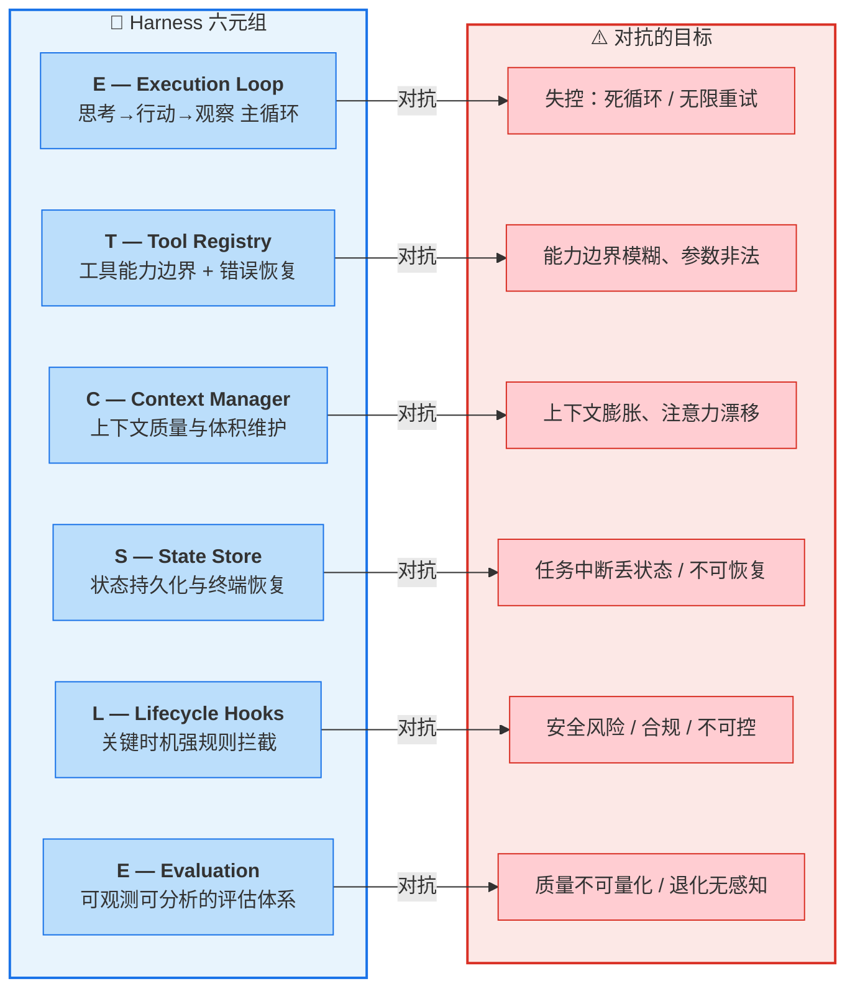

六元组速记表：

| 元素 | 职责 | 对抗的目标 | 典型实现 |
|------|------|-----------|---------|
| **E**xecution Loop | 思考→行动→观察 主循环 | 死循环 / 无限重试 | 最大重试次数、循环退出条件 |
| **T**ool Registry | 工具能力边界 + 错误恢复 | 能力边界模糊、参数非法 | HARD-GATE、沙箱、权限白名单 |
| **C**ontext Manager | 上下文质量与体积维护 | 上下文膨胀、注意力漂移 | subagent 隔离、artifact 传递、渐进式加载 |
| **S**tate Store | 状态持久化与断点恢复 | 任务中断丢状态 / 不可恢复 | execution_log.json、状态机、心跳监控 |
| **L**ifecycle Hooks | 关键时机强规则拦截 | 安全风险 / 合规 / 不可控 | prereasoning/posttoolcall hook、红线门禁 |
| **E**valuation | 可观测可分析的评估体系 | 质量不可量化 / 退化无感知 | 独立 reviewer、Benchmark 闭环、A/B 测试 |

### 1.2 比喻体系
- LLM = 泉眼，Prompt = 水龙头，Context = 水管
- Harness = 阀门，Loop = 循环系统，Self-Harness = 自动检修
- Environment = 整个供水网络

### 1.3 核心概念词汇表
- **Artifact**：JSON 文件，阶段间的契约。每个阶段读上阶段的 artifact，写自己的 artifact
- **SKILL.md**：AI agent 看的 Markdown 指令文档，定义"做什么、怎么做、不能做什么"
- **Harness (Python)**：确定性代码，纯函数、格式解析、固定序列，不做决策
- **Skill**：一个可复用的 Prompt 增强包，通过渐进式加载为 Agent 注入领域知识
- **红线**：skill 里的硬约束，违反红线比产出错误更严重
- **门禁**：阶段间的校验点，必须满足条件才能进入下一阶段
- **状态机**：定义合法的状态转换路径，防止非法跳转
- **Orchestrator**：编排者，只做规划/委派/汇总，不做具体逻辑

### 1.4 演进路径

> **图 1-2：从 Prompt 到 Harness 的演进**

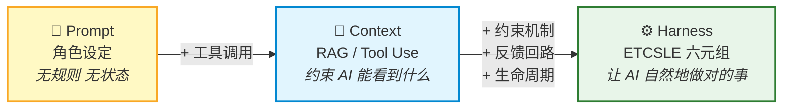

每个阶段解决的问题：
- Prompt：让 AI 知道"我是谁"
- Context：让 AI 知道"我能用什么"
- Harness：让 AI "自然地做对的事"

---

## 第 2 章 为什么需要 Harness

**目标**：讲透问题本质，让读者从"感觉有用"变成"确信必要"

**内容**：

### 2.1 LLM 的四个固有缺陷

> **图 2-1：LLM 固有缺陷 → ETCSLE 对策映射**

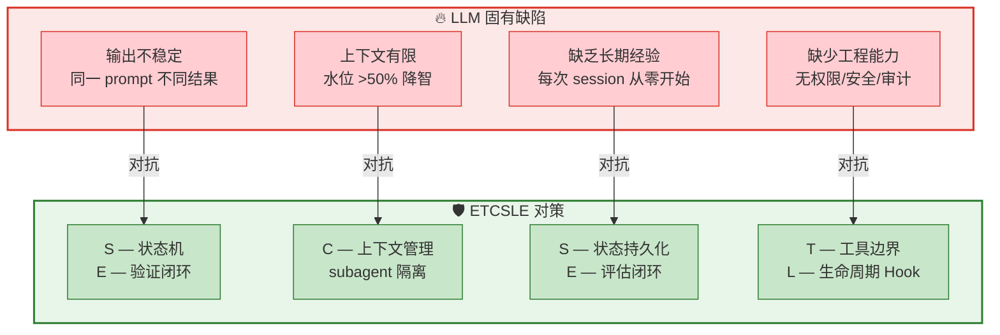

| 缺陷 | 表现 | Harness 对策（ETCSLE） |
|------|------|----------------------|
| 输出不稳定 | 同一 prompt 不同结果 | **S** 状态机 + **E** 验证闭环 |
| 上下文有限 | 水位 >50% 降智 | **C** subagent 隔离 + artifact 传递 |
| 缺乏长期经验 | 每次 session 从零开始 | **S** 状态持久化 + **E** 评估闭环沉淀 |
| 缺少工程能力 | 无权限/安全/审计 | **T** 沙箱/红线 + **L** 审计日志 |

### 2.2 纯文本约束（SKILL.md）的局限
- 无法穷尽隐式规则（命名规范、逻辑约定、边界处理）
- AI 在压力下会违反红线（Superpowers 的实验：合规率从 33% 提到 72% 需要说服原则辅助）
- 大模型 1M 上下文仍可能挤爆，小模型需要更少上下文
- 结论：文本约束是必要条件，不是充分条件 → 需要代码级兜底

### 2.3 "人在回路" vs "无人值守"
| 维度 | 人在回路 | 无人值守 |
|------|---------|---------|
| 代表项目 | Superpowers | patch-merge-workflow / 自主增长系统¹ |

> ¹ 高德 OPC 自主增长系统，来源：developer.aliyun.com/article/1739352
| 每步是否等人确认 | 是 | 否 |
| 约束强度 | 软约束够用 | 必须硬约束 |
| 状态管理 | 无（人脑记住） | 必须有（状态机 + artifact） |
| 失败恢复 | 人介入重来 | 必须可断点续跑 |
| 可行性判断 |  | 50 个 patch 无人值守 → 必须做到 |

---

## 第 3 章 Harness 的七大能力

**目标**：每个能力讲清原理 + 配真实案例，让读者能直接借鉴

**内容**：

### 3.1 上下文管理：防止挤爆

**原理**：主 agent 做编排，子 agent 做执行，artifacts 作为跨 agent 的信息载体

> **图 3-1：父子 Agent 双向关系图**

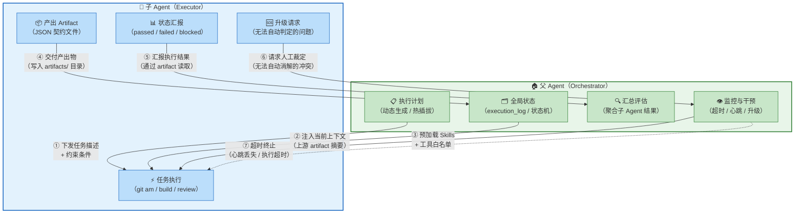

**双向通信协议**：

| 方向 | 通道 | 载体 | 示例 |
|------|------|------|------|
| 父→子 | 任务下发 | prompt + artifact 摘要 | `apply patch #7，risk=high，需 checkpoint 编译` |
| 父→子 | 上下文注入 | 上游 artifact 文件路径 | `读 workspace.json 获取仓库路径` |
| 父→子 | 能力约束 | tools + skills + gates | `只能用 Bash/Read/Write，预加载 build-validator` |
| 子→父 | 产出交付 | JSON artifact 写入磁盘 | `execution_log.json 记录 passed + 编译通过` |
| 子→父 | 状态汇报 | artifact 中的 status 字段 | `status: "blocked", reason: "conflict on main.c"` |
| 子→父 | 升级请求 | blocked 状态 + 冲突上下文 | `conflict_context.json → 等待 conflict-handler` |
| 父→子 | 超时终止 | 心跳监控 / 进程 kill | `1200 秒未完成 → STALLED → 终止子进程` |

**核心原则**：
- 子 Agent 不共享父 Agent 的对话上下文（物理隔离，防止膨胀）
- 所有跨 Agent 通信必须通过 artifact 文件（磁盘契约，不通过内存）
- 父 Agent 不信任子 Agent 的口头汇报，只读 artifact 做判断

**案例 1：patch-merge-workflow 的 orchestrator 模式**
- orchestrator 只保留 execution_log 摘要（几十行 JSON）
- merge-executor 在独立上下文执行单个 patch
- 产物通过 artifact（JSON 文件）传递，不通过内存

**案例 2：高德自主增长系统的 Planner/Builder 分层**

> 📖 来源：《让 AI 自己做增长——高德 OPC 基于 Agent 的工程实践》，阿里云开发者社区，developer.aliyun.com/article/1739352

- Planner 拆为 product_agent / design_agent / arch_agent
- Builder 拆为 testcase_agent / builder_agent
- 每个 Agent 做完一次任务，下次启动新 subagent
- 强制每次生成新 subagent 避免上下文污染：
  同一上下文开启多件事情时，记忆会混乱，实现质量快速下降

**案例 3：Superpowers 的 subagent-driven-development**
- controller 预提取 task 全文，直接粘贴到 subagent prompt
- subagent 不读文件，不继承对话历史
- 三个角色：implementer（执行）→ spec-reviewer（验证合规）→ code-quality-reviewer（验证质量）

**平台能力**：
- Claude Code：Agent 工具 + context:fork + isolation:worktree
- OpenCode：Task 工具 + task_id 复用
- Subagent 中调 Skill：预加载（skills 字段）或运行时（Skill 工具）

### 3.2 事前拦截：小步验证

**原理**：事前拦截成本远低于事后修复

**案例 1：checkpoint 编译**
- 无脑合入 50 个 patch 再编译 → 事后大海捞针
- harness 做法：根据 7 条规则标记 checkpoint patch，合入后立即编译
- 规则示例：
  - Rule_1：infra 类 patch 必检
  - Rule_2：被 3+ 后续 patch 引用必检
  - Rule_4：最后一个 patch 必检
  - Rule_6：同一模块组的最后一个 patch 必检

**案例 2：conflict 决策矩阵**
- decision_table.md：10 种冲突场景的 Ours/Theirs 决策
- 减少AI试错：给AI问题解决矩阵，而非让它自由发挥
- 场景 6/10 无法自动判定 → 暂停输出给用户裁定

**案例 3：高德系统的三层快速失败评审**

> 📖 来源：同上，高德 OPC Harness 工程实践

> **图 3-2：三层快速失败评审流程**

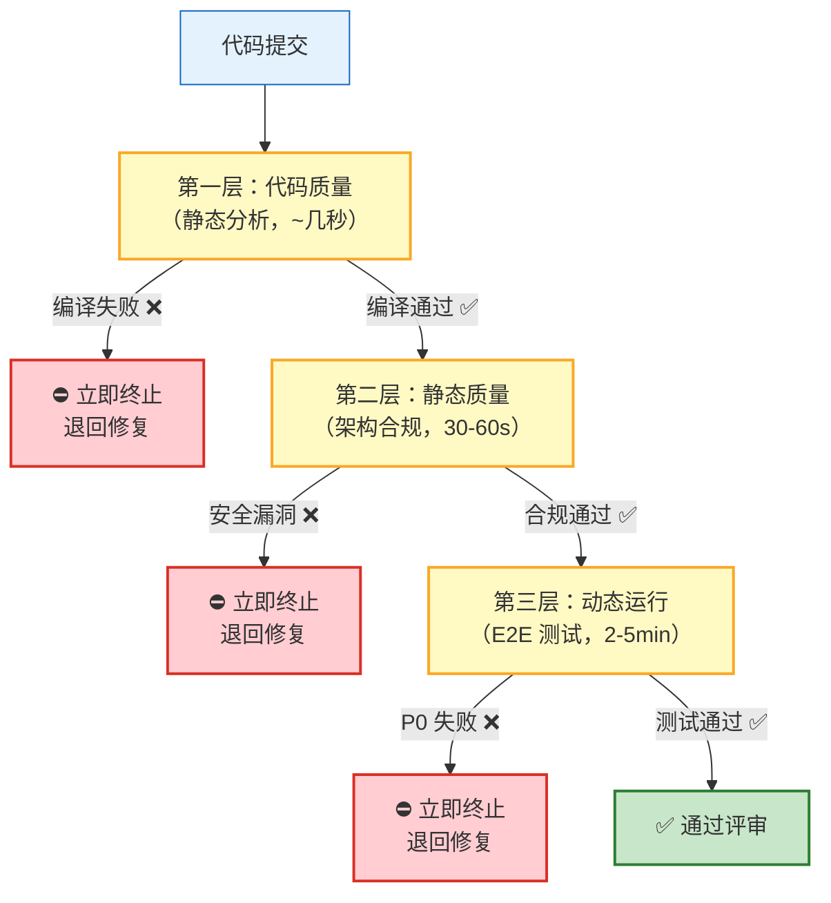

- 实战数据：引入快速失败后，评审耗时从 4 分钟降到 1 秒
- 核心信念：宁可让 Evaluator 花 10 次 1 秒钟快速退回，也不允许 1 次 4 分钟的无效评审

**案例 4：沙箱保护**
- 容器内根文件系统只读
- CPU/进程/内存限额
- 不注入宿主机环境变量
- 执行记录写入审计日志

### 3.3 状态恢复：断点续跑

**原理**：以 JSON artifact 为状态恢复依据，让长任务可以从断点继续

**案例 1：patch-merge-workflow 的状态调度**

> **图 3-3A：Patch Apply 状态机（冲突消解流程）**

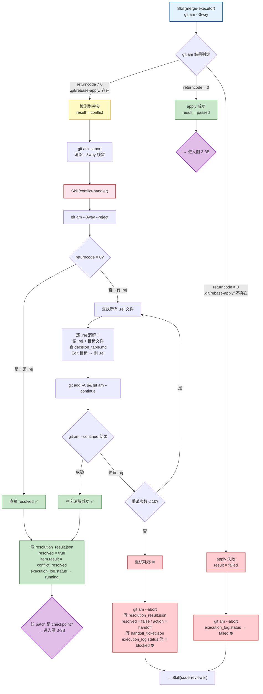

> **图 3-3B：Build Checkpoint 状态机（编译门禁流程）**

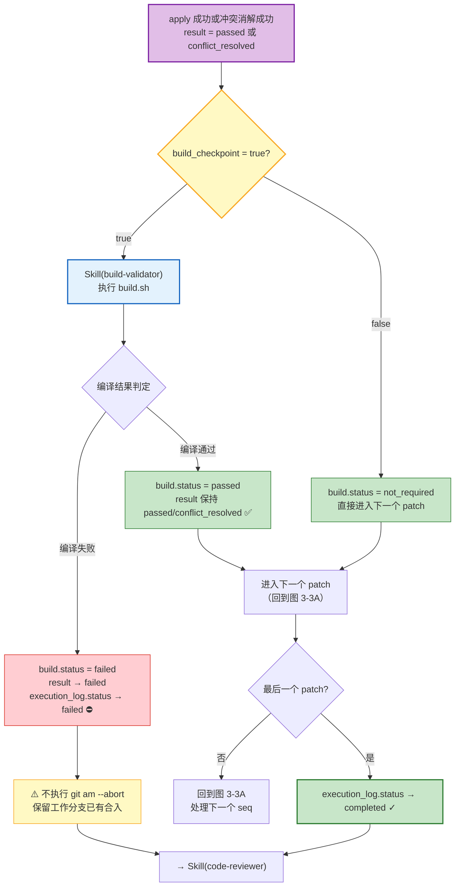

**两张图的关系**：

```
图 3-3A（Apply 状态机）              图 3-3B（Build 状态机）
┌─────────────────────┐            ┌─────────────────────┐
│ git am --3way       │            │ build_checkpoint?   │
│   ├─ passed ────────┼─── 入口 ──→│   ├─ true → build   │
│   ├─ conflict       │            │   └─ false → skip   │
│   │   ├─ resolved ──┼─── 入口 ──→│                      │
│   │   └─ handoff    │            │ build 结果:          │
│   └─ failed         │            │   ├─ passed → 下一patch│←──┐
│                      │            │   └─ failed → 终止   │   │
└─────────────────────┘            └─────────────────────┘   │
                                       ↑ 下一个 patch ───────┘
```

**三层状态体系**：

| 层级 | 字段 | 合法值 | 说明 |
|------|------|--------|------|
| 工作流级 | `execution_log.status` | `running` / `completed` / `blocked` / `failed` | 全局状态 |
| 单 patch 级 | `item.result` | `passed` / `conflict` / `failed` / `conflict_resolved` | 单次合入结果 |
| 编译级 | `item.build.status` | `passed` / `failed` / `not_required` / `blocked_by_conflict` | Checkpoint 编译结果 |

**关键调度规则**：
- `conflict_resolved` 后仍需检查 `build_checkpoint`——冲突消解成功不代表编译安全
- checkpoint 编译失败**不执行** `git am --abort`（保留工作分支已有合入，便于定位问题）
- `blocked` 或 `failed` 状态**仍需**进入 code-reviewer 和 report-generator（生成反映失败状态的报告）
- Resume 机制：读 execution_log，跳过已 processed 的 seq

**案例 2：高德系统的状态流转**

> 📖 来源：同上，高德 OPC Harness 工程实践

> **图 3-4：高德系统状态机 + 心跳监控**

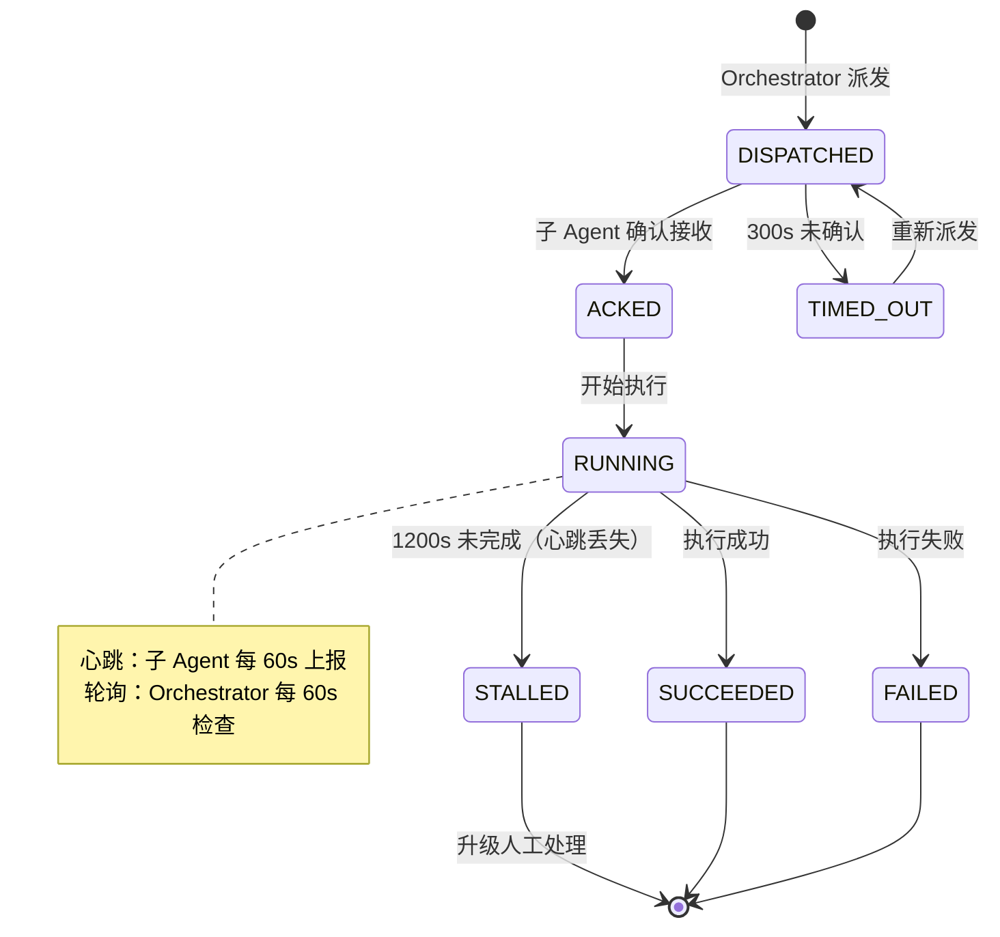

**案例 3：生命周期 Hook**
- prereasoning：注入最新 state，按需加载记忆
- posttoolcall：结果校验与状态更新
- 记忆回写：执行结果提炼，作为持续演化 skill 的依据

### 3.4 约束执行：软调用 vs 硬调用

> **图 3-6：软调用 vs 硬调用光谱**

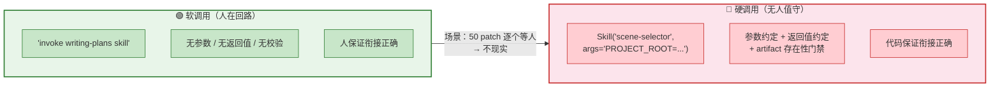

**软调用（Superpowers）**：
```markdown
9. **Transition to implementation** — invoke writing-plans skill
```
- 只说了"调"，无参数、无返回值、无校验
- 前提：人在回路，人保证衔接正确

**硬调用（patch-merge-workflow）**：
```markdown
Skill("scene-selector", args="PROJECT_ROOT=... artifacts_root=...")
调用后校验：
- request.json 存在
- config_selection.json 存在
```
- 参数约定 + 返回值约定 + artifact 存在性门禁
- 前提：无人值守，必须写死

**高德系统的硬约束**：

> 📖 来源：同上，高德 OPC Harness 工程实践

- 每个 Agent 有明确的进入条件（condition）
- 每个 Agent 有明确的产出物（outputs），orchestrator 检测产物存在
- 每个 Agent 有明确的失败处理（on_failure）

**选择标准**：人在回路 = 软调用；无人值守 = 硬调用

### 3.5 验证闭环：不信任自汇报

**原理**：Generate → Verify → Repair → Verify 循环

> **图 3-5：验证闭环循环**

```mermaid
graph LR
    G["🔄 Generate<br/>生成产物"] -->|"交付"| V1["🔍 Verify<br/>独立验证"]
    V1 -->|"通过 ✅"| Done["✅ Done"]
    V1 -->|"不通过 ❌"| R["🔧 Repair<br/>修复问题"]
    R -->|"重新交付"| V1

    style G fill:#e3f2fd,stroke:#1565c0,stroke-width:2px
    style V1 fill:#fff9c4,stroke:#f9a825,stroke-width:2px
    style R fill:#fce4ec,stroke:#c62828,stroke-width:2px
    style Done fill:#c8e6c9,stroke:#2e7d32,stroke-width:2px
```

**关键原则**：验证者 ≠ 生成者，零信任自汇报

**案例 1：Superpowers 的两阶段 review**
- spec-reviewer 验证是否按 spec 做（防偷工减料）
- code-quality-reviewer 验证代码质量（防 over-engineering）
- prompt 里写了 "CRITICAL: Do Not Trust the Report"

**案例 2：高德系统的评估独立性**

> 📖 来源：同上，高德 OPC Harness 工程实践

- 评审与生成彻底分离：同一个 AI 既写又审行不通
- 零信任：Builder 说"测试通过了"，Evaluator 得自己跑一遍
- 零 Broken Feature：Evaluator 是最后一道防线，不能因为"只差一点点"就放水
- 六个独立 reviewer：proposal_reviewer / prd_reviewer / contract_reviewer /
  testcase_reviewer / impl_reviewer / frontend_design_reviewer

**案例 3：patch-merge-workflow 的独立读取**
- merge-executor 不信任 AI 口头汇报
- 要求 AI 调 harness 的 build_execution_item() 写入 JSON
- orchestrator 读 execution_log.json 获取真实状态

### 3.6 执行计划：动态生成与跟踪

**原理**：skill 根据任务和场景动态生成执行计划，用 checkbox 跟踪进度

**案例 1：Superpowers 的 writing-plans**
- 极严格的计划格式：强制 header、每步 2-5 分钟粒度、禁止占位符
- 自检环节：spec coverage + placeholder scan + type consistency
- 本质：把 spec 变成 subagent 可独立执行的原子任务

**案例 2：patch-merge-workflow 的热插拔 plan**
- 场景 1（完整流程）：查找 patch → 依赖搜索 → 深度分析 → 逐 patch 合入 → review → 输出
- 场景 2（已有 patch，无依赖）：深度分析 → 逐 patch 合入 → review → 输出
- plan 根据输入动态调整，sub skill 可热插拔

**跟踪机制**：
- TodoWrite 逐项打卡（Commitment 说服原则：先声明任务列表，再逐项完成）

### 3.7 Agent 自进化：从失败中学习

**原理**：每次失败都是规则库的养分，通过数据驱动的闭环实现持续改进

> **图 3-7：Agent 自进化闭环**

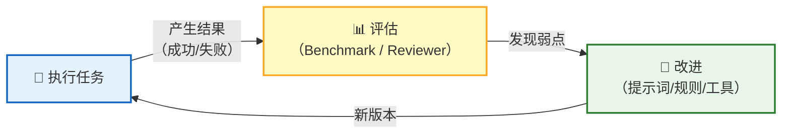

**案例 1：patch-merge-workflow 的过程记忆**
- conflict-handler 记录冲突内容、原因、解决方式
- build-validator 记录编译错误类型、修复摘要
- 冲突解决知识库 → 决策规则自动提取 → skill 自动增强

**案例 2：高德系统的 Benchmark 评估闭环**

> 📖 来源：同上，高德 OPC Harness 工程实践

- Evaluator 的"评审能力"可拆解为可测量指标
- 代码片段模式：评估代码规范识别能力
- 完整项目模式：静态分析 + 动态验证
- 闭环：跑评估 → 对答案 → 找弱点 → 改提示词 → 再跑评估
- 三轮迭代：均分从 64.5 → 67.5 → 83.4

**案例 3：Skill-Creator 的 A/B 测试**
- 并行启动 with_skill 和 without_skill 两组子 Agent
- Grader 评分（自批评机制：对薄弱断言给通过比失败更糟）
- Comparator 盲比较（不知道哪个输出来自哪个 Skill）
- Analyzer 事后分析（揭盲后分析 WHY）

---

## 第 4 章 Harness 怎么落地：架构与实现

**目标**：从理念到工程，讲清怎么设计一个 harness 系统

**内容**：

### 4.1 Skill 规范标准

**SKILL.md 格式**：
```yaml
---
name: skill-name           # 唯一标识，小写字母+数字+连字符
description: Use when...   # 触发条件，不要总结工作流
---

# Skill 标题

## Overview
核心原则，1-2 句话

## When to Use
触发条件 + 不适用场景

## Implementation
具体指令、代码、流程

## Red Flags
自检信号表
```

**三层渐进式加载**：

> **图 4-1：Skill 三层渐进式加载**

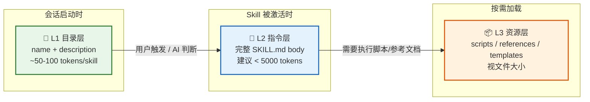

| 层级 | 加载内容 | 加载时机 | Token 成本 |
|------|---------|---------|-----------|
| L1 目录层 | name + description | 会话启动时 | ~50-100 tokens/skill |
| L2 指令层 | 完整 SKILL.md body | Skill 被激活时 | 建议 <5000 tokens |
| L3 资源层 | scripts/ references/ | 按需加载 | 视文件大小 |

**Description 的关键陷阱**：
- Description 只应描述触发条件，绝不要总结工作流
- 测试发现：当 description 总结了工作流时，AI 可能直接按 description 执行，跳过完整 Skill
- 好例子：`Use when executing implementation plans with independent tasks`
- 坏例子：`Use when executing plans - dispatches subagent per task with code review`

### 4.2 五种 Skill 设计模式（Google ADK）

| 模式 | 核心逻辑 | 适用场景 | 典型案例 |
|------|---------|---------|---------|
| Tool Wrapper | 需要时才加载领域知识 | 封装框架规范、代码风格 | FastAPI 开发规范 |
| Generator | 模板 + 风格指南强制输出一致 | 标准化文档生成 | 报告生成器 |
| Reviewer | "查什么"和"怎么查"分离 | 自动化审查 | 代码审查、安全扫描 |
| Inversion | Agent 先采访用户再动手 | 需求不明确 | 项目规划、架构设计 |
| Pipeline | 带检查点的多步工作流 | 复杂多步骤任务 | patch-merge-workflow |

**模式组合**：

> **图 4-3：五种模式关系与组合**

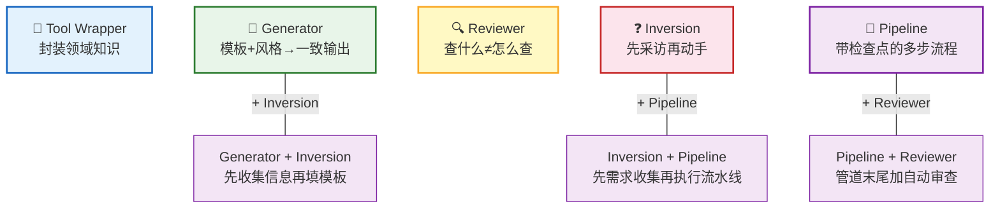

- Pipeline + Reviewer：管道最后一步加自动审查
- Generator + Inversion：先收集信息再填充模板
- Inversion + Pipeline：先需求收集再执行流水线

### 4.3 两层架构：Skill + Harness

> **图 4-2：Skill + Harness 两层架构**

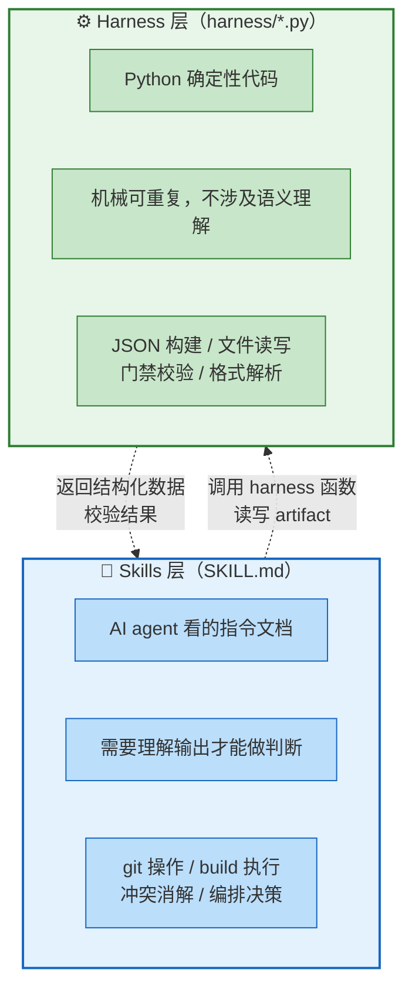

**划分标准**：
| 放 Harness | 放 Skill（AI 自己做） |
|---|---|
| 确定性数据提取（patch Subject 解析） | 语义理解（.rej 冲突内容、build 失败原因） |
| 固定 git 操作序列（checkout/branch） | 需要看输出判断的 git（git am 结果） |
| JSON 构建/读写/校验 | 循环、分支、决策、降级链 |

### 4.4 Harness 五类操作
1. JSON 构建器：build_execution_item()、build_merge_plan()
2. JSON 文件读写：read_json()、write_json()、append_list_item()
3. 门禁校验：validate_local_git_repo()
4. Patch 拆解：ingest_source()、extract_subject()
5. Workspace 搭建：prepare_workspace()、setup_work_branch()

### 4.5 当前缺口与改进方向
- harness 只做了"写"没做"防"——set_execution_status() 无校验
- validate.py 的设计：状态转换合法性 + artifact 存在性门禁
- 文本约束（SKILL.md 红线）+ 代码约束（validate.py）= 双保险

### 4.6 SKILL.md 中的文本约束技术

**来自 Superpowers 的实践**：

**a) Iron Law**——绝对规则：
```
NO PRODUCTION CODE WITHOUT A FAILING TEST FIRST
```

**b) HARD-GATE**——能力边界：
```xml
<HARD-GATE>
❌ git am --reject（这是 conflict-handler 的工具）
❌ 编辑源码来修编译错误（这是 build-validator 的活）
✅ apply 后立即用 build_execution_item() 写 execution_log
</HARD-GATE>
```

**c) Red Flags**——自检信号：
```markdown
- Code before test
- "I already manually tested it"
- "Tests after achieve the same purpose"
- "It's about spirit not ritual"
```

**d) Rationalization Table**——预判借口：
```markdown
| Excuse | Reality |
|--------|---------|
| "Too simple to test" | Simple code breaks. Test takes 30 seconds. |
| "I'll test after" | Tests passing immediately prove nothing. |
```

**e) 说服原则**（基于 N=28,000 对话实验）：
| 原则 | 在 Skill 中的应用 | 效果 |
|------|-----------------|------|
| Authority | "YOU MUST"、"Never" | 最有效，合规率翻倍 |
| Commitment | "Announce: I'm using [Skill]" | 制造一致性压力 |
| Scarcity | "IMMEDIATELY after X" | 制造紧迫感 |
| Social Proof | "Every time"、"X without Y = failure" | 建立规范 |
| Unity | "your human partner"、"we" | 共同身份 |

---

## 第 5 章 实战：patch-merge-workflow 架构全貌

**目标**：用完整案例串联所有概念

**内容**：

### 5.1 流程图
（引用 PROJECT_STATUS_AND_PLAN.md 中的 mermaid 流程图）

### 5.2 Artifact 数据流

> **图 5-1：Artifact 数据流全景**

```mermaid
graph LR
    SS["scene-selector"] -->|"request.json"| WM["workspace-manager"]
    WM -->|"workspace.json"| PA["patch-analysis"]
    PA -->|"patch_manifest.json"| ME["merge-executor"]
    ME -->|"merge_plan.json<br/>execution_log.json"| CH{"状态?"}
    CH -->|"blocked"| CF["conflict-handler"]
    CF -->|"conflict_context.json<br/>resolution_result.json"| ME
    CH -->|"completed"| BV["build-validator"]
    BV -->|"build_report.json"| CR["code-reviewer"]
    CR -->|"review_report.json"| RG["report-generator"]
    RG -->|"summary.md<br/>output_report.json"| Done["🏁"]

    style SS fill:#e8f5e9,stroke:#2e7d32
    style WM fill:#e8f5e9,stroke:#2e7d32
    style PA fill:#e8f5e9,stroke:#2e7d32
    style ME fill:#e3f2fd,stroke:#1565c0,stroke-width:2px
    style CH fill:#fff9c4,stroke:#f9a825,stroke-width:2px
    style CF fill:#fce4ec,stroke:#c62828
    style BV fill:#e3f2fd,stroke:#1565c0
    style CR fill:#e3f2fd,stroke:#1565c0
    style RG fill:#e8f5e9,stroke:#2e7d32
    style Done fill:#c8e6c9,stroke:#2e7d32,stroke-width:2px
```

### 5.3 两条典型路径
- Happy Path：clean apply × N → completed → build → report
- Blocked Path：success × M → conflict → handler → resolved/failed

### 5.4 七个 Skill 的职责分工
（引用 PROJECT_STATUS_AND_PLAN.md 3.3 节）

### 5.5 Artifact 目录结构
```
artifacts/
├── request.json              ← scene-selector
├── workspace.json            ← workspace-manager
├── patches/patch_manifest.json ← patch-analysis
├── merge/
│   ├── merge_plan.json
│   └── execution_log.json    ← merge-executor
├── conflict/                 ← conflict-handler
│   ├── conflict_context.json
│   └── resolution_result.json
├── build/build_report.json   ← build-validator
├── review/review_report.json ← code-reviewer
└── final/
    ├── summary.md
    └── output_report.json    ← 最终产物
```

---

## 第 6 章 Subagent 架构与平台适配

**目标**：让读者理解两个主流平台的 subagent 实现差异，知道怎么选

**内容**：

### 6.1 Claude Code vs OpenCode 对比
| 维度 | Claude Code | OpenCode |
|------|-----------|----------|
| 调用工具 | Agent 工具 | Task 工具 |
| task_id 复用 | ❌ | ✅ 可继续同一会话 |
| Fork 模式 | ✅ context:fork 继承父对话 | ❌ |
| Worktree 隔离 | ✅ isolation:worktree | ❌ |
| Skill 预加载 | ✅ skills 字段启动时注入 | ✅ |
| Skill 运行时调用 | ✅ Skill 工具在保留列表中 | ✅ skill 工具 |

### 6.2 Subagent 中调 Skill 的两种方式
- 预加载：skills 字段启动时注入 SKILL.md 全文
- 运行时：subagent 拥有 Skill 工具，可动态发现加载

### 6.3 context: fork 的意义
Skill 声明 context:fork → 不注入主会话，而是创建 subagent 执行
- v2.1.38+ 的变化：Skill 执行方式从"内联加载"变为"subagent 执行"

### 6.4 对 patch-merge-workflow 的改造方向
```yaml
name: merge-executor
description: 对指定 patch 执行 git am 合入
tools: Bash, Read, Write, Edit, Grep, Glob
skills:
  - merge-executor
  - build-validator
permissionMode: acceptEdits
isolation: worktree
```
→ 物理隔离上下文，50 个 patch 也不挤爆

---

## 第 7 章 YAML 在 AI 工程中的角色

**目标**：回答"什么时候用 YAML，什么时候用 Markdown，什么时候用代码"

**内容**：

### 7.1 三种规则载体的选择标准
| 载体 | 适合放什么 | AI 可读 | 人可审 | 机器可校验 |
|------|----------|--------|-------|-----------|
| SKILL.md (Markdown) | 需要语义理解的规则、流程、决策 | ✅ | ✅ | ❌ |
| YAML | 机械可判定的配置、状态机定义 | ✅ | ✅ | ✅ |
| Python (harness) | 必须代码执行的校验、构建 | ❌ | ❌ | ✅ |

### 7.2 当前 patch-merge-workflow 的 YAML 使用
- config/build_profiles/kernel-arm64-basic.yaml
- config/merge_profiles/am-first.yaml
- scenes/legacy-single-repo.yaml

### 7.3 哪些规则应该从 SKILL.md 迁移到 YAML
- checkpoint 规则：当前在 build_checkpoint.py 硬编码，可迁移为 risk_rules.yaml
- 冲突决策规则：当前在 decision_table.md，可部分迁移为 conflict_rules.yaml
- 判断标准：规则是否需要 AI 语义理解 → 需要就留 markdown，机械可判定就迁 YAML

### 7.4 状态机流程定义
- proposal-to-build.yaml：定义 patch 合入的合法状态转换
- rollback.yaml：定义回滚流程
- 参考：高德 Harness 工程的 YAML 状态机实践（condition + outputs + on_failure）

> 📖 来源：同上，高德 OPC Harness 工程实践

---

## 第 8 章 踩坑与经验

**目标**：分享实战中遇到的真实问题，让读者少走弯路

**内容**：

### 8.1 端到端自动化的工程量被严重低估
- 状态管理：每个 Agent 执行完毕后，系统需要准确判断成功/失败/部分成功
- 超时和资源管理：五六个 Agent 串联 + 门禁检查 + 重试，完整任务可能十几分钟
- 环境一致性：本地开发正常、云端构建失败
- 可追溯日志：失败时需要知道"在哪里、什么时间、为什么"

### 8.2 环境工具化本身就是约束

> 📖 来源：同上，高德 OPC Harness 工程实践

- 高德的案例：接入 skill 前 AI 10 次能成功 1-2 次，接入后基本都能成功
- 封装好加签算法，告诉 builder 项目结构，就能调用得很好
- 开发环境就是一种约束：限制在特定场景下使用特定组件，AI 更容易写出正确代码

### 8.3 完全无人干预不是 0/1 的状态
- 真正有价值的是把人工干预的频率降到足够低
- 一个人可以同时"监护"几十个并行运行的任务
- 关键节点仍保留人工确认（如高德的部署上线环节）

> 📖 来源：同上，高德 OPC Harness 工程实践

### 8.4 小步快跑，每次迭代保证上一轮是正常的
- 不要追求一步到位的全自动化
- 每个版本保证最起码的通路，然后在当前版本上迭代
- 上一轮验证过的部分是可信的，新问题一定出在新加的部分

### 8.5 模型很强但仍会出问题
- 长链路稳定性脆弱：8-10 个节点，每个 90% 成功率，端到端一次通过率仍不高
- 目前靠重试机制和门禁回退兜底，基本需要 1-3 次循环才能修掉 P0

---

## 第 9 章 动手练习

**目标**：让读者动手做，而不只是看

**内容**：

### 练习 1：给裸 SKILL.md 加约束
给定一个无约束的 merge-executor SKILL.md，要求加上：
- HARD-GATE 能力边界
- Red Flags 自检信号
- Rationalization Table 预判借口

### 练习 2：写 validate.py
为 execution_log.py 的 set_execution_status() 添加：
- 合法状态转换校验
- artifact 存在性门禁
- 非法转换时抛 ValueError

### 练习 3：写一个 subagent 定义
用 Claude Code 的 .claude/agents/ 格式，为 conflict-handler 写 subagent 定义：
- tools 限制
- skills 预加载
- permissionMode

### 练习 4：设计一个 YAML 状态机
为 patch 合入流程定义 proposal-to-build.yaml：
- 合法状态转换
- condition 门禁
- outputs 产出物
- on_failure 失败处理

### 练习 5：写一个 Pipeline 模式的 Skill
按照 Google 的 Pipeline 设计模式，写一个文档生成 Skill：
- 多步骤，带检查点
- 每步有明确的输入/输出和通过条件
- Agent 不能跳步

---

## 延伸阅读

| 资料 | 描述 | 链接 |
|------|------|------|
| Agent Skills 开放规范 | Skill 格式标准 | agentskills.io/specification |
| Superpowers 框架 | 约束型 Skill 体系 | github.com/obra/superpowers |
| Anthropic 官方 Skills 文档 | Claude Code Skills 开发 | docs.anthropic.com/en/docs/claude-code/skills |
| Claude Code Subagent 文档 | Subagent 配置与使用 | docs.anthropic.com/en/docs/claude-code/sub-agents |
| 让 AI 自己做增长 | 高德 Harness 工程实践 | developer.aliyun.com/article/1739352 |
| Agent Skill 规范、构建与设计模式 | Skill 规范 + 构建方法 + 设计模式 | developer.aliyun.com/article/1734589 |
| patch-merge-workflow 项目 | 无人值守 patch 合入系统 | /mnt/shared/patch-merge-workflow |
| Google ADK Skill 设计模式 | 五种设计模式 | x.com/GoogleCloudTech/status/2033953579824758855 |
| Awesome Agent Skills | 1060+ Skills 集合 | github.com/VoltAgent/awesome-agent-skills |
| Skill 评测基准 | skillsbench.ai | www.skillsbench.ai |
