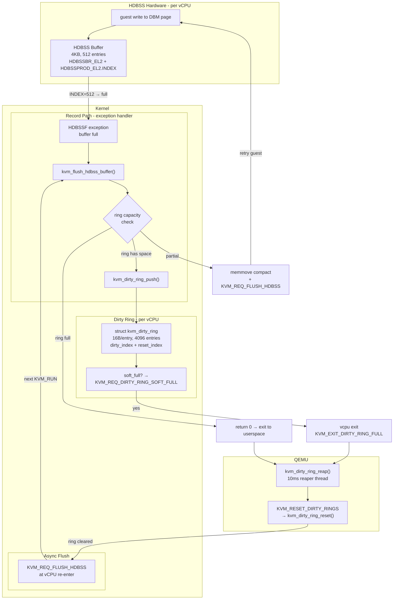
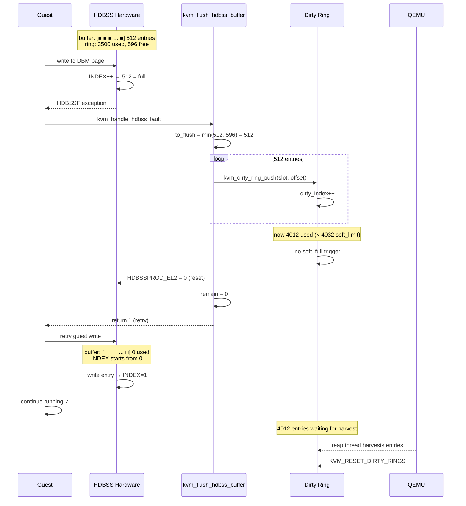
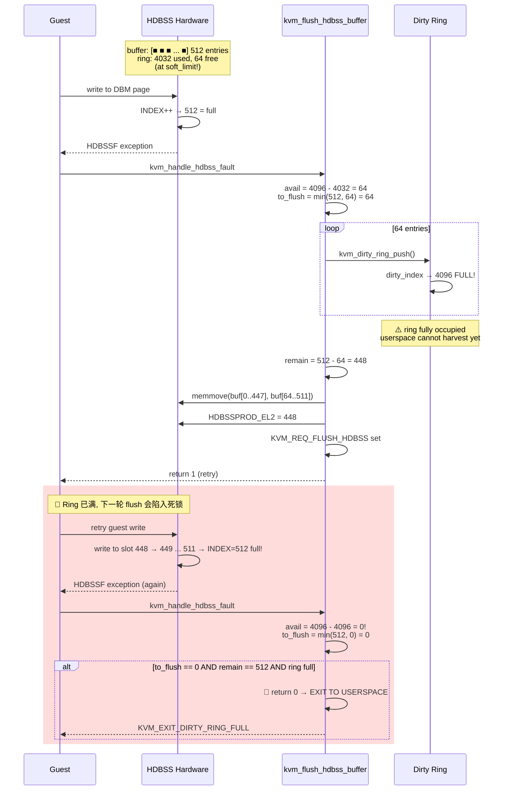
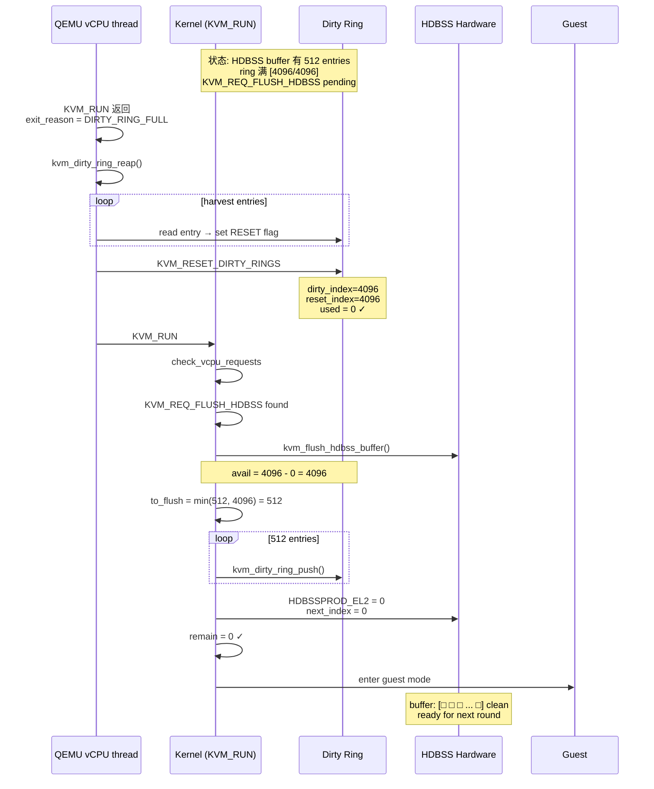
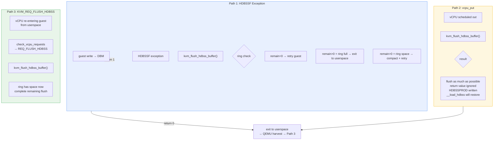
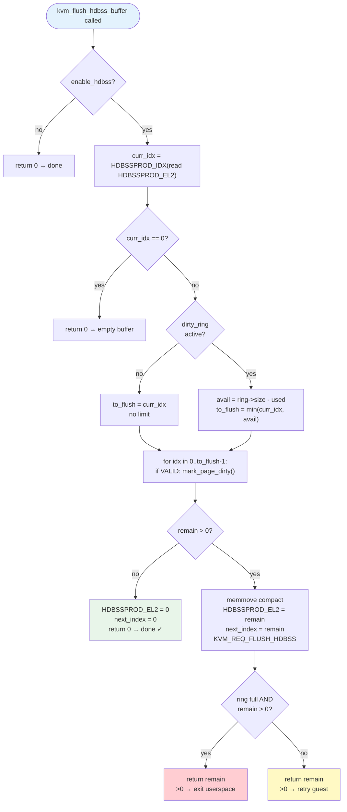
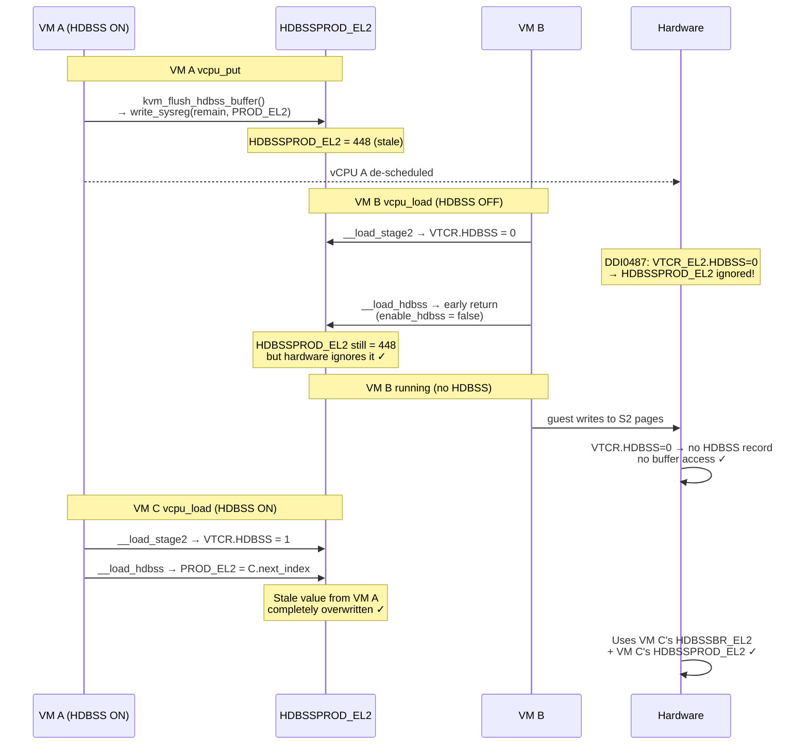

# 2: HDBSS 适配 Dirty Ring 完整方案

## 0. 背景

HDBSS 硬件模型是**纯生产者** — 只有 `HDBSSPROD_EL2.INDEX` (生产者指针), **无消费者指针**。flush 后只能写 0 复位, 不能增量消费。Dirty ring 是完整的环形 producer-consumer 模型 (`dirty_index` + `reset_index`)。两者集成需要解决: 格式转换、flush 时序、死锁预防。

### 参考: HACDBS 对比

HACDBS 有 `HACDBSCONS_EL2` (消费者寄存器 + ERR_REASON), 是完整的 producer-consumer 模型。HACDBS 做 **清理脏位** (反过来: 读 ring → 清 S2 PTE dirty), 跟 HDBSS 方向相反但硬件接口更完整。

---

## 1. 硬件差异对比

```
                          HDBSS (记录脏页)          HACDBS (清理脏位)
                          ──────────────            ──────────────
BR 寄存器                  HDBSSBR_EL2              HACDBSBR_EL2
  .BADDR                   GENMASK(55,12)           GENMASK(55,12)
  .SZ                      4-bit size encoding      4-bit size encoding
  .EN                                              BIT(11) ← 使能位

PROD 寄存器                HDBSSPROD_EL2            (无独立 PROD)
  .INDEX                   19-bit producer ptr
  .FSC                     6-bit fault code

CONS 寄存器                **无!**                   HACDBSCONS_EL2
  .INDEX                                              19-bit consumer ptr
  .ERR_REASON                                         2-bit error code

触发                      每笔 DBM 写 → 记录 IPA    batch 送 entries → 逐个清 S2 PTE
                          满 → HDBSSF exception    完成/出错 → HACDBSIRQ 中断

entry 格式                u64: IPA[55:12] | VALID   u64: IPA[55:12] | TTWL | VALID
                          (8 字节 raw GPA)            (含 translation table walk level)
```

**核心差异**: HDBSS 没有 consumer register, 无法做增量消费。只能全量 flush 或 `memmove` 压缩。

### Dirty Ring 结构

```c
struct kvm_dirty_gfn {          // 16 bytes per entry
    __u32 flags;                // KVM_DIRTY_GFN_F_DIRTY | KVM_DIRTY_GFN_F_RESET
    __u32 slot;                 // (as_id << 16) | memslot_id
    __u64 offset;               // GFN offset relative to memslot base
};

struct kvm_dirty_ring {         // per-vCPU
    u32 dirty_index;            // 软件生产者, 自由运行计数器
    u32 reset_index;            // 软件消费者, 自由运行计数器
    u32 size;                   // entries 数 (2的幂)
    u32 soft_limit;             // size - KVM_DIRTY_RING_RSVD_ENTRIES (arm64: 64)
    struct kvm_dirty_gfn *dirty_gfns;
};
```

---

## 2. 当前 flush 路径和问题

### 2.1 flush 触发点

| 触发点 | 代码位置 | 上下文 | 问题 |
|--------|---------|--------|------|
| HDBSSF exception | `kvm_handle_hdbss_fault` → `kvm_flush_hdbss_buffer` | 异常处理, `mmu_lock` | 单次批量 push, ring 可能溢 |
| vcpu_put | `kvm_vcpu_put_vhe` → `kvm_flush_hdbss_buffer` | vCPU 切出 | vCPU 即将退出,有可能切到其他vcpu上,这个时候是要求必须全部flush掉的,所以如果ring不够空间就会有问题(当然也可以选择不保证进入下一个vcpu前prod_index必须为零,允许prod_index是已经有值的) |
| KVM_REQ_FLUSH_HDBSS | `check_vcpu_requests` → `kvm_flush_hdbss_buffer` | vCPU 重入 guest 前 | 通过 `kvm_arch_sync_dirty_log` 间接触发 |

**关键**: dirty ring 模式下, `kvm_arch_sync_dirty_log` 不会被调用 (用户态不读 bitmap), 所以只有前两个触发点有效。

### 2.2 核心风险: 格式不兼容

```
HDBSS 硬件写入:                     Dirty ring 存储:
┌──────────────────────┬───┐        ┌────────┬────────┬────────────┐
│  guest IPA[55:12]    │ V │        │ flags  │ slot   │ offset     │
│  44 bits             │bit│        │ (32b)  │ (32b)  │ (64b)      │
└──────────────────────┴───┘        └────────┴────────┴────────────┘
       8 bytes                            16 bytes
```

硬件直接写入元物理地址 + valid bit。Dirty ring 需要 slot + offset 编码。**必须通过 `kvm_vcpu_mark_page_dirty` → `kvm_dirty_ring_push` 逐条转换**, 无法直接复用 ring 内存做 HDBSS buffer。

---

## 3. 死锁路径分析

### 3.1 理想场景 (正常)

```
HDBSS buffer (512 entries)    dirty ring (4096 entries, 64 reserved)
──────────────────────────    ─────────────────────────────────────

初始:  ring 3000 used          [512 free slots]     [1096 free]
       HDBSS 记录到满了
       HDBSSF → flush 512
       ring: 3000+512=3512 (soft_limit=4032)
       没到 soft_limit, vCPU 继续             ✓ 正常
```

### 3.2 死锁场景

```
HDBSS buffer (512 entries)    dirty ring (4096 entries)
──────────────────────────    ──────────────────────────

初始:  [512 待 flush]                                [4032 used, 64 free]

HDBSSF → flush:
  max_to_flush = min(512, 64) = 64
  → push 64 entries                                 [4096/4096 FULL]
  → 448 entries 残留                                ← vCPU 未退出! 无法 harvest
  → compact: buf[0..447], INDEX=448
  → return 1 (retry)

guest retry 写:
  → HDBSS 写 slot 448..512 → 满 → HDBSSF

HDBSSF again:
  → ring full → max_to_flush = min(512, 0) = 0
  → flush 0 entries!
  → 512 entries 残留                                [4096/4096 FULL]
  → compact: buf[0..511], INDEX=512 = 满
  → return 1 (retry)                                ← 异常, done
guest retry 写 → HDBSSF → flush 0 → retry → ...
  → **死锁: vCPU 不退出, ring 无法 harvest, flush 无法推进**
```

### 3.3 死锁根因

```
vCPU 在异常处理中 → retry → guest retry → 异常 → retry → ...
                       ↑                                   ↓
                  无法退出到                           ring 满,
                  用户态                              flush 0
                       ↑                                   ↓
                  ring 无法被                   ┌──────────────────┐
                  QEMU harvest                  │  互锁 deadlock    │
                                                └──────────────────┘
```

**HDBSS 异常路径的 retry=1 导致 vCPU 永远不退出。但 ring 满时必须退出才能被 harvest。**

---

## 4. 解决方案

### 4.1 核心思路

1. **flush 时限制批次大小** = min(HDBSS entries, ring 剩余空间)
2. **ring 满且 buffer 有残留时, 退出到用户态** 而不是 retry
3. **`memmove` 压缩** 未 flush 的条目, 让硬件继续往空闲位置写
4. **异步请求** `KVM_REQ_FLUSH_HDBSS` 确保下次重入 guest 前完成剩余 flush

### 4.2 实现

#### 4.2.1 `kvm_flush_hdbss_buffer` — 改为返回剩余条目数

```c
/*
 * Flush HDBSS hardware buffer to dirty tracking (ring or bitmap).
 *
 * Returns the number of entries remaining in the HDBSS buffer after flush.
 *   0 = all consumed and HDBSSPROD_EL2 reset to 0.
 *  >0 = partial flush only; entries compacted to buffer[0..ret-1],
 *       KVM_REQ_FLUSH_HDBSS set for later completion.
 */
int kvm_flush_hdbss_buffer(struct kvm_vcpu *vcpu)
{
    int idx, curr_idx, to_flush, remain;
    u64 br_el2;
    u64 *hdbss_buf;
    struct kvm *kvm = vcpu->kvm;

    if (!kvm->arch.enable_hdbss)
        return 0;

    curr_idx = HDBSSPROD_IDX(read_sysreg_s(SYS_HDBSSPROD_EL2));
    br_el2 = HDBSSBR_EL2(vcpu->arch.hdbss.base_phys, vcpu->arch.hdbss.size);

    if (curr_idx == 0 || br_el2 == 0)
        return 0;

    hdbss_buf = page_address(phys_to_page(vcpu->arch.hdbss.base_phys));
    if (!hdbss_buf)
        return 0;

    to_flush = curr_idx;

    /*
     * Dirty ring mode: limit flush to ring's remaining capacity.
     * kvm_dirty_ring_used() returns dirty_index - reset_index.
     */
    if (kvm->dirty_ring_size) {
        struct kvm_dirty_ring *ring = &vcpu->dirty_ring;
        u32 avail = ring->size -
                    (READ_ONCE(ring->dirty_index) - READ_ONCE(ring->reset_index));
        to_flush = min((u32)curr_idx, avail);
    }

    guard(write_lock_irqsave)(&kvm->mmu_lock);
    for (idx = 0; idx < to_flush; idx++) {
        u64 gpa = hdbss_buf[idx];

        if (!(gpa & HDBSS_ENTRY_VALID))
            continue;

        gpa &= HDBSS_ENTRY_IPA;
        kvm_vcpu_mark_page_dirty(vcpu, gpa >> PAGE_SHIFT);
    }

    remain = curr_idx - to_flush;

    if (remain) {
        /* Compact unflushed entries to front of buffer */
        memmove(hdbss_buf, &hdbss_buf[to_flush], remain * sizeof(u64));
        write_sysreg_s(remain, SYS_HDBSSPROD_EL2);
        vcpu->arch.hdbss.next_index = remain;
        kvm_make_request(KVM_REQ_FLUSH_HDBSS, vcpu);
    } else {
        write_sysreg_s(0, SYS_HDBSSPROD_EL2);
        vcpu->arch.hdbss.next_index = 0;
    }
    isb();

    return remain;
}
```

#### 4.2.2 `kvm_handle_hdbss_fault` — 破解死锁

```c
static int kvm_handle_hdbss_fault(struct kvm_vcpu *vcpu)
{
    u64 prod, fsc;
    int remain;

    prod = read_sysreg_s(SYS_HDBSSPROD_EL2);
    fsc = FIELD_GET(HDBSSPROD_EL2_FSC_MASK, prod);

    switch (fsc) {
    case HDBSSPROD_EL2_FSC_OK:
        remain = kvm_flush_hdbss_buffer(vcpu);

        /*
         * If HDBSS buffer still has entries AND dirty ring is full,
         * we can't make progress: exit to userspace so the ring can
         * be harvested.  KVM_REQ_FLUSH_HDBSS was set in flush above,
         * so remaining entries will be processed on next KVM_RUN.
         */
        if (remain > 0 && kvm->dirty_ring_size) {
            struct kvm_dirty_ring *ring = &vcpu->dirty_ring;
            u32 used = READ_ONCE(ring->dirty_index) -
                       READ_ONCE(ring->reset_index);

            if (used >= ring->size) {
                /*
                 * Ring is full. Signal exit to userspace rather
                 * than retry to avoid the HDBSSF→flush(0)→retry
                 * deadlock loop.
                 */
                return 0;   /* 0 → exit to userspace */
            }
        }
        return 1;

    case HDBSSPROD_EL2_FSC_ExternalAbort:
    case HDBSSPROD_EL2_FSC_GPF:
        return -EFAULT;

    default:
        WARN_ONCE(1, "Unexpected HDBSS fault type, FSC: 0x%llx\n", fsc, prod);
        return -EFAULT;
    }
}
```

#### 4.2.3 导出 `kvm_dirty_ring_used`

当前 `kvm_dirty_ring_used()` 是 `static inline u32` 在 `virt/kvm/dirty_ring.c` 中, 需要改为非 static 并在 `include/linux/kvm_dirty_ring.h` 中声明:

```c
// include/linux/kvm_dirty_ring.h:
u32 kvm_dirty_ring_used(struct kvm_dirty_ring *ring);

// virt/kvm/dirty_ring.c:
u32 kvm_dirty_ring_used(struct kvm_dirty_ring *ring)
{
    return READ_ONCE(ring->dirty_index) - READ_ONCE(ring->reset_index);
}
```

> 或直接在 mmu.c 中通过 `vcpu->dirty_ring.dirty_index - vcpu->dirty_ring.reset_index` 访问 (ring 字段在 `kvm_vcpu` 中公开, 但直接读裸字段不够优雅)。

#### 4.2.4 所有调用方签名适配

`kvm_flush_hdbss_buffer` 返回值从 `void` 改为 `int`:

| 调用方 | 位置 | 适配 |
|--------|------|------|
| `kvm_vcpu_put_vhe` | `switch.c:245` | 忽略返回值 (vcpu_put 不关心) |
| `check_vcpu_requests` | `arm.c:1242-1243` | 忽略返回值 (这是异步补 flush) |
| `kvm_handle_hdbss_fault` | `mmu.c:2285+` | 检查返回值, 决定 retry 还是 exit |
| `mmu.h` 声明 | `kvm_mmu.h:186` | `int` 替代 `void` |

---

## 5. 完整生命周期流程

### 5.1 正常 case: ring 有足够空间

```
guest 写脏页 × N → HDBSS buffer 从 0 填到 512
  ↓
HDBSSF exception → kvm_flush_hdbss_buffer(vcpu)
  ring: 3500 used, 596 free
  to_flush = min(512, 596) = 512
  push 512 entries → ring: 4012 used (4012 < 4032 soft_limit)
  HDBSSPROD = 0, next_index = 0
  remain = 0 → done
  return 1 (retry)
  ↓
guest retry 写 → HDBSS 从 0 开始写 → work OK ✓
```

### 5.2 部分 flush case: ring 接近满

```
HDBSSF exception → kvm_flush_hdbss_buffer(vcpu)
  ring: 4000 used, 96 free
  to_flush = min(512, 96) = 96
  push 96 entries → ring: 4096 used (FULL!)
  compact: buf[0..415], INDEX = 416
  remain = 416 (> 0)
  KVM_REQ_FLUSH_HDBSS set
  return 1 (retry)
  ↓
guest retry 写 → HDBSS 从 416 写 → 96 个 slot 后又满 → HDBSSF
  ↓
HDBSSF again → kvm_flush_hdbss_buffer(vcpu)
  ring: FULL, 0 free
  to_flush = min(512, 0) = 0
  flush 0 entries!
  remain = 512 (> 0) AND ring full → return 0 (exit to userspace!)
  ↓
vCPU exit → QEMU reap ring → ring cleared
  ↓
KVM_RUN → check_vcpu_requests → KVM_REQ_FLUSH_HDBSS
  → kvm_flush_hdbss_buffer(vcpu)
  ring: 0 used, 4096 free
  to_flush = min(512, 4096) = 512
  push 512 → HDBSSPROD = 0
  remain = 0 → done ✓
```

---

## 6. 容量分析

### 6.1 关键数字

| 参数 | 值 | 说明 |
|------|:---:|------|
| HDBSS buffer (order=0) | 512 entries | 4KB / 8 bytes |
| Dirty ring 典型 | 4096 entries | 64KB / 16 bytes |
| Dirty ring reserved | 64 entries | `KVM_DIRTY_RING_RSVD_ENTRIES` |
| Soft_limit | ring_size - 64 | arm64: 4032 |
| 最坏 case: HDBSS flush 单次最大 | 512 entries | buffer 全满 |

### 6.2 溢出条件

```
HDBSS overflow ring 条件:
  ring->used + 512 > ring->size  →  溢出

soft_limit 保护 (单次常规 push 1 entry):
  used 接近 soft_limit → request → vCPU exit → harvest
  预留 64 entries 确保 vCPU 退出前有缓冲

HDBSS 批量 push 绕过保护:
  HDBSS flush 一次 push ≤512 entries
  used + 512 > size 可能导致溢出
  → 需要容量检查 (方案中已实现)
```

### 6.3 容量检查矩阵

| ring used | ring free | HDBSS to_flush | 行为 |
|:---:|:---:|:---:|------|
| 0..3583 | ≥513 | 512 (全部) | 正常 flush, ring 不超 soft_limit |
| 3584..4031 | 65..512 | ring free | 部分 flush, ring 可能满 |
| 4032..4095 | 1..64 | ring free | 部分 flush, compact 残留, 下次满即退出 |
| 4096 | 0 | 0 | flush 0, 退出用户态 |

**结论**: order=0 的 512-entry buffer 在典型 4096-entry ring 下有足够的安全边际, 但容量检查是必须的安全网。

---

## 7. 性能影响

| 操作 | order=0 (512 entries) | 说明 |
|------|:---:|------|
| `memmove` 压缩 | ~4KB copy | 最坏 case: 512 条全保留, 开销 ~O(buffer_size) |
| HDBSSPROD_EL2 写 | 1 个 sysreg | 每条 flush 路径 1 次 |
| ring 检查 | 2 个 READ_ONCE | `dirty_index` + `reset_index` |
| 额外 HDBSSF 异常 | 0..1 次 | 仅 ring 接近满时触发, 正常路径不增加 |

---

## 8. 涉及文件汇总

| # | 文件 | 改动 | 行 |
|---|------|------|-----|
| 1 | `arch/arm64/kvm/mmu.c` | `kvm_flush_hdbss_buffer` → 返回 `int`, 加容量检查和 memmove | L2239-2276 |
| 2 | `arch/arm64/kvm/mmu.c` | `kvm_handle_hdbss_fault` → 死锁检测, ring 满时 return 0 | L2278-2301 |
| 3 | `arch/arm64/include/asm/kvm_mmu.h` | 声明 `int kvm_flush_hdbss_buffer(struct kvm_vcpu *)` | L186 |
| 4 | `arch/arm64/kvm/hyp/vhe/switch.c` | `kvm_vcpu_put_vhe` 忽略返回值 | L245 |
| 5 | `arch/arm64/kvm/arm.c` | `check_vcpu_requests` 忽略返回值 | L1242-1243 |
| 6 | `include/linux/kvm_dirty_ring.h` | 声明 `u32 kvm_dirty_ring_used(struct kvm_dirty_ring *ring)` | new |
| 7 | `virt/kvm/dirty_ring.c` | `kvm_dirty_ring_used` 从 `static` 改为非 static | L38-41 |

---

## 9. 验证清单

- [ ] order=0 buffer + 4096-entry ring: 正常 flush 不触发容量限制
- [ ] ring 接近 soft_limit: 部分 flush, compact 正确, retry 后 HDBSS 继续写入
- [ ] ring 满 + buffer 满: flush 0 entries, 退出到用户态, 无死锁
- [ ] vCPU exit 后 KVM_RUN 重入: `KVM_REQ_FLUSH_HDBSS` 完成剩余 flush
- [ ] vcpu_put 路径: 返回值被忽略, 功能不受影响
- [ ] bitmap 模式: `kvm->dirty_ring_size == 0`, 跳过容量检查, 行为不变
- [ ] memmove 压缩: buffer 内容正确, INDEX 正确, 硬件从正确位置继续写入
- [ ] 热插拔 vCPU: buffer alloc 后 flush 行为与正常 vCPU 一致

---

## 10. 流程图 (Mermaid)

### 10.1 总体架构: HDBSS → Dirty Ring



### 10.2 正常场景: Ring 空间充裕



### 10.3 部分 Flush + 死锁破解



### 10.4 死锁破解后的恢复路径



### 10.5 三条 Flush 调用路径对比



### 10.6 Flush 决策矩阵



### 10.7 跨 VM 安全性 (无寄存器污染)


