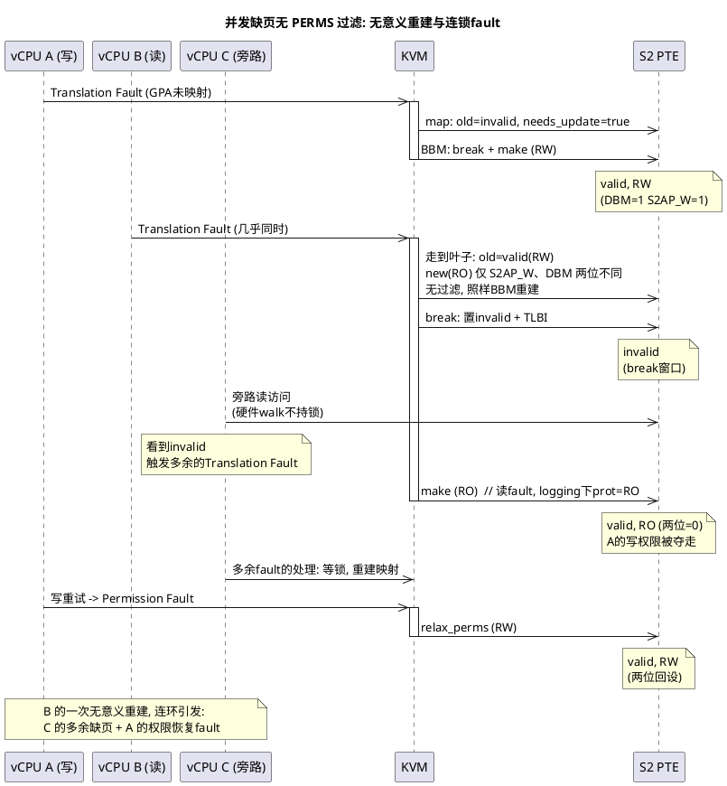
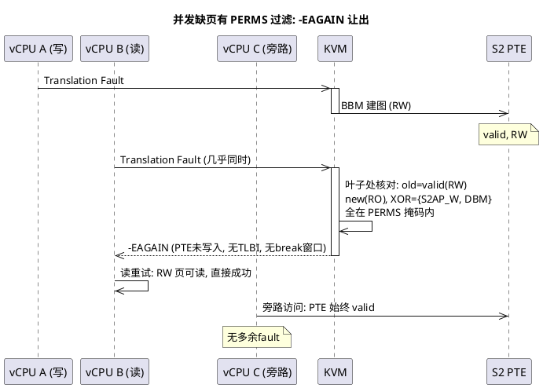
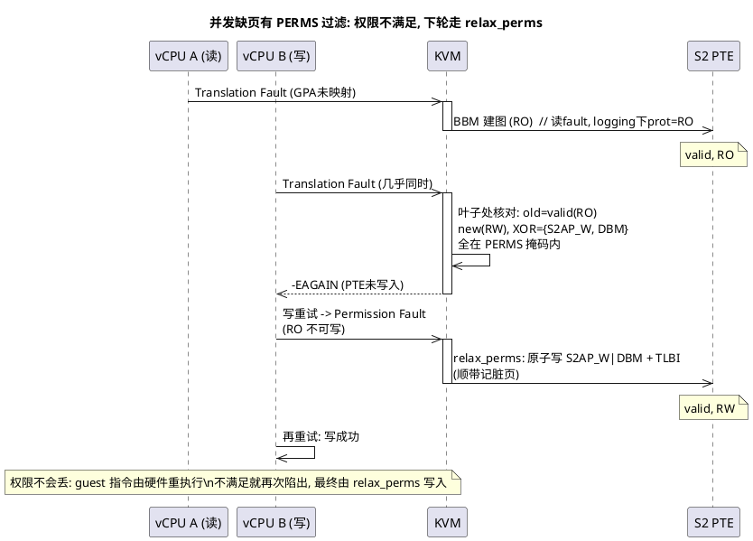

Leo的patch是把"可写"的语义从 S2AP_W（bit 7）迁移到 DBM（bit 51）。

核心方式(步骤):

- step1:所有原来设S2AP_W 的地方改为同时设 DBM | S2AP_W
- step1 的 patch 还把 DBM 收进了 PERMS 权限掩码（原因见 2.3）
- step2:所有原来从 S2AP_W 判断"可写"的地方改为从 DBM 判断。

终态（全部 patch 合入后）的语义分工:

- **DBM = 可写位**: DBM=1 即可写, 与 S2AP_W 无关
- **S2AP_W = 脏位**: 可写页的 S2AP_W=0 是"干净", =1 是"脏"
- 三态: **N**(0,0 只读) / **WC**(1,0 可写干净) / **WD**(1,1 可写脏)

# 1. 三态模型: DBM 承载可写, S2AP_W 承载脏

Leo 的 patch 把"可写"语义从 S2AP_W 迁到 DBM 后, S2AP_W 腾出来承载"脏"。终态的编码规则一句话: **DBM 由 W 决定, S2AP_W 由脏决定**:

```c
/* linux/arch/arm64/kvm/hyp/pgtable.c, stage2_set_prot_attr() */
	if (prot & KVM_PGTABLE_PROT_W) {
		attr |= KVM_PTE_LEAF_ATTR_HI_S2_DBM;

		if (prot & KVM_PGTABLE_PROT_DIRTY)
			attr |= KVM_PTE_LEAF_ATTR_LO_S2_S2AP_W;
	}
```

这段代码跨两个层面: 读的 `prot & KVM_PGTABLE_PROT_W` 是**软件枚举位**, 含义从未变过, 就是"这页要可写"; 写的 `attr` 是 **PTE 硬件位**, Leo 改的正是这一层, 可写语义从 S2AP_W 换到 DBM。编码器就是翻译官: **prot 的 W 落成 PTE 的 DBM, prot 的 DIRTY 落成 PTE 的 S2AP_W**。两位的四种组合里三种有定义:

| 状态 | DBM | S2AP_W | 语义 | 写访问的命运 |
|---|---|---|---|---|
| N | 0 | 0 | 只读 | Permission Fault（VMA 可写则 relax 恢复） |
| WC | 1 | 0 | 可写·干净 | 记一次脏: HD=1 硬件免 fault 升 WD; HD=0 fault 出来软件标脏 |
| WD | 1 | 1 | 可写·脏 | 畅通, 已在脏集 |

（DBM=0, S2AP_W=1 的组合全系列任何路径都不会产出。编码器先判 W 设 DBM, S2AP_W 只在其后。）

## 1.1 谁产出哪个状态

| 写手 | 何时 | 落表 |
|---|---|---|
| `stage2_set_prot_attr` | map/split 建页（见 2.2） | prot 带 W 无脏: WC; 带 W 带脏: WD; 无 W: N |
| `kvm_pgtable_stage2_relax_perms` | 放权（见 2.4） | 写 fault 的放权带脏: WD |
| `stage2_wrprotect_walker`（wrprotect 专属 walker） | 写保护（见 4） | page: 清 S2AP_W, WD→WC; block: 连 DBM 一起清, →N |

## 1.2 给脏策略: DIRTY 何时进 prot

「带脏」不由编码器决定, prot 里的 DIRTY 是 compute_prot 按场景给的:

```c
/* linux/arch/arm64/kvm/mmu.c, kvm_s2_fault_compute_prot() */
	if (s2vi->map_writable) {
		*prot |= KVM_PGTABLE_PROT_W;

		if (s2vi->device ||
		    !(memslot_is_logging(s2fd->memslot) || kvm_supports_hafdbs(kvm)) ||
		    kvm_is_write_fault(s2fd->vcpu))
			*prot |= KVM_PGTABLE_PROT_DIRTY;
	}
```

非 device 页的真值表。前提: 该页本身允许被写（map_writable=1, VMA/memslot 判可写）, prot 拿到 W, 变的只是脏与不脏。map_writable=0 的页连 W 都没有, 直接落 N, 不在表内:

| 场景 | logging | HAFDBS 支持 | fault 类型 | DIRTY | 落表 |
|---|---|---|---|---|---|
| 写已发生 | 任意 | 任意 | 写 | 给 | WD |
| 迁移迭代期 | 开 | 任意 | 读 | 不给 | WC |
| 非迁移 | 关 | 支持 | 读 | 不给 | WC |
| 非迁移 | 关 | 不支持 | 读 | 给 | WD |

统一规则: **写已发生的（写 fault、device 页）当场给脏; 读 fault 只有在"第一次写有人接"时才留 WC**。logging 下由 fault 机制接, 写 fault 出来标脏; HAFDBS 下由硬件接, 免 fault 升脏。没人接就预标 WD, 否则 WC 的第一次写只是白白多 fault 一次。

## 1.3 硬件行为: HD 门控 WC 的写

脏状态的硬件更新由 VTCR_EL2.HD 门控, 同一个 WC 页的写有两种命运:

- **HD=1**: 硬件免 fault 放行写, 顺手置 S2AP_W=1（WC→WD）, 脏由硬件记
- **HD=0**: 硬件不管 DBM, S2AP_W=0 挡住写, Permission Fault 出来由软件标脏后放行

HD 随迁移状态开关: 非迁移且硬件支持 HAFDBS 时开; 迁移开始时关, 保住"写 fault 才能标脏"的跟踪机制（见 5）。

演进注: 系列分两步走到三态, 每步自洽。第一步两位绑定, 设/清全成对, 成立不变量 DBM≡S2AP_W, 判断切到 DBM 后读哪个都一样; 第二步 DIRTY 分离两位, WC 诞生, 不变量让位于三态。

# 2. 建页路径: 从 fault 到 PTE

## 2.1 compute_prot: prot 现算

先交代背景: 虚机 S2 建页是 lazy 的。VMM 先申请内存, 权限随申请一路存进宿主机 VMA / KVM memslot（纯软件记录, 此时还没有页表）; guest 实际访问时才触发 fault, KVM 在 fault 处理中读 VMA/memslot 权限, 算出 prot, 走 map 路径做真实的 BBM 写入。

后文反复用到两个概念, 先分清:

- **访问类型**: 触发异常的 guest 指令行为, 硬件记录在 ESR 的 WnR 位。store 指令触发为写 fault, load 指令触发为读 fault。**说的是指令想做什么，跟要建表时的读写权限的计算是无关的**
- **prot**: **KVM 根据 VMA/memslot 算出的映射权限**, 决定 make 阶段写进 PTE 的属性位（S2AP_R / S2AP_W 等）。是真实的页表属性

prot 在 fault 处理的 `kvm_s2_fault_compute_prot()` 中计算:

```c
/* linux/arch/arm64/kvm/mmu.c, 主线版本（系列合入前） */
user_mem_abort
  +-> kvm_s2_fault_compute_prot
  +-> kvm_s2_fault_map

static void kvm_s2_fault_compute_prot(vma, prot)
{
  //...
	*prot = KVM_PGTABLE_PROT_R;

	if (s2vi->map_writable && (s2vi->device ||
				   !memslot_is_logging(s2fd->memslot) ||
				   kvm_is_write_fault(s2fd->vcpu)))
		*prot |= KVM_PGTABLE_PROT_W;

  //...
}
```

- `map_writable`: 从 VMA/memslot 读出的软件权限, 是 prot 的权限来源
- **普通可写内存（未开 logging）: `!memslot_is_logging` 恒真短路, 访问类型不参与计算, 读写 fault 算出的 prot 都是 RW**
- **dirty logging 是例外**。它是热迁移迭代期的脏页跟踪机制: memslot 开启后：
  - 已建映射全部写保护（S2AP_W=0）, guest 首次写某页触发 Permission Fault, 该页记入脏页集后 relax 恢复可写。
  - 对新建映射, 跟踪策略进入 prot 计算, `kvm_is_write_fault` 成为决定性条件:
    - **写 fault: prot = RW, fault 处理中顺带记脏页**
    - **读 fault: prot = RO, 保持写保护不走 relax, 让未来的写还能 fault 出来被标脏。**

终态差异: 系列合入后, W 的给予简化成 map_writable 一个条件, 读写不对称从 W 挪到脏。读 fault 也拿 W, 不带脏, 建 WC（见 1.2 的真值表）; 写保护由 S2AP_W=0 承担, 不再收回 W。

### map_writable 的两层来源

compute_prot 只看 `s2vi->map_writable`, 这个值的底层是两层 flags, 都过才算可写:

```
user_mem_abort()                                   /* [mmu.c] */
  +-> __kvm_faultin_pfn(..., &map_writable, ...)   /* [kvm_main.c] */
    +-> kvm_follow_pfn()
      +-> memslot_is_readonly(slot)                /* memslot 层: KVM_MEM_READONLY */
      +-> hva_to_pfn()                             /* VMA 层: GUP 判 VM_WRITE */
        +-> hva_to_pfn_slow()                      /* 读 fault 的可写探测在这 */
```

- **memslot 层**: VMM 在 `KVM_SET_USER_MEMORY_REGION` 传的 `KVM_MEM_READONLY`, 只读则 map_writable 直接清零
- **VMA 层**: 宿主机进程 mmap 的真实权限 `VM_WRITE`。KVM 不显式读这个 flag, 借 GUP 的 FOLL_WRITE 语义判断。写 fault 的请求本身带 FOLL_WRITE, GUP 失败即无 VM_WRITE; 读 fault 则是顺手探测, `hva_to_pfn_slow()` 里 `get_user_page_fast_only(FOLL_WRITE)` 成功即 VM_WRITE

读 fault 建 WC 的前提（map_writable=1 拿到 W）就落在这两层 flags 上。

## 2.2 编码器: W 设 DBM, 脏设 S2AP_W

`stage2_set_prot_attr()` 是 stage-2 的**编码器**: 把软件视角的 prot（`enum kvm_pgtable_prot` 枚举位）翻译成硬件视角的 PTE 属性位（S2AP、XN、DBM、MEMATTR）。map 出来的一切映射, 权限位都出自它。fault 处理中现算的 prot（怎么算见 2.1）, 最终在这里落成 PTE 上的位。

Leo 的系列分两步改写它的 W 分支：

```c
/* linux/arch/arm64/kvm/hyp/pgtable.c, stage2_set_prot_attr() */
/* 第一步(abf089b02d3c): 可写页两位同设, DBM 跟着 S2AP_W 走 */
 	if (prot & KVM_PGTABLE_PROT_W)
-		attr |= KVM_PTE_LEAF_ATTR_LO_S2_S2AP_W;
+		attr |= KVM_PTE_LEAF_ATTR_HI_S2_DBM | KVM_PTE_LEAF_ATTR_LO_S2_S2AP_W;

/* 第二步(cc87c84b71bb)起, 终态: 脏位分离, W 只设 DBM, 脏时才加 S2AP_W */
 	if (prot & KVM_PGTABLE_PROT_W) {
 		attr |= KVM_PTE_LEAF_ATTR_HI_S2_DBM;
 
 		if (prot & KVM_PGTABLE_PROT_DIRTY)
 			attr |= KVM_PTE_LEAF_ATTR_LO_S2_S2AP_W;
 	}
```

终态编码规则即 1 开头那句话: DBM 由 W 决定, S2AP_W 由脏决定; 脏何时进 prot 见 1.2 的给脏策略。这两步是整个系列的地基, **决定了可写位怎么写进去, 决定了后面所有读写权限的判断要怎么读**（见 3）。

### 编码器的两个调用方

编码器 `stage2_set_prot_attr` 只有两个调用方, 恰好对应 prot 的两个来源：

```
user_mem_abort()                                   /* [mmu.c] */
  +-> kvm_s2_fault_compute_prot()                  /* prot 现算: VMA/memslot 权限 -> prot */
  +-> kvm_s2_fault_map(prot)                       /* map重建页表 */
    +-> kvm_pgtable_stage2_map()                   /* [pgtable.c] */
      +-> stage2_set_prot_attr(prot, &map_data.attr)   /* 编码: prot -> PTE 属性位 */
      +-> kvm_pgtable_walk()
        +-> stage2_map_walker_try_leaf()               /* 2.3 的差异检查在这 */
          +-> kvm_init_valid_leaf_pte(phys, data->attr, level)  /* 拼上物理地址, 造出 new */

stage2_split_walker()                              /* split 路径 */
  +-> kvm_pgtable_stage2_pte_prot(父pte)           /* 1. 解码: 父 PTE -> prot */
  +-> kvm_pgtable_stage2_create_unlinked(prot)     /* 2. 造子表 */
    +-> stage2_set_prot_attr(prot, &map_data.attr) /* 3. 再编码: 子页按继承的 prot 落位 */
```

- **map 路径**: **2.3 差异检查的 new, 正是这里的编码结果拼上物理地址造出来的**。
- **split 路径**: 一解码一编码, 构成 round-trip（解码-再编码的往返, 判断语义见 3）。

## 2.3 并发与 PERMS 掩码

`KVM_PTE_LEAF_ATTR_S2_PERMS` 是一组权限位掩码, 掩码**为并发缺页竞态而生**, 用在 map 路径中**重建/新建页表**走到叶子时的新旧 PTE 差异检查: 两者完全相同, 或仅在 S2AP_R/W、DBM、XN 这些位上有差异, 视为无需更新, 本次直接跳过, **不做 BBM、页表不写入**。

- 已建权限在建完重新执行指令时，如果满足访问则无事发生; 
- 重新执行时，权限仍不满足, 下次异常走 `relax_perms` 放权。

```c
/* linux/arch/arm64/include/asm/kvm_pgtable.h */
#define KVM_PTE_LEAF_ATTR_S2_PERMS	(KVM_PTE_LEAF_ATTR_LO_S2_S2AP_R | \
 		KVM_PTE_LEAF_ATTR_LO_S2_S2AP_W | \
+		KVM_PTE_LEAF_ATTR_HI_S2_DBM | \
 		KVM_PTE_LEAF_ATTR_HI_S2_XN)
```

### 竞态的由来: 并发缺页

掩码由 commit `694d071f8d85`（Filter out the case of only changing permissions from stage-2 map path）引入, 解决的是 map 路径的并发问题。

权限固化在 memslot/VMA, guest 的读写访问不改变它, 所以并发竞态的形态取决于是否开 logging:

- 未开 logging: prot 相同, 后到者 old == new → 无过滤时用 BBM 重建一模一样的映射, 纯浪费（最常见形态）
- 开 logging: prot 可能不同（RW/RO）, 仅权限位差异 → 无过滤时权限被夺 + 恢复 fault + 连锁缺页（下图的场景）

接下来我们就可以看一下实际的竞态场景了：

多个 vCPU 几乎同时访问同一个尚未建立 stage-2 映射的 GPA（Guest 物理地址）时, 全部触发 Translation Fault（缺页）。缺页时 `perm_fault_granule = 0`, `mapping_size` 必大于 0, 所以都走 map 路径各自建图。先到者建好映射, 后到者走到叶子时发现 PTE 已是 valid。而两个 vCPU 的 fault 类型可能不同（读/写/执行）, dirty logging 下算出的权限也就可能不同。

以"A 写 fault 先到, B 读 fault 后到"为例（dirty logging 下: A 算出 prot=RW, B 算出 prot=RO; 第一步的编码下, RW 落成 DBM、S2AP_W 两位同设, RO 两位全无, 两次 make 要写进页表的权限位不同）:



后到者 B 若不过滤, 会用 BBM（Break-Before-Make）把 PTE 从 RW 重建为 RO。这次重建本身是无意义的（映射本来能用）, 代价却连环:

- 夺走 A 的写权限: guest 下一次写触发 Permission Fault（权限异常）, 由 relax_perms 恢复 RW
- break 窗口伤及旁路: B 的 break 把 PTE 置 invalid, 到 make 写入 RO 之前有个窗口; 期间任何 vCPU（如旁路的 C）访问该页, 硬件 walk 看到的是 invalid, 触发本不该发生的 Translation Fault, 其处理还要等 B 释放 mmu_lock

好在这只是性能问题, 不是逻辑错误: BBM 保证时序正确, relax 对 R/W 只加不减, 脏页记账幂等。fault 绕几圈后收敛到满足所有访问的权限, 不会死循环。这就是引入掩码的 patch 所说的 useless small loops（无意义的小循环）, PERMS 过滤是纯性能优化: 省掉无意义的 BBM/TLBI 和连锁的 VM exit。



上图是已建权限满足访问的结局: B 的读重试直接成功。如果反过来, A 是 RO（读 fault 先到, logging 下建 RO）, B 是 RW（写 fault 后到）。那么 B 重试的时候会触发 Permission Fault, 再由 relax_perms 把权限恢复为 RW 并标脏:



### 叶子处的差异检查

PERMS 掩码的差异检查发生在 map 路径的 `stage2_map_walker_try_leaf`。而走哪条路径, 由 `kvm_s2_fault_map` 比较两个量决定: `mapping_size`（KVM 期望的映射大小）与 `perm_fault_granule`（硬件报告的权限故障粒度, 缺页时为 0）。相等走 relax_perms, 不等走 map:

```c
user_mem_abort                                 // [mmu.c]
  +-> kvm_s2_fault_map
    +-> if (mapping_size == perm_fault_granule)  // 期望映射大小 vs 硬件报告的权限故障粒度
    |     kvm_pgtable_stage2_relax_perms         // 相等: 仅放松权限, 原子更新 (见 relax_perms 路径)
    +-> else
          kvm_pgtable_stage2_map                 // 不等: 走 map 流程 (缺页/改变 block size)
            +-> stage2_map_walker_try_leaf       // [pgtable.c]
              +-> if (!stage2_pte_needs_update) return -EAGAIN;  // 叶子处核对: 完全相同或仅权限位差异 -> 让出
              +-> BBML;                          // 确有非权限位差异 -> 真重建
    +-> if (ret != -EAGAIN) return ret; else return 0; // -EAGAIN 转为 0, vCPU 恢复运行

stage2_pte_needs_update                         // [pgtable.c]
  +-> return ((old ^ new) & (~KVM_PTE_LEAF_ATTR_S2_PERMS));//差异检查: 过滤掉KVM_PTE_LEAF_ATTR_S2_PERMS的位，表示如果是PERMS位修改的话，不认为是old跟new不一致
```

内核注释直说这个设计:

```c
/* linux/arch/arm64/kvm/hyp/pgtable.c, stage2_map_walker_try_leaf */
	/*
	 * Skip updating the PTE if we are trying to recreate the exact
	 * same mapping or only change the access permissions. Instead,
	 * the vCPU will exit one more time from guest if still needed
	 * and then go through the path of relaxing permissions.
	 */
	if (!stage2_pte_needs_update(ctx->old, new))
		return -EAGAIN;
```

大意: 若在重建完全相同的映射、或只改访问权限, 就跳过更新, 让 vCPU 多退出一次

返回 -EAGAIN 时:

- PTE 完全未写入（new 只是局部变量）、无 TLBI、不触发 BBM
- `kvm_s2_fault_map` 将 -EAGAIN 转为 0（视为成功）, vCPU 恢复运行

`kvm_s2_fault_map` 分叉的两条路径, 触发条件对比:

| | relax_perms 路径 | map 路径 |
|---|---|---|
| 何时进入 | Permission Fault（权限异常）且 mapping_size == granule | 缺页（granule=0, 必不等）; 或映射尺寸需变化 |
| PTE 状态 | valid, 只需放松 | 后到者走到叶子时 old 已 valid（先到者刚建） |
| 动作 | 原子改权限位 + TLBI, 无 BBM | 叶子处差异检查: 完全相同或仅权限位差异 → -EAGAIN |

### DBM 为什么必须进掩码

Leo 的 patch 把 DBM 收进 `KVM_PTE_LEAF_ATTR_S2_PERMS`, 掩码为什么要跟编码器一起变? 回到本节开头的竞态: logging 下, A 写 fault 先到建 RW, B 读 fault 后到算 RO。看 patch 后的差异检查。

两个 vCPU 的映射各自经编码器构造（见 2.2）, DBM 没有独立来源, 它只是编码器 W 分支里成对多写的一个位:

```
A (写 fault):  compute_prot: 写 fault -> prot = R|W
                 编码器: if (prot & W) 成立 -> 两位同设
                 -> A 建好的 old: S2AP_R=1 S2AP_W=1 DBM=1

B (读 fault):  compute_prot: 读 fault 不满足写条件 -> prot = R
                 编码器: if (prot & W) 不成立, 跳过
                 -> B 算出的 new: S2AP_R=1 S2AP_W=0 DBM=0

old ^ new = { S2AP_W, DBM }     /* 同一组"RW vs RO"差异, 摊到两个位 (其余位相同) */
```

同一个"RW vs RO"差异, patch 前只落在 S2AP_W 一个位上, 现在被编码器摊到两个位。过滤器只认掩码内的位: 掩码若不把 DBM 收进去, XOR 里的 DBM 位就落在掩码外, `stage2_pte_needs_update` 照样返回 true。B 还是走完整 BBM 重建, 上文的无意义重建和连环 fault 原样复活。收进去之后, 这组差异被过滤, `stage2_pte_needs_update` 返回 false, 不触发昂贵的 BBM。new 只是局部变量, PTE 一位未动, B 的 RO 编码（DBM=0）到不了页表。

所以掩码和编码器是同一份契约的两端: **编码器把权限语义写进哪些位, 掩码就得把哪些位认作权限**。Leo 把两处改动放进同一个 patch, 原因就在这。

掩码管住的是"不乱写"。那"不丢写"呢? 把先后对调再走一遍: A 读 fault 先到、B 写 fault 后到（第三张图的顺序, 也是真正需要恢复的场景: RO 落了地, 写的人还没拿到权限）, VMA 的 W=1:

```
A 建表:    读 fault -> prot=RO -> 编码 S2AP_R=1 S2AP_W=0 DBM=0 -> 写入页表
B 后到:    old=RO, new=RW, XOR={S2AP_W, DBM} 全在掩码内 -> -EAGAIN
           B 的 RW 编码 (DBM=1) 到不了页表
B 写重试:  RO -> Permission Fault -> 走 relax 路径 (2.4)
           compute_prot: VMA W=1 且写 fault -> prot |= W   /* 判 W 读的是 VMA, 不读 PTE */
           relax_perms: set |= DBM|S2AP_W -> DBM 回到 1
           (写 fault 在 logging 下, 顺带标脏)
B 再重试:  写成功
```

DBM=0 不会把写权限锁死, 因为恢复的判断依据不是 PTE: fault 路径判"可写"看的是 `compute_prot` 现算的 prot, 来源是 VMA/memslot（2.4 流程注释也点了这层）。PTE 上的 DBM=0 只说明"赢下的那次建图没带写", 不说明"写丢了"。非权限位差异重建装进 RO 的场合同理, 恢复机制相同。全系列真正从 PTE 读回可写判断的是 split 继承这类解码场景（见 3）; fault/relax 每一轮都从 VMA 现算, 这是一切"写权限丢失"场景的最终兜底。

时点注: 本节的图与推导取的是第一步的行为, 那时读 fault 仍建 RO, 竞态差异摊到 S2AP_W、DBM 两位。终态下读 fault 改建 WC（见 1.2）, 同一竞态的 XOR 收敛到 S2AP_W 一位; 但契约不变, 掩码是权限位集合, **编码器把权限语义写进哪些位, 掩码就得认哪些位**。

## 2.4 relax_perms 路径: 已建页表的权限放松

relax_perms 是对已建页表（valid PTE）的权限修改: 只改 S2AP_W/DBM 等权限位, 不动输出地址。

为什么无需 BBM? 按 **RWHZWS**, 必须使用 break-before-make 的修改类型是内存属性、OA、block size 等变化, **不含纯权限位修改**（原文见附录A）。所以 relax_perms 原子更新即可, 事后按 **RGPPYH** 做 TLBI 使新权限可见（原文见附录A）。

与之相对, map 路径的页表重建:

- old 无效（新建映射）或非权限位变化（OA/level 等）→ 命中 RWHZWS, 正常都要走完整 BBM
- 唯一例外: 并发竞态下 old 与 new 完全相同或仅 PERMS 位有差 → 2.3 的 filter 跳过

KVM 端流程: guest 访问 valid 但权限不足的页 → Permission Fault（权限异常）陷入 EL2:

```
[KVM] kvm_handle_guest_abort()
  +-> user_mem_abort(&s2fd)
    +-> kvm_s2_fault_map(s2fd, &s2vi, prot, memcache)
      +-> perm_fault_granule = 4KB, mapping_size = 4KB -> 相等
      +-> kvm_pgtable_stage2_relax_perms()          // 这里能否 relax_perms 完全取决于软件位 vma 的权限位(这也是热迁移中能对wrprotect进行 relax的原因,因为wrprotect只改变硬件位,不改变软件vma的写权限,这也是DBM要注意的地方).
        +-> set |= DBM (bit 51)                     // W: 设可写位
        +-> if (prot & DIRTY)                        // 脏: 写 fault 的 relax 总带脏
              set |= S2AP_W (bit 7)
        +-> stage2_update_leaf_attrs(set, clr)
          +-> stage2_attr_walker()               // [pgtable.c]
            +-> pte = old | set               // 原子置位, 无 BBM
            +-> stage2_try_set_pte(ctx, pte)   // 直接原子更新 PTE
      +-> __kvm_tlb_flush_vmid_ipa_nsh()             // TLBI (RGPPYH)
  +-> vCPU 恢复执行, 写操作成功
```

relax 放权, wrprotect 收权。收权的刀法按 page/block 分化, 其中有一个值得追问的问题（见 4）。

# 3. 解码路径: 从 PTE 读回权限

建页路径把 prot 编码进 PTE。反方向, 软件拿到一个已建 PTE 想读回它的权限时, 走 `kvm_pgtable_stage2_pte_prot()`, 它是编码器的逆运算, 不改写页表。Leo 的系列对它的改写与编码器同步:

```c
/* linux/arch/arm64/kvm/hyp/pgtable.c, kvm_pgtable_stage2_pte_prot() */
/* 第一步(abf089b02d3c): 判断位切换 */
-	if (pte & KVM_PTE_LEAF_ATTR_LO_S2_S2AP_W)
+	if (pte & KVM_PTE_LEAF_ATTR_HI_S2_DBM)
 		prot |= KVM_PGTABLE_PROT_W;

/* 第二步(cc87c84b71bb)起, 终态: 脏随 W 一起读回 */
 	if (pte & KVM_PTE_LEAF_ATTR_HI_S2_DBM) {
 		prot |= KVM_PGTABLE_PROT_W;
 
 		if (pte & KVM_PTE_LEAF_ATTR_LO_S2_S2AP_W)
 			prot |= KVM_PGTABLE_PROT_DIRTY;
 	}
```

解码规则与编码规则（1 开头）严格互逆: **W 从 DBM 读回, 脏从 S2AP_W 读回**。函数开头一行 `pte & KVM_PTE_LEAF_ATTR_HI_SW` 是软件位的透传, 与权限无关（见 3.1 的 pKVM 族）。

## 3.1 调用点: 谁在读 PTE 的权限

解码器全树五个调用点, 按消费的位分三族:

```
stage2_map_walk_leaf()                             /* [pgtable.c] map: 装可执行 PTE 前 */
  +-> stage2_pte_executable(new)                   /* 只取 X 位: icache 无效化判断 */
stage2_attr_walker()                               /* relax: 加执行权限时 */
  +-> stage2_pte_executable(pte)                   /* 同上 */
stage2_split_walker()                              /* eager split: 唯一消费 W 位 */
  +-> kvm_pgtable_stage2_pte_prot(父pte)           /* 继承链见 2.2 的 round-trip 树 */
pKVM: guest_get_page_state() 等三处                /* [mem_protect.c] 状态查询/share/unshare */
  +-> pkvm_getstate(kvm_pgtable_stage2_pte_prot(pte))  /* 只取 SW 状态位, W/R/X 丢弃 */
```

- **executable 族**: `stage2_pte_executable()` 是解码器的薄包装, 只看返回值的执行位, 用在 map 装可执行 PTE 前与 relax 加执行权限时两处 icache 无效化判断。W 位不参与, 判断切换对它无影响
- **pKVM 族**: `pkvm_getstate()` 从返回值里只 FIELD_GET 软件状态位（pKVM 用 SW 位编码页归属）, 同样无影响
- **split 族**: 唯一消费 W 的调用点, 子页继承的写权限凭据就是这个解码结果

判断端切换（step2）的影响面因此收敛到一个函数: split。另有两处判断不经解码器、直接读 PTE 位, 见 3.4。

## 3.2 split: 继承链与触发时机

继承链（解码 → 造子表 → 再编码）已画在 2.2 的 round-trip 树里: 子页权限完全由父 PTE 决定, 不查 VMA/memslot。这里看 split 什么时候跑, 分 eager 与 lazy 两条。

**eager split**: VMM 主动拆, 只在 dirty logging 场景, 两条触发链都是 wp 在前、split 在后:

```
[KVM] kvm_arch_commit_memory_region()            /* [mmu.c] memslot 开 dirty logging */
  +-> kvm_mmu_wp_memory_region()                 /* 1. 先写保护 (见 4) */
  +-> kvm_mmu_split_memory_region()              /* 2. 后拆大页 */
        +-> kvm_mmu_split_huge_pages()
              +-> kvm_pgtable_stage2_split()     /* [pgtable.c] */
[KVM] kvm_arch_mmu_enable_log_dirty_pt_masked()  /* [mmu.c] CLEAR ioctl 分批开 */
  +-> kvm_stage2_wp_range()
  +-> kvm_mmu_split_huge_pages()
```

eager split 默认关闭: `KVM_CAP_ARM_EAGER_SPLIT_CHUNK_SIZE` 默认 0, 由 VMM 按 VM 打开。

**lazy split**: guest 写 N block 触发 fault, fault 处理顺手拆。logging 强制 `max_map_size = PAGE_SIZE`（`kvm_s2_resolve_vma_size`）, mapping_size(4K) 不等于 perm_fault_granule(2M), 走 2.3 分叉里的 map 路径:

```
stage2_map_walker_try_leaf()                     /* [pgtable.c] 走到 block 所在层 */
  +-> stage2_leaf_mapping_allowed()              /* 4K 映射装不进 2M granule: false */
  +-> return -E2BIG

stage2_map_walk_leaf()                           /* -E2BIG 落到这里 */
  +-> zalloc_page(memcache)                      /* 造新空表 */
  +-> stage2_try_break_pte(ctx)                  /* block 失效: BBM */
  +-> stage2_make_pte(ctx, 新表PTE)              /* block 换成空表 */
  (walk 框架在回调后重读 PTE, 下降进新表续走)
  +-> try_leaf 到 PTE 层, 装 fault 页            /* prot 来自本次 fault 的 compute_prot 现算 */
```

同一次 fault 处理内完成 block→表→fault 页落位, 写 fault 的 prot 带 W 带脏, 子页 WD, 顺带标脏; 空表里其余子页留 invalid, 等各自的 fault。

lazy split **不经解码器**: 子页 prot 由 fault 现算（2.1）, 来源 VMA/memslot, 不继承父 PTE。解码器只活在 eager split 的继承链里。

## 3.3 三态分歧: WC 是唯一分歧态

旧判断读 S2AP_W, 新判断读 DBM, 三个状态对齐比较:

| PTE 状态 | 旧判断 (读 S2AP_W) | 新判断 (读 DBM) |
|---|---|---|
| N (0,0) | 不可写 ✓ | 不可写 ✓ |
| **WC (1,0)** | **不可写 ✗** | **可写 ✓** |
| WD (1,1) | 可写 ✓ | 可写 ✓ |

分歧只在 WC。旧判断把 WC 解码成"只读", 继承链立刻违约:

```
旧判断 + WC 父页:  解码无 W -> 子页 prot 无 W -> 编码子页 N
                   -> guest 每次写都 Permission Fault, 靠 relax 兜底
新判断 + WC 父页:  解码 W 无脏 -> 子页落成 WC, 状态无损
```

旧判断丢的写不会被锁死（2.3 的不丢写论证: relax 的事实源在 VMA）, 代价是迭代期每次写都 fault, split 出的子页全成 N。

触发窗口真实存在过: 系列第二个 patch 的中间态, wrprotect 只清 S2AP_W, 拆分前 block 保持 WC; 此时若 VMM 开了 eager split, WC block 真实到达继承链, 旧判断丢写, 新判断保住。终态（第四节的专属 walker）把 block 清成 N, 拆分输入回到 N, 窗口关上; 解码器契约保持: **N→N, WC→WC, WD→WD, round-trip 状态无损**, 任何以 PTE 为事实源的路径都不再丢语义。

第四种组合（DBM=0, S2AP_W=1）: 系列的编码器产不出来（1 的不可达说明）, 新判断读它为不可写。但 guest 自建的描述符可能是传统编码, 那是 nested 的事, 见 3.4。

## 3.4 nested 与 ptdump: 不经解码器的两处判断

**nested**: KVM 走 guest 自建的 stage-2（影子页表）, guest 可能用任何一种编码建描述符:

```c
/* linux/arch/arm64/kvm/nested.c, walk_nested_s2_pgd() */
	out->readable = desc & KVM_PTE_LEAF_ATTR_LO_S2_S2AP_R;
	/* Takes care of both RO/RW and RO/WC/WD encodings */
	out->writable = desc & (KVM_PTE_LEAF_ATTR_HI_S2_DBM |
				KVM_PTE_LEAF_ATTR_LO_S2_S2AP_W);
```

注释直说两种编码都要认: 写权限 = DBM 或 S2AP_W 任一为 1, 传统 RW(0,1) 与新 WC/WD(1,x) 都读出可写。若这里只认 DBM, 用传统编码的 guest 描述符会被误判只读。

**ptdump**: 调试视图跟着语义分工走, W 列挂 DBM, S2AP_W 挂脏/干净（D/C）列:

```c
/* linux/arch/arm64/kvm/ptdump.c, stage2_pte_bits[] */
	{ .mask = KVM_PTE_LEAF_ATTR_HI_S2_DBM,    .set = "W", .clear = " " },
	{ .mask = KVM_PTE_LEAF_ATTR_LO_S2_S2AP_W, .set = "D", .clear = "C" },
```

ptdump 一眼看三态: 显示 W 的是 WC, 显示 WD 的是 WD, 都不显示的是 N。

# 4. wrprotect 专属 walker: page 降 WC, block 清 N

> 疑问: wrprotect 会把 block 的 DBM 清掉（block 清成 N, 强制 fault 触发 lazy split）。但可写位判断已换成 DBM。会不会存在可写的 block 因 DBM=0, 被软件误判为只读了?!!(这应该也是leo单独定义了一个只提供给wrprotect的walk函数的原因)

写保护发生在 dirty logging 开启时, 位置在 split 之前（3.2 的两条链都是 wp 在前）。系列第三个 patch（`14ef2b2dba5a`, "Introduce a dedicated walker for stage2 write-protect"）为它单独定义了 walker:

```c
/* linux/arch/arm64/kvm/hyp/pgtable.c */
static int stage2_wrprotect_walker(const struct kvm_pgtable_visit_ctx *ctx,
				   enum kvm_pgtable_walk_flags visit)
{
	kvm_pte_t new = ctx->old & ~KVM_PTE_LEAF_ATTR_LO_S2_S2AP_W;

	/* We remove DBM on blocks so they can fault and get split */
	if (ctx->level < KVM_PGTABLE_LAST_LEVEL)
		new &= ~KVM_PTE_LEAF_ATTR_HI_S2_DBM;

	if (kvm_pte_valid(ctx->old) && ctx->old != new)
		WRITE_ONCE(*ctx->ptep, new);

	return 0;
}
```

同一刀, 两种落点, 差在跟踪粒度:

- **page（level 3）只清 S2AP_W, WD→WC**。page 粒度 4K, 正好等于脏页跟踪粒度。迭代期（HD=0）WC page 的写 fault 出来标脏再 relax 成 WD（1.3）, 经典脏页循环照常; DBM 留着, 迁移结束后 HD 回 1, 未写过的 WC page 还能享受硬件免 fault 升脏
- **block 连 DBM 一起清, →N**。block 粒度 2M, 装不下 4K 粒度的跟踪, 必须先拆; 拆的触发靠写 fault, 所以 block 的写必须 fault。commit 注释说得直白: "We remove DBM on blocks so they can fault and get split"。若 block 留成 WC, HD=1 时写被硬件静默升级成整块 WD（1.3）, 无 fault、无拆分, 脏粒度 2M, 4K 跟踪失效

回答开头的疑问: **会读出只读, 而且是对的**。wrprotect 后 block 的 DBM=0, 解码器读出不可写, 这不是误判: 跟踪语义上这个 block 本来就该 fault 来触发拆分, fault 后按 4K 粒度恢复写。权限的事实源在 VMA（2.3 已证）, 不在 PTE; PTE 的 N 只是"等待拆分"的记号。

至于为什么单独定义 walker: **strip 是 wrprotect 独有的、按 level 分化的行为**。若把它放进共享的 `stage2_attr_walker`, relax 也会走到那里（2.4 的树: relax 经 `stage2_update_leaf_attrs` 进 attr_walker）。relax 作用于 block 是真实场景: 迁移结束后 HD 回 1, 未拆的 N block 遇到与块同粒度的写 fault（mapping_size 与 granule 都是 2M）, relax 把整块放成 WD。若共享 walker 在这里剥 DBM, 放权结果变成 DBM=0、S2AP_W=1: 硬件按 S2AP[1] 判可写, 软件按 DBM 判只读, 两套判断当场分裂。专属 walker 把 strip 关在写保护这一条路径里, relax 的 attr_walker 保持纯粹置位。

# 5. HAFDBS 生命周期: HD 的开关与重载

1.3 说过 HD 门控 WC 写的命运, 这一节讲 HD 本身: 谁有资格开, 什么时候开与关, 翻转怎么生效。

## 5.1 谁有资格

```c
/* linux/arch/arm64/include/asm/kvm_mmu.h */
static inline bool kvm_supports_hafdbs(struct kvm *kvm)
{
	return IS_ENABLED(CONFIG_ARM64_HW_AFDBM) && has_vhe() &&
		!kvm_vcpu_has_nv(kvm) && cpus_have_final_cap(ARM64_HW_DBM);
}
```

四个条件: 内核编译开了硬件 AF/DBM 支持, VHE, 非嵌套 guest, CPU 有 HW_DBM 能力。后两个条件把范围限定在 VHE 直跑的非嵌套 guest, NVHE 与嵌套场景本系列未覆盖。

## 5.2 开关点与生效机制

初始开关在 vcpu 创建时（`kvm_setup_vcpu`）: 没有任何 memslot 在 logging 就开 HD, 否则关。

运行中的翻转挂在 dirty logging 的开与关上（`kvm_arch_commit_memory_region`）:

```c
/* linux/arch/arm64/kvm/mmu.c */
static void kvm_set_hafdbs(struct kvm *kvm, bool set)
{
	if (!!(kvm->arch.mmu.vtcr & VTCR_EL2_HD) == set)
		return;

	if (set)
		kvm->arch.mmu.vtcr |= VTCR_EL2_HD;
	else
		kvm->arch.mmu.vtcr &= ~VTCR_EL2_HD;

	kvm_make_all_cpus_request(kvm, KVM_REQ_RELOAD_STAGE2);
}
```

- logging 开始: `kvm_set_hafdbs(kvm, 0)`, 时序在 wp 和 split **之前**。HD 不先关, WC 写会被硬件免 fault 升脏, "写 fault 出来标脏"的跟踪循环就不成立了
- 最后一个 memslot 停 logging: `kvm_set_hafdbs(kvm, 1)`, 回到硬件升脏模式

翻转的生效靠系列第四个 patch（`6ddad18d396a`）加的 KVM_REQ_RELOAD_STAGE2: vCPU 正在 guest 里跑, VTCR 装在硬件上, 改内存里的 vtcr 不够, 必须让所有 vCPU 退出 guest 重装 stage-2（含 TLB 无效化）, 新的 HD 才对硬件生效:

```c
/* linux/arch/arm64/kvm/arm.c, vcpu request 处理 */
	if (kvm_check_request(KVM_REQ_RELOAD_STAGE2, vcpu)) {
		unsigned long flags;

		local_irq_save(flags);
		__load_stage2(vcpu->arch.hw_mmu);
		local_irq_restore(flags);
	}
```

## 5.3 全周期时间线

```
非迁移:    HD=1
           读 fault -> WC (1.2 真值表: HAFDBS 接手)
           写 WC -> 硬件免 fault 升 WD, 只有真写过的页才脏

迁移开始:  KVM_SET_USER_MEMORY_REGION 开 LOG_DIRTY_PAGES
           -> kvm_set_hafdbs(0) + RELOAD_STAGE2    /* 先关 HD */
           -> wp: page->WC, block->N               /* 再写保护 (4) */
           -> eager split (可选, 默认关)            /* 再拆 (3.2) */
迭代期:    HD=0
           读 fault -> WC; 写 WC -> fault -> relax WD + 标脏
           写 N block -> fault -> lazy split -> 4K 粒度跟踪

迁移结束:  最后一个 memslot 停 logging
           -> kvm_set_hafdbs(1) + RELOAD_STAGE2    /* 回硬件升脏 */
```

非迁移开 HD 的动机（第五个 patch `96edd67e5e49`）: 主线行为里非写 fault 也直接建"脏"页（2.1 的 RW）, 好处是写的时候免二次 fault, 代价是迁移开始时全部可写页都要清一遍脏, 即使从未写过。HD=1 模式两头兼得: 读 fault 建 WC 不丢免二次 fault（硬件按需升）, 又只有真写过的页是 WD。迁移开始的 wp 对 WC 页是无操作（walker 的 `ctx->old != new` 检查跳过）, 清零工作量只剩真脏页。commit message 一句话: "keeping dirty only the pages that have been actually written to"。

## 附录A: ARM规则索引

**RWHZWS** — 何种页表项修改必须使用 break-before-make（ARM DDI 0487 M.b, D8.17.1）

> If multiple execution threads use the same translation tables, then when a translation table entry is modified in one or more of the following ways, the architecture requires software to use a break-before-make sequence:
>
> - A change to the memory type, Shareability or Cacheability.
> - The translation OA is changed and one or more of the following apply:
>   - Either or both of the old and new translations grant write permission, including cases where the DBM bit is 1 and hardware updates of the dirty state is enabled.
>   - The memory contents at the new OA do not match the memory contents at the previous OA.
> - If software does not follow the sequence enabled by FEAT_BBML1 and FEAT_BBML2 is not implemented, all of the following changes to the block size used by the translation system:
>   - Changing from a smaller size to a larger size, such as when a level 2 Table descriptor is replaced with a Block descriptor.
>   - Changing from a larger size to a smaller size, such as when a level 2 Block descriptor is replaced with a Table descriptor.
> - A global entry is created that might overlap with non-global entries in a TLB.
>
> 中文: 多执行线程共用同一套页表时, 页表项按下列方式修改则架构要求软件使用 break-before-make 序列: (1) 内存类型 / Shareability / Cacheability 变化; (2) 翻译输出地址（OA）变化, 且新旧任一可写（含 DBM=1 且硬件脏状态更新使能）, 或新旧 OA 处内存内容不匹配; (3) 未走 FEAT_BBML1 允许的序列且未实现 FEAT_BBML2 时, 所有 block size 变化（小→大或大→小）; (4) 创建可能与 TLB 中非全局条目重叠的全局条目。**纯权限位修改不在该列表中。**

**RGPPYH** — 页表项修改后的 TLB 无效化义务（ARM DDI 0487 M.b, D8.17）

> When a translation table entry associated with a specific VMID or ASID is modified, software is required to invalidate the corresponding TLB entry to ensure that the modified translation table entry is visible to subsequent execution, including speculative execution.
>
> 中文: 关联特定 VMID 或 ASID 的页表项被修改后, 软件必须无效化对应 TLB 条目, 确保修改后的页表项对后续执行（包括投机执行）可见。

**RFVQCK** — 不遵守 BBM 的后果（ARM DDI 0487 M.b, D8.17.1）

> If translation table entries are changed without appropriate TLB maintenance operations, including in the case where use of the break-before-make sequence is required but software does not follow the break-before-make sequence, it is possible that TLBs concurrently hold multiple different copies of those translation table entries. In this situation, the following behaviors are permitted for a speculative or architectural access to the address resolved by those TLB entries:
>
> - Use of the address matches multiple entries in a TLB, and a TLB conflict abort is detected. In this case, no access is made to memory based on those TLB entries. If the access is architectural, then the TLB conflict abort is reported as an exception.
> - The resulting behavior is CONSTRAINED UNPREDICTABLE, and gives a behavior consistent with translation using one of the matching entries, or an amalgamation of more than one of the matching entries, but cannot permit access to memory regions with permissions or attributes that would not be possible in the current Security state at the current Exception level.
>
> 中文: 页表项在缺少适当 TLB 维护（含要求 BBM 而未走 BBM）的情况下被修改时, TLB 可能同时持有多个不同副本。此时对相应地址的投机或架构访问允许的行为: (1) 命中多条 TLB 条目, 检测出 TLB conflict abort（架构访问则报告为异常, 不访问内存）; (2) 行为 CONSTRAINED UNPREDICTABLE——翻译结果与使用某一条或若干条的混合一致, 但不得访问超出当前 Security state 与 Exception level 所允许权限或属性的内存区域。
