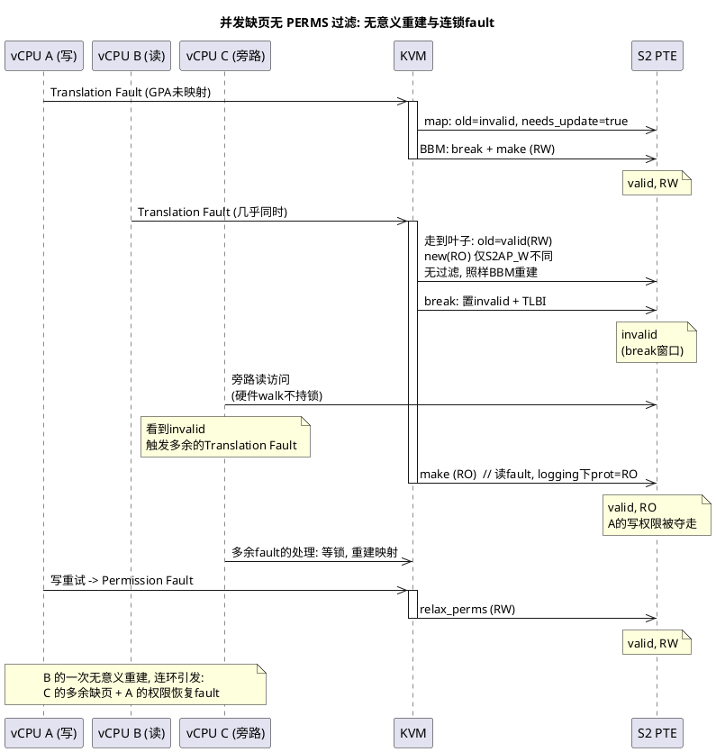
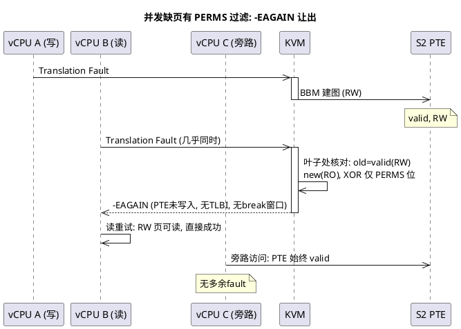
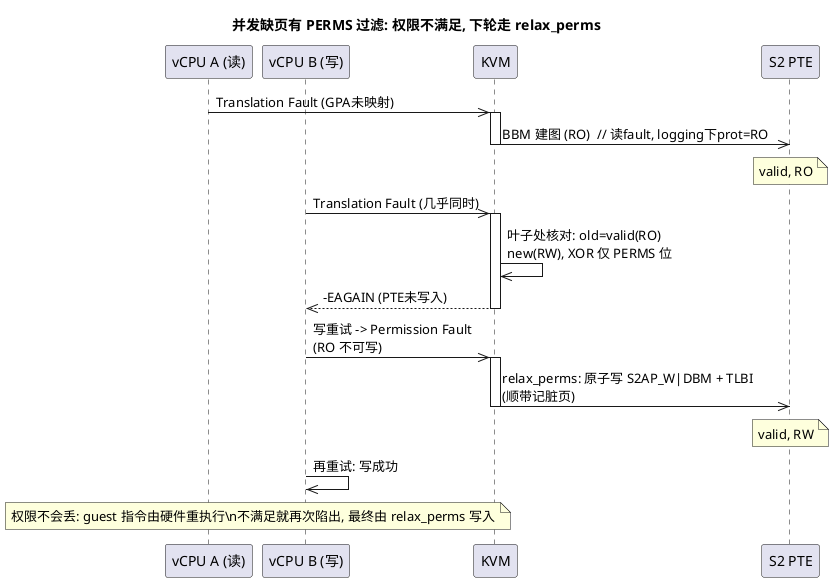

Leo的patch是把"可写"的语义从 S2AP_W（bit 7）迁移到 DBM（bit 51）。

核心方式(步骤):

- step1:所有原来设S2AP_W 的地方改为同时设 DBM | S2AP_W
- step2:所有原来从 S2AP_W 判断"可写"的地方改为从 DBM 判断。

# 1. DBM 加入PERMS权限位

`KVM_PTE_LEAF_ATTR_S2_PERMS` 是一组权限位掩码, 掩码**为并发缺页竞态而生**（见 1.1），用在 map 路径中**重建/新建页表**走到叶子时的新旧 PTE 差异检查: 两者完全相同, 或仅在 S2AP_R/W、DBM、XN 这些位上有差异, 视为无需更新, 本次直接跳过——**不做 BBM、页表不写入**。
- 已建权限在建完重新执行指令时，如果满足访问则无事发生; 
- 重新执行时，权限仍不满足, 下次异常走 `relax_perms` 放权。

```c
#define KVM_PTE_LEAF_ATTR_S2_PERMS	(KVM_PTE_LEAF_ATTR_LO_S2_S2AP_R | \
 		KVM_PTE_LEAF_ATTR_LO_S2_S2AP_W | \
+		KVM_PTE_LEAF_ATTR_HI_S2_DBM | \
 		KVM_PTE_LEAF_ATTR_HI_S2_XN)
```

## 1.1 掩码的由来: 并发缺页竞态

掩码由 commit `694d071f8d85`（Filter out the case of only changing permissions from stage-2 map path）引入, 解决的是 map 路径的并发问题。

先交代背景: 虚机 S2 建页是 lazy 的——VMM 先申请内存, 权限随申请一路存进宿主机 VMA / KVM memslot（纯软件记录, 此时还没有页表）; guest 实际访问时才触发 fault, KVM 在 fault 处理中读 VMA/memslot 权限, 算出 prot, 走 map 路径做真实的 BBM 写入。

后文反复用到两个概念, 先分清:

- **访问类型**: 触发异常的 guest 指令行为, 硬件记录在 ESR 的 WnR 位——store 指令触发为写 fault, load 指令触发为读 fault。**说的是指令想做什么，跟要建表时的读写权限的计算是无关的**
- **prot**: **KVM 根据 VMA/memslot 算出的映射权限**, 决定 make 阶段写进 PTE 的属性位（S2AP_R / S2AP_W 等）。是真实的页表属性

prot 在 fault 处理的 `kvm_s2_fault_compute_prot()` 中计算:

```c
/* linux/arch/arm64/kvm/mmu.c, kvm_s2_fault_compute_prot() */
	*prot = KVM_PGTABLE_PROT_R;

	if (s2vi->map_writable && (s2vi->device ||
				   !memslot_is_logging(s2fd->memslot) ||
				   kvm_is_write_fault(s2fd->vcpu)))
		*prot |= KVM_PGTABLE_PROT_W;
```

- `map_writable`: 从 VMA/memslot 读出的软件权限——prot 的权限来源
- 普通可写内存（未开 logging）: `!memslot_is_logging` 恒真短路, 访问类型不参与计算, 读写 fault 算出的 prot 都是 RW
- dirty logging 是例外——它是热迁移迭代期的脏页跟踪机制: memslot 开启后：
  - 已建映射全部写保护（S2AP_W=0）, guest 首次写某页触发 Permission Fault, 该页记入脏页集后 relax 恢复可写。
  - 对新建映射, 跟踪策略进入 prot 计算, `kvm_is_write_fault` 成为决定性条件:
    - 写 fault: prot = RW, fault 处理中顺带记脏页
    - 读 fault: prot = RO, 保持写保护不走 relax, 让未来的写还能 fault 出来被标脏。

权限固化在 memslot/VMA, guest 的读写访问不改变它——所以并发竞态的形态取决于是否开 logging:

- 未开 logging: prot 相同, 后到者 old == new → 无过滤时用 BBM 重建一模一样的映射, 纯浪费（最常见形态）
- 开 logging: prot 可能不同（RW/RO）, 仅权限位差异 → 无过滤时权限被夺 + 恢复 fault + 连锁缺页（下图的场景）

接下来我们就可以看一下实际的竞态场景了：

多个 vCPU 几乎同时访问同一个尚未建立 stage-2 映射的 GPA 时, 全部触发 Translation Fault（缺页）。缺页时 `perm_fault_granule = 0`, `mapping_size` 必大于 0, 所以都走 map 路径各自建图。先到者建好映射, 后到者走到叶子时发现 PTE 已是 valid——而两个 vCPU 的 fault 类型可能不同（读/写/执行）, dirty logging 下算出的权限也就可能不同。

以"A 写 fault 先到, B 读 fault 后到"为例（dirty logging 下: A 算出 prot=RW, B 算出 prot=RO, 两次 make 要写进页表的 S2AP_W 不同）:



后到者 B 若不过滤, 会用 BBM（Break-Before-Make）把 PTE 从 RW 重建为 RO。这次重建本身是无意义的（映射本来能用）, 代价却连环:

- 夺走 A 的写权限: guest 下一次写触发 Permission Fault（权限异常）, 由 relax_perms 恢复 RW
- break 窗口伤及旁路: B 的 break 把 PTE 置 invalid, 到 make 写入 RO 之前有个窗口; 期间任何 vCPU（如旁路的 C）访问该页, 硬件 walk 看到的是 invalid, 触发本不该发生的 Translation Fault, 其处理还要等 B 释放 mmu_lock

好在这只是性能问题, 不是逻辑错误: BBM 保证时序正确, relax 对 R/W 只加不减, 脏页记账幂等——fault 绕几圈后收敛到满足所有访问的权限, 不会死循环。这就是 commit 说的 useless small loops（无意义的小循环）, PERMS 过滤是纯性能优化: 省掉无意义的 BBM/TLBI 和连锁的 VM exit。



有了掩码, 后到者在叶子处核对: 新旧 PTE 完全相同, 或仅 PERMS 位不同, 都不做 BBM 更新, 返回 -EAGAIN 让 vCPU 重新进入 guest。

上图是已建权限满足访问的结局: B 的读重试直接成功。如果反过来, A 是 RO（读 fault 先到, logging 下建 RO）, B 是 RW（写 fault 后到）——那么 B 重试的时候会触发 Permission Fault, 再由 relax_perms 把权限恢复为 RW 并标脏:



## 1.2 PERMS 掩码的差异检查

PERMS 掩码的差异检查发生在 map 路径的 `stage2_map_walker_try_leaf`。而走哪条路径, 由 `kvm_s2_fault_map` 比较两个量决定: `mapping_size`（KVM 期望的映射大小）与 `perm_fault_granule`（硬件报告的权限故障粒度, 缺页时为 0）——相等走 relax_perms, 不等走 map:

```c
user_mem_abort
  +-> kvm_s2_fault_map
    +-> if (mapping_size == perm_fault_granule)  // 期望映射大小 vs 硬件报告的权限故障粒度
    |     kvm_pgtable_stage2_relax_perms         // 相等: 仅放松权限, 原子更新 (见 relax_perms 路径)
    +-> else
          kvm_pgtable_stage2_map                 // 不等: 走 map 流程 (缺页/改变 block size)
            +-> stage2_map_walker_try_leaf
              +-> if (!stage2_pte_needs_update) return -EAGAIN;  // 叶子处核对: 完全相同或仅权限位差异 -> 让出
              +-> BBML;                          // 确有非权限位差异 -> 真重建
    +-> if (ret != -EAGAIN) return ret; else return 0; // -EAGAIN 转为 0, vCPU 恢复运行

stage2_pte_needs_update
  +-> return ((old ^ new) & (~KVM_PTE_LEAF_ATTR_S2_PERMS));//差异检查: 过滤掉KVM_PTE_LEAF_ATTR_S2_PERMS的位，表示如果是PERMS位修改的话，不认为是old跟new不一致
```

内核注释直说这个设计:

```c
/* linux/arch/arm64/kvm/hyp/pgtable.c, stage2_map_walker_try_leaf */
	/*
	 * Skip updating the PTE if we are trying to recreate the exact
	 * same mapping or only change the access permissions. Instead,
	 * the vCPU will exit one more time from guest if still needed
	 * and then go through the path of relaxing permissions.
	 */
	if (!stage2_pte_needs_update(ctx->old, new))
		return -EAGAIN;
```

大意: 若在重建完全相同的映射、或只改访问权限, 就跳过更新, 让 vCPU 多退出一次

返回 -EAGAIN 时:

- PTE 完全未写入（new 只是局部变量）、无 TLBI、不触发 BBM
- `kvm_s2_fault_map` 将 -EAGAIN 转为 0（视为成功）, vCPU 恢复运行

`kvm_s2_fault_map` 分叉的两条路径, 触发条件对比:

| | relax_perms 路径 | map 路径 |
|---|---|---|
| 何时进入 | Permission Fault（权限异常）且 mapping_size == granule | 缺页（granule=0, 必不等）; 或映射尺寸需变化 |
| PTE 状态 | valid, 只需放松 | 后到者走到叶子时 old 已 valid（先到者刚建） |
| 动作 | 原子改权限位 + TLBI, 无 BBM | 叶子处差异检查: 完全相同或仅权限位差异 → -EAGAIN |

Leo 的 patch 将 DBM 加入 `KVM_PTE_LEAF_ATTR_S2_PERMS` 后, `(old ^ new) & (~PERMS)` 计算中 DBM 位也被过滤掉——竞态中两个 vCPU 因 fault 类型不同产生的 S2AP_W + DBM 差异（即可写语义的变化）, 同样让 `stage2_pte_needs_update` 返回 false, 不触发昂贵的 BBM; 若已建权限仍不满足, 由 `relax_perms` 路径放权（见 1.3）。

## 1.3 relax_perms 路径: 已建页表的权限放松

relax_perms 是对已建页表（valid PTE）的权限修改: 只改 S2AP_W/DBM 等权限位, 不动输出地址。按 **RWHZWS**, 必须使用 break-before-make 的修改类型（内存属性、OA、block size 变化等）不含纯权限位修改（原文见附录A）——无需 BBM, 原子更新后按 **RGPPYH** 做 TLBI 使新权限可见（原文见附录A）。与之相对, map 路径的页表重建（old 无效或非权限位变化）命中 RWHZWS, 正常都要走完整 BBM; 唯一跳过的是并发竞态下 old 与 new 完全相同或仅 PERMS 位有差的情况（1.2 的 filter）。

KVM 端流程: guest 访问 valid 但权限不足的页 → Permission Fault（权限异常）陷入 EL2:

```
[KVM] kvm_handle_guest_abort()
  +-> user_mem_abort(&s2fd)
    +-> kvm_s2_fault_map(s2fd, &s2vi, prot, memcache)
      +-> perm_fault_granule = 4KB, mapping_size = 4KB -> 相等
      +-> kvm_pgtable_stage2_relax_perms()          // 这里能否 relax_perms 完全取决于软件位 vma 的权限位(这也是热迁移中能对wrprotect进行 relax的原因,因为wrprotect只改变硬件位,不改变软件vma的写权限,这也是DBM要注意的地方).
        +-> set |= S2AP_W (bit 7)
        +-> set |= DBM    (bit 51)                 // step1: 同时设 DBM | S2AP_W
        +-> stage2_update_leaf_attrs(set, clr)
          +-> stage2_attr_walker()               // [pgtable.c]
            +-> pte = old | set               // 在 PTE 中设置 S2AP_W | DBM
            +-> if (level < LAST_LEVEL)
              pte &= ~DBM               // block 入口 strip DBM, 强制 fault 触发 split
            +-> stage2_try_set_pte(ctx, pte)   // 直接原子更新 PTE, 无需 BBM!
      +-> __kvm_tlb_flush_vmid_ipa_nsh()             // TLBI (RGPPYH)
  +-> vCPU 恢复执行, 写操作成功
```

!!!疑问:上面的流程中,恰好暴露了一个问题,我们会把block页的DBM给去掉,那么如果在虚机运行中(非热迁移场景),经过stage2_attr_walker的时候,我们就会把DBM去掉,按照leo的这个语义场景,如果是可写的block页,不是很可能被stage2_attr_walker改写成DBM=0吗?那么,因leo的patch的可写位判断语义已经被换成判断DBM了,所以会不会可能存在可写的block被因为DBM=0,被软件判断为只读了!!

# 2. 意义判断的切换:从W判断可写转换为从DBM位判断可写

`kvm_pgtable_stage2_pte_prot`这个函数的作用是xx,一般在xxx的时候会被调用,它的目的不是改写,而是可以理解为usr想获取当前pte的prot,就可以通过调用这个函数来获取某个pte的prot位.

在这个函数中,实现语义判断的转换.在这个patch之前,我们是根据读写AP位来判断是否可写的

## 附录A: ARM规则索引

**RWHZWS** — 何种页表项修改必须使用 break-before-make（ARM DDI 0487 M.b, D8.17.1）

> If multiple execution threads use the same translation tables, then when a translation table entry is modified in one or more of the following ways, the architecture requires software to use a break-before-make sequence:
>
> - A change to the memory type, Shareability or Cacheability.
> - The translation OA is changed and one or more of the following apply:
>   - Either or both of the old and new translations grant write permission, including cases where the DBM bit is 1 and hardware updates of the dirty state is enabled.
>   - The memory contents at the new OA do not match the memory contents at the previous OA.
> - If software does not follow the sequence enabled by FEAT_BBML1 and FEAT_BBML2 is not implemented, all of the following changes to the block size used by the translation system:
>   - Changing from a smaller size to a larger size, such as when a level 2 Table descriptor is replaced with a Block descriptor.
>   - Changing from a larger size to a smaller size, such as when a level 2 Block descriptor is replaced with a Table descriptor.
> - A global entry is created that might overlap with non-global entries in a TLB.
>
> 中文: 多执行线程共用同一套页表时, 页表项按下列方式修改则架构要求软件使用 break-before-make 序列: (1) 内存类型 / Shareability / Cacheability 变化; (2) 翻译输出地址（OA）变化, 且新旧任一可写（含 DBM=1 且硬件脏状态更新使能）, 或新旧 OA 处内存内容不匹配; (3) 未走 FEAT_BBML1 允许的序列且未实现 FEAT_BBML2 时, 所有 block size 变化（小→大或大→小）; (4) 创建可能与 TLB 中非全局条目重叠的全局条目。**纯权限位修改不在该列表中。**

**RGPPYH** — 页表项修改后的 TLB 无效化义务（ARM DDI 0487 M.b, D8.17）

> When a translation table entry associated with a specific VMID or ASID is modified, software is required to invalidate the corresponding TLB entry to ensure that the modified translation table entry is visible to subsequent execution, including speculative execution.
>
> 中文: 关联特定 VMID 或 ASID 的页表项被修改后, 软件必须无效化对应 TLB 条目, 确保修改后的页表项对后续执行（包括投机执行）可见。

**RFVQCK** — 不遵守 BBM 的后果（ARM DDI 0487 M.b, D8.17.1）

> If translation table entries are changed without appropriate TLB maintenance operations, including in the case where use of the break-before-make sequence is required but software does not follow the break-before-make sequence, it is possible that TLBs concurrently hold multiple different copies of those translation table entries. In this situation, the following behaviors are permitted for a speculative or architectural access to the address resolved by those TLB entries:
>
> - Use of the address matches multiple entries in a TLB, and a TLB conflict abort is detected. In this case, no access is made to memory based on those TLB entries. If the access is architectural, then the TLB conflict abort is reported as an exception.
> - The resulting behavior is CONSTRAINED UNPREDICTABLE, and gives a behavior consistent with translation using one of the matching entries, or an amalgamation of more than one of the matching entries, but cannot permit access to memory regions with permissions or attributes that would not be possible in the current Security state at the current Exception level.
>
> 中文: 页表项在缺少适当 TLB 维护（含要求 BBM 而未走 BBM）的情况下被修改时, TLB 可能同时持有多个不同副本。此时对相应地址的投机或架构访问允许的行为: (1) 命中多条 TLB 条目, 检测出 TLB conflict abort（架构访问则报告为异常, 不访问内存）; (2) 行为 CONSTRAINED UNPREDICTABLE——翻译结果与使用某一条或若干条的混合一致, 但不得访问超出当前 Security state 与 Exception level 所允许权限或属性的内存区域。
