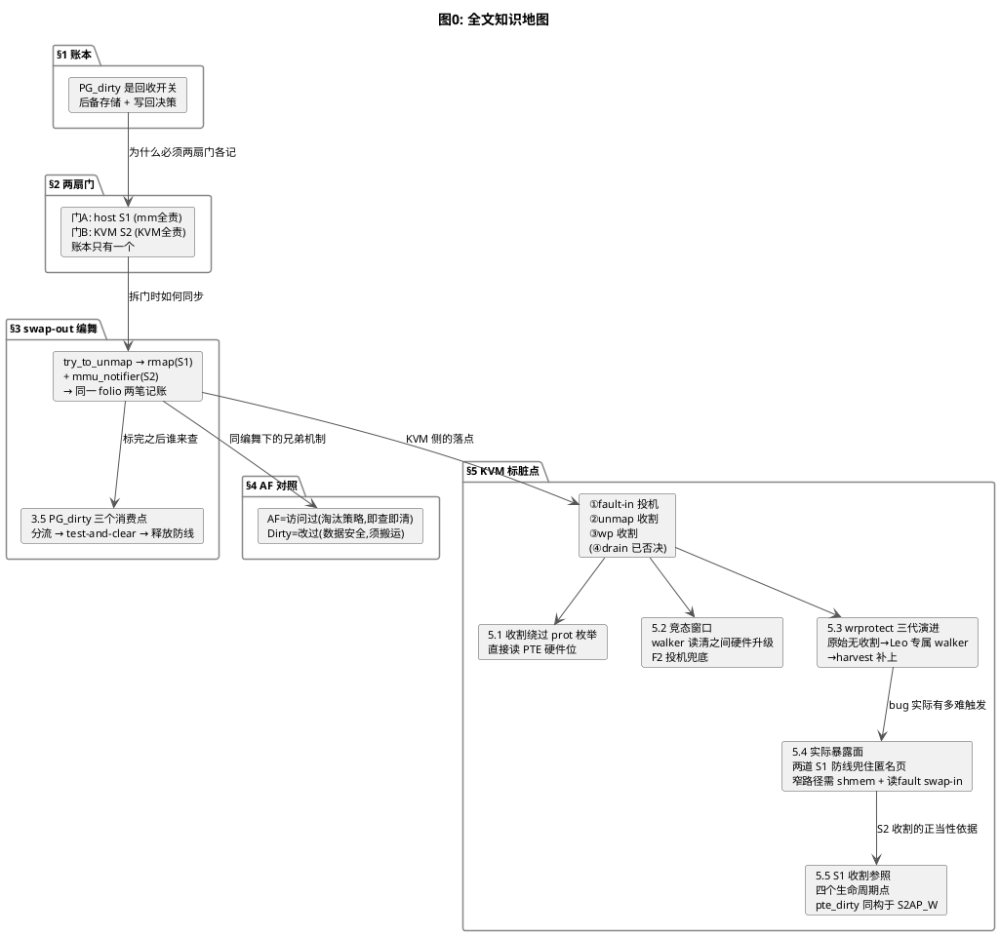

# swap 中 folio 在 KVM 中的 dirty 标记与收割

> 定位：Leo DBM 系列 folio 主题的概念收尾篇。前置阅读：`docs/leo/dbm_blindspots_and_risks.md`
> §0.3（folio 五分钟入门）、§0.3.1（一个 folio 两扇门）。四个递进问题：
> PG_dirty 为什么存在 → 两扇门为什么分开记账 → swap-out 的完整编舞（mmu_notifier）→
> AF 位与 Dirty 的平行与差异。
>
> 所有代码路径均可在当前仓库验证；行号会随版本漂移，以函数名定位为准。

## 0. 全文地图



## 1. PG_dirty 是回收正确性的开关

**物理内存是缓存副本**，host 内核对每个用户页都有一个基本假设：它是某个后备存储的缓存——

| 页类型 | 后备存储 | "干净"的含义 |
|---|---|---|
| 匿名页（QEMU guest RAM 默认） | swap slot | 内存内容 == swap 里的那份 |
| shmem/memfd | swap slot（共享） | 同上 |
| file-backed（page cache） | 磁盘文件 | 内存内容 == 磁盘上的那份 |

内存压力回收时只问一个问题，答案就是 PG_dirty：

- 脏（内存比后备新）→ **必须先写回** swap/磁盘，才能释放物理页
- 干净（两边一致）→ **直接丢弃**，以后要用时从后备读回来即可

**PG_dirty 标错的代价不是性能，是正确性**：把"有新数据的页"当"冗余副本"扔掉，数据永久丢失；
下次读回来的是旧内容。静默、无报错——这正是 sashiko 对 Leo patch 2 那条 Critical 的定性
（silent data corruption）。

类比：swap slot/磁盘文件 = 云端备份，物理页 = 本地副本，PG_dirty = 本地副本上
"有未同步修改"的红点。清理本地腾空间：有红点先同步再删；没红点直接删。guest 在本地
写了东西却没打红点，清理时直接删，那次修改永久蒸发。

## 2. 一个 folio，两扇门：为什么脏记录必须分开记

QEMU 的一页 guest RAM 是**一个物理页 = 一个 folio**（PG_dirty 在 folio 的 flags 里），
同时被两个 PTE 指向，分属两张页表：

```
                host 物理页 (struct folio, PG_dirty here)
                      ^                        ^
                      |                        |
        Door A: host S1 PTE            Door B: KVM S2 PTE
        (QEMU userspace HVA->HPA)      (guest GPA->HPA)
        --------------------------     --------------------------
        writer: QEMU itself            writer: guest CPU
        record : VMA/rmap YES          record : NOWHERE (not in rmap)
        harvester: mm itself           harvester: KVM (must do it)
```

每扇门各自维护**一份脏记录**，最后都汇到同一个 folio：

- **门 A（host S1）**：脏状态在 S1 PTE 的 bit 7（AP[2]，host 内核自己的 DBM 管理）。
  QEMU 用户态写 guest RAM 时硬件置位。**收割者：mm 自己**——`zap_present_folio_ptes()`
  遍历 S1 表时读出折算回 folio
- **门 B（KVM S2）**：脏状态在 S2 PTE 的 S2AP[1]（guest 侧 DBM/HAFDBS 管理）。
  guest CPU 写时硬件置位（HD=1 免 fault）。**收割者：KVM**——`stage2_unmap_walker`
  拆 S2 PTE 前读出折算回 folio

**为什么必须分开记**：一个 PTE 只知道"我这扇门放行的写有没有发生"。S1 PTE 看不见
guest 的写（guest 的写走 GVA→guest S1→GPA→S2→HPA，全程不碰 host S1 PTE）；
S2 PTE 看不见 QEMU 的写。两条写路径在物理页上汇合，但脏信号各自留在各自的 PTE 里。
**如果门 B 的脏记录没有同步到共有账本，且门 A 也没脏过，回收就以为页是干净的，
swap-out 时直接丢弃，guest 的写永久丢失。**这就是 KVM 侧必须有收割点的全部理由。

注意方向性：folio 不属于任何一扇门，它属于物理页本身。谁的写弄脏了这页，
不管走哪扇门，最终都必须在 folio 上留痕。

## 3. swap-out 完整编舞：mmu_notifier 如何串起两张表

### 3.1 两条路的分工

先澄清一个易混点：`zap_present_folio_ptes()`（mm/memory.c）是 mm 拆自己 S1 PTE 时
的收割函数（munmap/exit/截断场景），它不通知任何人。**通知 KVM 的是 mmu_notifier 框架**，
两条路服务于两张不同的表：

```
reclaim a guest-RAM anonymous folio:

  host reclaim (kswapd / direct reclaim)
    |
    v
  try_to_unmap(folio)                          [mm/rmap.c]
    |
    +-- Path A: rmap finds QEMU's S1 PTE
    |     +-- try_to_unmap_one():
    |           1. mmu_notifier_range_init(MMU_NOTIFY_CLEAR)
    |           2. mmu_notifier_invalidate_range_start()   *** notify KVM ***
    |           3. replace S1 PTE with swap entry (not zap!)
    |           4. invalidate_range_end()
    |
    +-- Path B: KVM receives notification 2
          +-- kvm_mmu_notifier_invalidate_range_start()   [virt/kvm/kvm_main.c]
                |  handler = kvm_mmu_unmap_gfn_range
                |  HVA range -> GFN range (via memslots)
                v
              kvm_unmap_gfn_range()                        [arch/arm64/kvm/mmu.c]
                +-- __unmap_stage2_range -> stage2_unmap_walker
                      +-- harvest point 2: read S2AP_W -> SetPageDirty(folio) ***
                      +-- tear down the S2 PTE
    |
    v
  folio now unmapped on both doors -> write to swap -> free the physical page
```

细节：swap-out 时 S1 PTE **不是被 zap 而是被替换成 swap entry**（非 present 的 PTE，
记录"这个虚拟地址的内容在 swap slot N"）。`zap_present_folio_ptes` 是另一场景的 S1 收割，
函数名相似但路径不同。

### 3.2 完整时序

```
t1: reclaim picks the folio (QEMU anon page, mapped by S1 + S2)
t2: rmap walk finds QEMU's S1 PTE
t3: try_to_unmap_one fires MMU_NOTIFY_CLEAR over the HVA range
t4: KVM notifier receives -> unmaps S2 PTE over the GFN range
    *** harvest point 2 runs here: S2AP_W=1 -> SetPageDirty(folio)
        (the hardware-promoted evidence is folded back before PTE death)
t5: S1 PTE replaced with swap entry
t6: folio unmapped everywhere -> PG_dirty decides:
    dirty -> write to swap, then free ; clean -> free directly
t7: guest next access to that GPA -> S2 translation fault
    -> kvm_s2_fault_map -> GUP -> host fault -> do_swap_page reads back
    -> possibly a different physical page -> remap into S2
    -> harvest point 1: speculative SetPageDirty on fault-in
```

t7 有个并发细节：fault 路径在 pin pfn 前记录 `mmu_seq = kvm->mmu_invalidate_seq`
（kvm_s2_fault_pin_pfn），map 完检查 `mmu_invalidate_retry`——若处理期间又来了回收通知，
放弃本次映射重试，防止把一个正在被回收的旧页装回页表。

### 3.3 为什么回收必须通知 KVM

**因为 S2 页表是 KVM 的私有结构，host mm 根本不知道它存在。**

- mm 的 rmap 只记录 S1 映射。KVM 的 S2 映射不进 rmap，mm 没有 GPA 的概念，
  也不会走 KVM 的页表
- 就算 mm 想拆 S2 PTE，它连"这页被映射到哪个 guest 的哪个 GPA"都不知道——
  memslot 是 KVM 与 QEMU 之间的约定，mm 无从查起
- mmu_notifier 是为此而生的契约框架："任何在我内存上建立二级映射的子系统
  （KVM S2、IOMMU、RDMA、HMM），必须注册回调；我做任何影响映射的操作
  （回收换出、munmap、迁移、NUMA balance、khugepaged、进程退出、文件截断），
  先回调你们拆干净，再动手"

分工边界：**mm 管 S1（它自己的），KVM 管 S2（它自己的），mmu_notifier 是两者之间
唯一的同步点**。

### 3.4 guest kernel 为什么不能处理

**guest 对 host 侧回收零可见性。**swap 是 host 的幻觉：

- guest 眼中 GPA 就是物理内存，不知道背后是 host 匿名页、随时可能被换出
- swap-out 全程 guest 无感知（无中断无异常）——直到 t7 再访问，触发的是
  **S2 fault 到 KVM**（不是 fault 到 guest），KVM 负责 fault 回来
- guest kernel 的页表（guest S1，GVA→GPA）与 host 回收没有任何交集

一句话：**host mm 是页的主人，KVM 是 S2 映射的建造者，guest 是不知情的租户**。
主人收回房子，通知建造者拆违章建筑（notifier），租客下次来发现要重新办入住（S2 fault）。

我们的收割点挂在 `stage2_unmap_walker` 上，意味着**所有触发 S2 拆除的场景**
（swap、munmap、mremap、NUMA 迁移、compaction、THP 合并、进程退出、截断）
都会顺带把 folio 账记对——这正是放在 walker 而非某个特定调用方的价值。

### 3.5 PG_dirty 的三个消费点：swap-out 的写回决策链

标脏是被动状态，回收路径上有三个点检查 PG_dirty，层层递进：

**消费点 ①：shrink_folio_list 的脏页分流**（mm/vmscan.c）：

```c
if (folio_test_dirty(folio)) {
    if (folio_is_file_lru(folio)) {
        /* dirty file page: queue for writeback, no direct free */
        ...
    }
    /* dirty anon page: continue to pageout below */
}
```

**消费点 ②：pageout 的原子 test-and-clear（决策核心）**（mm/vmscan.c，pageout()）：

```c
if (!folio_clear_dirty_for_io(folio))
    return PAGE_CLEAN;               /* clean: skip writeback, direct free */
...
res = swap_writeout(ctx, folio);     /* dirty: write to swap, then free */
```

`folio_clear_dirty_for_io` 的实现（mm/page-writeback.c）核心是对 PG_dirty 的
**原子 test-and-clear**：

```c
bool folio_clear_dirty_for_io(struct folio *folio)
{
    ...
    if (folio_mkclean(folio))            /* reverse harvest first (S1 收割点3) */
        folio_mark_dirty(folio);         /* re-dirty as a safety net */
    ...
    if (folio_test_clear_dirty(folio)) { /* atomic test-and-clear PG_dirty */
        ...
        ret = true;                      /* was dirty -> triggers writeback */
    }
    return ret;
}
```

`folio_test_clear_dirty` 是原子 `test_and_clear_bit`——返回 true（原来是脏的）
则 pageout 走 `swap_writeout` 把页内容写进 swap slot；返回 false 跳过写回。
注意它调 `folio_mkclean` 做反向收割（见 §5.5 收割点 3），确保硬件 DBM 的
最后一次写不会在这道关被漏掉。

**消费点 ③：\_\_remove\_mapping 的最后防线**（mm/vmscan.c）：

```c
if (unlikely(folio_test_dirty(folio))) {
    folio_ref_unfreeze(folio, refcount);
    goto cannot_free;                /* dirty page: refuse to free! */
}
```

即使前面的检查点都通过了，释放物理页的最后一道门还会再查一次。脏 folio
在这里被拦下退回 LRU，只有干净 folio 才能从 swapcache 摘除、物理页归还 buddy。

完整检查链（标脏后的最终归宿）：

```
reclaim -> shrink_folio_list:
  (1) folio_test_dirty -> dirty file pages queued, dirty anon continue  [vmscan.c]
  -> try_to_unmap -> S1 PTE dirty harvest -> folio may get dirtied here  [rmap.c]
  -> pageout:
      (2) folio_clear_dirty_for_io -> atomic test-and-clear              [page-writeback.c]
         true  -> swap_writeout -> page content to swap slot -> page freeable
         false -> PAGE_CLEAN -> skip to free
  -> __remove_mapping:
      (3) folio_test_dirty -> final gate, dirty pages refused            [vmscan.c]
         clean -> removed from swapcache, slot freed, page returned to buddy
```

(2) 是决策核心（原子 test-and-clear，只有一次机会），(1) 是提前分流，
(3) 是安全网。三个点共同保证"脏页必须先写回再释放，干净页直接丢弃省一次 I/O"。
标记侧（F2 + 收割）的正确性最终在这条链上兑现。


## 4. AF 位：与 Dirty 平行但语义不同的兄弟机制

### 4.1 对照表

AF（Access Flag，PTE bit 10）与 Dirty 结构同构，但回答不同的问题：

| | Dirty (S2AP[1] / AP[2]) | AF (bit 10) |
|---|---|---|
| 回答的问题 | **改过没有？**（只记写） | **碰过没有？**（读写都记） |
| 决定什么 | 回收时**丢还是先写回**（数据安全） | 回收时**先踢谁**（LRU 淘汰策略） |
| S1 硬件位 | bit 7（AP[2]，TCR_EL1.HD 管理） | bit 10（TCR_EL1.**HA** 管理） |
| S2 硬件位 | bit 7（S2AP[1]，VTCR_EL2.**HD**） | bit 10（VTCR_EL2.**HA**） |
| 消费者 | swap-out 写回决策 | 页老化（active/inactive LRU 换档） |

不是同一层意思：Dirty 管"能不能直接扔"，AF 管"该不该优先扔"。一个页可以很脏但很冷
（早该回收，只是回收时先写回），也可以很干净但很热（根本不该被回收选中）。

### 4.2 AF 在两扇门下的工作方式（与 Dirty 平行）

host mm 老化页时同样面临"S2 门看不见"，同样走 mmu_notifier：

```
host mm aging scan (shrink_active_list -> folio_referenced)
  |
  +-- Door A: rmap walks S1 PTEs, checks/clears S1 AF
  |
  +-- Door B: mmu_notifier .clear_young callback (kvm_main.c)
        +-- kvm_age_gfn -> kvm_pgtable_stage2_test_clear_young
              +-- stage2_age_walker (hyp/pgtable.c):
                    reads S2 PTE's AF bit
                    AF=1 -> report "young" (still hot), clear it
                    AF=0 -> report "old" (cold)
```

guest 经 S2 门碰过页（读或写都算）→ HA=1 时硬件免 fault 置 AF → 老化扫描 KVM 报告
young → 页在 LRU 保持热度。两扇门的访问记录在**扫描时刻现场聚合**。

### 4.3 精妙差异：AF 为什么不需要"收割进 folio"

- **Dirty 是持久状态**：脏记录必须在 PTE 销毁前**搬运**到 folio 的 PG_dirty 存活，
  供之后某个时刻的 swap-out 消费。PTE 拆了记录就没了，所以必须抢在拆前折算
  （收割点②③）
- **AF 是即时查询**：老化扫描当场读两扇门的 PTE 位、当场聚合 young/old、当场清零，
  信息在查询时被消费，**不需要持久保存**。AF 位随老化周期反复置 1/清 0，
  是轮转的信号量，不是账本

fault-in 路径两个机制都喂了（virt/kvm/kvm_main.c）：

```c
void kvm_release_page_clean(struct page *page)
{
	kvm_set_page_accessed(page);   /* AF: always mark (boost LRU heat) */
	put_page(page);
}

void kvm_release_page_dirty(struct page *page)
{
	kvm_set_page_dirty(page);      /* Dirty: conditionally mark (speculative) */
	kvm_release_page_clean(page);  /* also marks accessed */
}
```

### 4.4 与 F1 修复的呼应

VTCR_EL2 上 Dirty/AF 各有开关：**HD 管脏、HA 管访问**。F1（HD 必须与 HA 成对设置）
的附带红利正在于此：HA=1 后硬件自动置 S2 的 AF，`handle_access_fault` 处理的
Access Flag fault 大幅消失，老化机制照常工作还省了 VM exit。内核自家 stage-1
也是这个形状：proc.S 先开 HA、HD 经 ARM64_HW_DBM cap 补开，从未单开 HD。

## 5. KVM 侧 folio 标脏点全景（三个点 + 一个否决）

```
                     S2 mapping lifecycle

  establish/relax              runtime                  teardown/write-protect
+-----------------+   +---------------------+   +---------------------------+
| 1 fault-in      |   | (hardware DBM       |   | 2 unmap                   |
|   speculative   |-->|  WC->WD silently,   |-->|   exact harvest before    |
|   W-gated       |   |  no VM exit)        |   |   PTE teardown            |
+-----------------+   +---------------------+   +---------------------------+
                                                          ^
                              CLEAR ioctl (WD->WC) -------+
                              3 wp harvest before clearing S2AP_W
```

| # | 位置 | 门控 | 语义 |
|---|---|---|---|
| 1 | `kvm_s2_fault_map` / `gmem_abort` 收尾，`kvm_release_faultin_page(..., prot & PROT_W)` | W | **投机**：凡映射可写就标，宁多一次回写不丢数据（x86 同款契约，见 kvm_release_faultin_page 注释） |
| 2 | `stage2_unmap_walker` leaf 分支，经 `mm_ops->mark_page_dirty` | S2AP_W | **精确**：S2AP_W=1 是硬件写过的唯一物证，PTE 销毁前折算（对齐 S1 的 zap_present_folio_ptes） |
| 3 | `stage2_wrprotect_walker` 清位前 | S2AP_W | **精确**：CLEAR 的 WD→WC 销毁物证，且此刻 HDBSS buffer entry 可能未 drain，若清位后紧跟 unmap 则 ② 看到的是 WC 会跳过 |
| ~~4~~ | ~~`kvm_flush_hdbss_buffer` 反查 PTE~~ | — | **否决**：②③已覆盖 WD 全部出口，drain 收割冗余且给 flush 引入 mmu 读锁（表页 put_page 直进 buddy 不走 RCU，RCU-only 反查不安全）；详见 `docs/leo/hdbss_v5_unmap_harvest.md` §1.2 |

**不变式**：S2 映射存续期间 folio 被标过脏（①），映射拆除/收权前脏信息折算回 folio（②③）。
与 stage-1 完全同构：S1 的 fault-in `pte_mkdirty` 是①，`zap_present_folio_ptes` 是②。

**完备性论证**（WD 状态的每个出口都有兜底）：

| WD 的出口 | 兜底 |
|---|---|
| unmap（mmu-notifier / memslot 删除 / VM 销毁） | ② |
| wp 清位（CLEAR 的 WD→WC） | ③ |
| 迁移结束 HD 回开后的再次硬件升脏 | 下次 wp（迁移再开始）/ ②（teardown） |
| 迁移迭代期内二次写（PTE 已 WD，无新 entry） | 下次 CLEAR 的 ③ / teardown 的 ② |

### 5.1 收割不走解码器：三条路径的层次关系

收割代码里没有一个 prot 枚举，也没有一次解码器调用——它直接读 PTE 硬件位：

```
================= FAULT path (prot enum is born here) =================
VMA/memslot
  -> kvm_s2_fault_compute_prot()    /* computes prot enum: W, DIRTY */
  -> stage2_set_prot_attr()         /* encoder: prot enum -> PTE hw bits */
       prot & W      -> PTE.DBM
       prot & DIRTY  -> PTE.S2AP_W
  -> PTE installed

================= DECODE path (PTE bits -> prot enum) =================
kvm_pgtable_stage2_pte_prot()      /* decoder: PTE hw bits -> prot enum */
  PTE.DBM       -> prot.W
  PTE.S2AP_W    -> prot.DIRTY
consumers: eager-split inheritance / icache checks / pKVM state queries

=============== HARVEST path (bypasses the enum entirely) =============
stage2_unmap_walker / stage2_wrprotect_walker:
  ctx->old                               /* raw PTE value (u64) */
    & KVM_PTE_LEAF_ATTR_LO_S2_S2AP_W     /* direct bit-7 test */
  kvm_pte_to_phys(ctx->old)              /* extract OA from the PTE */
  mm_ops->mark_page_dirty(pa)            /* -> SetPageDirty(folio) */
```

为什么收割可以绕过枚举层：

- **S2AP_W 位本身就是答案**：HD=1 时硬件在实际写入的瞬间置位，HD=0 时编码器在装
  WD 映射时置位——不管谁置的，这个位=1 就是"这页被写过（或以脏状态装过）"的物证，
  不需要翻译成 prot 枚举再翻译回来
- **输出地址就在 PTE 里**：`kvm_pte_to_phys()` 直接从 PTE 的 OA 字段提取目标页物理
  地址，不需要查 VMA/memslot 反推
- **解码器是翻译，收割是记账**：解码器服务于继承（eager split 子页继承父 PTE 权限，
  需要 prot 枚举做中间表示），收割只需要"一个位 + 一个字段"，枚举层是多余的中间层
- **mm_ops 回调的隔离**：收割代码在双编译的 hyp/pgtable.c，`SetPageDirty` 是
  host-only API，nVHE 侧不能碰 folio——经 `mm_ops->mark_page_dirty` 回调隔离后，
  只有 guest pgt 接了线，pKVM host stage-2 的 mm_ops 留 NULL

各路径中 prot 枚举的角色对照：

| 路径 | 输入 | 处理 | prot 枚举参与？ |
|---|---|---|---|
| fault 建页 | VMA/memslot | compute_prot 现算 → 编码器落表 | ✓（诞生地） |
| fault-in 标脏 | prot（fault 路径现算的） | `prot & PROT_W` 做投机谓词 | ✓ |
| eager split 继承 | 父 PTE | 解码器 → prot → 编码器（round-trip） | ✓ |
| **unmap 收割** | **裸 PTE** | **直接测位 + 提取 OA** | **✗ 完全绕过** |
| **wp 收割** | **裸 PTE** | 同上 | **✗ 完全绕过** |

### 5.2 竞态窗口：为什么"只靠收割"不够，F2 不能省

直觉上收割是状态检查（拆 PTE 那一刻读 S2AP_W），不关心 WC→WD 何时发生，
主路径上自洽。但 **walker 的读和清不是原子的**，而硬件升级与它们并发：

```
CPU 0: unmap walker                     CPU 1: guest (HD=1)
---------------------                   ----------------------
1. ctx->old = *ptep
   (reads S2AP_W=0, WC)
                                        2. hardware walks the same PTE:
                                           atomic RMW: S2AP_W 0->1
                                           writes data to the page
                                           <-- data really changed!
3. WRITE_ONCE(*ptep, cleared)
   (the clear silently overwrites
    the S2AP_W=1 just set by 2)
4. harvest check uses the snapshot
   from 1: S2AP_W=0 -> no harvest  ***

result: the write in 2 really happened (page content changed)
        but 4 missed it -> folio stays clean
        -> if the folio is reclaimed next -> written data lost
```

步骤 2 落在 1 和 3 之间时，硬件升级的物证被清位动作无声覆盖，收割失明。
unmap 由 mmu-notifier 触发（host 回收路径），**不静默 vCPU**——guest 还在跑，
硬件 walk 与 walker 并发，这个窗口是真实的。

**F2 为什么能兜住**：它的时序在一切竞态之前——fault-in 时映射还不存在，
硬件连写的门都没有：

```
fault-in (installing the WC mapping)
  -> F2: prot & PROT_W = true -> SetPageDirty(folio)   <-- red dot here
  -> whatever the hardware does afterwards, whenever it promotes,
     the folio has been dirty since the mapping was installed
  -> the racing write in 2 is covered: folio was already marked
```

不对称的风险决定了分工：

| 层 | 机制 | 覆盖什么 | 覆盖不了什么 |
|---|---|---|---|
| F2（fault-in, W 门控） | 投机，时序在一切竞态之前 | 一切"可写映射存在期间的写"（含竞态窗口内的写） | 精确性（从未被写的页也被标——过标，安全） |
| 收割（unmap/wp, S2AP_W） | 精确，状态检查 | 物证健在时的准确折算（对齐 stage-1 zap 语义） | walker 读清之间的硬件升级竞态 |

x86 的先例早已写好这个合同（kvm_release_faultin_page 注释原文）：
*"KVM must (somewhat) **speculatively mark the folio dirty** if KVM could
**locklessly** make the SPTE writable."*——x86 的场景是 fast page fault 路径
无锁升权限，arm64 DBM 的场景是硬件免锁升 WC→WD，执行者不同，竞态形状完全一样：
**只要存在无锁的权限升级可能，fault-in 的投机标脏就是正确性前提，不是可选优化**。

补一个对称的问题：HD 翻转（开迁移）方向的 wp 为什么没有这个竞态？因为模式翻转的
`KVM_REQ_RELOAD_STAGE2`（KVM_REQUEST_WAIT）返回后无 vCPU 在 guest 里，wp 期间
硬件被静默，读写不并发——这也是 Leo patch 3 的裸 WRITE_ONCE 在 wp 场景安全的
隐含前提（顺带说明：unmap 场景无此保护，所以收割 walker 的裸写在 5.2 的窗口里
只是"漏收割"，由 F2 兜底，不会产生更糟的状态）。

### 5.3 wrprotect 收割的前世今生（三代代码对照）

**主线原始版本（Leo 之前）**：wrprotect 复用通用属性修改器，**没有收割，
也不需要**——

```c
/* original: kvm_pgtable_stage2_wrprotect() */
  return stage2_update_leaf_attrs(pgt, addr, size, 0,
                                  KVM_PTE_LEAF_ATTR_LO_S2_S2AP_W, /* clr */
                                  ...);
    -> stage2_attr_walker():
         pte &= ~data->attr_clr;      /* clear the bit, no harvest */
         pte |= data->attr_set;
         stage2_try_set_pte(ctx, pte);
```

pre-DBM 世界里 S2AP_W 只有软件一个来源，而软件设置的每条路径都已标过 folio：

| S2AP_W 的来源（pre-DBM） | 设置时 folio 标了吗 |
|---|---|
| fault 建页（写 fault → WD） | ✓ fault-in 的 release dirty |
| relax 放权（RO → WD） | ✓ 同一 fault 处理收尾 |
| 硬件置位 | **不存在**（HD=0，硬件不认 S2 DBM） |

物证销毁时信息不丢——信息早已在 folio 账本里。**收割无对象。**

**Leo patch 3（专属 walker，仍无收割）**：换专属 walker 的动机是 level 相关行为
（block 剥 DBM 逼 lazy split、page 保留 DBM），通用 attr_walker 表达不了。
但 Leo patch 5 开 HD=1 后，S2AP_W 出现了第三个来源：

| S2AP_W 的来源（HD=1） | 设置时 folio 标了吗 |
|---|---|
| fault 建页 / relax 放权 | ✓（F2 修复后） |
| **硬件免 fault 升级（WC→WD）** | **✗ 零代码执行**——收割要接的班 |

**Harvest（我们的修复）**：在 Leo 的专属 walker 里、清位动作**之前**补收割。
收割放这里而不是塞回 attr_walker 的原因：attr_walker 被 relax/mkyoung/mkold
共用，塞进去要加 `attr_clr & S2AP_W` 条件防误触发，而专属 walker 天然只在
wrprotect 语境执行。

### 5.4 Leo bug 的实际暴露面：两道 S1 防线与最窄丢数据路径

Leo 的 bug（fault-in 用 DIRTY 门控 + 无任何收割）在理论上丢数据，但实际测试
（qcow2 + 默认匿名内存后端）几乎不可能复现。原因是**内核回收路径有两道
Leo 绕不过去的防线**，把绝大多数场景兜住了。

**防线 A：回收时对非 swapcache 匿名页的强制标脏**（mm/vmscan.c，
shrink_folio_list 中）：

```c
if (folio_test_anon(folio) && folio_test_swapbacked(folio) &&
        !folio_test_swapcache(folio)) {
    if (folio_alloc_swap(folio)) {
        ...
        folio_mark_dirty(folio);   /* unconditional force-dirty */
    }
}
```

注释原文："Normally the folio will be dirtied in unmap because its pte
should be dirty... **Always setting the dirty flag** for the folio solves
the problem."——任何不在 swapcache 里的匿名页，回收时**无条件标脏**，
无论 S1/S2 门有没有人记过账。QEMU 默认内存（匿名页）经过独占 swap-in 后
slot 被释放、folio 移出 swapcache → 回收时防线 A 强制标脏 → 必走 pageout → 安全。

**防线 B：try_to_unmap 收割 S1 PTE 的脏位**：

回收拆 S1 映射时 `try_to_unmap_one` 检查 `pte_dirty(pteval)`，若 S1 PTE 脏
则 `folio_mark_dirty`。而 KVM 的 GUP 写探测（`hva_to_pfn_fast` 里
`get_user_page_fast_only(hva, FOLL_WRITE, &page)`）在可写 VMA 上几乎
总走写 fault 路径 → `do_swap_page(FAULT_FLAG_WRITE)` → `pte_mkdirty` →
S1 PTE 脏 → 防线 B 在回收时收割到。

**两道防线的窄缝**——要丢数据必须同时绕过 A 和 B，推导出的最窄真实路径：

```
前提: shmem/memfd backend (NOT default anon!), HD=1

1. shmem page goes through a writeback cycle:
   folio dirty -> written to swap slot -> folio clean (content == slot)
   folio stays in swapcache (shmem swap entries are SHARED, slot stays live)
   [defense A skipped: folio IS in swapcache]

2. QEMU userspace does a READ fault on this page (e.g. migration snapshot):
   -> do_swap_page / shmem_fault, read fault does NOT call pte_mkdirty
   -> S1 PTE: "writable clean" (WRITE=1, RDONLY=1, sw_dirty=0)
   [defense B skipped: S1 PTE is NOT dirty]

3. guest read-fault -> KVM GUP (FOLL_WRITE probe):
   -> get_user_page_fast_only: pte_write()=true (checks DBM bit, not RDONLY)
   -> fast path succeeds WITHOUT triggering any fault
   -> S1 PTE stays writable-clean (nobody wrote through S1)

4. S2 WC mapping installed (HD=1, read fault)
   + Leo bug: release clean -> folio unmarked

5. guest writes -> hardware silently promotes S2 WC->WD -> folio still unmarked

6. reclaim:
   |- defense A: folio in swapcache (shared entry) -> force-dirty SKIPPED
   |- defense B: try_to_unmap -> S1 PTE writable-clean, not dirty -> SKIPPED
   |- pageout: folio_clear_dirty_for_io -> false (clean) -> PAGE_CLEAN
   \- __remove_mapping: folio_test_dirty -> false -> freed from swapcache
      -> slot holds step-1 content, physical page holds step-5 content
      -> page freed without writing -> step-5 data PERMANENTLY LOST
```

每一环都不可少：

- **必须 shmem/memfd 后端**：匿名页的独占 swap-in 会释放 slot、移出 swapcache → 防线 A 兜住
- **必须读 fault swap-in**：写 fault 的 `pte_mkdirty` 会让 S1 PTE 脏 → 防线 B 兜住
- **KVM GUP 必须不触发 fault**：S1 PTE 已 present 且 writable-clean，
  fast path 直接成功，S1 PTE 保持干净
- **必须 HD=1 + 读 fault 建 WC + 硬件升级**：写 fault 会给 DIRTY →
  Leo 的 bug 不触发（`dirty=true` → release dirty → folio 标了）

**对测试的启示**：默认匿名内存后端上测不出这个 bug 是预期行为（防线 A+B
把窗口堵死）；要验证修复（或复现原始 bug），需要用
`memory-backend-memfd` 后端并配合读 fault swap-in 的访问模式。

### 5.5 S1 收割参照：内核自己是怎么做的

S2 收割的正当性最直接的证据是**S1 内核在四个生命周期点都做了同样的事**。
不做收割的 S2 不是"多了个优化"，而是"缺了 S1 早就有的机制"。

**S1 收割点 1：try_to_unmap（swap-out / 迁移时）**

```c
/* linux/mm/rmap.c, try_to_unmap_one() */
    flush_tlb_range(vma, address, end_addr);
    if (pte_dirty(pteval))           /* read the S1 PTE's dirty state */
        folio_mark_dirty(folio);     /* fold into the folio ledger */
```

跟 `stage2_unmap_walker` 完全同构。关键在 arm64 的 `pte_dirty` 定义
（arch/arm64/include/asm/pgtable.h）：

```c
#define pte_dirty(pte)      (pte_sw_dirty(pte) || pte_hw_dirty(pte))
#define pte_hw_dirty(pte)   (pte_write(pte) && !pte_rdonly(pte))
```

`pte_hw_dirty` 检查 `PTE_WRITE(DBM位)=1 且 PTE_RDONLY=0`——**它收割的就是硬件
DBM 免 fault 升级的状态**（硬件写时清 RDONLY）。S1 通过这一个宏同时收割了
软件脏位（PTE_DIRTY，bit 55）和硬件 DBM 脏状态（RDONLY 被清），不需要区分来源。

**S1 收割点 2：pte_wrprotect（写保护时，硬件脏折算成软件脏）**

```c
/* linux/arch/arm64/include/asm/pgtable.h, pte_wrprotect() */
static inline pte_t pte_wrprotect(pte_t pte)
{
    if (pte_hw_dirty(pte))
        pte = set_pte_bit(pte, __pgprot(PTE_DIRTY));  /* HW dirty -> SW dirty */
    pte = clear_pte_bit(pte, __pgprot(PTE_WRITE));
    pte = set_pte_bit(pte, __pgprot(PTE_RDONLY));
    return pte;
}
```

**收权前先把硬件脏折算成软件脏**——与 `stage2_wrprotect_walker` 的收割同构。
S1 在写保护一个 PTE 之前，如果硬件 DBM 已经弄脏了它（RDONLY 被清），先置
PTE_DIRTY（软件持久位），再清 PTE_WRITE。硬件的痕迹被翻译成不会丢失的记录。

**S1 收割点 3：folio_mkclean（writeback 清脏时的反向收割）**

```c
/* linux/mm/rmap.c, folio_mkclean() */
    rmap_walk(folio, &rwc);
    /* -> page_mkclean_one():
         entry = pte_wrprotect(entry);   <- 收割点 2! HW dirty -> SW dirty
         entry = pte_mkclean(entry);     <- 然后才清脏
       */
```

写回路径的反向收割：mm 决定写回一个 folio 时，走 rmap 找到所有映射它的
S1 PTE，对每个先做 `pte_wrprotect`（收割硬件脏）再 `pte_mkclean`（清脏）。
硬件 DBM 的最后一次写不会在清脏时被遗漏。

**S1 收割点 4：迁移 entry 继承**

```c
/* linux/mm/rmap.c, try_to_unmap_one() (migration path) */
    if (pte_dirty(pteval))
        entry = make_migration_entry_dirty(entry);
```

页迁移时脏状态随迁移 entry 走，不因映射重建而丢失。

**S1 vs S2 收割全景**：

| 生命周期点 | S1 的收割 | S2 的收割（我们） | Leo 原始 |
|---|---|---|---|
| 拆映射 | `try_to_unmap_one: pte_dirty → folio_mark_dirty` | `stage2_unmap_walker: S2AP_W → SetPageDirty` | **无** |
| 写保护 | `pte_wrprotect: pte_hw_dirty → PTE_DIRTY` | `stage2_wrprotect_walker: S2AP_W → SetPageDirty` | **无** |
| 写回清脏 | `folio_mkclean → rmap → pte_wrprotect` | S1 的 mkclean 触发 notifier → S2 unmap（收割在 unmap 里） | **无** |
| 迁移 | `pte_dirty → migration_entry_dirty` | 由 bitmap 接管（不同机制） | **无** |

S1 用 `pte_dirty`（一个宏同时覆盖软硬两个来源）做收割；S2 用 `S2AP_W`
（硬件置位的唯一物证）做收割。表述不同，机制同构：**在映射状态销毁前，
把脏信息折算进 folio 账本**。

## 6. 一个易混点：unmap walker 里的两种"页"

`stage2_unmap_walker` 一次遍历碰到两种物理页，处理完全不同：

```
S2 page table (kernel-allocated, also a folio, irrelevant to dirty tracking)
+--------------------------------+
| [PTE: OA=0x12345000, W=1] ----+-----> target data page (guest RAM)
| [PTE: OA=0x12346000, W=0] ----|--+    +----------------------+
| [PTE: invalid]                |  +--> | physical page 0x12345 |
+--------------------------+---+       | struct page / folio   |
                           |           | PG_dirty here  ***    |
  table page: walker only  |           +----------------------+
  does put_page to free           ^                ^
  the table itself (memory         |                |
  management of the table,         host S1 PTE      S2 PTE
  not dirty tracking)              (QEMU proc)      (this very PTE)
```

- **收割作用在目标数据页的 folio 上**：`mark_page_dirty(kvm_pte_to_phys(ctx->old))`
  取的是 PTE 的输出地址 = 数据页物理地址 → `pfn_to_page` → `SetPageDirty`
- **页表页只是被遍历和释放**（`mm_ops->put_page(ctx->ptep)`）：内核分配的表页
  不参与 LRU/swap 游戏，它的 folio 与脏跟踪无关
- **数据页跟 host S1 指向的是同一个物理页**——这不是巧合，是设计：两个 PTE 各记
  各门的脏，最终写进**同一个 folio 的同一个 PG_dirty 位**，与 S1 侧
  zap_present_folio_ptes 的折算是"同一本账的两笔独立记账"

## 7. 总结

1. **PG_dirty 是回收正确性的开关**：错标干净 = 丢数据（静默损坏）。它是全系统
   "这页被写过"的唯一汇聚点，每条写路径的属主各自负责汇入
2. **两扇门分开记账是必然**：S1 PTE 看不见 guest 的写，S2 PTE 看不见 QEMU 的写；
   两条写路径在物理页汇合，脏信号留在各自的 PTE 里，必须都折算进共有账本
3. **swap-out 编舞**：mm 走 rmap 处理 S1（替换成 swap entry），经 mmu_notifier
   通知 KVM 拆 S2（notifier 是两张表之间唯一的同步点）；guest 对此零可见，
   下次访问 S2 fault 到 KVM 由 KVM fault 回来
4. **AF 与 Dirty 平行但不同**：AF 即查即清（淘汰策略信号量），Dirty 须搬运
   （数据安全账本）；VTCR 上 HA/HD 各管一个，F1 修复后两者成对开启
5. **三个标脏点构成闭环**：fault-in 投机（W 门控）+ unmap/wp 精确收割
   （S2AP_W 物证），drain 侧冗余已否决——形状与 stage-1 完全同构
6. **收割绕过枚举层**：它活在比 prot 枚举更下面的一层，直接测 PTE 的
   S2AP_W 位 + 提取 OA 字段——不需要解码器，也不需要 VMA/memslot 反查；
   这也是它能放进双编译 walker（hyp 侧）的原因
7. **竞态窗口决定 F2 不可省**：unmap walker 的读和清不是原子的，硬件升级
   （WC→WD）可以落在两者之间，物证被清位无声覆盖，收割失明；F2 的投机标脏
   时序在一切竞态之前（fault-in 时映射尚不存在），是这类"存在无锁权限升级"
   机制的正确性前提——x86 的 fast page fault 同款合同
8. **收割的必要性由 HD=1 诞生**：pre-DBM 世界 S2AP_W 只有软件一个来源且
   来源处都已标过 folio（收割无对象）；HD=1 引入硬件这个免通知的第三来源后，
   拆除/收权时刻的物证折算才成为必须
9. **Leo bug 的实际暴露面被两道 S1 防线大幅压缩**：回收路径对非 swapcache
   匿名页的强制标脏（vmscan.c 的 folio_mark_dirty）+ try_to_unmap 对 S1 PTE
   脏位的收割，使默认匿名内存后端上几乎不可能复现。真正的窄路径需要
   shmem/memfd 后端 + 读 fault swap-in + GUP 不触发 fault + HD=1 + 硬件
   免 fault 写，五环同时成立才丢数据（§5.4）。这也解释了功能测试"测不出
   swap 有问题"的根因
10. **S1 收割是 S2 收割的正当性依据**（§5.5）：S1 在四个生命周期点做收割
   （try_to_unmap 的 `pte_dirty → folio_mark_dirty`、`pte_wrprotect` 的
   `pte_hw_dirty → PTE_DIRTY` 折算、folio_mkclean 的反向收割、迁移 entry
   继承），其中 `pte_hw_dirty`（`pte_write && !pte_rdonly`）收割的正是
   硬件 DBM 免 fault 升级的状态。S2 的收割不是发明，是把 S1 早已有的机制
   对齐到第二张表上
11. **PG_dirty 在 swap-out 链上有三个消费点**（§3.5）：shrink_folio_list
   的脏页分流 → pageout 的 `folio_clear_dirty_for_io` 原子 test-and-clear
   （决策核心，触发 swap_writeout）→ `__remove_mapping` 的释放防线（脏页
   拒绝释放）。标记侧（F2 + 收割）的正确性最终在这条链上兑现
