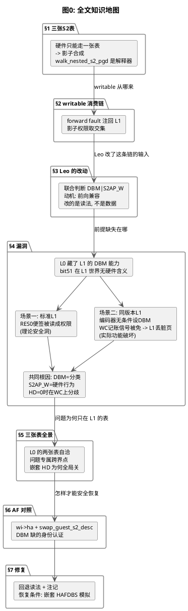

# 嵌套虚拟化中 L1 页表 bit 51 的误读漏洞

嵌套虚拟化（Nested Virtualization，虚机里再跑虚机）给 stage-2 权限体系引入了一个新矛盾：L2 的内存翻译要过两张 S2 页表，而 CPU 硬件一次只能走一张。L0 的解法是软件模拟走 L1 的表，再把两张表的翻译合成一张影子页表（shadow stage-2）。合成的每一步都要 L0 正确**解读** L1 内核写下的描述符。Leo 的 DBM 系列改动了这个解读规则，让 L0 把 L1 页表里一个架构上无效的位（bit 51）读成了写权限，L2 借此可以写穿 L1 设定的只读页。



## 1. 三张 S2 表：硬件走不了三张，于是有了影子合成

没有嵌套时，guest 的翻译只过一张 S2 表（L0 为 guest 建的）。嵌套后角色变成三个：

- **L0**：host 上的 KVM，我们的代码
- **L1**：guest 虚机，它内核里也跑着一份 KVM
- **L2**：L1 里面的虚机，L1 的 guest

L2 的完整翻译链是四级：GVA 经 L2 的 S1 到 GPA2（L2 物理地址），GPA2 经 **L1 建的 S2** 到 GPA1（L1 物理地址），GPA1 再经 **L0 建的 S2** 到 HPA。问题在于 CPU 的翻译硬件（MMU，Memory Management Unit）一次只认一张 S1 加一张 S2，走不了两张 S2。

L0 的解法分两步。第一步软件模拟：用 `walk_nested_s2_pgd()` 走一遍 L1 的表，得到 GPA2 到 GPA1 的翻译及权限。第二步合成：把这个翻译与 L0 自己的 S2 叠加，生成一张**影子 stage-2**（shadow stage-2），直接完成 GPA2 到 HPA 的映射。L2 运行时硬件走影子表，与非嵌套场景完全相同。

```
L2 VA
  |  L2 S1 (built by L2 kernel)
  v
GPA2 --------------------------------------------------+
  |  L1 S2 (built by L1's KVM, in guest memory)        |
  |  walked in SOFTWARE by L0:                          |
  |    kvm_walk_nested_s2()                             |
  |      +-> walk_nested_s2_pgd()   [reads L1's desc]   |
  v                                                     |
GPA1 ---------------------------------------------+     |
  |  L0 S2 (built by L0's KVM)                     |     |
  |  walked by HARDWARE when L1 runs               |     |
  v                                                v     v
HPA        <========== SHADOW S2 (synthesized) ==========+
           built by L0, maps GPA2 -> HPA directly
           permissions = intersection of both tables
```

关键认知：**L1 的 S2 表是数据，`walk_nested_s2_pgd()` 是解读数据的解释器**。L0 对 L1 的表只读不写（唯一例外见第 6 节的 AF 回写）。表项里每个位是什么含义，完全由读的人决定。这个区分是理解整个漏洞的钥匙。

## 2. out->writable 的两条消费链

`walk_nested_s2_pgd()` 走到叶子后，把 L1 描述符的权限读进 `struct kvm_s2_trans` 的两个字段：

```c
/* linux/arch/arm64/kvm/nested.c, walk_nested_s2_pgd() 尾部 */
out->readable  = desc & KVM_PTE_LEAF_ATTR_LO_S2_S2AP_R;
out->writable  = desc & KVM_PTE_LEAF_ATTR_LO_S2_S2AP_W;  /* 原始读法 */
```

这个 `writable` 报告"L1 的表允不允许这次访问"，随后被两条链消费。第一条是**注回裁决**，L2 的 fault 发生时先问 L1 的表答不答应：

```c
/* linux/arch/arm64/kvm/mmu.c, kvm_handle_guest_abort() 中 */
kvm_handle_guest_abort()
  +-> kvm_walk_nested_s2(vcpu, fault_ipa, &nested_trans)   /* 软件走 L1 的表 */
  |     +-> walk_nested_s2_pgd()                            /* 产出 writable */
  +-> kvm_s2_handle_perm_fault(vcpu, &nested_trans)         /* L1 的表说不, 注回 L1 */
```

```c
/* linux/arch/arm64/kvm/nested.c, kvm_s2_handle_perm_fault() */
bool write_fault = kvm_is_write_fault(vcpu);
forward_fault = ((write_fault && !trans->writable) ||
                 (!write_fault && !trans->readable));
```

L1 的表说不可写而 L2 确实在写，fault 注回 L1（L1 可能正等着给 L2 做按需分页），L0 不越俎代庖。

第二条是**影子权限交集**。L1 的表放行的访问，才允许继续建影子映射，且权限收窄到两张表的交集：

```c
/* linux/arch/arm64/kvm/mmu.c, adjust_nested_fault_perms() */
if (!kvm_s2_trans_writable(nested))
  prot &= ~(KVM_PGTABLE_PROT_W | KVM_PGTABLE_PROT_DIRTY);  /* L1 不给, 影子摘掉 */
if (!kvm_s2_trans_readable(nested))
  prot &= ~KVM_PGTABLE_PROT_R;
```

`writable` 一旦读错（L1 说不给、L0 读成给了），两条链同时失守：注回裁决不触发，影子表还带上写权限。L2 的写就绕过了 L1 的管辖区。

## 3. Leo 的改动：读法换了，数据没换

Leo 系列的第一个 patch 把 `out->writable` 的读法改成联合判断：

```c
/* Leo 系列 "pgtables: Change write bit from S2AP_W to DBM" 的改动 */
out->writable = desc & (KVM_PTE_LEAF_ATTR_HI_S2_DBM |   /* bit 51 也认 */
                        KVM_PTE_LEAF_ATTR_LO_S2_S2AP_W);
```

动机是前向兼容。设想 L1 里跑的内核将来也合入了这套三态编码：L1 的 KVM 给 L2 建表时，WC（可写干净）页的编码就是 DBM=1 加 S2AP_W=0。若 L0 只认 S2AP_W，会把 L1 的 WC 页读成只读，L2 的每次写都被注回 L1，L1 精心构造的 WC 语义在 L2 层面失效。联合判断同时认传统编码（RW）与新编码（WC/WD）。

动机合理，但要注意 Leo 改动对象的性质：**他改的是 L0 的解读代码，L1 写表的行为一个字都没变**。L1 继续按它认为的语义写表，而 L1 认为的语义是什么，正是下一节的问题。

## 4. 漏洞：bit 51 在 L1 的世界里没有硬件含义

嵌套虚拟化下，L1 读自己的 CPU 能力寄存器时会被 L0 拦截。主线代码在 ID 寄存器处理里有一行限制：

```c
/* linux/arch/arm64/kvm/nested.c, ID 寄存器模拟 */
val = ID_REG_LIMIT_FIELD_ENUM(val, ID_AA64MMFR1_EL1, HAFDBS, AF);
```

这行把 L1 可见的 HAFDBS（Hardware Access Flag and Dirty Bit Management，硬件访问/脏位管理）能力限到 AF-only（仅访问标志更新）。也就是说，**L0 主动告诉 L1：你的硬件不支持 stage-2 的 DBM**。由此产生的漏洞按 L1 运行的内核分两种场景，损害形态完全不同。

### 场景一：标准 L1，理论安全洞

标准内核（不带三态编码系列）作为 L1 运行时，`kvm_supports_hafdbs()` 查到能力为 false，KVM 走传统编码，页表里 bit 51 恒为 0，联合读法与旧读法结果恒同。漏洞要成立，需要一个不寻常的前提：

- ARM 架构规定 RES0（Reserved，应写零）位硬件会忽略，一个拿 bit 51 当软件便签的 L1（比如标记"这页在我的迁移集合里"）会写下 S2AP_W=0（本意：L2 只读）加 bit51=1（本意：软件标记）
- Leo 的联合判断读到 bit51=1，判定"可写"，`adjust_nested_fault_perms` 不摘 W，影子表带上了写权限
- L2 的写直达物理页，L1 设定的只读边界被 L0 的读法出卖

标准内核对 RES0 位写零，所以这个场景停留在纸面上。真正会出事的是下一个场景。

### 场景二：同版本 L1，实际功能破坏

实际部署中 host 和 guest 常跑同一发行版。如果 L1 也合入了这套三态编码系列，L1 的编码器会**无条件**给所有可写页设 DBM：

```c
/* linux/arch/arm64/kvm/hyp/pgtable.c, stage2_set_prot_attr() */
if (prot & KVM_PGTABLE_PROT_W) {
    attr |= KVM_PTE_LEAF_ATTR_HI_S2_DBM;    /* 无条件设, 无能力检查 */

    if (prot & KVM_PGTABLE_PROT_DIRTY)
        attr |= KVM_PTE_LEAF_ATTR_LO_S2_S2AP_W;
}
```

没有能力检查。HD=0 时 DBM 是惰性位（硬件忽略），编码本身无害。但 L1 的表从此带上 bit 51，联合读法与旧读法在 WC 状态上产生分歧。

分歧为什么致命，取决于 WC 在 L1 的语义里是什么。L1 的 HD 同样开不了（能力被藏，L1 的 `kvm_supports_hafdbs()` 返回 false，L1 的模式机不设 HD），所以 L1 眼中自己的硬件不认 DBM，权限检查只看 S2AP。三态模型把"可写"拆成了 fault 行为相反的两个状态：

| L1 表中的状态 | DBM | S2AP_W | L1 的分类 | L1 硬件（HD=0）对写的行为 |
|---|---|---|---|---|
| RO | 0 | 0 | 不可写 | fault |
| WD | 1 | 1 | 可写 | 放行 |
| WC | 1 | 0 | **可写（分类）** | **fault（硬件拦截）** |

WC 是"L1 认为这页属于可写家族"与"L1 的硬件此刻会拦截写"同时成立的状态。L1 的脏跟踪正是靠这个拦截工作的：迁移期间 L1 的 compute_prot 给读 fault 的页 W 不给 DIRTY（产 WC），L1 的 wp 把 WD 清成 WC（保留 DBM 只清 S2AP_W），**写 fault 回 L1 就是 L1 的记账信号**。

联合读法在 WC 上读到 bit51=1 判定"可写"，但消费端 `kvm_s2_handle_perm_fault` 的 forward 判断问的是"L1 的硬件会不会 fault 这次写"。L1 的 HD=0，正确答案是会（S2AP_W=0 且硬件只看 S2AP）。联合读法回答了另一个问题——"L1 的分类里算不算可写家族"——这不是 forward 判断需要的信息：

```
L1 migrating L2, its table full of WC (tracking relies on write faults)

L2 writes a WC page
  -> shadow S2 fault -> L0 walks L1's table
  -> union reading: bit51=1 -> "writable"
     (answered the CLASSIFICATION question, not the HARDWARE question)
  -> kvm_s2_handle_perm_fault: forward_fault = false  <- wrong answer!
  -> adjust_nested_fault_perms: keeps W -> shadow gains W
  -> L2's write reaches the physical page directly
  -> the fault L1 was waiting for NEVER arrives
  -> L1's dirty bitmap misses this page -> migration data loss
```

回退读法（只认 S2AP_W）在 WC 上判定"不可写"，`forward_fault=true`，fault 注回 L1，L1 标脏加 relax，跟踪闭环完好。

### 两种场景的共同根因

DBM 位回答的是"这页在 L1 的**分类**里属不属于可写家族"，S2AP_W 回答的是"L1 的**硬件此刻放不放行写**"。L1 的 HD 关着时这两个答案在 WC 上分歧，而 `walk_nested_s2_pgd` 的消费端需要的是后者。联合读法把分类当成了权限，替 L2 免掉了 L1 特意安排的那次 fault。场景一是把 L1 不存在的权限当成了真（泄露），场景二是把 L1 想收的信号给免了（没收）。

## 5. 三张表的 DBM 状态全景

把嵌套下的三张 S2 表排开，问题精确圈定在一张表上：

| 表 | 谁建 | 什么编码 | HD（硬件升脏）开关 | 有无问题 |
|---|---|---|---|---|
| L0 为 L1 建的 S2 | L0 的 KVM | 新编码（L0 编码器统一产出） | 关（`kvm_supports_hafdbs()` 含 `!kvm_vcpu_has_nv`） | 无：L0 自己写自己读，编码自洽 |
| L1 为 L2 建的 S2 | L1 的 KVM（guest 内存里） | 取决于 L1 内核：标准=传统编码（bit51 恒 0），同版本=新编码（可写页恒设 DBM） | 恒关（L1 的虚拟 HD 开不了） | **问题专属**：无论哪种编码，L1 的 HD=0 使 bit 51 无硬件含义 |
| L0 为 L2 合成的影子 S2 | L0 的 KVM | 新编码 | 关（同一个 VM，HD 全局关） | 无：同第一行 |

L0 自己的两张表用新编码没有问题，因为写和读都是 L0 的代码，编码自洽。唯一的跨界点是中间那张：L1 按自己认知的语义写（标准内核写传统编码，同版本内核写新编码但 HD 开不了），L0 用 `walk_nested_s2_pgd()` 读。两种 L1 的共同点是 L1 的 HD 恒关，bit 51 在 L1 的世界里没有硬件含义，L0 的读法必须按"L1 的硬件只看 S2AP"来预测 fault 行为。

嵌套 VM 的 HD 全局关闭也不是疏漏，而是有意的取舍。HD=1 时硬件免 fault 升 WC 为 WD，这个提升只会发生在**硬件当时正走的表**上。L2 运行时硬件走的是影子表，硬件升的是影子表的 S2AP_W，L1 的原始表纹丝不动。于是脏信号分裂：硬件把脏记在影子表上，L1 看不到自己的表有任何变化，L1 层面的脏跟踪无从谈起。所以在嵌套 HAFDBS 模拟落地前，嵌套 VM 一律 HD=0，所有脏跟踪走传统 fault 路径，L1 的 fault 信号完好。

## 6. AF 模拟：bit 51 缺的那套身份认证

同一个文件里，AF（Access Flag，访问标志）有一套现成的对照，能说明 DBM 缺的是什么。

AF 的模拟是完整的：L1 可以在自己的虚拟 VTCR_EL2 里开 HA（硬件访问标志管理），L0 走表时读出这个开关并存进 `s2_walk_info`：

```c
/* linux/arch/arm64/kvm/nested.c, setup_s2_walk() */
wi->ha = vtcr & VTCR_EL2_HA;
```

`walk_nested_s2_pgd()` 看到 L1 开了 HA，就代硬件把 AF 位写回 L1 的描述符（`swap_guest_s2_desc()`）。这意味着 **L1 的 VTCR_EL2.HA=1 是"L1 的 bit 10 是硬件 AF 位"的权威信号**：L1 声明了启用，位才有硬件含义；没声明，位就是 L1 自己的空间。

DBM 没有这套。L1 的虚拟 VTCR_EL2.HD 因能力被藏而根本开不了，L0 也就没有任何信号能证明"L1 的 bit 51 是 DBM 位而不是便签"。bit 51 的身份不可判定，联合判断就只能是赌博。这也是 Leo 在 review 回复里说 "for this to work on NV we need Oliver's patch series enabling HAFDBS emulation" 的含义：那个系列要补的正是 DBM 版的身份认证，让 L1 能开虚拟 HD，让 L0 有依据地解读 bit 51。

## 7. 修复：回退读法，等模拟系列再恢复

修复是精确的一行回退。社区版分支把 Leo 第一个 patch 拾取进来时，`out->writable` 恢复只认传统编码：

```c
/* code_v5_3_community 分支, patch 1 拾取（带 [zhengtian: ...] 注记） */
out->writable = desc & KVM_PTE_LEAF_ATTR_LO_S2_S2AP_W;  /* 只认 bit 7 */
```

注记里写明两件事：回退原因是 L0 藏了 L1 的 DBM 能力，L1 的 HD 恒关使 bit 51 在 L1 的世界里没有硬件含义；恢复条件是嵌套 HAFDBS 模拟系列落地后，gate 在"L1 的虚拟 VTCR_EL2.HD==1"上，对称于 AF 的 `wi->ha` 模式。

代价评估按 L1 的内核类型分，不按时间点分：

- **标准 L1**：bit 51 恒 0，两种读法结果恒同，回退零影响，只是堵掉第 4 节场景一的理论攻击面
- **同版本 L1**（跑同一套带三态编码的内核）：联合读法破坏 L1 的脏跟踪（第 4 节场景二，WC 的记账信号被免，L1 迁移 L2 丢脏页），**回退是必要的功能修复**而非纯防御。回退后 L1 的 WC 页被读成"不可写"，L2 的写 fault 注回 L1，L1 标脏加 relax，闭环完好，代价只是 fault 多走一层（性能，非正确性）

这个修正也回答了一个反直觉的问题：既然回退后同版本 L1 的 WC 页"被误读为只读"，为什么反而是对的？因为 L1 的 HD=0，WC 在 L1 的硬件语义里就是会被拦截的——"误读"只是相对 L1 的分类而言，相对 L1 的硬件行为则是精确翻译。

## 8. 总结

1. 嵌套虚拟化的核心矛盾是 L2 翻译要过两张 S2 而硬件只走一张，L0 用软件走 L1 的表再合成影子表。`walk_nested_s2_pgd()` 是 L0 解读 L1 数据的解释器，解释规则改了，被解释的数据不会跟着变
2. `out->writable` 同时喂两条链：注回裁决（`kvm_s2_handle_perm_fault`）与影子权限交集（`adjust_nested_fault_perms`），读错则两条链一起失守
3. 漏洞分两种场景。标准 L1：bit 51 恒 0，联合读法无实际差异，理论安全洞（RES0 便签被读成权限）。同版本 L1：编码器无条件设 DBM，L1 脏跟踪期间的 WC 页被联合读法判为可写，L2 的写不再 fault 回 L1，**L1 迁移 L2 丢脏页**（实际功能破坏）
4. 两种场景的共同根因：DBM 回答 L1 的**分类**（属不属于可写家族），S2AP_W 回答 L1 的**硬件行为**（此刻放不放行写）。L1 的 HD 恒关使两个答案在 WC 上分歧，而 forward 判断需要的是硬件行为。联合读法把分类当成了权限，替 L2 免掉了 L1 特意安排的记账 fault
5. 问题精确圈定在"L1 写、L0 读"这个跨界点。L0 自己的两张表编码自洽无恙；嵌套 VM 的 HD 全局关是为了保住 L1 的 fault 信号（脏信号不会分裂到影子表）
6. AF 有完整的身份认证（`wi->ha` 加代硬件回写），DBM 缺的就是这套。修复回退读法对标准 L1 零影响、对同版本 L1 是功能修复，恢复条件是嵌套 HAFDBS 模拟系列把"L1 的虚拟 HD==1"变成 bit 51 的权威信号
