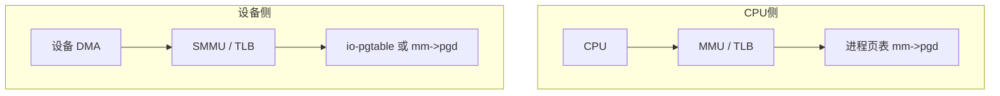
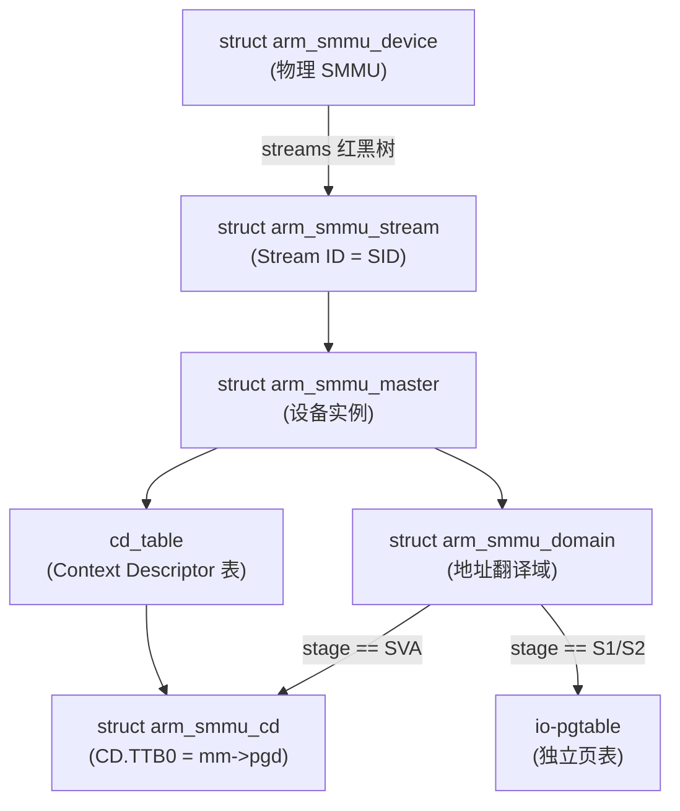
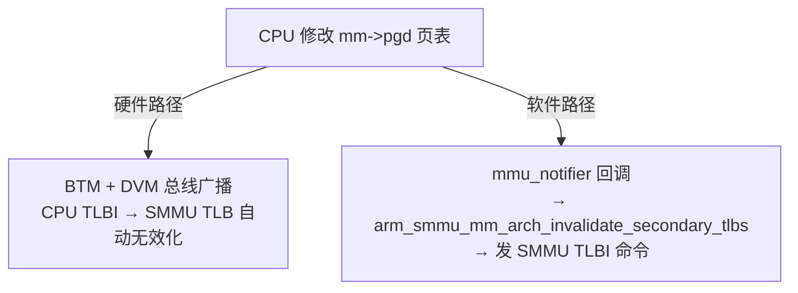
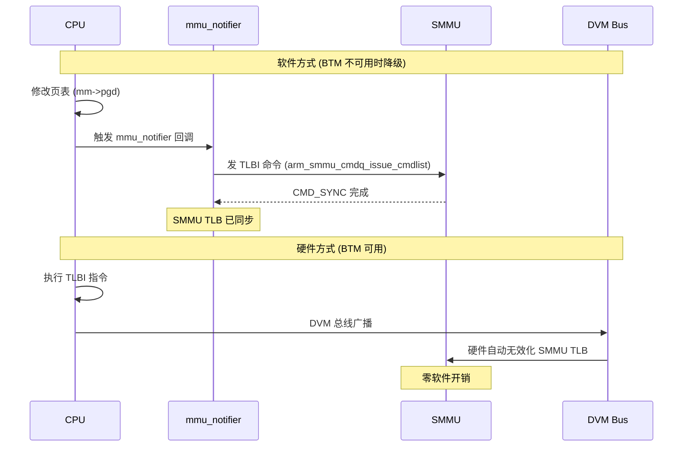
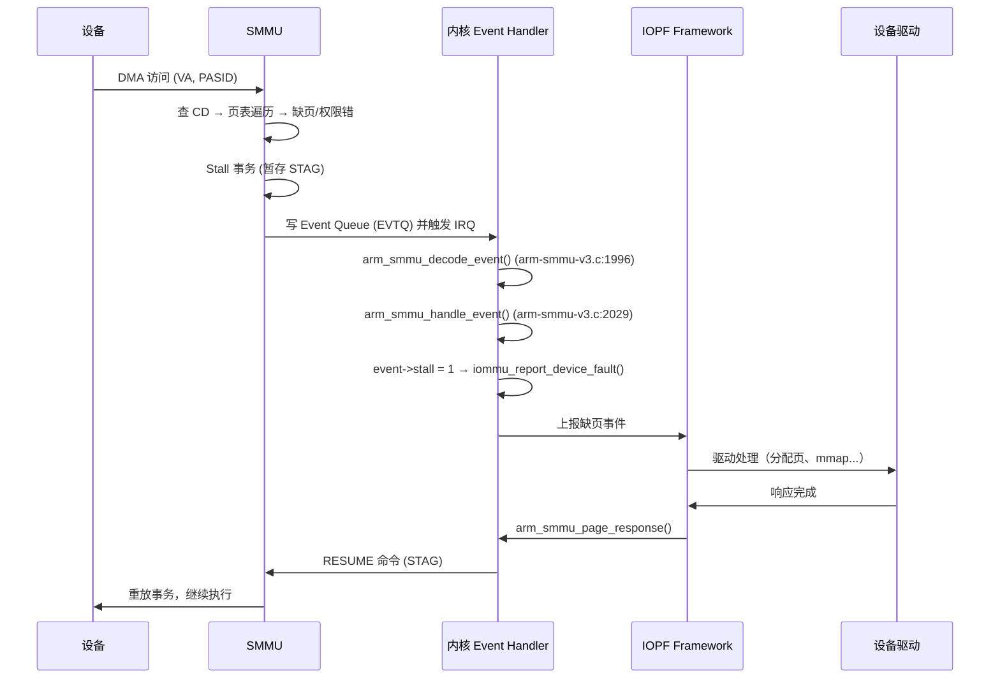
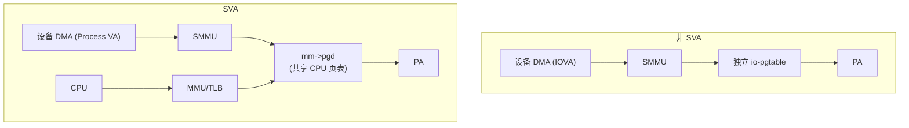
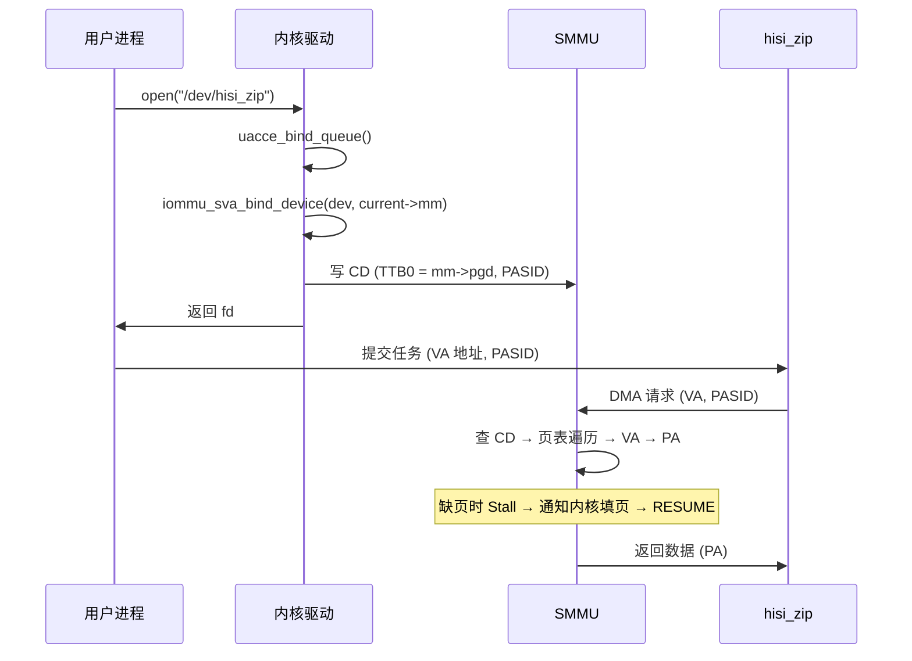
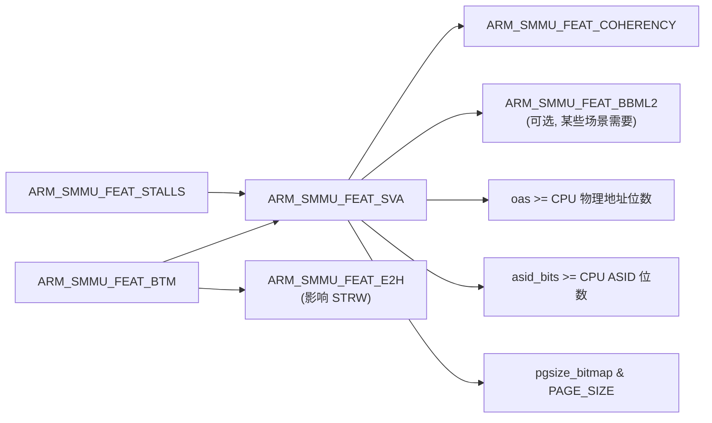

# Host SMMU (ARM SMMUv3) 笔记

## 1. SMMU 是什么

### 1.1 概述

SMMU (System Memory Management Unit) 是 ARM 体系架构中定义的 **IOMMU 硬件规范**，负责翻译设备发起的 DMA 地址。`arm-smmu-v3` 驱动是 Linux 内核对 SMMUv3 硬件的软件实现，通过 `struct iommu_ops` 接口对接 IOMMU 通用框架。

**关键区分**：SMMU 是硬件规范名称，`arm-smmu-v3` 是内核驱动名称。

### 1.2 SMMU 与 CPU MMU 的关系

SMMU 和 CPU MMU 是两个**独立的地址翻译单元**：



- 非 SVA 场景：SMMU 用独立的 `io-pgtable`，与 CPU 页表无关
- SVA 场景：SMMU 和 CPU 共享同一份 `mm->pgd`，但各有独立的 TLB 和页表遍历器（walker）

### 1.3 驱动入口：`arm_smmu_ops`

**文件**: `drivers/iommu/arm/arm-smmu-v3/arm-smmu-v3.c:4306`

```c
static const struct iommu_ops arm_smmu_ops = {
    .identity_domain           = &arm_smmu_identity_domain,
    .blocked_domain            = &arm_smmu_blocked_domain,
    .domain_alloc_sva          = arm_smmu_sva_domain_alloc,       // SVA 入口
    .domain_alloc_paging_flags = arm_smmu_domain_alloc_paging_flags, // 默认非 SVA 入口
    .probe_device              = arm_smmu_probe_device,
    .release_device            = arm_smmu_release_device,
    .page_response             = arm_smmu_page_response,
    .default_domain_ops        = &(const struct iommu_domain_ops) {
        .attach_dev           = arm_smmu_attach_dev,
        .map_pages            = arm_smmu_map_pages,
        .unmap_pages          = arm_smmu_unmap_pages,
        .flush_iotlb_all      = arm_smmu_flush_iotlb_all,
        ...
    },
};
```

---

## 2. Key 数据结构

### 2.1 `struct arm_smmu_device` — 物理 SMMU 实例

**文件**: `drivers/iommu/arm/arm-smmu-v3/arm-smmu-v3.h:891`

```c
struct arm_smmu_device {
    struct device           *dev;
    void __iomem            *base;
    void __iomem            *page1;
    u32                     features;      // 硬件 feature 位图
    unsigned long           oas;           // 输出地址大小
    unsigned long           asid_bits;     // ASID 位数
    unsigned long           vmid_bits;     // VMID 位数
    struct rb_root          streams;       // Stream 红黑树
    struct mutex            streams_mutex;
    struct arm_smmu_cmdq    cmdq;          // 命令队列
    struct arm_smmu_evtq    evtq;          // 事件队列
    struct arm_smmu_priq    priq;          // PRI 队列
    ...
};
```

`features` 位图决定了硬件支持的各项能力：

| Feature 宏 | 位 | 含义 |
|---|---|---|
| `ARM_SMMU_FEAT_COHERENCY` | (1 << 8) | IO Coherent |
| `ARM_SMMU_FEAT_TRANS_S1` | (1 << 9) | 支持 Stage-1 翻译 |
| `ARM_SMMU_FEAT_TRANS_S2` | (1 << 10) | 支持 Stage-2 翻译 |
| `ARM_SMMU_FEAT_STALLS` | (1 << 11) | 支持 Stall 模式 |
| `ARM_SMMU_FEAT_PRI` | (1 << 4) | 支持 PRI |
| `ARM_SMMU_FEAT_ATS` | (1 << 5) | 支持 ATS |
| `ARM_SMMU_FEAT_BTM` | (1 << 16) | 广播 TLB 维护 |
| `ARM_SMMU_FEAT_SVA` | (1 << 17) | 支持 SVA（需硬件满足多个条件） |
| `ARM_SMMU_FEAT_HA` | (1 << 21) | 硬件 Access flag |
| `ARM_SMMU_FEAT_HD` | (1 << 22) | 硬件 Dirty flag |
| `ARM_SMMU_FEAT_BBML2` | (1 << 24) | BBML2 |

**文件**: `drivers/iommu/arm/arm-smmu-v3/arm-smmu-v3.h:899-923`

### 2.2 `struct arm_smmu_master` — 挂载在 SMMU 下的设备

**文件**: `drivers/iommu/arm/arm-smmu-v3/arm-smmu-v3.h:994`

```c
struct arm_smmu_master {
    struct arm_smmu_device           *smmu;
    struct device                    *dev;
    struct arm_smmu_stream           *streams;
    struct arm_smmu_ctx_desc_cfg     cd_table;          // CD 表
    unsigned int                     num_streams;
    bool                             ats_enabled : 1;
    bool                             stall_enabled;     // 是否启用 Stall 模式
    unsigned int                     ssid_bits;
    ...
};
```

`stall_enabled` 决定设备是否支持 Stall 模式：

**文件**: `drivers/iommu/arm/arm-smmu-v3/arm-smmu-v3.c:4195`

```c
// 设备 probe 时，根据固件 "dma-can-stall" 属性设置
if (device_property_read_bool(dev, "dma-can-stall"))
    master->stall_enabled = true;
```

### 2.3 `struct arm_smmu_domain` — 地址翻译域

**文件**: `drivers/iommu/arm/arm-smmu-v3/arm-smmu-v3.h:1025`

```c
struct arm_smmu_domain {
    struct arm_smmu_device      *smmu;
    struct io_pgtable_ops       *pgtbl_ops;      // io-pgtable 操作接口
    enum arm_smmu_domain_stage  stage;           // S1 / S2 / SVA
    union {
        struct arm_smmu_ctx_desc cd;             // S1/SVA 的 CD cache
        struct arm_smmu_s2_cfg   s2_cfg;         // S2 配置
    };
    struct iommu_domain          domain;
    struct mmu_notifier          mmu_notifier;   // 仅 SVA 使用
    ...
};
```

### 2.4 STE（Stream Table Entry）

每个 Stream（由 SID 标识）对应一个 STE，STE 决定了该 Stream 的翻译方式：

**文件**: `drivers/iommu/arm/arm-smmu-v3/arm-smmu-v3.h:243-276`

```c
#define STRTAB_STE_0_V              (1UL << 0)           // Valid
#define STRTAB_STE_0_CFG            GENMASK_ULL(3, 1)
#define STRTAB_STE_0_CFG_ABORT      0                    // Abort 所有事务
#define STRTAB_STE_0_CFG_BYPASS     4                    // Bypass
#define STRTAB_STE_0_CFG_S1_TRANS   5                    // Stage-1 翻译
#define STRTAB_STE_0_CFG_S2_TRANS   6                    // Stage-2 翻译
#define STRTAB_STE_0_CFG_NESTED     7                    // Nested 翻译 (S1+S2)

#define STRTAB_STE_1_S1DSS          GENMASK_ULL(25, 24)  // 默认 S1 子流行为
#define STRTAB_STE_1_STRW           GENMASK_ULL(31, 30)  // StreamWorld (影响 BTM)
#define STRTAB_STE_1_STRW_NSEL1     0UL                  // Non-secure EL1
#define STRTAB_STE_1_STRW_EL2       2UL                  // EL2 (E2H)
#define STRTAB_STE_1_S1STALLD       (1UL << 27)          // Stall disable
#define STRTAB_STE_1_EATS           GENMASK_ULL(29, 28)  // ATS 启用
```

### 2.5 CD（Context Descriptor）

每个子流（由 PASID/SSID 标识）对应一个 CD，CD.TTB0 指向该子流用的页表基地址：

**文件**: `drivers/iommu/arm/arm-smmu-v3/arm-smmu-v3.h:324-372`

```c
struct arm_smmu_cd {
    __le64 data[8];
};

#define CTXDESC_CD_0_V              (1UL << 31)          // Valid
#define CTXDESC_CD_0_ASID           GENMASK_ULL(63, 48)  // ASID
#define CTXDESC_CD_0_S              (1UL << 44)          // Stall
#define CTXDESC_CD_0_R              (1UL << 45)          // Remote (PRI)
#define CTXDESC_CD_0_A              (1UL << 46)          // Accessed
#define CTXDESC_CD_0_ASET           (1UL << 47)          // ASID 类型
#define CTXDESC_CD_0_AA64           (1UL << 41)          // 64-bit 格式
#define CTXDESC_CD_0_TCR_T0SZ       GENMASK_ULL(5, 0)    // VA 范围
#define CTXDESC_CD_0_TCR_TG0        GENMASK_ULL(7, 6)    // 页粒度
#define CTXDESC_CD_0_TCR_EPD0       (1ULL << 14)         // 禁用 TTB0 翻译
#define CTXDESC_CD_0_TCR_EPD1       (1ULL << 30)         // 禁用 TTB1 翻译
#define CTXDESC_CD_0_TCR_HA         (1UL << 43)          // 硬件 Access flag
#define CTXDESC_CD_0_TCR_HD         (1UL << 42)          // 硬件 Dirty flag
#define CTXDESC_CD_1_TTB0_MASK      GENMASK_ULL(51, 4)   // TTB0 地址
```

### 2.6 数据结构关系图



**STE 寻址路径**:

```
SID → Stream Table → STE → CD Table → CD[PASID] → 页表基地址
```

---

## 3. 非 SVA（默认非 SVA domain）

### 3.1 概念

设备 probe 时，IOMMU 框架自动分配默认 domain。这个 domain 使用**独立的 `io-pgtable`**，与 CPU 进程页表 (`mm->pgd`) 完全无关。此为非 SVA 的默认行为。

### 3.2 完整调用链

```
__iommu_probe_device()                         // iommu.c:627, 设备首次接入 IOMMU
    -> iommu_setup_default_domain()            // iommu.c:3148
        -> iommu_group_alloc_default_domain()  // iommu.c:1758
            -> __iommu_group_alloc_default_domain() // iommu.c:1721
                -> __iommu_paging_domain_alloc_flags() // iommu.c:2080
                    -> ops->domain_alloc_paging_flags() // iommu.c:2093
                        -> arm_smmu_domain_alloc_paging_flags() // arm-smmu-v3.c:3858
```

### 3.3 核心代码

**文件**: `drivers/iommu/arm/arm-smmu-v3/arm-smmu-v3.c:3858`

```c
static struct iommu_domain *
arm_smmu_domain_alloc_paging_flags(struct device *dev, u32 flags,
                                   const struct iommu_user_data *user_data)
{
    struct arm_smmu_master *master = dev_iommu_priv_get(dev);
    struct arm_smmu_device *smmu = master->smmu;
    struct arm_smmu_domain *smmu_domain;

    smmu_domain = arm_smmu_domain_alloc();
    ...

    switch (flags) {
    case 0:  /* 默认路径 */
        if (smmu->features & ARM_SMMU_FEAT_TRANS_S1)
            smmu_domain->stage = ARM_SMMU_DOMAIN_S1;   // 用 S1 页表格式
        else
            smmu_domain->stage = ARM_SMMU_DOMAIN_S2;   // 用 S2 页表格式
        break;
    ...
    }

    smmu_domain->domain.type = IOMMU_DOMAIN_UNMANAGED;
    smmu_domain->domain.ops = arm_smmu_ops.default_domain_ops;
    ret = arm_smmu_domain_finalise(smmu_domain, smmu, flags);  // 初始化 io-pgtable
    return &smmu_domain->domain;
}
```

`arm_smmu_domain_finalise()` 内部会调用 `alloc_io_pgtable_ops()` 分配独立的 `io_pgtable_ops`，页表内存由内核独立管理。

### 3.4 非 SVA 场景下图

```mermaid
graph TD
    subgraph 非 SVA——独立页表
        Device["设备 DMA"] --> SMMU["SMMU"]
        SMMU --> IOPGT["io-pgtable<br/>(SMMU 独立分配)"]
        IOPGT --> PA["物理地址 PA"]
    end
    subgraph CPU侧
        CPU["CPU"] --> MMU["MMU/TLB"]
        MMU --> MMUPG["进程页表<br/>mm->pgd"]
        MMUPG --> PA2["物理地址 PA<br/>(与设备无关)"]
    end
```

- SMMU 页表 ≠ CPU 页表：地址空间完全不同
- 设备用 IOVA 做 DMA，SMMU 通过自己的 `io-pgtable` 翻译 IOVA → PA
- 无需 TLB 同步（互不干扰）
- 页表内存由驱动通过 `map_pages`/`unmap_pages` 操作维护

### 3.5 页表操作

默认 domain 的页表由 `arm_smmu_ops.default_domain_ops` 提供：

```c
// arm-smmu-v3.c:4325
.default_domain_ops = &(const struct iommu_domain_ops) {
    .map_pages        = arm_smmu_map_pages,       // → io_pgtable_ops->map_pages
    .unmap_pages      = arm_smmu_unmap_pages,     // → io_pgtable_ops->unmap_pages
    .flush_iotlb_all  = arm_smmu_flush_iotlb_all, // → 发 SMMU TLBI 命令
    .iova_to_phys     = arm_smmu_iova_to_phys,    // → io_pgtable_ops->iova_to_phys
    .free             = arm_smmu_domain_free_paging,
}
```

每次 `map_pages`/`unmap_pages` 后必须调用 `iotlb_sync` 刷 TLB，保证 SMMU 看到最新映射。

---

## 4. SVA（Shared Virtual Addressing）

### 4.1 概念

SVA 允许设备和 CPU **共享进程的虚拟地址空间**，设备可以直接使用进程的 VA 做 DMA。

```mermaid
graph TD
    subgraph SVA——共享页表
        CPU["CPU"] --> MMU["MMU/TLB"]
        Device["设备 DMA"] --> SMMU["SMMU TLB"]
        MMU --> MMUPG["mm->pgd<br/>(同一份页表)"]
        SMMU --> MMUPG
        MMUPG --> PA["物理地址 PA"]
    end
```

- 同一份 `mm->pgd`，CPU 和 SMMU 各自有独立 TLB
- 设备用进程 VA 做 DMA，与 CPU 看到同一物理地址

### 4.2 完整调用链

```
用户态 / 内核驱动
    -> iommu_sva_bind_device(dev, current->mm)   // iommu-sva.c:72
        -> iommu_sva_domain_alloc(dev, mm)       // iommu-sva.c:309（内部函数）
            -> ops->domain_alloc_sva(dev, mm)    // iommu-sva.c:318
                -> arm_smmu_sva_domain_alloc()   // arm-smmu-v3-sva.c:314
```

### 4.3 核心代码

**文件**: `drivers/iommu/arm/arm-smmu-v3/arm-smmu-v3-sva.c:314`

```c
struct iommu_domain *arm_smmu_sva_domain_alloc(struct device *dev,
                                               struct mm_struct *mm)
{
    struct arm_smmu_master *master = dev_iommu_priv_get(dev);
    struct arm_smmu_device *smmu = master->smmu;
    struct arm_smmu_domain *smmu_domain;
    u32 asid;

    // 分配 SVA domain
    smmu_domain = arm_smmu_domain_alloc();
    smmu_domain->domain.type = IOMMU_DOMAIN_SVA;
    smmu_domain->domain.ops = &arm_smmu_sva_domain_ops;
    smmu_domain->stage = ARM_SMMU_DOMAIN_SVA;

    // 分配 ASID
    xa_alloc(&arm_smmu_asid_xa, &asid, smmu_domain,
             XA_LIMIT(1, (1 << smmu->asid_bits) - 1), GFP_KERNEL);
    smmu_domain->cd.asid = asid;

    // 注册 mmu_notifier，用于 TLB 同步
    smmu_domain->mmu_notifier.ops = &arm_smmu_mmu_notifier_ops;
    mmu_notifier_register(&smmu_domain->mmu_notifier, mm);

    return &smmu_domain->domain;
}
```

### 4.4 CD 构造 —— `arm_smmu_make_sva_cd()`

**文件**: `drivers/iommu/arm/arm-smmu-v3/arm-smmu-v3-sva.c:51`

```c
void arm_smmu_make_sva_cd(struct arm_smmu_cd *target,
                          struct arm_smmu_master *master,
                          struct mm_struct *mm, u16 asid)
{
    memset(target, 0, sizeof(*target));

    // CD[0]: 控制字段
    target->data[0] = cpu_to_le64(
        CTXDESC_CD_0_TCR_EPD1 |           // 禁用 TTB1（只用 TTB0）
        CTXDESC_CD_0_V |                   // Valid
        CTXDESC_CD_0_AA64 |                // 64-bit 格式
        (master->stall_enabled ? CTXDESC_CD_0_S : 0) |  // Stall 模式
        CTXDESC_CD_0_R |                   // Remote（PRI）
        CTXDESC_CD_0_A |                   // Accessed
        CTXDESC_CD_0_ASET |                // ASID 类型
        FIELD_PREP(CTXDESC_CD_0_ASID, asid));  // ASID

    if (mm) {
        // 设置 TTB0 指向 CPU 进程的页表
        target->data[1] = cpu_to_le64(
            virt_to_phys(mm->pgd) & CTXDESC_CD_1_TTB0_MASK);  // ← 关键！
        ...
        // 设置页表属性：T0SZ、TG0、IRGN0、ORGN0、SH0
        target->data[0] |= cpu_to_le64(
            FIELD_PREP(CTXDESC_CD_0_TCR_T0SZ, 64ULL - vabits_actual) |
            FIELD_PREP(CTXDESC_CD_0_TCR_TG0, page_size_to_cd()) |
            FIELD_PREP(CTXDESC_CD_0_TCR_IRGN0, ARM_LPAE_TCR_RGN_WBWA) |
            FIELD_PREP(CTXDESC_CD_0_TCR_ORGN0, ARM_LPAE_TCR_RGN_WBWA) |
            FIELD_PREP(CTXDESC_CD_0_TCR_SH0, ARM_LPAE_TCR_SH_IS));
    }

    // CD[3]: MAIR（内存属性，直接从 CPU 寄存器复制）
    target->data[3] = cpu_to_le64(read_sysreg(mair_el1));
}
```

### 4.5 硬件前提

`arm_smmu_sva_supported()` 检查 SVA 是否可用：

**文件**: `drivers/iommu/arm/arm-smmu-v3/arm-smmu-v3-sva.c:197`

```c
bool arm_smmu_sva_supported(struct arm_smmu_device *smmu)
{
    u32 feat_mask = ARM_SMMU_FEAT_COHERENCY;

    // LPA2 限制
    if (vabits_actual == 52 && PAGE_SIZE != SZ_64K)
        return false;

    if (system_supports_bbml2_noabort())
        feat_mask |= ARM_SMMU_FEAT_BBML2;

    if ((smmu->features & feat_mask) != feat_mask)
        return false;

    // 页大小兼容性
    if (!(smmu->pgsize_bitmap & PAGE_SIZE))
        return false;

    // 输出地址大小需 >= CPU 支持的物理地址
    if (smmu->oas < oas)
        return false;

    // ASID 位数需 >= CPU ASID 位数
    if (smmu->asid_bits < asid_bits)
        return false;

    return true;
}
```

**核心要求**：Coherency + BBML2(某些场景) + 页大小兼容 + 地址空间足够

### 4.6 SVA domain ops

```c
// arm-smmu-v3-sva.c:309
static const struct iommu_domain_ops arm_smmu_sva_domain_ops = {
    .set_dev_pasid = arm_smmu_sva_set_dev_pasid,  // 绑定设备 PASID → CD 写入
    .free          = arm_smmu_sva_domain_free,    // 释放 ASID + 注销 mmu_notifier
};
```

### 4.7 SVA 绑定流程中设备如何获得 PASID

```
iommu_sva_bind_device(dev, mm)
    -> iommu_alloc_mm_data(mm, dev)          // 分配 mm->pasid
    -> iommu_sva_domain_alloc(dev, mm)       // 分配 SVA domain + ASID
    -> iommu_attach_device_pasid(domain, dev, pasid, handle)
        -> arm_smmu_sva_set_dev_pasid()
            -> arm_smmu_make_sva_cd()        // 构造 CD (TTB0 = mm->pgd)
            -> arm_smmu_set_pasid()          // 写 CD 表 + STE → 发 CMD_SYNC
```

**关键**：SVA 绑定的入口参数是 `(dev, mm)`——传入进程地址空间，驱动才能把 CD.TTB0 指向 `mm->pgd`。

---

## 5. SVA TLB 同步

### 5.1 问题背景

SVA 场景下 CPU 和 SMMU **共享同一份 `mm->pgd` 页表**，但各有独立 TLB。CPU 修改页表（mmap/munmap/mprotect/fork 等）后，SMMU TLB 仍持有可能已过时的映射，必须同步。

### 5.2 两种同步方式



### 5.3 软件同步 —— `mmu_notifier`

**文件**: `drivers/iommu/arm/arm-smmu-v3/arm-smmu-v3-sva.c:135`

```c
static void arm_smmu_mm_arch_invalidate_secondary_tlbs(
    struct mmu_notifier *mn, struct mm_struct *mm,
    unsigned long start, unsigned long end)
{
    struct arm_smmu_domain *smmu_domain =
        container_of(mn, struct arm_smmu_domain, mmu_notifier);
    size_t size = end - start;

    arm_smmu_domain_inv_range(smmu_domain, start, size, PAGE_SIZE, false);
}
```

**调用链**：

```
CPU 修改页表 (mmap / munmap / mprotect / fork 的 COW...)
    -> mmu_notifier 回调链触发
        -> arm_smmu_mm_arch_invalidate_secondary_tlbs()  // arm-smmu-v3-sva.c:135
            -> arm_smmu_domain_inv_range()               // arm-smmu-v3.c:2616
                -> __arm_smmu_domain_inv_range()
                    -> 构造 SMMU TLBI 命令 (TLBI_NH_VA / TLBI_NH_ASID)
                    -> arm_smmu_cmdq_issue_cmdlist()     // 发送命令到 SMMU
```

**进程退出时的清理**：

```c
// arm-smmu-v3-sva.c:154
static void arm_smmu_mm_release(struct mmu_notifier *mn, struct mm_struct *mm)
{
    // 进程退出时，将 CD 设为无效（EPD0=1, 禁用翻译）
    // 避免设备继续用已释放的页表
    arm_smmu_make_sva_cd(&target, master, NULL, smmu_domain->cd.asid);
    arm_smmu_write_cd_entry(master, master_domain->ssid, cdptr, &target);
}
```

**TLB 无效化命令类型**（部分）：

**文件**: `drivers/iommu/arm/arm-smmu-v3/arm-smmu-v3.h:462-482`

```c
enum arm_smmu_cmdq_opcode {
    CMDQ_OP_TLBI_NH_ALL   = 0x10,  // 无效化所有 S1 TLB (Non-secure Hyp)
    CMDQ_OP_TLBI_NH_ASID  = 0x11,  // 按 ASID 无效化
    CMDQ_OP_TLBI_NH_VA    = 0x12,  // 按 VA+ASID 无效化
    CMDQ_OP_TLBI_NH_VAA   = 0x13,  // 按 VA 无效化 (不考虑 ASID)
    CMDQ_OP_CMD_SYNC      = 0x46,  // 命令同步（确保之前的命令完成）
};
```

### 5.4 硬件同步 —— BTM（Broadcast TLB Maintenance）

**文件**: `drivers/iommu/arm/arm-smmu-v3/arm-smmu-v3.h:915`

```c
#define ARM_SMMU_FEAT_BTM    (1 << 16)
```

**原理**：当 BTM 启用时，CPU 执行 TLB 无效化指令（`TLBI VMALLE1IS` 等）会通过 **DVM（Distributed Virtual Memory）总线**自动广播到 SMMU，SMMU 硬件收到后自动无效化自己的 TLB，**无需软件干预**。

**STE 配置要求**：`S1STALLD` 和 `STRW` 必须与 CPU 异常级别匹配。

**文件**: `drivers/iommu/arm/arm-smmu-v3/arm-smmu-v3.c:1845`

```c
if (smmu->features & ARM_SMMU_FEAT_E2H) {
    // Hypervisor 场景 (VHE): STRW = EL2
    target->data[1] |= cpu_to_le64(
        FIELD_PREP(STRTAB_STE_1_STRW, STRTAB_STE_1_STRW_EL2));
} else {
    // Guest/EL1 场景: STRW = NS-EL1
    target->data[1] |= cpu_to_le64(
        FIELD_PREP(STRTAB_STE_1_STRW, STRTAB_STE_1_STRW_NSEL1));
}
```

**Errata 导致 BTM 被禁用**：

**文件**: `drivers/iommu/arm/arm-smmu-v3/arm-smmu-v3.c:4902-4916`

```c
case IIDR_PRODUCTID_ARM_MMU_700:
    smmu->features &= ~ARM_SMMU_FEAT_BTM;   // MMU-700 禁用 BTM
    break;
case IIDR_PRODUCTID_ARM_MMU_L1:
case IIDR_PRODUCTID_ARM_MMU_S3:
    smmu->features &= ~ARM_SMMU_FEAT_BTM;   // MMU-L1/MMU-S3 禁用 BTM
    break;
```

### 5.5 软件 vs 硬件对比

| 方式 | 机制 | 延迟 | 软件开销 | 条件 |
|---|---|---|---|---|
| **BTM + DVM** | CPU TLBI 经 DVM 总线广播到 SMMU | 硬件自动 | 零 | BTM 硬件支持 + 无 Errata |
| **mmu_notifier** | CPU 改页表 → 软件回调 → 发 SMMU TLBI 命令 | 需命令提交+等待 | 回调 + CMDQ 开销 | 总是可用（降级路径） |



---

## 6. Stall 模式

### 6.1 原理

**文件**: `drivers/iommu/arm/arm-smmu-v3/arm-smmu-v3.h:910`

```c
#define ARM_SMMU_FEAT_STALLS    (1 << 11)
```

当设备发起 DMA 访问但 S1 页表缺页（未映射或权限不足）时：

- **无 Stall**：SMMU 直接 Abort 事务，设备收到错误
- **有 Stall**：SMMU **暂停（Stall）该事务**，生成 Event 通知 CPU，等待软件处理缺页，再发送 RESUME 命令恢复事务

### 6.2 CD 中的 Stall 控制位

**文件**: `drivers/iommu/arm/arm-smmu-v3/arm-smmu-v3.h:366-367`

```c
#define CTXDESC_CD_0_S      (1UL << 44)   // Stall 启用（设备 Stall + SMMU Stall）
#define CTXDESC_CD_0_R      (1UL << 45)   // Remote/PRI 启用
```

### 6.3 完整流程



### 6.4 关键代码

**事件解码** (`arm-smmu-v3.c:1996-2010`)：

```c
static void arm_smmu_decode_event(struct arm_smmu_device *smmu, u64 *raw,
                                  struct arm_smmu_event *event)
{
    event->stall  = FIELD_GET(EVTQ_1_STALL, raw[1]);   // 是否为 Stall 事件
    event->sid    = FIELD_GET(EVTQ_0_SID, raw[0]);      // Stream ID
    event->ssid   = FIELD_GET(EVTQ_0_SSID, raw[0]);     // Substream ID (PASID)
    event->iova   = FIELD_GET(EVTQ_2_ADDR, raw[2]);     // 出错地址
    event->stag   = FIELD_GET(EVTQ_1_STAG, raw[1]);     // Stall Tag
    event->read   = FIELD_GET(EVTQ_1_RnW, raw[1]);     // 读/写
    ...
}
```

**Stall 事件处理** (`arm-smmu-v3.c:2052-2076`)：

```c
if (event->stall) {
    // 构造 IOMMU page fault 事件
    if (event->read)
        perm |= IOMMU_FAULT_PERM_READ;
    else
        perm |= IOMMU_FAULT_PERM_WRITE;

    flt->type = IOMMU_FAULT_PAGE_REQ;
    flt->prm = (struct iommu_fault_page_request){
        .flags = IOMMU_FAULT_PAGE_REQUEST_LAST_PAGE,
        .grpid = event->stag,    // Stall Tag 用于 RESUME
        .perm  = perm,
        .addr  = event->iova,
    };

    if (event->ssv) {
        flt->prm.flags |= IOMMU_FAULT_PAGE_REQUEST_PASID_VALID;
        flt->prm.pasid = event->ssid;
    }
}
```

### 6.5 Stall 与 Stall_Force

**文件**: `drivers/iommu/arm/arm-smmu-v3/arm-smmu-v3.h:912`

```c
#define ARM_SMMU_FEAT_STALL_FORCE  (1 << 13)
```

当 `ARM_SMMU_FEAT_STALL_FORCE` 置位时，即使 STE 中设置了 `S1STALLD`（stall disable），SMMU 仍然会 stall。这用于在设备退出（如进程异常终止）时强制关闭 stall 并转为 abort，防止 DMA 挂起。

---

## 7. 非 SVA vs SVA 对比



| 维度 | 非 SVA（默认非 SVA domain） | SVA |
|---|---|---|
| **页表来源** | 独立 `io-pgtable` | 共享 `mm->pgd` |
| **分配入口** | `domain_alloc_paging_flags` | `domain_alloc_sva` |
| **触发方式** | 设备 probe 时自动 | 用户态显式 `iommu_sva_bind_device()` |
| **地址空间** | IOVA 空间（与进程 VA 无关） | 进程 VA 空间 |
| **TLB 同步** | 不需要（地址空间独立） | 需要——mmu_notifier / BTM |
| **页表管理** | 驱动通过 map/unmap 操作 | 内核自动通过 mmu_notifier 同步 |
| **典型场景** | 网卡、磁盘、普通外设 | 加速器（DPU、GPU）、UACCE（hisi_zip） |

---

## 8. UACCE 实例 —— hisi_zip 的 SVA 用法

### 8.1 UACCE 框架简述

UACCE (Unified Accelerator) 是内核的统一加速器框架，向用户态暴露加速器设备，支持 SVA 模式。

**文件**: `include/uapi/misc/uacce/uacce.h:26`

```c
#define UACCE_DEV_SVA   BIT(0)   // SVA 模式：支持 PASID + 缺页 (PRI/Stall)
```

### 8.2 `uacce_mode` 模块参数

**文件**: `drivers/crypto/hisilicon/zip/zip_main.c:421`

```c
static u32 uacce_mode = UACCE_MODE_NOUACCE;  // 默认 0
module_param_cb(uacce_mode, &zip_uacce_mode_ops, &uacce_mode, 0444);
MODULE_PARM_DESC(uacce_mode, UACCE_MODE_DESC);
```

**模式定义** (`include/linux/hisi_acc_qm.h:112-114`)：

```c
#define UACCE_MODE_NOUACCE   0    // 不注册 UACCE，仅作为 crypto 引擎
#define UACCE_MODE_SVA       1    // 注册 UACCE，使用 SVA 模式
```

> **openEuler 内核额外支持** `UACCE_MODE_NOSVA = 2`（注册 UACCE 但不做 SVA，用 pinned DMA buffer 替代共享页表）。

### 8.3 SVA Bind 调用链

```
用户进程 open("/dev/hisi_zip")
    -> uacce_fops_open()                           // uacce.c:151
        -> uacce_bind_queue()                      // uacce.c:120
            -> iommu_sva_bind_device(uacce->parent, current->mm)  // uacce.c:128
                -> iommu_sva_domain_alloc(dev, mm)  // iommu-sva.c:128
                    -> arm_smmu_sva_domain_alloc()  // arm-smmu-v3-sva.c:314
                        -> CD.TTB0 = virt_to_phys(mm->pgd)
            -> iommu_sva_get_pasid(handle)          // 获取 PASID
            -> q->pasid = pasid                    // 保存到队列上下文
```

**文件**: `drivers/misc/uacce/uacce.c:120`

```c
static int uacce_bind_queue(struct uacce_device *uacce, struct uacce_queue *q)
{
    u32 pasid;
    struct iommu_sva *handle;

    if (!(uacce->flags & UACCE_DEV_SVA))
        return 0;

    handle = iommu_sva_bind_device(uacce->parent, current->mm);  // current->mm = 当前进程
    if (IS_ERR(handle))
        return PTR_ERR(handle);

    pasid = iommu_sva_get_pasid(handle);
    q->handle = handle;
    q->pasid = pasid;
    return 0;
}
```

### 8.4 hisi QM 的 UACCE 初始化

**文件**: `drivers/crypto/hisilicon/qm.c:2936`

```c
static int qm_alloc_uacce(struct hisi_qm *qm)
{
    struct uacce_interface interface = {
        .flags = UACCE_DEV_SVA,      // 硬编码 SVA 模式
        .ops = &uacce_qm_ops,
    };

    uacce = uacce_alloc(&pdev->dev, &interface);

    if (uacce->flags & UACCE_DEV_SVA)
        qm->use_sva = true;
    else {
        // 当前版本只考虑 SVA，不支持 noSVA
        qm_remove_uacce(qm);
        return -EINVAL;
    }
    ...
}
```

### 8.5 UACCE SVA vs noSVA 区别

| 维度 | SVA (mode=1) | noSVA (mode=2, openEuler only) |
|---|---|---|
| **内存共享方式** | 共享 CPU mm->pgd，设备用进程 VA | 使用 pinned DMA buffer |
| **CD.TTB0** | `virt_to_phys(mm->pgd)` | 不需要（无 SVA domain） |
| **页表管理** | mmu_notifier 自动同步 | 不需要 |
| **缺页处理** | Stall + IOPF | 不需要（预 pin 内存） |
| **性能** | 用户态零拷贝，灵活 | 避免 Stall 开销，但 pin 限制 |



---

## 9. Features 位图速查

### 9.1 SMMU 设备 Features

**文件**: `drivers/iommu/arm/arm-smmu-v3/arm-smmu-v3.h:899-923`

| 宏 | 值 | 含义 |
|---|---|---|
| `ARM_SMMU_FEAT_2_LVL_STRTAB` | (1 << 0) | 2 级 Stream Table |
| `ARM_SMMU_FEAT_2_LVL_CDTAB` | (1 << 1) | 2 级 CD Table |
| `ARM_SMMU_FEAT_PRI` | (1 << 4) | Page Request Interface |
| `ARM_SMMU_FEAT_ATS` | (1 << 5) | Address Translation Service |
| `ARM_SMMU_FEAT_SEV` | (1 << 6) | SError Virtualization |
| `ARM_SMMU_FEAT_MSI` | (1 << 7) | MSI 中断 |
| `ARM_SMMU_FEAT_COHERENCY` | (1 << 8) | IO Coherent |
| `ARM_SMMU_FEAT_TRANS_S1` | (1 << 9) | Stage-1 翻译支持 |
| `ARM_SMMU_FEAT_TRANS_S2` | (1 << 10) | Stage-2 翻译支持 |
| `ARM_SMMU_FEAT_STALLS` | (1 << 11) | Stall 模式支持 |
| `ARM_SMMU_FEAT_HYP` | (1 << 12) | Hypervisor 支持 |
| `ARM_SMMU_FEAT_STALL_FORCE` | (1 << 13) | 强制 Stall |
| `ARM_SMMU_FEAT_VAX` | (1 << 14) | 52-bit VA |
| `ARM_SMMU_FEAT_RANGE_INV` | (1 << 15) | 范围无效化 |
| `ARM_SMMU_FEAT_BTM` | (1 << 16) | 广播 TLB 维护 |
| `ARM_SMMU_FEAT_SVA` | (1 << 17) | SVA 支持 |
| `ARM_SMMU_FEAT_E2H` | (1 << 18) | EL2 Host |
| `ARM_SMMU_FEAT_NESTING` | (1 << 19) | Nested 翻译 |
| `ARM_SMMU_FEAT_ATTR_TYPES_OVR` | (1 << 20) | 属性类型覆盖 |
| `ARM_SMMU_FEAT_HA` | (1 << 21) | 硬件 Access flag |
| `ARM_SMMU_FEAT_HD` | (1 << 22) | 硬件 Dirty flag |
| `ARM_SMMU_FEAT_S2FWB` | (1 << 23) | Stage-2 强制写回 |
| `ARM_SMMU_FEAT_BBML2` | (1 << 24) | BBM Level 2 |

### 9.2 SVA 的关键 Feature 依赖



---

*文档版本: v1.0 | 基于 Linux 内核源码生成 | 仅涵盖 Host 侧 SMMU*
