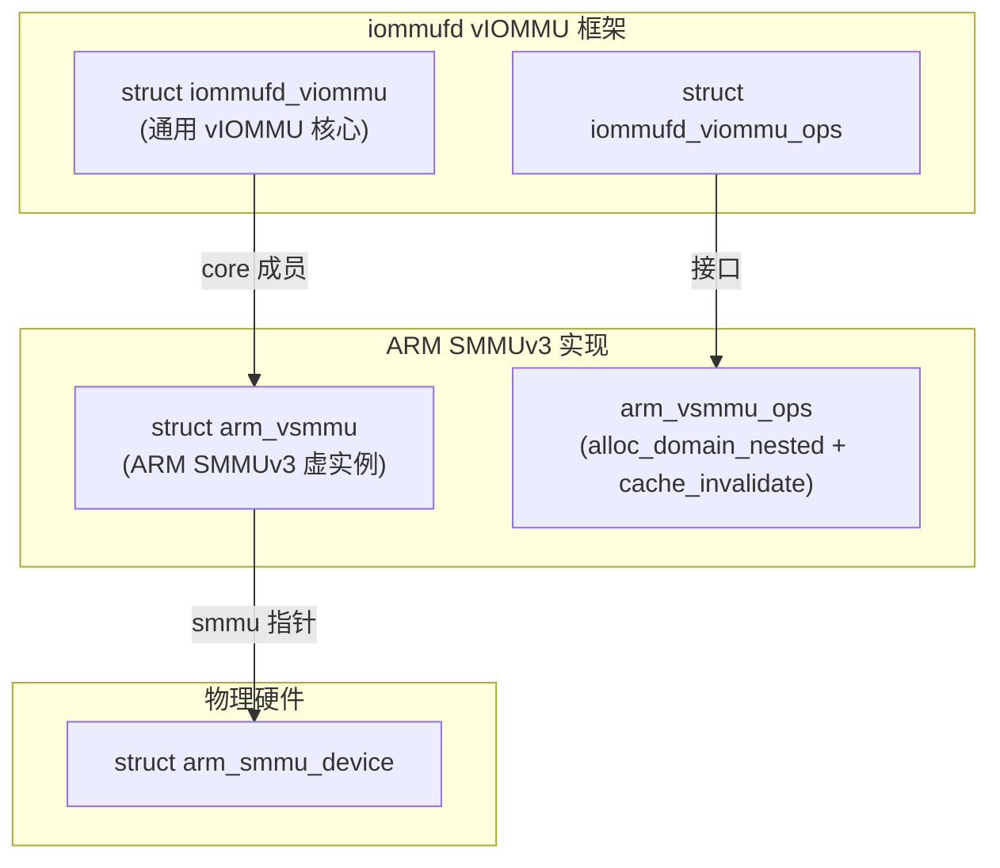
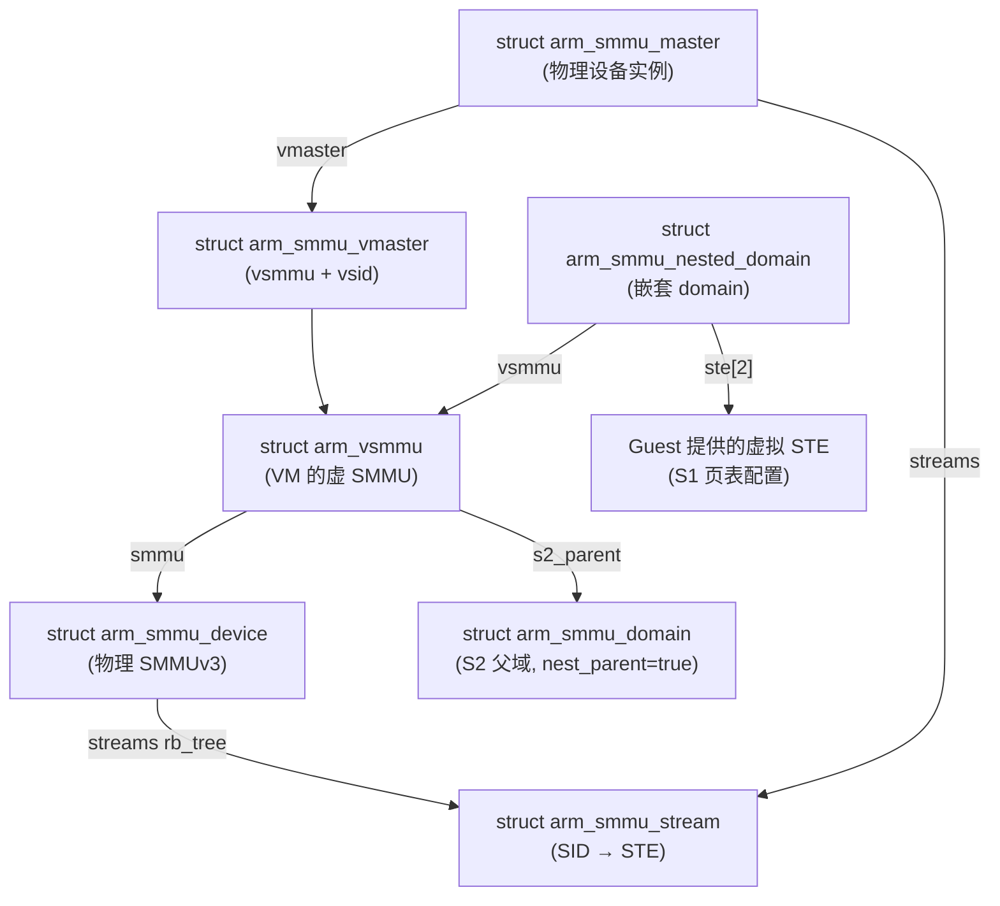
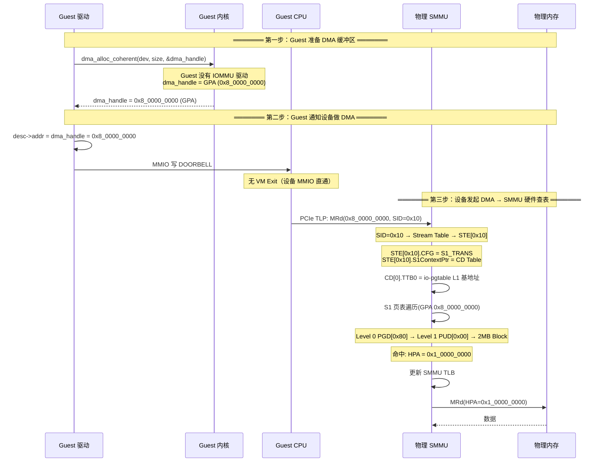
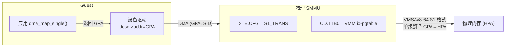
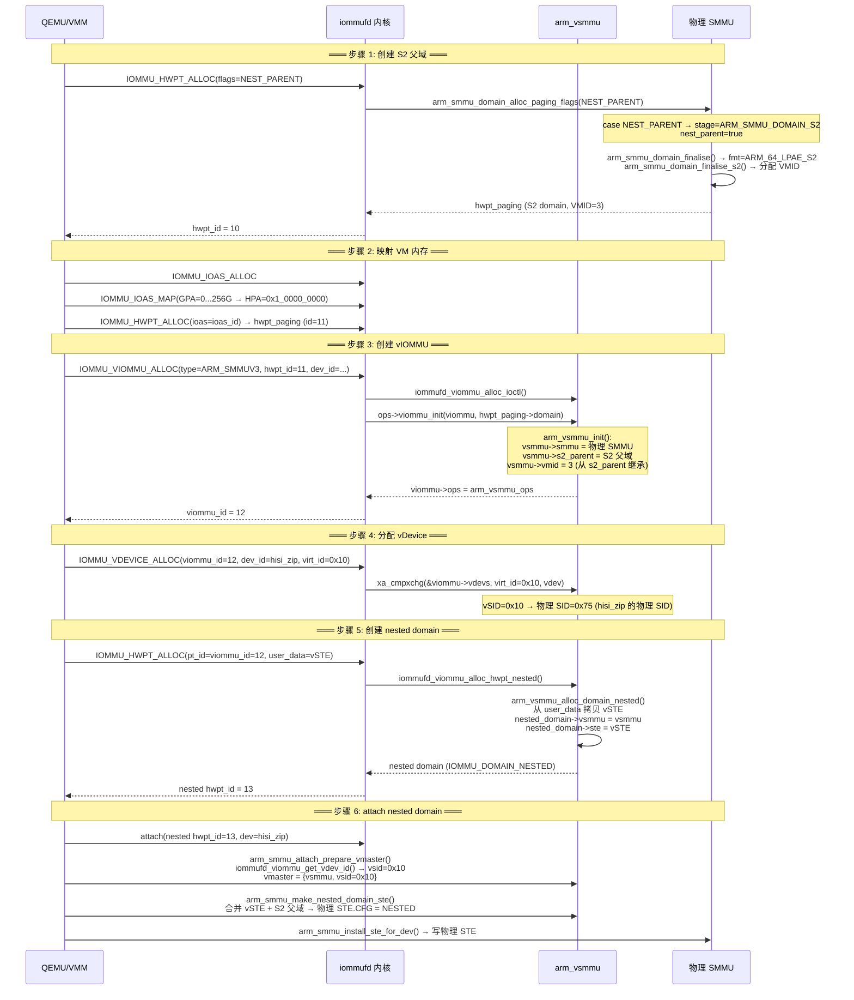
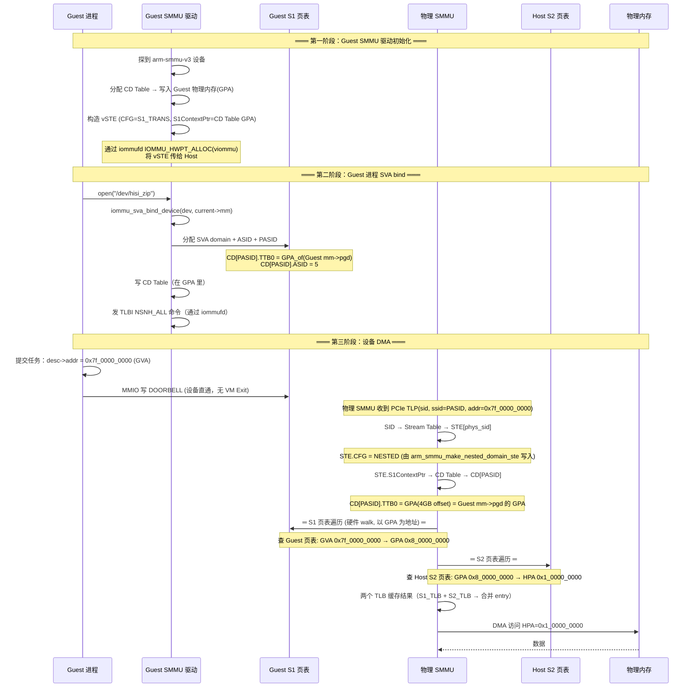
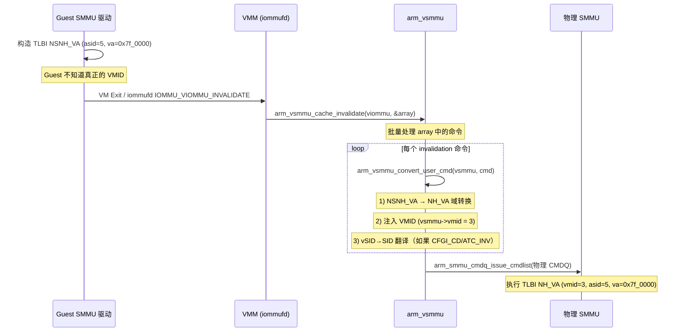
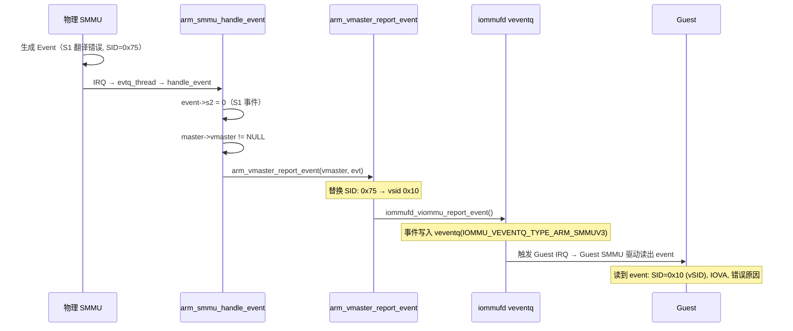
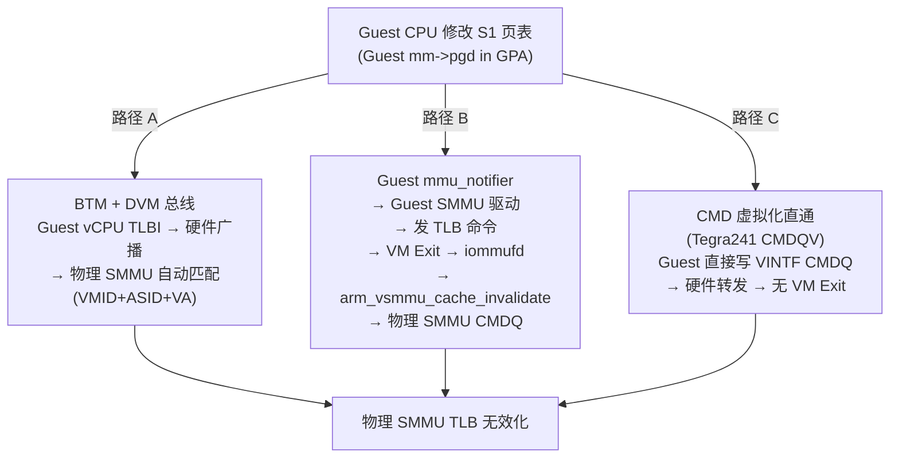
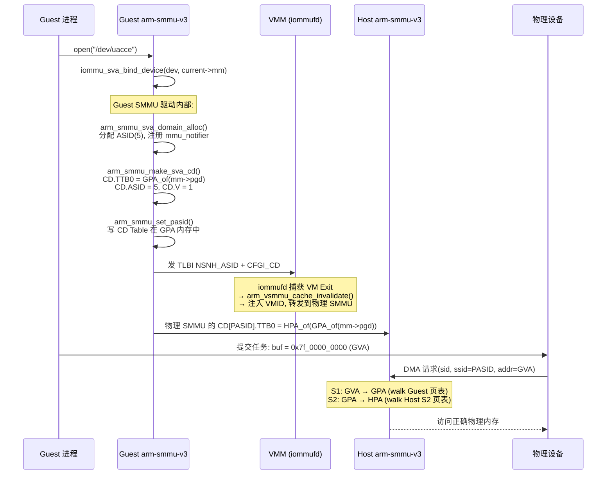

# 虚拟机 SMMU（ARM SMMUv3 虚拟化）笔记

## 1. VSMMU 概述

### 1.1 什么是 VSMMU

VSMMU（Virtual SMMU）是 SMMUv3 在 iommufd vIOMMU 框架中的**虚拟化实例**。每个 VM 可以拥有一个 VSMMU，它提供：

- Guest 看到的**虚拟 SMMUv3 设备**（Guest 可加载 `arm-smmu-v3` 驱动）
- **Nested Translation**：Guest 自主管理 S1 页表，Host 管理 S2 页表
- **命令转换**：Guest 发出的 TLBI/CFGI 命令 → 转换 VMID + vSID→SID → 发到物理 SMMU
- **事件注入**：物理 SMMU 事件 → 替换 SID 为 vSID → 注入 Guest

### 1.2 VSMMU 在 iommufd vIOMMU 框架中的位置



### 1.3 vIOMMU 类型枚举

**文件**: `include/uapi/linux/iommufd.h:1060-1069`

```c
enum iommu_viommu_type {
    IOMMU_VIOMMU_TYPE_DEFAULT          = 0,
    IOMMU_VIOMMU_TYPE_ARM_SMMUV3       = 1,
    IOMMU_VIOMMU_TYPE_TEGRA241_CMDQV   = 2,  // NVIDIA CMDQV 硬件加速
};
```

---

## 2. Key 数据结构

### 2.1 `struct arm_vsmmu` — VSMMU 实例

**文件**: `drivers/iommu/arm/arm-smmu-v3/arm-smmu-v3.h:1242-1247`

```c
struct arm_vsmmu {
    struct iommufd_viommu core;        // 通用 vIOMMU 对象
    struct arm_smmu_device *smmu;      // 指向物理 SMMU
    struct arm_smmu_domain *s2_parent; // 该 VM 的 S2 父域（GPA→HPA 映射）
    u16 vmid;                          // 该 VM 的 VMID
};
```

### 2.2 `struct arm_smmu_vmaster` — 虚拟 master

**文件**: `drivers/iommu/arm/arm-smmu-v3/arm-smmu-v3.h:968-971`

```c
struct arm_smmu_vmaster {
    struct arm_vsmmu *vsmmu;           // 所属 VSMMU
    unsigned long     vsid;            // 虚拟 Stream ID
};
```

用于建立 vSID ↔ 物理 SID 的映射（一个物理设备在 Guest 里看到的是 vSID）。

### 2.3 `struct arm_smmu_nested_domain` — 嵌套 domain

**文件**: `drivers/iommu/arm/arm-smmu-v3/arm-smmu-v3.h:1050-1056`

```c
struct arm_smmu_nested_domain {
    struct iommu_domain  domain;       // 通用 IOMMU domain
    struct arm_vsmmu    *vsmmu;        // 所属 VSMMU
    bool                 enable_ats : 1;
    __le64               ste[2];       // Guest 提供的虚拟 STE
};
```

Guest 提供的 `ste[2]` 是虚拟 STE，包含了 Guest 期望的 S1 页表配置。物理 STE 由 `arm_smmu_make_nested_domain_ste()` 根据 vSTE 和 S2 父域信息合并生成。

### 2.4 `struct iommufd_viommu` — 通用 vIOMMU 核心

**文件**: `include/linux/iommufd.h:99-112`

```c
struct iommufd_viommu {
    struct iommufd_object           obj;
    struct iommufd_ctx             *ictx;
    struct iommu_device            *iommu_dev;
    struct iommufd_hwpt_paging     *hwpt;
    const struct iommufd_viommu_ops *ops;
    struct xarray                   vdevs;         // vSID → device 映射表
    struct list_head                veventqs;      // vEvent 队列列表
    struct rw_semaphore             veventqs_rwsem;
    enum iommu_viommu_type          type;
};
```

### 2.5 `arm_vsmmu_ops` — VSMMU 操作接口

**文件**: `drivers/iommu/arm/arm-smmu-v3/arm-smmu-v3-iommufd.c:403-406`

```c
static const struct iommufd_viommu_ops arm_vsmmu_ops = {
    .alloc_domain_nested = arm_vsmmu_alloc_domain_nested,
    .cache_invalidate    = arm_vsmmu_cache_invalidate,
};
```

### 2.6 数据结构关系图



---

## 3. 不开 VSMMU（传统 VFIO 直通）

### 3.1 概念

设备直通给 VM，但 **不创建 vIOMMU**。Guest 内看不到 SMMU，没有 IOMMU 驱动。SMMU 只用**单级翻译**。

### 3.2 页表配置：VMSAv8-64 S1 格式

**文件**: `drivers/iommu/arm/arm-smmu-v3/arm-smmu-v3.c:3878-3884`

```c
case 0:  /* 默认路径，IOMMU_HWPT_ALLOC(flags=0) */
    /* Prefer S1 if available */
    if (smmu->features & ARM_SMMU_FEAT_TRANS_S1)
        smmu_domain->stage = ARM_SMMU_DOMAIN_S1;   // ← 优先 S1 格式
    else
        smmu_domain->stage = ARM_SMMU_DOMAIN_S2;
```

**文件**: `drivers/iommu/arm/arm-smmu-v3/arm-smmu-v3.c:2838-2846`

```c
case ARM_SMMU_DOMAIN_S1:
    fmt = ARM_64_LPAE_S1;                           // VMSAv8-64 S1 格式
    finalise_stage_fn = arm_smmu_domain_finalise_s1; // 分配 ASID
    break;
```

**结论**：不开 VSMMU 时，arm-smmu-v3 使用 **VMSAv8-64 S1 格式的独立 io-pgtable**，由 VMM 全权管理。这条 `io-pgtable` 与 Guest 内的 S1 和 CPU 的 `mm->pgd` 都没有任何关系。

### 3.3 VMM 侧创建 domain 调用链

```
QEMU / VMM
    -> IOMMU_HWPT_ALLOC(flags=0)
        -> iommufd_hwpt_alloc()                       // hw_pagetable.c:334
            -> iommufd_hwpt_paging_alloc(flags=0)     // hw_pagetable.c:148-150
                -> ops->domain_alloc_paging_flags(dev, 0, NULL)
                    -> arm_smmu_domain_alloc_paging_flags(dev, 0, NULL) // arm-smmu-v3.c:3858
                        -> case 0: stage = ARM_SMMU_DOMAIN_S1   // ← S1 格式
                        -> arm_smmu_domain_finalise()           // arm-smmu-v3.c:2819
                            -> fmt = ARM_64_LPAE_S1
                            -> alloc_io_pgtable_ops(ARM_64_LPAE_S1, ...)  // 独立 io-pgtable
                            -> arm_smmu_domain_finalise_s1()  // 分配 ASID

VMM 映射 Guest 内存:
    -> IOMMU_IOAS_MAP(GPA, HPA, size)
        -> iommu_map() → arm_smmu_map_pages() → io_pgtable_ops->map_pages()
```

**硬件 STE 最终配置**：`CFG = S1_TRANS`，单级翻译（不是 Nested）。

### 3.4 Guest 内 DMA 完整流程（核心）

以 Guest 里网卡驱动做 `dma_map_single()` 为例：



**关键点**：
1. Guest **不知道自己是 VM**，以为自己在物理机上没有 IOMMU
2. `dma_addr` 就是 GPA，设备直接拿 GPA 做 DMA
3. SMMU 做 **单级翻译**（S1 格式 io-pgtable）：GPA → HPA
4. 整个过程 **Host CPU 零参与**，纯硬件查表
5. S2 映射是 **VMM 在 VM 启动时一次性建好的**，DMA 时不会缺页

### 3.5 IOVA 来源

```
Guest 内核:
    dma_map_single(kva) → 返回 GPA（Guest 以为自己没有 IOMMU）
    
    不走真正的 IOVA 分配，直接返回物理连续内存的 GPA
```

Guest 里的 `dma_map_single()` 实际上走的路径取决于 Guest 内核配置：
- **无 IOMMU（swiotlb）**：CPU 做 memcpy 到 swiotlb bounce buffer，返回 swiotlb 内的 GPA
- **virtio-iommu（半虚拟化）**：每次 `dma_map` 都要 **VM Exit**，VMM 代做映射

### 3.6 CPU MMU vs SMMU 的不对称性

**重要**：CPU MMU 永远是两层嵌套，SMMU 用单级。

```
┌──────────────────────────────────────────────────────┐
│  CPU MMU（访问 GVA）：                                 │
│    S1 (Guest TTBR0_EL1): GVA → GPA   ← Guest 管      │
│    S2 (VTTBR_EL2):       GPA → HPA   ← KVM/VMM 管   │
│    ▸ 两层嵌套                                          │
├──────────────────────────────────────────────────────┤
│  SMMU（设备 DMA，以 GPA 为输入）：                      │
│    S1 (VMM io-pgtable):  GPA → HPA   ← VMM 管        │
│    S2: N/A                                           │
│    ▸ 单级翻译                                          │
└──────────────────────────────────────────────────────┘
```

### 3.7 流程图总结



---

## 4. 开 VSMMU（Nested Translation）

### 4.1 概念

VMM 通过 iommufd 创建 vIOMMU 对象，Guest 内拥有完整的 SMMUv3 驱动。启用 **Nested Translation**：

- **Guest 自主管理 S1 页表**（GVA→GPA 或 IOVA→GPA）
- **Host 管理 S2 页表**（GPA→HPA）

### 4.2 开启前提条件

`arm_smmu_get_viommu_size()` 检查三个条件：

**文件**: `drivers/iommu/arm/arm-smmu-v3/arm-smmu-v3-iommufd.c:408-443`

| 条件 | 含义 |
|---|---|
| `ARM_SMMU_FEAT_NESTING` | SMMU 硬件支持 nested translation（`arm-smmu-v3.h:918`） |
| `!ARM_SMMU_OPT_CMDQ_FORCE_SYNC` | 命令队列无 Errata 限制 |
| `canwbs` 或 `ARM_SMMU_FEAT_S2FWB` | 能防止 Guest 绕过缓存一致性 |

任一不满足 → `get_viommu_size()` 返回 0 → `IOMMU_VIOMMU_ALLOC` 失败 → 降级为无 VSMMU。

### 4.3 页表配置：两层翻译

| 层级 | 页表格式 | 所有者 | 作用 |
|---|---|---|---|
| **S1** | ARM_64_LPAE_S1 | Guest（通过 Guest SMMU 驱动） | GVA/IOVA → GPA |
| **S2** | ARM_64_LPAE_S2 | Host（VMM 通过 iommufd） | GPA → HPA |

**文件**: `drivers/iommu/arm/arm-smmu-v3/arm-smmu-v3.c:2838-2856`

```c
case ARM_SMMU_DOMAIN_S1:
    fmt = ARM_64_LPAE_S1;                         // Guest S1: VMSAv8-64 S1 格式
    break;
case ARM_SMMU_DOMAIN_S2:
    fmt = ARM_64_LPAE_S2;                         // Host S2: VMSAv8-64 S2 格式
    break;
```

### 4.4 VMM 侧创建 VSMMU 完整步骤



### 4.5 Guest 内 DMA 完整流程（核心）



**关键点**：
1. **S1 页表遍历以 GPA 为地址**：Guest `mm->pgd` 在 GPA 空间，SMMU walk S1 时读 Guest 页表，地址是 GPA → 需要经过 S2 再次翻译
2. **两阶段页表嵌套 hardware walk**：S1 walker 输出的 GPA 直接喂给 S2 walker，SMMU 硬件原子完成
3. **S1 TLB 和 S2 TLB 合并**：最终 TLB entry = `(VMID, ASID, GVA) → HPA`，合并命中
4. **Guest 可以自主改 S1 页表**：mprotect/mmap → 只改 Guest 内存里的 S1 页表 → 发 Guest TLBI → iommufd 转发

### 4.6 物理 STE 合并过程

`arm_smmu_make_nested_domain_ste()` 将 Guest 提供的 vSTE 与 Host 的 S2 父域信息合并：

**文件**: `drivers/iommu/arm/arm-smmu-v3/arm-smmu-v3-iommufd.c:67-97`

```c
static void arm_smmu_make_nested_domain_ste(
    struct arm_smmu_ste *target, struct arm_smmu_master *master,
    struct arm_smmu_nested_domain *nested_domain, bool ats_enabled)
{
    unsigned int cfg = FIELD_GET(STRTAB_STE_0_CFG,
                                  le64_to_cpu(nested_domain->ste[0]));

    switch (cfg) {
    case STRTAB_STE_0_CFG_S1_TRANS:      // Guest 要 S1 翻译
        arm_smmu_make_nested_cd_table_ste(target, master, nested_domain, ats_enabled);
        // → STE.CFG = NESTED, S1 来自 vSTE, S2 来自 s2_parent
        break;
    case STRTAB_STE_0_CFG_BYPASS:        // Guest 要 bypass
        arm_smmu_make_s2_domain_ste(target, master, nested_domain->vsmmu->s2_parent, ...);
        // → STE.CFG = S2_TRANS, 仅 S2
        break;
    case STRTAB_STE_0_CFG_ABORT:         // Guest 要 abort
    default:
        arm_smmu_make_abort_ste(target);
        break;
    }
}
```

`arm_smmu_make_nested_cd_table_ste()` 合并 S2 父域和 vSTE：

**文件**: `drivers/iommu/arm/arm-smmu-v3/arm-smmu-v3-iommufd.c:42-57`

```c
static void arm_smmu_make_nested_cd_table_ste(
    struct arm_smmu_ste *target, struct arm_smmu_master *master,
    struct arm_smmu_nested_domain *nested_domain, bool ats_enabled)
{
    // 先写 S2 部分的 STE 字段（S2TTB, S2VMID, S2S 等）
    arm_smmu_make_s2_domain_ste(target, master, nested_domain->vsmmu->s2_parent, ...);

    // 设置 CFG = NESTED
    target->data[0] = cpu_to_le64(STRTAB_STE_0_V |
                                  FIELD_PREP(STRTAB_STE_0_CFG, STRTAB_STE_0_CFG_NESTED));
    // S1 部分从 vSTE 中提取（S1ContextPtr, S1CDMax, S1FMT 等）
    target->data[0] |= nested_domain->ste[0] & ~cpu_to_le64(STRTAB_STE_0_CFG);
    target->data[1] |= nested_domain->ste[1];
    target->data[1] |= cpu_to_le64(STRTAB_STE_1_MEV);  // 合并事件，防止 DoS
}
```

**合并策略**：
- `ste[0]`：Guest 提供 S1 配置（S1ContextPtr, CD table 格式），Host 覆写 CFG 为 NESTED
- `ste[1]`：Guest 提供 S1DSS/S1CIR/S1COR/S1CSH/EATS，Host 提供 S2 相关字段
- **安全问题**：`STRTAB_STE_1_MEV` 强制开启 Merge Event，防止 Guest 通过生成大量 event 攻击 Host

---

## 5. 有/无 VSMMU 对比

### 5.1 核心差异表

| 维度 | 不开 VSMMU | 开 VSMMU |
|---|---|---|
| **STE.CFG** | S1_TRANS（单级） | NESTED（两级嵌套） |
| **页表格式** | ARM_64_LPAE_S1（单层，VMM 管） | ARM_64_LPAE_S1（Guest S1）+ ARM_64_LPAE_S2（Host S2） |
| **页表所有者** | VMM 全权管理 | Guest 管 S1，Host 管 S2 |
| **页表来源** | VMM 分配的独立 `io-pgtable` | Guest `mm->pgd`(S1 GPA) + VMM S2 `io-pgtable` |
| **Guest 有 SMMU 驱动？** | 无 | 有 (arm-smmu-v3) |
| **创建 domain 调用** | `IOMMU_HWPT_ALLOC(flags=0)` | `IOMMU_HWPT_ALLOC(viommu, user_data=vSTE)` |
| **DMA map/unmap 开销** | 可能 VM Exit（virtio-iommu） | 无 VM Exit |
| **Guest 内设备隔离** | 无（所有设备共享同一个 S1 domain） | 有（不同 stream 不同的 S1 domain） |
| **vSVA 支持** | 不支持 | 可支持 |
| **硬件要求** | S1 或 S2 其一 | `FEAT_NESTING` + coherency |
| **SMMU 硬件 walk 层数** | 1 层 | 2 层（但差距可忽略） |

### 5.2 DMA 映射开销对比

```mermaid
sequenceDiagram
    participant G as Guest
    participant VMM as VMM/Host
    participant SMMU as SMMU

    rect rgb(255, 240, 240)
        Note over G,SMMU: 不开 VSMMU: dma_map_single() → VM Exit
        G->>VMM: dma_map_single() → VM Exit &nbsp;(~2000+ cycles)
        VMM->>VMM: 更新 VMM 的 io-pgtable
        VMM->>SMMU: 发 TLBI 命令
        VMM->>VMM: VM Entry &nbsp;(~2000+ cycles)
    end

    rect rgb(240, 255, 240)
        Note over G,SMMU: 开 VSMMU: dma_map_single() → 无 VM Exit
        G->>G: 写 Guest S1 页表 &nbsp;(~100 cycles)
        G->>G: 发 Guest TLBI → iommufd 转发
        Note over G: 无 VM Exit!
    end
```

### 5.3 DMA 稳态对比（TLB 热）

```
不开 VSMMU（单级 S1）:
    device → SID → STE → CD → S1 TLB hit → HPA
    硬件: 1 次 TLB lookup

开 VSMMU（嵌套 S1+S2）:
    device → SID → STE → CD → S1 TLB hit → S2 TLB hit → HPA
    硬件: 2 次 TLB lookup
    额外开销: ~10-20ns（与 VM Exit 的 ~2000ns 相比可忽略）
```

---

## 6. VSMMU 核心操作

### 6.1 arm_vsmmu_init() — 初始化 VSMMU

**文件**: `drivers/iommu/arm/arm-smmu-v3/arm-smmu-v3-iommufd.c:445-468`

```c
int arm_vsmmu_init(struct iommufd_viommu *viommu,
                   struct iommu_domain *parent_domain,
                   const struct iommu_user_data *user_data)
{
    struct arm_vsmmu *vsmmu = container_of(viommu, struct arm_vsmmu, core);
    struct arm_smmu_device *smmu =
        container_of(viommu->iommu_dev, struct arm_smmu_device, iommu);
    struct arm_smmu_domain *s2_parent = to_smmu_domain(parent_domain);

    if (s2_parent->smmu != smmu)
        return -EINVAL;                     // S2 域必须属于同一个 SMMU

    vsmmu->smmu = smmu;                     // 绑定物理 SMMU
    vsmmu->s2_parent = s2_parent;           // 绑定 S2 父域
    vsmmu->vmid = s2_parent->s2_cfg.vmid;   // 从 S2 父域继承 VMID

    if (viommu->type == IOMMU_VIOMMU_TYPE_ARM_SMMUV3) {
        viommu->ops = &arm_vsmmu_ops;        // 注册标准 ops
        return 0;
    }

    return smmu->impl_ops->vsmmu_init(vsmmu, user_data);  // 厂商扩展（如 Tegra241）
}
```

### 6.2 arm_vsmmu_alloc_domain_nested() — 分配嵌套 domain

**文件**: `drivers/iommu/arm/arm-smmu-v3/arm-smmu-v3-iommufd.c:242-276`

```c
struct iommu_domain *
arm_vsmmu_alloc_domain_nested(struct iommufd_viommu *viommu, u32 flags,
                              const struct iommu_user_data *user_data)
{
    struct arm_vsmmu *vsmmu = container_of(viommu, struct arm_vsmmu, core);
    struct arm_smmu_nested_domain *nested_domain;
    struct iommu_hwpt_arm_smmuv3 arg;

    // 从用户态拷贝 Guest 提供的 vSTE
    ret = iommu_copy_struct_from_user(&arg, user_data,
                                      IOMMU_HWPT_DATA_ARM_SMMUV3, ste);

    // 验证 vSTE 合法性
    ret = arm_smmu_validate_vste(&arg, &enable_ats);

    // 分配 nested domain，保存 vSTE
    nested_domain->domain.type = IOMMU_DOMAIN_NESTED;
    nested_domain->domain.ops = &arm_smmu_nested_ops;
    nested_domain->vsmmu = vsmmu;
    nested_domain->ste[0] = arg.ste[0];
    nested_domain->ste[1] = arg.ste[1] & ~cpu_to_le64(STRTAB_STE_1_EATS);

    return &nested_domain->domain;
}
```

### 6.3 arm_smmu_attach_prepare_vmaster() — 分配 vmaster

**文件**: `drivers/iommu/arm/arm-smmu-v3/arm-smmu-v3-iommufd.c:99-132`

```c
int arm_smmu_attach_prepare_vmaster(struct arm_smmu_attach_state *state,
                                    struct arm_smmu_nested_domain *nested_domain)
{
    ret = iommufd_viommu_get_vdev_id(&nested_domain->vsmmu->core,
                                     state->master->dev, &vsid);
    // 在 vsmmu->vdevs xarray 中查找物理设备 → 返回 vSID
    // 如果没分配 vDEVICE（abort/bypass case），允许不带 vmaster

    vmaster = kzalloc_obj(*vmaster);
    vmaster->vsmmu = nested_domain->vsmmu;
    vmaster->vsid = vsid;               // vSID 用于后续事件注入
    state->vmaster = vmaster;
}
```

**commit 阶段**：`arm_smmu_attach_commit_vmaster()` 把 vmaster 设置到 `master->vmaster`。

---

## 7. 命令转换（Cache Invalidate）

### 7.1 概念

Guest SMMU 驱动发出的 TLBI/CFGI 命令经过 VSMMU 转换为物理 SMMU 命令，核心转换逻辑：

1. **注入 VMID**：Guest 不知道自己真正的 VMID，Host 必须强制注入
2. **vSID → SID 翻译**：对于 per-stream 命令（CFGI_CD, ATC_INV），把 Guest 的 vSID 换成物理 SID
3. **域转换**：Guest 的 NSNH 域命令转为 NH 域

### 7.2 arm_vsmmu_cache_invalidate() 完整流程



### 7.3 arm_vsmmu_convert_user_cmd() — 逐条命令转换

**文件**: `drivers/iommu/arm/arm-smmu-v3/arm-smmu-v3-iommufd.c:315-351`

```c
static int arm_vsmmu_convert_user_cmd(struct arm_vsmmu *vsmmu,
                                      struct arm_vsmmu_invalidation_cmd *cmd)
{
    switch (cmd->cmd.data[0] & CMDQ_0_OP) {

    case CMDQ_OP_TLBI_NSNH_ALL:
        // NSNH_ALL → NH_ALL + 注入 VMID
        cmd->cmd.data[0] = CMDQ_OP_TLBI_NH_ALL |
                  FIELD_PREP(CMDQ_TLBI_0_VMID, vsmmu->vmid);
        break;

    case CMDQ_OP_TLBI_NH_VA:
    case CMDQ_OP_TLBI_NH_VAA:
    case CMDQ_OP_TLBI_NH_ALL:
    case CMDQ_OP_TLBI_NH_ASID:
        // 这些命令已经带有 VMID 字段，强制覆写
        cmd->cmd.data[0] &= ~CMDQ_TLBI_0_VMID;
        cmd->cmd.data[0] |= FIELD_PREP(CMDQ_TLBI_0_VMID, vsmmu->vmid);
        break;

    case CMDQ_OP_ATC_INV:
    case CMDQ_OP_CFGI_CD:
    case CMDQ_OP_CFGI_CD_ALL:
        // Per-stream 命令: vSID → 物理 SID 翻译
        vsid = FIELD_GET(CMDQ_CFGI_0_SID, cmd->cmd.data[0]);
        if (arm_vsmmu_vsid_to_sid(vsmmu, vsid, &sid))
            return -EIO;
        cmd->cmd.data[0] &= ~CMDQ_CFGI_0_SID;
        cmd->cmd.data[0] |= FIELD_PREP(CMDQ_CFGI_0_SID, sid);
        break;

    default:
        return -EIO;
    }
}
```

### 7.4 arm_vsmmu_vsid_to_sid() — vSID→SID 翻译

**文件**: `drivers/iommu/arm/arm-smmu-v3/arm-smmu-v3-iommufd.c:278-298`

```c
static int arm_vsmmu_vsid_to_sid(struct arm_vsmmu *vsmmu, u32 vsid, u32 *sid)
{
    xa_lock(&vsmmu->core.vdevs);
    dev = iommufd_viommu_find_dev(&vsmmu->core, (unsigned long)vsid);
    // → 在 vsmmu->vdevs xarray 中按 vSID 查 vDEVICE
    // → 从 vDEVICE 取到物理 dev → master → streams[0].id = 物理 SID

    master = dev_iommu_priv_get(dev);
    *sid = master->streams[0].id;     // 物理 SID
    xa_unlock(&vsmmu->core.vdevs);
}
```

**注意**：当前 iommufd 只支持单 SID PCIe 设备（`master->streams[0].id`）。

### 7.5 命令转换总结

| Guest 命令 | 转换操作 | 物理命令 |
|---|---|---|
| `TLBI NSNH_ALL` | 域转 NH + 注入 VMID | `TLBI NH_ALL (vmid=3)` |
| `TLBI NSNH_VA` | 注入 VMID | `TLBI NH_VA (vmid=3, asid=5, va=...)` |
| `TLBI NSNH_ASID` | 注入 VMID | `TLBI NH_ASID (vmid=3, asid=5)` |
| `CFGI_CD` | vSID→SID | `CFGI_CD (sid=phys_sid, ssid=pasid)` |
| `ATC_INV` | vSID→SID | `ATC_INV (sid=phys_sid)` |

---

## 8. 事件注入（vEvent）

### 8.1 概念

物理 SMMU 的事件（翻译错误、缺页等）需要注入到 Guest。VSMMU 负责**SID → vSID 替换**，将物理 SID 替换为 Guest 看到的 vSID。

### 8.2 arm_vmaster_report_event()

**文件**: `drivers/iommu/arm/arm-smmu-v3/arm-smmu-v3-iommufd.c:470-485`

```c
int arm_vmaster_report_event(struct arm_smmu_vmaster *vmaster, u64 *evt)
{
    struct iommu_vevent_arm_smmuv3 vevt;

    // 物理 event 中的 SID 替换为 Guest 的 vsid
    vevt.evt[0] = cpu_to_le64((evt[0] & ~EVTQ_0_SID) |
                              FIELD_PREP(EVTQ_0_SID, vmaster->vsid));
    for (i = 1; i < EVTQ_ENT_DWORDS; i++)
        vevt.evt[i] = cpu_to_le64(evt[i]);

    // 注入到 Guest 的 vEvent 队列
    return iommufd_viommu_report_event(&vmaster->vsmmu->core,
                                       IOMMU_VEVENTQ_TYPE_ARM_SMMUV3, &vevt,
                                       sizeof(vevt));
}
```

### 8.3 事件触发条件

**文件**: `drivers/iommu/arm/arm-smmu-v3/arm-smmu-v3.c:2085-2088`（`arm_smmu_handle_event()`）

```c
if (event->stall)
    ret = iommu_report_device_fault(master->dev, &fault_evt);  // Stall → IOPF
else if (master->vmaster && !event->s2)                        // 非 Stall + S1 事件 + 有 vmaster
    ret = arm_vmaster_report_event(master->vmaster, evt);      // → 注入 Guest
```

**注入条件**：
1. 事件不是 stall 类型（stall 走 IOPF 框架，不在 vEvent 里）
2. 事件发生在 S1 翻译中（`!event->s2`）
3. master 有 vmaster（即该设备属于某个 VSMMU）

### 8.4 vEvent 注入流程



---

## 9. VSMMU 下的 TLB 同步

### 9.1 问题背景

VSMMU Nested 场景下，Guest CPU 修改 Guest 内的 S1 页表后，物理 SMMU TLB 还有旧映射，必须通知物理 SMMU。同步链路比 Host SVA 多了一环。

### 9.2 三种同步路径



### 9.3 路径 A: BTM（Broadcast TLB Maintenance）

Guest vCPU 运行在 NS-EL1 执行 `TLBI VA (asid=5, va=0x7f_0000)` 指令：

1. CPU 侧的 DVM 总线广播携带 `(NS-EL1, VMID, ASID, VA)` 信息
2. 物理 SMMU 收到广播 → 匹配 `STRW=NS_EL1` 的 STE → 按 VMID+ASID+VA 匹配 TLB entry
3. 匹配成功 → 硬件自动无效化 → **零软件开销，零 VM Exit**

**条件**：`ARM_SMMU_FEAT_BTM` 可用，STE 的 `STRW` 配置为 NS-EL1。

**文件**: `drivers/iommu/arm/arm-smmu-v3/arm-smmu-v3.c:1845-1858`

```c
if (smmu->features & ARM_SMMU_FEAT_E2H) {
    target->data[1] |= cpu_to_le64(
        FIELD_PREP(STRTAB_STE_1_STRW, STRTAB_STE_1_STRW_EL2));
} else {
    target->data[1] |= cpu_to_le64(
        FIELD_PREP(STRTAB_STE_1_STRW, STRTAB_STE_1_STRW_NSEL1));  // Guest 用这个
}
```

### 9.4 路径 B: 软件 mmu_notifier → iommufd

当 BTM 不可用（Errata）时降级为软件路径：

```
Guest CPU 修改 S1 页表
    → Guest mmu_notifier 回调
        → Guest SMMU 驱动构造 TLBI NSNH_* 命令
            → 写入 Guest 虚拟 CMDQ → VM Exit
                → VMM 捕获 → iommufd IOMMU_VIOMMU_INVALIDATE
                    → arm_vsmmu_cache_invalidate()
                        → arm_vsmmu_convert_user_cmd(): 注入 VMID + vSID→SID
                        → arm_smmu_cmdq_issue_cmdlist(物理 CMDQ)
                            → 物理 SMMU 执行 TLBI
```

**代价**：每次 Guest 改页表都需要 **VM Exit**。

### 9.5 路径 C: Tegra241 CMDQV（硬件命令队列虚拟化）

NVIDIA Tegra241 提供 VINTF（Virtual Interface），Guest 直接写 VINTF CMDQ 寄存器：

- Guest MMIO 写 VINTF CMDQ → 硬件自动转发到物理 CMDQ
- **无 VM Exit**
- 需要 `IOMMU_VIOMMU_TYPE_TEGRA241_CMDQV` 类型

**文件**: `drivers/iommu/arm/arm-smmu-v3/tegra241-cmdqv.c`

### 9.6 SMMU 改页表 → 不需要通知 MMU

和 Host SVA 一样，**不存在反向同步**：
- SMMU HA/HD 是硬件原子写 DRAM PTE → MMU walk 时自然看到最新值
- IOPF 填页是新建映射 → MMU TLB 不可能有 stale entry

### 9.7 三种同步路径对比

| 路径 | 触发 | VM Exit？ | 延迟 | 硬件要求 |
|---|---|---|---|---|
| **BTM + DVM** | Guest CPU TLBI → 硬件广播 | 不需要 | 最低（纳秒级） | `FEAT_BTM` + `STRW=NS_EL1` |
| **mmu_notifier → iommufd** | mmu_notifier → Guest TLBI → VM Exit → iommufd | 需要 | 高（微秒级） | 无特殊要求 |
| **Tegra241 CMDQV** | Guest MMIO → 硬件转发 | 不需要 | 低 | Tegra241 硬件 |

---

## 10. VSVA（Virtual SVA）

### 10.1 概念

VSVA = Guest VM 内部做 SVA。Guest 里的设备与 Guest 里的进程共享地址空间。它不是独立模块，而是建立在 VSMMU 之上的一整套能力：

```
物理 SMMU
    └── arm_vsmmu (nested translation 基础)
            └── Guest 内 arm-smmu-v3 驱动 + SVA bind (VSVA)
```

### 10.2 当前内核实现状态

| 组件 | 状态 |
|---|---|
| `arm_vsmmu` (VSMMU) | 已实现（iommufd v6.11+） |
| `arm_vsmmu_alloc_domain_nested()` | 已实现 |
| `arm_vsmmu_cache_invalidate()` | 已实现 |
| `arm_vmaster_report_event()` | 已实现 |
| **Guest 内 vSVA bind** | 框架已有，IOPF 在 Guest 内的处理仍不完善 |
| **Tegra241 CMDQV** | 已实现 |

**代码中的 VSVA 状态提示**：只有 Intel IOMMU 代码中有一个注释提到 "vSVA usage (upcoming)"（`drivers/iommu/intel/iommu.c:4147`）。ARM 侧没有专门的 vSVA 标记，能力通过 VSMMU + nested domain 自然支持。

### 10.3 Guest 内 SVA bind 完整流程



---

## 11. UACCE 在 VM 中的实践

### 11.1 hisi_zip QEMU 启动命令分析

```bash
numactl --cpubind=0 --membind=0 qemu-system-aarch64 \
-machine virt,kernel_irqchip=on,gic-version=3,default-bus-bypass-iommu=on \
-m 50G,maxmem=50G -smp cpus=96,maxcpus=96 \
-cpu host -enable-kvm \
-object iommufd,id=iommufd0 \
-device pxb-pcie,id=pcie.1,bus_nr=8,bus=pcie.0 \
-device pcie-root-port,id=pcie.port1,bus=pcie.1,chassis=1 \
-device arm-smmuv3-accel,id=smmuv1,bus=pcie.1 \
-device vfio-pci,host=0000:31:00.1,bus=pcie.port1,iommufd=iommufd0
```

**逐参数分析**：

| 参数 | 作用 |
|---|---|
| `default-bus-bypass-iommu=on` | 默认 PCIe bus bypass IOMMU，只有 pcie.1 上的设备经过 SMMU |
| `-object iommufd,id=iommufd0` | iommufd backend（替代传统 VFIO type1），支持 nested translation |
| `-device pxb-pcie,id=pcie.1,bus_nr=8` | 创建独立 PCIe bus 8 |
| `-device arm-smmuv3-accel,bus=pcie.1` | vSMMU 挂在 bus 8 ← 创建 VSMMU |
| `pcie-root-port,bus=pcie.1` | bus 8 下的 root port |
| `vfio-pci,bus=pcie.port1,iommufd=iommufd0` | hisi_zip 挂在同一个 bus 8 下 ← 经过同一个 SMMU |

**PCIe 拓扑**：

```
pcie.0 (default bus, bypass IOMMU)
    └── pcie.1 (bus_nr=8, 经过 SMMU)
            ├── arm-smmuv3-accel         ← vSMMU (Guest 看到 SMMUv3)
            └── pcie.port1
                    └── vfio-pci          ← hisi_zip (被 SMMU 管理)
```

**为什么 arm-smmuv3-accel 和 vfio-pci 要同 bus？**

PCIe IOMMU 按 BDF (Bus:Device.Function = SID) 寻址。hisi_zip 的 DMA 事务从 bus 8 发出 → `SID = (bus=8, device=port1.device, function=0)` → SMMU Stream Table 中必须查到对应 STE。arm-smmuv3-accel 在 QEMU realize 阶段通过 iommufd 创建 VSMMU 和 nested domain，确保 Guest 内 arm-smmu-v3 驱动和 hisi_zip 在同一个 IOMMU group 中。

### 11.2 Guest 内 UACCE 完整路径

```
Guest 内核启动:
    → arm-smmu-v3 驱动探到虚拟 SMMU → 创建 iommu_group
    → hisi_zip 驱动 probe → 挂到 same iommu_group

modprobe hisi_zip uacce_mode=1:
    → hisi_qm_init()
        → qm_alloc_uacce()
            → interface.flags = UACCE_DEV_SVA
            → uacce_alloc(&pdev->dev, &interface)
            → qm->use_sva = true
        → hisi_qm_register_uacce()
            → uacce_register()

Guest 用户进程: open("/dev/hisi_zip")
    → uacce_fops_open()
        → uacce_bind_queue()
            → iommu_sva_bind_device(uacce->parent, current->mm)
                → arm_smmu_sva_domain_alloc(dev, mm)
                    → CD.TTB0 = GPA_of(mm->pgd)
                    → Guest SMMU 驱动写 CD Table (GPA)
                → 分配 PASID

    → mmap() + ioctl() 提交压缩任务
        → 设备 DMA: (GVA, PASID)
            → 物理 SMMU:
                S1 walk GVA→GPA (Guest 页表)
                S2 walk GPA→HPA (Host 页表)
```

**关键代码**：

**文件**: `drivers/misc/uacce/uacce.c:120-141` (uacce_bind_queue)

```c
static int uacce_bind_queue(struct uacce_device *uacce, struct uacce_queue *q)
{
    if (!(uacce->flags & UACCE_DEV_SVA))
        return 0;

    handle = iommu_sva_bind_device(uacce->parent, current->mm);  // ← 关键
    if (IS_ERR(handle))
        return PTR_ERR(handle);

    pasid = iommu_sva_get_pasid(handle);
    q->handle = handle;
    q->pasid = pasid;
    return 0;
}
```

**文件**: `drivers/crypto/hisilicon/qm.c:2936-2964` (qm_alloc_uacce)

```c
static int qm_alloc_uacce(struct hisi_qm *qm)
{
    struct uacce_interface interface = {
        .flags = UACCE_DEV_SVA,             // 硬编码 SVA
        .ops = &uacce_qm_ops,
    };

    uacce = uacce_alloc(&pdev->dev, &interface);

    if (uacce->flags & UACCE_DEV_SVA)
        qm->use_sva = true;
    else {
        /* only consider sva case */
        qm_remove_uacce(qm);
        return -EINVAL;                     // non-SVA 直接失败
    }
}
```

### 11.3 完整调用链总图

```
┌─ Host ────────────────────────────────────────────────────────────────────────┐
│                                                                               │
│  arm-smmu-v3 驱动加载                                                          │
│    → 检测 features: NESTING y, SVA y, COHERENCY y                             │
│    → arm_smmu_get_viommu_size() 返回 arm_vsmmu 大小                            │
│                                                                               │
│  QEMU 启动 VM:                                                                 │
│    IOMMU_HWPT_ALLOC(NEST_PARENT)        → S2 父域 (ARM_64_LPAE_S2, VMID alloc)│
│    IOMMU_IOAS_ALLOC + IOMMU_IOAS_MAP    → GPA→HPA 完备                          │
│    IOMMU_VIOMMU_ALLOC(ARM_SMMUV3)       → arm_vsmmu_init()                     │
│      vsmmu->smmu = 物理 SMMU                                                   │
│      vsmmu->s2_parent = S2 父域                                                │
│      vsmmu->vmid = 3                                                         │
│      viommu->ops = &arm_vsmmu_ops                                            │
│    IOMMU_VDEVICE_ALLOC(viommu, hisi_zip, virt_id=0x10) → xarray vdevs[0x10]  │
│      vSID=0x10 → 物理 SID=0x75                                                │
│    Guest arm-smmuv3-accel DTB 节点 → Guest 看到 vSMMU                         │
│                                                                               │
└───────────────────────────────────────────────────────────────────────────────┘
    │
┌─ Guest VM ────────────────────────────────────────────────────────────────────┐
│                                                                               │
│  Guest 内核启动:                                                               │
│    arm-smmu-v3 驱动探到虚拟 SMMU → iommu_group 建立                            │
│    hisi_zip 设备 probe → 挂到 group → 建立 sva-capable master                │
│    modprobe hisi_zip uacce_mode=1                                             │
│      → qm_alloc_uacce() → UACCE_DEV_SVA → use_sva=true                       │
│      → hisi_qm_register_uacce() → uacce_register()                           │
│                                                                               │
│  用户进程 open("/dev/hisi_zip"):                                              │
│    uacce_fops_open()                                                          │
│      → uacce_bind_queue()                                                     │
│        → iommu_sva_bind_device(dev, current->mm)                             │
│          → arm_smmu_sva_domain_alloc(dev, mm)                                │
│            → ASID 分配, mmu_notifier 注册                                     │
│            → CD.TTB0 = GPA_of(mm->pgd)                                        │
│          → Guest arm_smmu_set_pasid() → 写 CD Table (在 GPA 空间)            │
│          → Guest 发 TLBI NSNH_ALL                                             │
│            → VM Exit → iommufd IOMMU_VIOMMU_INVALIDATE                        │
│              → arm_vsmmu_cache_invalidate()                                   │
│                → arm_vsmmu_convert_user_cmd(): NSNH→NH + 注入 VMID            │
│                → arm_smmu_cmdq_issue_cmdlist(物理 CMDQ)                      │
│        → 获取 PASID = 5                                                       │
│                                                                               │
│  用户提交压缩任务:                                                              │
│    desc->src_addr = 0x7f_0000_0000 (GVA)                                     │
│    desc->dst_addr = 0x7f_4000_0000 (GVA)                                     │
│    MMIO write DOORBELL → hisi_zip 硬件开始 DMA                                │
│                                                                               │
└───────────────────────────────────────────────────────────────────────────────┘
    │
┌─ 物理 SMMU 硬件 ───────────────────────────────────────────────────────────────┐
│                                                                               │
│  PCIe TLP: MRd(0x7f_0000_0000, SID=0x75, SSID=PASID=5)                      │
│                                                                               │
│  STE[0x75].CFG = NESTED (由 arm_smmu_make_nested_domain_ste 写入)             │
│    S1: CD Table → CD[PASID=5] → TTB0 → S1 Walk (读 Guest 页表 in GPA)       │
│         GVA 0x7f_0000_0000 → GPA 0x8_0000_0000                                │
│    S2: S2 Walk → GPA 0x8_0000_0000 → HPA 0x1_0000_0000                        │
│                                                                               │
│  ▸ 结果: MRd(0x1_0000_0000) → 内存控制器                                      │
│                                                                               │
└───────────────────────────────────────────────────────────────────────────────┘
```

---

## 12. Features 依赖速查

### 12.1 硬性依赖

| Feature | 含义 | 依赖场景 |
|---|---|---|
| `ARM_SMMU_FEAT_NESTING (1<<19)` | Nested translation 支持 | **必须**，否则无法创建 VSMMU |
| `ARM_SMMU_FEAT_COHERENCY (1<<8)` | IO Coherent | VSMMU + SVA 都需要 |
| `ARM_SMMU_FEAT_S2FWB (1<<23)` | Stage-2 强制写回缓存 | VSMMU 的替代安全条件 |
| `ARM_SMMU_FEAT_TRANS_S1 (1<<9)` | S1 翻译支持 | 无 VSMMU 时默认用 S1 格式 |
| `ARM_SMMU_FEAT_BTM (1<<16)` | 广播 TLB 维护 | Guest 内硬件 TLB 同步 |
| `ARM_SMMU_FEAT_SVA (1<<17)` | SVA 支持 | Guest 和 Host SVA 都要 |
| `ARM_SMMU_FEAT_STALLS (1<<11)` | Stall 模式 | vSVA 的按需缺页 |

### 12.2 VSMMU 可用的 Feature 组合矩阵

| 硬件配置 | 无 VSMMU | VSMMU (标准) | VSMMU + BTM | vSVA |
|---|---|---|---|---|
| S1 only (无 NESTING) | ✓ S1 格式 | ✗ | ✗ | ✗ |
| S2 only (无 NESTING) | ✓ S2 格式 | ✗ | ✗ | ✗ |
| NESTING | ✓ (也可做) | ✓ | ✗ (如有 Errata) | ✗ |
| NESTING + BTM | ✓ | ✓ | ✓ | ✗ (缺 IOPF) |
| NESTING + BTM + STALLS | ✓ | ✓ | ✓ | ✓ (理论可用) |

### 12.3 已知 Errata

**文件**: `drivers/iommu/arm/arm-smmu-v3/arm-smmu-v3.c:4902-4916`

```c
case IIDR_PRODUCTID_ARM_MMU_700:
    smmu->features &= ~ARM_SMMU_FEAT_BTM;           // MMU-700 禁用 BTM
    if (variant < 1 || revision < 1) {
        smmu->features &= ~ARM_SMMU_FEAT_NESTING;   // 早期版本甚至禁用 NESTING
    }
    break;
case IIDR_PRODUCTID_ARM_MMU_L1:
case IIDR_PRODUCTID_ARM_MMU_S3:
    smmu->features &= ~ARM_SMMU_FEAT_BTM;           // MMU-L1 / MMU-S3 也禁用 BTM
    break;
```

---

*文档版本: v1.0 | 基于 Linux 内核源码生成 | 涵盖虚拟机 SMMU 虚拟化全流程*
