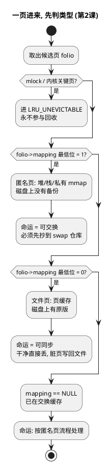
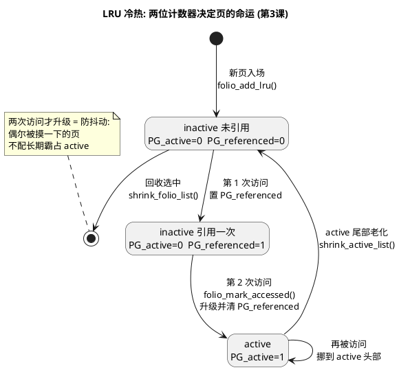
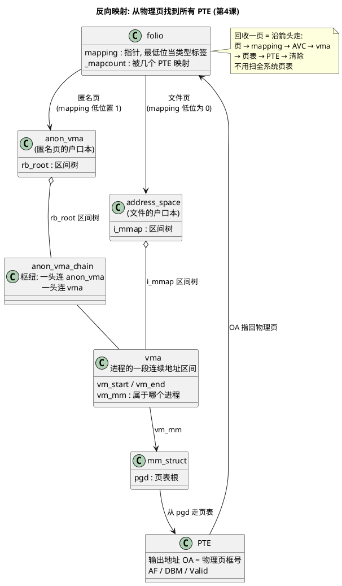
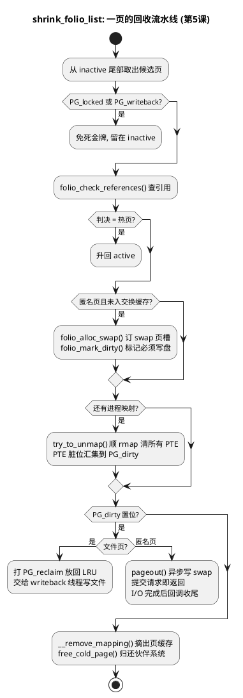
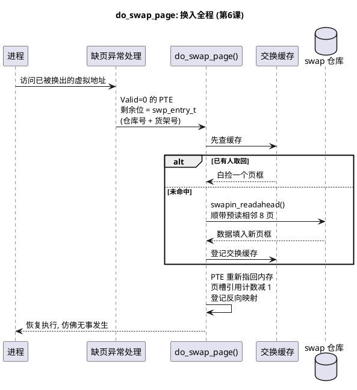
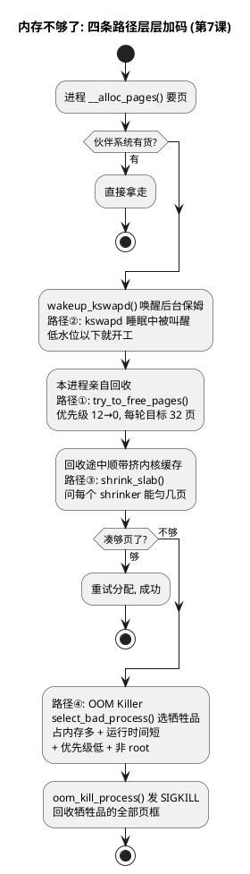
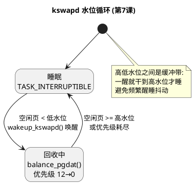

# 内核页框回收与交换 —— 小白完整教程

> 以《深入理解 Linux 内核》第三版第 17 章《回收页框》为纲，
> 全部结论均在 **Linux 主线内核 v7.2-rc7**（`~/code/linux/linux`）源码中逐条实测校验。
> PlantUML 图可粘贴到 [plantuml.com 在线渲染器](http://www.plantuml.com/plantuml) 或 VS Code PlantUML 插件查看。

---

## 第 0 课：预备知识（不懂这节，后面全懵）

### 0.1 物理内存和页框

把物理内存（内存条）想象成一排**宿舍床位**。内核把每个 4KB 的床位叫一个**页框（page frame）**。所有进程共用这排床位。

### 0.2 虚拟地址与页表

进程看到的是"虚拟地址"——像每个进程都以为自己住独栋别墅。**页表（页表项 PTE）**就是"虚拟门牌 → 真实床位"的翻译表：

```
虚拟地址 ──查页表(PTE)──→ 物理页框
```

关键：**页表不只记录地址，还有几个标志位**（这是本章的伏笔）。本文一律使用 ARM64 官方名，括号给出书中叫法便于对照：

| ARM64 标志位（缩写 · 位号） | 书中叫法 | 含义 | 本章中的作用 |
|---|---|---|---|
| **Valid**（bit[0]，与 bit[1] 合成描述符类型） | Present | 这页在不在内存里 | bits[1:0]=00 → 无效描述符，触发 Translation Fault；PTE 剩下的位存去向（swap entry） |
| **AF**（Access Flag，bit[10]） | Accessed | 最近有没有被访问过 | AF=0 表示"自上次清零以来没人碰过"，回收算法靠它判断页的冷热 |
| **DBM**（Dirty Bit Modifier，bit[51]） | Dirty | 内容有没有被改过 | 脏页必须写盘才能丢，干净页直接丢 |

注意：AF 要打开 FEAT_HAFDBS 的 HA（`TCR_EL1.HA` 置 1）才由硬件在访问时置位。没开的时候，访问 AF=0 的页会直接触发 **Access Flag Fault**，由内核缺页处理把 AF 置 1——Linux 恰好拿这个特性做访问追踪：回收扫描前清掉 AF，下次谁访问谁就会把 AF 立起来。另外，AF=0 的描述符**不能进 TLB**，所以软件改 AF 不需要 TLB 失效操作。DBM 则由内核置位（借作可写位 `PTE_WRITE`），硬件从不置它；HD 开启时硬件的写脏动作是**清 PTE_RDONLY**（bit7），不是置 DBM。

> 位号出处：ARM DDI 0487M.b **Table D8-52**（Stage 1 VMSAv8-64 Block and Page descriptor fields）。Linux 侧定义在 `arch/arm64/include/asm/pgtable-hwdef.h`：`PTE_VALID`（bit 0）、`PTE_AF`（bit 10）、`PTE_DBM`（bit 51）。

### 0.3 每个页框都有一张"身份证"

内核用 `struct folio`（旧版叫 `struct page`，书中叫**页描述符**）为每个页框记账，本章用到两个关键字段：

- **`_mapcount`**：有几个进程的页表指着这个页框
- **`mapping`**：一个指针，**最低位是类型标签**（见第 2 课）

账本和金库是两块内存：PTE 的 OA 指向的是存数据的物理页框，`struct page` 本身住在 **vmemmap 区**的大数组里，**PFN（物理页框号）就是数组下标**（`pfn_to_page(pfn) = vmemmap + pfn`）。老书的 `mem_map[]` 数组就是它的前身。

---

## 第 1 课：为什么必须回收

两个原因，书里 670–671 页讲得非常直白：

**原因一：内核分配内存时"来者不拒"。** 用户进程要内存基本都给，各种缓存（页缓存、slab）疯狂占地盘从不主动还。内存迟早被瓜分干净。

**原因二：临渴掘井会死锁。** 假设空闲页已经归零，此时内核想释放一页：

- 释放前通常得把页内容写盘
- 写盘需要 I/O 缓冲区 → 又要申请新页框
- **没有空闲页 → 无法写盘 → 无法释放页 → 死循环**

所以内核必须在耗尽**之前**主动回收，始终保持一个空闲页池。这套算法书里叫 **PFRA**（页框回收算法），现代内核散落在 `mm/vmscan.c`（近 8000 行）里。

---

## 第 2 课：抢谁的页？——先给所有页分类

回收的哲学：**有备份的便宜丢，没备份的先造备份**。按"丢掉要不要付出代价"分四类（书中表 17-1）：

| 类型 | 通俗理解 | 例子 | 丢弃代价 |
|---|---|---|---|
| **不可回收** | 公共设施，动了系统瘫痪 | 内核代码、内核栈、mlock 锁定的页 | 永不碰 |
| **可同步** | 书的复印件，图书馆有原版 | 页缓存里的文件数据 | 脏了写回文件；干净的直接丢 |
| **可交换** | 自己画的画，没有备份 | 匿名页（堆、栈） | 必须先抄到 swap 仓库 |
| **可丢弃** | 用完即弃的草稿 | 空闲 slab 对象、dentry 缓存 | 直接丢 |

**核心概念：匿名页 vs 文件页**（贯穿全章的分水岭）：

- **文件页**：内容来自磁盘文件（如程序的代码、读过的文件数据）。丢了不怕，重读文件就有。
- **匿名页**：进程运行时自己产生的数据（malloc 的堆、局部变量的栈），**磁盘上没有对应文件**。丢了数据就没了，所以必须先存到 swap。

### 分类只需要两个字段（"抠位"技巧）

看 folio 的 `_mapcount` 和 `mapping`：

- `_mapcount = -1`：没任何页表引用；`= 0`：独占；`> 0`：多进程共享
- `mapping` 指针：
  - **为空** → 在交换缓存里
  - **最低位 = 1** → 匿名页，mapping 指向 `anon_vma`
  - **最低位 = 0** → 文件页，mapping 指向文件的 `address_space`

为什么敢用最低位当标签？因为 `address_space` 在内存中 4 字节对齐，最低两位必然是 0——空出来的位白捡一个布尔量。这是内核"省字节"文化的经典体现。

### 图 1 · 一页进来，先判类型



---

## 第 3 课：抢哪一页？——LRU 链表（本书最朴素的智慧）

**假设**：很久没人访问的页，将来被访问的概率也小（程序的**局部性原理**）。

### 机制

给每类页维护两条链表，按"冷热"排队：

```
active 链表：  [刚用过的页 ... 老页]  ← 页从尾部慢慢变冷
                                    │ 降温
inactive 链表：[候选回收区 ... ]      ← 回收只从这里挑
```

- 页被访问时，硬件把 PTE 的 AF 置 1 → 内核函数 `folio_mark_accessed()`（mm/swap.c:496）看到后把页**升级到 active 头部**
- active 链表**尾部**（最老的页）会降级回 inactive——inactive 才是回收的"候选池"
- 服务器书里说的"页年龄"，就是用**页在链表里的位置**模拟的——因为没有"页年龄计数器"这种硬件，用链表位置是软件实现的折中

### 现代代码的进化：2 条 → 5 条

现代内核把"匿名/文件" × "活跃/不活跃"组成 4 条链表，外加第 5 条不可回收链表（`include/linux/mmzone.h:388`）：

```c
enum lru_list {
    LRU_INACTIVE_ANON, LRU_ACTIVE_ANON,
    LRU_INACTIVE_FILE, LRU_ACTIVE_FILE,
    LRU_UNEVICTABLE,
};
```

而且这些链表不再挂在内存管理区（zone）上，而是挂在 **lruvec** 上——为的是每个内存限制组（memcg，容器用的 cgroup）有自己独立的回收队列，容器之间互不偷页。

### 防抖动：两次访问才升级（书中 PG_referenced 规则）

日志进程每小时写一次页，如果一次访问就把它标成"热"，它会永远霸占 active。所以规则是：inactive 页**连续两次**被访问才升级（第一次只置 `PG_referenced` 标志，第二次才真正搬家）。

### 图 2 · LRU 冷热状态机



---

## 第 4 课：怎么抢走？——反向映射（本章最精巧的设计）

### 难题

回收一页 = 把**所有**指向它的页表项清掉，否则进程还在通过旧映射访问已释放的内存 → 系统崩溃。

可问题是：页框不知道谁在用它！难道扫描所有进程的所有页表？——几 GB 内存、几百个进程，扫描是天文数字。

### 解法：登记户口，而不是挨家搜查

反向映射（rmap）的思路：不记录"哪些 PTE 指向我"，而是记录"**哪些线性区（vma）包含我**"。

- vma = 进程地址空间里一段连续区域（比如"堆""代码段""mmap 的文件"），一个进程只有几十上百个 vma，比页表项少几个数量级
- 找到 vma → vma 里有进程的页表根（`mm->pgd`）→ 沿页表走到具体 PTE → 清掉

两个方向的查找结构：

- **匿名页**：`anon_vma` 结构串起所有共享它的 vma（2.6.11 用双向链表，现代内核用**区间树** `anon_vma_interval_tree`，mm/rmap.c:214，红黑树变体，查找 O(log n)）
- **文件页**：文件 `address_space` 的 `i_mmap` 树挂着所有映射该文件的 vma（书中讲的"优先搜索树"，现代实现为 `rb_root_cached` 区间树，include/linux/fs.h:478）

### 执行者：try_to_unmap

现代版本统一入口（mm/rmap.c:2394）：构造一个 `rmap_walk_control`，核心是两个回调——`.rmap_one = try_to_unmap_one`（对每个找到的 PTE 执行清除+刷 TLB）和 `.done = folio_not_mapped`（全部清完才停）。

```c
void try_to_unmap(struct folio *folio, enum ttu_flags flags)
{
    struct rmap_walk_control rwc = {
        .rmap_one = try_to_unmap_one,   // 对每个找到的PTE执行清页表
        .done = folio_not_mapped,        // 所有映射清完才停
        ...
    };
    rmap_walk(folio, &rwc);
}
```

热页的保护不在这里，在更早的判决阶段：`shrink_folio_list()` 先调 `folio_check_references()` → `folio_referenced()` → 回调 `folio_referenced_one()`（mm/rmap.c），它收割每个 PTE 的 AF 位并计数，判决为热的页根本轮不到 `try_to_unmap()`。判决在前，行刑在后。（书中把这个检查画在 try_to_unmap_one 里，现代内核已前移。）

### 书中的 try_to_unmap_one 十四步，浓缩为五步

1. 由 vma 和页偏移算出页的虚拟地址
2. 拿页表锁，定位 PTE
3. 安检：锁定区（VM_LOCKED）→ 放弃；AF 置位 → 放弃；特殊映射 → 放弃
4. 清 PTE，把换出页标识符（第 6 课）写进去，刷新 TLB
5. 各类计数器递减（_mapcount、进程的 rss 等）

### 图 3 · 反向映射数据结构



---

## 第 5 课：回收流水线——shrink_folio_list（图 17-5 的现代版）

前面所有课的机制，在这里串成一条流水线。对 inactive 链表挑出的每个候选页，依次执行（行号实测）：

```c
// mm/vmscan.c shrink_folio_list() 内部：
folio_alloc_swap(folio);    // ①匿名页在 swap 仓库订个座位 (vmscan.c:1280)
folio_mark_dirty(folio);    // ①'给匿名页打上"必须写盘"标记 (vmscan.c:1311)
try_to_unmap(folio, flags); // ②清掉所有进程的页表映射     (vmscan.c:1349)
pageout(folio, mapping,..); // ③把脏匿名页异步写入swap     (vmscan.c:1397)
```

注意脏标志的分工，ARM64 上从近到远：**PTE_RDONLY**（bit7）在硬件脏管理（HD）开启时充当硬件脏指示——干净可写页的编码是"标注可写实际只读"（`PTE_WRITE`=1 且 `PTE_RDONLY`=1，spec 称 writable-clean），首写由硬件**清掉 RDONLY** 翻成 writable-dirty；**PTE_DIRTY**（bit55，`arch/arm64/include/asm/pgtable-prot.h`）是软件脏形态——HD 没开时首写触发 Permission Fault，缺页处理置上它；**DBM**（bit51）被内核借作可写位（`PTE_WRITE` 别名），兼作硬件脏更新的候选资格；**PG_dirty** 是 folio 的页级脏标志，回收判决读的是它。PTE 级脏不脏由 `pte_dirty()` 判：两种形态的**或**（`pte_sw_dirty || pte_hw_dirty`，`arch/arm64/include/asm/pgtable.h`）。`try_to_unmap_one()` 清映射时收割：`if (pte_dirty(pteval)) folio_mark_dirty(folio)`（mm/rmap.c），脏从映射级汇集到页级（vmscan.c 注释："Normally the folio will be dirtied in unmap because its pte should be dirty"）；①' 的强制置脏是给 MADV_FREE 页兜底的特例。

**每个页只有三种结局**：

1. **回收成功** → `free_cold_page()` 归还伙伴系统（页框分配器的免费仓库）
2. **留在 inactive**（如正在写盘，下次再说）
3. **升回 active**（检查中发现它其实很热门）

**几个重要的"免死金牌"**（安检不过直接放行）：

- 锁定页（PG_locked 正在 I/O）、写回中页（PG_writeback）→ 跳过
- **写不写盘由 PG_dirty 说了算**（`folio_test_dirty()`，vmscan.c:1370），但两类脏页待遇不同：
  - 脏**文件页**：回收路径**不负责写回**（v6.19 起，commit "mm: vmscan: simplify the logic for activating dirty file folios"）——打上 PG_reclaim 标记放回 LRU，交给 writeback 子系统（flusher 线程）写盘，下轮扫描发现干净了再直接丢
  - 脏**匿名页**：`pageout()` 只是**提交**写请求就返回（`__swap_writepage` → `submit_bio`，mm/page_io.c:370），I/O 完成后回调 `end_swap_bio_write()`（page_io.c:532）收尾——回收线程绝不能被磁盘速度拖死，这是全流程异步化的原因

匿名页没有"干净"状态：走订槽路径的页在 `folio_alloc_swap()` 后紧跟 `folio_mark_dirty()`（vmscan.c:1311）强制置脏，这道判决对它必然通过。唯一免写盘的出口是 MADV_FREE 声明过"不要"且未被重新写的页（PG_swapbacked 已清），连 swap 都不进直接丢（PGLAZYFREED 计数）。

**和书中图 17-5 对照**：加交换缓存 → 解映射 → 写回的**顺序 20 年没变**，变的只是函数名（page→folio）。

### 图 4 · shrink_folio_list 回收流水线



---

## 第 6 课：匿名页的避难所——交换（swap）子系统

### 6.0 为什么必须有 swap——匿名页丢不起

第 2 课说过：匿名页在磁盘上**没有备份**，内存里这份就是唯一原件。这决定了内存不够时的处境：

- 内存不够了，但进程还活着，还会继续访问这些页
- 直接丢？进程不会收到友好报错——要么缺页后拿到一个**清零的空页**（数据悄悄消失），要么读到被复用的**垃圾数据**（静默损坏）。问题延迟爆炸，排查极难
- 干脆杀进程重开？以网络服务为例：连接全断、缓存全冷、十几 GB 的模型重新加载，重启代价极高
- swap 的答案：把冷匿名页**抄一份到磁盘**再释放内存，进程真要用时缺页异常自动取回——只是慢一点，状态一个不少

AgentENV 沙箱教程讲的是同一个思想：沙箱里跑了几小时的环境（激活的 conda、加载的十几 GB 模型、中间计算状态），直接销毁再重建代价不可接受，所以快照时把内存状态落盘、恢复时 mmap 装回。**用磁盘 I/O 换进程状态的完整保留**——swap 就是内核里这套机制的自动化版本，区别只是粒度：AgentENV 快照整台虚机的内存，swap 只搬冷页。

没有 swap 会怎样：`get_scan_count()` 里 `can_reclaim_anon_pages()`（vmscan.c:345）发现 swap 余量为 0 就走 `SCAN_FILE`（代码注释原话："If we have no swap space, do not bother scanning anon folios"）——回收器**跳过所有匿名页**，压力全部砸在文件页缓存上，文件页挤干之后来的就不是回收而是 OOM Killer。

### 6.1 仓库长什么样

- **交换区**：专门的磁盘分区或文件，最多 `MAX_SWAPFILES` 个（include/linux/swap.h:113）
- 仓库按 4KB 一格切分，每格叫**页槽**
- 第一个页槽是"仓库须知"（`swap_header`）：末尾有 10 字符魔数 `"SWAPSPACE2"`（激活时校验，mm/swapfile.c:3460），还有坏块列表——磁盘有坏块，仓库得一开张就排查

### 6.2 怎么记住页去了哪——PTE 的神来之笔

页换出后页表项不能浪费。Linux 的设计：

```
PTE = [ 页槽索引 | 交换区号 | Valid=0 ]
         高位存"我在仓库的哪个货架"
```

- Valid=0 → 描述符变无效，硬件触发 **Translation Fault**（缺页异常），进入换入流程
- PTE 剩余位 = 换出页标识符 `swp_entry_t`（区号+页槽号）→ 异常处理程序照单取货

**一个 64 位字既当"地址"又当"失踪去向登记条"**，零额外内存开销——这是全章最漂亮的设计。

### 6.3 防打架——交换缓存（swap cache）

**竞态场景**：进程 A 正把页 X 从仓库取回（换入），同时 PFRA 觉得 X 冷门要送回仓库（换出）。两人一取一存，如果操作落在**不同的页框**上，数据就乱了。

**规则**：任何换入/换出前，先查**交换缓存**——一个全局 XArray 基树（现代实现 `swapper_spaces[]`，每节点一个），登记所有"正在路上"的匿名页。并发操作发现页已在缓存中，就直接复用同一个页框 + 靠页锁（PG_locked）排队。书中图 17-8 的五个状态图讲的就是这套握手协议。

### 6.4 换入：do_swap_page（缺页异常的后半场）

进程访问一个被换出的页 → CPU 触发缺页异常 → 最终进入 `do_swap_page()`（mm/memory.c:4747）：

1. 从异常 PTE 里解析出 `swp_entry_t`
2. 先查交换缓存（可能别的路径已经取回来了，白捡）
3. 没有则**预读**：`swapin_readahead()` 不仅取目标页槽，还把**物理相邻的一串**一起取回（`max_pages = 1 << page_cluster`，默认系数 3 → 每次 8 页，mm/swap_state.c:769）——磁盘顺序读比随机读快一个数量级，赌你马上访问隔壁
4. 新页框填好数据、更新 PTE（重新指回内存）、页重新登记到反向映射

### 6.5 管理员操作

- `swapon/swapoff` 系统调用：签名 20 年未变（`SYSCALL_DEFINE2(swapon, specialfile, swap_flags)`，swapfile.c:3594）
- `swapoff` 最重：必须把仓库里**所有页全部搬回内存**才能拆仓库，即 `try_to_unuse()`（swapfile.c:2718）——要扫遍所有进程的页表替换标识符，书里讲的"神出鬼没的线性区"（反复扫描直到计数归零）依然存在

### 图 5 · 换入时序图（do_swap_page 全程）



---

## 第 7 课：什么时候回收——四条触发路径

```
路径① 直接回收（要内存的人自己动手）
   malloc/缺页 → __alloc_pages() 发现没页 → try_to_free_pages() (vmscan.c:6676)
   优先级 12→0 共 13 轮，每轮更狠（扫描量 = 页数 >> priority，位移逻辑与书一致）
   每轮目标凑够 32 页，凑够收工

路径② 后台回收（kswapd 保姆）
   每个内存节点一个 kswapd 内核线程 (vmscan.c:7399)
   空闲页 < 低水位 → 唤醒开抢 (vmscan.c:6577 wake_up_interruptible(&pgdat->kswapd_wait))
   空闲页 > 高水位 → 睡觉 (TASK_INTERRUPTIBLE)
   目的：用系统空闲时间提前干活，让路径①尽量别发生

路径③ 缓存回收（shrink_slab）
   slab/dentry 等内核缓存注册"shrinker"回调 (shrinker_register, mm/shrinker.c:749)
   内核定期挨个问："你 cache 里能匀几页吗？"

路径④ 兜底：OOM Killer
   交换区满 + 所有缓存挤干 + 13 轮回收都凑不够 32 页
   → out_of_memory() (oom_kill.c:1103) → select_bad_process() (oom_kill.c:362)
   按经验公式选"牺牲品"：占内存多、运行时间短、优先级低、非 root、非内核线程
   → oom_kill_process() (oom_kill.c:1008) 发 SIGKILL，回收它全部页框
```

**什么时候真的换出匿名页？** 不是一刀切。`get_scan_count()`（vmscan.c:2493）按 `swappiness`（默认 60，`/proc/sys/vm/swappiness`，代码 vmscan.c:199）在"扫文件链表 vs 扫匿名链表"之间配比——值越大越愿意忍受换出带来的磁盘 I/O。书中"交换倾向值公式"的现代形态就是这个函数：仍是启发式配比，只是公式重写了。

### 图 6 · 四条触发路径



### 图 7 · kswapd 水位状态机



---

## 第 8 课：全书知识地图

```
                    ┌──────────── 内存快不够了 ────────────┐
                    │  ①分配者直接回收 ②kswapd后台 ③slab  ④OOM兜底
                    ▼
      [LRU inactive 链表挑候选页] ←─ 平时由 mark_accessed 维护冷热
                    ▼
      [shrink_folio_list 流水线]
        ① 匿名页? → folio_alloc_swap 订swap页槽
        ② try_to_unmap 顺rmap清所有PTE(热页放过)
        ③ pageout 异步写盘
                    ▼
   ┌─────────────────────────────────────┐
   │ 结局A: 释放→伙伴系统                  │
   │ 结局B: 留inactive  结局C: 升active    │
   └─────────────────────────────────────┘
                    │
        进程再访问 → 缺页异常 → do_swap_page
        → 查swap缓存 → 预读邻居 → 填回页表
```

---

## 第 9 课：书（2.6.11）vs 现代内核（7.2）速查表

| 概念 | 不变 ✅ | 改名/重构 🔄 | 已消失 ❌ |
|---|---|---|---|
| 回收流程顺序 | 图 17-5 三步完全一致 | page→folio 全线更名 | — |
| LRU 冷热思想 | AF 位 + 双链表 | 2链→5链，挂在 lruvec/memcg | — |
| 反向映射 | anon_vma + vma 遍历思路 | 链表/PST→区间树 | try_to_unmap_anon/file 分立函数 |
| swap 标识符 | swp_entry_t 塞 PTE | — | — |
| swap 记账 | — | swap_map 数组→每簇 swap_table | SWAP_MAP_MAX 永久页槽 |
| 触发机制 | try_to_free_pages/kswapd/OOM | shrinker 独立成文件 | swap token、cache_reap |
| 新增（书中没有） | — | MGLRU 多代 LRU、zswap 压缩、memcg 回收、大 folio 整块换出 | — |

### 书中关键函数的现代对照

| 书中函数 (2.6.11) | 现代内核 (7.2-rc7) | 位置 |
|---|---|---|
| shrink_list() | shrink_folio_list() | mm/vmscan.c:1055 |
| shrink_zone() | shrink_node() | mm/vmscan.c:6146 |
| shrink_caches() | shrink_lruvec() | mm/vmscan.c:5876 |
| shrink_cache() | shrink_inactive_list() | mm/vmscan.c:1986 |
| page_referenced() | folio_referenced() | mm/rmap.c:1064 |
| mark_page_accessed() | folio_mark_accessed() | mm/swap.c:496 |
| add_to_swap() | folio_alloc_swap() | mm/swapfile.c:1734 |
| set_shrinker() | shrinker_register() | mm/shrinker.c:749 |
| grab_swap_token() | （无，已移除） | — |
| cache_reap() | （无，SLUB 合并后移除） | — |

---

## 学习建议

1. **先跑通概念闭环**：冷热判断（LRU）→ 找主人（rmap）→ 抢页流水线（shrink_folio_list）→ 仓库（swap）→ 取货（do_swap_page）
2. **对照读三个文件**：`mm/vmscan.c`（回收）、`mm/rmap.c`（反向映射）、`mm/swapfile.c`（交换）——文中行号可直接跳转
3. **做实验**：
   - `sudo swapoff -a` 关掉交换后再跑大内存程序，`dmesg` 观察 OOM killer 行为
   - `cat /proc/vmstat | grep -E "pswpin|pswpout"` 看换入换出计数
   - `cat /proc/sys/vm/swappiness` 查看并调整匿名/文件回收配比（默认 60）
   - `cat /proc/zoneinfo | grep -E "min|low|high"` 查看水位，对照 kswapd 触发条件
