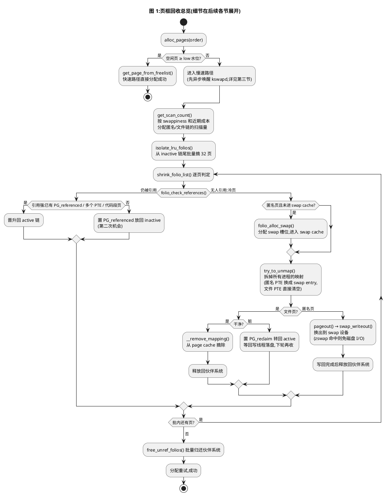
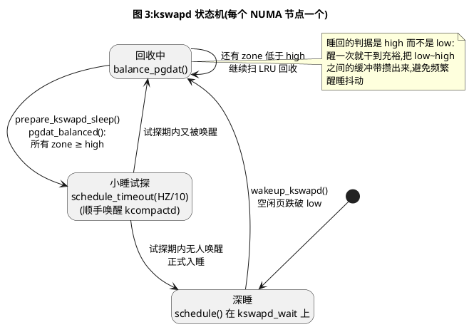
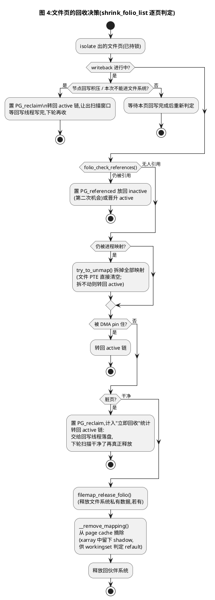
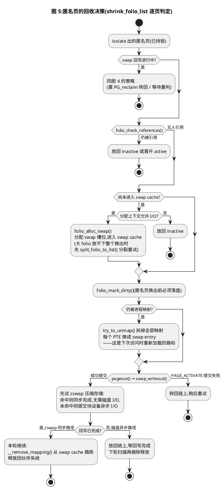
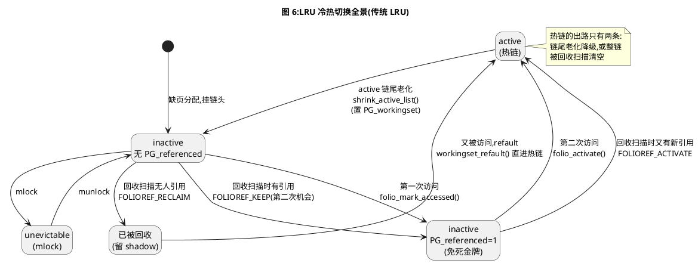

# Linux 页框回收:从 alloc_pages 到换回内存

> - 源码基准:Linux v7.3-rc5(ARM64)。文中函数名与行为均对照该版本源码核实;调用栈只列函数名,不标行号,便于跨版本对照。
> - 只讲宿主机(host)场景,不涉及虚拟化。
> - 全文以传统 LRU(active/inactive 双链)为准——本文实验配置未开启多代 LRU(MGLRU,`CONFIG_LRU_GEN`),不展开。
> - PlantUML 图可粘贴到 [plantuml.com 在线渲染器](http://www.plantuml.com/plantuml) 或 VS Code PlantUML 插件查看。

---

## 一、术语约定

| 术语 | 英文 | 一句话定义 |
|---|---|---|
| 页框 | page frame | 物理内存按 4KB 划分的分配单位,内核的"库存货物" |
| 页 / folio | `struct page` / `struct folio` | 每个页框一份软件账本;folio 是"一摞连续页"的抽象,单页 folio 与 page 等价 |
| 匿名页 | anonymous page | 没有磁盘文件作后备的页(堆、栈),回收前必须先写入 swap |
| 文件页 | file-backed page | 内容来自磁盘文件的页(代码段、page cache),磁盘上始终有副本 |
| LRU 链 | LRU list | 按"多久没被访问"给页排队:active 链放热页,inactive 链放冷页(回收目标) |
| 冷热 | active / inactive | 链头是最新放入的,链尾是最久未动的;链尾即"最冷" |
| 不可回收页 | unevictable | mlock 等锁定的页,挂 LRU_UNEVICTABLE,回收器不碰 |
| 工作集 / 重故障 | workingset / refault | 进程正在用的页集合;refault 指页刚被回收又立刻被访问——回收决策失误的信号 |
| swap / swap cache | swap / swap cache | 交换设备(分区或文件);swap cache 是换出页的中转缓存 |
| 水位线 | watermark | 每个 zone 空闲页数的三条阈值:min、low、high,判断内存紧张程度的标尺 |

两处容易踩坑的判据,先钉死:

1. **匿名页和文件页的分界是 `PG_swapbacked` 标志,不是"有没有关联文件"**。shmem/tmpfs 的页来自文件系统,但它的后备存储是 swap,`PG_swapbacked` 为 1,挂匿名侧的 LRU。
2. **swap 不等于回收**。swap 只是匿名页的处置分支;文件页的回收与 swap 无关(见第二节)。

---

## 二、触发时机:从 alloc_pages() 说起

进程要内存(fork 复制页表、缺页分配物理页、内核自身分配……),最终都落到 `alloc_pages()`,从伙伴系统(buddy allocator)领取页框。本节以这条路径展开:内存充足时它一路顺风;内存不足时,页框回收机制启动。

### 2.1 内存充足:直接分配成功

`alloc_pages()` 的快速路径只做一件事:挑一个合适的 zone,检查空闲页够不够,够就拿走:

```
alloc_pages()                      /* include/linux/gfp.h,宏 */
→ alloc_pages_noprof()
→ __alloc_pages_noprof()           /* mm/page_alloc.c */
→ __alloc_frozen_pages_noprof()
   ├─ get_page_from_freelist()     /* 快速路径:逐 zone 检查水位并分配 */
   │   └─ zone_watermark_fast()
   │       └─ __zone_watermark_ok()
   └─ __alloc_pages_slowpath()     /* 慢速路径:水位不达标才进入 */
```

快速路径的门槛是 `ALLOC_WMARK_LOW`:zone 的空闲页数不低于 low 水位线才直接分配。低于 low,说明内存已经紧张,进入慢速路径——页框回收的故事从这里开始(慢速路径内部做什么,第三节展开)。

### 2.2 回收什么:两类页,五条链

慢速路径要"腾"页框,腾的就是那些可以不要的页。所有可回收页分为两大类,分别挂在 5 条 LRU 链上:

```c
/* include/linux/mmzone.h */
enum lru_list {
	LRU_INACTIVE_ANON = LRU_BASE,			/* 匿名页,冷链 */
	LRU_ACTIVE_ANON = LRU_BASE + LRU_ACTIVE,	/* 匿名页,热链 */
	LRU_INACTIVE_FILE = LRU_BASE + LRU_FILE,	/* 文件页,冷链 */
	LRU_ACTIVE_FILE = LRU_BASE + LRU_FILE + LRU_ACTIVE, /* 文件页,热链 */
	LRU_UNEVICTABLE,				/* mlock 等不可回收页 */
};
```

链表本体挂在 `struct lruvec` 里,每个(NUMA 节点 × 内存 cgroup)组合一份:无 cgroup 时用节点自带的 `pglist_data->__lruvec`,有 cgroup 时用 cgroup 自己的。每个 cgroup 一套独立账本,容器之间互不偷页。

两类页的回收代价差别巨大:

- **文件页**:内容在磁盘上另有副本。干净文件页直接丢弃即可,**零 I/O**;脏文件页需先写回文件。
- **匿名页**:磁盘上没有副本,**没有"干净"一说**,任何匿名页回收前都必须先写入 swap 设备。

page cache 里的页就是文件页——这是系统里数量最庞大、回收最便宜的一类页。

不过,回收器并不是"先扫光文件页、冷链没有可收的了才轮到匿名页"。两类链的扫描量按比例分配,由 `get_scan_count()` 计算:swappiness(默认 60)和两类链**近期的回收成本**共同决定配额——近期 refault 多、旋转多(收它吃亏)的那条链,下次就少扫:

```c
/* mm/vmscan.c,calculate_pressure_balance() 的核心 */
ap = swappiness * (total_cost + 1) / (anon_cost + 1);
fp = (MAX_SWAPPINESS - swappiness) * (total_cost + 1) / (file_cost + 1);
```

即**每条链的扫描压力 ∝ swappiness ÷ 自身近期回收成本**。几个特殊分支:没有 swap 或本次不允许换出 → 只扫文件链;文件缓存过小(`file_is_tiny`)→ 偏向匿名链;临近 OOM(priority == 0)→ 两链等量扫;仅 cgroup 回收且 swappiness = 0 → 只扫文件链。

### 2.3 回收的执行:从链尾摘页,逐页判定

扫描量定了之后,`isolate_lru_folios()` 从 inactive 链表**尾部**批量摘取页(每批 `SWAP_CLUSTER_MAX`,32 页)——链尾是最久没有被碰过的冷页。这批页交给 `shrink_folio_list()` 流水线逐页判定:

- **被引用的页**(还热着):晋升回 active 链,或放回 inactive 再给一次机会;
- **干净文件页**:直接释放回伙伴系统;
- **脏文件页**:做标记后转回 active 链,交给回写线程(writeback)落盘,下轮扫描干净了再释放;
- **匿名页**:先拿到 swap 槽位并进入 swap cache,拆掉所有映射,换出到 swap 设备,写完才释放。



### 2.4 带着三个问题往下读

上图就是页框回收的完整骨架。后面的章节按流程中的三个关键问题展开:

- **"内存不足"的依据是什么?**——三条水位线与三条触发路径,第三节;
- **该回收哪些页?冷热怎么判定和维护?**——LRU 链、PG 标志与访问位 AF,第四节;
- **选中的页被哪些进程映射着?怎么拆干净?拆完之后再访问怎么办?**——反向映射(第五节)与重新加载(第六节)。

---

## 三、内存监控与触发:三条水位线与三条路径

### 3.1 三条水位线

内核用水位线衡量每个 zone 的内存紧张程度。三条线从上到下(图 2):

**图 2:三条水位线与两条缓冲带(ASCII)**

```
  zone 空闲页数随消耗不断下降 ──────────────────────────►

   high ─────────────────────────────  kswapd 的"干够了"线:
        │                               回收到此才肯睡
        │  ← 间距 tmp(缓冲带,防频繁醒睡抖动)
        │
   low  ─────────────────────────────  警戒线:低于此线,
        │                               分配路径唤醒 kswapd
        │  ← 间距 tmp
        │
   min  ─────────────────────────────  保命线:留给紧急/原子
        │                               分配的最后储备,慢速路径
        │                               放宽到这条线仍可分配
     0  ┴
```

三条线的数值不是拍脑袋定的(mm/page_alloc.c):

- `min_free_kbytes = int_sqrt(lowmem_kbytes × 16)`,即低区内存的 4 倍开方,钳位在 [128, 262144] KB;
- 每个 zone 的 min 按自身容量占低区总量的比例分摊;
- 间距 `tmp = max(本 zone min 水位的 1/4, managed_pages × watermark_scale_factor / 10000)`,scale 默认 10,即 zone 容量的 0.1%(可 sysctl 调整,控制缓冲带宽度);
- `low = min + tmp`,`high = low + tmp`。

三条线刻在 `zone->_watermark[]` 里,枚举为 `WMARK_MIN / WMARK_LOW / WMARK_HIGH`(v7.3 起还有第四条 `WMARK_PROMO`,供 NUMA 内存分层提升用,超出本文范围)。另有一个动态加成 `watermark_boost`:伙伴系统发生迁移类型回退、盗用整个 pageblock 时,会抬高 low 让 kswapd 提前介入(见下节)。

### 3.2 路径一:kswapd 后台回收

kswapd 是**每个 NUMA 节点一个**的内核线程(`kswapd_run(nid)`),睡在该节点的等待队列 `pgdat->kswapd_wait` 上。它是**被动唤醒**的:没有定时器,不做巡检,只有 `wakeup_kswapd()` 显式叫它才会干活。

谁会叫醒它:

1. **分配慢速路径**:每轮重试的开头 `wake_all_kswapds()`(见 3.3);
2. **伙伴系统的水位提升**:分配发生迁移类型回退、盗用整个 pageblock 时(`try_to_claim_block()`),`boost_watermark()` 抬高 low 并置 `ZONE_BOOSTED_WATERMARK` 标志;`rmqueue()` 下次分配看到该标志,调 `wakeup_kswapd()` 提前叫醒 kswapd;
3. **NUMA balancing 页迁移失败**(`migrate_misplaced_folio_prepare()`)。

`wakeup_kswapd()` 本身还会先自查一次:如果 `pgdat_balanced()` 成立(所有相关 zone 空闲页 ≥ high),说明不需要回收,就不叫 kswapd,可能转而叫 kcompactd 去做内存压缩。

kswapd 醒来后执行 `balance_pgdat()`,目标是把所有 zone 回收到 high 水位以上;干到目标才通过 `kswapd_try_to_sleep()` 睡回去——先以 `HZ/10` 的小睡试探(此时顺手叫醒 kcompactd 做压缩),期间没人再叫,才进入深睡。**high 与 low 之间的缓冲带,就是防止 kswapd 频繁醒睡的抖动抑制带。**



### 3.3 路径二:直接回收——慢速路径的兜底

快速路径失败后,`__alloc_pages_slowpath()` 接手。它的设计是**先礼后兵的两级**:先异步把 kswapd 叫起来(不阻塞自己),让它后台慢慢收;自己重试几次还失败、真等不起了,才亲自下场做同步的直接回收:

```
__alloc_pages_slowpath()               /* mm/page_alloc.c */
→ wake_all_kswapds()                   ① 异步唤醒 kswapd(不阻塞,后台回收)
→ get_page_from_freelist()             ② 放宽到 min 水位再试一次
→ __alloc_pages_direct_reclaim()       ③ 等不起:当前进程同步直接回收(阻塞)
   → __perform_reclaim()
     → try_to_free_pages()             /* mm/vmscan.c */
       → do_try_to_free_pages()
         → shrink_zones()
           → shrink_node()             ← 全部回收路径的汇聚点
→ __alloc_pages_direct_compact()       ④ 直接压缩(order-0 在 ③ 之后;
                                          THP 等大订单则先压缩后回收)
→ should_reclaim_retry()               ⑤ 回收/压缩一轮后回到 ② 再试,循环
→ __alloc_pages_may_oom()              ⑥ 实在无路可走:OOM killer
```

三个要点:

- **先后两级**:kswapd 的唤醒发生在第 ① 步,异步、不等待;直接回收是第 ③ 步的兜底,发生在当前分配进程自己的上下文里,回收耗时直接转化为这次分配的延迟。
- **直接回收路径本身不再触发 kswapd**——叫醒的动作在 ① 已经做过,③ 里没有第二次。
- ③ 的回收逻辑与 kswapd 完全相同(都汇聚到 `shrink_node()`),区别只在"谁在做、阻塞谁"。

### 3.4 路径三:主动回收,用户说了算

前两条路径都是被内存压力逼出来的;第三条是用户主动指定"收这里的内存":

| 触发方式 | 调用链 | 特点 |
|---|---|---|
| `madvise(MADV_PAGEOUT)` | `madvise_pageout()` → `madvise_cold_or_pageout_pte_range()` → `reclaim_pages()` | 用户指定地址范围;绕过 LRU 挑选,**直达 `shrink_folio_list()`** |
| 写 cgroup 的 `memory.reclaim` | `memory_reclaim()` → `user_proactive_reclaim()` → `try_to_free_mem_cgroup_pages()` → `shrink_node()` | 写"64M"就收 64M;支持附带 `swappiness=` 参数 |
| DAMON | `damon_pa_pageout()` → `reclaim_pages()` | 内核自动采样识别冷的物理地址区域,无需用户指定 |

### 3.5 三条路径对比

| | kswapd 后台回收 | 直接回收 | 主动回收 |
|---|---|---|---|
| 触发条件 | 空闲页 < low(被动) | 分配慢速路径兜底(被动) | 用户/策略显式发起 |
| 执行者 | 后台内核线程 | 当前分配进程 | 发起调用的进程 |
| 对业务的影响 | 业务无感 | 阻塞当前分配 | 阻塞调用者 |
| 挑页方式 | LRU 扫描 | LRU 扫描 | 用户指定范围 / DAMON 识别 |

无论哪条路径,最终都落到同一套回收核心:`shrink_node()`(madvise/DAMON 除外,它们直达 `shrink_folio_list()`)。回收的核心问题只剩两个:**挑谁**和**怎么放**——下一节讲挑谁。

---

## 四、LRU 链:页的排队、冷热与回收决策

第三节解决了"什么时候收",本节解决"收谁"。直觉上该收"最久没人用的页"——LRU(Least Recently Used,最近最少使用)链就是按这个原则给页排队的:最近用过的靠热端,久未使用的沉到冷端,回收从最冷处下手。

### 4.1 五条链与两个方向

五条链(见 2.2 的 `enum lru_list`)分三个维度:匿名/文件 × 热/冷,外加 unevictable。每条链都是双向链表,**链头是最新进入的,链尾是最久未动的**——新页从链头进,回收从链尾摘:

```
      inactive 链(冷,回收目标)                active 链(热)
      ┌──┬──────┬──────┬──────┬──┐          ┌──┬──────┬──────┬──┐
 链头 →│新│      │      │最老 │← 链尾   链头 →│  │      │即将老化│← 链尾
      └──┴──────┴──────┴──────┴──┘          └──┴──────┴──────┴──┘
       ▲ list_add()                  isolate_lru_folios()  ▲
       │ 新页进入(4.2)              从链尾摘冷页(2.3)      │ folio_activate() 晋升
                                                   shrink_active_list() 老化降级 ──┘
```

### 4.2 页第一次进链:缺页分配之后

页框在缺页异常里分配(分配路径就是第二节的 `alloc_pages`,水位检查发生在那里),分配成功后 folio 被挂上 LRU。**匿名页**(写缺页,以 `do_anonymous_page()` 为例):

```
handle_mm_fault()
→ __handle_mm_fault()
→ handle_pte_fault()
→ do_pte_missing()
→ do_anonymous_page()                    /* mm/memory.c */
   ├─ alloc_anon_folio()                 /* 分配页框(走第二节的路径) */
   └─ map_anon_folio_pte_pf()
        └─ map_anon_folio_pte_nopf()
             ├─ folio_add_new_anon_rmap()  /* mm/rmap.c:置 PG_swapbacked,
             │                               建反向映射(第五节) */
             └─ folio_add_lru_vma()       /* mm/folio.c */
                  └─ folio_add_lru()
                       └─ folio_batch_add_and_move()   /* 先攒进 per-CPU 批 */
                            └─ lru_add()               /* 批满或 drain 时挂链 */
                                 └─ lruvec_add_folio()
                                      ├─ folio_lru_list()   /* 决定挂哪条链 */
                                      └─ list_add()         /* 挂链头 */
```

三个细节:

- **读缺页不分配**:只读的匿名缺页直接映射共享零页(zero page),不分配页框、不挂 LRU;写缺页才真正分配。
- **出生即热**:新匿名页的 PTE 出生时 AF 位就是 1(`pte_sw_mkyoung()`),可写页的 PTE 还带脏位——"刚分配"本身就是"刚访问"。
- **挂链是批量的**:folio 先攒进 per-CPU 的 `folio_batch`,攒满(或回收前 `lru_add_drain()` 强制排空)才一次性挂链,摊薄链表锁的开销。这意味着刚分配的页可能短暂地"不在任何链上"。

**文件页**(读缺页):

```
do_read_fault()                          /* mm/memory.c */
→ __do_fault()
→ filemap_fault()                        /* mm/filemap.c */
   ├─ page cache 命中 → 直接映射已有 folio(它早已在链上,不重复挂)
   └─ 未命中 → do_sync_mmap_readahead()
        → page_cache_ra_order()          /* mm/readahead.c:预读 */
          → ra_alloc_folio()
            → filemap_add_folio()        /* mm/filemap.c */
                 ├─ __filemap_add_folio()   /* 插入页缓存 xarray;
                 │                           若替换出回收时留下的 shadow,
                 │                           调 workingset_refault() */
                 └─ folio_add_lru()         /* 后续同匿名页 */
```

文件页进入 page cache 的那一刻就挂上 LRU——page cache 里的页就是"等着被回收再用"的页。

### 4.3 挂哪条链:folio_lru_list()

首次挂链时,由 `folio_lru_list()` 一锤定音:

```c
/* include/linux/mm_inline.h(节选) */
static __always_inline enum lru_list folio_lru_list(const struct folio *folio)
{
	enum lru_list lru;

	VM_BUG_ON_FOLIO(folio_test_active(folio) && folio_test_unevictable(folio), folio);

	if (folio_test_unevictable(folio))
		return LRU_UNEVICTABLE;

	lru = folio_is_file_lru(folio) ? LRU_INACTIVE_FILE : LRU_INACTIVE_ANON;
	if (folio_test_active(folio))
		lru += LRU_ACTIVE;
	return lru;
}
```

三级判定:不可回收(mlock)→ LRU_UNEVICTABLE;否则按 `PG_swapbacked` 分匿名/文件基链;`PG_active` 再决定热冷。其中 `folio_is_file_lru()` 就是"PG_swapbacked 取反"——**判断一个页是匿名还是文件,全程只看这一个标志**。

### 4.4 进链那一刻的 PG 标志

| 标志 | 新匿名页 | 新文件页 | 说明 |
|---|---|---|---|
| PG_swapbacked | 1 | 0 | 匿名页在 `folio_add_new_anon_rmap()` 里置位;shmem 页也为 1(挂匿名侧) |
| PG_active | 0 | 0 | 新页一律进 inactive 链;唯一例外见下一行 |
| PG_referenced | 0 | 0 | 首次访问后置位(见 4.5 状态机) |
| PG_workingset | 0 | 0 | refault 页例外:`workingset_refault()` 判定为"近期刚被回收又立刻要用",直接置 PG_active 放行进 active 链(曾活跃过的再置 PG_workingset) |

refault 直进热链是重要的纠偏机制:被回收的页马上又被访问,说明上次回收决策失误,这次不再给它"从冷链重新爬起"的待遇。

### 4.5 运行中谁在改这些标志

标志不是一成不变的,内核的各种行为都在动态修改它们:

| 行为 | 函数 | 标志变化 |
|---|---|---|
| 进程访问(文件读、fault-around 等) | `folio_mark_accessed()` | 无引用 → 置 PG_referenced;已有引用 → 晋升 active |
| 回收扫描检查引用 | `folio_check_references()` | 清 PTE 的 AF 位并统计;置/清 PG_referenced |
| active 链老化 | `shrink_active_list()` | 链尾摘页:清 PG_active + 置 PG_workingset,降入 inactive |
| 回收后被再次访问 | `workingset_refault()` | 置 PG_active(直进热链),视情况置 PG_workingset |
| `madvise(MADV_COLD)` | `madvise_cold_or_pageout_pte_range()` | 清 PG_referenced、清 PTE young,强制"冷冻" |
| `mlock` | `mlock_new_folio()` | 挂 LRU_UNEVICTABLE |
| `madvise(MADV_FREE)` | `folio_mark_lazyfree()` | 清 PG_swapbacked 转挂文件冷链,变成"免费可丢"的 lazyfree 页 |
| NUMA balancing / DAMON | hinting fault / `damon_folio_mkold()` | 清 young/PG_referenced,辅助识别冷页 |

其中最核心的是 `folio_mark_accessed()` 的两段式状态机——它就是"第二次机会"的第一现场:

```c
/* mm/folio.c,folio_mark_accessed() 核心逻辑(传统 LRU 路径) */
if (!folio_test_referenced(folio)) {
	folio_set_referenced(folio);            /* 第 1 次访问:记下 PG_referenced */
} else if (!folio_test_active(folio)) {
	folio_activate(folio);                  /* 第 2 次访问:晋升 active 链 */
	folio_clear_referenced(folio);
	workingset_activation(folio);
}
```

一个冷链上的页:第一次访问只留下 PG_referenced(免死金牌);短时间内第二次访问,说明它真热,晋升热链。

### 4.6 回收时的引用检查:三选一

回收扫描扫到一个页,先问一句"最近还有人用它吗",由 `folio_check_references()` 回答。它调用 `folio_referenced()` 沿反向映射(第五节)遍历所有映射该页的 PTE:每发现一个 AF=1 的 PTE 就清掉 AF、引用数加一。然后三选一:

```c
/* mm/vmscan.c,folio_check_references() 核心逻辑 */
referenced_folio = folio_test_clear_referenced(folio);

if (referenced_ptes) {
	/*
	 * All mapped folios start out with page table references from
	 * the instantiating fault, so we need to look twice if a mapped
	 * file/anon folio is used more than once.
	 *
	 * Mark it and spare it for another trip around the inactive
	 * list.  Another page table reference will lead to its
	 * activation.
	 */
	folio_set_referenced(folio);

	if (referenced_folio || referenced_ptes > 1)
		return FOLIOREF_ACTIVATE;

	/* Activate file-backed executable folios after first usage. */
	if (is_exec_file_folio(folio, &vma_flags))
		return FOLIOREF_ACTIVATE;

	return FOLIOREF_KEEP;
}

return FOLIOREF_RECLAIM;
```

- **FOLIOREF_KEEP**:扫描期间有 PTE 引用,但这是首次(页出生时 PTE 就带引用,所以必须"看两眼")——置 PG_referenced 放回 inactive 链尾再转一圈,这就是**第二次机会**:下次扫描若又有新引用,直接晋升;
- **FOLIOREF_ACTIVATE**:引用来得更凶(上一次的 PG_referenced 还没消耗、或多个 PTE 同时引用、或代码段页 `is_exec_file_folio` 优待)——晋升 active 链,退出本轮回收;
- **FOLIOREF_RECLAIM**:无人引用,真冷页——进入处置流水线(4.7/4.8)。

热链也不是保险箱:`shrink_active_list()` 会从 active 链尾把长期不动的页降级(`folio_clear_active()` + `folio_set_workingset()`),送回 inactive 链头重新排队;被引用的可执行文件页除外(`is_exec_file_folio` 优待,代码段换进来代价高)。

### 4.7 文件页的回收决策



两个容易想当然、但源码不是这么写的点:

1. **回收路径不直接写盘脏文件页**。`pageout()` 的注释说得直白:"We no longer attempt to writeback filesystem folios here, other than tmpfs/shmem. That's taken care of in page-writeback."——回收器对脏文件页的全部动作就是置 PG_reclaim、转回 active、等回写线程。原因:回收上下文里做文件系统回写容易死锁,而且文件页脏往往意味着存储已经被连续写打满,回收器再插一脚随机写只会更糟。
2. **writeback 进行中的页也不傻等**。注释同样点明:"waiting for disk writes is more expensive than potentially causing reloads down the line"——与其阻塞等盘,不如先放回去继续扫别的冷页。

### 4.8 匿名页的回收决策



与文件页的本质区别:匿名页没有磁盘副本,**换出必须先占一个 swap 槽位(`folio_alloc_swap()`),并且把每个映射它的 PTE 替换成 swap entry**(而不是清空)——swap entry 记录了"这页内容在 swap 设备的哪里",是第六节重新加载的路标。

### 4.9 冷热切换全景

把 4.4~4.8 串成一张图——一个页在链表体系里的完整一生:



这套"冷热循环 + 第二次机会"的设计目的只有一个:**避免误杀热页导致抖动**——把正在使用的页收走,进程立刻缺页把它换回来,内存没省下多少,CPU 和 I/O 全浪费在搬运上(thrashing)。

### 4.10 访问位 AF:冷热判定的原始证据

冷热判定的证据链源头是 PTE 里的访问位 AF(Access Flag,ARM64 bit 10;x86 叫 Accessed 位):回收器靠"清掉 AF,过段时间看有没有被重新置上"来判断一个页冷不冷。

**谁清**:回收扫描,`folio_check_references()` → `folio_referenced()` → `folio_referenced_one()` → `clear_flush_young_ptes_notify()` → `ptep_test_and_clear_young()`,在 ARM64 上最终就是 `pte_mkold()` 清掉 PTE_AF。

**清掉之后再次访问,谁把它置回来**——分两种情况,取决于 CPU:

1. **CPU 实现 FEAT_HAFDBS(真机常态)**:Neoverse、鲲鹏、Apple 等现代 arm64 核都实现了这个特性。Linux(`CONFIG_ARM64_HW_AFDBM`,默认开)在 `__cpu_setup()` 里检测到 `ID_AA64MMFR1_EL1.HAFDBS` 非零,即置 `TCR_EL1.HA`。此后硬件在访问时**静默置回 AF,不触发任何异常**——行为与 x86 的 Accessed 位完全相同。Kconfig 帮助文本的原话:"accesses to pages with PTE_AF cleared will set this bit instead of raising an access flag fault"。
2. **CPU 不实现 FEAT_HAFDBS**:QEMU TCG 模拟的 vCPU、Cortex-A53/A57 等老核。此时 AF=0 的页再被访问会触发 **access flag fault**,由内核软件置回:

```
CPU 触发 access flag fault("level 3 access flag fault")
→ do_page_fault()                     /* arch/arm64/mm/fault.c */
→ handle_mm_fault()
→ handle_pte_fault()                  /* mm/memory.c,PTE present 分支 */
   ├─ entry = pte_mkyoung(entry)      /* 软件置回 AF */
   └─ ptep_set_access_flags()
        → __ptep_set_access_flags_anysz()   /* arch/arm64,cmpxchg 原子更新 */
```

实验虚机里观察到的是哪种,取决于 vCPU 暴露的 `ID_AA64MMFR1_EL1.HAFDBS`——多数 QEMU 虚机是软件路径,真机是硬件路径,两种路径对回收算法完全透明。

顺带一提,AF=0 的翻译结果不会驻留 TLB,所以软件置回路径不需要额外的 TLB 失效操作。

最后把概念对齐:AF 只是**证据采集**手段(谁访问过留痕);**第二次机会是纯软件机制**(PG_referenced 标志 + 链表位置),无论 AF 由硬件静默置位还是 fault 软件置回,都同样成立。两者正交,共同构成"不误杀热页"的防线。

---

## 五、反向映射:从物理页找到所有进程

### 5.1 问题:页表是单行道

第四节的流程走到"选中一个 folio,决定回收"之后,还有一个绕不开的问题:**这个物理页被哪些进程映射着?** folio 可以被多个进程共享(fork 之后父子进程的 PTE 指向同一个页框),回收前必须把每一处映射都拆干净——漏拆一个,进程就会顺着旧映射踩进已被复用的页框,静默读到别人的数据。

而页表只存正向映射 VA→PA,从物理页反查进程没有任何现成索引。暴力扫描所有进程的所有页表也不现实:PTE 条数是内存除以 4KB,16GB 内存就是约 400 万条。内核的解法是**登记户口,而不是挨家搜查**:给每个 folio 维护一个能找回所有相关 vma 的数据结构,这就是反向映射(reverse mapping,rmap)。

设计上分两段:

- **反向段**:folio → 相关的 vma(靠 rmap 数据结构,是本节主角);
- **正向段**:拿到 vma 后,普通的页表遍历走到具体 PTE(现算,不用记)。

反向段只到 vma、不直接记 PTE,正是省内存的关键:vma 每个进程只有几十上百个,而从 vma 到 PTE 可以用 folio 的页偏移现场推算出来。

### 5.2 匿名页:anon_vma 与 anon_vma_chain

匿名页的"户口本"是两个结构体搭起来的(定义与设计注释都在 include/linux/rmap.h):

```c
/* include/linux/rmap.h(节选) */
struct anon_vma {
	struct anon_vma *root;          /* 树根 */
	struct anon_vma *parent;        /* 父节点 */
	struct rw_semaphore rwsem;      /* 遍历/修改互斥 */
	atomic_t refcount;
	struct rb_root_cached rb_root;  /* avc 区间树:挂着所有"相关"vma */
};

struct anon_vma_chain {            /* 枢纽:两头各挂一个 */
	struct vm_area_struct *vma;     /* 一头:进程的 vma */
	struct anon_vma *anon_vma;      /* 另一头:anon_vma */
	struct list_head same_vma;      /* 把一个 vma 的所有 avc 串成链表 */
	struct rb_node rb;              /* 插进 anon_vma 的区间树 */
};
```

头部注释解释了为什么必须"绕一圈",而不是让 folio 直接指向 vma:

> Since vmas come and go as they are split and merged (particularly in mprotect), the mapping field of an anonymous page cannot point directly to a vma: instead it points to an anon_vma, on whose list the related vmas can be easily linked or unlinked.

即:**vma 会因为 mprotect/split/merge 频繁生灭,页不能直接指向这么短命的对象;anon_vma 是长寿的锚点,"相关"的 vma(由 fork 或 split 产生)动态地挂上来、摘下去。**

整体关系(图 7,以 fork 后父子共享一个匿名页为例):

**图 7:匿名页反向映射结构(ASCII)**

```
              ┌─────────────────────────────────────┐
              │   folio(父子共享的匿名页)             │
              │   mapping = anon_vma_root            │
              │             + FOLIO_MAPPING_ANON     │  ← 指针低 bit 打标,
              │   index   = 页偏移(反推 VA 用)        │    低 bit 1 = 匿名页
              └───────────────────┬─────────────────┘
                                  │ 非独占页指向最老(root)的 anon_vma
                                  ▼
                  ┌───────────────────────────┐
                  │ anon_vma_root(父进程原建)  │
                  │ root/parent 均指向自己      │
                  │ rb_root:avc 区间树         │──┐
                  └───────────────────────────┘  │ 按页偏移区间索引
                           ▲                     ▼
             ┌──────────────────┐   ┌──────────────────────┐
             │ anon_vma_B(子新建)│   │ avc_1        avc_2   │ ← 枢纽节点:
             │ parent: root     │   │ (vma_A↔root)(vma_B↔root)│  挂进区间树
             └──────────────────┘   └─────┬──────────┬─────┘
                   ▲                      ▼          ▼
        ┌──────────┴─────┐        ┌────────────┐ ┌────────────┐
        │ 子进程的新匿名页  │        │ vma_A(父)  │ │ vma_B(子)  │
        │ 挂自己新建的      │        │ →各自顺页表 │ │            │
        │ anon_vma_B       │        │   定位 PTE  │ │            │
        └─────────────────┘        └────────────┘ └────────────┘
```

fork 时刻(`dup_mmap()` → `anon_vma_fork()`,mm/mmap.c 与 mm/rmap.c)发生两件事:

1. **`anon_vma_clone()`**:给子进程的 vma 复制父辈链上所有的 avc——子 vma 由此挂到父辈每一个 anon_vma 上(上图 avc_2),父辈旧页的反向映射因此能找到子进程;
2. **新建子自己的 anon_vma**:parent 指向父的,root 共享。子进程 fork 之后**新产生**的匿名页挂子自己的 anon_vma(anon_vma_B),与父辈完全隔离。

查找一个共享匿名页的所有映射时,`rmap_walk_anon()` 从 folio 指向的 root anon_vma 出发,沿 avc 区间树(`anon_rmap_tree_foreach`)枚举所有相关 vma,再逐个走页表定位 PTE。**为什么不每个 PTE 上一条记录?** 因为从 folio 的页偏移 + vma 起始偏移可以现算出 VA,再用 vma 的 mm 走几层页表就到——存指针是浪费,现算是 O(1) 的。

### 5.3 文件页:address_space 的 i_mmap

文件页不用另建户口本,它的"归属"天然存在——页缓存(page cache)本来就按 `address_space`(每个文件一个)组织:

```
   folio(文件页)
    mapping ──────→ address_space(该文件的页缓存)
    index = 页偏移      └─ i_mmap: vma 区间树(按文件偏移区间索引)
                          ├─ vma_A(映射该文件 [偏移a, 偏移b) 的进程 A)
                          └─ vma_B(映射 [偏移c, 偏移d) 的进程 B)
```

folio->mapping 低 bit 为 0,直接指向 `address_space`;`i_mmap` 是按**文件偏移区间**组织的区间树,`__rmap_walk_file()` 用 folio 的 index 区间做一次区间查询(`mapping_rmap_tree_foreach`),所有映射该文件段的 vma 一网打尽。对比匿名侧:anon_vma 是为匿名页专门造的户口本,address_space 则是文件页"本来就有"的户口本,反向映射只是复用它。

### 5.4 拆映射的执行:try_to_unmap

定位到 vma 之后,拆映射由一条链完成:

```
try_to_unmap(folio, flags)              /* mm/rmap.c:入口 */
→ rmap_walk / rmap_walk_anon / __rmap_walk_file   /* 枚举所有相关 vma */
→ try_to_unmap_one()                    /* 对每个 vma: */
   ├─ vma_anon_address() / vma_filebacked_address()   /* 现算起始 VA */
   ├─ page_vma_mapped_walk()            /* 顺页表逐级定位 PTE */
   ├─ 匿名换出:PTE ← swap entry(留下第六节的路标)
   │  文件回收:PTE ← 清空
   └─ folio_remove_rmap_ptes()          /* 映射计数 _mapcount 递减 */
```

起始 VA 的计算:VA = vma 起始地址 +(页偏移 − vma 起始偏移)× 页大小。v7.3 把这个计算拆成了 `vma_filebacked_address()`(文件页,用文件偏移)和 `vma_anon_address()`(匿名页,用独立的匿名页偏移体系)两个函数,老版本的单一 `vma_address()` 已不存在。

`_mapcount` 从 -1 起数(0 表示一个 PTE 映射),每拆一处递减;**归回 -1(无人映射)是 folio 可以安全释放的前提**——这也是 `_mapcount`(几个 PTE 指着)与 `_refcount`(几个地方在用)分工的意义:前者管映射,后者管生命周期。

---

## 六、重新访问回收的页

第五节把映射全拆了,页框也还给了伙伴系统。最后一块拼图:进程下一次访问这些虚拟地址时,发生什么?

### 6.1 PTE 留下的路标

拆映射时,两类页留下的东西不一样:

- **匿名页**:PTE 没有被清空,而是换成了 **swap entry**——一个非有效(non-present)的条目,记录"内容在 swap 设备的哪个槽位"。这是重新加载的路标;
- **文件页**:PTE 直接清空。路标不用留——内容在磁盘文件里,VA 所属的 vma 本来就记录着"这段地址映射文件的哪个偏移"。

于是在缺页处理的总入口 `handle_pte_fault()` 里天然分叉(mm/memory.c):

```c
if (!vmf->pte)
	return do_pte_missing(vmf);      /* PTE 为空:全新缺页(或文件页重访) */

if (!pte_present(vmf->orig_pte))
	return do_swap_page(vmf);        /* 非有效:swap entry,走换入 */
```

### 6.2 匿名页换入:do_swap_page()

```
缺页异常(PTE 为 swap entry)
→ handle_pte_fault()
→ do_swap_page()                       /* mm/memory.c */
   ├─ softleaf_from_pte()              /* 从 PTE 取出 swap entry */
   ├─ get_swap_device()
   ├─ swap_cache_get_folio()           /* 第一步:查 swap cache */
   │    ├─ 命中 → 直接复用现有 folio(见 6.3)
   │    └─ 未命中 →
   │         swapin_sync()             /* zram 类同步设备:同步读入 */
   │         或 swapin_readahead()     /* 磁盘 swap:预读 */
   │           → swap_vma_readahead() / swap_cluster_readahead()
   │             → swap_cache_read_folio()
   │                ├─ swap_cache_alloc_folio()   /* 分配新页框,进 swap cache 并挂 LRU */
   │                └─ swap_read_folio()          /* 从 swap 设备读入内容 */
   ├─ folio_add_new_anon_rmap()        /* 全新换入:独占映射 */
   │  或 folio_add_anon_rmap_ptes()    /* swap cache 命中:可能非独占 */
   └─ set_ptes()                       /* 重建 PTE(带 AF) */
```

磁盘读入属于 major fault(计入 PGMAJFAULT),是换出决策的"账单"——第四节的压力平衡公式(`calculate_pressure_balance`)收集的 refault 成本,源头就是这里。

### 6.3 拿到的是新的物理页吗?

分四种情况:

| 场景 | 得到的物理页 | 机制 |
|---|---|---|
| 匿名页**首次**换入 | **新 PA** | `swap_cache_alloc_folio()` 新分配页框,内容从 swap 读入 |
| fork 的多个子进程先后访问同一个已换出的页 | **同一 PA**(首个换入的) | swap entry 被多个进程共享:第一个 fault 的进程换入新页并放进 swap cache,**folio 留在 swap cache 里**;其余子进程 fault 时 `swap_cache_get_folio()` 命中,直接映射同一个物理页(非独占)。谁要写,谁走 COW 拷贝出私有副本 |
| 文件页重访,page cache 还留着该页(比如别的进程仍映射着,或回收尚未轮到它) | **原 PA** | `filemap_fault()` 直接映射原 folio,零 I/O |
| 文件页重访,page cache 已无此页 | **新 PA** | `filemap_add_folio()` 新分配页框,从磁盘重读 |

所以答案是:**多数情况下是新的物理页**——回收本来就意味着旧页框已归还伙伴系统,可能已被别人用掉;唯一的例外是各种缓存(swap cache / page cache)恰好还留着原 folio,此时原地复用,连 I/O 都省了。

### 6.4 swap cache 的保留期

换出的 folio 会在 swap cache 里待到什么时候?由 `should_try_to_free_swap()` 决定(mm/memory.c):

- zram 类同步设备(`SWP_SYNCHRONOUS_IO`):换入后**立即删除**——读回是纯内存操作,留着无益;
- swap 占用接近满(`mem_cgroup_swap_full`,按 cgroup 或全局判定)、mlock 场景、写缺页且独占:换入后删除;
- 其余情况:保留,等 swap 引用计数归零(`folio_free_swap()` → `swap_cache_del_folio()`)。

保留的意义正是 6.3 第二行的机制:让共享同一 swap entry 的兄弟进程命中同一个物理页,避免重复 I/O。

### 6.5 回到起点

至此闭环完成,把全文串起来:

```
进程访问内存 → 缺页 → alloc_pages(第二节)
   → 水位检查(第三节):空闲充足 → 快速路径分配,缺页建映射、挂 LRU(第四节)
   → 内存紧张 → kswapd / 直接回收 → LRU 冷热判定(第四节)
   → 冷页 → 反向映射拆干净所有 PTE(第五节)
   → 文件页:干净直接丢 / 脏页等回写;匿名页:换出到 swap
   → 页框归还伙伴系统
   → 进程再次访问 → 缺页 → 从文件 / swap 重新加载(本节)→ 新的(或缓存命中的)物理页
```

内存不足的依据是水位线,挑页靠 LRU 冷热与第二次机会,拆映射靠反向映射,重新加载靠缺页机制——四问归一,这就是宿主机上页框回收的全部主线。

---


