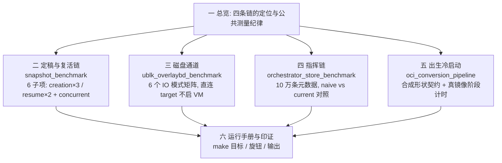
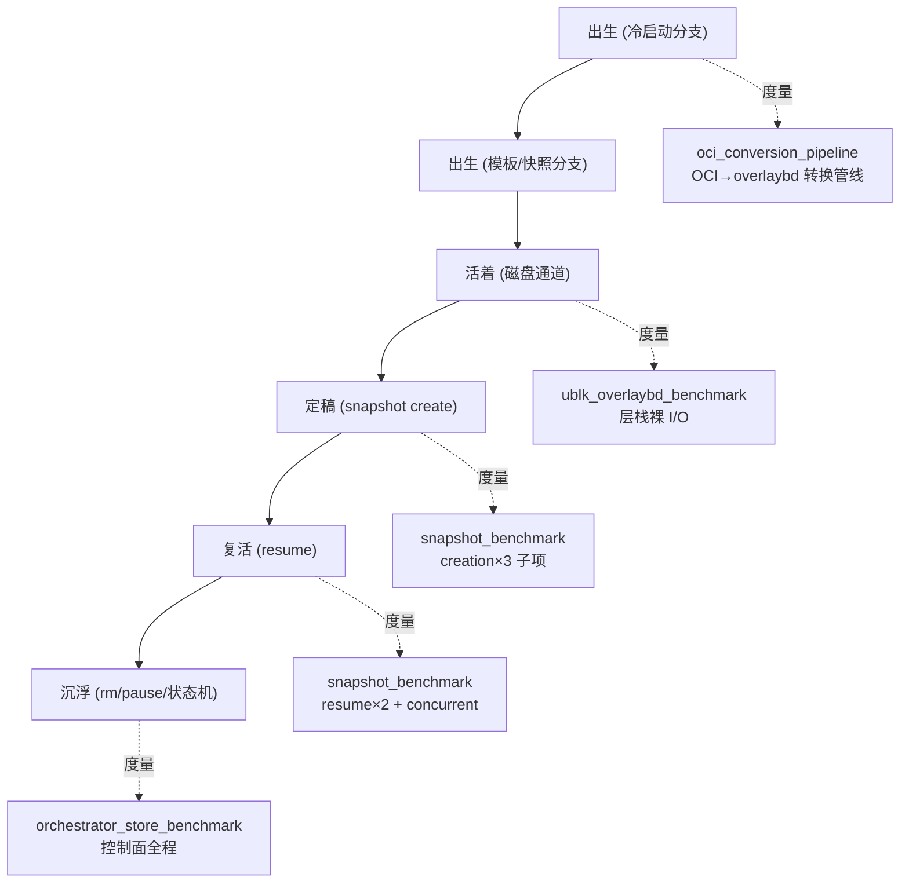

AgentENV 的性能基准集中在 `crates/benchmarks/`（Criterion 体系），四个基准文件分别压沙箱生命周期的四条链：定稿与复活（snapshot）、磁盘通道裸性能（ublk_overlaybd）、指挥链控制面（orchestrator_store）、冷启动镜像转换（oci_conversion_pipeline）。本文逐子项解析每个基准的测试内容、目的、数据口径与影响因素，全部结论来自对基准源码的逐行阅读，并与一台真实服务器的实测数据相互印证。

> **代码基线**: `crates/benchmarks/benches/` 四个文件，约 2700 行。**姊妹篇**: 沙箱机制详见《AgentENV 沙箱的一生》，本文按其生命周期主线（出生 → 活着 → 定稿 → 复活 → 沉浮）组织。文中提及的真机数据来自 192.168.64.2（`$AENV_HOME = /var/lib/aenv`，模板 `ubuntu-nodamon`）。

**图 0**：全文知识地图

## 1. 总览：四条链与公共测量纪律

**图 1**：四个基准在沙箱生命周期上的位置。

四个基准共享同一套测量哲学：**把不相关的东西全部挡在计时外**。具体有四条纪律，后面每个基准都会用到：

- **iter_custom 自定义计时**：只累计目标操作的墙钟，起沙箱、准备脏数据、`stop()`、清理等待（settle）全部排除
- **驱逐缓存**：ublk 基准每次迭代前 `posix_fadvise(FADV_DONTNEED)` 驱逐 upper.data 页缓存，snapshot 基准准备磁盘数据后 drop guest 页缓存，防止把落盘 I/O 测成内存速度
- **确定性随机**：固定随机种子预生成访问序列，跑两次结果可复现、可对比
- **校验有效 I/O**：每轮断言返回字节数等于预期，防止测到假 I/O（比如命中稀疏洞）

另一个公共设计是**双模式**（snapshot 与 ublk 两个基准共享）：默认模式是快速档（小样本、短测量，适合开发机冒烟），设置 `AENV_BENCH_FULL=1` 后切换到统计档（Criterion 完整采样、更大设备、更长测量），适合正式基准记录。

## 2. snapshot_benchmark：定稿与复活链

这是唯一起真实 microVM 的基准。测试主体直接调用 `FirecrackerSandbox::pause()`（定稿全链：暂停 vCPU + 写 vm_state + 抄脏页 + upper 封印）和 `FirecrackerSandbox::resume_from_snapshot_config()`（复活全链：层栈就位 + mmap 内存盘 + Firecracker 恢复），与生产路径零差别。

### 2.1 双模式架构

默认模式是自研的 bounded runner：每个子项跑 10 个样本，打印一行 `mean/min/max` 摘要，`AENV_BENCH_PRINT_SAMPLES=1` 可打印全部样本。`--list` 列出子项名，位置参数做子串过滤（例如 `cargo bench --bench snapshot resume` 只跑恢复类）。

`AENV_BENCH_FULL=1` 切换为 Criterion 统计采样：样本 10、预热 3s、测量 20s，产出置信区间与变化检测（与上次基线对比）。两档的清理等待也不同：默认 25ms、FULL 500ms，给异步设备销毁留时间，避免污染下一迭代。

每个子项开跑前先做一次 smoke test（完整走一遍 setup + prepare + pause + stop），环境不满足（如无 /dev/kvm）时打印 Skipping 而不是崩溃。

### 2.2 六个子项

**定稿组（creation×3）**，三档脏量形成单变量对照：

| 子项 | 准备工作 | 测量内容 | 影响因素 |
|---|---|---|---|
| `snapshot_creation` | 128MiB 内存 / 1 vCPU 沙箱，无脏数据 | 基线定稿延迟：`pause()` 全链墙钟 | guest 内存大小（KVM 位图扫描）、upper 模式、模板镜像 |
| `snapshot_creation_1gdisk` | `dd` 1GB `oflag=direct` 到 /tmp + sync + **drop_caches** | 磁盘脏量 1GB 时的定稿延迟：upper 已 1GB，封印层 rename/落盘的开销 | upper.data 体积、LSMT 索引规模、文件系统 flush |
| `snapshot_creation_1gmem` | 内存配 **1536MiB**，`dd` 1GB 到 **/dev/shm** | 内存脏量 1GB 时的定稿延迟：`process_vm_readv` 抄 1GB 脏页写成内存层 | 脏页总量（抄页字节线性）、内存层写盘、位图密度 |

两个准备函数的细节是有意设计的对照：磁盘档用 `oflag=direct` 绕过 guest 页缓存再 drop_caches，保证 1GB 真实落进 upper；内存档写到 `/dev/shm`（tmpfs），**只脏内存、零磁盘写**，与磁盘档隔离出"封印开销"和"抄页开销"两个变量。内存配 1536MiB 是让 1GB tmpfs 文件放得下且留余量。

**复活组（resume×2 + concurrent）**：

| 子项 | 实验设计 | 测量内容 | 影响因素 |
|---|---|---|---|
| `snapshot_resume_cold` | 从同一份快照反复 resume→stop，**不保活任何实例** | 冷恢复延迟：每轮 stop 后共享内存盘引用计数归零、设备销毁，下轮全冷重建 | 页缓存全冷、ublk 设备重建、Firecracker 进程冷启 |
| `snapshot_resume` | 同上，但**保活一个 warm 沙箱** | 热恢复延迟 | 共享只读内存盘常驻、页缓存复用 |
| `concurrent_resume` | warm 保活 + **50 线程 Barrier 齐射**，AtomicU64 分发总请求量 | 并发恢复的**平均单请求延迟**（各线程延迟求和后除以 50） | 50 路对同一只读内存盘的引用计数争用、设备并发注册、宿主内存带宽 |

warm/cold 是这组基准的灵魂。源码注释点明机制：**memory ublk devices are shared while at least one handle is live**。cold 组每轮 stop 后设备销毁、页缓存清空，模拟"第一个从模板启动的沙箱"；warm 组保活一个实例让共享内存盘和页缓存常驻，模拟"同模板后续沙箱"。两者的差值就是共享内存盘机制（姊妹篇 §6 复活）收益的直接量化。

**图 2**：三种恢复模式的实验设计对比。

concurrent 的两个细节：Barrier 保证 50 线程同时起跑（测的是真并发而非排队）；默认模式没有 Criterion 预热，所以先跑 1 轮 prime 预热自适应池（网络、块设备、Firecracker warm pool），再收集 10 个样本。

### 2.3 旋钮

| 环境变量 | 作用 |
|---|---|
| `AENV_BENCH_FULL=1` | Criterion 统计采样（样本 10 / 预热 3s / 测量 20s） |
| `AENV_BENCH_UPPER_MODE` | upper 写模式：`sparse` / `log` / `hybrid`（默认 log），对比三种写路径 |
| `AENV_BENCH_PRINT_SAMPLES` | 打印每个样本值 |
| 位置参数 | 子项名子串过滤，如 `resume` |

## 3. ublk_overlaybd_benchmark：磁盘通道裸性能

度量"活着"阶段磁盘通道（姊妹篇 §4：写追加 upper、读自上而下找层）的裸性能天花板。它**不起 VM、不碰内核 ublk 设备**，直接度量 overlaybd 层栈逻辑本身。

### 3.1 架构：直连 target

`BenchEnv` 在临时目录里 `prepare_runtime_upper` + `OverlaybdTarget::open` 建好层栈，然后绕过 `/dev/ublkbN`，直接构造 `ublksrv_io_desc` 调用 `target.handle_io_request()`。io_uring 配 256 SQE / 512 CQE，单线程 tokio runtime 的 park 钩子在线程休眠前自动 flush 提交队列。

这样设计排除的噪声：Firecracker 进程、virtio 转发、内核 ublk 驱动、io_uring 跨进程。剩下的就是纯粹的问题：**overlaybd 层栈（upper 追加 + LSMT 索引 + 只读层查找）本身每秒能吃多少 I/O**。

### 3.2 六个 IO 模式

| 子项 | IO 参数 | 度量什么 |
|---|---|---|
| `read_seq_1m_qd8` | 1MiB 块 × 队列深 8，顺序游标 | 大块顺序读吞吐（模板/备料读取形态） |
| `read_seq_128k_qd32` | 128KiB × 32 | 高并发顺序读 |
| `read_rand_4k_qd1` | 4K × 1 | 单路随机读延迟（最坏交互，无并行掩盖） |
| `read_rand_4k_qd64` | 4K × 64 | 4K 随机读 IOPS 上限 |
| `write_rand_4k_qd1` | 4K × 1 | 单路写延迟（进 upper 的追加路径） |
| `write_rand_4k_qd64` | 4K × 64 | 写吞吐 / IOPS |

六个模式覆盖经典存储测试矩阵的两轴（块大小 × 队列深度）加读写方向，任何一个数字异常都能定位到层栈的对应路径。

### 3.3 测量纪律：prime 与 evict

这是全文件最精彩的部分，两个函数保证了数字的真实性：

**prime_all**：读测试开始前，用 256KiB 块把整个设备写穿一遍（`prime_region` 从 0 扇区写到设备尾）。不 prime 的话，读测试读到的可能是稀疏洞（未映射区域），路径完全不同，数字虚高。

**evict_sector_cache**：每次迭代前对 upper.data 整文件执行 `posix_fadvise(FADV_DONTNEED)` 驱逐页缓存。源码注释专门解释为什么必须整文件驱逐：**overlaybd 的物理偏移由 LSMT 索引决定，不是 start_sector×512 的线性映射**，无法按扇区精确驱逐。不驱逐的话，32MiB 小设备全在页缓存里，"落盘随机读"会被测成"内存速度"。

配套纪律：固定随机种子预生成洗牌扇区序列（可复现）；写场景用 unprimed 状态（写不需要先读）；每轮 `assert_eq` 校验返回字节数等于 io_size×depth。

### 3.4 两档设备与报告

| 档位 | 设备大小 | 采样 | 用途 |
|---|---|---|---|
| 默认 | 32MiB | 10 样本 / 500ms，Flat 模式 | 开发机快跑 |
| `AENV_BENCH_FULL=1` | **1GiB** | 50 样本 / 12s | 正式基准（避免小设备缓存效应失真） |

吞吐按 `Throughput::Bytes(io_size × io_depth)` 归一为 MB/s。跑完还会把 Criterion 的 HTML 报告**重写为吞吐柱状图**（`rewrite_criterion_summary_with_bar_charts`），六个模式一图横向对比。

upper 模式旋钮与 snapshot 基准共享：`AENV_BENCH_UPPER_MODE` 切 sparse/log/hybrid，其中 sparse 无索引文件、log/hybrid 带 upper.index，可以量化索引维护对写路径的代价。

## 4. orchestrator_store_benchmark：指挥链控制面

度量 Orchestrator 元数据存储（`InMemoryMetadataStore`）在超大规模下的表现。纯内存微基准，无 VM 无设备，采样极快（默认预热 50ms / 测量 250ms）。

### 4.1 数据集设计本身就是测试内容

list 场景造 **10 万条**元数据，分布刻意模拟真实节点画像：

| 维度 | 分布 | 设计意图 |
|---|---|---|
| 状态 | 1% Running / 9% Paused / 10% 过渡态（Pausing/Resuming）/ **80% Creating** | 大量短命沙箱 + 少量常驻，模拟 AI Agent 典型负载 |
| 过期 | 0.5% 已过期 / 9.5% 有未来 deadline / 90% 无 | `list_expired` 只有 500 条命中，测稀疏扫描 |
| 元数据 | 20% 带 user_metadata | 测元数据克隆的真实成本 |

metrics 场景更狠：1000 条、每条 16 个键值、value 128 字节，把元数据克隆成本放大到可见。

### 4.2 子项矩阵

所有 list 场景都是 **NaiveStore（朴素实现：RwLock + HashMap 全表扫描过滤）vs 当前实现**成对跑，优化收益直接可读：

| 子项 | 内容与目的 | 数据口径 |
|---|---|---|
| `list_expired` naive vs current | 超时淘汰扫描（心跳名册对账同路径）：10 万条里捞 500 条过期 | `Elements(100000)`，条/秒 |
| `list_filtered_running` naive vs current | 按状态过滤列表（`GET /sandboxes` 底层），1% 命中率稀疏过滤 | 同上 |
| `update_state_if_state` success/**conflict** | 状态机 CAS：成功路径 vs 冲突路径（期望 Paused 实际 Running），量化并发 pause/resume 竞态时每个失败 CAS 的代价 | `Elements(1)`，ops/s |
| `update_if_state` success/conflict | 带闭包的整元数据 CAS，元数据克隆更大 | 同上 |
| `update` success/**not_found** | 无条件更新 vs 缺失报错（错误路径开销） | 同上 |
| `metrics_snapshot_resource_scan_1000` | `list_with_callback` 流式扫描聚合运行数/CPU/内存，即 Observability 体检员每次心跳上报的资源汇总路径 | `Elements(1000)` |

**规模论证**：Scheduler 心跳带全量沙箱名册、API 列表请求高频打到 store。这个基准证明 10 万沙箱规模下控制面仍是微秒级，不会成为集群瓶颈；CAS 冲突路径单独成项，因为沙箱状态机的并发转换（两个请求同时操作一个沙箱）在真实负载里是常态。

## 5. oci_conversion_pipeline_benchmark：出生的冷启动分支

度量 `aenv pull` / `--cold` 启动 / 模板构建的第一步：OCI 镜像转 overlaybd。分合成与真实两种模式。

### 5.1 合成基准：流水线形状契约

两个 Criterion 子项，全部用 sleep 模拟（6 层，每层下载 80ms + 应用 55ms）：

```mermaid
gantt
    title 流水线形状: 串行参照 vs 生产管线 (6 层示意, 毫秒)
    dateFormat X
    axisFormat %s ms
    section 串行参照
    下载全部层 (6×80) :d1, 0, 480
    逐层应用 (6×55) :a1, 480, 330
    section 流水线 (Semaphore=2)
    并发下载 6 层 :d2, 0, 240
    应用 1~6 (边下边转) :a2, 80, 330
```

- `synthetic_reference_no_pipeline`：串行，先下载全部 6 层再逐层应用，总耗时 6×80+6×55 = 810ms
- `synthetic_pipeline`：Semaphore(2) 并发下载 + mpsc 按完成序消费 + 逐层应用，下载与应用重叠

延迟是模拟值，所以这两个 bench **不关心绝对耗时，只关心两条曲线的比值**。它们是回归防线：谁把管线改回串行，加速比立刻塌掉。`AGENTENV_BENCH_OCI_DOWNLOAD_CONCURRENCY` 可调下载并发度，观察重叠收益的边际变化。

### 5.2 真实镜像基准：五列阶段计时

`AGENTENV_BENCH_OCI_IMAGE=<image>` 触发。文件头注释明确要求它**复刻生产后台管线**（`src/image/oci_image.rs` 的 regctl image copy 生产者），行为变更需保持同步，所以它测的是真管线的形状没有漂移。

跑 reference 和 pipeline 各一次（冷缓存，64GiB 虚拟层），输出阶段计时表：

| 列 | 含义 | 主导因素 |
|---|---|---|
| `total` | 端到端墙钟 | 全部 |
| `copy_wall` | regctl 拉层墙钟 | registry 网络带宽 |
| `wait` | 消费端等下载的空转 | 流水线衔接好坏就看它小不小 |
| `convert` | OCI→overlaybd 逐层转换 | overlaybd CLI 工具 + 磁盘 |
| `digest` | sha256 校验 | CPU + 磁盘 |

外加一行 `real-image speedup: N.NNx`。这张表能直接回答"冷启动慢在哪"：copy 大是网络、wait 大是管线退化、convert 大是工具慢。

## 6. 运行手册与实测印证

### 6.1 运行方式

| 目标 | 内容 |
|---|---|
| `make bench` | 先 `install-ublk PROFILE=release`，再跑全部基准 |
| `make bench-snapshot` | 只跑 snapshot 系列 |
| `make bench-ublk` | 只跑 ublk_overlaybd |
| `make bench-orchestrator-store` | 只跑存储状态（无需特权，纯内存） |
| `make bench-oci-conversion OCI_IMAGE=<镜像>` | 合成 + 真实镜像 |

前置条件：snapshot 与 ublk 需要 `/dev/kvm` + ublk + 特权（`scripts/run-with-capabilities.sh` 只授予 `CAP_NET_ADMIN` + `CAP_SYS_ADMIN`）；结果落 `target/criterion/`（HTML 报告）。

### 6.2 环境变量速查

| 变量 | 作用 | 适用基准 |
|---|---|---|
| `AENV_BENCH_FULL=1` | 统计档采样 + 大设备（snapshot/ublk） | snapshot, ublk, store |
| `AENV_BENCH_UPPER_MODE` | upper 写模式 sparse/log/hybrid | snapshot, ublk |
| `AENV_BENCH_PRINT_SAMPLES` | 打印全部样本 | snapshot |
| `AGENTENV_BENCH_OCI_DOWNLOAD_CONCURRENCY` | 合成管线下载并发度 | oci |
| `AGENTENV_BENCH_OCI_IMAGE` | 真实镜像模式开关 | oci |

### 6.3 与真机实测的印证

在一台真实服务器（192.168.64.2）上的生命周期实测可与基准口径对上：

- `aenv snapshot create` 实测 **0.455s**（128MiB 级沙箱、少量脏数据），对应 `snapshot_creation` 基线档
- `aenv start upper-demo`（快照恢复）实测 **1.46s**，warm pool 加持下对应 `snapshot_resume` 热档量级
- 服务器上 `ub_bench` 跑完留下的 60+ 个 `agentenv-fc-*` 工作目录，正是 `snapshot_resume`/`concurrent_resume` 每轮迭代 resume→stop 的痕迹：warm pool 补充加残留，几十轮迭代就是几十个目录

基准数字与真机体验能够互相对上，靠的正是第 1 节那四条测量纪律：计时外的东西被排除了，剩下的就是机制本身的价格。
