AgentENV 是一个快照能力优先的 AI Agent 沙箱系统：向它要一台"干净的虚拟电脑"（沙箱），在里面跑代码，还能随时存档、读档、复制。每个沙箱是一台 Firecracker 微虚拟机（microVM），系统盘由 overlaybd 分层镜像 + ublk 设备供给，因此开新沙箱、从模板恢复都接近零拷贝。

> **源码基线**: AgentENV 开源仓库（MIT），Rust workspace（`src/` + `storage/`）+ Go 控制面（`services/`）
>
> **阅读约定**: 图 0 一页总览（10 秒）→ 图 1 组件架构（2 分钟）→ 图 2 调度时序（5 分钟）→ 图 3 沙箱解剖 → 图 4 日常通路 → §8 动手敲：aenv CLI。

## 1. 一页总览

**图 0**: 四层骨架——用户 → 集群 → 节点 → 沙箱，外加快照仓库与 P2P 网络

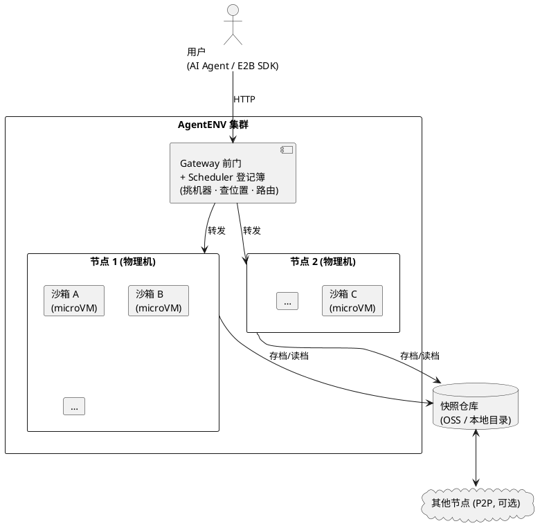

## 2. 顶层架构图

**图 1**: AgentENV 顶层架构，自上而下三层：集群层（全局一套）→ 节点层（每台物理机一个）→ guest 虚拟机内部

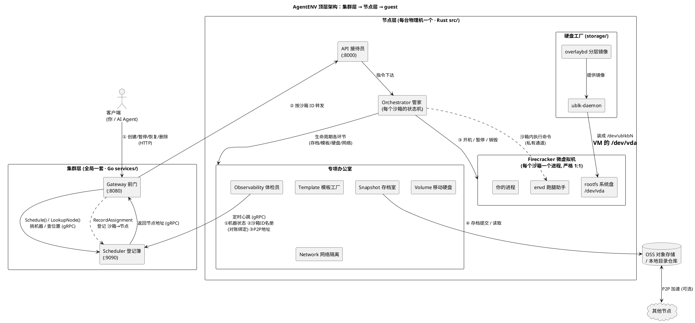

## 3. E2B 是什么角色

E2B 不是 AgentENV 里的组件，而是一个商业 AI 沙箱云服务（e2b.dev）+ 它的 SDK 生态。AgentENV 是"兼容 E2B 的自建替代品"——类比自建 MinIO 之于 AWS S3。

- **不用的**：E2B 的云服务（不租他们的服务器跑沙箱）
- **用的**：E2B 官方 SDK（Python/TS 客户端库），它本质是一个帮你发 HTTP 请求的库
- **AgentENV 自己是服务端**：用 HTTP 暴露一套"E2B 形状"的接口，让 SDK 以为自己在跟 E2B 说话

兼容体现在四处：HTTP API 接口形状（`POST /sandboxes` 等）、API key 的 `e2b_` 前缀格式、代理头（`e2b-sandbox-id` / `e2b-sandbox-port` / `e2b-traffic-access-token`）、以及 guest 内的 envd（从 E2B 开源仓库 `e2b-dev/infra` 编译而来）。效果：已有的 E2B Python/TS 代码一行不改，把 `E2B_API_URL` 指向 AgentENV 就能用。

各段通信协议一览：

| 通信段 | 协议 |
|---|---|
| 你 ↔ Gateway | HTTP（由 E2B SDK 代发，另有 WS/SSE） |
| Gateway ↔ Scheduler | gRPC |
| 节点 ↔ Scheduler（心跳） | gRPC |
| 节点 ↔ VM 内 envd | gRPC |

## 4. 组件清单

| 组件 | 所在层 | 一句话职责 |
|---|---|---|
| Gateway | 集群层 (`services/gateway/`) | 唯一对外前门，按沙箱 ID 把请求转发到对应节点 |
| Scheduler | 集群层 (`services/scheduler/`) | 登记簿：记录"沙箱 A 在节点 1"，新沙箱来了挑一台空闲机器 |
| API | 节点层 (`src/api/`) | 接待员，把 HTTP 指令翻译给管家 |
| Orchestrator | 节点层 (`src/orchestrator/`) | 管家/大脑，管每个沙箱的一生：创建→运行→暂停→恢复→销毁 |
| Snapshot | 节点层 (`src/snapshot/`) | 存档室，把运行中沙箱（内存+硬盘）拍成快照落盘 |
| Template | 节点层 (`src/template/`) | 模板工厂，预制存档，用于秒级开机 |
| Volume | 节点层 (`src/volume.rs`) | 移动硬盘，独立于沙箱生命周期，沙箱删了它还在 |
| Network | 节点层 (`src/sandbox/network/`) | 每沙箱独立网络命名空间 + 防火墙规则 |
| Observability | 节点层 (`src/observability/`) | 体检员，定时心跳上报给 Scheduler |
| overlaybd + ublk-daemon | 硬盘工厂 (`storage/`) | 把只读底层 + 可写顶层拼成虚拟磁盘，装成内核块设备 |
| Firecracker | 节点层（外部软件） | 亚马逊开源 microVM 监视器，真正"开机"的地方 |
| envd | guest 内 (`thirdparty/envd/`) | 预装在镜像里的跑腿助手，代办命令执行/文件操作 |

## 5. 调度与登记：两条路径 + 心跳对账

**图 2**: 沙箱 ID 从哪来、去哪查。Scheduler 只和 Gateway 说话（gRPC），从不直接面对用户。

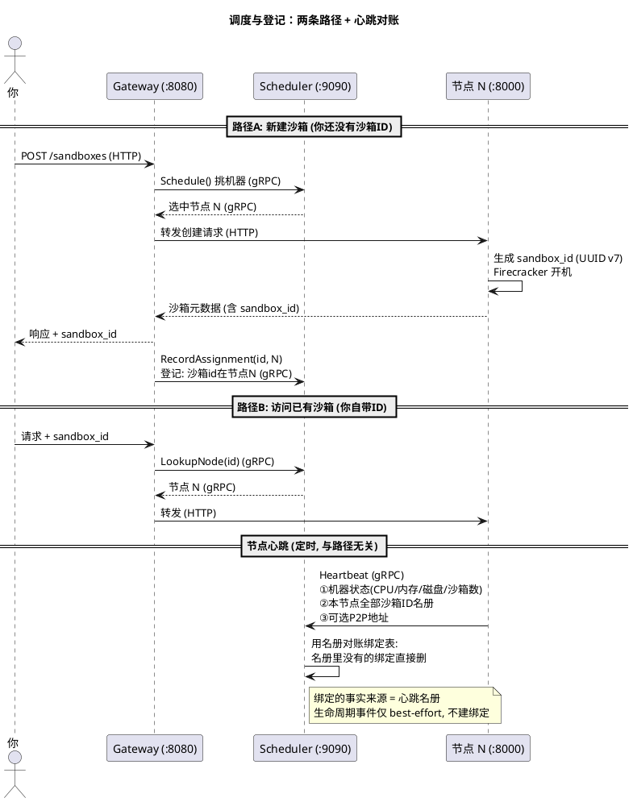

要点：

- **Schedule() 挑的是节点（机器），不是沙箱**：候选来自节点发现列表（静态配置或 K8s DaemonSet），先按心跳上报的资源余量过滤，再按策略（默认 round_robin）选一台；结果 gRPC 只回给 Gateway，用户永远只跟 Gateway 说话。
- **沙箱 ID 由节点创建时生成**（UUID v7），随创建响应经 Gateway 交到你手里；之后的请求由你自带 ID，Gateway 拿它调 `LookupNode` 查登记簿。
- **RecordAssignment 是 Gateway 的"顺手登记"**：创建成功后把 (sandbox_id, 节点 N) 写进 Scheduler 绑定表，供后续 LookupNode 使用。
- **心跳名册是绑定的事实来源**：Scheduler 收到某节点的心跳后，把名册里没有的绑定直接删除（对账）；节点上报的生命周期事件被 Scheduler 忽略，不用于建立绑定，避免乱序事件污染登记簿。

## 6. 单个沙箱解剖

### 6.1 硬盘：一块分层拼装的"三明治"

**图 3a**: VM 只看到一块系统盘，实际上是 overlaybd 把多个层叠出来的

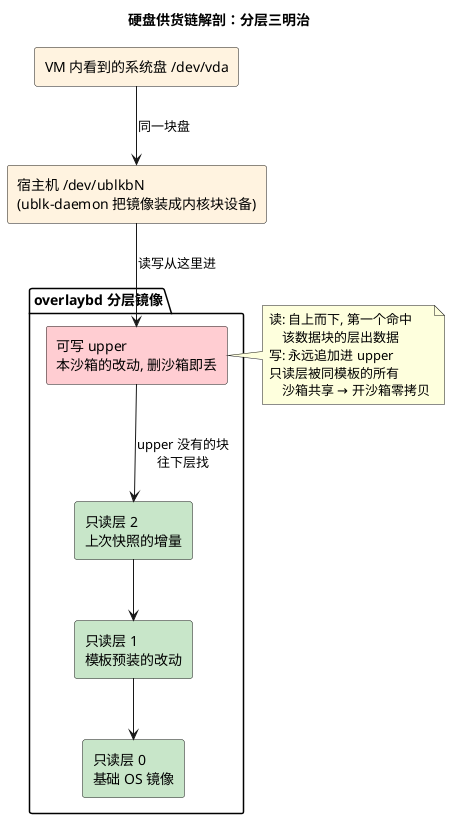

### 6.2 内存：存档/读档也走"分层"这一招

**图 3b**: 暂停时只导出被写过的页（增量层），恢复时只读 mmap、写时复制

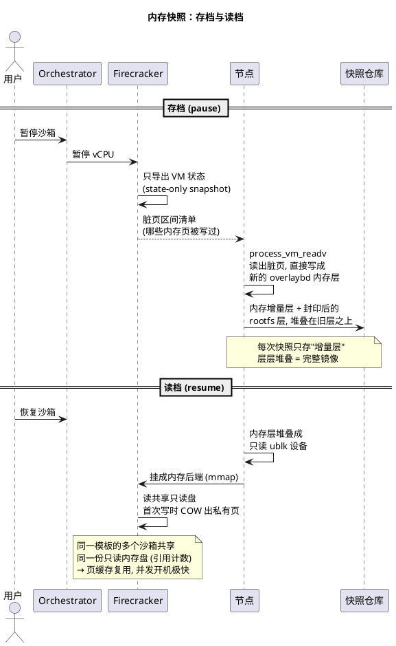

### 6.3 实证：磁盘 → 快照 → CoW → 内存标脏的组织逻辑

以下全部来自一台真实 AgentENV 服务器（192.168.64.2，`$AENV_HOME = /var/lib/aenv`，模板 `ubuntu-nodamon` = Ubuntu 22.04 底盘 + 关闭 DAMON 的定制层）的实测，路径为完整路径；代码行号来自本仓库。文中 `sha256:xxxx…` 是层的内容寻址摘要（层文件的身份证），括注的文字即该层的实际内容。

实验角色（第一轮）：沙箱 A `01a0916c-4755-7ae0-8f4d-fc33310398e4` → 快照 `upper-demo` `01a0916d-0945-7002-8868-ad9b2b08f2e1` → 沙箱 B `01a0916d-ee44-71c0-bc6a-3b90d3b2ff32`；第二轮（服务器重启后）：沙箱 C `01a09181-4a8e-7fc3-8a25-c63128049856` → 快照 `upper-demo2` `01a09182-08ed-7252-8586-72296a75310c` → 沙箱 D `01a09182-5115-7bb1-aa30-6b3074805f68`。

**实验时间线（指令 → 磁盘证据 → 代码出处）**：

| 时刻 | 完整指令 | 磁盘证据（完整路径） | 代码出处 |
|---|---|---|---|
| t0 | `aenv start ubuntu-nodamon -d --timeout 1800`（2.98s，warm pool 过户） | 新建 `/var/lib/aenv/firecracker-work/agentenv-fc-ngYwdl/overlaybd/`：image.json 声明 **lowers=2**（`sha256:c35ac8ec…` 151997440B = Ubuntu 22.04 根文件系统全量；`sha256:1cef7359…` 24576B = 模板定制：envd+工具+关 DAMON 配置），**upper.data=4096B 全新**；`user-rootfs -> /dev/ublkb0`；`rootfs.ext4 -> /var/lib/aenv/deps/tools/0.1.0/tools.ext4`（envd 工具盘，只读共享） | `materialize_overlaybd_runtime`（storage/ublk-daemon/src/runtime.rs:124）建 upper.data/upper.index |
| t1 | `aenv exec 01a0916c-… sh -c 'dd if=/dev/zero of=/root/blob bs=1M count=8 && sync'` | guest `/root/blob`=8388608B → VM `/dev/vda` = 宿主机 `/dev/ublkb0` → ublk-daemon → overlaybd → 宿主机本地文件 `upper.data` 4096→**8577024B**（完整写链见 **图 3d**） | overlaybd 写路径：写永远追加 upper，只读层不动 |
| t2 | `aenv snapshot create 01a0916c-… --name upper-demo`（**0.455s**） | ① 仓库层 7→9：`/var/lib/aenv/snapshot-store/repository/managed-layers/sha256_668fe88b….overlaybd.commit`（8585216B 封印 upper，内含 A 的全部磁盘写入如 /root/blob）+ `sha256_c2075887….overlaybd.commit`（15364096B 内存脏页层 = A 运行期被写过的内存页快照）；② 快照记录 `/var/lib/aenv/snapshot-store/repository/snapshots/01a0916d-0945-…/`：`vm_state.bin`（10879B）+ `firecracker-manifest.json`（声明 memory 1GiB / rootfs 64GiB）+ `commit`；③ 运行时 **upper 归零 4096B、lowers 2→3**，第三层 file 指向 `/var/lib/aenv/firecracker-work/managed-snapshots/01a0916c-…/…/rootfs/snapshot.commit`（本地暂存）；④ 沙箱继续 running | 六步链：`snapshot_to_dir`（src/sandbox/firecracker/sandbox.rs:969）→ `create_state_only_snapshot`（instance.rs:468）→ `get_dirty_memory_ranges`（instance.rs:480）→ `process_vm_readv` 抄脏页 → `close_seal_and_reopen` 封印（storage/overlaybd/src/image/image_file.rs:302） |
| t3 | `aenv rm 01a0916c-…` | `/var/lib/aenv/firecracker-work/managed-snapshots/` 暂存区清空，工作目录回收；仓库 9 层保留 | `PersistentSnapshotRootGuard::Drop`（src/sandbox/firecracker/config.rs:77） |
| t4 | `aenv start upper-demo -d --timeout 1800`（1.46s） | B 的 `/var/lib/aenv/firecracker-work/agentenv-fc-66UcUz/overlaybd/image.json`：**lowers=3**（第三层 `sha256:668fe88b…` 8585216B = A 的用户数据 epoch-1 封印层，改由 digest 从仓库解析），upper 4096B 全新；**`/root/blob` 8MB 完整在 B 中**（数据跟层走）；`/dev/ublkb0`（rootfs）+ `/dev/ublkb1`（内存恢复盘） | `start_resume`（sandbox.rs:1672）→ `load_snapshot_file` 以 `BackendType::File` 挂内存盘（instance.rs:523） |
| t5 | `aenv rm 01a0916d-ee44-…` | 清理完成，仓库 9 层随时可再 `aenv start upper-demo` | — |

**图 3c**: upper 封印与层栈增长（实测摘要）

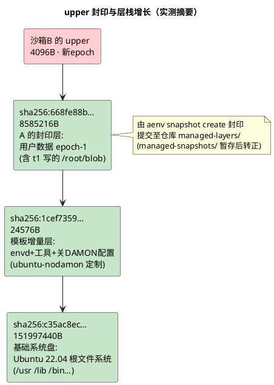

**图 3d**: 磁盘写路径——增量追加 upper，**不是 CoW**（VM 侧 / 宿主机内核态 / 宿主机用户态全程标注）

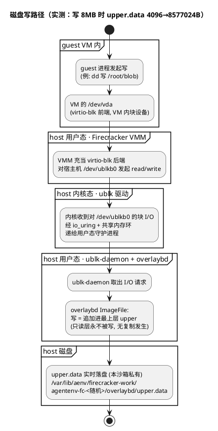

三个易混点澄清：

- **这不是 CoW**：磁盘写是"追加式增量"——新数据追加进 upper，只读层既不被写也不被复制。效果上等同"零改底层"，但机制是追加而非写时复制
- **读路径**：在 overlaybd 层栈自上而下查段映射，第一个命中该数据块的层**直接出数据**（不复制）
- **真正的 CoW 全系统只有一处**：内存恢复时 Firecracker mmap 只读内存盘，guest 首次写某页才复制该页（见图 3b 与图 3f 末段）

**图 3e**: 内存快照落盘路径——脏页从 host RAM "抄"成 overlaybd 层（`aenv snapshot create` 内部）

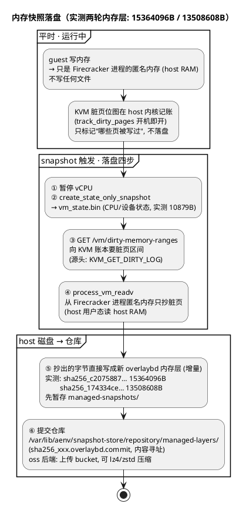

内存落盘同样**不是 CoW**——是"选择性抄页"：只抄 KVM 账本标记的脏页，页本身在 host RAM 里原地不动；复制动作发生在恢复侧（mmap 首写 COW）。

**图 3e'**: 内存恢复时的真 CoW——mmap 只读盘，首写复制私有页（全系统唯一一处 CoW）

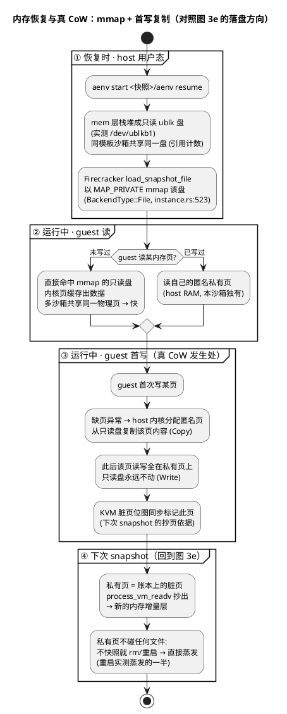

**磁盘 upper vs 内存私有页——两个世界的对等角色**（易混点终极对照）：

| | 磁盘世界 | 内存世界 |
|---|---|---|
| 只读底座 | `managed-layers/` 只读层栈（宿主机磁盘文件） | mem 层栈堆成的只读 ublk 盘（`/dev/ublkb1`） |
| **私有增量** | **upper.data**（宿主机磁盘上的层文件） | **匿名私有页**（Firecracker 进程地址空间，host RAM） |
| 写机制 | **追加**：新块追加进 upper 文件（无复制，见图 3d） | **CoW**：首写某页 → 内核复制该页为匿名页（本图） |
| 写后去哪 | 已在盘上（实时持久，节点本地） | 只在 RAM 里，**不碰任何文件** |
| 何时定稿成层 | `aenv snapshot create` → 封印成磁盘层 | `aenv snapshot create` → 抄脏页成内存层 |
| 多沙箱共享 | 只读层文件共享，upper 各自一份 | 只读盘共享（引用计数），私有页各自一份 |
| 不快照就 rm | upper 随工作目录删除 | 私有页随进程蒸发（重启实测） |

**upper.data 的位置规则**（承接 t1 证据）：

- **实物位置**：宿主机本地普通文件，路径 `/var/lib/aenv/firecracker-work/agentenv-fc-<随机后缀>/overlaybd/upper.data`；同目录还有 `upper.index`（段索引）和 `image.json`（层栈清单）
- **目录名规则**：`agentenv-fc-` + TempDir 随机后缀，**不是沙箱 ID**（src/sandbox/firecracker/config.rs:324-336）；基目录由 `[firecracker].work_dir` 配置（默认 `$AENV_HOME/firecracker-work`，不配则落系统 /tmp）
- **生命周期**：`aenv start` 创建（空 4KB）→ 随写增长 → 快照/暂停时封印转走并原地重开新 upper → `aenv rm` 随工作目录整体删除
- **本质**："正在写的层"——只属于本沙箱、只在本节点；其他节点和仓库都看不到它，直到封印提交（`aenv snapshot create`）

**补充实测：服务器重启后的持久性验证（第二轮）**

服务器重启后重新检查损伤面——仓库（永存的一半）原样幸存，运行态（易失的一半）全部蒸发：

| 检查项 | 重启后状态 |
|---|---|
| `/var/lib/aenv/snapshot-store/repository/managed-layers/` | 9 个层全在（含 `sha256_668fe88b…` 8585216B 封印层） |
| 快照记录 `upper-demo` / 模板 `ubuntu-nodamon` | 均在 |
| 工作目录 upper、`/dev/ublkb*` 设备、warm pool 进程、运行中沙箱 | 全部蒸发（aenv 服务自启后重建 warm pool） |

第二轮周期证据链：

1. `aenv start upper-demo -d --timeout 1800`（3.14s）：`/root/blob` 8388608B、**md5 `96995b58d4cbf6aaa9041b4f00c7f6ae` 与重启前完全一致**；guest 内文件时间戳仍为写入时刻 `Sep 11 17:03`（数据躺在只读层里）；层栈 lowers=3 摘要不变
2. 写 4MB `/root/after-reboot`（`dd`）：宿主机 upper.data 实时涨到 4247552B；guest 里新旧文件时间戳分界清晰（`blob` 17:03 来自层3、`after-reboot` 17:26 在 upper）
3. `aenv snapshot create 01a09181-… --name upper-demo2`（0.399s）：仓库层 **9→11**（封印层 `sha256_f9c41053…` 4255744B + 内存层 `sha256_174334ce…` 13508608B）；运行中沙箱 lowers **3→4**
4. `aenv rm C` → `aenv start upper-demo2 -d`（1.53s）：**两个 epoch 的文件同时在场**——`/root/blob`（17:03，第一代封印层）+ `/root/after-reboot`（17:26，第二代封印层），md5 校验一致；清理后仓库 11 层保留

结论：重启天然完成了一次"易失/永存分界"的实测——**沙箱（upper、内存、ublk 设备）全部蒸发，仓库（内容寻址层 + 快照记录）原样幸存**；跨重启、跨 epoch 的数据恢复链完整可用。这正是 6.5 节"仓库 = 权威档案"的实证。

**启动时加载什么：仓库三样输入 → 备料清单 → 开工清单**

回应"是不是把模板的磁盘 + 快照的磁盘 + upper 三方叠加起来启动"——不是三方叠加。启动只读取**一份定稿层清单**：启动目标快照记录里的层列表。清单在该快照创建那一刻定稿，且链式继承——模板的层早在派生快照的清单里（t4 实测：从 `upper-demo` 启动 lowers=3，即模板两层 + A 的封印层）。启动 = 按清单备料 + 顶上开一个空白 upper。

**仓库侧的三样输入**（`aenv start upper-demo` 实测解析链，posix 后端）：

```
/var/lib/aenv/snapshot-store/repository/
├── catalog/
│   ├── aliases/upper-demo                          ← ① 别名 → snapshot_id（文件内容即 ID）
│   └── records/<snapshot_id>.json                  ← ② 快照记录（物化的真正输入）
├── managed-layers/sha256_<digest>.overlaybd.commit ← ③ 层文件本体（rootfs 层与内存层混住）
└── snapshots/<snapshot_id>/
    ├── vm_state.bin                                ← CPU/设备状态（直接读，不物化）
    └── firecracker-manifest.json                   ← 尺寸/槽位元数据
```

快照记录（`catalog/records/<id>.json` 的 committed 段）是物化的真正输入，实测 `upper-demo` 的记录里有：

- `rootfs_layers`：`[c35ac8ec… 基础系统盘 151997440B, 1cef7359… 模板增量 24576B, 668fe88b… A 的封印层 8585216B]`，每项就是 digest + size
- `memory_layers`：`[140741a6… 72499200B 模板内存基线, c2075887… 15364096B A 的脏页层]`——**内存层栈与磁盘层栈同构，一样链式继承**：模板构建时抓的内存层是底座，A 的脏页层是增量
- 资源（2C/1GiB/64GiB）、上下文（env/cmd/labels）、运行时版本

三份真实清单的完整内容（`upper-demo`，逐字取自该服务器）：

**① 快照记录里的层清单**——物化的输入（`/var/lib/aenv/snapshot-store/repository/catalog/records/01a0916d-0945-….json` 的 committed 段，仅列两个字段）：

```text
{
  "rootfs_layers": [
    // 以下三项按"从底到顶"排列; 每一项只在"产生它的那次快照"里新写,
    // 之后的所有派生快照原样继承 —— 所以磁盘层只会越来越多, 永不修改
    { "Managed": { "digest": "sha256:c35ac8ec…", "size": 151997440, "uuid": "3c3d9e73-…" } },
    //            ↑ 继承: 模板构建期封印 (基础系统盘)
    { "Managed": { "digest": "sha256:1cef7359…", "size": 24576,    "uuid": "e8fd1b4b-…" } },
    //            ↑ 继承: 模板构建期封印 (模板增量)
    { "Managed": { "digest": "sha256:668fe88b…", "size": 8585216,  "uuid": "f2d69dd0-…" } }
    //            ↑ 本次新增: A 的 upper.data 封印成层, 追加在清单尾部
  ],
  "memory_layers": [
    // 与 rootfs_layers 同构: 继承旧层 + 追加本次脏页层
    { "digest": "sha256:140741a6…", "size": 72499200 },
    //          ↑ 继承: 模板构建时抓的内存基线
    { "digest": "sha256:c2075887…", "size": 15364096 }
    //          ↑ 本次新增: A 的脏页字节抄出成层
  ]
}
```

**② 备料清单（rootfs）**——resolver 的产物（`/var/lib/aenv/snapshot-local-cache/runtime/01a0916d-0945-…/rootfs/image.json`）：

```text
{
  "repoBlobUrl": "",
  "lowers": [
    {
      "file": "/var/lib/aenv/snapshot-store/repository/managed-layers/sha256_c35ac8ec….overlaybd.commit",
      "digest": "sha256:c35ac8ec…c51350caa1d7eab840c6efe4", "size": 151997440, "uuid": "3c3d9e73-…"
    },
    {
      "file": "/var/lib/aenv/snapshot-store/repository/managed-layers/sha256_1cef7359….overlaybd.commit",
      "digest": "sha256:1cef7359…8cbb19cd3c5d93809fb992f22", "size": 24576, "uuid": "e8fd1b4b-…"
    },
    {
      "file": "/var/lib/aenv/snapshot-store/repository/managed-layers/sha256_668fe88b….overlaybd.commit",
      "digest": "sha256:668fe88b…6b13f206854f0ea", "size": 8585216, "uuid": "f2d69dd0-…"
    }
  ],
  "upper": { "index": "", "data": "", "target": "", "gzipIndex": "" }
}
```

**③ 备料清单（memory）**——同一目录下 `memory/image.json`：

```text
{
  "repoBlobUrl": "",
  "lowers": [
    {
      "file": "/var/lib/aenv/snapshot-store/repository/managed-layers/sha256_140741a6….overlaybd.commit",
      "digest": "sha256:140741a6…1f53e0e7ad79bcf2c2d445a6", "size": 72499200
    },
    {
      "file": "/var/lib/aenv/snapshot-store/repository/managed-layers/sha256_c2075887….overlaybd.commit",
      "digest": "sha256:c2075887…c17a4e9be396ff9e3", "size": 15364096
    }
  ],
  "upper": { "index": "", "data": "", "target": "", "gzipIndex": "" }
}
```

三个一目了然的对照点：记录里只有 digest+size（"要什么"），备料清单把 digest 解析成 `managed-layers/` 绝对路径（"在哪拿"，posix 原地引用）；备料清单的 `upper` 字段**全是空串**——备料阶段不含任何可写层，upper 要等开工时 ublk-daemon 新建并填进开工清单（对照 t4 实测：开工清单 `work_dir/overlaybd/image.json` 里 upper 指向 `./upper.data` 且 lowers 已就位）；rootfs 与 memory 两份备料清单形状完全同构，只是层内容不同。

**清单怎么长出来的（追加机制，第三轮快照 upper-demo3 实测）**：`aenv snapshot create` 时，upper.data 被封印成层文件、其 digest+size **追加到 rootfs_layers 尾部**；脏页字节抄出成内存层、**追加到 memory_layers 尾部**——新清单 = 旧清单原样复制 + 两条各追加一项。实测 upper-demo3 的记录：

```text
rootfs_layers = [c35ac8ec 基础系统盘, 1cef7359 模板增量, 668fe88b A的封印层,
                 734183eb 8192B]    ← 新增: epoch-3 封印层(追加在尾)
memory_layers = [140741a6 模板内存基线, c2075887 A的脏页层,
                 41f13357 2793472B] ← 新增: epoch-3 脏页层(追加在尾)
```

两个新层的大小是个教学彩蛋：epoch-3 沙箱**没写任何文件**，rootfs 封印层只有 8192B（空 upper，仅格式元数据），内存脏页层却有 2793472B（guest 光是运行就弄脏了 2.79MB 内存）——磁盘通道与内存通道的独立性，连"什么都不做"的场景都分得清清楚楚。

**图 3f**: 启动时层栈的组装——解析、备料、开工三段

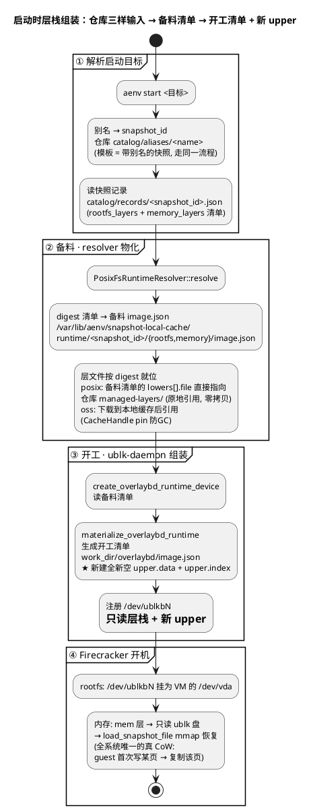

**两级清单的分工**：备料清单（`snapshot-local-cache/runtime/<snapshot_id>/`，按快照 ID 缓存，同一快照重复启动直接命中）只回答"层在哪"；开工清单（每个沙箱工作目录一份，由 `materialize_overlaybd_runtime` 生成）在备料清单之上**多出新 upper 一栏**，是这台沙箱实际打开的层栈。两级都只是 JSON 清单，层文件本体从不复制。

**三种启动方式的差异**：

| 启动方式 | 层清单来源 | 清单内容（实测） | upper | 内存 |
|---|---|---|---|---|
| `aenv start ubuntu-nodamon` | 模板快照记录 | `[基础系统盘, 模板增量]` + 模板内存基线 | 全新空 | mmap（真 CoW） |
| `aenv start upper-demo` | 该快照记录 | `[基础, 模板增量, A封印层]` + `[模板内存, A脏页]` | 全新空 | 同上 |
| `aenv resume`（Paused 沙箱） | **不走仓库**，直接用 `/var/lib/aenv/persisted-sandboxes/` 的暂停工件 | 暂停时封存的层 | 全新空 | 同上 |
| `aenv start --cold <镜像>` | OCI 镜像转换现场生成 | 转换出的层 | 全新空 | 无（正常开机） |

**只读层是什么、谁在共享**（备料备的就是它们）：

| 实测只读层（t4 沙箱 B 的 lowers=3） | 内容是什么 | 大小 | 来源（怎么成为只读层的） |
|---|---|---|---|
| `sha256:c35ac8ec…` | **Ubuntu 22.04 基础系统盘**：根文件系统全量（/usr /lib /bin…），模板 `ubuntu-nodamon` 的最底层 | 151997440B | 模板构建：基础 OS 镜像（OCI 转换/`aenv build`），构建期定稿 |
| `sha256:1cef7359…` | **模板定制改动**：在基础系统上装的东西（envd 助手、guest 内工具、关闭 DAMON 的配置等），只有零星几个数据块 | 24576B | 模板构建：模板增量（装包/配置改动），构建期封印定稿 |
| `sha256:668fe88b…` | **用户数据 epoch-1**：沙箱 A 运行期的全部磁盘写入（t1 的 8MB `/root/blob` 的**字节内容**就躺在层里——是状态快照，不是写操作记录） | 8585216B | 沙箱运行期：A 的 upper 被 `aenv snapshot create` 封印转正 |

- **共享语义（零拷贝开机的关键）**：启动不复制任何只读层——同一份层文件被同节点所有引用它的沙箱同时打开；同 digest 层在仓库里永远只有一份
- **谁产生只读层**：只有两条路——`aenv build`（模板构建定稿）和 `aenv snapshot create`（运行中 upper 封印转正）；运行中的 upper 永远不是只读层，直到被封印
- **堆叠方向**：清单里 lowers[0] 是最底层（基础镜像），越往后越新；新 upper 盖在整个栈顶

实测对应：t0 模板启动 lowers=2；t4 从 `upper-demo` 启动 lowers=3；第二轮从 `upper-demo2` 启动 lowers=4——清单随每代快照累积。

### 6.4 四个机制如何咬合

1. **磁盘写 = 只追加 upper**。VM 以为自己在写一块普通磁盘（/dev/vda = /dev/ublkbN），实际所有写经 ublk-daemon 追加进本沙箱的 upper.data；读自上而下找第一个命中的层。t1 的 4096B→8577024B 就是证据。
2. **快照 = 一次封印 + 两层产物**。`aenv snapshot create` 内部六步：暂停 vCPU → 写 vm_state.bin → 要脏页账本 → 抄脏页成内存层 → upper rename 成只读层（封印）→ 重开新 upper 并继续运行。产物成对出现：rootfs 封印层（8585216B）+ 内存脏页层（15364096B），连同 vm_state.bin/manifest 一起提交仓库。
3. **内存标脏 = KVM 记账，不是落盘**。开机即开 `track_dirty_pages`（src/sandbox/firecracker/config.rs:193 默认 true），脏页位图待在内核内存里；只有快照那一刻才被 `GET /vm/dirty-memory-ranges` 查询，`process_vm_readv` 只抄脏页 → 内存层是增量的。
4. **恢复 = mmap + CoW**。内存层堆成只读 ublk 盘（实测 /dev/ublkb1），Firecracker 以 `BackendType::File` mmap 它；guest 首次写某页才 COW 出私有匿名页（全流程见图 3e'）。同模板多个沙箱共享同一只读内存盘（引用计数），页缓存复用。

**指令 ↔ 机制时机表**：

| 指令 | 磁盘层 | 内存层 | 沙箱状态 |
|---|---|---|---|
| `aenv start` | 新 upper | （快照启动时）mmap 只读盘 | Running |
| 运行中写盘/写内存 | 追加 upper | 只进 host RAM，不落盘 | Running |
| `aenv snapshot create` | 封印+提交仓库 | 脏页抄出+提交仓库 | 继续运行 |
| `aenv pause` | 封印+存本地 persisted-sandboxes/ | 同左 | 释放资源 |
| `aenv resume` | 新 upper | mmap+COW | Running |
| `aenv rm` | upper 蒸发，工作目录清理 | 蒸发 | 消失 |
| server Ctrl+C | 全部走 pause 路径 | 同左 | Paused |

### 6.5 节点目录层级总览与快照仓库（posix_fs vs oss）

实测服务器配置 `repository_backend = "posix_fs"`，仓库就在本机。`$AENV_HOME` 全量目录树如下（逐项实测注释，标注与本文各图的对应关系）：

```text
/var/lib/aenv/                                        <- $AENV_HOME（节点状态根，config 可改）
|
|-- config/
|   \-- config.toml                                   <- 节点配置（repository_backend、work_dir、超时等）
|-- secrets/
|   |-- api-key                                       <- API key（e2b_ 前缀格式，E2B SDK 用它认证）
|   \-- sandbox-access-token-hash-seed                <- 沙箱访问令牌的哈希种子
|
|-- deps/                                             <- 服务自管的外部资产（启动时下载）
|   |-- firecracker/1.15.1-patch-v1/firecracker       <- Firecracker VMM 二进制（每沙箱一个进程，Q3）
|   |-- kernel/vmlinux-6.1.175                        <- guest 内核
|   |-- tools/0.1.0/tools.ext4                        <- envd 工具盘（rootfs.ext4 符号链接指向它，只读共享）
|   |-- regctl/v0.11.5/regctl                         <- OCI registry 客户端（冷启动/镜像发布用）
|   \-- overlaybd/bin/overlaybd-{commit,apply,...}    <- overlaybd CLI 工具（封印/应用/扩容；
|                                                      etc/overlaybd/ 下另附其配置)
|
|-- ublk/
|   \-- uvm-ublk-daemon                               <- ublk 守护进程二进制（图 1"硬盘工厂"的常驻进程）
|-- overlaybd/                                        <- ublk-daemon 引用的全局配置目录
|   |                                                  （[ublk].overlaybd.global_config_path 指向此处）
|   |-- overlaybd-global.json                         <- rootfs 层栈全局配置（实测 775B）
|   |-- mem-overlaybd-global.json                     <- 内存层栈专属全局配置（实测 770B，内存盘独立调参）
|   |-- convert-overlaybd-global.json                 <- 镜像转换用全局配置（实测 776B）
|   \-- overlaybd.log                                 <- 层栈操作日志（实测 4118B）
|-- logs/
|   |-- serial/<sandbox_id>/firecracker-std{out,err}.log <- 每沙箱串口日志（按沙箱 ID 归档）
|   \-- ublk-daemon.log
|
|-- firecracker-work/                                 <- 沙箱工作区（[firecracker].work_dir）
|   |-- agentenv-fc-<随机>/                            <- 一个沙箱（TempDir 随机名，非沙箱 ID）
|   |   |                                               （实测：t0/t1 沙箱 A = agentenv-fc-ngYwdl，
|   |   |                                                 t4 沙箱 B = agentenv-fc-66UcUz，
|   |   |                                                 重启后沙箱 C = agentenv-fc-6uz9FK）
|   |   |-- firecracker.socket                        <- FC API 控制通道（节点指挥这台 VM 的"方向盘"）
|   |   |-- overlaybd/                                <- 开工清单 + 私有增量（图 3d / 图 3f）
|   |   |   |-- image.json                            <-   开工清单：lowers + 新 upper（图 3f 步骤3；
|   |   |                                             |    实测 t2 前后 lowers 2->3、1129B->1633B）
|   |   |   |-- upper.data / upper.index              <-   可写 upper（磁盘写的唯一去处，实时落盘；
|   |   |                                             |    实测写 8MB 前后 4096B->8577024B）
|   |   |   \-- result.txt
|   |   |-- user-rootfs -> /dev/ublkbN                <- VM 系统盘 = 内核 ublk 块设备
|   |   |-- rootfs.ext4 -> deps/tools/0.1.0/tools.ext4 <- envd 工具盘挂载点
|   |   \-- agentenv_volume_slot_*.img                <- 卷槽位占位盘（实测 4 个预留槽）
|   \-- managed-snapshots/<sandbox_id>/<捕获ID>/rootfs/snapshot.commit
|                                                     <- 封印层暂存（图 3c 注：发布后 Drop 自动清理）
|                                                     （实测：managed-snapshots/01a0916c-4755-…/
|                                                       01a0916d-0879-…/rootfs/snapshot.commit，
|                                                       即 t2 时运行时清单新增第三层的 file 指向）
|
|-- image-cache/                                      <- OCI 镜像层缓存（aenv pull / 冷启动 / 模板构建）
|   |-- commits/sha256-c35ac8ec….commit              <- 镜像层文件（模板构建的基础系统盘原始来源；
|   |                                                  与仓库 managed-layers/ 同 digest 但独立存放）
|   |-- configs/                                      <- 镜像的 image.json + metadata
|   |-- indexes/                                      <- 层索引
|   |-- metadata/                                     <- RocksDB 元数据（.log/.sst 文件）
|   \-- convert-blocks/                               <- OCI→overlaybd 转换的块缓存
|
|-- snapshot-local-cache/
|   \-- runtime/<snapshot_id>/                       <-（实测 runtime/01a0916d-0945-…/ 即 upper-demo，
|       |                                                 runtime/01a09117-cd5f-…/ 即模板）
|       |-- rootfs/image.json                         <- 备料清单 rootfs（digest→仓库路径，图 3f 步骤2）
|       \-- memory/image.json                         <- 备料清单 memory（同构，层栈链式继承）
|
|-- snapshot-store/                                   <- posix 快照仓库（权威档案，重启幸存的那一半）
|   \-- repository/
|       |-- catalog/
|       |   |-- aliases/upper-demo                    <- 别名 -> snapshot_id（实测文件内容 =
|       |   |                                             01a0916d-0945-7002-8868-ad9b2b08f2e1；
|       |   |                                             另有 upper-demo2 与模板别名 ubuntu-nodamon）
|       |   \-- records/01a0916d-0945-….json          <- 快照记录：rootfs_layers + memory_layers（1号清单）
|       |-- managed-layers/                           <- 内容寻址层文件（rootfs 层与内存层混住，去重共享）
|       |   |-- sha256_c35ac8ec….overlaybd.commit     <- Ubuntu 22.04 基础系统盘 151997440B
|       |   |-- sha256_1cef7359….overlaybd.commit     <- 模板增量（envd+工具+关DAMON） 24576B
|       |   |-- sha256_668fe88b….overlaybd.commit     <- A 的封印层（含 /root/blob） 8585216B
|       |   |-- sha256_140741a6….overlaybd.commit     <- 模板内存基线 72499200B
|       |   |-- sha256_c2075887….overlaybd.commit     <- A 的内存脏页层 15364096B
|       |   |-- sha256_f9c41053….overlaybd.commit     <- C 的封印层（after-reboot） 4255744B
|       |   |-- sha256_174334ce….overlaybd.commit     <- C 的内存脏页层 13508608B
|       |   \-- …（实测共 11 层，含模板构建期旧层）
|       |-- snapshots/<snapshot_id>/                 <-（实测 01a0916d-0945-…/ 即 upper-demo）
|       |   |-- vm_state.bin                          <- CPU/设备状态（快照三件套之一，实测 10879B）
|       |   |-- firecracker-manifest.json             <- 尺寸/槽位元数据（声明 memory 1GiB / rootfs 64GiB）
|       |   \-- commit                                <- 提交标记
|       \-- volumes/{records,aliases}/                <- 卷的记录与别名（与 catalog 同构）
|
\-- persisted-sandboxes/                              <- aenv pause 的本地存档（不走仓库，见图 2 差异表）
    |-- records.db
    \-- artifacts/<sandbox_id>/
```

guest 侧路径对照（VM 内看到的，与宿主机实体一一对应）：

```text
guest (VM 内)                        <- 对应的宿主机实体
/  (根文件系统, 即 /dev/vda)         <- /dev/ublkbN = 只读层栈(managed-layers/) + upper.data
/root/blob                           <- 实测 t1 写入 8388608B, md5 96995b58d4cbf6aaa9041b4f00c7f6ae;
                                        字节落在 agentenv-fc-ngYwdl/overlaybd/upper.data,
                                        t2 封印后进 managed-layers/sha256_668fe88b…（epoch-1）
/root/after-reboot                   <- 实测第二轮写入 4194304B; 封印进 sha256_f9c41053…（epoch-2）
/tools (envd 工具盘)                 <- deps/tools/0.1.0/tools.ext4（只读, 各沙箱共享）
```

设备侧（不属于 `$AENV_HOME`，但属于同一体系）：

```text
/dev/
|-- ublk-control                                     <- 全局管理入口（daemon 经它注册/删除设备）
|-- ublkcN                                           <- daemon 侧 I/O 入口（字符设备，c=char）
\-- ublkbN                                           <- 内核侧块设备出口（b=block；实测 ublkb0=rootfs、ublkb1=内存恢复盘）
```

按生命周期归组（与全文实测对齐）：

- **易失（沙箱存活期间）**：`firecracker-work/agentenv-fc-*/`（开工清单 + upper）、`/dev/ublkb*`、`logs/serial/<id>/`——`aenv rm` 或重启即清
- **暂存（发布后自动清）**：`firecracker-work/managed-snapshots/`（PersistentSnapshotRootGuard::Drop）
- **缓存（GC 管理 + 引用保护）**：`image-cache/`、`snapshot-local-cache/`（备料清单按快照 ID 复用，同快照重复启动直接命中）
- **持久（直到显式删除）**：`snapshot-store/repository/`（posix 后端）、`persisted-sandboxes/`（到 resume/删除）
- **资产（服务自管，基本不变）**：`deps/`、`ublk/`、`overlaybd/`、`secrets/`、`config/`

**oss 后端的差异**（`repository_backend = "oss"`，多节点部署推荐）：

| 维度 | posix_fs（本机实测） | oss |
|---|---|---|
| 仓库位置 | 本地/共享目录 | S3 兼容 bucket（配 endpoint/bucket/region/凭证） |
| 访问协议 | 本地文件 IO | S3/HTTPS（opendal，src/snapshot/repository/backends/oss/client.rs:12） |
| 多节点共享 | 仅当目录在共享盘 | 天然全集群共享（节点 A 存档、节点 B 恢复） |
| 上传压缩 | 无（本地层保持 raw） | lz4/zstd 一次性压缩（`[snapshot.publish_compression]`） |
| 跨节点加速 | 无需 | P2P（iroh）可选，Scheduler 只帮忙发现 peer |

两种后端的共同点：**Gateway/Scheduler 都不碰仓库**，只有节点自己读写；层的身份统一是内容寻址（sha256 摘要），同层只存一份。

一句话总结层的一生：**仓库（权威档案，内容寻址去重）← managed-snapshots（暂存）/ 本地缓存（工作副本）← 运行时 upper（正在写）**——把"正在写的"变成"定稿档案"的唯一通道就是 `aenv snapshot create`。

## 7. 日常通路

**图 4**: 你实际用沙箱的两条通路，以及"沙箱睡着了会自动叫醒"

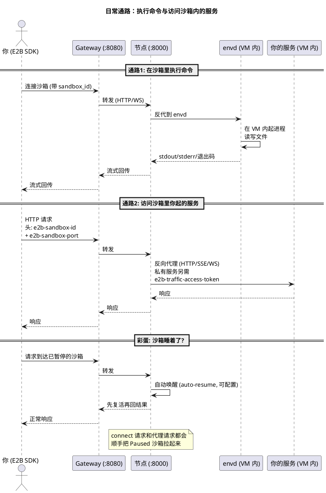

要点：

- **执行命令**：SDK 的进程交互（WebSocket）经节点反代进入 envd，envd 在 VM 内代办，结果流式回传。
- **访问沙箱内服务**：请求头 `e2b-sandbox-id` 指定沙箱、`e2b-sandbox-port` 指定端口；也可用 `{port}-{sandboxID}.{domain}` 域名形式。私有服务（`allowPublicTraffic: false`）还要带 `e2b-traffic-access-token`。
- **自动唤醒**：对 Paused 沙箱发 connect 或代理请求，节点会先把它从快照复活再处理，业务侧无感。

## 8. 用户操作指令：aenv CLI

前面各图里的 `POST /sandboxes/...` 是 **HTTP API**；`aenv` CLI 和 E2B SDK 是两个平级的客户端，底下调的都是这一套。用户实际敲的指令（定义在 `crates/aenv/src/main.rs`）：

| 用户指令 | 底层 HTTP | 作用 |
|---|---|---|
| `aenv start` | POST /sandboxes | 开沙箱 |
| `aenv ls` / `aenv list` | GET /sandboxes | 列沙箱 |
| `aenv exec` | envd 通路 | 沙箱内跑命令 |
| `aenv upload` / `aenv download` | envd 文件通路 | 传/取文件 |
| `aenv cn` / `aenv connect` | POST …/connect | 连接沙箱（Paused 自动唤醒） |
| `aenv pause` | POST …/pause | 暂停：本地存档 + 释放资源 |
| `aenv resume` | POST …/resume | 从 paused 复活 |
| `aenv snap` / `aenv snapshot` | POST …/snapshots | 快照：捕获 + 提交仓库 + 继续跑 |
| `aenv rm` / `aenv delete` | DELETE …/{id} | 删沙箱（内存蒸发、工作目录清理） |
| `aenv timeout` | POST …/timeout | 设置/调整超时 |
| `aenv build` | 模板构建 API | 从镜像/Dockerfile 建模板 |
| `aenv templates` | 模板 API | 列模板 |
| `aenv volume` | 卷 API | 管持久卷 |
| `aenv pull` | 镜像预拉 | 拉镜像进节点缓存 |

生命周期与磁盘操作的 CLI 对照：

```text
aenv start     → 拉层入缓存 + 建 overlaybd/（新 upper.data）+ Firecracker 开机
（运行中写盘） → 实时追加进该沙箱的 upper.data
aenv snap      → 瞬时暂停 → vm_state + 脏页内存层 + upper 封印层
                → 恢复运行 → 上传仓库 → 暂存目录删除
aenv pause     → 同样捕获 → 存 $AENV_HOME/persisted-sandboxes/
                → 释放资源（目录保留，resume 要用）
aenv resume    → 从 persisted-sandboxes/ 取层 → 新 upper → mmap 复活
aenv rm        → 杀进程 → 内存蒸发 → 工作目录（含 upper）整体删除；共享只读层不动
Ctrl+C (server) → 所有 Running 沙箱自动走 pause 路径
```

## 9. 四条核心关系线

1. **指挥链**：Client → Gateway → 节点 API → Orchestrator → Firecracker。上层只发命令，下层只干活。
2. **按 ID 转发**：Gateway 问 Scheduler"这个沙箱在哪台机器"，再把请求送过去。
3. **硬盘供货链**：overlaybd 做出分层镜像 → ublk-daemon 装成 `/dev/ublkbN` → Firecracker 挂给 VM 当 `/dev/vda`。多个沙箱共享同一份只读底层，只有各自增量是新的，所以开沙箱快。
4. **存档/恢复**：Orchestrator 让 Firecracker 暂停 vCPU → 内存和硬盘变化量经 Snapshot 提交到 OSS/本地仓库；恢复时反向走一遍，VM 原地复活。

一句话总结：**Gateway/Scheduler 管"在哪儿"，Orchestrator 管"生老病死"，Firecracker 管"开机"，storage 管"硬盘"，envd 管"VM 里跑腿"。**

## 10. 常见疑问

### Q1: E2B SDK 的作用是"把用户指令封装成合规 HTTP 指令"吗?

基本正确，再补两成：它不只封装 HTTP——还管鉴权头（`E2B_API_KEY`）、WebSocket 流式通道（进程交互的 stdin/stdout 实时回传）、超时与重试。可以理解为：**SDK 是"E2B 方言"的客户端实现，AgentENV 是这套方言的服务端实现**，双方靠 HTTP/WS 对话，谁也不依赖谁的代码。

### Q2: E2B 在 AgentENV 中怎么用?

用户侧只需三个环境变量，SDK 就以为在跟 E2B 说话：

```bash
export E2B_API_URL=http://127.0.0.1:8000   # 单节点指向节点; 集群指向 Gateway:8080
export E2B_SANDBOX_URL=${E2B_API_URL}
export E2B_API_KEY=${AENV_API_KEY}
```

```python
# pip install e2b
from e2b import Sandbox

sandbox = Sandbox.create("<template-id>")     # → POST /sandboxes
result = sandbox.commands.run("echo hello")   # → 经反代进 envd 执行
sandbox.beta_pause()                          # → POST /sandboxes/{id}/pause
sandbox.kill()                                # → DELETE /sandboxes/{id}
```

源码侧还有两处"借 E2B 的零件"：guest 内的 envd 直接从 E2B 开源仓库 `e2b-dev/infra` 编译；API key 沿用 `e2b_` 前缀、代理头沿用 `e2b-sandbox-id` 等命名。

### Q3: 一个 Firecracker 管多个沙箱吗?

**严格 1:1——一个 Firecracker 进程就是一个沙箱**。每个 Firecracker 实例拥有自己的进程、自己的工作目录、自己的 API socket（`src/sandbox/firecracker/instance.rs:34-52`）。Firecracker 本身是亚马逊为 Lambda 设计的"单 VM VMM"，与 QEMU 一个进程开多 VM 不同。所以一个节点上：**N 个沙箱 = N 个 Firecracker 进程 + N 个网络命名空间**，由本节点 Orchestrator 统一管；warm pool 预热的也是一批待认领的 Firecracker 进程。

### Q4: 多节点共用一个快照仓库吗? 在哪? 是 gRPC 吗?

是否共用取决于后端配置（`config/default.toml` 的 `snapshot.repository_backend`）：

| 后端 | 仓库在哪 | 多节点共享? |
|---|---|---|
| `oss` (集群推荐) | S3 兼容对象存储的 bucket（如阿里云 OSS，配 endpoint/bucket/region/凭证） | 天然共享 |
| `posix_fs` (默认) | 服务器本地目录或挂载共享盘（默认 `$AENV_HOME` 下） | 仅当目录是共享盘时 |

**不是 gRPC**：节点访问 OSS 用 S3/HTTPS 协议（`src/snapshot/repository/backends/oss/client.rs` 用 opendal），posix 后端就是本地文件读写；Gateway 和 Scheduler 从头到尾不碰快照仓库；跨节点加速走 P2P（iroh，节点对节点直传），Scheduler 只在心跳里帮忙交换 peer 端点。上传 OSS 时可选一次性压缩（lz4/zstd）省跨节点流量，本地层始终保持 raw。
