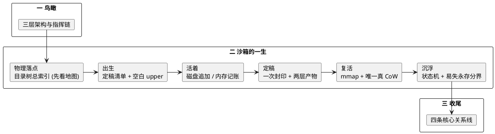
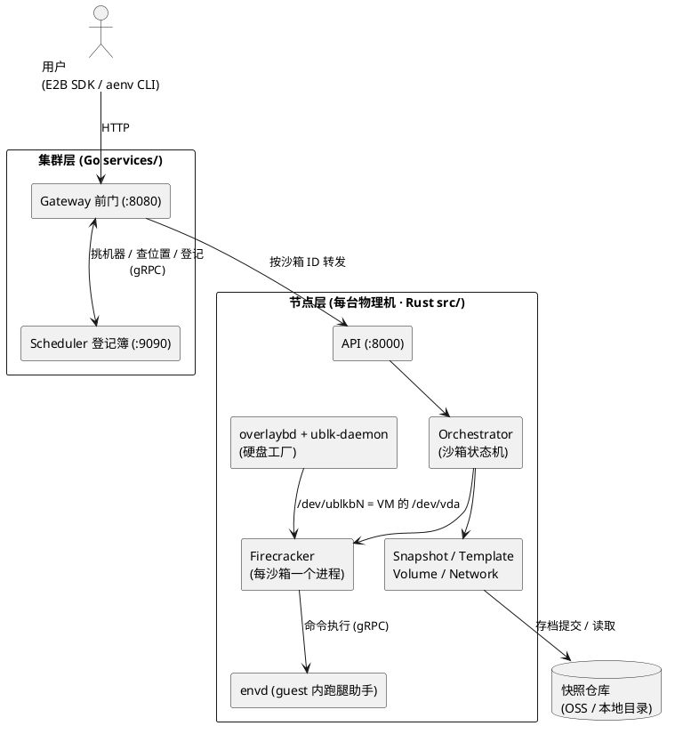
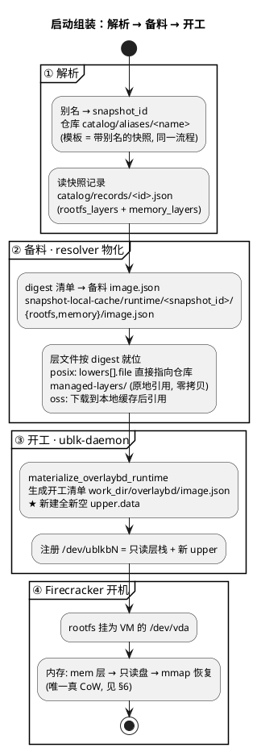
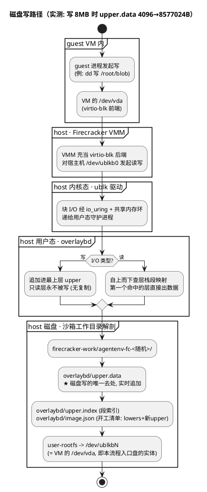
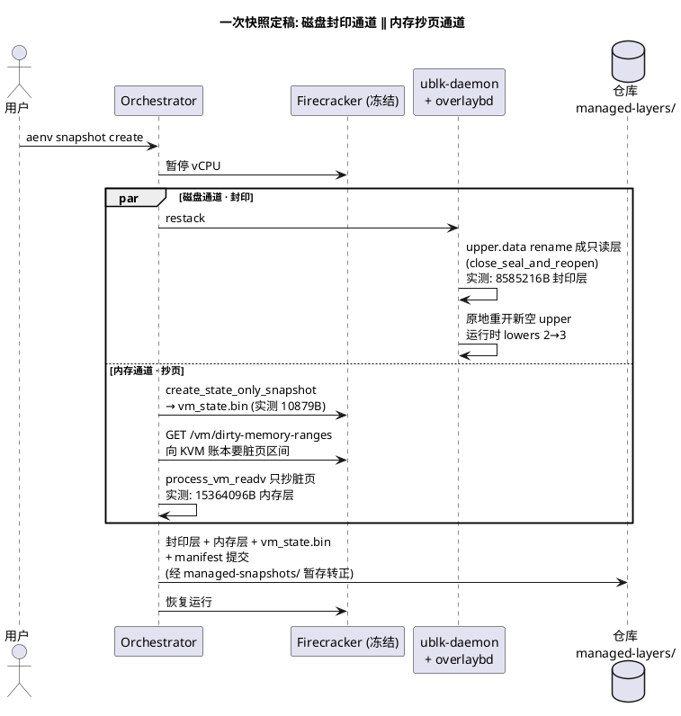
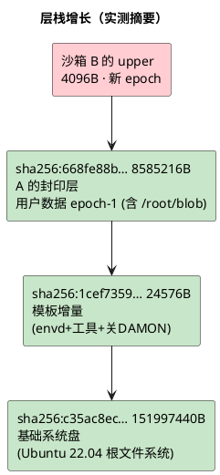
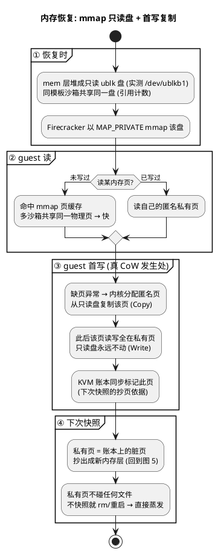
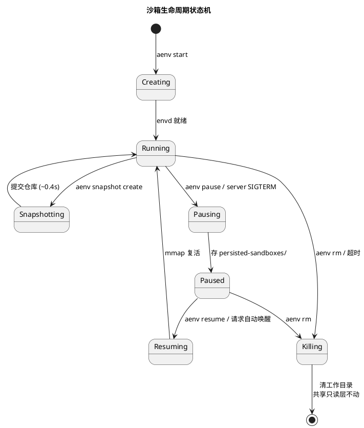

AgentENV 是一个快照能力优先的 AI Agent 沙箱运行时：每个沙箱是一台 Firecracker 微虚拟机（microVM），系统盘由 overlaybd 分层镜像经 ublk 设备供给，内存快照恢复走 mmap + 写时复制（Copy-on-Write，CoW）。对用户而言，沙箱是一台可以随时存档、读档、复制的虚拟电脑。本文按生命周期主线（出生 → 活着 → 定稿 → 复活 → 沉浮）串起核心机制，全部数据来自一台真实服务器的实测。

> **实测环境**：192.168.64.2，`$AENV_HOME = /var/lib/aenv`，模板 `ubuntu-nodamon`（Ubuntu 22.04 底盘），`repository_backend = "posix_fs"`。`sha256:xxxx…` 是层的内容寻址摘要（层文件的身份证），括注文字即该层的实际内容。贯穿全文的故事线：沙箱 A 写入 8MB 文件 `/root/blob` 后打快照 `upper-demo`，再由它启动沙箱 B。

**图 0**：全文知识地图



## 1. 鸟瞰：三层架构与指挥链

**图 1**：集群层全局一套，节点层每台物理机一个，guest 是每台 microVM 的内部。Firecracker 与沙箱严格 1:1，N 个沙箱等于 N 个 Firecracker 进程加 N 个网络命名空间。



指挥链是单向的：用户只跟 Gateway 说话，Gateway 问 Scheduler 再转发到节点，节点内 API → Orchestrator → Firecracker。节点侧各组件分工：

| 组件 | 位置 | 职责 |
|---|---|---|
| Gateway / Scheduler | `services/` | 前门转发；登记沙箱与节点的绑定 |
| API / Orchestrator | `src/api/`、`src/orchestrator/` | 翻译指令；管沙箱一生的状态机 |
| Snapshot / Template / Volume | `src/snapshot/` 等 | 存档；预制模板秒级开机；独立持久卷 |
| overlaybd + ublk-daemon | `storage/` | 把只读层 + 可写 upper 拼成虚拟磁盘 |
| Firecracker / envd | 外部 / `thirdparty/envd/` | 单 VM VMM 开机；guest 内代办命令与文件 |

调度只有两条路径。新建沙箱时 Gateway 调 `Schedule()` 挑一台节点（挑的是机器不是沙箱），节点生成 sandbox_id（UUID v7）随响应回到用户手里，Gateway 顺手调 `RecordAssignment` 登记；之后所有请求用户自带 ID，Gateway 调 `LookupNode` 查登记簿转发。绑定的事实来源是节点定时心跳里的完整沙箱名册，Scheduler 拿名册对账，名册里没有的绑定直接删。

对外只有一套 HTTP API（`POST /sandboxes` 等），E2B SDK 和 `aenv` CLI 是两个平级的客户端，底下调的都是这一套。

**E2B SDK**。E2B 是一个商业 AI 沙箱云服务（e2b.dev）加它的 SDK 生态，AgentENV 是"兼容 E2B 的自建替代品"，类比自建 MinIO 之于 AWS S3。不租 E2B 的云，只借用它的官方 SDK（Python/TS 客户端库，本质是帮用户发 HTTP 请求的库）；AgentENV 自己做服务端，暴露一套"E2B 形状"的接口，让 SDK 以为自己在跟 E2B 说话。兼容体现在四处：HTTP API 接口形状、API key 的 `e2b_` 前缀格式、代理头（`e2b-sandbox-id` / `e2b-sandbox-port` / `e2b-traffic-access-token`）、guest 内的 envd（从 E2B 开源仓库 `e2b-dev/infra` 编译而来）。已有的 E2B 代码一行不改，用户侧只需三个环境变量：

```bash
export E2B_API_URL=http://127.0.0.1:8000   # 单节点指向节点; 集群指向 Gateway:8080
export E2B_SANDBOX_URL=${E2B_API_URL}
export E2B_API_KEY=${AENV_API_KEY}
```

```python
# pip install e2b
from e2b import Sandbox

sandbox = Sandbox.create("<template-id>")     # → POST /sandboxes
result = sandbox.commands.run("echo hello")   # → 经反代进 envd 执行
sandbox.beta_pause()                          # → POST /sandboxes/{id}/pause
sandbox.kill()                                # → DELETE /sandboxes/{id}
```

**aenv CLI**。AgentENV 自带的命令行客户端（定义在 `crates/aenv/src/main.rs`），也是本文实测使用的入口：

| 用户指令 | 底层 HTTP | 作用 |
|---|---|---|
| `aenv start` | POST /sandboxes | 开沙箱 |
| `aenv ls` / `aenv list` | GET /sandboxes | 列沙箱 |
| `aenv exec` | envd 通路 | 沙箱内跑命令 |
| `aenv upload` / `aenv download` | envd 文件通路 | 传/取文件 |
| `aenv cn` / `aenv connect` | POST …/connect | 连接沙箱（Paused 自动唤醒） |
| `aenv pause` | POST …/pause | 暂停：本地存档 + 释放资源 |
| `aenv resume` | POST …/resume | 从 paused 复活 |
| `aenv snap` / `aenv snapshot` | POST …/snapshots | 快照：捕获 + 提交仓库 + 继续跑 |
| `aenv rm` / `aenv delete` | DELETE …/{id} | 删沙箱（内存蒸发、工作目录清理） |
| `aenv timeout` | POST …/timeout | 设置/调整超时 |
| `aenv build` | 模板构建 API | 从镜像/Dockerfile 建模板 |
| `aenv templates` | 模板 API | 列模板 |
| `aenv volume` | 卷 API | 管持久卷 |
| `aenv pull` | 镜像预拉 | 拉镜像进节点缓存 |

各段通信协议一览：

| 通信段 | 协议 |
|---|---|
| 你 ↔ Gateway | HTTP（由 E2B SDK 或 aenv 代发，另有 WS/SSE） |
| Gateway ↔ Scheduler | gRPC |
| 节点 ↔ Scheduler（心跳） | gRPC |
| 节点 ↔ VM 内 envd | gRPC |
| 节点 ↔ 快照仓库 | posix 本地文件 IO / oss 走 S3-HTTPS（不是 gRPC，Gateway 和 Scheduler 从不碰仓库） |

## 2. 物理落点：先看地图，再走旅程


后面各节讲机制时出现的每个路径，都住在这棵树上。带 ★ 的是全文重点路径（磁盘写的去处、封印暂存、两级清单、层文件），先混个脸熟，旅程中再相遇：

```text
/var/lib/aenv/                                        <- $AENV_HOME
|-- config/config.toml                                <- 节点配置 (repository_backend 等)
|-- secrets/api-key                                   <- API key (e2b_ 前缀)
|-- deps/                                             <- 服务自管资产
|   |-- firecracker/1.15.1-patch-v1/firecracker       <- VMM 二进制 (每沙箱一个进程)
|   |-- kernel/vmlinux-6.1.175                        <- guest 内核
|   \-- tools/0.1.0/tools.ext4                        <- envd 工具盘 (只读共享)
|
|-- ublk/uvm-ublk-daemon                              <- 硬盘工厂守护进程
|-- overlaybd/*.json                                  <- 层栈全局配置 (rootfs/mem/convert 各一份)
|-- logs/serial/<sandbox_id>/                         <- 每沙箱串口日志
|
|-- firecracker-work/                                 <- 沙箱工作区 (易失)
|   |-- agentenv-fc-<随机>/                            <- 一个沙箱 (TempDir 随机名, 非沙箱 ID;
|   |   |                                               实测 A=ngYwdl, B=66UcUz, C=6uz9FK)
|   |   |-- firecracker.socket                        <- FC API 控制通道
|   |   |-- overlaybd/image.json                      <- ★ 开工清单 (lowers + 新 upper)
|   |   |-- overlaybd/upper.data                      <- ★ 可写 upper (磁盘写唯一去处)
|   |   |-- user-rootfs -> /dev/ublkbN                <- VM 系统盘 = ublk 块设备
|   |   \-- rootfs.ext4 -> deps/tools/0.1.0/tools.ext4
|   \-- managed-snapshots/<sandbox_id>/…              <- ★ 封印层暂存 (发布后自动清)
|
|-- image-cache/                                      <- OCI 镜像层缓存 (aenv pull/冷启动)
|-- snapshot-local-cache/runtime/<snapshot_id>/       <- ★ 备料清单 (按快照 ID 复用)
|
|-- snapshot-store/repository/                        <- 快照仓库 (权威档案, 重启幸存)
|   |-- catalog/aliases/<名字>                        <- 别名 -> snapshot_id
|   |-- catalog/records/<id>.json                     <- ★ 快照记录 (§3 出生引用的层清单)
|   |-- managed-layers/sha256_<digest>.overlaybd.commit  <- ★ 层文件 (内容寻址, rootfs/内存混住;
|   |                                                     实测 11 层: 基础盘/模板增量×2/A 的
|   |                                                     封印层+脏页层/C 的封印层+脏页层/…)
|   |-- snapshots/<id>/{vm_state.bin, manifest}       <- 快照三件套之二
|   \-- volumes/                                      <- 卷记录与别名
|
\-- persisted-sandboxes/                              <- ★ pause 的本地存档 (不走仓库)

/dev/ublkb0 = rootfs   /dev/ublkb1 = 内存恢复盘      <- ★ 设备侧, 动态存在:
                                                          沙箱启动时 daemon 经 /dev/ublk-control
                                                          注册, rm/pause 释放时注销; snapshot
                                                          create 不销毁 (沙箱继续跑).
                                                          rootfs 盘每沙箱独占一台, 同生共死;
                                                          内存恢复盘可被同模板多个沙箱
                                                          共享 (引用计数), 最后一个退出才注销
guest 内 / (即 /dev/vda) = 只读层栈 + upper.data       <- guest 侧对照
```

按生命周期归组：**易失**（`firecracker-work/agentenv-fc-*/`、`/dev/ublkb*`，rm 或重启即清）；**暂存**（`managed-snapshots/`，发布后自动清）；**缓存**（`image-cache/`、`snapshot-local-cache/`，GC 管理）；**持久**（`snapshot-store/repository/`、`persisted-sandboxes/`，直到显式删除或 resume）；**资产**（`deps/`、`ublk/`、`secrets/`）。

仓库后端二选一（`snapshot.repository_backend`）：

| 维度 | posix_fs（本机实测） | oss（多节点推荐） |
|---|---|---|
| 仓库位置 | 本地/共享目录 | S3 兼容 bucket |
| 多节点共享 | 仅当目录在共享盘 | 天然全集群共享 |
| 上传压缩 | 无（本地层保持 raw） | lz4/zstd 一次性压缩 |
| 跨节点加速 | 无需 | P2P（iroh）可选 |

共同点：Gateway 和 Scheduler 从不碰仓库，只有节点自己读写；层的身份统一是内容寻址摘要，同层只存一份。层的一生：**仓库（权威档案）← managed-snapshots（暂存）/ 本地缓存（工作副本）← 运行时 upper（正在写）**，把"正在写的"变成"定稿档案"的唯一通道是 `aenv snapshot create`。

## 3. 出生：一份定稿清单，一个空白 upper

启动不是把模板磁盘、快照磁盘、upper 三方叠加。启动只读取**一份定稿层清单**：启动目标（模板或快照）记录里的层列表。清单在该快照创建那一刻定稿，链式继承：模板的层早在派生快照的清单里。启动等于按清单备料，再顶上开一个空白 upper。

实测锚点：`aenv start ubuntu-nodamon` 后，开工清单 image.json 声明 lowers=2（基础系统盘 + 模板增量），upper.data 全新 4096B；从快照 `upper-demo` 启动则 lowers=3，多出的第三层正是沙箱 A 的封印层，且 `/root/blob` 8MB 完整出现在新沙箱里。数据跟层走，清单随每代快照累积（沙箱工作目录的完整解剖见图 4 末段）。

**图 2**：启动时层栈的组装。



三份清单的完整内容（`upper-demo`，逐字取自该服务器）。

**清单一，快照记录里的层清单**，物化的输入（`catalog/records/01a0916d-0945-….json` 的 committed 段，每项标来源）：

```text
{
  "rootfs_layers": [
    // 从底到顶排列; 每项只在"产生它的那次快照"里新写,
    // 之后所有派生快照原样继承, 磁盘层只增不改
    { "Managed": { "digest": "sha256:c35ac8ec…", "size": 151997440, … } },
    //            ↑ 继承: 模板构建期封印 (Ubuntu 22.04 基础系统盘全量)
    { "Managed": { "digest": "sha256:1cef7359…", "size": 24576, … } },
    //            ↑ 继承: 模板构建期封印 (模板增量: envd+工具+关DAMON配置)
    { "Managed": { "digest": "sha256:668fe88b…", "size": 8585216, … } }
    //            ↑ 本次新增: 沙箱 A 的 upper 封印成层 (内含 /root/blob)
  ],
  "memory_layers": [
    // 与 rootfs_layers 同构, 内存层栈一样链式继承
    { "digest": "sha256:140741a6…", "size": 72499200 },   // 继承: 模板内存基线
    { "digest": "sha256:c2075887…", "size": 15364096 }    // 新增: A 的脏页层
  ]
}
```

**清单二，备料清单 rootfs**，resolver 的产物（`snapshot-local-cache/runtime/01a0916d-0945-…/rootfs/image.json`）：

```text
{
  "repoBlobUrl": "",
  "lowers": [
    {
      "file": "/var/lib/aenv/snapshot-store/repository/managed-layers/sha256_c35ac8ec….overlaybd.commit",
      "digest": "sha256:c35ac8ec…c51350caa1d7eab840c6efe4", "size": 151997440, "uuid": "3c3d9e73-…"
    },
    {
      "file": "/var/lib/aenv/snapshot-store/repository/managed-layers/sha256_1cef7359….overlaybd.commit",
      "digest": "sha256:1cef7359…8cbb19cd3c5d93809fb992f22", "size": 24576, "uuid": "e8fd1b4b-…"
    },
    {
      "file": "/var/lib/aenv/snapshot-store/repository/managed-layers/sha256_668fe88b….overlaybd.commit",
      "digest": "sha256:668fe88b…6b13f206854f0ea", "size": 8585216, "uuid": "f2d69dd0-…"
    }
  ],
  "upper": { "index": "", "data": "", "target": "", "gzipIndex": "" }
}
```

**清单三，备料清单 memory**，同一目录下 `memory/image.json`：

```text
{
  "repoBlobUrl": "",
  "lowers": [
    {
      "file": "/var/lib/aenv/snapshot-store/repository/managed-layers/sha256_140741a6….overlaybd.commit",
      "digest": "sha256:140741a6…1f53e0e7ad79bcf2c2d445a6", "size": 72499200
    },
    {
      "file": "/var/lib/aenv/snapshot-store/repository/managed-layers/sha256_c2075887….overlaybd.commit",
      "digest": "sha256:c2075887…c17a4e9be396ff9e3", "size": 15364096
    }
  ],
  "upper": { "index": "", "data": "", "target": "", "gzipIndex": "" }
}
```

三个对照点：记录里只有 digest+size（"要什么"），备料清单把 digest 解析成 `managed-layers/` 绝对路径（"在哪拿"，posix 原地引用）；备料清单的 `upper` 字段**全是空串**，备料阶段不含任何可写层，upper 要等开工时 ublk-daemon 新建并填进开工清单（对照实测：开工清单 `work_dir/overlaybd/image.json` 里 upper 指向 `./upper.data` 且 lowers 已就位）；rootfs 与 memory 两份备料清单形状完全同构，只是层内容不同。

两级清单的分工：备料清单按快照 ID 缓存在 `snapshot-local-cache/`，同一快照重复启动直接命中；开工清单每个沙箱工作目录一份，在备料清单之上多出新 upper 一栏。两级都只是 JSON 清单，层文件本体从不复制。

三种启动方式的差异：

| 启动方式 | 层清单来源 | 内存 |
|---|---|---|
| `aenv start <模板/快照>` | 该快照记录（模板只是带别名的快照） | mmap 恢复 |
| `aenv resume`（Paused 沙箱） | **不走仓库**，直接用 `persisted-sandboxes/` 的暂停工件 | 同上 |
| `aenv start --cold <镜像>` | OCI 镜像转换现场生成 | 无，正常开机 |

清单里的层全部是只读层，启动不复制任何一层：同一份层文件被同节点所有引用它的沙箱同时打开，同 digest 层在仓库里永远只有一份。这是零拷贝开机的关键。产生只读层只有两条路：`aenv build` 模板构建定稿，`aenv snapshot create` 运行中 upper 封印转正；运行中的 upper 永远不是只读层，直到被封印。

## 4. 活着：磁盘追加，内存记账

沙箱运行期间，磁盘写和内存写走两条完全独立的通道。磁盘通道实时落盘，内存通道只进 host RAM，KVM 在内核里记账。

**图 4**：磁盘写路径。VM 以为自己拿着一块普通磁盘，实际是 overlaybd 层栈；写永远追加进最上层 upper，只读层既不被写也不被复制。



磁盘写**不是 CoW**，是追加式增量：新数据追加进 upper，只读层既不被写也不被复制（实测：guest 写 8MB，upper.data 从 4096B 涨到 8577024B）。这不是文件级联合挂载（overlayfs 那种），而是块级叠加：VM 自己格式化成 ext4，完全不知道底下有层。upper 是"正在写的层"，只属于本沙箱、只在本节点，仓库和其他节点都看不到它，直到封印提交。

内存通道完全不同。guest 写内存只是 Firecracker 进程的匿名内存（host RAM），不写任何文件。KVM 脏页位图在 host 内核记账（`track_dirty_pages` 开机即开），只标记"哪些页被写过"。这本账唯一的用途：快照那一刻被查询，让节点只抄脏页而不是全量导内存（见下节）。账本本身从不进任何文件，因为"哪些页脏"已经隐含在抄出来的层里，且每次导出后位图清零重记，下一次快照抄到的永远是距上次以来的新脏页。

## 5. 定稿：一次封印，两层产物

`aenv snapshot create` 把 VM 冻结一瞬间，磁盘和内存两条通道并行产出，随后 VM 继续运行。实测全程 0.455 秒。

**图 5**：定稿的双通道。



快照产物是三件套，全部装**状态**而非**记录**：

| 三件套 | 实测 | 装的是什么 | 不是什么 |
|---|---|---|---|
| 磁盘封印层 | `sha256:668fe88b…` 8585216B | A 写下的数据块本身（8MB blob 的字节躺在层里） | 不是写操作日志，恢复时零重放 |
| 内存层 | `sha256:c2075887…` 15364096B | 被写过的内存页的字节 | 不是脏页记录，KVM 位图只是抄页筛选账本，抄完即弃 |
| VM 状态 | `vm_state.bin` 10879B | CPU 寄存器、设备状态 | 不是执行历史 |

快照不是录像带（记录操作、恢复时重放），是 CT 扫描（某一时刻的状态切片、恢复时直接摆回去）。两个实测数字自证：新沙箱开机后 `ls` 立刻可见 `/root/blob`，因为数据块就在层里；内存层只有 15MB 而沙箱内存配了 1GiB，因为只抄了脏页。内存落盘同样不是 CoW，是选择性抄页：只抄账本标记的脏页，页本身在 host RAM 原地不动，复制动作发生在恢复侧（见 §6）。

封印同时，快照记录的两条清单各追加一项（新清单 = 旧清单复制 + 各追加一条）。第三轮快照 `upper-demo3` 实测，其沙箱没写任何文件：

```text
rootfs_layers = [基础系统盘, 模板增量, A的封印层, 734183eb 8192B    ← 新增: 空 upper, 仅格式元数据]
memory_layers = [模板内存基线, A的脏页层, 41f13357 2793472B          ← 新增: 光运行就脏了 2.79MB]
```

空 upper 封印只有 8192B，内存却脏了 2.79MB：磁盘通道与内存通道的独立性，连"什么都不做"的场景都分得清清楚楚。

**图 6**：封印后的层栈增长（沙箱 B 的实测层栈）。



## 6. 复活：mmap 与唯一的真 CoW

从快照启动或 resume 时，内存层栈堆成只读 ublk 盘（实测 `/dev/ublkb1`），Firecracker 以 `load_snapshot_file` 把它 mmap 进地址空间。读共享，写复制，这是全系统唯一的真 CoW。

普通虚机日常运行确实不碰内存落盘。但是设想，沙箱中跑了几个小时的环境中，进程（已经激活的conda，python里加载的十多G模型）、进程内的中间计算状态等都没了的话，重启沙箱就得重来，严重影响速度。所以这个过程必须对内存标脏-snapshot的时候落盘，恢复的时候mmap回内存，保证沙箱的状态可以恢复。

**图 7**：内存恢复的 CoW 全流程。



磁盘 upper 与内存私有页是两个世界的对等角色，都代表"每个沙箱私有的可写增量、快照时定稿成层"，但媒介与机制完全不同：

| | 磁盘世界 | 内存世界 |
|---|---|---|
| 只读底座 | `managed-layers/` 层栈（宿主机磁盘文件） | mem 层栈堆成的只读盘（`/dev/ublkb1`） |
| **私有增量** | **upper.data**（宿主机磁盘文件） | **匿名私有页**（host RAM） |
| 写机制 | **追加**，无复制（图 4） | **CoW**，首写复制（图 7） |
| 写后去哪 | 已在盘上，实时持久 | 只在 RAM，不碰任何文件 |
| 不快照就 rm | 随工作目录删除 | 随进程蒸发 |

## 7. 沉浮：状态机与易失永存分界

沙箱状态机全集是 Creating / Resuming / Running / Snapshotting / Forking / Pausing / Paused / Killing，没有 Stopped 态：`stop()` 是内部资源释放动作，用户视角的"停"就是删除（经 Killing）或超时淘汰。

**图 8**：生命周期状态机。



指令与机制时机对照（snapshot 与 pause 捕获机制相同，差别只在捕获后继续运行还是释放资源）：

| 指令 | 磁盘层 | 内存层 | 结果 |
|---|---|---|---|
| `aenv start` | 新 upper | mmap 只读盘 | Running |
| 运行中写 | 追加 upper | 只进 host RAM | Running |
| `aenv snapshot create` | 封印+提交仓库 | 抄脏页+提交仓库 | 继续运行 |
| `aenv pause` | 封印+存本地 `persisted-sandboxes/` | 同左 | 释放资源 |
| `aenv resume` | 新 upper | mmap+COW | Running |
| `aenv rm` | upper 蒸发 | 蒸发 | 消失 |

不快照就删除，脏页与 upper 一起蒸发，磁盘上什么都没写。两个例外：server 收到 SIGTERM 时所有 Running 沙箱自动走 pause 路径存档，重启后可恢复；对 Paused 沙箱发 connect 或代理请求会自动唤醒（auto-resume），业务侧无感。

**重启实测：易失与永存的分界**。服务器重启后，仓库原样幸存（9 个层、快照记录、模板全在），运行态全部蒸发（工作目录 upper、`/dev/ublkb*`、warm pool 进程）。重启后直接 `aenv start upper-demo`（3.14s）：`/root/blob` 8388608B，md5 与重启前完全一致，guest 内文件时间戳仍为写入时刻。这就是全文机制的自然验证：数据躺在仓库只读层里，重启不可能碰到它；蒸发的那一半本来就不落盘。

## 8. 收尾：四条核心关系线

1. **指挥链**：用户 → Gateway → 节点 API → Orchestrator → Firecracker，上层只发命令，下层只干活。
2. **按 ID 转发**：Gateway 问 Scheduler 沙箱在哪台机器，再把请求送过去；绑定的事实来源是心跳名册。
3. **硬盘供货链**：overlaybd 层栈 → ublk-daemon 装成 `/dev/ublkbN` → Firecracker 挂给 VM 当 `/dev/vda`；只读层共享所以开沙箱快。
4. **存档/恢复**：暂停 vCPU，内存和磁盘变化量提交仓库；恢复反向走一遍，VM 原地复活。

一句话总结：**Gateway/Scheduler 管"在哪儿"，Orchestrator 管"生老病死"，Firecracker 管"开机"，storage 管"硬盘"，envd 管"VM 里跑腿"。**
