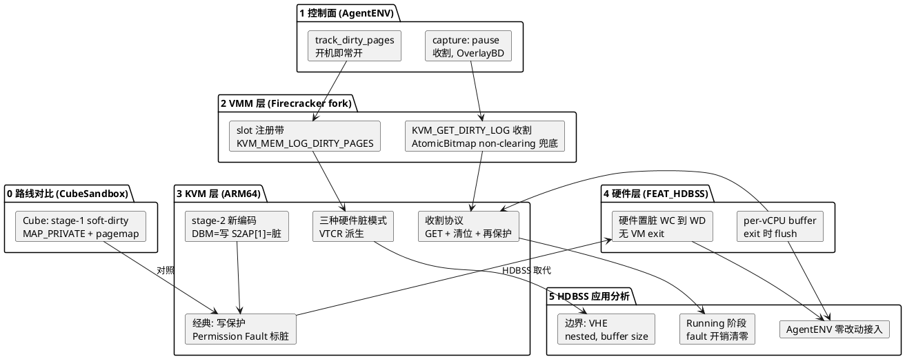
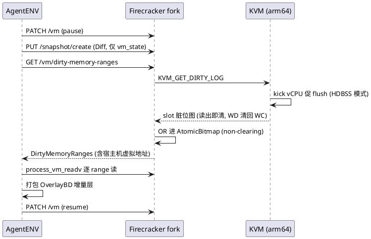
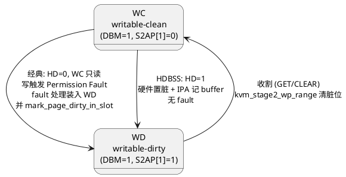
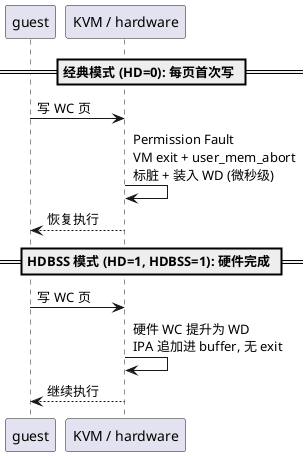

# AgentENV 内存快照脏页跟踪全链路与 ARM64 HDBSS 硬件加速

AgentENV 的内存快照是 diff snapshot（增量快照）：每次 capture 只把上一次快照之后被写过的页打成 OverlayBD 增量层，下层不可变、只加新层。要把增量做小，前提是准确知道"哪些页被写过了"，这就是 dirty logging（脏页跟踪）。整条链路由三层分工：

- **AgentENV（控制面）**：决定开不开标脏（`track_dirty_pages`），在 capture 时刻收割脏页并落盘
- **Firecracker fork（VMM 层）**：把意图翻译成 KVM ioctl，读出脏位图后做 non-clearing 兜底
- **KVM + ARM 硬件（内核/硬件层）**：ARM64 stage-2（第二阶段页表）上真正记录脏状态

x86 上这套机制由 EPT dirty bit + PML（Page Modification Logging，页修改日志）硬件完成，ARM 上经典方案是**软件写保护 + 每页首次写一次 Permission Fault（权限错误）**，写密集负载下 exit 开销显著。我们的内核已经合入了 FEAT_HDBSS（硬件脏状态跟踪结构）系列，让 ARM 也能硬件标脏。下文自顶向下拆完整条链路，最后分析 HDBSS 能否直接用在 AgentENV 流程里。

图0：全文知识地图



## 0 两条路线：AgentENV 与 Cube 的标脏对比

沙箱产品做内存增量快照有两条代表性路线，先把 CubeSandbox（Cube）拉进来对照，再看 AgentENV 主线。Cube 的 VMM 是 Cloud Hypervisor fork（CubeSandbox 仓库 `hypervisor/` 目录），内存标脏**完全不经 KVM**：

- restore 时 guest 内存以 `MAP_PRIVATE` mmap 到基础快照文件上：只读页留在文件页缓存，guest 写过的页经 CoW 变成匿名页，"匿名页"本身就是"改过"的证据（`hypervisor/vmm/src/memory_manager.rs`）
- 增量快照因此变成 VMM 进程自查 `/proc`：pagemap_anon 路径读 `/proc/self/pagemap` + `/proc/kpageflags` 挑 `KPF_ANON` 页（累积集，restore 以来所有 CoW 页）；soft-dirty 路径写 "4" 到 `/proc/self/clear_refs` 开观察窗口，快照时读 pagemap bit 55 与匿名页取交集，得到真 delta（`hypervisor/vmm/src/soft_dirty.rs`）
- 代价分布：soft-dirty 武装窗口内每首写一次 exit + host fault（写保护陷阱机制，与 KVM 经典 dirty logging 同构）；快照时刻（pause 中）另付 `clear_refs` 的 mmap_lock 写锁全 PTE 遍历，multi-GiB VM 上是几百 ms 的 stall。运行期零开销的只有 pagemap_anon 被动账本

| | AgentENV (Firecracker fork) | Cube (Cloud Hypervisor fork) |
| --- | --- | --- |
| 标脏层 | KVM stage-2 dirty logging | VMM 进程 stage-1 soft-dirty |
| 脏信息载体 | KVM slot bitmap（硬件 EPT/HDBSS） | pagemap bit 55 + kpageflags |
| 运行期开销 | ARM 经典：每页 first-write fault | soft-dirty：每页 first-write fault（x86）；pagemap_anon：零 |
| 快照时刻开销 | bitmap copy | clear_refs 遍历 + pagemap 读（几百 ms） |
| ARM 现状 | 完整支持（HDBSS 后零开销） | soft-dirty 探测多半失败 → 退化为 pagemap_anon 累积集，增量变大 |
| 数据搬运 | AgentENV process_vm_readv 跨进程读 | VMM 自己 save_range_to_file 直接写 |

对照的结论是**架构选型直接决定硬件加速的可达性**：Cube 不碰 KVM dirty logging，HDBSS 的收益与它天然无关；AgentENV 的标脏建立在 KVM ioctl ABI 上，换内核即零改动受益（第 6 节展开）。两条路线的开销分布也恰好错开：Cube 运行期零开销、快照时刻付页表遍历；AgentENV 经典 ARM 快照时刻便宜、运行期付 fault，HDBSS 消掉的正是这笔运行期成本。下面回到 AgentENV 主线，自顶向下展开。

## 1 控制面：标脏在沙箱生命周期中的两个时刻

AgentENV 的配置 `[memory_snapshot].track_dirty_pages` 默认为 `true`（PVM 模式强制关闭，但 PVM 仅限 x86_64，ARM 上不受影响）。这个开关决定的是**注册时的 slot flag**，而不是快照瞬间的动作：

- 冷启动：`configure_microvm` 先把 `track_dirty_pages` 经 `PUT /machine-config` 传给 Firecracker
- Firecracker 创建 guest 内存时，`track_dirty_pages.then(|| AtomicBitmap::with_len(size))` 决定每个 region 是否挂内部位图（`firecracker/src/vmm/src/vstate/memory.rs`）
- InstanceStart 注册 KVM slot 时，挂了位图的 slot 带 `KVM_MEM_LOG_DIRTY_PAGES` flag

也就是说，只要开了内存快照，**vCPU 从跑第一秒起，每次 guest 写内存都在被跟踪**，代价由整个 Running 阶段承担。这在 ARM 经典方案下意味着海量 Permission Fault（第 4 节），是本文要解决的核心痛点。

第二个时刻是 capture（快照收割），AgentENV 的完整序列是：

```text
沙箱 Running
  -> pause                                   VM 必须先暂停
  -> create_state_only_snapshot              PUT /snapshot/create (Diff, 仅存 vm_state, 无 mem file)
  -> get_dirty_memory_ranges                 GET /vm/dirty-memory-ranges
  -> process_vm_readv 逐 range 直读 VMM 进程内存
  -> 写成 OverlayBD 内存增量层
  -> resume
```

fork 的 swagger 明确该 API 只对 **paused, post-boot** 的 VM 有效。数据面不走 REST：返回的 range 携带宿主机虚拟地址，AgentENV 用 `process_vm_readv`（跨进程读，`AgentENV src/sandbox/firecracker/process_vm_reader.rs`）直接抓 Firecracker 地址空间里的 guest 内存，再交给 OverlayBD 打包。



图1：capture 时刻的全链路时

## 2 VMM 层：KVM_GET_DIRTY_LOG 收割与 non-clearing 兜底

`GET /vm/dirty-memory-ranges` 在 Firecracker fork 内部的落地是 `get_dirty_memory_ranges_preserve`，这个函数是理解 VMM 层行为的关键：

```c
/* firecracker/src/vmm/src/vstate/vm.rs */
+-> get_dirty_memory_ranges_preserve
  +-> get_dirty_bitmap                       /* 逐 slot 读脏位图 */
    +-> fd().get_dirty_log(slot, len)        /* KVM_GET_DIRTY_LOG ioctl, 读出即清 */
    +-> mincore_bitmap(...)                  /* slot 无内部位图时的降级路径 */
  +-> store_dirty_bitmap                     /* 刚读出的位 OR 进 VMM 内部 AtomicBitmap */
  +-> dirty_memory_ranges                    /* kvm 位 ∪ 内部位, 合并成区间 */
```

三个行为值得展开：

- **读出即清**：`KVM_GET_DIRTY_LOG` 在内核里是破坏性读取，取走位图的同时清零 KVM 侧状态（第 4 节展开收割协议）
- **non-clearing 兜底**：正因为读取是破坏性的，fork 在读出后立刻把位 OR 进自己的 `AtomicBitmap`（vm-memory crate 实现，每页占 8 bit）。这样外部消费者（AgentENV）如果打包失败，下一次重试仍能看到这些页。API 语义上的"查询不清零"由 VMM 层实现，而不是内核
- **mincore 降级**：slot 没挂内部位图（即 `track_dirty_pages=false` 的 VM）时，`get_dirty_bitmap` 用 `mincore()` 扫页表判断哪些页被映射过。精度更差（只反映驻留，不反映写入），这是 AgentENV 配置注释里 "use Firecracker KVM dirty-page tracking instead of mincore" 的由来

收割协议本身也有一个设计决策：**dirty bitmap，而不是 dirty ring**。Firecracker 全仓库（含 fork）没有 `KVM_CAP_DIRTY_LOG_RING` 的任何引用，seccomp 白名单只放行 `KVM_GET_DIRTY_LOG`。这不是随手的选择，而是与快照模型强绑定：

| | dirty bitmap | dirty ring |
| --- | --- | --- |
| 收割方式 | 停机后逐 slot 一次性拉取 | vCPU 异步推送, 用户态持续收割 |
| 适配场景 | stop-the-world 快照 | precopy 热迁移迭代 |
| 数据形态 | 整 slot 位图 | 增量 GFN 记录 |

capture 本来就要求 pause（vm_state 一致性的前提），暂停后 ring 的异步优势完全发挥不出来，还得自己轮询 drain，不如逐 slot 一次 `KVM_GET_DIRTY_LOG` 干净。fork 的 non-clearing 兜底也围绕"逐 slot 读位图"设计。这个选择划定了 HDBSS 收益的流入路径：内核两种模式都支持，Firecracker 只走 bitmap 分支（第 6 节展开）。

还有一个容易被忽略的边界：**AgentENV 外部路径从不重置内部 AtomicBitmap**。清位只发生在带 mem file 的 Diff 快照成功（`dump_dirty` 成功后 `reset_dirty`）或 Full 快照。所以同一个运行中 VM 反复 capture 会产生"并集"增量，内容正确但有冗余；从快照拉起的新 VM 是新进程、新位图，首次 capture 是真增量。

## 3 KVM 层：ARM64 stage-2 的脏状态编码

ARM64 上 guest 物理地址到宿主机物理地址的翻译由 stage-2 页表完成，由 VTCR_EL2 控制。这个内核系列做的第一件事，是把 stage-2 PTE（页表项）的**写权限和脏状态拆成两个独立的位**：

```text
 63                   51                              7 6        1 0
+----------------------+------+------------------------+---+--------+---+
|   output address     | DBM  |          ...           | D |   R    |...|
+----------------------+------+------------------------+---+--------+---+
                        ^                                ^
                        |                                |
                   bit 51: W                       bit 7: dirty
                                                   bit 6: R
```

图2：stage-2 PTE 的写权限与脏状态编码

- **DBM（Dirty Bit Modifier，脏位修饰符，bit 51）**：写权限位
- **S2AP[1]（Stage-2 Access Permission，bit 7）**：脏状态位；S2AP[0]（bit 6）是读权限

由此定义两种页状态：

```text
WC (writable-clean)  = DBM=1, S2AP[1]=0    writable-clean
WD (writable-dirty)  = DBM=1, S2AP[1]=1    writable-dirty
```

编码的语义由 VTCR_EL2.HD 决定，这是整个设计的枢纽：

- **HD=0（硬件不管理脏位）**：S2AP[1] 恢复经典写权限语义，DBM 被忽略。WC 页实际**只读**，写它触发 Permission Fault
- **HD=1（硬件管理脏位）**：DBM 是唯一的写权限位，硬件在写访问时自动把 S2AP[1] 置 1（WC 提升为 WD），**不产生任何异常**

这套编码支撑了内核里一个纯函数式的模式派生 `kvm_arch_update_hw_dirty_mode`（`linux/arch/arm64/kvm/mmu.c`），输入只有"静态硬件能力 + 正在 logging 的 memslot 数量"：

| logging | 硬件能力 | VTCR_EL2 | 跟踪信号 |
| ------- | -------- | -------- | -------- |
| 是 | FEAT_HDBSS | HD \| HA \| HDBSS | 硬件置脏 + buffer（第 5 节） |
| 是 | 无 HDBSS | 全关 | 写保护 Permission Fault（第 4 节） |
| 否 | FEAT_HAFDBS | HD \| HA | 硬件只置脏（服务 host MM 回收） |
| 否 | 无 | 全关 | 无 |

模式是重算而非翻转的，不存在丢更新的竞态窗口；vCPU 创建、logging 开关都走同一个函数。开启 logging 的完整路径：

```c
/* virt/kvm/kvm_main.c */
+-> kvm_vm_ioctl_set_user_memory_region
  +-> kvm_set_memory_region
    +-> kvm_arch_commit_memory_region            /* linux/arch/arm64/kvm/mmu.c */
      +-> kvm_arch_update_hw_dirty_mode          /* 派生 VTCR 模式 + TLB 全刷 */
      +-> kvm_mmu_wp_memory_region
        +-> kvm_stage2_wp_range
          +-> kvm_pgtable_stage2_wrprotect       /* 清脏位 WD->WC; block 同时清 DBM */
      +-> kvm_mmu_split_memory_region            /* 拆成 PAGE_SIZE 粒度 */
```

注意 `stage2_wrprotect_walker`（`linux/arch/arm64/kvm/hyp/pgtable.c`）在 HDBSS 时代干的事变了：它**只清脏位 S2AP[1]，保留 DBM**；只有 block 映射额外清 DBM，让后续访问 fault 进来触发大页拆分（lazy splitting）。"write-protect"这个名字是历史遗留，现在的语义是"清脏位"。

## 4 经典软件路径：写保护 fault 标脏

没有 HDBSS 硬件时（HD=0），logging 期间 WC 页只读，guest 每次**首次写一个页**都要走一遍完整的 fault 处理：

```c
/* linux/arch/arm64/kvm/arm.c */
+-> kvm_arch_vcpu_ioctl_run
  +-> handle_exit
    +-> kvm_handle_guest_abort                  /* linux/arch/arm64/kvm/mmu.c */
      +-> user_mem_abort
        +-> kvm_s2_fault_compute_prot           /* 是写 fault -> 加 PROT_DIRTY */
        +-> kvm_s2_fault_map
          +-> kvm_pgtable_stage2_map            /* 装入 WD (DBM + S2AP[1]) */
          +-> mark_page_dirty_in_slot           /* slot 脏位图置位 */
```

fault 处理完成时装入 WD 并把 slot 脏位图置位，这个页后续的写不再 fault。`kvm_s2_fault_compute_prot` 里有一个精妙的分支：读 fault 在 logging memslot 上装的是 **WC 而不是 WD**，目的就是让这个页的第一次写 fault 进来被记录。整条跟踪链的状态机：



图3：WC/WD 状态机，经典路径与 HDBSS 路径的转移差异

收割协议由通用 KVM 框架完成（arm64 选择了 `CONFIG_KVM_GENERIC_DIRTYLOG_READ_PROTECT`）：

```c
/* virt/kvm/kvm_main.c */
+-> kvm_vm_ioctl_get_dirty_log
  +-> kvm_get_dirty_log_protect
    +-> kvm_arch_sync_dirty_log                 /* arm64: kick 所有 vCPU 出 guest 模式 */
    +-> snapshot + xchg 清零 slot 脏位图        /* 位图交给用户态, 内核清零 */
    +-> kvm_arch_mmu_enable_log_dirty_pt_masked /* linux/arch/arm64/kvm/mmu.c */
      +-> kvm_stage2_wp_range                   /* WD->WC 再清脏位, 下轮重新跟踪 */
```

这个协议和第 2 节 Firecracker 的"读出即清"观察完全对上。代价在哪里？**经典模式下每个脏页的第一次写都是一次 VM exit**，exit 要走 VMA 查找、pin page、拿 mmu_lock、重装 PTE 的全流程，微秒级一次。AgentENV 又是"开机即常开标脏"，guest 一旦有写密集负载（编译、KV cache 写入），Running 阶段全程在付这个税。

## 5 硬件路径：FEAT_HDBSS

Armv9.5 引入的 HDBSS（Hardware Dirty State tracking Structure，硬件脏状态跟踪结构，`ID_AA64MMFR1_EL1.HAFDBS=0b0100`）给 ARM 补上了 x86 EPT+PML 的等价物：**硬件在写 WC 页时自动置脏（WC 提升为 WD），同时把脏页的 IPA 追加进一个内存 buffer，全程无 VM exit**。

硬件接口一共三个寄存器加一种 entry 格式：

```text
HDBSSBR_EL2 (base)                          HDBSSPROD_EL2 (producer index)
+--------------+----+                        +------------+----------------+
| BADDR[55:12] | SZ |                        | FSC[31:26] |  INDEX[18:0]   |
+--------------+----+                        +------------+----------------+

  per-vCPU buffer (default one page)
  +--------+--------+--------+--------+
  | entry0 | entry1 | entry2 |  ...   |    entry: [ VALID(bit0) | IPA[55:12] ]
  +--------+--------+--------+--------+
```

图4：HDBSS 硬件接口，两个控制寄存器加 per-vCPU buffer

- `HDBSSBR_EL2`：buffer 基地址 BADDR 加编码大小 SZ（0b0000=4KB 到 0b1001=2MB）
- `HDBSSPROD_EL2`：硬件推进的写入位置 INDEX，加错误状态 FSC（OK / ExternalAbort / GPF）
- entry：bit 0 是 VALID，bit 55:12 是脏页 IPA。硬件只追加，软件消费后清 INDEX

软件侧的设计（12 个 commit 的系列）分五块：

**buffer 管理**：每个 vCPU 独立 buffer，在 vCPU 创建时分配（`linux/arch/arm64/kvm/dirty_bit.c` 的 `kvm_arm_vcpu_alloc_hdbss`），生命周期与 dirty logging 解耦，因为 HDBSS 的开关只是翻转 VTCR_EL2 位。`HDBSSPROD_EL2` 的 INDEX 是 per-CPU 寄存器状态，vCPU put 时保存、load 时恢复，否则跨 CPU 迁移就丢了。

**flush 时机**：单点收敛在 run loop 的 exit 路径上：

```c
/* linux/arch/arm64/kvm/arm.c */
+-> kvm_arch_vcpu_ioctl_run
  +-> guest exit                                /* 任意原因的 exit */
  +-> kvm_flush_hdbss_buffer                    /* linux/arch/arm64/kvm/dirty_bit.c */
    +-> kvm_vcpu_mark_page_dirty                /* 逐 entry: buffer IPA -> slot 位图 */
```

flush 放在 exit 之后、exit reason 处理之前，是为了配合 dirty ring（脏环）的反馈回路：flush 推 ring 过软上限时置 `KVM_REQ_DIRTY_RING_SOFT_FULL`，下一轮循环开头就能看到并退出到用户态收割。放在 `kvm_arch_vcpu_put` 里就赶不上这个时序。

**buffer 满的处理**：buffer 满后硬件停止 WC 提升为 WD，写访问退化为带 `ESR_EL2.ISS2.HDBSSF` 标志的 Permission Fault。`kvm_handle_hdbss_fault` 区分三种情况：FSC=OK（buffer 满，exit 路径已经 flush 过，直接恢复 guest）；ExternalAbort/GPF（HDBSS buffer 本身访问失败，清 FSC 让硬件恢复工作，向用户态报 `-EFAULT`）。

**folio account（宿主页一致性）**：硬件可以无 exit 地把 WC 提升为 WD，这个脏状态只存在于 stage-2 PTE 里，而 arm64 的 unmap 路径原本不收割脏位，reclaim（页回收）可能丢弃 guest 已写的数据。修复是三层的：fault 入页时**投机性**标脏 folio（`kvm_release_faultin_page` 以 PROT_W 为条件）；`stage2_unmap_walker` 和 `stage2_wrprotect_walker` 在拆掉/清脏 WD 页之前，经 `mm_ops->mark_page_dirty` 回调收割进 folio account（对应通用 mm 的 `zap_present_folio_ptes` 模式）；HDBSS buffer flush 本身**不碰 folio**，保持 SRCU-only 的无锁设计。

**dirty ring 集成**：`kvm_cpu_dirty_log_size` 上报 buffer 的 entry 数，ring 框架据此预留空间，保证整 buffer flush 一定装得下。bitmap 模式（Firecracker 用的就是这种）下可用 `KVM_CAP_ARM_HDBSS_BUFFER_SIZE` 在 vCPU 创建前调整 buffer 大小（PAGE_SIZE 到 2MB），默认一页即 512 个 entry。

三种方案的能力对比：

| 能力 | x86 EPT+PML | ARM 经典 | ARM+HDBSS |
| ---- | ----------- | -------- | --------- |
| 硬件脏位 | EPT D-bit | 无 | DBM (S2AP[1]) |
| 脏页硬件记录 | PML buffer | 无 | HDBSS buffer |
| first-write 开销 | 无 fault | 每页一次 fault + VM exit | 无 fault |
| buffer 满行为 | PML FULL exit | 不适用 | HDBSSF fault |

## 6 HDBSS 在 AgentENV 流程中的应用分析

结论先行：**HDBSS 对 AgentENV/Firecracker 是零改动的透明加速**。依据是第 3 节的模式派生，切换完全由内核根据 memslot flag 自主完成：

```c
[AgentENV]
+-> configure_microvm                           /* AgentENV src/sandbox/firecracker/sandbox.rs */
  +-> set_machine_config(track_dirty_pages=true)
    +-> PUT /machine-config (REST)
[Firecracker]
+-> InstanceStart
  +-> 创建 guest 内存 (AtomicBitmap)
  +-> KVM_SET_USER_MEMORY_REGION (LOG_DIRTY_PAGES)
[kernel]
+-> kvm_arch_commit_memory_region               /* linux/arch/arm64/kvm/mmu.c */
  +-> kvm_arch_update_hw_dirty_mode
    /* logging && kvm_supports_hdbss(kvm)
       -> VTCR_EL2 = HD|HA|HDBSS   (硬件标脏模式自动生效)
       -> KVM_REQ_RELOAD_STAGE2 + TLB 全刷 */
```

Firecracker 用的 ioctl 组合是 `KVM_SET_USER_MEMORY_REGION(LOG_DIRTY_PAGES)` + `KVM_GET_DIRTY_LOG`（bitmap 模式，选型理由见第 2 节），这套 ABI 在 HDBSS 内核上完全不变。内核侧两种模式都支持，`kvm_flush_hdbss_buffer` 的汇入点按 VM 当前配置分流：

```c
/* virt/kvm/kvm_main.c */
+-> kvm_vcpu_mark_page_dirty
  +-> mark_page_dirty_in_slot
    +-> kvm_dirty_ring_push          /* kvm->dirty_ring_size && vcpu: ring 分支 */
    +-> set_bit_le                   /* 否则 slot 脏位图置位, Firecracker 走这条 */
```

Firecracker 从不设置 `dirty_ring_size`，HDBSS 的收益路径固定为 buffer flush 写 slot 位图、capture 时一次 `KVM_GET_DIRTY_LOG` 收割。ring 那条路（第 5 节的预留空间、soft limit 提前退出）只有换成 QEMU 式热迁移 VMM 才有意义。逐时刻推演：

**Running 阶段（收益所在）**：guest 写 WC 页时硬件直接置脏并记 buffer，无 exit。经典模式下每页首次写的 VM exit 整体消失。AgentENV 的常开标脏策略把经典方案的开销放大到整个生命周期，HDBSS 恰好把这个税清零，**两者的受益场景正好咬合**。

**capture 时刻**：pause 让所有 vCPU 退出 guest 模式，而 run loop 的 exit 路径已经把 buffer flush 进 slot 位图，所以 `KVM_GET_DIRTY_LOG` 拿到的位图一定是完整的。`kvm_arch_sync_dirty_log` 的 kick 对已暂停的 vCPU 是 no-op。收割后的 `kvm_stage2_wp_range` 把 WD 清成 WC，但因为 HD=1 且 DBM 保留，**页面仍然可写**，下一次写硬件重新置脏记 buffer，无任何 fault。对比经典模式：清位后页面只读，下一次写又要走一遍 fault。

**non-clearing 语义**：Firecracker fork 的 AtomicBitmap OR 回写发生在 VMM 用户态，与内核用什么机制标脏正交，行为不变。



图5：同一写访问在两种模式下的路径对比

**边界与前置条件**：

- 硬件必须实现 FEAT_HDBSS（`ID_AA64MMFR1_EL1.HAFDBS=0b0100`，Armv9.5 起）
- 必须 VHE（Virtualization Host Extension，内核运行在 EL2）：HDBSS 寄存器是 EL2-only 且从 host 上下文直接编程，capability 检测里显式要求 `is_kernel_in_hyp_mode()`
- 嵌套虚拟化下 L2 的 shadow stage-2 不带 HDBSS 位，L1 自身仍可用
- AgentENV 的 PVM 模式是 x86_64 only，与本文无关
- write 密集 burst 超过 buffer 容量（默认 512 entry）时会触发 HDBSSF fault 退回 exit。想让 fault 更稀疏，需要 Firecracker 在 vCPU 创建前调 `KVM_CAP_ARM_HDBSS_BUFFER_SIZE` 调大 buffer，这是**唯一值得做的可选适配**，不调也不影响正确性
- 大页在 logging 期间被强制拆成 PAGE_SIZE 粒度（block 清 DBM 触发 lazy split），HDBSS 的 entry 也是页粒度 IPA，语义一致

## 7 总结

AgentENV 的脏页跟踪链路是三层接力：AgentENV 管生命周期（开机常开、capture 收割），Firecracker fork 管 ioctl 翻译和 non-clearing 兜底，KVM 管真正的脏状态记录。ARM64 经典方案用软件写保护把 first-write 变成 Permission Fault，写密集负载下整个 Running 阶段都在付 exit 的税；HDBSS 用 DBM 硬件置脏加 per-vCPU buffer 把这笔税清零，而模式派生机制让这一切对 VMM 完全透明。对 AgentENV 而言，换上带 HDBSS 的内核即可获得全部收益，唯一可选的优化是给 Firecracker 增加 buffer size 配置的透传。
