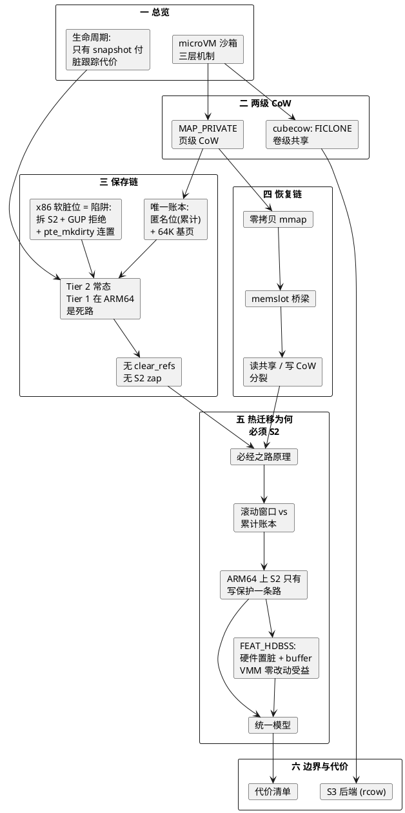
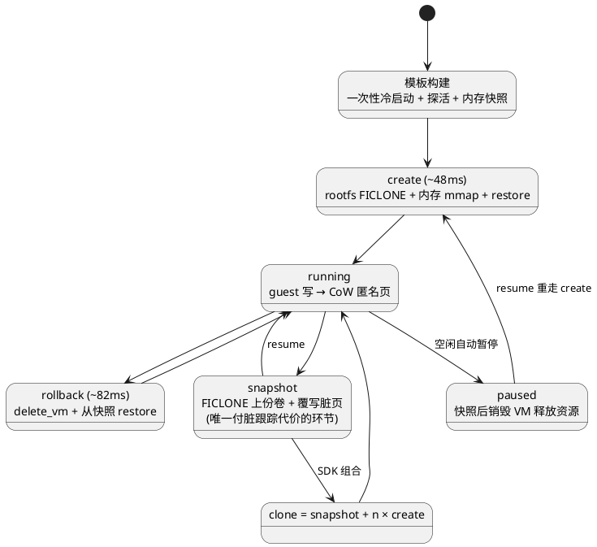
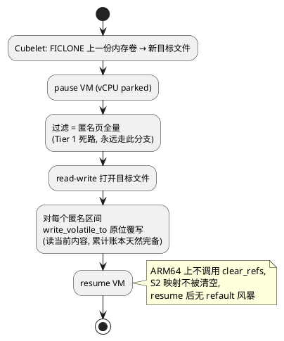
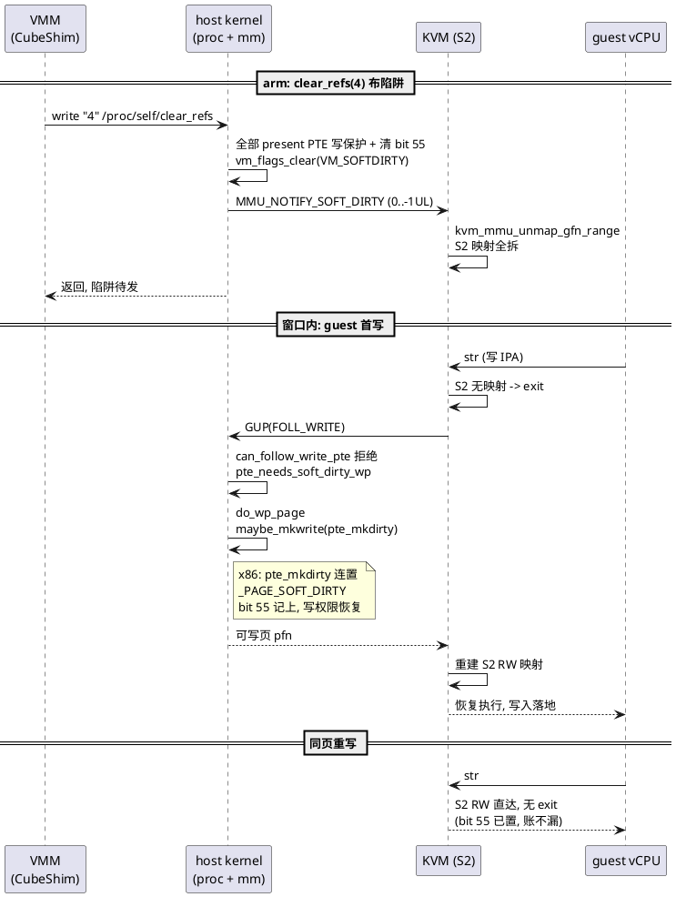
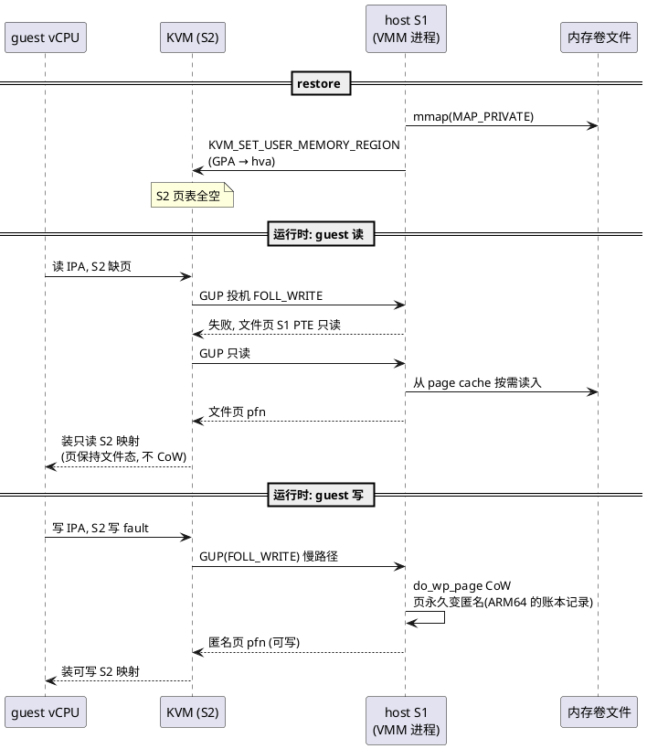

CubeSandbox 是腾讯云开源的 AI Agent 沙箱服务，基于 RustVMM 和 KVM，每个沙箱一台 MicroVM（微型虚拟机），兼容 E2B SDK，官方 x86 裸机基准下冷启动平均 48ms。它最核心的能力是把一台运行中的虚拟机连同内存与文件系统打成快照，再从快照克隆出任意多份沙箱。

支撑这套能力的存储机制分两级：

- **卷级**用 FICLONE（文件级 reflink 克隆 ioctl）实现 O(1) 快照
- **页级**用 MAP_PRIVATE（私有文件映射）的写时复制（Copy-on-Write，CoW）沉淀内存脏页

在 ARM64 上，整套脏页跟踪只有"匿名页"这一本被动账本，S2 从头到尾只当通道，而虚拟机热迁移的脏页跟踪全部建在 S2 上。这个分野不是工程偏好，是两种场景对脏账本的语义要求不同。

> **源码基线**: CubeSandbox 开源仓库（Apache 2.0），Linux v7.3-rc1，全部行为以 arm64 视角分析
>
> **视角约定**: **host S1** 指宿主机上 VMM 进程自己的页表。**S2** 指 KVM 管理的 stage-2 翻译表，ARM64 上由 VTCR_EL2 描述。guest 的 S1 藏在 guest 内存里，host 不可见，本文不涉及。基准数字为官方 x86 实测，ARM64 无公开数据，仅作量级参考

## 0. 全文知识地图

**图0**: 全文知识地图



## 一、microVM 沙箱快速启动：模板预快照 + FICLONE + MAP_PRIVATE

集群分控制面与数据面：

- **控制面**：CubeAPI 与 CubeMaster 无状态，靠 Redis 协调调度
- **数据面**：每个节点跑 Cubelet（节点代理）、CubeShim（containerd shim v2 接口）、CubeHypervisor（Cloud Hypervisor fork 出来的 VMM）

沙箱就是这个 VMM 管理的一台 KVM 虚拟机，自带独立 guest 内核，硬件级隔离。

**图1**: 沙箱生命周期，只有 snapshot 一个环节付脏跟踪代价



快从哪里来？拆开是三层：

- **模板预快照**。模板构建期真实冷启动一次 VM，探活后把内存快照、rootfs、设备状态全部落盘。之后所有 create 都是 restore，不再走 boot。VM 里进程早已在跑，模板探活过的端口 create 返回即可用
- **卷级 FICLONE**。create 时 rootfs 用一次 FICLONE 从模板克隆，O(extents) 元数据操作，与卷大小无关
- **页级 MAP_PRIVATE**。内存连 FICLONE 都不用，VMM 直接把模板的内存卷文件 mmap 成 MAP_PRIVATE，页按需从 page cache fault in。多沙箱共享同一份物理页，x86 基准下 1000 台沙箱摊薄后每台约 25MB

官方基准（x86 裸金属与 PVM 虚机，2 vCPU / 2 GiB 规格）：

| 操作 | 延迟 |
|---|---|
| 冷启动 create | 平均 47.8ms（PVM 虚机 66.7ms） |
| 快照（7MB 脏页） | 约 50ms，每 100MB 脏页约加 40ms |
| 回滚 | 81.6ms，摊销 26.6ms |
| 克隆 | 单次 219.6ms，c=50 摊销 5.4ms |
| pause（2GiB，full-copy 模式） | 558ms，soft-dirty 模式预期降到约 60ms |

create-from-snapshot 的耗时与脏页多少无关，0MB 到 1024MB 脏页基本持平，因为 restore 是 O(元数据) 而不是 O(内存)。第二章展开两级 CoW 怎么做到这一点。

## 二、两级 CoW：卷级 FICLONE 共享未写数据，页级 MAP_PRIVATE 沉淀脏状态

### 2.1 cubecow：一个 ioctl 完成的快照

Cubelet 通过 cubecow 引擎管理所有卷。引擎注释里写明了选型理由，dm-thin 与 reflink 文件系统都能给 O(1) 快照，差别在代价：

- **dm-thin**（块层）：要付出 ioctl 编排、per-pool 账本和复杂的崩溃恢复面
- **reflink 文件系统**（文件层，xfs 挂 `-m reflink=1` 或 Btrfs）：每个操作都是单个文件系统事务

对"大量短生命周期克隆大镜像"的沙箱负载，后者胜出。核心调用就一个 ioctl：

```rust
/* CubeSandbox/cubecow/src/engine/reflink.rs */
fn ficlone(src: &File, dst_path: &Path) -> Result<(), i32> {
    let dst = OpenOptions::new().write(true).create_new(true).open(dst_path)
        .map_err(|e| e.raw_os_error().unwrap_or(libc::EIO))?;
    // FICLONE = _IOW(0x94, 9, int) = 0x40049409
    let rc = unsafe { libc::ioctl(dst.as_raw_fd(), FICLONE, src.as_raw_fd()) };
    if rc != 0 {
        // ...
        let _ = std::fs::remove_file(dst_path);
        return Err(errno);
    }
    Ok(())
}
```

内核处理 FICLONE 时让目标文件与源共享全部数据 extent（盘上物理块），只复制元数据。之后对任一文件的写入由 XFS reflink 写时复制自动断链，分配新 extent。快照成本只与 extent 数量有关，与卷大小无关。

**图2**: 卷布局与内存卷链

```
<root>/volumes/
  +-- tpl-xxx/                     <- ultimate origin volume dir
  |     +-- tpl-xxx                <- template rootfs main file (FICLONE source)
  |     +-- sb-1-rootfs-gen0       <- FICLONE(tpl-xxx)  sandbox 1 private rootfs
  |     +-- snap-A                 <- FICLONE(any file) a snapshot
  |     `-- snap-B                 <- FICLONE(snap-A)   flattened into tpl-xxx/

memory volume chain across snapshots:

  vol_N --FICLONE--> vol_N+1 --FICLONE--> vol_N+2
                        ^                     ^
                        | overwrite dirty     | overwrite dirty
                        | pages in-place      | pages in-place
                  (untouched pages stay extent-shared with vol_N)
```

盘上布局采用平铺模型，卷与快照共享一个全局命名空间，每个快照都是独立文件，放在它"终极源卷"的目录下，快照的快照也被拍平到终极源目录。由此带来两个性质：

- **删除安全**。删一个快照就是一次 unlink，不影响任何其他快照的 extent
- **零账本**。引擎不维护盘上账本，卷列表来自 readdir，大小来自 stat，创建时间来自 mtime，启动时扫一遍目录重建内存索引，顺手清掉崩溃残留（空目录、零字节的 FICLONE 半成品）

布局即账本，崩溃恢复面接近于零。

### 2.2 rootfs 与内存卷的不同待遇

同样是"从模板克隆"，rootfs 和内存卷走两条路：

- rootfs 以 virtio-blk 块设备暴露给 guest，VMM 用读写方式打开文件直接写。源文件不能被写，所以必须 FICLONE 出独立 inode，靠 reflink 断链隔离写
- 内存卷是 VMM 自己 mmap 的对象。MAP_PRIVATE 语义保证源文件永远不会被写，guest 的写全部落在 CoW 出的匿名页上，所以 create 时直接共享模板内存卷文件本身，连 FICLONE 都省了。XFS 文件支持 unlink 后继续被已打开的 fd 使用，模板文件被删也不影响活着的沙箱

这个差异在 S3 后端会反转，见第六节。

### 2.3 MAP_PRIVATE 的双重角色

MAP_PRIVATE 在生命周期两端各当一次加速器。对 VMM 地址空间里的每一页：

**图3**: 页的两态，读共享与写 CoW

```
        VMM process address space (host S1)
        MAP_PRIVATE mmap of memory volume file

   guest READS page              guest WRITES page (first time)
         |                                |
         v                                v
  +--------------+   S1 write fault   +--------------+
  | file-backed  | ---------------->  |     anon     |
  +--------------+   do_wp_page CoW   +--------------+
  | content ==   |                    | content ==   |
  | volume file  |                    | current guest|
  | extent       |                    | data         |
  | (shared by   |                    | (one-way,    |
  |  all sandboxes                     |  accumulates|
  |  via page    |                    |  since       |
  |  cache)      |                    |  restore)    |
  +--------------+                    +--------------+
   restore accelerator                 dirty ledger
```

读端，文件页与内存卷 extent 共享，多沙箱共享 page cache，这是恢复加速器。写端，CoW 单向不可逆，页一旦变成匿名页就回不去，匿名页集合恰好等于"自恢复以来被 guest 写过的页"，这是一本零成本的累计脏账本。第三章的保存链和第四章的恢复链都建立在这同一个语义上。

## 三、快照保存：ARM64 上只有一本累计账本

### 3.1 唯一的账本：匿名位

保存链要回答的问题是，快照时刻哪些页被写过了。CubeSandbox 不设任何写保护，答案从被动信号里读。

VMM 读自己的 `/proc/self/pagemap` 拿到每页的 PFN（Page Frame Number，物理帧号），再查 `/proc/kpageflags` 的 KPF_ANON 位。MAP_PRIVATE 语义保证匿名等价于"写过"，这本账自 mmap 时刻起累计，单向不可逆，数学上完备。设计上还有第二本账（软脏位，x86 专属的窗口账，3.3 节展开），但 ARM64 上它根本不存在，能用的只有匿名这一本。

这个标记是谁写进去的？guest 一次写要触发 stage-2 缺页，KVM 用 GUP（get_user_pages，用户页获取）去 host S1 拿物理页，首写就在这条链上留下痕迹：

```c
[guest]   str x0, [x1]                          // 首次写一个页
  +-> [KVM] stage-2 translation fault           // IPA 翻译缺页
    +-> kvm_handle_guest_abort()                /* arch/arm64/kvm/mmu.c */
      +-> user_mem_abort()
        +-> kvm_s2_fault_pin_pfn()
          +-> __kvm_faultin_pfn(slot, gfn, FOLL_WRITE)   /* virt/kvm/kvm_main.c */
            +-> kvm_follow_pfn()
              +-> hva_to_pfn()
                +-> hva_to_pfn_fast()
                  +-> pin_user_pages_fast(FOLL_WRITE)    // 文件页 S1 PTE 只读, 快路径失败
                +-> hva_to_pfn_slow()
                  +-> get_user_pages_unlocked(FOLL_WRITE)
                    +-> faultin_page()
                      +-> handle_mm_fault(FAULT_FLAG_WRITE)
                        +-> do_wp_page()        // MAP_PRIVATE 的 CoW, 页从此永久匿名
```

这条链从 `user_mem_abort` 往下全部是 KVM 公共代码与 mm 公共代码，ARM64 与 x86 在此汇合。stage-2 缺页与权限位的处理细节，具体逻辑可以参考[这里](/2026/09/05/虚拟化-读写权限相关源码详解/)。CoW 安装新 PTE 的瞬间，页从文件态变成匿名态，这就是 ARM64 上唯一的账本记录。

此后该页对 GUP 快路径就是"可写匿名页"，重写它不再触发任何 host S1 故障，因为硬件写一个已可写的 PTE 不走内核。累计账本不关心这个（页已在账上，快照时读当前内容即可），但窗口账本做不出来，根源就在这里，第五章会回到这一点。

ARM64 还有一个影响账本粒度的细节，**64KiB 基页**。ARM64 内核可配置 64K 基页，pagemap 与 kpageflags 都按内核真实页大小索引，CubeSandbox 的 `host_page_size()` 从 sysconf 探测并贯穿全部偏移计算，其注释明确警告"硬编码 4096 会在 64K 内核上错位索引并静默损坏快照"。64K 页下扫描项数减少 16 倍，但 CoW 与账本粒度同步变粗（一个 64K 页内任何写入都整页记账）。

### 3.2 保存链

快照前 Cubelet 先把上一份内存卷 FICLONE 成新目标文件，再让 CubeShim 经 chapi socket 依次调 `/vm.pause`、`/vm.snapshot`、`/vm.resume`。ARM64 上 VMM 内部的实际路径（Tier 1 请求退化为匿名全量的过程见 3.3）：

```c
[Cubelet]  prepareCommitMemoryArtifact()        /* services/cubebox/snapshot_base_memory.go */
  +-> [cubecow] CreateSnapshotFromVolume()      // FICLONE 上一份内存卷 -> 新目标文件
    +-> ficlone(src, dst)                       /* engine/reflink.rs */

[hypervisor] Vmm::vm_snapshot()                 /* vmm/src/lib.rs */
  +-> Vm::snapshot()                            // VM 必须已 Paused, 运行中直接拒绝
    +-> cpu_manager/device_manager 状态序列化进 state.json
  +-> MemoryManager::send()                     /* vmm/src/memory_manager.rs */
    +-> send_soft_dirty_memory()                // Cubelet 请求的 Tier 1
      +-> send_pagemap_anon_memory()            // ARM64: "未武装"分支, 每次都退化到这里
        +-> filter_memory_ranges_by_pagemap_anon()   /* pagemap_anon.rs */
          +-> get_anon_pages()                  // pagemap 取 PFN, kpageflags 查 KPF_ANON
        +-> save_range_to_file()
          +-> write_volatile_to()               // 从 VMM 自己的 MAP_PRIVATE 视图读出
      +-> probe_soft_dirty_support()            // ARM64: bit55 永不置位, 永远返回 false
```

`save_range_to_file` 的读侧就是 VMM 自己的 MAP_PRIVATE 视图，把匿名页的**当前内容**（CoW 副本）写进目标文件的对应偏移。这一点是累计账本完备性的关键：

- 重写过的页虽然不再触发任何故障，但快照时读的是它的最新内容，全量匿名集每轮重写，所以不漏
- FICLONE 已经让未写页在 extent 层与上一份共享，两步合起来，快照成本是 O(匿名页数)

目标文件以 read-write 方式打开后**原位覆写**，不写新文件。这要求目标文件必须先存在，所以 Cubelet 必须先 FICLONE 出基座再触发快照。

**图4**: ARM64 上的保存流程



### 3.3 Tier 1 的软脏位：一场设计好的陷阱

设计上的三级降级是：

- **Tier 1**，FICLONE 上一份快照 + soft-dirty 增量。真正的窗口增量，只写两次快照之间变化过的页
- **Tier 2**，FICLONE 最后一次 restore 的基 + 匿名页全量。匿名集合相对恢复基精确，稳妥兜底
- **Tier 3**，空文件 + 全量 dump。首次快照

Tier 1 的启用条件是软脏位（soft-dirty）可用。pagemap 每项的 bit 55 在页被写入时置位，写 `"4"` 到 `/proc/self/clear_refs` 可以整体清零，清零之后的置位只反映"本窗口内写过的页"，这是一本可以任意开窗口的增量账。Tier 1 取"匿名 且 软脏"的交集，交集里的匿名位是为了排除 VMM 进程自己写文件页的噪声。

这本窗口账有一个绕不开的问题：guest 的写走 guest S1 加 S2 两级翻译，host S1 只在 KVM 服务 S2 缺页时经 GUP 被顺路访问（3.1 的栈就是这条顺路），软脏位又不是硬件维护的位，那它是怎么记上 guest 的写的？答案是它不记，它堵。软脏位的工作模型是一场设计好的陷阱，全部机关在 clear_refs 一次调用里布下：

```c
/* linux/fs/proc/task_mmu.c */
[VMM]  write "4" -> /proc/self/clear_refs
  +-> clear_refs_write()
    +-> vm_flags_clear(vma, VM_SOFTDIRTY)       // VMA 武装: vma_soft_dirty_enabled() 从此为真
    +-> vma_set_page_prot(vma)                  // vm_page_prot 换成写保护版, 新 fault 的页也带机关
    +-> mmu_notifier_invalidate_range_start()   // MMU_NOTIFY_SOFT_DIRTY, 范围 0..-1UL 全地址空间
    +-> walk_page_range()
      +-> clear_soft_dirty(vma, addr, pte)
        +-> pte_wrprotect(ptent)                // 每个 present PTE: 写保护
        +-> pte_clear_soft_dirty(ptent)         // 且清 bit 55
    +-> flush_tlb_mm(mm)
```

对 KVM 这台 secondary MMU，`MMU_NOTIFY_SOFT_DIRTY` 是一次全范围失效事件，`kvm_mmu_notifier_invalidate_range_start` 的响应是把覆盖到的 S2 映射全部拆掉（`kvm_mmu_unmap_gfn_range`）。S2 一空，guest 的写再无直达通路，陷阱进入待发状态。窗口内 guest 首写一个页，走的还是 3.1 那条 exit 链，但 GUP 在 host S1 门口被拦下：

```c
/* 承接 3.1 的栈: guest 首写 -> S2 缺页 -> exit -> user_mem_abort */
[KVM]  __kvm_faultin_pfn(slot, gfn, FOLL_WRITE)   /* virt/kvm/kvm_main.c */
  +-> get_user_pages(FOLL_WRITE)
    +-> can_follow_write_pte()                    /* mm/gup.c */
      // PTE 已被写保护, pte_write() 为假
      // pte_needs_soft_dirty_wp(vma, pte) 为真 -> 拒绝 follow, 强制走 host S1 写 fault
    +-> handle_mm_fault(FAULT_FLAG_WRITE)
      +-> do_wp_page()                            /* mm/memory.c */
        // 文件页走 wp_page_copy (CoW), 已匿名页走 wp_page_reuse, 收尾相同:
        +-> maybe_mkwrite(pte_mkdirty(entry), vma)
          /* x86 的 pte_mkdirty 无条件同时置 _PAGE_DIRTY 与 _PAGE_SOFT_DIRTY
             (arch/x86/include/asm/pgtable.h), bit 55 在此刻记上, 写权限恢复 */
[KVM]  拿到可写页 -> 重建 S2 RW 映射 -> vCPU 恢复 -> 写入落地
```

**图5**: 软脏位的陷阱闭环：武装、捕获、免捕获重写



三个环节合起来，窗口是完备的：

- **武装即写保护**。窗口内所有 present PTE 只读，VMA 标志保证此后新 fault 的页同样带机关，没有可写 PTE 漏网
- **捕获即记录**。GUP 的 `can_follow_write_pte` 对写保护 PTE 检查 `pte_needs_soft_dirty_wp`，拒绝放行强制 fault，而 fault 收尾的 `pte_mkdirty` 在 x86 上无条件连置软脏位
- **重写免捕获**。同页第二次写走已重建的 S2 RW 映射直达，位已置，账不漏

所以 x86 软脏位是完备的开窗账本，单写代价是每首写一次 exit 加一次 host fault，与 S2 写保护的 dirty logging 同构，还多穿一层 host fault。clear_refs 时刻另有两笔一次性账：mmap_lock 写锁下的全 PTE 遍历（多 GiB 进程上百 ms），以及 S2 全拆后的 refault 风暴（后果第二条展开）。

ARM64 上这套机制整体不存在，判定发生在首次快照时的 probe：

```rust
/* CubeSandbox/hypervisor/vmm/src/soft_dirty.rs */
pub fn probe_soft_dirty_support() -> bool {
    let page_size = host_page_size();
    // Step 1: mmap 一个 MAP_PRIVATE|MAP_ANONYMOUS 的临时页
    let scratch = GuestMemoryMmap::from_ranges(&[(GuestAddress(0), page_size as usize)])?;
    // Step 2: 写一个字节, 首写强制安装真实 PTE
    scratch.write(&[0xabu8], GuestAddress(0))?;
    // Step 3: 读 pagemap 检查 bit 55
    let bit55_set = get_soft_dirty_pages(host_addr, page_size)...;
    if !bit55_set {
        // "kernel lacks CONFIG_MEM_SOFT_DIRTY (e.g. ARM64 ...)"
        return false;
    }
    // Step 4: 只有成功才调用一次 clear_refs 武装跟踪
    // ...
}
```

probe 失败的根源在内核配置链。`CONFIG_MEM_SOFT_DIRTY` 依赖 `HAVE_ARCH_SOFT_DIRTY`（mm/Kconfig），x86、s390 与 powerpc BOOK3S_64 在各自 Kconfig 里 select 它（riscv 也有对应扩展），ARM64 不在其列，软脏位编不进内核，pagemap 的 bit 55 在 ARM64 上永不置位。probe 的失败注释里直接点名了 ARM64。

三个后果：

- **增量退化为 Tier 2 常态**。每次快照把全部匿名页重写一遍。读的是当前内容所以完备，但快照 I/O 随匿名页集合单调增长，不因为"这两次快照之间没多少新脏页"而变快。长生命周期沙箱反复快照，每轮成本都是全量
- **不调用 clear_refs**。probe 失败路径连一次 clear_refs 都不发（真实实现是 mmap、写、读 pagemap 的往返探测，而非代码注释里说的"写 clear_refs 看 EINVAL"，注释已过时）。这顺带避开了上面陷阱链的固有代价：clear_refs 的 MMU_NOTIFY_SOFT_DIRTY 会把整个进程范围的 S2 映射全部作废（KVM 对任何失效事件都要 zap，否则映射指向已变更的目标，S2 映射替换的语义可以参考[这里](/2026/09/01/ARM64-BBML源码分析-BBML0-BBML3/)），resume 后 guest 工作集要逐页重新 fault 进 S2，一页一次 vmexit
- **host S1 上的开窗手段为零**。x86 的软脏位是完备的开窗账本（机关与单写代价见上文陷阱链），ARM64 连它都没有。累计账本是 host S1 被动状态的全部，这是第五章论证的起点

### 3.4 验证 Tier 1 死路与 Tier 2 完备性

两个可直接操作的实验（ARM64 host）：

- **观察死路**。对同一沙箱连续做两次快照，VMM 日志两轮都应出现 `PagemapAnon snapshot: ... anon=...`（send_pagemap_anon_memory 的 info 日志），且第二轮 anon 页数不小于第一轮（累计语义，只增不减），全程没有 `Soft-dirty snapshot (anon ∩ soft-dirty)` 字样。debug 日志里还能看到 probe 失败的 `bit 55 never flipped`
- **验证 Tier 2 回滚正确性**。创建沙箱，guest 写文件 F 为 V1，快照 S1；guest 把 F 原地覆写为 V2（同尺寸确保同页），快照 S2；回滚到 S2，读 F。预期读到 V2。累计账本轮轮全量重读当前内容，重写页不会漏（基于代码推演，此实验即证伪路径）

## 四、快照恢复：零拷贝 mmap 加上 stage-2 按需重建

### 4.1 恢复时什么都不读

```c
[CubeShim] start_vm()                           /* shim/src/sandbox/sb.rs */
  +-> by_snapshot() 判定为快照恢复, 不走 boot
    +-> restore_vm()
      +-> [hypervisor] Vmm::vm_restore()        /* vmm/src/lib.rs */
        +-> recv_vm_config / recv_vm_state()    // 读 config.json / state.json
        +-> Vm::new_from_snapshot()
          +-> MemoryManager::new_from_snapshot()   /* vmm/src/memory_manager.rs */
            +-> support_fast_restore_check()    // 无共享内存且无热插拔时走快路径
            +-> open_read(memory_volume)        // 只读打开, 不读内容
            +-> restore_memory_regions_and_zones()
              +-> create_ram_region()
                +-> mmap(PROT_READ|PROT_WRITE, MAP_NORESERVE|MAP_PRIVATE)
                  // fd = 内存卷文件, offset = 该 region 在顺序布局中的偏移
        +-> vm.restore(snapshot)                // ARM64: KVM_SET_ONE_REG 逐个恢复
                                                // 约五百个核心/系统寄存器, 重建 vGIC
        +-> vm.resume()
```

fast path 判定条件是"没有共享内存区且没有 virtio-mem 热插拔"，满足时内存一个字节都不拷贝，mmap 完直接返回。慢路径（`fill_saved_regions`，逐段 `read_volatile_from` 拷贝）只在共享或热插拔场景出现。

ARM64 特有的恢复细节有两个：

- vCPU 状态从保存的 `KVM_GET_REG_LIST` 逐寄存器恢复（栈中 `KVM_SET_ONE_REG` 一行，约五百个核心/系统寄存器）
- GICv3-ITS 中断控制器整体重建，另外 aarch64 的 UEFI flash 占用 GPA 0 起始的保留区

mmap 完成时 VMM 地址空间里没有任何一个页被实际映射，纯 demand paging 基座。恢复快就是快在"什么都不做"，把全部工作推迟给运行时的缺页。

### 4.2 memslot：host S1 与 S2 的桥梁

VMM 随后在 `allocate_address_space` 里把每个 region 注册给 KVM：

```c
[hypervisor] MemoryManager::allocate_address_space()   /* vmm/src/memory_manager.rs */
  +-> create_userspace_mapping()
    +-> make_user_memory_region(slot, guest_phys_addr, memory_size, userspace_addr, ...)
    +-> create_user_memory_region()
      +-> KVM_SET_USER_MEMORY_REGION     // 告诉 KVM: GPA 区间 -> hva 区间的换算规则
```

此刻 KVM 知道的只是"GPA 映射到哪个 host 虚拟地址"，S2 页表仍然全空。memslot（内存槽位）是 S1 与 S2 之间唯一的桥梁，真正的翻译要等 guest 访问触发。

### 4.3 运行时：读共享与写 CoW 的分裂

**图6**: 恢复后的两种缺页路径



guest 读一个从未碰过的页，S2 缺页，KVM 先投机地用 FOLL_WRITE 走 GUP 快路径（`hva_to_pfn_fast`，virt/kvm/kvm_main.c）。文件页的 S1 PTE 只读，快路径失败，退回只读 GUP，host S1 以只读方式把页从 page cache 映射进来，S2 装只读映射。这一步**不发生 CoW**，页保持文件态，与内存卷 extent 共享。

guest 写这个页，S2 写 fault，GUP 带 FOLL_WRITE 走慢路径，`do_wp_page` 完成 3.1 展示过的 CoW，S2 换装可写映射。

至此闭环。读路径保持共享，多沙箱 page cache 摊薄。写路径 CoW 出匿名页并留下账本记录，作为下一轮快照的原料。S2 不是被"重建"的，是被 guest 访问一页一页 fault 出来的，而每次 fault 都顺路穿过 host S1。恢复机制与标脏机制共用同一个 MAP_PRIVATE 语义，这是整套设计最精巧的地方。

## 五、热迁移为什么必须跟踪 S2 脏页

前四章的机制全部建立在 host S1 上，S2 只当通道。那为什么虚拟机热迁移从来都是跟踪 S2？因为**脏账本必须建在写的必经之路上**，两种场景的必经之路不同。

### 5.1 guest 的写不经过 host S1

**图7**: guest 一次写的完整翻译链

```
        guest virtual addr (guest VA)
                |
                v
        +--------------------+
        |     guest S1       |   guest's own page tables,
        |  (TTBR0/1_EL1)     |   live inside guest memory,
        +--------------------+   invisible to host
                |
                v
          guest IPA (= gPA)
                |
                v
        +--------------------+
        |   S2 (KVM)         |   every guest access MUST pass here.
        |  (VTCR_EL2)        |   the only complete observation
        +--------------------+   point on the host side
                |
                v
             host PA

   note: host S1 (VMM process page tables) is NOT on this
   path. it is only touched when KVM services a stage-2
   fault via GUP, and only leaves a trace when the fault
   resolves through a CoW.
```

S2 映射建好之后，guest 的写直达物理页，host S1 页表根本不被遍历。两个推论：

- S2 是 host 侧唯一**完备**的观测点，guest 每次访存必经
- host S1 只在 S2 缺页时被顺路访问（GUP），且只对"需要 CoW 的页"留下痕迹，且这个痕迹是累计的、无法清零

CubeSandbox 的被动账本能工作，靠的是把内存摆成 MAP_PRIVATE，让"写过"恰好等价于"CoW 过"。这是一个特例，成立条件是账本只需要累计语义，下一节展开。

### 5.2 热迁移的三个硬约束

**图8**: 两种时间模型

```
live migration (VM never stops):

  VM:   WWWWWWWWWWWWWWWWWWWWWWWWWWWWWWWWWWWWWWWWWWWWpp
        |<------ round 1 ------>|<---- round 2 ----->|^
        copy all pages          copy dirty since       final: copy last
                                round 1 (VM keeps     dirty pages, then
                                writing)              cutover (~ms pause)

CubeSandbox snapshot on ARM64 (stop-the-world):

  VM:   WWWWWWWWWWWWWWWWWWWppppppppWWWWWWWWWWWW...
        |<---- running ---->|<-pause->|<-resumed, no refault storm
                            snapshot   (S2 mappings survive,
                            window:    clear_refs is never called
                            anon filter
                            + write all
                            dirty pages
```

热迁移要求 VM 全程不停（或只有毫秒级停顿），目标端最终拿到源端内存的逐位一致的最新状态。这带来三个硬约束：

- **滚动窗口**。迁移分轮迭代，第一轮全量拷贝，后续轮只拷上一轮以来的脏页，脏页率收敛到能被最后一个小停顿吃完才切流量。账本必须支持任意开窗，每轮清零重记
- **完备性**。漏一页脏页，目标端就是旧数据，静默损坏，没有"大概率对"的余地
- **记账单位是 GFN**（Guest Frame Number，客户机物理帧号）。迁移协议以 guest 物理帧为单位传输和填充，账本天然按 GPA 索引

对照 CubeSandbox，三个约束全部不存在：

- 快照在 stop-the-world 的暂停点上进行，vCPU 全停，取一次"自恢复以来写过的页"就够，**累计账本**足矣
- 快照基底本来就是文件，按 hva 偏移写入即可，不需要按 GFN 记账
- 完备性由 CoW 语义免费保证

还有一个隐含的分别，在消费端：

- 热迁移的消费端是另一个 QEMU/VMM 进程的普通内存，普通内存的写入语义不提供任何账本
- 快照的消费端是一个会被 MAP_PRIVATE mmap 的文件，这个映射的写入语义本身就是账本

### 5.3 为什么热迁移不直接跟踪 host S1

host S1 有两类可用的脏跟踪手段，在 ARM64 上分别算一下账。

**被动状态**。唯一免费存在的是匿名位，只有累计语义，账本自 mmap 起单调增长，无法清零，做不出滚动窗口。x86 的软脏位名义上是被动位，实际上武装即写保护、捕获经陷阱（3.3 的链路），窗口完备，但单写代价回到每首写一次 exit 加 host fault，与 S2 写保护同构——它不是免费的被动状态，是把写保护搬到了 S1 还多穿一层 fault。真正卡死它的工程约束在权限：pagemap 读 PFN 与 kpageflags 都要求 CAP_SYS_ADMIN，容器化部署的 VMM 通常拿不到。

ARM64 连软脏位都没有，被动状态就只剩累计这一本账。

**主动写保护**（UFFDIO_WRITEPROTECT）。userfaultfd 的写保护模式把 host S1 的页变只读（ARM64 页表有专门的 PTE_UFFD 软件位），写触发 fault 汇聚到 VMM 的用户态处理线程，写保护同时经 mmu notifier 把 S2 一并写保护，所以观测是完备的，每写必被捕获。QEMU 的后台快照（background snapshot）走的就是这条路。

但它的单写开销是一次 fault 加一次用户态陷落，这正是脏跟踪机制想消灭的开销。给热迁移迭代用，等于退化回写保护路线还更贵，所以它只服务异步场景，用 fault 开销换不暂停。

反过来，S2 上的脏日志满足全部三个约束，ARM64 上的实现是纯写保护。开启 `KVM_MEM_LOG_DIRTY_PAGES` 后，内核把选中页的 stage-2 PTE 装成只读（`kvm_arch_mmu_enable_log_dirty_pt_masked`，arch/arm64/kvm/mmu.c），guest 首写触发 permission fault，`user_mem_abort` 在安装可写映射的尾部调用 `mark_page_dirty_in_slot` 记位图，代价是每个首写一次陷入。

往下一层是硬件。x86 有 PML（Page Modification Logging，页修改日志）把这笔账记进硬件日志免 fault。ARM 侧的对应物是 Armv9.5 的 FEAT_HDBSS（Hardware Dirty State tracking Structure，硬件脏状态跟踪结构）：stage-2 PTE 把写权限挪进 DBM 位（bit 51）、脏状态留在 S2AP[1]，VTCR_EL2 置起 HD|HA|HDBSS 后，硬件写"可写-干净"页时自动置脏，把脏页 IPA 追加进 per-vCPU 的内存 buffer，vCPU 退出 guest 时一次性 flush 进 KVM 位图，全程无 exit。基于 v7.3-rc2 的十二补丁系列把开关做成了纯函数派生（`kvm_arch_update_hw_dirty_mode`：只要有 memslot 在 logging 且硬件支持就置 HDBSS，否则退回写保护），VMM 只要还在用 `KVM_MEM_LOG_DIRTY_PAGES` 加 `KVM_GET_DIRTY_LOG` 这对老 ABI，就零改动拿到硬件加速。ARM 热迁移相对 x86 的主要差距点，正在被这块补上。

### 5.4 统一模型

把观测点（S2 还是 host S1）和账本语义（累计还是开窗）抽成两个维度，加上完备性与单写开销，五种方案在 ARM64 上各有其位：

| 方案 | 观测点 | 写是否必经观测点 | 账本语义 | 单写开销 | ARM64 现状 |
|---|---|---|---|---|---|
| 写保护加 fault | S2 | 每写必经 | 任意开窗 | 每首写一次陷入 | **唯一量产选项** |
| 硬件脏位 | S2 | 每写必经 | 任意开窗 | 零 fault | x86 有 PML，ARM 补齐方向 |
| CoW 匿名位 | host S1 | 仅首写 | 累计（自恢复起） | 零 fault | CubeSandbox 在用（Tier 2） |
| UFFDIO_WRITEPROTECT | host S1 | 每写必经 | 任意开窗 | 每写一次 fault 到用户态 | 内核机制可用 |
| 软脏位 | host S1 | 武装窗口内每首写必经（陷阱） | 开窗（clear_refs） | 每首写一次 exit + host fault | x86 有，ARM64 **不存在** |

这张表也解释了一个普遍现象，每个写 guest 内存的入口都需要自己的账本：

- vCPU 的写记在 S2
- vhost 内核线程的写记在 vhost 的 log base
- VMM 进程自己模拟设备写 guest 内存的写记在用户态位图

CubeSandbox 休眠的 KVM 脏日志路径把 KVM 位图与 vm-memory 用户态位图做 OR 再落盘，就是在合并 vCPU 与 VMM 两类写入口的账本。这份"冗余"本身就是必经之路原理的体现。

### 5.5 两个产品答案：账本建在哪层，就吃哪层的红利

统一模型落到开源产品里正好有一对现成对照。同为 stop-the-world 快照、同为目标端可 mmap 的文件，CubeSandbox 把账本建在 host S1，AgentENV（kvcache-ai 开源的 E2B 兼容沙箱，VMM 用 Firecracker fork）建在 S2：

| | CubeSandbox (Cloud Hypervisor fork) | AgentENV (Firecracker fork) |
|---|---|---|
| 标脏层 | host S1（VMM 进程页表） | S2（KVM dirty logging） |
| 脏信息载体 | 匿名位（Tier 2）/ bit 55 + kpageflags（Tier 1） | KVM slot 位图（硬件 EPT/DBM 维护） |
| 运行期开销 | Tier 2 零（被动账本）；x86 Tier 1 每首写一次 exit + host fault | 每首写一次 fault（HDBSS 后归零） |
| 快照时刻开销 | clear_refs 全 PTE 遍历 + pagemap 逐页扫描 | KVM_GET_DIRTY_LOG 一次位图拷贝 |
| ARM64 现状 | 软脏位不存在，Tier 2 累计账本常态，增量只增不减 | 写保护 dirty logging 完整可用，HDBSS 后零 fault |
| 数据搬运 | VMM 从自己的 MAP_PRIVATE 视图写文件 | AgentENV 用 process_vm_readv 跨进程读 VMM，再打包成增量层 |

两条路线的深浅用 5.1 的必经之路原理一看便知。Cube 建在 S1，靠 MAP_PRIVATE 的 CoW 语义被动记账，ARM64 上这本账只有累计语义；AgentENV 建在 S2，纯 ioctl ABI（`KVM_SET_USER_MEMORY_REGION` 带标脏 flag，收割走 `KVM_GET_DIRTY_LOG`），内核把 S2 的实现从写保护升级成 HDBSS 时，VMM 与编排层零改动受益，而 Cube 根本不碰 KVM 的脏跟踪，这笔硬件红利与它无关。选哪层做账本，就选定了能吃哪层的硬件红利。

## 六、边界与代价

### 6.1 已知代价清单（ARM64）

- Tier 2 常态：每轮快照全量重写匿名页集合，I/O 随匿名集单调增长，与两次快照之间的实际变化量无关
- kpageflags 逐页查询要求 CAP_SYS_ADMIN，pagemap 扫描是 O(总页数)
- 64K 基页下账本粒度变粗，一个 64K 页内的任何写入都整页记账；换来的是扫描项数减少 16 倍
- 增量优化空间为零，改进只能来自内核侧，把观测点移回 S2（见第五章统一模型）

### 6.2 S3 后端：把"一个可 mmap 的文件"换成跨节点的 rcow

CubeSandbox 的卷还有 S3 后端，服务跨节点 pause/resume。cubecow 的 S3 引擎只是控制面代理，真正的存储在 CubeS3lvol，一个 SPDK 模块，把 SPDK lvol 跑在自研的 S3 后端设备上，再经 NVMe-oF 导出给宿主机当本地盘。

rcow（redirect-on-write，重定向写）是它的写路径模型：

- **写**。先进本地 NVMe 上的 WAL（Write-Ahead Log，预写日志），落盘即应答，同时进内存 overlay。后台 flusher 对每个 1MiB chunk 做一次读改写，把新数据 PUT 成一个全新 uuid 的不可变 S3 对象，journal 记录映射变更，然后删旧对象，S3 上没有任何原地更新
- **快照**。只是冻结 lvol 的 cluster map，零数据搬移
- **跨节点导出**。先做一次全量 drain，然后生成一份 manifest（清单，present 位图加 16 字节 uuid 引用表），纯引用不拷贝字节，被引用对象靠快照存活和 lease 续期防删
- **目标节点导入**。建 esnap clone，读操作直接对 manifest 引用做 ranged GET，后台 decouple 再把有数据的 cluster 物化成本地副本

内存卷在 S3 上必须克隆，不能像 XFS 那样直接共享 mmap。XFS 文件 unlink 后 fd 兜底，而 S3 的活盘是 NVMe lvol，停用包快照会把盘从 VM 脚下抽走，所以 resume 前 Cubelet 先 clone 出沙箱私有的内存 lvol。

| | XFS reflink | S3 rcow |
|---|---|---|
| CoW 单位 | extent | 1MiB chunk（不可变 S3 对象）加 1MiB cluster |
| 写路径 | 直接写文件 | NVMe WAL 应答，flusher 异步整 chunk 上传 |
| 快照 | FICLONE | 冻结 cluster map |
| 跨节点 | 不支持 | manifest 引用导出加 esnap 导入 |
| 内存卷恢复 | 直接 mmap 共享文件 | 克隆私有 lvol 再 mmap |
| 典型延迟 | 冷启约 48ms（x86） | 冷启约 430ms，跨节点恢复约 6.5s |

还有几个值得警惕的行为：

- NVMe FLUSH 只保证数据到本地 WAL，不保证到 S3，guest 里的数据库拿到的持久性语义是本地盘级别的
- 忙删的快照对象会被静默泄漏，没有自动重试
- 跨节点恢复要求两节点 cpuid 与内核版本一致，内核升级会让节点悄悄失去恢复资格

### 6.3 收束

无论 XFS 还是 S3，到 hypervisor 层全部收敛成同一个接口，一个可以被 MAP_PRIVATE mmap 的文件。第三章的保存链与第四章的恢复链对所有后端通用，变的只是这个文件底下怎么 CoW、能不能跨节点引用。这也解释了为什么脏跟踪只能建在 host S1，它是唯一在所有后端之上保持不变的层。

而第五章的统一模型说明，这个选择成立的前提是 stop-the-world 加累计账本。ARM64 上 host S1 的被动状态只有匿名位这一本累计账，一旦需求换成不停机的滚动窗口，被动手段为零，观测点必须移回 S2，而在 S2 上等待 ARM64 的目前只有写保护一条路。这正是热迁移与快照两条技术路线分道扬镳的地方，也是 ARM 的硬件脏位机制值得补齐的原因。
